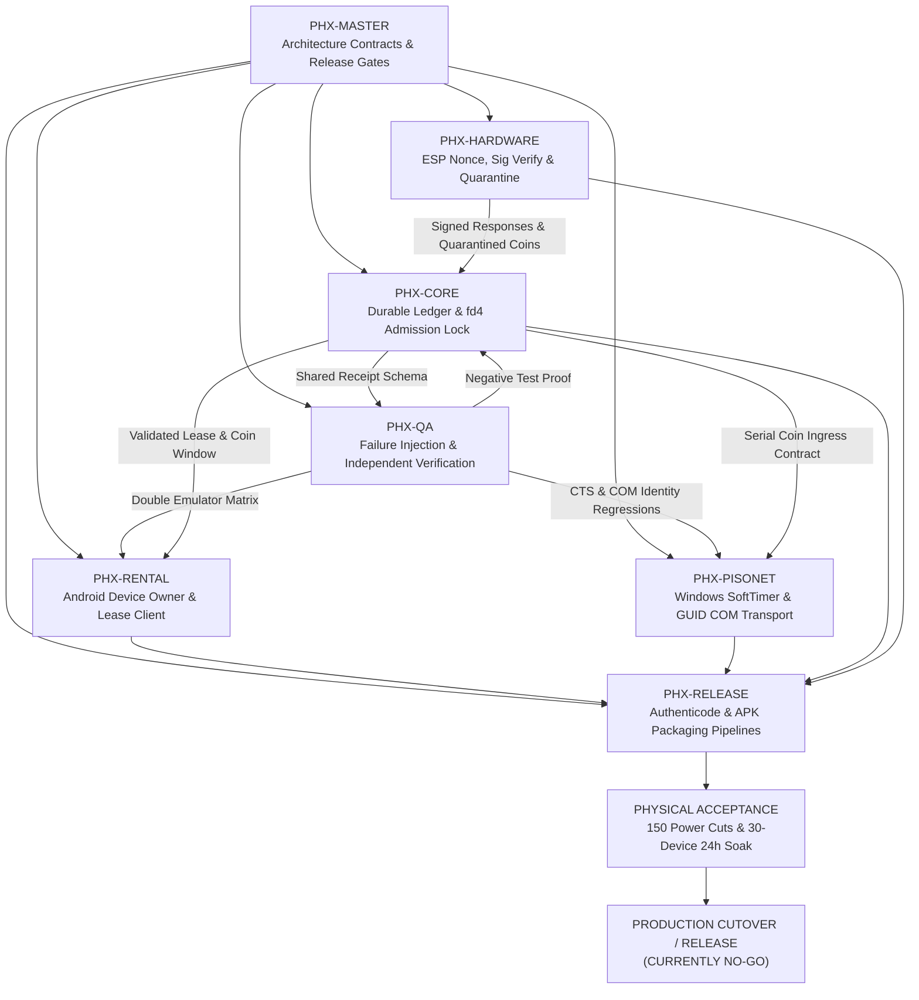

# Project Phoenix — Subsystem Integration Matrix & Gate Hierarchy

**Protocol Specification:** BLAZE-COMMS/1  
**Master Auditor:** `PHX-MASTER`  
**Original matrix date:** 2026-11-13 · **Latest bounded correction:** 2026-11-15  
**Overall Commercial / Production Status:** **STRICT NO-GO**

---

## 1. Subsystem Readiness Matrix

| Subsystem | Owner Role | Code Maturity | Dev Ready | Lab / CI Verified | Hardware Accepted | Production Ready | Active Draft PR / Branch |
|---|---|---|---|---|---|---|---|
| **Coordination & Gates** | PHX-MASTER | In review | **DRAFT** | **PARTIAL** (QA recipient 4/4; full 18-suite **NOT RUN**) | N/A (Governance) | **NO RELEASE AUTHORITY** | [Draft #288](https://github.com/BlazeDevStudio/BlazingSystems-Experiments/pull/288) |
| **Financial Ledger / Vendo** | PHX-CORE | Medium | **YES** | **YES** (Lab/CI) | **NO** (Pending HW) | **NO** (Gate P0) | PR #241, #248, #252 |
| **ESP32/ESP8266 Firmware** | PHX-HARDWARE | Medium | **YES** | **YES** (C++ Mock) | **NO** (No bench log) | **NO** (Gate P0) | PR #283, #254 |
| **Android BlazeRental** | PHX-RENTAL | High | **YES** | **YES** (API27 CI) | **NO** (Physical DO) | **NO** (Lineage lock) | PR #240, #285, #287 |
| **Windows SoftTimer** | PHX-PISONET | High | **YES** | **YES** (CLR/Win CI)| **NO** (Serial bench) | **NO** (AuthSign lock) | PR #238, #255, #268 |
| **QA / Failure Injection** | PHX-QA | High | **YES** | **YES** (20-job CI) | **NO** (Physical rig) | **NO** (Gate P0) | PR #267, #264, #279 |
| **Release / Packaging** | PHX-RELEASE | Medium | **YES** | **YES** (CI smoke) | **NO** (Prod secrets) | **NO** (Authenticode) | PR #242, #217 |

---

## 2. Cross-Subsystem Dependency Flow

---

## 3. Mandatory Integration Gates

Every change affecting money, cryptographic state, or physical actuation must progress sequentially through the following numbered gates:

### Gate 1: Source-Contract Definition & Non-Overlapping PRs
- Changes must reside in a dedicated role branch matching `ROLE_ASSIGNMENTS.md`.
- No single PR may alter both client UI and server accounting scripts.
- Handover ledgers (`PROJECT_HANDOVER.md`, `CURRENT_STATE.md`, `CHANGE_LEDGER.md`) must be synchronized with the commit.

### Gate 2: Lab & CI Verification on Exact SHA
- Source-exact commit must pass all automated linters, static checks (`static.sh`, `config.sh`), and compiler warnings-as-errors.
- Negative tests must be demonstrated: the failure must reproduce (RED) on baseline and resolve (GREEN) on candidate.
- Evidence links must cite exact GitHub Actions run and job IDs.

### Gate 3: Peer & QA Independent Verification
- Financial, cryptographic, and migration changes require independent review by `PHX-QA` and `PHX-MASTER`.
- `PHX-QA` verifies the identical git commit SHA using independent test fixtures without shared mutable state.

### Gate 4: Hardware & Physical Acceptance (P0 Gate #34)
- **150 Real Power-Cut Trials:** Abrupt power termination during active coin insertion and member transfer; journal must recover cleanly with zero corrupt receipts or phantom balance.
- **30-Device 24-Hour Soak:** 30 physical client nodes (mix of Android rental devices and Windows SoftTimer stations) running concurrent sessions under full traffic.
- **Physical Coin Ingress Validation:** Real mechanical coin selectors (multi-coin and single-coin) tested across denominations.

### Gate 5: Production Release Authorization (Master Gate)
- Formal approval by `PHX-MASTER`.
- Verification of authentic production code-signing certificates and anti-rollback witness.
- Final tag and manifest generation.

> [!IMPORTANT]
> **Active Gating Notice:**  
> Gates 1–3 are **incomplete across the combined target**; isolated historical CI results do not validate current stacked commits or the final integration tree. Gates 4 and 5 remain **CLOSED (NO-GO)**. No production release, real-money migration, flashing or customer cutover is authorized without independent acceptance and explicit owner approval.

## 4. Live evidence correction — 2026-11-15 UTC23

The 2026-11-13 table retains **historical, scope-limited worker CI claims**, not universal current-HEAD acceptance. Do not interpret the other subsystem `YES (Lab/CI)` cells as green for COE draft #26 or a future combined merge. Per-PR evidence must be reconciled on the exact proposed integration SHA before upgrading readiness; `NO` in the Production Ready column remains binding.

**Master source-exact distinction:** Independent [PHX-QA draft #292](https://github.com/BlazeDevStudio/BlazingSystems-Experiments/pull/292) recorded `4/4 PASS` on original four recipient tests with the **corrected** verifier Git blob `903df4034f8aa46f66e32de6e0be9b9ab2ca4b48`; this is a source-linked minimal checkout, not a full PR synthetic merge or the Master `18`-method unit suite. Consequently **Coordination Lab/CI: PARTIAL**, not `YES`. Earlier source-exact `2 PASS / 2 RED` remains recorded as a genuine pre-fix finding.

**PISONET migration provenance gate:** [Windows SoftTimer parity ledger](WINDOWS_SOFTTIMER_PARITY_20261115.json) compares owner [Experiments PR #255](https://github.com/BlazeDevStudio/BlazingSystems-Experiments/pull/255) pinned `d01fd1642c105b3b0f6cd3343d1c9b67291f6e09` against monorepo [COE integration PR #26](https://github.com/BlazeDevStudio/CoinOperatedEcosystem/pull/26) pinned `b382d233ff06c8791b1028bed3c617cc7b670d12`: 27 same-path identical blobs; **11 different**, **30 source-only** and **9 candidate-only**. File hashes, modes and paths are recorded read-only, not semantic compatibility. PISONET/QA must review each before allowing any copy or merge; do not overwrite staged error-aware `TryGetSignal` with an older active-low fail-open implementation. Stacked child [COE PR #30](https://github.com/BlazeDevStudio/CoinOperatedEcosystem/pull/30) advanced during this audit and is intentionally **not** conflated with PR #26.

**Release sequence:** source parity + license/dependency review → exact proposed combined-tree integration and independent QA → protected signing/independent witness and reversible financial migration → noncustomer real-target acceptance (150 real power cuts, 30-device/24h soak) → explicit owner-authorized release decision. No step can be waived by a readiness percentage, an isolated green CI job, or a coordination-only documentation merge.

---

## Live pinned migration review — 2026-11-16 UTC21

See [SOURCE_INTAKE_STATUS_ENUM_AUDIT_20261116_UTC21.md](SOURCE_INTAKE_STATUS_ENUM_AUDIT_20261116_UTC21.md) for exact Git-tree evidence and human reproduction steps.

- Source snapshot `6d4c9b487af4d768c4d7627654d119417fcc6e00` is 22 commits behind active Phoenix development `blazepwifi-v0.6.0-audit-foundation@2fbd2475e9f54878c316fa7cea2f228386b0e859`.
- COE #26 `b382d233ff06c8791b1028bed3c617cc7b670d12`: 61/61 manifest blob identities and modes match the pinned source/destination trees; actual classification is 46 identical / 15 derived, not the manifest summary 47/14.
- Destination rootfs has one unmanifested extra `usr/sbin/blaze-appliance-diag`; source/current-development test trees contain 149/150 files versus 19 in destination, with only two exact test identities.
- Root project license and three rootfs vendor license/notice files match. Android launcher, jsQR test-vendor, and Tabler license-bearing paths have no corresponding candidate destination path; owner provenance review remains required.
- COE #26 still has five queued workflows. Master PR #288 has no PR-triggered workflow runs. Scoped role CI results are recorded in the audit; none establishes integrated or physical acceptance.
- Production remains NO-GO. No migration, merge, release, or subsystem source edit is authorized by this snapshot.

## Live QA evidence freshness correction — 2026-11-16 UTC22

See [QA_EVIDENCE_FRESHNESS_AUDIT_20261116_UTC22.md](QA_EVIDENCE_FRESHNESS_AUDIT_20261116_UTC22.md) for the pinned refs, exact role PR heads, workflow links and reproduction limits.

- Current Master draft PR #288 is `phoenix/master-coordination@9f05cf7eedb9a91f599504450520f59702ded91d`. Current verifier blob is `3a6d0ca34cad54cd113abbda17d90898603547b3`; the recipient contract accepts one exact registered PHX role or literal `ALL`.
- The prior **18-test** count is stale. The current tree contains **38 authored methods** across `test_verify_coordination.py` (21), `test_verify_source_intake_manifest.py` (11), and `test_snapshot_identity.py` (6). This is inventory, not a pass claim.
- Current source-extracted recipient harness: **8/8 PASS**. Full 38-method exact-checkout suite remains **NOT RUN**; the local Git clone failed DNS and Master #288 has no PR-triggered workflow runs.
- QA PR #292 remains draft at `75a3f66d...`, based on `b1ca02e...`, which is **55 commits behind** current Master HEAD. Its reported 4/4 GREEN retest used older verifier blob `903df403...`, not current blob `3a6d0ca...`. Rebase/reproduce against current #288 HEAD before any QA VERIFIED disposition.
- COE PR #26 remains draft at `b382d233...` with five queued workflows. A separate successful stacked PR #30 run does not clear #26.
- Private Drive v11 registry was not retrieved in this activation; no older registry was substituted. Production remains **NO-GO**.

## Live hardware poll / quarantine stack hold — 2026-11-16 UTC22

See [HARDWARE_POLL_CONTRACT_AND_STACK_HOLD_20261116_UTC22.md](HARDWARE_POLL_CONTRACT_AND_STACK_HOLD_20261116_UTC22.md) for the exact source patches, branch comparisons and CI jobs.

- Hardware #315 and #316 both modify the same ESP32/ESP8266 sketches but are divergent branches: #316 is 10 commits ahead and 108 behind #315. Do not integrate or choose a branch until PHX-HARDWARE consolidates them into one owner-controlled stack.
- #316 run [43972511250](https://github.com/BlazeDevStudio/BlazingSystems-Experiments/actions/runs/43972511250) remains in progress at last observation; validation job [133668043447](https://github.com/BlazeDevStudio/BlazingSystems-Experiments/actions/runs/43972511250/job/133668043447) failed at Controller protocol parity. ESP32/ESP8266 compile jobs passed; other matrix jobs were still in progress. The focused [43972511337](https://github.com/BlazeDevStudio/BlazingSystems-Experiments/actions/runs/43972511337) success is the inherited quarantine lab, not the new poll-response matrix.
- The #316 patch permits an `ok=true` response to pass when `cfg.key` is empty. This conflicts with the existing signed-response contract. Provisional default-deny clarification is now recorded in `ARCHITECTURE_CONTRACTS.md`; PHX-CORE and PHX-HARDWARE review is pending.
- #315's same-boot RAM latch is not by itself proof that a rejected coin event remains non-replayable across reboot. Durable reconciliation semantics remain open with PHX-CORE/HARDWARE and independent QA.
- PHX-HARDWARE's UTC22 issue envelope used a semicolon-separated `to` field, which the current BLAZE-COMMS validator rejects. Republish only as one role or `ALL`; preserve the original comment.
- No subsystem source, firmware, merge or production state changed. Production remains **NO-GO**.

### Final #316 workflow status correction — 2026-11-16 UTC22:45Z

The prior in-progress observation is superseded: exact-head full run [43972511250](https://github.com/BlazeDevStudio/BlazingSystems-Experiments/actions/runs/43972511250) completed **failure** at 22:45:24Z. Validation job [133668043447](https://github.com/BlazeDevStudio/BlazingSystems-Experiments/actions/runs/43972511250/job/133668043447) failed at Controller protocol parity. ESP32/ESP8266 and listed firmware target builds completed success; Android completed success; production signing/import/publication and candidate-gate jobs were skipped. This is not a CI pass, and the inherited focused quarantine lab does not clear the failed poll validation. See the hardware hold document for the exact evidence and owner-reported extractor diagnosis.
