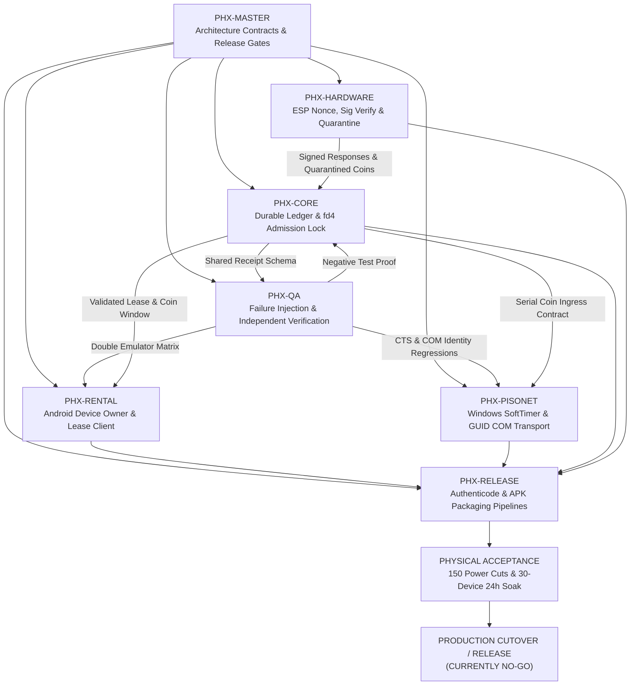

# Project Phoenix — Subsystem Integration Matrix & Gate Hierarchy

**Protocol Specification:** BLAZE-COMMS/1  
**Master Auditor:** `PHX-MASTER`  
**Current Date:** 2026-11-13  
**Overall Commercial / Production Status:** **STRICT NO-GO**

---

## 1. Subsystem Readiness Matrix

| Subsystem | Owner Role | Code Maturity | Dev Ready | Lab / CI Verified | Hardware Accepted | Production Ready | Active Draft PR / Branch |
|---|---|---|---|---|---|---|---|
| **Coordination & Gates** | PHX-MASTER | High | **YES** | **YES** | N/A (Governance) | N/A | `phoenix/master-coordination` |
| **Financial Ledger / Vendo** | PHX-CORE | Medium | **YES** | **YES** (Lab/CI) | **NO** (Pending HW) | **NO** (Gate P0) | PR #241, #248, #252 |
| **ESP32/ESP8266 Firmware** | PHX-HARDWARE | Medium | **YES** | **YES** (C++ Mock) | **NO** (No bench log) | **NO** (Gate P0) | PR #283, #254 |
| **Android BlazeRental** | PHX-RENTAL | High | **YES** | **YES** (API27 CI) | **NO** (Physical DO) | **NO** (Lineage lock) | PR #240, #285, #287 |
| **Windows SoftTimer** | PHX-PISONET | High | **YES** | **YES** (CLR/Win CI)| **NO** (Serial bench) | **NO** (AuthSign lock) | PR #238, #255, #268 |
| **QA / Failure Injection** | PHX-QA | High | **YES** | **YES** (20-job CI) | **NO** (Physical rig) | **NO** (Gate P0) | PR #267, #264, #279 |
| **Release / Packaging** | PHX-RELEASE | Medium | **YES** | **YES** (CI smoke) | **NO** (Prod secrets) | **NO** (Authenticode) | PR #242, #217 |

---

## 2. Cross-Subsystem Dependency Flow

---

## 3. Mandatory Integration Gates

Every change affecting money, cryptographic state, or physical actuation must progress sequentially through the following numbered gates:

### Gate 1: Source-Contract Definition & Non-Overlapping PRs
- Changes must reside in a dedicated role branch matching `ROLE_ASSIGNMENTS.md`.
- No single PR may alter both client UI and server accounting scripts.
- Handover ledgers (`PROJECT_HANDOVER.md`, `CURRENT_STATE.md`, `CHANGE_LEDGER.md`) must be synchronized with the commit.

### Gate 2: Lab & CI Verification on Exact SHA
- Source-exact commit must pass all automated linters, static checks (`static.sh`, `config.sh`), and compiler warnings-as-errors.
- Negative tests must be demonstrated: the failure must reproduce (RED) on baseline and resolve (GREEN) on candidate.
- Evidence links must cite exact GitHub Actions run and job IDs.

### Gate 3: Peer & QA Independent Verification
- Financial, cryptographic, and migration changes require independent review by `PHX-QA` and `PHX-MASTER`.
- `PHX-QA` verifies the identical git commit SHA using independent test fixtures without shared mutable state.

### Gate 4: Hardware & Physical Acceptance (P0 Gate #34)
- **150 Real Power-Cut Trials:** Abrupt power termination during active coin insertion and member transfer; journal must recover cleanly with zero corrupt receipts or phantom balance.
- **30-Device 24-Hour Soak:** 30 physical client nodes (mix of Android rental devices and Windows SoftTimer stations) running concurrent sessions under full traffic.
- **Physical Coin Ingress Validation:** Real mechanical coin selectors (multi-coin and single-coin) tested across denominations.

### Gate 5: Production Release Authorization (Master Gate)
- Formal approval by `PHX-MASTER`.
- Verification of authentic production code-signing certificates and anti-rollback witness.
- Final tag and manifest generation.

> [!IMPORTANT]
> **Active Gating Notice:**  
> Gates 1, 2, and 3 are actively running in lab and CI workflows. Gates 4 and 5 remain **CLOSED (NO-GO)**. No production releases, flashing, or customer migrations are authorized.
