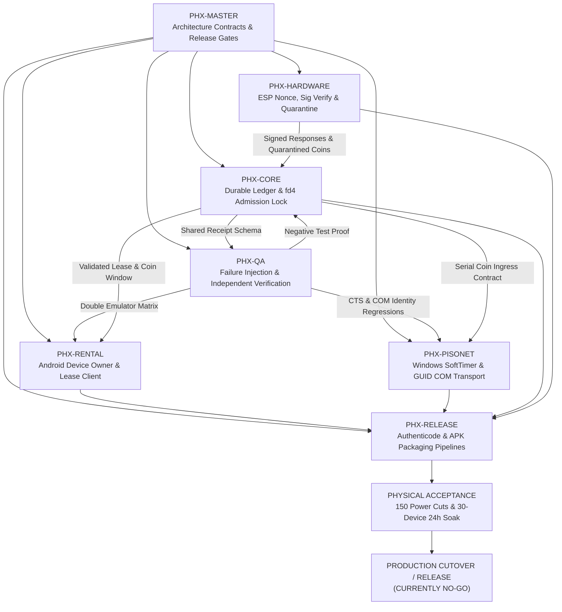

# Project Phoenix — Subsystem Integration Matrix & Gate Hierarchy

**Protocol Specification:** BLAZE-COMMS/1  
**Master Auditor:** `PHX-MASTER`  
**Original matrix date:** 2026-11-13 · **Latest bounded correction:** 2026-11-15  
**Overall Commercial / Production Status:** **STRICT NO-GO**

---

## 1. Subsystem Readiness Matrix

| Subsystem | Owner Role | Code Maturity | Dev Ready | Lab / CI Verified | Hardware Accepted | Production Ready | Active Draft PR / Branch |
|---|---|---|---|---|---|---|---|
| **Coordination & Gates** | PHX-MASTER | In review | **DRAFT** | **PARTIAL** (QA recipient 4/4; full 18-suite **NOT RUN**) | N/A (Governance) | **NO RELEASE AUTHORITY** | [Draft #288](https://github.com/BlazeDevStudio/BlazingSystems-Experiments/pull/288) |
| **Financial Ledger / Vendo** | PHX-CORE | Medium | **YES** | **YES** (Lab/CI) | **NO** (Pending HW) | **NO** (Gate P0) | PR #241, #248, #252 |
| **ESP32/ESP8266 Firmware** | PHX-HARDWARE | Medium | **YES** | **YES** (C++ Mock) | **NO** (No bench log) | **NO** (Gate P0) | PR #283, #254 |
| **Android BlazeRental** | PHX-RENTAL | High | **YES** | **YES** (API27 CI) | **NO** (Physical DO) | **NO** (Lineage lock) | PR #240, #285, #287 |
| **Windows SoftTimer** | PHX-PISONET | High | **YES** | **YES** (CLR/Win CI)| **NO** (Serial bench) | **NO** (AuthSign lock) | PR #238, #255, #268 |
| **QA / Failure Injection** | PHX-QA | High | **YES** | **YES** (20-job CI) | **NO** (Physical rig) | **NO** (Gate P0) | PR #267, #264, #279 |
| **Release / Packaging** | PHX-RELEASE | Medium | **YES** | **YES** (CI smoke) | **NO** (Prod secrets) | **NO** (Authenticode) | PR #242, #217 |

---

## 2. Cross-Subsystem Dependency Flow

---

## 3. Mandatory Integration Gates

Every change affecting money, cryptographic state, or physical actuation must progress sequentially through the following numbered gates:

### Gate 1: Source-Contract Definition & Non-Overlapping PRs
- Changes must reside in a dedicated role branch matching `ROLE_ASSIGNMENTS.md`.
- No single PR may alter both client UI and server accounting scripts.
- Handover ledgers (`PROJECT_HANDOVER.md`, `CURRENT_STATE.md`, `CHANGE_LEDGER.md`) must be synchronized with the commit.

### Gate 2: Lab & CI Verification on Exact SHA
- Source-exact commit must pass all automated linters, static checks (`static.sh`, `config.sh`), and compiler warnings-as-errors.
- Negative tests must be demonstrated: the failure must reproduce (RED) on baseline and resolve (GREEN) on candidate.
- Evidence links must cite exact GitHub Actions run and job IDs.

### Gate 3: Peer & QA Independent Verification
- Financial, cryptographic, and migration changes require independent review by `PHX-QA` and `PHX-MASTER`.
- `PHX-QA` verifies the identical git commit SHA using independent test fixtures without shared mutable state.

### Gate 4: Hardware & Physical Acceptance (P0 Gate #34)
- **150 Real Power-Cut Trials:** Abrupt power termination during active coin insertion and member transfer; journal must recover cleanly with zero corrupt receipts or phantom balance.
- **30-Device 24-Hour Soak:** 30 physical client nodes (mix of Android rental devices and Windows SoftTimer stations) running concurrent sessions under full traffic.
- **Physical Coin Ingress Validation:** Real mechanical coin selectors (multi-coin and single-coin) tested across denominations.

### Gate 5: Production Release Authorization (Master Gate)
- Formal approval by `PHX-MASTER`.
- Verification of authentic production code-signing certificates and anti-rollback witness.
- Final tag and manifest generation.

> [!IMPORTANT]
> **Active Gating Notice:**  
> Gates 1–3 are **incomplete across the combined target**; isolated historical CI results do not validate current stacked commits or the final integration tree. Gates 4 and 5 remain **CLOSED (NO-GO)**. No production release, real-money migration, flashing or customer cutover is authorized without independent acceptance and explicit owner approval.

## 4. Live evidence correction — 2026-11-15 UTC23

The 2026-11-13 table retains **historical, scope-limited worker CI claims**, not universal current-HEAD acceptance. Do not interpret the other subsystem `YES (Lab/CI)` cells as green for COE draft #26 or a future combined merge. Per-PR evidence must be reconciled on the exact proposed integration SHA before upgrading readiness; `NO` in the Production Ready column remains binding.

**Master source-exact distinction:** Independent [PHX-QA draft #292](https://github.com/BlazeDevStudio/BlazingSystems-Experiments/pull/292) recorded `4/4 PASS` on original four recipient tests with the **corrected** verifier Git blob `903df4034f8aa46f66e32de6e0be9b9ab2ca4b48`; this is a source-linked minimal checkout, not a full PR synthetic merge or the Master `18`-method unit suite. Consequently **Coordination Lab/CI: PARTIAL**, not `YES`. Earlier source-exact `2 PASS / 2 RED` remains recorded as a genuine pre-fix finding.

**PISONET migration provenance gate:** [Windows SoftTimer parity ledger](WINDOWS_SOFTTIMER_PARITY_20261115.json) compares owner [Experiments PR #255](https://github.com/BlazeDevStudio/BlazingSystems-Experiments/pull/255) pinned `d01fd1642c105b3b0f6cd3343d1c9b67291f6e09` against monorepo [COE integration PR #26](https://github.com/BlazeDevStudio/CoinOperatedEcosystem/pull/26) pinned `b382d233ff06c8791b1028bed3c617cc7b670d12`: 27 same-path identical blobs; **11 different**, **30 source-only** and **9 candidate-only**. File hashes, modes and paths are recorded read-only, not semantic compatibility. PISONET/QA must review each before allowing any copy or merge; do not overwrite staged error-aware `TryGetSignal` with an older active-low fail-open implementation. Stacked child [COE PR #30](https://github.com/BlazeDevStudio/CoinOperatedEcosystem/pull/30) advanced during this audit and is intentionally **not** conflated with PR #26.

**Release sequence:** source parity + license/dependency review → exact proposed combined-tree integration and independent QA → protected signing/independent witness and reversible financial migration → noncustomer real-target acceptance (150 real power cuts, 30-device/24h soak) → explicit owner-authorized release decision. No step can be waived by a readiness percentage, an isolated green CI job, or a coordination-only documentation merge.

---

## Live pinned migration review — 2026-11-16 UTC21

See [SOURCE_INTAKE_STATUS_ENUM_AUDIT_20261116_UTC21.md](SOURCE_INTAKE_STATUS_ENUM_AUDIT_20261116_UTC21.md) for exact Git-tree evidence and human reproduction steps.

- Source snapshot `6d4c9b487af4d768c4d7627654d119417fcc6e00` is 22 commits behind active Phoenix development `blazepwifi-v0.6.0-audit-foundation@2fbd2475e9f54878c316fa7cea2f228386b0e859`.
- COE #26 `b382d233ff06c8791b1028bed3c617cc7b670d12`: 61/61 manifest blob identities and modes match the pinned source/destination trees; actual classification is 46 identical / 15 derived, not the manifest summary 47/14.
- Destination rootfs has one unmanifested extra `usr/sbin/blaze-appliance-diag`; source/current-development test trees contain 149/150 files versus 19 in destination, with only two exact test identities.
- Root project license and three rootfs vendor license/notice files match. Android launcher, jsQR test-vendor, and Tabler license-bearing paths have no corresponding candidate destination path; owner provenance review remains required.
- COE #26 still has five queued workflows. Master PR #288 has no PR-triggered workflow runs. Scoped role CI results are recorded in the audit; none establishes integrated or physical acceptance.
- Production remains NO-GO. No migration, merge, release, or subsystem source edit is authorized by this snapshot.

## Live QA evidence freshness correction — 2026-11-16 UTC22

See [QA_EVIDENCE_FRESHNESS_AUDIT_20261116_UTC22.md](QA_EVIDENCE_FRESHNESS_AUDIT_20261116_UTC22.md) for the pinned refs, exact role PR heads, workflow links and reproduction limits.

- Current Master draft PR #288 is `phoenix/master-coordination@9f05cf7eedb9a91f599504450520f59702ded91d`. Current verifier blob is `3a6d0ca34cad54cd113abbda17d90898603547b3`; the recipient contract accepts one exact registered PHX role or literal `ALL`.
- The prior **18-test** count is stale. The current tree contains **38 authored methods** across `test_verify_coordination.py` (21), `test_verify_source_intake_manifest.py` (11), and `test_snapshot_identity.py` (6). This is inventory, not a pass claim.
- Current source-extracted recipient harness: **8/8 PASS**. Full 38-method exact-checkout suite remains **NOT RUN**; the local Git clone failed DNS and Master #288 has no PR-triggered workflow runs.
- QA PR #292 remains draft at `75a3f66d...`, based on `b1ca02e...`, which is **55 commits behind** current Master HEAD. Its reported 4/4 GREEN retest used older verifier blob `903df403...`, not current blob `3a6d0ca...`. Rebase/reproduce against current #288 HEAD before any QA VERIFIED disposition.
- COE PR #26 remains draft at `b382d233...` with five queued workflows. A separate successful stacked PR #30 run does not clear #26.
- Private Drive v11 registry was not retrieved in this activation; no older registry was substituted. Production remains **NO-GO**.

## Live hardware poll / quarantine stack hold — 2026-11-16 UTC22

See [HARDWARE_POLL_CONTRACT_AND_STACK_HOLD_20261116_UTC22.md](HARDWARE_POLL_CONTRACT_AND_STACK_HOLD_20261116_UTC22.md) for the exact source patches, branch comparisons and CI jobs.

- Hardware #315 and #316 both modify the same ESP32/ESP8266 sketches but are divergent branches: #316 is 10 commits ahead and 108 behind #315. Do not integrate or choose a branch until PHX-HARDWARE consolidates them into one owner-controlled stack.
- #316 run [43972511250](https://github.com/BlazeDevStudio/BlazingSystems-Experiments/actions/runs/43972511250) remains in progress at last observation; validation job [133668043447](https://github.com/BlazeDevStudio/BlazingSystems-Experiments/actions/runs/43972511250/job/133668043447) failed at Controller protocol parity. ESP32/ESP8266 compile jobs passed; other matrix jobs were still in progress. The focused [43972511337](https://github.com/BlazeDevStudio/BlazingSystems-Experiments/actions/runs/43972511337) success is the inherited quarantine lab, not the new poll-response matrix.
- The #316 patch permits an `ok=true` response to pass when `cfg.key` is empty. This conflicts with the existing signed-response contract. Provisional default-deny clarification is now recorded in `ARCHITECTURE_CONTRACTS.md`; PHX-CORE and PHX-HARDWARE review is pending.
- #315's same-boot RAM latch is not by itself proof that a rejected coin event remains non-replayable across reboot. Durable reconciliation semantics remain open with PHX-CORE/HARDWARE and independent QA.
- PHX-HARDWARE's UTC22 issue envelope used a semicolon-separated `to` field, which the current BLAZE-COMMS validator rejects. Republish only as one role or `ALL`; preserve the original comment.
- No subsystem source, firmware, merge or production state changed. Production remains **NO-GO**.

### Final #316 workflow status correction — 2026-11-16 UTC22:45Z

The prior in-progress observation is superseded: exact-head full run [43972511250](https://github.com/BlazeDevStudio/BlazingSystems-Experiments/actions/runs/43972511250) completed **failure** at 22:45:24Z. Validation job [133668043447](https://github.com/BlazeDevStudio/BlazingSystems-Experiments/actions/runs/43972511250/job/133668043447) failed at Controller protocol parity. ESP32/ESP8266 and listed firmware target builds completed success; Android completed success; production signing/import/publication and candidate-gate jobs were skipped. This is not a CI pass, and the inherited focused quarantine lab does not clear the failed poll validation. See the hardware hold document for the exact evidence and owner-reported extractor diagnosis.

## Live role/CI correction — 2026-11-16 UTC23

Exact repository refs observed for this snapshot: Experiments `main@f4e8a891aed8af86d5fd315d28750a0ac3a7372b`; `blazepwifi-v0.5.3-development@aad3aade72c1156eecba1fed30907c6d0283b2c5`; Master draft `phoenix/master-coordination@8201deb9198a8416a6546584a9a8f5789526ad84`; COE `main@a6513ab4412b4c014eee2863e45cbe32d06cb243`; COE integration #26 `b382d233ff06c8791b1028bed3c617cc7b670d12`.

- The current `OWNERSHIP_ROUTES.json` blob `e4db324315a1b3543fec17a148fbf960170fcb29` remains `DRAFT_REVIEW_ONLY`, pinned to source main `f4e8a891...` and destination PR #26 `b382d233...`. Its PHX-MASTER route remains coordination-only; no route authorizes copy or migration.
- Master #288 has no PR-triggered workflow runs. The complete current Master Python suite was not executed: a local `git ls-remote` attempt failed because this runtime could not resolve `github.com`. Do not infer PASS from source inspection.
- COE #26 has five queued candidate-head workflows, not completed CI: 43096752609 (case collision), 43096752632 (SoftTimer), 43096752800 (Hardware/Shared), 43096752563 (Rental), 43096752557 (Pisowifi).
- CORE #252, RENTAL #240/#289/#287, PISONET #255, HARDWARE #294/#314/#315, QA #267 and RELEASE #242/#291 have the scoped success runs listed in the live role snapshot in [ROLE_ASSIGNMENTS.md](ROLE_ASSIGNMENTS.md). These are not combined-tree acceptance.
- HARDWARE #315 and #316 are not a single linear stack. #315 is based on #314 head `556adc20...`; #316 is based on #294 head `8cbd4ece...`. The exact PR file lists overlap on both ESP32 and ESP8266 sketches. Comparing #315 head `953b743f...` with #316 head `888e6941...` reports diverged histories (10 commits ahead / 108 behind; common base #294 head). Do not merge either independently or overwrite one with the other.
- #316's focused source-extracted poll-response lab run 43972511337 passed, but its full build run 43972511250 failed in validation job 133668043447 at Controller protocol parity: the #294 extractor compiles a loop that now calls `acceptPollResponse` without extracting/declaring that helper. ESP32 and ESP8266 compile jobs themselves passed. The new #316 lab is not yet wired into the canonical validation workflow.
- Source inspection of #316 shows `signatureOk=true` before the conditional `if(String(cfg.key).length())`; with an empty key, the signature check is skipped and a response containing `"ok":true` can reach the authorization path. This conflicts with the **provisional** default-deny contract in Architecture Contracts §6.1 (owner review still pending). PHX-CORE and PHX-HARDWARE must agree the keyless policy; PHX-QA must add an empty-key negative case. Master did not edit firmware.
- The RAM-only `journalRecoveryRequired` limitation remains open for reboot-safe rejected-event disposition under Architecture Contracts §6.2. PHX-CORE owns ledger/replay semantics; PHX-HARDWARE owns firmware persistence; QA owns independent failure/reboot tests.
- QA #292 is not current Master evidence: its branch verifier blob is `a8a989964c45ab9aef5719e8d17ba3f6fc66e773`, while current Master is `3a6d0ca34cad54cd113abbda17d90898603547b3`. Branch comparison shows 63 Master-only commits and 6 QA-only commits after the common base. No #292 PR-triggered workflow run was returned.
- P0 issues #31, #32, #34, #43 and #177 remain open. Protected signer/independent anti-rollback witness, crash-atomic financial state, reversible migration, native acceptance, 150 real power cuts and 30-device/24-hour soak remain unverified. **PRODUCTION NO-GO**.
- The exact private Drive registry v11 and newer corrections were not accessible through the current connected tool surface; exact-name Library search did not return v11. Older Library registry artifacts were not substituted. The AGENTS.md storage-policy/handover links also could not be retrieved through the connected GitHub file reader. No private Drive contents or identifiers were published.
- No source migration, firmware edit, branch rewrite, merge, release, signing, secret provisioning, hardware flash, physical test or live financial operation occurred in this Master activation.

## Live PHX-MASTER snapshot — 2026-11-17 UTC00

This section supersedes earlier live-status tables only for the exact refs observed in this snapshot. Historical evidence remains preserved.

### Exact branch and candidate refs

| Ref | Exact SHA |
|---|---|
| Experiments main | f4e8a891aed8af86d5fd315d28750a0ac3a7372b |
| Experiments blazepwifi-v0.5.3-development | aad3aade72c1156eecba1fed30907c6d0283b2c5 |
| Experiments blazepwifi-v0.6.0-audit-foundation | 2fbd2475e9f54878c316fa7cea2f228386b0e859 |
| Master PR #288 before this snapshot | 3d3634dfab35d9f427e159b7d392194edda37930 |
| COE main | a6513ab4412b4c014eee2863e45cbe32d06cb243 |
| COE integration PR #26 | b382d233ff06c8791b1028bed3c617cc7b670d12 |

The v0.5.3 branch is 293 commits behind main. The v0.6 audit-foundation branch is 22 commits ahead of the pinned PisoWiFi source commit 6d4c9b487af4d768c4d7627654d119417fcc6e00; v0.6 and main are divergent. The current OWNERSHIP_ROUTES.json remains DRAFT_REVIEW_ONLY and routes PHX-MASTER to coordination/phoenix/ only.

### Migration manifest and exact selected blobs

At COE #26 b382d233, SOURCE_INTAKE.json blob 1b9018ff944f7f673934d0fc2a97e0a0090d3f5f reports 47 byte-identical / 14 derived rootfs files. MIGRATION_MAP.md blob b54fc15d83bc2269de03db8aadd0e76259fd13d9 has 61 rootfs rows; the recorded Git blob IDs compute 46 identical / 15 different (13 intentionally edited, 2 locally derived). The summary is inconsistent by one in both counters. The two locally derived member.sh and rental.sh entries state real-router tests NOT_RUN.

The source-intake manifest pins source 6d4c9b... and a prior destination feature branch/head cf59b41..., while OWNERSHIP_ROUTES.json pins source main f4e8... and candidate PR #26 b382d233.... Reconcile these snapshots before proposing a move.

Selected blobs: vendo source pin/v0.6 = db58041c0575ad0a1101d99cb85403e03c8dcb22; Experiments main = 2e3a1430d08cc6606429a042df3b5848f53c7267; COE #26 destination = 0a71c4e253ac6ec2c30d46f1f99faf874dbaab8e. common.sh source pin = 4ccb10777b08f541d092f7c2c2d2aad4d2f6562e; v0.6 branch = 50fa2d02d40af7fd8b06e83974345f1016a317f9; COE destination = ae00667da26c68c9e44a54a941887191029afc11. The candidate contains derived versions; current source drift needs owner review.

Root PisoWiFi LICENSE and selected vendor QR LICENSE, TailAdmin LICENSE and NOTICE blobs match between pinned source and destination. This is a bounded check, not a complete dependency/license audit. SOURCE_INTAKE lists four legacy tests (two unchanged, two derived) and 15 derived tests (11 NOT_RUN, four PENDING_CI_RUN). COE #26 has five queued workflows and no completed integration acceptance.

### Current role CI

| Role / PR | Exact head | Exact-head workflow observation |
|---|---|---|
| MASTER #288 | 3d3634dfab35d9f427e159b7d392194edda37930 | No PR-triggered workflows returned |
| CORE #252 | c82705f2de865c89ab733b10efa84f26f56a5cc4 | 42698139210 success |
| RENTAL #289 | 68928774d0d7cf65adb26bc6b54199a3159d066c | 43653329235 and 43653329229 success |
| PISONET #255 | d01fd1642c105b3b0f6cd3343d1c9b67291f6e09 | 42462978704 success |
| HARDWARE #315 | 939e6ae09050e3e7244249acf9c7969301a05363 | Focused 43982762795 success; full 43982762668 validation failure; ESP32/ESP8266 compile jobs success |
| HARDWARE #316 | 888e6941e3a7a81641682c23d937f97d8117d2ea | Focused 43972511337 success; full 43972511250 validation failure |
| QA #292 | 75a3f66d9563e38a0a48b9cf487b0b057a91ea96 | No PR-triggered workflows returned |
| QA #267 | ff5367990c2d27b8ebbb822ee208251af0c890e2 | 41452247439 success |
| RELEASE #291 | 2c4edff231d9b2819415086825530d80b8801307 | 43744993487 success |

COE role drafts: #31 RELEASE f4f93dd7... runs 43986022373 and 43986022315 success; #29 CORE d0830332... runs 43653906675/676 success; #30 PISONET 4897348d... run 43653415598 success; #28 PISONET b21b0461... run 43632393888 success; #32 QA 29b6fe08... run 43653540607 success; #27 HARDWARE/Shared 009f70cc... runs 43079646393/46264 success. COE #18 PisoWiFi and #19 Rental have case-collision-only runs 43061613277 and 43061768902. These are scoped checks, not integrated acceptance.

### HARDWARE shared-contract blocker

Current #315 ESP32/ESP8266 acceptPollResponse helpers skip signature verification when cfg.key is empty because signatureOk starts true and verification is conditional on a nonempty key. A keyless ok=true response with a nonempty target can pass. The focused 8/8 poll lab uses a test-key and has no empty-key case. The full validation failure is also reproducible: the #294 QA extractor omits acceptPollResponse, so both board extracts fail compilation with “not declared in this scope”. Architecture Contracts §6.1 already requires default-deny for an empty key. PHX-HARDWARE owns firmware correction, PHX-CORE owns the signature/replay contract, and PHX-QA owns extractor and negative/reboot tests.

### Execution and release limits

Ten local synthetic Python tests for the new Master-owned migration-map verifier passed; no full Master suite or PR-triggered Master CI ran. The private Drive registry v11 and newer corrections were not available through the connected tool surface; older Library versions were not substituted. No migration, merge, signing, release, flash or physical acceptance is authorized. PRODUCTION NO-GO remains.

## Live poll-response producer/consumer reconciliation — 2026-11-17 UTC02

This snapshot supersedes earlier poll-response claims only for the exact refs below; historical evidence is retained.

### Exact refs and routing

| Ref | Exact SHA / state |
|---|---|
| Experiments main | f4e8a891aed8af86d5fd315d28750a0ac3a7372b |
| Experiments blazepwifi-v0.5.3-development | aad3aade72c1156eecba1fed30907c6d0283b2c5 |
| Experiments blazepwifi-v0.6.0-audit-foundation | 2fbd2475e9f54878c316fa7cea2f228386b0e859 |
| Master branch / PR #288 before this snapshot | d047c49419c920a546ff9438f2fc9e708566f78a |
| COE main | a6513ab4412b4c014eee2863e45cbe32d06cb243 |
| COE integration PR #26 | b382d233ff06c8791b1028bed3c617cc7b670d12 |

PR #288 is open/draft and based on Experiments main. OWNERSHIP_ROUTES.json remains DRAFT_REVIEW_ONLY at blob e4db324315a1b3543fec17a148fbf960170fcb29; PHX-MASTER remains coordination-only. Cleanup issue #266 remains open. No route authorizes source relocation.

### Poll producer/consumer parity

| Exact file snapshot | Git blob | Poll response |
|---|---|---|
| Experiments main | 2e3a1430d08cc6606429a042df3b5848f53c7267 | No response_sig in poll action |
| v0.5.3 development | a1c19180385e618c412b4af21c0e91c1f47da1dd | No response_sig in poll action |
| v0.6 audit-foundation | db58041c0575ad0a1101d99cb85403e03c8dcb22 | No response_sig in poll action |
| COE #26 candidate | 0a71c4e253ac6ec2c30d46f1f99faf874dbaab8e | response_sig emitted by derived vendo_poll_sig |

The current COE candidate root LICENSE blob and Experiments main root LICENSE blob both equal 1ee55b94183417be977ca287cd7391f9a6f7e721. This is one bounded license identity check, not a complete dependency/license audit.

HARDWARE #315 at b21d05822772e7c07299331d2a6a1670da2b077e has ESP8266 blob 226c068731666d20eb91a2544ecb8ef9f9c11432 and ESP32 blob 54308cc5153c11889d107af1e15e560f39ebb327. Both consumers initialize signatureOk=false, require a nonempty configured key and response_sig, reject targetless positive responses, and clear stale insert/target state on denial. This is source inspection plus focused CI, not hardware acceptance.

Focused exact-head run 43997886923 / job 133754358681 completed SUCCESS. Its log reports poll-response 10/10 per board and strict root JSON 13/13 per board, in addition to quarantine/mount/recovery checks. Full run 43997886963 completed FAILURE at validation job 133754360411: the QA-owned tests/controllers.sh source extractor omits acceptPollResponse(), so both generated board harnesses fail with an undeclared-function error. ESP8266 and ESP32 compile jobs, Android and returned target image jobs passed; production sign/import/publish and candidate simulations were skipped. See [focused run](https://github.com/BlazeDevStudio/BlazingSystems-Experiments/actions/runs/43997886923), [full run](https://github.com/BlazeDevStudio/BlazingSystems-Experiments/actions/runs/43997886963), and [failing validation job](https://github.com/BlazeDevStudio/BlazingSystems-Experiments/actions/runs/43997886963/job/133754360411).

HARDWARE #316 remains open/draft at 888e6941e3a7a81641682c23d937f97d8117d2ea; its older full run 43972511250 has the same extractor failure. #315 is the owner-reported consolidated stack; Master did not close #316 or modify firmware.

### Live role CI summary

| Role | Exact open draft head(s) | Exact-head CI observation |
|---|---|---|
| MASTER #288 | d047c49419c920a546ff9438f2fc9e708566f78a | No PR-triggered workflow runs returned |
| CORE #252 | c82705f2de865c89ab733b10efa84f26f56a5cc4 | 42698139210 success |
| RENTAL #240 / #287 / #289 | a7d113fb8ae3f0c5e838e64d31cae7a154e37b56; a4fffd01c8fb1818c32a53522e0590c1dc8a77cd; 68928774d0d7cf65adb26bc6b54199a3159d066c | 40910311141/40910311159; 43754089203; 43653329235/43653329229 success |
| PISONET #255 | d01fd1642c105b3b0f6cd3343d1c9b67291f6e09 | 42462978704 success |
| HARDWARE #314 / #315 / #316 | 556adc20ef0cfd355089aff3b979c0169af79bdd; b21d05822772e7c07299331d2a6a1670da2b077e; 888e6941e3a7a81641682c23d937f97d8117d2ea | #314 43782088731/43782088748 success; #315 focused 43997886923 success, full 43997886963 failure; #316 focused 43972511337 success, full 43972511250 failure |
| QA #267 / #292 / #279 | ff5367990c2d27b8ebbb822ee208251af0c890e2; 75a3f66d9563e38a0a48b9cf487b0b057a91ea96; 8f476ef05893193325ef3d1f65a35e144ae7a568 | #267 41452247439 success; #292 and #279 no PR-triggered runs returned |
| RELEASE #242 / #291 | 734b89d9e7792247e8376335c3f3685500ab3f89; 2c4edff231d9b2819415086825530d80b8801307 | 40882814472 and 43744993487 success |

COE role drafts re-read for this poll review: #27 head 009f70cc2c2775039a5fb072c9d4fdedee76cfc7 (43079646393/43079646264 success); #29 head d0830332dee8a1844a85606150681b41d91fe796 (43653906676/43653906675 success); #31 head f3f995c91e38b5c5908bf8910056523015c8f0fd (44002215761/44002215760 success); #32 head 29b6fe08b10688182d981a66745f482758bd6630 (43653540607 success). COE #26 still has five queued candidate-head workflows: 43096752609, 43096752632, 43096752800, 43096752563 and 43096752557. These are scoped workflow observations, not integrated acceptance.

### Master static audit execution

Seven read-only structural assertions were executed against freshly fetched source files: unsigned poll action on main/v0.5.3/v0.6, signed poll action on COE #26, default-deny key requirement on both hardware consumers, and identical root LICENSE blob. Result: 7/7 PASS. These are Master audit assertions, not the Project Phoenix Python suite, not the canonical controller lab, and not CI.

The full Master Python suite was not executed and #288 has no PR-triggered workflow runs.

### Registry and remaining gates

The exact private Drive BLAZE_PROJECT_REGISTRY_v11_20261027.json and newer corrections were not retrievable: no Google Drive connector/read action was exposed, and exact-name Library search did not return v11. No older Library registry was substituted; no private contents or identifiers were published.

PHX-CORE must resolve the canonical signed poll producer and exact test vector; PHX-QA must add acceptPollResponse to the canonical extractor and independently verify both boards; PHX-HARDWARE must retain default-deny and durable rejected-event work; COE integration must reconcile the derived candidate against pinned source and licenses before any move.

Independent protected signing/anti-rollback witness, crash-atomic durable financial state, reversible migration tests, independent QA, native acceptance, 150 real power cuts and 30-device/24-hour soak remain unverified. PRODUCTION NO-GO.

## Live poll/config trust-boundary reconciliation — 2026-11-17 UTC03

This snapshot supersedes earlier poll/config claims only for the exact refs below; historical checkpoints remain intact.

### Exact refs and current owner evidence

| Area | Exact ref | Current evidence |
|---|---|---|
| Experiments main / development / v0.6 | `f4e8a891...` / `aad3aade...` / `2fbd2475...` | Poll producer in these source refs does not emit the candidate's signed poll response. |
| Master #288 | `2c2b517995365e23d89e423e2b9faeac4135381f` before this audit | No PR-triggered workflow runs returned. Master scope remains coordination/phoenix only. |
| HARDWARE #315 | `58ade5df83df0c6894dd8d1e2a70617b90dae374` | Focused run 44008962809 success; full run 44008962837 failed at QA controller extractor job 133791150681. ESP32/ESP8266 and other target builds passed; no overall full-workflow success. |
| HARDWARE #316 | `888e6941e3a7a81641682c23d937f97d8117d2ea` | Focused run 43972511337 success; full run 43972511250 failed validation. Separate draft remains open. |
| CORE #252 | `c82705f2de865c89ab733b10efa84f26f56a5cc4` | Experiments run 42698139210 success; scoped CORE CI only. |
| QA #292 | `75a3f66d9563e38a0a48b9cf487b0b057a91ea96` | No PR-triggered workflow runs returned; no independent register-config test evidence. |
| RELEASE #242 | `734b89d9e7792247e8376335c3f3685500ab3f89` | Run 40882814472 success; no signing/release authorization. |
| COE integration #26 | `b382d233ff06c8791b1028bed3c617cc7b670d12` | Five candidate-head workflows remain queued; no integrated acceptance. |
| COE HARDWARE #27 / CORE #29 / QA #32 / RELEASE #31 | `009f70cc...` / `d0830332...` / `29b6fe08...` / `79f79c6c...` | Their scoped workflows returned success (respectively 43079646393/46264; 43653906676/675; 43653540607; 44009785780/581). These do not test the Experiments #315 register-config path or establish COE #26 acceptance. |

### New source finding

HARDWARE #315 removed configuration application from poll admission, but the exact ESP32 and ESP8266 `connectSta()` paths still call `applyRemoteConfig(r)` after register/ping. Both initialize `sigOk=true` and only verify a register signature if a key exists. The COE #26 register producer's `vendo_ping_sig()` covers action, controller ID, request nonce and server time, but not the returned controller configuration object. Thus:
- empty-key register responses can still apply configuration without authentication;
- a provisioned-key register signature does not authenticate modified configuration fields;
- the current poll config-injection lab does not cover this register path.

This is a source inspection finding, not a live exploit or physical actuation result. Full evidence and owner actions are in [POLL_CONFIG_REGISTER_TRUST_BOUNDARY_AUDIT_20261117_UTC03.md](POLL_CONFIG_REGISTER_TRUST_BOUNDARY_AUDIT_20261117_UTC03.md).

### Required owner sequence

1. PHX-HARDWARE disables/guards the remaining register-path configuration application and adds both-board negative regressions.
2. PHX-CORE defines a separate domain-separated configuration signature and exact canonical golden vectors.
3. PHX-QA independently verifies keyless, altered-config, wrong-identity/nonce, stale revision, invalid-range and persistence-failure cases on the identical exact SHA; separately repair the canonical controller extractor.
4. PHX-RELEASE keeps signing/publication gated until independent QA and Master review.

**Gate:** remote configuration remains disabled pending owner-reviewed contract; poll admission remains default-deny for keyless/unverified responses. Focused source-extracted CI is SIMULATED / CI VERIFIED only. Physical acceptance remains NOT TESTED. PRODUCTION NO-GO.

## Live remote-configuration source/staging correction — 2026-11-17 UTC04

**Disposition: BLOCKED for COE #26 migration; PRODUCTION NO-GO.**

- Experiments #315 current owner head is 75dc5f0b888f16e2c85e4321f62df4685639ad33. ESP8266 blob f59e624ae2da04bddc70ddc2809bf6d8ff486aac and ESP32 blob 38a2d239eed6af876d421f9f908bbb62b3ae27e1 each contain only the dormant applyRemoteConfig definition. There are zero response call sites.
- COE #26 destination head b382d233ff06c8791b1028bed3c617cc7b670d12 still contains ESP8266 blob c8be98f72596681e36a3ad1f8939bf8046c96887 and ESP32 blob 3cc7ec54b476943dc04a8d1af5e2df5fe054e422. Each contains two applyRemoteConfig(r) response call sites and two sigOk=true defaults (register and poll). The staged candidate therefore remains unsafe for migration until its owner resolves the mismatch.
- HARDWARE focused run 44013351048 succeeded, including register-config denial 7/7 per board. HARDWARE full run 44013351035 failed in validation job 133805413831 because the QA-owned extractor omitted acceptPollResponse(); board compile and target image jobs passed. This is not an overall full-build pass.
- COE #26 still has five queued workflows. Master #288 has no PR-triggered workflow runs.
- The Hardware source-intake/license record is incomplete: Pisowifi/SOURCE_INTAKE.json is explicitly PisoWiFi-only; the Hardware subtree has no LICENSE/NOTICE, and the candidate's firmware audit still claims the firmware was not copied although both sketches exist in the PR tree. The source MIT license and Pisowifi/LICENSE share blob 1ee55b94183417be977ca287cd7391f9a6f7e721, but coverage for Hardware is not established.

**Owner sequence:** HARDWARE maintains the source-side deny behavior; QA repairs the extractor and independently tests both boards; CORE reviews the configuration authorization domain; COE integration owner reconciles per-file provenance, license scope and candidate tests. No blind copy, source move or merge is authorized. See REMOTE_CONFIG_MIGRATION_STAGING_AUDIT_20261117_UTC04.md.

## 11. Live exact-head Hardware migration hold — 2026-11-17 UTC05

| Gate surface | Current owner source | COE #26 candidate | Disposition |
|---|---|---|---|
| ESP32 remote config | #315 blob 38a2d239...; helper definition only; register/poll responses do not apply config | blob 3cc7ec54...; three helper occurrences; register/poll call sites; two keyless-true defaults | BLOCKED |
| ESP8266 remote config | #315 blob f59e624...; helper definition only; fail-closed register tuple and poll acceptance | blob c8be98f...; three helper occurrences; register/poll call sites; two keyless-true defaults | BLOCKED |
| Quarantine clear | #315 returns 403; no quarantine-log delete call | #26 deletes /quarantine.log and returns 200; no explicit AP-origin guard | P0 MIGRATION HOLD |
| Source tests | register config 7/7 and poll/config 11/11 per board in focused #315 source lab | one shell hardening script; no keyless, no-config-callsite, 403/no-delete or AP-origin regressions | IMPORT GAP |
| License/notice | BlazePwifi MIT LICENSE and source repository NOTICE | Pisowifi/LICENSE only; Hardware/root scope unresolved | OWNER REVIEW |

The exact blobs and modes are recorded in HARDWARE_STAGING_PARITY_AUDIT_20261117_UTC05.md. Focused #315 run 44013351048 succeeded on source-extracted host tests; full #315 run 44013351035 failed in the QA-owned controller extractor. COE #26 still has five queued workflows. None of these results establishes integrated acceptance.

**Disposition:** keep #26 draft and do not copy/promote Hardware files until PHX-HARDWARE and independent PHX-QA reconcile exact source/destination blobs, route security, test identities, crypto wording, license/notice scope and candidate CI. No production flash, release, migration or live-money operation is authorized.

## 6. Live exact-head reconciliation — 2026-11-17 UTC06

This section supersedes stale PR/CI identifiers in the historical readiness rows above. All CI labels are scoped to the exact listed commit; none implies hardware acceptance.

| Role | Current draft / exact head | Exact CI evidence | Current disposition |
|---|---|---|---|
| PHX-MASTER | #288 `7616a3d5de69f4e6d7d9905fc91d0c7500bdfd68` | No PR-triggered workflow runs returned | Draft; local full suite NOT RUN |
| PHX-CORE | #252 `c82705f2de865c89ab733b10efa84f26f56a5cc4` | [42698139210](https://github.com/BlazeDevStudio/BlazingSystems-Experiments/actions/runs/42698139210) SUCCESS | Scoped CI only |
| PHX-RENTAL | #289 `68928774d0d7cf65adb26bc6b54199a3159d066c` | [43653329235](https://github.com/BlazeDevStudio/BlazingSystems-Experiments/actions/runs/43653329235), [43653329229](https://github.com/BlazeDevStudio/BlazingSystems-Experiments/actions/runs/43653329229) SUCCESS | Scoped CI only |
| PHX-PISONET | #255 `d01fd1642c105b3b0f6cd3343d1c9b67291f6e09` | [42462978704](https://github.com/BlazeDevStudio/BlazingSystems-Experiments/actions/runs/42462978704) SUCCESS | Scoped CI only; physical serial NOT TESTED |
| PHX-HARDWARE | #315 `c1db0a567500302921c0561bcd31446f12767372` | [44030492133](https://github.com/BlazeDevStudio/BlazingSystems-Experiments/actions/runs/44030492133) focused SUCCESS; [44030492146](https://github.com/BlazeDevStudio/BlazingSystems-Experiments/actions/runs/44030492146) Full validation FAILURE | Host/fake-LittleFS labs only; QA extractor blocker |
| PHX-HARDWARE (separate) | #316 `888e6941e3a7a81641682c23d937f97d8117d2ea` | [43972511337](https://github.com/BlazeDevStudio/BlazingSystems-Experiments/actions/runs/43972511337) focused SUCCESS; [43972511250](https://github.com/BlazeDevStudio/BlazingSystems-Experiments/actions/runs/43972511250) Full FAILURE | Separate open draft; do not compose without owner decision |
| PHX-QA | #292 `75a3f66d9563e38a0a48b9cf487b0b057a91ea96` | No PR-triggered workflow runs returned | Stale base; exact current #315 extractor verification absent |
| PHX-RELEASE | #291 `2c4edff231d9b2819415086825530d80b8801307` | [43744993487](https://github.com/BlazeDevStudio/BlazingSystems-Experiments/actions/runs/43744993487) SUCCESS; publish-release SKIPPED | Scoped Windows CI only |
| COE integration | #26 `b382d233ff06c8791b1028bed3c617cc7b670d12` | Eight exact-head workflows remain QUEUED: 43096752609, 43096752632, 43096752800, 43096752563, 43096752557, 43096746202, 43096746248, 43096746194 | No completed destination acceptance |

### 6.1 Current hardware migration hold

The current #315 source blobs are ESP8266 `35bc5b20...` and ESP32 `5b448444...`; COE #26 destination blobs remain `c8be98f7...` and `3cc7ec54...`. All four files are mode `100644`, but neither source/destination pair is byte-identical.

The #315 source now has the durable one-shot `/pending.attempt` marker and exact-source host lab; COE #26 has no marker state or marker lab. COE still has keyless-positive remote configuration call sites and a destructive `POST /quarantine/clear` handler. Its Hardware test tree has one shell hardening script, not the source's current negative/failure-injection suite. No Hardware-scoped LICENSE/NOTICE exists under `Hardware/`; scope requires owner review.

**Migration decision:** no copy, overwrite, relocation, or promotion of the current COE Hardware sketches. The exact comparison and owner actions are in [the UTC06 Master audit](COIN_POST_ATTEMPT_MARKER_MIGRATION_AND_QA_EXTRACTOR_AUDIT_20261117_UTC06.md).

### 6.2 Provisional financial replay invariant

Before any coin POST, the controller must durably write, flush, close, and read back an attempt marker bound to the pending record. A marker found after reboot (matching, malformed, mismatched, or orphan) blocks automatic replay. Clear the pending record first and the marker last, only after authoritative receipt or durable quarantine disposition. This client fence does not replace server idempotency and remains pending PHX-CORE/PHX-QA review and physical power-cut evidence.

Production remains STRICT NO-GO.

## 7. Live coin POST disposition authority and exact-head reconciliation — 2026-11-17 UTC07

**Exact refs:** Experiments main `f4e8a891...`, v0.5.3 development `aad3aade...`, v0.6 audit foundation `2fbd2475...`, Master #288 pre-change `c121d651...`; COE main `a6513ab4...`, COE #26 `b382d233...`.

| Role | Current open draft(s) / exact head | Exact-head CI observation | Gate state / next owner action |
|---|---|---|---|
| PHX-MASTER | #288 `c121d651...` before this update | No PR-triggered workflow runs; targeted source-intake tests 11/11 PASS locally; full Master suite NOT RUN | Coordination-only; maintain architecture and migration holds |
| PHX-CORE | #252 `c82705f2...`; #241 `8aa2529a...`; #248 `a1f80f30...` | #252 run 42698139210 SUCCESS; #241 run 40813818877 FAILURE; #248 run 40882042148 FAILURE | Publish authenticated event-bound coin receipt/disposition contract and idempotency vectors; no Master source edits |
| PHX-RENTAL | #240 `a7d113fb...`; #287 `a4fffd01...`; #289 `68928774...` | #240 runs 40910311141/40910311159 SUCCESS; #287 43754089203 SUCCESS; #289 43653329235/43653329229 SUCCESS | Scoped software evidence only; physical Device Owner/lease acceptance remains outstanding |
| PHX-PISONET | #255 `d01fd164...` | Run 42462978704 SUCCESS | Native COM/serial physical acceptance NOT TESTED |
| PHX-HARDWARE | #315 `4afc7c8bd8ea410049f1da7bc962bfc989b4ba1b`; separate #316 `888e6941...`; older #283 `a8756729...` | #315 focused 44038469936 SUCCESS; full 44038469823 FAILURE in validation job 133887096342; #316 focused 43972511337 SUCCESS/full 43972511250 FAILURE; #283 43634101437 SUCCESS | #315 is current owner candidate; no Master firmware edits. Full validation blocked by stale QA extractor. Current coin POST verifier returns false until approved receipt contract |
| PHX-QA | #267 `ff536799...`; #279 `8f476ef0...`; #292 `75a3f66d...` | #267 41452247439 SUCCESS; #279/#292 no workflow runs returned | Repair extractor for current #315 dependencies and independently test both-board receipt vectors |
| PHX-RELEASE | #242 `734b89d9...`; #291 `2c4edff2...` | #242 40882814472 SUCCESS; #291 43744993487 SUCCESS | Scoped Windows CI only; signing/publisher gates remain closed |
| COE integration owner | COE #26 `b382d233...` | Five workflows remain QUEUED: 43096752609, 43096752632, 43096752800, 43096752563, 43096752557 | Keep draft; reconcile source/destination blobs, imports, tests and license scope before any move |

### 7.1 Current coin POST disposition hold

At exact #315 source blobs ESP8266 `e47d392e...` and ESP32 `5de92f01...` (both mode `100644`), `coinPostDispositionVerified()` returns false until an approved authenticated receipt contract exists. The source persists and readback-verifies `/pending.attempt` before POST and retains the pending evidence on every unapproved response.

COE #26 still stages ESP8266 `c8be98f7...` and ESP32 `3cc7ec54...` (both mode `100644`). Neither pair is byte-identical. The destination lacks the attempt marker and disposition verifier, retains keyless-positive response paths and the prior destructive quarantine-clear mismatch. COE `Hardware/tests/` has only one shell hardening script; it does not import the current source lab.

**Migration decision:** no copy, overwrite, relocation, merge or promotion. Keep COE #26 draft. Exact full blob identities, sizes, test identity and CI are in [the UTC07 audit](COIN_POST_DISPOSITION_AUTHORITY_AUDIT_20261117_UTC07.md).

### 7.2 CI/test interpretation and release gates

The #315 focused run is source-extracted host/fake-filesystem evidence only: 34/34 host scenarios passed, coin disposition default-deny 4/4 per board, pending attempt marker 19/19 per board. The log explicitly reports physical coin acceptance and power-cut verification as zero. The full #315 workflow is failed because the QA-owned extractor omits five current firmware dependencies; ESP target builds passing does not turn that workflow green.

The PHX-MASTER source-intake test file executed locally at its exact fetched source/test blobs: 11/11 passed. This is not the complete Master suite or cross-repository acceptance.

COE #29, #28 and #30 have scoped successes at their pinned heads, but they do not validate the combined #26 tree. Historical financial issues #31/#32, witness #43, hardware acceptance #34 and pulse issue #177 remain open.

**PRODUCTION NO-GO:** independent protected signing/anti-rollback witness, crash-atomic durable financial state, reversible migration, independent QA, native acceptance, 150 real power cuts and a 30-device/24-hour soak remain mandatory.

## Live Hardware staging refresh — 2026-11-17 UTC08

The current owner source is Experiments HARDWARE PR #315 at cc0743009f44baeda0ea12d84eb6199a8a6916c7, not the older firmware snapshot staged in COE #26. The separate COE Hardware & Shared PR #27 at 009f70cc2c2775039a5fb072c9d4fdedee76cfc7 contains the same ESP32/ESP8266 firmware blobs as #26 and is therefore a duplicate stale candidate for this comparison, not an updated import.

| Evidence | Exact ref / result | Gate interpretation |
|---|---|---|
| HARDWARE source | #315 cc074300…; focused 44041818004 SUCCESS; full 44041818133 FAILURE | Source lab is simulated; full validation blocked by QA extractor |
| HARDWARE parallel draft | #316 888e6941…; focused 43972511337 SUCCESS; full 43972511250 FAILURE | Separate branch; do not silently compose with #315 |
| COE integration | #26 b382d233…; five workflows QUEUED | No combined-tree CI conclusion |
| COE Hardware & Shared | #27 009f70cc…; runs 43079646264 and 43079646393 SUCCESS | These runs validate the stale #27 candidate, not current #315 source parity |
| Master | #288 349c5e24… before this update; no PR-triggered runs | Coordination-only; no subsystem source change |

Exact firmware blobs differ on both boards; #315 has dormant remote configuration, one-shot attempt/disposition helpers and a deny/no-delete quarantine clear, while #26/#27 retain response-driven config paths, keyless defaults, no attempt marker/disposition helpers and destructive quarantine clear. Source board-local failure labs are not imported into COE Hardware/tests. Hardware license scope remains unresolved. See HARDWARE_STAGING_REFRESH_AND_DUPLICATE_CANDIDATE_AUDIT_20261117_UTC08.md for exact blobs, modes, sizes, test identities and CI.

**Disposition:** keep #26/#27 draft and do not copy, overwrite, relocate or promote firmware. PHX-QA must repair the exact #315 extractor and rerun Full validation; the COE integration owner must reconcile the candidate, tests and license scope. Production remains NO-GO.

## 13. Exact-head poll fixture conflict and COE Hardware migration hold — 2026-11-17 UTC09

| Gate | HARDWARE #315 source | COE #26 destination | Result |
|---|---|---|---|
| Poll admission | Both sketches' `acceptPollResponse()` return DENY; candidate state is cleared | Older response-driven poll/config path remains | BLOCKED |
| Coin POST disposition | `coinPostDispositionVerified()` returns DENY pending CORE contract | Current attempt/disposition helpers absent | BLOCKED |
| Remote configuration | `applyRemoteConfig` definition-only | Three occurrences and two `sigOk=true` defaults per sketch | P0 HOLD |
| Quarantine clear | HTTP 403; no log deletion | HTTP 200 and `LittleFS.remove("/quarantine.log")` | P0 HOLD |
| Firmware blobs | ESP32 `c3833a02...`; ESP8266 `77c403ad...` | ESP32 `3cc7ec54...`; ESP8266 `c8be98f7...` | Non-identical |
| Test imports | Source board-local poll, marker, journal and quarantine labs | One `Hardware/tests/test_firmware_hardening.sh` (`f921c56c...`) | IMPORT GAP |
| License/NOTICE | BlazePwifi LICENSE + repository NOTICE | Pisowifi/LICENSE only; no root NOTICE or Hardware-local notice in candidate tree | OWNER REVIEW |

Current #315 Full run [44054778555](https://github.com/BlazeDevStudio/BlazingSystems-Experiments/actions/runs/44054778555) fails at validation job `133941354361`: the inherited v0.5 fixture still requires a positive `|poll|` signature even though the current source intentionally denies poll admission. Focused quarantine run [44054778537](https://github.com/BlazeDevStudio/BlazingSystems-Experiments/actions/runs/44054778537) succeeds, but does not prove poll admission or physical acceptance. The separate v0.6 extractor omission remains open and was not reached. COE #26's five workflows remain queued.

**Disposition:** no file move/copy/overwrite. PHX-QA repairs the stale test contract and extractor; PHX-CORE approves the canonical poll/receipt contract; PHX-HARDWARE preserves the deny state; COE owner reconciles exact blobs, tests and license scope. See `HARDWARE_POLL_SIGNATURE_FIXTURE_AND_COE_MIGRATION_HOLD_20261117_UTC09.md`. Combined integration and production remain NO-GO.

## 14. PISONET candidate-stack, test-import and installer guard audit — 2026-11-17 UTC10

Exact source/destination trees were re-read at Experiments PR #255 `d01fd1642c105b3b0f6cd3343d1c9b67291f6e09`, COE #26 `b382d233ff06c8791b1028bed3c617cc7b670d12`, #28 `b21b04617d38a177260258de2d56b24382822117`, and #30 `4897348d94a0cf7884ecd53244bfcd59e7bf2fbc`. The source has 68 blobs; candidates have 47/48/48. Same-path identical/different and source-only/candidate-only counts are #26 27/11/30/9, #28 28/10/30/10, and #30 26/12/30/10. All compared modes are 100644; no mode mismatch was observed. The full path inventory and commit-graph evidence are in [PISONET_STACKED_DESTINATION_CANDIDATE_AUDIT_20261117_UTC10.md](PISONET_STACKED_DESTINATION_CANDIDATE_AUDIT_20261117_UTC10.md).

COE #30 is 27 commits ahead of #28 and 0 behind; it is **not** a child of COE #26. #26 and #30 diverge from COE main (merge base `a6513ab...`; compare reports 56 ahead / 85 behind). Do not treat #28/#30 as already included in #26 or propose a recursive copy.

A source-vs-destination safety difference is material: old Experiments #255 `SerialHardware.cs`/ `AppController.cs` can turn an active-low status-read error into an active state; COE #26/#30 use `TryGetSignal` and deny before inversion. Do not blanket-copy those old source blobs over the safer destination code. #30 also has same-opened-handle identity checks and synthetic read-error tests, but no physical acceptance.

**New P0:** COE #30's NSIS installer line 44 uses `$COMMONAPPDATA`; exact installer-lab run [43653415598](https://github.com/BlazeDevStudio/CoinOperatedEcosystem/actions/runs/43653415598) logs warning 6000 saying that variable/constant is unknown and ignored. Its InstallerLayoutGuard checks only the literal text, so the green job does not prove existing CommonApplicationData state is detected. PHX-PISONET must fix the path resolution, make the relevant compiler warning fatal, and add a sentinel-existing-state test before any installer candidate promotion.

The source root NOTICE and destination/subtree license/notice inventory are not equivalent; no Pisonet-subtree license/notice was found, and Pisowifi/LICENSE does not establish Pisonet scope. Require owner/custodian decision. COE #26's five workflows remain QUEUED; #28/#30 scoped synthetic Windows jobs pass; QA #290 has no exact-head run. Keep #26/#28/#30/#32 draft and migration blocked.

## 15. COE generated ULA prefix is invalid — 2026-11-17 UTC11

| Gate | Exact evidence | Disposition |
|---|---|---|
| COE #26 packager | Blob c6ad3807... emits fd00:db8:blaze::/48 | P0 configuration blocker |
| COE #31 current packager | Blob 5e42d81e... retains the invalid literal | Open |
| Profile | Blob 6e797cf9... has no networking.ula_prefix | Contract gap |
| Tests | #31 blob 109d1ee2... has no ULA/IPv6 assertions | Test gap |
| COE #31 CI | 44074188531 and 44074188480 SUCCESS, scoped | Does not test prefix validity |
| COE #26 CI | 43096752609, 43096752632, 43096752800, 43096752563, 43096752557 QUEUED | No combined acceptance |

Python ipaddress rejected the exact literal because blaze is non-hex and accepted a valid ULA /48 control. This was not OpenWrt uci/netifd or router validation. Route packager correction to PHX-RELEASE, policy to PHX-CORE/COE owner, independent tests to PHX-QA, and later target validation to PHX-HARDWARE. Master changes coordination only. Keep #26/#31 draft; no migration.

## 16. COE ULA prefix revalidation and deployment-scope decision — 2026-11-17 UTC13

The current COE #26 and release child #31 both emit the same invalid hard-coded `fd00:db8:blaze::/48` from `tools/package_appliance_firmware.py::generate_network_uci()`. Exact packager blobs: #26 `c6ad3807d7fedb00ab7560813b82810cb8cce751`; #31 `fd558928b2869ce1f4b2cb2776b405b4b723b310`. Their test blobs `8f6b2f849152902c341428067e52fe95f6763b93` and `c183ceaad0c470ee06db9a9c68993844553efc3c` contain no ULA/IPv6 assertions. Shared profile schema `ddc5d2ebad868c99908747c75961b45b8c0edced` and EW1200G Pro profile `6e797cf9c9922209efe4c0da49c49fa1da16c11a` contain no ULA field.

At exact COE #31 head `b29d69a4cd97ca93babbab436bcc00b1e9d8280d`, run [44084015060](https://github.com/BlazeDevStudio/CoinOperatedEcosystem/actions/runs/44084015060) passed 57/57 packaging tests, 18/18 shared contracts, 10/10 profiles and both ESP compile jobs; [44084014924](https://github.com/BlazeDevStudio/CoinOperatedEcosystem/actions/runs/44084014924) passed case-collision. Those suites do not test ULA validity. COE #26 still has five queued workflows. No combined acceptance is established.

**Architecture decision:** ULA is installation/site state, not shared router-profile metadata. Do not add one static prefix to the reusable hardware profile. Require a target-supported first-boot generation + durable persistence path, or a validated deployment-specific build input for a site-unique artifact. Never hard-code a shared prefix or assume implicit netifd behavior without target evidence. PHX-RELEASE implements, COE integration owner stages, PHX-QA independently tests, PHX-HARDWARE validates target behavior, and PHX-MASTER owns the contract only.

Python `ipaddress` rejected the exact invalid literal and accepted a valid fd/48 control. This was not OpenWrt UCI/netifd or router validation. Keep #26/#31 draft; no copy, overwrite, move or promotion. See [COE_ULA_PREFIX_CONTRACT_REVALIDATION_20261117_UTC13.md](COE_ULA_PREFIX_CONTRACT_REVALIDATION_20261117_UTC13.md). **PRODUCTION NO-GO.**

## 17. COE ImageBuilder sandbox boundary and ULA exact-head refresh — 2026-11-17 UTC13

| Gate | Exact evidence | Disposition |
|---|---|---|
| COE #31 current head | 19fc87988e55f47e8c6a512e51b470a91abbf816, based on #26 b382d233... | Draft / no promotion |
| Packager | fd558928... still emits fd00:db8:blaze::/48 | P0 invalid ULA |
| Packager tests | 322b4a4b... has no ULA/IPv6 assertions | Test gap |
| EW1200G profile | 6e797cf9... has no ULA field | No static site prefix in model profile |
| Sandbox workflow | b0ca74cb... probes bwrap, then directly runs Python tests | Not contained |
| Current #31 sandbox run | [44098939249](https://github.com/BlazeDevStudio/CoinOperatedEcosystem/actions/runs/44098939249), job 134093412365 | FAILURE at UID/GID probe; packaging tests SKIPPED |
| #31 Hardware/Shared + case collision | [44098939596](https://github.com/BlazeDevStudio/CoinOperatedEcosystem/actions/runs/44098939596), [44098939148](https://github.com/BlazeDevStudio/CoinOperatedEcosystem/actions/runs/44098939148) | Scoped SUCCESS only |
| Earlier #31 sentinel regression | [44098400955](https://github.com/BlazeDevStudio/CoinOperatedEcosystem/actions/runs/44098400955) at prior edf4a37 head | FAILURE: external sentinel became BUILDER-OVERWRITE |
| COE #26 | Five workflows remain QUEUED | No combined acceptance |

The current #31 workflow has a separate bwrap capability probe and UID/GID probe, but the packaging test command is direct Python; the test calls the generated shell wrapper directly. At current head the UID/GID probe fails, so the package regression is skipped. The earlier head reached the test and recorded an external sentinel overwrite. No current-head sandbox containment pass exists.

HARDWARE #317 current head 4496124580a11f8bdd88c2e5adcdfb86e824b978 has focused quarantine run 44097183197 SUCCESS and relay polarity run 44097182916 SUCCESS; Full run 44097182945 fails at QA validation job 134088551798 because the inherited poll fixture still expects a positive signature. Preserve default-deny; PHX-QA owns fixture/extractor correction.

PHX-RELEASE must repair and actually apply the sandbox to the Make process and resolve the installation-scoped ULA contract. PHX-QA independently verifies. COE integration owner keeps #26 draft and reconciles provenance. No file move/copy/overwrite. See COE_IMAGEBUILDER_SANDBOX_EXECUTION_BOUNDARY_AUDIT_20261117_UTC13.md. **PRODUCTION NO-GO.**

## 18. COE #31 sandbox test-harness vs generated-build boundary — 2026-11-17 UTC14

| Gate | Exact evidence | Disposition |
|---|---|---|
| COE #31 final head | d45b84c67dc587fca6226662cb1d8bc59bdb11ae, based on #26 b382d233ff06c8791b1028bed3c617cc7b670d12 | Open / draft |
| Test harness | Test blob b2cdbcebf111a4f04c0504edf983072323fa2718 calls the sandbox runner when PHX_REQUIRE_BWRAP=1; workflow sets it | Test-harness containment attempt |
| Runner | Blob f20267d26185238bc82bcaccebf857fee67d929a; read-only root, writable builder, tmpfs, UID/GID mapping; uses --share-net | No network isolation; no confidentiality claim |
| Generated packager | Blob fd558928b2869ce1f4b2cb2776b405b4b723b310; no bwrap/runner invocation | Runtime build entrypoint does not enforce runner |
| Final-head sandbox | [44104956173](https://github.com/BlazeDevStudio/CoinOperatedEcosystem/actions/runs/44104956173) PENDING / no jobs | No containment PASS |
| Final-head shared CI | [44104956321](https://github.com/BlazeDevStudio/CoinOperatedEcosystem/actions/runs/44104956321) SUCCESS | Scoped only |
| Final-head case collision | [44104956464](https://github.com/BlazeDevStudio/CoinOperatedEcosystem/actions/runs/44104956464) SUCCESS | Scoped only |
| ULA output | Still fd00:db8:blaze::/48; no ULA assertions in packager tests | P0 invalid configuration |

The sandbox helper is now exercised by the CI test harness, but the generated build artifact does not invoke it. Do not classify the actual ImageBuilder build as sandbox-enforced. PHX-RELEASE must enforce the boundary at the supported build entrypoint or document and prove a separate mandatory isolated build host; PHX-QA must test that actual path. Network isolation remains explicitly unclaimed. The ULA remains a separate P0; require installation/site-scoped durable generation or validated deployment input, not a shared static profile prefix.

COE #26 remains at five queued workflows. Keep #26/#31 draft. No copy, overwrite, move, merge or promotion is authorized by this audit.

## 19. COE generated-wrapper runtime guard recheck — 2026-11-17 UTC15

| Gate | Exact evidence | Disposition |
|---|---|---|
| COE RELEASE #31 | `d45b84c67dc587fca6226662cb1d8bc59bdb11ae`, child of #26 `b382d233ff06c8791b1028bed3c617cc7b670d12` | Open / draft |
| Packager | blob `fd558928b2869ce1f4b2cb2776b405b4b723b310`, line 495 | Literal `\\n` in generated shell template; runtime defect reproduced in minimal shell fragment |
| Syntax-only test | `test_generated_build_script_passes_posix_shell_syntax_check` | `sh -n` returned 0 in minimal reproduction; insufficient alone |
| Runtime test | `test_generated_wrapper_denies_empty_firmware_payload` | Relevant exact wrapper execution; expected diagnostic must be verified on corrected head |
| Current sandbox CI | [#44104956173](https://github.com/BlazeDevStudio/CoinOperatedEcosystem/actions/runs/44104956173), job `134126241456` | IN_PROGRESS at last read; no conclusion |
| ULA | `fd00:db8:blaze::/48` | Still invalid; deployment-scoped durable ULA required |
| Generated build sandbox | Packager does not invoke runner; runner uses `--share-net` | Actual build boundary unproven; no network-isolation claim |
| COE #26 | Five workflows queued at exact head | No combined acceptance |

PHX-RELEASE owns generated-wrapper correction; PHX-QA owns independent exact-head runtime verification. PHX-MASTER owns the architecture contract and integration gate only. No COE source edit or destination migration was performed. `OWNERSHIP_ROUTES.json` remains `DRAFT_REVIEW_ONLY`; #26/#31 remain draft. **PRODUCTION NO-GO.**

### §19 exact-head CI follow-up — 2026-11-17 UTC15:14Z

COE #31 sandbox run [#44104956173](https://github.com/BlazeDevStudio/CoinOperatedEcosystem/actions/runs/44104956173) at `d45b84c67dc587fca6226662cb1d8bc59bdb11ae` completed **CANCELLED**, job `134126241456`. Fifteen packaging tests reported `ok`, including `test_generated_build_script_passes_posix_shell_syntax_check`; the job was then canceled before `test_generated_wrapper_denies_empty_firmware_payload`. This is incomplete, not PASS or source RED. The local exact-fragment reproduction still showed `sh -n=0` but runtime exit 2 (`Syntax error: Bad fd number`). Shared-contract #44104956321 and case-collision #44104956464 are scoped successes only.

## 20. COE #31 generated-wrapper correction and operator-build boundary — 2026-11-17 UTC15

| Gate | Exact source / CI evidence | Current disposition |
|---|---|---|
| Experiments source main / development | `main@f4e8a891aed8af86d5fd315d28750a0ac3a7372b`; `blazepwifi-v0.5.3-development@aad3aade72c1156eecba1fed30907c6d0283b2c5`; v0.6 comparison-only `2fbd2475e9f54878c316fa7cea2f228386b0e859` | Exact refs refreshed; do not promote development snapshots by assumption |
| PHX-MASTER #288 | `phoenix/master-coordination@86b91edd2864d796487a9da56a8267ae44ca771c`, base main `f4e8a891...` | Open/draft; no PR-triggered runs returned |
| COE main / integration #26 | main `a6513ab4412b4c014eee2863e45cbe32d06cb243`; #26 `b382d233ff06c8791b1028bed3c617cc7b670d12` | Main remains scaffold/structure-only; #26 open/draft; five workflows QUEUED, zero jobs |
| COE RELEASE #31 | `phoenix/release-imagebuilder-failclosed-20261115@06d8b7c593f8e139891a6a659bf79e694ee229d5`, based on #26 | Open/draft; not integrated into #26 |
| Generated wrapper correction | Packager blob `66fc283eb52add75caee6131b78dcadbb5d8a7fc`; tests blob `3e917c30654ce629391c3fbd864d5b671b0a2e46` | Literal shell line-break defect corrected in source; exact-head runtime CI still pending |
| Final-head sandbox | [44113058229](https://github.com/BlazeDevStudio/CoinOperatedEcosystem/actions/runs/44113058229), job `134155724688` | IN_PROGRESS; no PASS/failure inferred |
| Final-head shared/hardware | [44113058271](https://github.com/BlazeDevStudio/CoinOperatedEcosystem/actions/runs/44113058271) | SUCCESS, scoped |
| Final-head case collision | [44113058276](https://github.com/BlazeDevStudio/CoinOperatedEcosystem/actions/runs/44113058276) | SUCCESS, scoped |
| Test-harness vs operator build | Test blob `3e917c30...` calls `run_imagebuilder_sandbox.py` under `PHX_REQUIRE_BWRAP=1`; generated packager template blob `66fc283e...` still invokes `{cmd}` directly and has no runner call | Actual operator build remains NOT SANDBOX-ENFORCED / UNKNOWN |
| Sandbox network boundary | Runner blob `f20267d26185238bc82bcaccebf857fee67d929a` passes `--share-net` | Network isolation not present or claimed |
| ULA | Current packager still emits `fd00:db8:blaze::/48`; test blob has no ULA parser assertion | P0 invalid configuration; keep §6.9 contract and block integration |
| Ownership routes | Manifest blob `e4db324315a1b3543fec17a148fbf960170fcb29` | `DRAFT_REVIEW_ONLY`; Master target remains null; broad Rental parent remains non-copyable |

The source correction resolves the prior generated-shell literal-newline defect at source level, but the final exact-head sandbox job is still running. The test harness invokes the sandbox helper; the generated operator wrapper does not. Do not collapse those two claims. PHX-RELEASE owns the runtime boundary and ULA implementation; PHX-QA owns independent exact-head verification. PHX-MASTER owns architecture, matrix and migration gate only.

**PHX-MASTER bounded static assertions:** 13/13 passed across current packager/test/runner/workflow/manifest blobs. **Not executed:** COE Python packaging suite, Master Python suite, OpenWrt UCI/netifd tests or physical tests. Local Git clone was blocked by DNS resolution; the GitHub Actions sandbox job remains IN_PROGRESS. No subsystem source, destination staging, license record, secret, firmware, payment or financial state was modified. **PRODUCTION NO-GO.**

## 21. UTC16 exact-head COE sandbox, ULA, and HARDWARE fixture reconciliation — 2026-11-17

| Gate | Exact ref / evidence | Current disposition |
|---|---|---|
| Experiments main / development | `main@f4e8a891aed8af86d5fd315d28750a0ac3a7372b`; `blazepwifi-v0.5.3-development@aad3aade72c1156eecba1fed30907c6d0283b2c5` | Exact live refs; v0.6 audit foundation remains comparison-only |
| PHX-MASTER #288 | `phoenix/master-coordination@5e11daf8d9a65659e92030df94b212eb9e28d21f` before UTC16 audit | Open/draft; no PR-triggered runs returned |
| COE main / integration #26 | `main@a6513ab4412b4c014eee2863e45cbe32d06cb243`; #26 `b382d233ff06c8791b1028bed3c617cc7b670d12` | #26 open/draft; five workflows remain QUEUED; not combined acceptance |
| COE RELEASE #31 | `phoenix/release-imagebuilder-failclosed-20261115@9c2bebf50030c03bc4dd1e827e050863ba482eab`, based on #26 | Open/draft; generated operator wrapper now routes through runner at source level |
| #31 sandbox runtime | [44125258197](https://github.com/BlazeDevStudio/CoinOperatedEcosystem/actions/runs/44125258197), job `134197585782` | CANCELLED at 20-minute workflow timeout after 15 tests; no complete runtime verdict |
| #31 shared/hardware | [44125258235](https://github.com/BlazeDevStudio/CoinOperatedEcosystem/actions/runs/44125258235) | SUCCESS, scoped only |
| #31 case collision | [44125258102](https://github.com/BlazeDevStudio/CoinOperatedEcosystem/actions/runs/44125258102) | SUCCESS, scoped only |
| #31 sandbox runtime observability | Test helper `subprocess.run` and runner `process.communicate` have no per-invocation timeout; workflow timeout is 20 minutes | RELEASE must add bounded child/process-group timeout and diagnostics; QA independently reruns |
| #31 ULA | Packager blob `f819ef1c...` still emits `fd00:db8:blaze::/48`; tests blob `a5310f90...` lacks ULA parser coverage | P0 invalid ULA remains; block integration |
| HARDWARE #317 | `839c21877c27c893e2efc73b3afe7c48e1fcfa4e`, based on #315 `84fe6b790139d147f330f13a40b3ae3e89a7042d` | Focused runs 44130911539/44130911583 SUCCESS; Full 44130911522 fails at legacy positive poll-signature fixture; preserve default-deny |
| QA #290 / #292 | `5c29d15994cee1279058f1eca12f2a3180704292` / `75a3f66d9563e38a0a48b9cf487b0b057a91ea96` | #290 scoped SUCCESS; #292 no runs returned (UNKNOWN) |
| OWNERSHIP_ROUTES.json | Existing blob `e4db324315a1b3543fec17a148fbf960170fcb29` | Unchanged, DRAFT_REVIEW_ONLY; PHX-MASTER target null |

The current #31 operator-wrapper source correction supersedes the older bypass finding, but the sandbox runtime suite is incomplete. The ULA P0 remains. HARDWARE Full validation now fails at the QA-owned legacy poll-signature check; do not restore a positive firmware admission path. No destination copy, move, cherry-pick, merge, or promotion is authorized. See [UTC16 audit](COE_IMAGEBUILDER_SANDBOX_TIMEOUT_AND_ULA_AUDIT_20261117_UTC16.md). **PRODUCTION NO-GO.**

## 21. COE #31 unprivileged user-namespace decision and exact-head runtime blocker — 2026-11-17 UTC17

| Gate | Exact source / CI evidence | Current disposition |
|---|---|---|
| Experiments main / development | `main@f4e8a891aed8af86d5fd315d28750a0ac3a7372b`; `blazepwifi-v0.5.3-development@aad3aade72c1156eecba1fed30907c6d0283b2c5` | Refreshed; development remains separate and unpromoted |
| PHX-MASTER #288 | `phoenix/master-coordination@f8f5169b0f06f52f19f6889fd66ae84bb9461a93` before this commit | Open/draft; Master owns coordination/phoenix only |
| COE main / integration #26 | `main@a6513ab4412b4c014eee2863e45cbe32d06cb243`; #26 `b382d233ff06c8791b1028bed3c617cc7b670d12` | Open/draft; five workflows queued, no jobs; no combined acceptance |
| COE RELEASE #31 | `411eeb103cfeebc589f6dc9c48b1789ebb047913`, child of #26 | Open/draft; not merged or promoted |
| Runner / packager / tests / workflow | blobs `605146f6...` / `f819ef1c...` / `92d8b4c1...` / `e350b17a...` | Runner still root+SUDO+uidmap-helper; generated operator wrapper dispatches through runner |
| Sandbox CI | [44137935105](https://github.com/BlazeDevStudio/CoinOperatedEcosystem/actions/runs/44137935105) | FAILURE at newuidmap UID-map authorization; 52 tests, 20 failures; real timeout regression not reached |
| Shared/hardware CI | [44137935148](https://github.com/BlazeDevStudio/CoinOperatedEcosystem/actions/runs/44137935148) | SUCCESS, scoped only |
| Case-collision CI | [44137935308](https://github.com/BlazeDevStudio/CoinOperatedEcosystem/actions/runs/44137935308) | SUCCESS, scoped only |
| Namespace policy | Master decision §6.15 | Approve unprivileged single-ID mapping trial only; QA independent review required |
| ULA output | Packager still emits `fd00:db8:blaze::/48` | Separate P0 invalid prefix; installation-scoped durable RFC 4193 /48 required |
| Ownership routes | `OWNERSHIP_ROUTES.json` remains `DRAFT_REVIEW_ONLY`, Master target null | No copy/move/overwrite authorization |

The current runner's root/SUDO/newuidmap path is blocked by the hosted runner's UID-map policy. The Master decision approves only a non-root single-ID namespace trial; it does not approve broad subordinate-ID grants or weaken the owner probe. QA must verify the exact final source SHA, host ownership, symlink/sentinel boundary, real timeout path, and fail-closed behavior. The host root remains readable and `--share-net` shares the host network, so this is not a confidentiality or network-isolation boundary.

Current role CI at exact PR heads: CORE #252 `c82705f2...` run 42698139210 SUCCESS (scoped); RENTAL #289 `68928774...` runs 43653329235/43653329229 SUCCESS (scoped); PISONET #255 `d01fd164...` run 42462978704 SUCCESS (scoped); HARDWARE #317 `839c2187...` focused runs 44130911539/44130911583 SUCCESS, Full run 44130911522 FAILURE; QA #290 `5c29d159...` run 43633486963 SUCCESS (scoped), QA #292 `75a3f66d...` has no runs; RELEASE #291 `2c4edff2...` run 43744993487 SUCCESS (scoped). COE candidates: #28 `b21b0461...` run 43632393888 SUCCESS (synthetic); #29 `d0830332...` runs 43653906676/43653906675 SUCCESS; #30 `4897348d...` run 43653415598 SUCCESS (synthetic); #32 `29b6fe08...` run 43653540607 SUCCESS (synthetic). COE #31 remains blocked as above; COE #26 has five queued workflows.

No physical COM acceptance, real OpenWrt UCI/netifd/ImageBuilder execution, native hardware acceptance, financial migration, signing, 150 power cuts, or 30-device/24-hour soak is established. Keep #26/#31 draft and **PRODUCTION NO-GO**.

## 22. COE #26 hardware staging provenance, #31 runner blocker and #317/#318 stack — 2026-11-17 UTC18

| Candidate | Exact HEAD / evidence | Integration disposition |
|---|---|---|
| Experiments main / development | `main@f4e8a891aed8af86d5fd315d28750a0ac3a7372b`; `blazepwifi-v0.5.3-development@aad3aade72c1156eecba1fed30907c6d0283b2c5` | Development is 293 commits behind main; do not treat as a promotion or destination source without exact path review |
| COE main / #26 | `main@a6513ab4412b4c014eee2863e45cbe32d06cb243`; #26 `b382d233ff06c8791b1028bed3c617cc7b670d12` | #26 open/draft; five workflows queued, zero jobs; no combined integration acceptance |
| COE RELEASE #31 | `d0491517388479aa44c6c0ede8fc876f0be5950c` | Sandbox [44147379837](https://github.com/BlazeDevStudio/CoinOperatedEcosystem/actions/runs/44147379837) FAILURE at unprivileged UID-map setup; 53 tests/20 failures; shared [44147379880](https://github.com/BlazeDevStudio/CoinOperatedEcosystem/actions/runs/44147379880) and case [44147379865](https://github.com/BlazeDevStudio/CoinOperatedEcosystem/actions/runs/44147379865) scoped SUCCESS only |
| HARDWARE #317 | `d3acdd8f60fb42bbcc6e8dbd7bdb3634fc496c78`; source/test SHA `1f263114fe003a930028b7fa9610655b03336614` | Focused poll/quarantine [44147243190](https://github.com/BlazeDevStudio/BlazingSystems-Experiments/actions/runs/44147243190) and relay [44147243095](https://github.com/BlazeDevStudio/BlazingSystems-Experiments/actions/runs/44147243095) SUCCESS; Full [44147243144](https://github.com/BlazeDevStudio/BlazingSystems-Experiments/actions/runs/44147243144) FAILURE at QA-owned legacy poll-signature assertion; preserve default-deny |
| HARDWARE child #318 | `be371b03a36306a7691b411bf1b29da60b916646`, base `3ed38225d02c4d8dde9df5b5f483bfbeb7deccc3` | DIVERGED 49 ahead / 40 behind current #317; mergeable=false; no current-head run returned; keep separate/draft pending owner stack proposal |
| COE Hardware firmware source/target | ESP32 `6399b471...` vs `3cc7ec54...`; ESP8266 `b0aba5fb...` vs `c8be98f...` | Both destination sketches differ from current #317 source; not byte-identical migration |
| COE Hardware tests/license | Source `tests/controllers.sh` blob `f7896647...`; target `Pisowifi/tests/controllers.sh` absent; Hardware test `f921c56c...` differs. Source MIT license `1ee55b94...`; no Hardware LICENSE/NOTICE | Import completeness and license/notice applicability unresolved; no copy/move proposed |
| ULA | Current packager blob `062fd263...` emits `fd00:db8:blaze::/48` | Invalid IPv6 literal; separate P0, no replacement guessed |

### Hardware behavior and test parity hold

Current #317 source sketches are fail-closed: `acceptPollResponse()` returns false, `applyRemoteConfig` has no call site, and POST `/quarantine/clear` returns 403 without deleting evidence. COE #26 destination sketches retain `bool sigOk=true`, active `applyRemoteConfig(r)` calls, and a clear handler that deletes `/quarantine.log` and returns 200. COE #26 `Hardware/README.md` still documents clearing quarantine. This is a safety-significant behavior mismatch, not a cosmetic fork.

The source QA entrypoint `experiment/openwrt/BlazePwifi/tests/controllers.sh` is not present at its routed target `Pisowifi/tests/controllers.sh`. The destination's separate `Hardware/tests/test_firmware_hardening.sh` still asserts a positive `|poll|` signature and clear route; it is not equivalent to the current default-deny source tests. Do not make destination test green by restoring positive poll admission or quarantine deletion.

### License and migration gate

The source BlazePwifi subtree has an MIT LICENSE blob `1ee55b94183417be977ca287cd7391f9a6f7e721`. COE #26 has the same blob under sibling `Pisowifi/LICENSE`, but no `Hardware/LICENSE`, `Hardware/NOTICE.md`, root `LICENSE`, or root `NOTICE.md` was found. Do not assume a sibling license covers `Hardware/`; owner/legal applicability and NOTICE mapping must be resolved before any move. The manifest remains `DRAFT_REVIEW_ONLY`, with PHX-MASTER target null.

No destination move, copy, overwrite, cherry-pick, rebase, merge or promotion is authorized. Keep #26/#31 and #317/#318 draft. **PRODUCTION NO-GO.**
## 23. COE sandbox substrate, ULA and Hardware stack revalidation — 2026-11-17 UTC19

| Candidate | Exact HEAD / evidence | Integration disposition |
|---|---|---|
| Experiments main / development | main f4e8a891aed8af86d5fd315d28750a0ac3a7372b; blazepwifi-v0.5.3-development aad3aade72c1156eecba1fed30907c6d0283b2c5 | Development remains separate; no promotion |
| COE main / #26 | main a6513ab4412b4c014eee2863e45cbe32d06cb243; #26 b382d233ff06c8791b1028bed3c617cc7b670d12 | Open/draft; five PR workflows queued, zero jobs; no combined acceptance |
| COE RELEASE #31 | 390f2acc45969689caa00a4647d365b0122877ca | Path-relative mode regression corrected; shared/hardware 44158649108 and case 44158649064 SUCCESS; mandatory sandbox 44158649032 FAILURE at unprivileged UID-map setup (54 tests, 20 environment-induced failures); no runtime sandbox acceptance |
| HARDWARE #317 | 7b42713376853337d622979df3a07d36ebc7b045; source/test 5f4aab0cf52854f550dae63c2f555558feed4130 | Focused poll-drain 44159494324 and relay 44159494397 SUCCESS; Full 44159479287 validation fails at stale positive poll-signature fixture; all 14 target builds pass; physical acceptance NOT TESTED |
| HARDWARE child #318 | be371b03a36306a7691b411bf1b29da60b916646; base/merge-base 3ed38225d02c4d8dde9df5b5f483bfbeb7deccc3 | DIVERGED 49 ahead / 45 behind current #317; mergeable=false; no current-head CI; keep separate/draft |

### Exact Hardware staging parity

| Artifact | Source #317 | COE #26 destination |
|---|---|---|
| ESP32 sketch | 6399b471460effe7817ec849b2f6a9ca271fbc57 | 3cc7ec54b476943dc04a8d1af5e2df5fe054e422 |
| ESP8266 sketch | b0aba5fb9d18a6c3a51f04eed3a52c1e85074d7b | c8be98f72596681e36a3ad1f8939bf8046c96887 |
| Source QA entrypoint | controllers.sh f7896647713d6bf8034ff48ed19b6383e4dedea0 | Pisowifi/tests/controllers.sh absent |
| Destination Hardware test | — | test_firmware_hardening.sh f921c56cecc19cab1989507b9b4ade1f45dac54e |
| Destination README | — | Hardware/README.md 99af3e5b46cd8b6f35c6479b204683f60c55ebcb |

Both destination firmware blobs differ from current #317. Destination sketches retain sigOk=true defaults and active applyRemoteConfig call sites; current source has no positive sigOk default and no active remote-config call. Destination test/README still expect poll signature and quarantine clear; current source preserves default-deny and quarantine evidence. The routed source controllers.sh has no exact destination at Pisowifi/tests/controllers.sh. No import-equivalence claim.

Source BlazePwifi MIT license blob 1ee55b94183417be977ca287cd7391f9a6f7e721 equals COE Pisowifi/LICENSE, but Hardware/LICENSE, Hardware/NOTICE.md, root LICENSE and root NOTICE.md were not found. Legal applicability and NOTICE mapping remain unresolved.

### Release and ULA holds

COE #31 runner blob 7bf7ec5b2512704aca52bedd8ccc7067786533af includes bounded timeouts/process-group cleanup and invokes unprivileged single-ID bubblewrap. Exact sandbox run 44158649032 fails because the hosted runner denies UID-map setup. --share-net still shares the host network; read-only host-root bind still exposes host files. This is not network isolation/confidentiality.

COE #31 packager blob 0763b1ea18ceff2fb9ccae212d5bb86a78119baf still emits invalid fd00:db8:blaze::/48; profile 6e797cf9c9922209efe4c0da49c49fa1da16c11a has no ula_prefix property and tests 18b13939b6d1e64477737c51f7b97acc1dc45169 have no ULA/IPv6 assertions. Keep §6.9 installation-scoped durable RFC 4193 /48 requirement.

**No source/destination move, copy, overwrite, cherry-pick, rebase, merge or promotion is authorized.** `OWNERSHIP_ROUTES.json` remains DRAFT_REVIEW_ONLY with PHX-MASTER target null. **PRODUCTION NO-GO.**

## Live coordination and CI refresh — 2026-11-17 UTC20

| Role / candidate | Exact head | Exact-head evidence / disposition |
|---|---|---|
| PHX-MASTER #288 | `cdb8c355f82255ccf87aaa78e7afdc99dec6f798` pre-audit | This run adds a Master-owned recipient-type regression and exact-head audit; PR remains DRAFT |
| PHX-CORE #252 | `c82705f2de865c89ab733b10efa84f26f56a5cc4` | 42698139210 SUCCESS, scoped; separate CORE automation owns implementation |
| PHX-RENTAL #289 | `68928774d0d7cf65adb26bc6b54199a3159d066c` | 43653329235 and 43653329229 SUCCESS, scoped |
| PHX-PISONET #255 | `d01fd1642c105b3b0f6cd3343d1c9b67291f6e09` | 42462978704 SUCCESS, scoped; native COM acceptance UNKNOWN |
| PHX-HARDWARE #317 | `2e20e21d1129c5b85493c1b48566d7e663fa6ba4` | 44162553889 / 44162553879 focused SUCCESS; 44162553919 Full validation FAILURE at stale QA poll-signature fixture; 14/14 target builds SUCCESS |
| PHX-HARDWARE #318 | `be371b03a36306a7691b411bf1b29da60b916646` | No current-head CI; mergeable=false; separate draft pending stack resolution |
| PHX-QA #290 | `5c29d15994cee1279058f1eca12f2a3180704292` | 43633486963 SUCCESS, scoped |
| PHX-QA #292 | `75a3f66d9563e38a0a48b9cf487b0b057a91ea96` | No current-head CI; old post-fix local 4/4 was against Master blob 903df, so rerun against current blob 3a6d and #288 candidate |
| PHX-RELEASE #291 | `2c4edff231d9b2819415086825530d80b8801307` | 43744993487 SUCCESS, scoped |
| COE RELEASE #31 | `93379dde568b956a56c06358d8031f7304667e1a` | 44168101092 packaging/shared/ESP8266/ESP32 SUCCESS; 44168101019 case guard SUCCESS; 44168101250 mandatory sandbox FAILURE at hosted UID-map denial |
| COE integration #26 | `b382d233ff06c8791b1028bed3c617cc7b670d12` | Five workflows QUEUED, zero jobs; no combined acceptance |

### Coordination recipient regression

Current Master validator blob `3a6d0ca34cad54cd113abbda17d90898603547b3` already rejects unknown and ambiguous recipient strings. QA #292's initial RED was against an older verifier; its recorded post-fix 4/4 run used a prior fixed Master blob, not current HEAD. The Master test suite now explicitly rejects non-string and empty recipient values. Bounded exact-function execution: 14/14 PASS; full Master suite and PR CI NOT RUN. Independent QA must retest the current exact blob and synthetic #288 integration tree.

The COE #31 sandbox remains host-blocked despite final packaging and both board compile jobs passing. ULA, HARDWARE #317 stale fixture, #318 stack, COE #26 queued jobs, registry access and all physical/financial gates remain OPEN/BLOCKED. **PRODUCTION NO-GO.**

## Live exact integration refresh — 2026-11-17 UTC21

| Integration area | Current exact candidate / evidence | State |
|---|---|---|
| Master coordination | #288 `b58771d5ac3f3c7489551429ea531c460d0f1185`; no PR-triggered runs returned | DRAFT / PARTIAL |
| Hardware parent #317 | `1d4320fb11c43192c1e27ebb0b69039729abdc1a`; focused 44173107322 and 44173107264 SUCCESS; Full 44173107277 fails at legacy positive poll-signature fixture | CI PARTIAL / QA BLOCKED |
| Hardware child #318 | `696e28ed4cd53b9189b78095b38aee973d774683`; compare vs #317 51 ahead / 63 behind; no runs; mergeable=false | STACK BLOCKED |
| COE ImageBuilder #31 | `7bdba18b86f706d7fb96831094338600e28cc9c5`; shared/hardware + case checks pass; sandbox fails at UID-map permission denial | SANDBOX BLOCKED |
| COE integration #26 | `b382d233ff06c8791b1028bed3c617cc7b670d12`; five workflows queued, zero jobs | INTEGRATION NOT ACCEPTED |

The #317 failure is a QA fixture/parity failure, not permission to enable positive poll admission. #318's 250 ms quiet-window source changes remain unverified on its current head. No native hardware, coin-acceptor, 150 power-cut, or 30-device/24-hour soak evidence was produced. Site-scoped ULA, protected signing/anti-rollback, crash-atomic financial state, reversible migration, and exact per-file provenance remain NO-GO gates.

## Hardware candidate #283 — exact-head supplement, 2026-11-17 UTC21

| Candidate | Exact head | Base / stack | CI |
|---|---|---|---|
| HARDWARE #283 | `83646f309a84f3f0de9c1af6dac2c7ee08b61c85` | `main@f4e8a891...`; diverged from #317 13/272 and #318 13/260 | Current run 44182715006 PENDING; predecessor run 44182117122 overall CANCELLED |
| HARDWARE #317 | `1d4320fb11c43192c1e27ebb0b69039729abdc1a` | stacked on #315 branch | focused labs pass; Full fails at QA stale poll-signature fixture |
| HARDWARE #318 | `696e28ed4cd53b9189b78095b38aee973d774683` | child of #317 branch but diverged 51/63 | no current-head runs; mergeable=false |

Exact ESP32 and ESP8266 Git blobs differ across #283/#317/#318; #283's `tests/controllers.sh` blob also differs from the shared #317/#318 blob. #283 modifies QA-owned `tests/controllers.sh` and adds `tests/v05_firmware_hardening_test.sh`; require QA review before integration. No candidate is accepted or physically verified.

## UTC23 exact Hardware / COE source-to-staging reconciliation — 2026-11-17

| Artifact | #283 | #317 | #318 | COE #26 |
|---|---|---|---|---|
| ESP32 | `91e2add2635d18228065a96a6dd1e3db3409c43a` | `067c79405a6eb81a6c0b292b858191d3a131ed4f` | `7a24b1b643aa90c0056b5f7634d3c67e3ecb5a34` | `3cc7ec54b476943dc04a8d1af5e2df5fe054e422` |
| ESP8266 | `dd91ae49abeb675015c8fae38e096156170a2e96` | `2f6dce596368d74f51aa6ab6a66b6dde875511c1` | `ebd1572cf82cd1c6ef2c5afbb7b4075533697440` | `c8be98f72596681e36a3ad1f8939bf8046c96887` |
| `tests/controllers.sh` | `0f73e9024b98cfe5c6cc131f70a58cf50375d0fe` | `f7896647713d6bf8034ff48ed19b6383e4dedea0` | `f7896647713d6bf8034ff48ed19b6383e4dedea0` | `Pisowifi/tests/controllers.sh` absent |

Destination `Hardware/tests/test_firmware_hardening.sh` is `f921c56cecc19cab1989507b9b4ade1f45dac54e` (100755), not the routed source `controllers.sh`; it still expects `response_sig`, `|poll|` and `/quarantine/clear`. #283 adds `littlefs_mount_failclosed_lab.py` (`8b63f8ec...`) and `quarantine_clear_deny_lab.py` (`e09b3b76...`); both are absent from #317/#318/#26 and not called by source workflow blob `2cd6ce83...`.

COE #26 `SOURCE_INTAKE.json` blob `1b9018ff...` and `MIGRATION_MAP.md` blob `b54fc15d...` remain pinned to historical source `6d4c9b487af4d768c4d7627654d119417fcc6e00`; intake records 61 rootfs files / 47 identical / 14 derived, but `release_authorized`, `hardware_tested`, `full_ci_tested`, and `source_admission_complete` are all false. Current Hardware candidate files/tests are not proven imported.

License: source BlazePwifi MIT blob `1ee55b94...` equals COE `Pisowifi/LICENSE`, but COE has no `Hardware/LICENSE`, `Hardware/NOTICE.md`, root LICENSE or root NOTICE. Workflow `blazepwifi-build.yml` blob `2cd6ce83...` differs from `pisowifi-ci.yml` blob `cf18705f...`; the manifest requires reimplementation review.

Current pairwise compare results: #283/#317 DIVERGED (13 commits unique to #283, 277 unique to #317); #283/#318 DIVERGED (13 unique to #283, 260 unique to #318); #317/#318 DIVERGED (51 unique to #318, 68 unique to #317). Keep drafts separate. No source copy, overwrite, rebase, cherry-pick or merge.

CI: #283 run 44182715006 SUCCESS for validation, ESP boards, target/platform matrix, Android and software simulations; it does not execute the two new labs. #317 focused runs 44193392313/44193392314 PASS; Full 44193392383 fails the stale QA poll-signature assertion while all 14 target builds pass. #318 has no current-head CI. COE #26 five workflows remain queued. No hardware acceptance is inferred.

## 2026-11-18 UTC00 — pending-clear, Hardware stack and COE test parity — exact Hardware / COE integration state

| Artifact | #283 e8c6619 | #317 fce915 | #318 696e28 | COE #26 b382d2 |
|---|---|---|---|---|
| ESP32 sketch | d86d9456... | 067c7940... | 7a24b1b6... | 3cc7ec54... |
| ESP8266 sketch | 710572a1... | 2f6dce59... | ebd1572c... | c8be98f7... |
| Source controller test | 0f73e902... | f7896647... | divergent branch copy | Pisowifi/tests/controllers.sh absent |

#317 source/test commit ddc7ed1f has exact-source quarantine CI 44209657736: 16/16 boot recovery and 17/17 pending-clear cases per board, plus POST gate, quarantine, poll-drain and pulse-capture simulations. Current PR head fce915 focused runs pass; Full 44209812745 fails the stale QA-owned “Missing poll signature check” assertion; all 14 target builds passed, simulations skipped.

#283 exact current-head Full 44203456152 is green, but it modifies QA-owned tests/controllers.sh and v05_firmware_hardening_test.sh. The v05 fixture only greps response_sig and |poll|; those tokens occur in comments on #283 and do not prove positive signature validation. #283 source calls denyRemoteControl after register/poll. QA must replace static string checks with actual source-linked negative assertions.

COE #26 SOURCE_INTAKE.json 1b9018ff... and Pisowifi/MIGRATION_MAP.md b54fc15d... remain pinned to historical source 6d4c9b..., with 61 rootfs files / 47 byte-identical / 14 derived / zero unrecovered / two unchanged tests. This does not prove current Hardware candidate import. COE Hardware test f921c56c... differs from source controllers.sh; target Pisowifi/tests/controllers.sh is absent. Source BlazePwifi LICENSE and COE Pisowifi/LICENSE are identical blob 1ee55b94..., but no Hardware-specific or root LICENSE/NOTICE exists.

COE #31 current packager still emits invalid fd00:db8:blaze::/48 and mandatory bubblewrap run 44206767227 fails closed at unprivileged UID-map setup. COE #26 still has five queued workflows and zero jobs. No destination files were moved/copied/overwritten/deleted. **PRODUCTION NO-GO.**

## 2026-11-18 UTC01 — COE #27/#26 and Release #31/#35 exact-head matrix

| Artifact / check | COE #26 | COE #27 | Current Experiments source |
|---|---|---|---|
| ESP32 | `3cc7ec54b476943dc04a8d1af5e2df5fe054e422` | same | #283 `d86d94568c0de9a5be6648e8d83c219a9cc58c62`; #317 `067c79405a6eb81a6c0b292b858191d3a131ed4f` |
| ESP8266 | `c8be98f72596681e36a3ad1f8939bf8046c96887` | same | #283 `710572a1aae661cfa7ba3936f2170f921200150e`; #317 `2f6dce596368d74f51aa6ab6a66b6dde875511c1` |
| Branch compare | — | DIVERGED 3 ahead / 83 behind #26 | Neither current source candidate is byte-identical to COE staged firmware |

#27's two firmware blobs equal #26, but its branch is separate and its available runs 43079646393/43079646264 are scoped only. Five #26 workflows remain QUEUED with zero jobs. No combined acceptance.

| Release candidate | Exact relationship | CI |
|---|---|---|
| #31 `20e75fc0...` | Based on #26 `b382d233...` | 44213707995 sandbox FAILURE at UID-map capability; 7/7 preflight unit tests PASS, packaging tests SKIPPED; 44213709669 shared/firmware PASS; 44213707845 case PASS |
| #35 `61e2d8ef...` | Based on old #31 `7bdba18b...`; compared with current #31 DIVERGED 2 ahead / 7 behind; mergeable=false; overlaps same packager/test paths | 44180549932 case PASS; 44180549950 shared/firmware/ESP builds PASS; no mandatory sandbox run returned |

The sandbox workflow's current automatic PR filter targets only the COE integration base branch; its push filter targets only the parent #31 branch. #35 is outside both automatic filters. Manual dispatch exists but no exact-head dispatch result was found. Release owner must repair the stack/trigger and produce exact-head sandbox evidence before any acceptance.

**Migration remains blocked.** Exact source/test/license/import completeness and destination CI must be reverified on the selected authoritative source. No file move/copy is authorized by this matrix.

## UTC03 — Exact Hardware and COE Release candidate matrix

| Candidate | Exact relationship | Exact-head CI | Integration status |
|---|---|---|---|
| #314 → #315 → #317 → #320 | Linear; #320 is 11 ahead / 0 behind #317 | #320 focused quarantine + relay PASS; Full validation FAIL; poll-edge PASS exists only at predecessor SHA | Candidate lineage accepted for review only |
| #318 | DIVERGED 51 ahead / 71 behind current #317 | No current-head run; owner-local Python/timeline report only; C++ lab not run | Keep separate |
| #283 | Main-based, outside #317 chain | Full + append-readback PASS; three mount/boot/clear labs not invoked; static QA string test is not behavior proof | Keep separate; QA review required |
| COE #31 → #35 | Linear; #35 7 ahead / 0 behind #31 | Shared + case PASS; mandatory sandbox FAIL at UID-map probe; packaging regressions skipped | Draft; no sandbox acceptance |
| COE #26 | Integration candidate on main | Five workflows QUEUED, zero jobs | No combined acceptance |
| COE #27 | Separate main-based candidate | Scoped shared/case PASS; firmware blobs match #26, not current source candidates | Not integrated |

The current #35 packager still emits invalid placeholder ULA fd00:db8:blaze::/48. No replacement prefix is guessed. No migration or destination move is authorized.

## UTC03 — output-preload child, poll-fault durability and current COE gate state

| Candidate | Exact relationship / evidence | Integration disposition |
|---|---|---|
| Hardware #314 → #315 → #317 → #320 → #322 | Linear exact ancestry; #322 head `50d93e0d...` has source/test SHA `7ba56c1b...` and exact base #320 `b2b41a3d...` | Candidate lineage for review only; no merge/migration authority |
| Hardware #322 output ordering | Current-head output run 44232877611 SUCCESS; logs report active-high/active-low `OUTPUT_SEQUENCE_PASS` on ESP8266 and ESP32; quarantine/readback 44232877649 SUCCESS | SIMULATED / CI VERIFIED only; GPIO/relay transient NOT TESTED |
| Hardware #322 Full | 44232877624 validation FAILED at QA-owned `Missing poll signature check`; 14/14 target/platform jobs completed SUCCESS; 12 downstream simulation/update/publish/signing jobs SKIPPED after the validation failure | Not a Full CI pass |
| Hardware #320 poll edge | Focused 44225475672 PASS is predecessor SHA `b6e9cfa...`; current-head focused quarantine/relay 44225714826/44225714732 PASS; Full 44225708501 validation FAIL, 14 target builds PASS, simulations/release skipped | Poll-edge current-head evidence still incomplete; marker-open failure has no reboot proof |
| Hardware #283 | Current head 830c355; Full 44219099256 and append/readback 44219099309 PASS | Separate main-based candidate; QA test ownership review required |
| Hardware #318 | DIVERGED from #317 51 ahead / 71 behind; no current-head CI | Keep separate |
| COE #31 → #35 | #35 7 ahead / 0 behind current #31; #35 case/shared CI PASS; sandbox 44228970827 fails at host UID-map probe after 8/8 preflight tests, package tests skipped | Release source/test review only; sandbox remains BLOCKED |
| COE #26 | Five workflows queued, zero jobs at exact head b382d233 | No combined integration acceptance |
| COE #27 | Separate main-based candidate, DIVERGED from #26 3 ahead / 83 behind; firmware matches #26, not current source | Not integrated |

**Durability gap:** #320's marker writer verifies successful write/readback, but when marker creation fails the latch is RAM-only. The source-extracted fake-open-failure case proves same-boot output denial only; it does not simulate reboot with no marker and no pending record. Keep the coin/poll path default-deny until a durable fallback and independent reset/power-loss vectors pass.

**Release gap:** #35's current packager still emits `fd00:db8:blaze::/48`; CORE/COE must define installation-scoped durable ULA provisioning before RELEASE implements it. Mandatory sandbox remains blocked by host namespace policy; no privileged or unsandboxed fallback.

No source/destination file move, copy, overwrite, merge or route change occurred.

## 2026-11-18 UTC04 — COE INTERCON candidate matrix and integration hold

| COE PR | Exact head | Base | Candidate | Exact CI disposition | Acceptance |
|---|---|---|---|---|---|
| #36 | `b4d7434764aab72673de1f496ed9e442f031ddff` | #26 `b382d233...` | Legacy Labs-source intake + V1.5-derived staging | #44226768392 Stage-1 compile, #44226768488 shared, #44226768389 case: SUCCESS | License UNKNOWN; no hardware |
| #37 | `1e9b0269e3ed2138813fcd0c838b0034a08dfd90` | old #36 snapshot `f58e6951...` | V1.6 AP+STA/discovery | #44226761277 firmware, #44226761298 shared, #44226761300 case: SUCCESS | Current #36 compare diverged 7 ahead / 11 behind; no hardware |
| #38 | `8dc5cc650b6c50e410f1d95c0ca18073122328da` | #36 `b4d74347...` | V1.7 authenticated peer transport | #44229469988 Stage-2, #44229470016 shared, #44229470030 case: SUCCESS | No live credit authority |
| #39 | `33e87fbd7f287955d85509cbb05ff5ca20a26a4b` | #38 `8dc5cc65...` | Stage-3 64-byte journal | #44234479271: host journal test + NodeMCU compile SUCCESS | Alternative A; no hardware |
| #40 | `85f38c6e2ba879fca9f26f708c1cbeb1736dd01c` | #38 `8dc5cc65...` | Stage-3 76-byte journal | #44235077999: 76-write fault test + NodeMCU compile SUCCESS | Alternative B; no hardware |
| #42 | `a35672fb60228fb8f84801405d032293f0266023` | #38 `8dc5cc65...` | Stage-3 92-byte journal | #44235625165: image fault test + NodeMCU compile SUCCESS | Alternative C; no hardware |
| #41 | `021e2474c5bc8df37ab016a586db516fb4f2445f` | #39 `33e87fbd...` | Stage-4 shadow-credit test | #44235451605: signed two-node host simulation + NodeMCU compile SUCCESS | Depends on #39; not portable to #40/#42 without reconciliation |

All PRs remain OPEN/DRAFT/UNMERGED. #39/#40/#42 diverge from one another; #41 is specifically stacked on #39. COE #26 remains at `b382d233...` with five queued workflows and zero jobs. No candidate is integrated into #26 or main. Host/compile CI is not physical flash, brownout, power-cut, radio, relay or coin acceptance. See the detailed exact-blob and job-log audit in [COE_INTERCON_STAGE3_PARALLEL_JOURNAL_LINEAGE_AUDIT_20261118_UTC04.md](COE_INTERCON_STAGE3_PARALLEL_JOURNAL_LINEAGE_AUDIT_20261118_UTC04.md).

## 2026-11-18 UTC05 — Hardware #323 dual-store candidate and COE #26 parity hold

### Exact Hardware candidate stack

| PR | Exact head | Base | Current exact-head CI | Disposition |
|---|---|---|---|---|
| #317 | `fce915c1167fc43c6936f3594ae9efce376b711f` | #315 | #44209812693 quarantine PASS; #44209812920 relay PASS; #44209812745 Full validation FAIL | Current #320 parent; preserve default-deny |
| #318 | `696e28ed4cd53b9189b78095b38aee973d774683` | #317 branch ancestor `3ed38225...` | No current-head runs | Diverged / nonmergeable; keep separate |
| #320 | `b2b41a3d6ce7887b9624137c966f58462895d3fa` | exact #317 head | #44225714732 relay PASS; #44225714826 quarantine PASS; #44225714932 Full CANCELLED | Child candidate |
| #322 | `50d93e0de3d682550b6f02fb43484e76ad9c7e08` | exact #320 head | #44232877611 output PASS; #44232877649 quarantine PASS; #44232877624 Full validation FAIL | Child candidate |
| #323 | `f98bc39c29eeb82b292aa83fa680d05d2e36efd5` | exact #322 head | #44242190343 dual-store/quarantine PASS; #44242190332 output PASS; #44242190324 Full validation FAIL | OPEN/DRAFT; conditional same-chip fallback only |

#323 exact focused logs report dual-store lab PASS on ESP32 and ESP8266 and explicitly report both-store failure as current-boot-only. Its output-order fix calls `applyOutputs()` before NVS/EEPROM and LittleFS writes. This is source-extracted host CI, not physical relay/flash/power-cut acceptance.

The Full run #44242190324 fails at the QA-owned legacy `Missing poll signature check` assertion. All 14 target/platform jobs completed SUCCESS; downstream simulations, signed import, update bundle, candidate gate, signing and publishing were skipped. Do not call this Full CI acceptance and do not weaken firmware default-deny to satisfy a stale string assertion.

### Exact COE #26 Hardware staging comparison

COE #26 remains `b382d233ff06c8791b1028bed3c617cc7b670d12`, OPEN/DRAFT, with five workflows QUEUED and zero jobs. Current #323 source blobs do not match the staged destination:
- ESP32 source `b0dfe6cf...` vs destination `3cc7ec54...`.
- ESP8266 source `8e79b9eb...` vs destination `c8be98f...`.
- New source lab `fbfe2c72...` is absent from the COE #26 tree.
- Experiments focused workflow `2358e4ab...` invokes the dual-store lab; COE `hardware-ci.yml` `fe79adbd...` does not.

The source MIT license blob `1ee55b94...` matches COE `Pisowifi/LICENSE`, but COE #26 has no root or Hardware-specific LICENSE/NOTICE path. Sibling Pisowifi license presence does not by itself resolve Hardware subtree applicability. Keep copy/move blocked pending owner/custodian determination.

### Current supporting role and Release refs

| Role/candidate | Exact head | Exact CI observation |
|---|---|---|
| CORE #252 | `c82705f2de865c89ab733b10efa84f26f56a5cc4` | #42698139210 SUCCESS, scoped; separate CORE automation owns implementation |
| RENTAL #289 | `68928774d0d7cf65adb26bc6b54199a3159d066c` | #43653329235 and #43653329229 SUCCESS, scoped |
| PISONET #255 | `d01fd1642c105b3b0f6cd3343d1c9b67291f6e09` | #42462978704 SUCCESS, scoped; native COM acceptance unknown |
| QA #290 / #292 | `5c29d159...` / `75a3f66d...` | #290 #43633486963 SUCCESS; #292 no current-head runs |
| RELEASE #291 | `a74b8b940fba3aa8651f1a9ee8bbf23cf112726e` | #44199987756 SUCCESS, scoped |
| COE RELEASE #31 | `59ed44d0b911e176f1a95b9cf5585ef811ffd31b` | #44222517238 shared PASS; #44222517258 case PASS; #44222517263 sandbox FAIL at UID-map setup |
| COE RELEASE #35 | `4f3e51ddacc85f44574967780cf2272e91e569b4` | #44242759605 shared PASS; #44242759687 case PASS; #44242759579 sandbox FAIL |
| COE INTERCON #39/#40/#41/#42 | `33e87fbd...` / `85f38c6e...` / `021e2474...` / `a35672fb...` | #44234479271 / #44235077999 / #44235451605 / #44235625165 SUCCESS, host/compile only; three Stage-3 schemas remain unselected |

No candidate is integrated into COE #26. No file move, copy, overwrite, merge or routing-manifest change occurred. **PRODUCTION NO-GO.**

---

## 2026-11-18 UTC06 — live exact-head integration refresh

| Candidate | Exact head | Current evidence | Readiness |
|---|---|---|---|
| PHX-MASTER #288 | c1500a585b07a5ecb2772bf58bf25c0e9df816e8 at refresh start | Master Python suite NOT RUN; no Master PR CI returned | DRAFT / PARTIAL |
| HARDWARE #323 | 82b0ed15e4aeb8b9b5af40e457e19d308d4a2cfb (source/test 30fb7cd2...) | Focused #44246998831/#44246999048 PASS; Full #44246998969 fails stale QA poll-signature fixture; 14/14 target builds pass | LAB ONLY / QA BLOCKED |
| COE Stage-3 #39 / #40 / #42 | 33e87fbd / 85f38c6e / a35672fb | Exact build/shared/case workflows pass; incompatible 64/76/92-byte records | UNSELECTED |
| COE Stage-4 #41 | 021e2474, child of #39 | Shadow-only host test + ESP8266 compile CI pass | DRAFT / NO-GO |
| COE Stage-4 #43 | 8f5eec79, child of #42 | HMAC/journal host model + ESP8266 compile CI pass | DRAFT / NO-GO |
| COE Release #35 | d73986d2, source/test aaecb633 | 84 tests, 10/10 profiles, both board builds and case guard pass; mandatory sandbox fails UID-map probe | SANDBOX BLOCKED |
| COE integration #26 | b382d233 | Five workflows queued, zero jobs | NOT ACCEPTED |

Current role refs: CORE #252 c82705f2 (scoped CI success); RENTAL #289 68928774 (two scoped successes); PISONET #255 d01fd164 (scoped success); QA #290 5c29d159 (scoped success), QA #292 75a3f66d (no current-head run); RELEASE #291 a74b8b94 (scoped success). These isolated results do not validate the combined COE #26 tree.

The #43 Intercon paid-time path has no demonstrated BlazePwifi CORE ledger adapter, no durable unresolved-pulse field, no protected key store and no physical acceptance. #41 is shadow-only. Do not promote either candidate or combine Stage-3 formats without owner selection and independent QA.

---

## 2026-11-18 UTC07 — exact-head poll-deny, release sandbox and integration matrix

| Candidate | Exact current ref | Evidence | Readiness |
|---|---|---|---|
| PHX-MASTER #288 | `d60e751f...` before this update; base `f4e8a891...` | 72 paths all in `coordination/phoenix/`; no PR-triggered Master run | DRAFT / coordination only |
| HARDWARE #323 | PR head `0d6f0c7...`; source/test `a3aa967...`; base #322 `50d93e0d...` | Focused #44256737982/#44256738001 SUCCESS; Full #44256738002 FAILS inherited `Missing poll signature check`; 14/14 target jobs SUCCESS | LAB ONLY / QA fixture blocked |
| HARDWARE #318 | `696e28ed...` | DIVERGED from #317 51 ahead / 71 behind; no current-head run | SEPARATE / NOT ACCEPTED |
| COE #26 | `b382d233...` | Five workflows QUEUED, zero jobs | NO COMBINED ACCEPTANCE |
| COE Release #35 | docs `68657a5...`; source/test `5fe815f9...` | Shared/board #44259106391 and case #44259106288 SUCCESS; mandatory sandbox #44259106331 fails UID-map probe after 9/9 preflight tests | SANDBOX HOST-BLOCKED |
| COE Stage-3 #39/#40/#42 | `33e87fbd...` / `85f38c6e...` / `a35672fb...` | Host/compile CI passed; 64/76/92-byte records are incompatible | UNSELECTED |
| COE Stage-4 #41 | `021e2474...`, child of #39 | Shadow-only host simulation + compile CI passed | DRAFT / NO-GO |
| COE Stage-4 #43 | `8f5eec79...`, child of #42 | Live timer/relay host model + compile CI passed; no CORE adapter, durable unresolved pulse or protected key store demonstrated | DRAFT / NO-GO |

### Poll authorization contract and Full CI failure

At #323's current source/test SHA, both `acceptPollResponse()` functions remain hard-deny and both `coinPostDispositionVerified()` functions return false. The current source poll producer emits no `response_sig`. The inherited QA fixture requires literal `response_sig` and `|poll|` strings, causing Full validation to fail even though all 14 target builds pass. The fix is QA-owned: test deny-only behavior, not restore positive poll admission.

The current #323 focused logs report poll-response fail-closed 11/11, strict JSON 13/13, coin POST ACK root status 4/4 and disposition default-deny 4/4. Logs explicitly mark physical coin acceptor, physical power cut and production financial authorization as 0. These are source-extracted CI simulations, not hardware acceptance.

### Migration hold

COE #26 remains at five queued workflows / zero jobs. No file was copied or moved. `OWNERSHIP_ROUTES.json` remains blob `e4db3243...`, DRAFT_REVIEW_ONLY, PHX-MASTER target null. Exact source/destination blobs, licensing, import completeness, test identities and exact-head combined CI remain mandatory before staging.

## 2026-11-18 UTC08 — poll producer/consumer and exact-head role refresh

| Role / candidate | Exact current ref | Exact-head evidence | Disposition |
|---|---|---|---|
| PHX-MASTER #288 | 9fb0d615c58731e488ea8f876e96d3e81425efb3 at refresh start; base f4e8a891aed8af86d5fd315d28750a0ac3a7372b | OPEN/DRAFT, 73 paths under coordination/phoenix/; no PR-triggered run returned | Coordination-only |
| PHX-CORE #252 | c82705f2de865c89ab733b10efa84f26f56a5cc4 | [42698139210](https://github.com/BlazeDevStudio/BlazingSystems-Experiments/actions/runs/42698139210) SUCCESS, scoped | CORE implementation remains with separate hourly continuation |
| PHX-RENTAL #289 | 68928774d0d7cf65adb26bc6b54199a3159d066c | [43653329235](https://github.com/BlazeDevStudio/BlazingSystems-Experiments/actions/runs/43653329235), [43653329229](https://github.com/BlazeDevStudio/BlazingSystems-Experiments/actions/runs/43653329229) SUCCESS, scoped | Rental-owned scope only |
| PHX-PISONET #255 | d01fd1642c105b3b0f6cd3343d1c9b67291f6e09 | [42462978704](https://github.com/BlazeDevStudio/BlazingSystems-Experiments/actions/runs/42462978704) SUCCESS, scoped | Native COM acceptance UNKNOWN |
| PHX-HARDWARE #323 | PR/docs 4850b16a31a1ccb67f265e5224a2799b25cf2e01; source/test c13dfb8d9b7ae83c15aa97c94842c339db8b8584; base #322 50d93e0de3d682550b6f02fb43484e76ad9c7e08 | Focused [44262258247](https://github.com/BlazeDevStudio/BlazingSystems-Experiments/actions/runs/44262258247) and [44262258937](https://github.com/BlazeDevStudio/BlazingSystems-Experiments/actions/runs/44262258937) SUCCESS; Full [44262258842](https://github.com/BlazeDevStudio/BlazingSystems-Experiments/actions/runs/44262258842) FAILURE at QA fixture; 14 firmware target jobs + Android SUCCESS | Deny-only / LAB only; same-chip fallback is not an independent witness |
| PHX-QA #290 / #292 | 5c29d15994cee1279058f1eca12f2a3180704292 / 75a3f66d9563e38a0a48b9cf487b0b057a91ea96 | #290 [43633486963](https://github.com/BlazeDevStudio/BlazingSystems-Experiments/actions/runs/43633486963) SUCCESS, scoped; #292 no current-head run | QA owns stale positive poll-signature fixture correction |
| PHX-RELEASE #291 | b812c40e6a000cbedfc0789d9e62107b1b6f637a | [44269469055](https://github.com/BlazeDevStudio/BlazingSystems-Experiments/actions/runs/44269469055) IN_PROGRESS at readback; handover PASS, Windows build running | Signing/publishing remains closed |
| COE integration #26 | b382d233ff06c8791b1028bed3c617cc7b670d12, base COE main a6513ab4412b4c014eee2863e45cbe32d06cb243 | Five workflows QUEUED, zero jobs | No combined acceptance |

The current Experiments development vendo producer blob a1c19180385e618c412b4af21c0e91c1f47da1dd emits no response signature. COE #26 vendo blob 0a71c4e253ac6ec2c30d46f1f99faf874dbaab8e emits a derived response_sig candidate using keyed SHA-256 concatenation; this is not standard HMAC and has no accepted golden vectors. Current #323 consumer remains hard-deny. See POLL_RESPONSE_PRODUCER_CONSUMER_RECONCILIATION_20261118_UTC08.md.

No source/destination copy or migration occurred. Physical acceptance and production financial authority remain NOT TESTED / NO-GO.

## 2026-11-18 UTC09 — #323 current-head and COE #26 provenance refresh

- HARDWARE #323 branch/docs head 1761bf38d01c44f3bfd87acc6c7f03d97d7e1d17, source/test SHA d37d5da9bdd8e3be08f6344f4a2520c29c2d0abb, child of #322 50d93e0de3d682550b6f02fb43484e76ad9c7e08.
- Focused current-head quarantine [44278980129](https://github.com/BlazeDevStudio/BlazingSystems-Experiments/actions/runs/44278980129) and relay/output [44278980263](https://github.com/BlazeDevStudio/BlazingSystems-Experiments/actions/runs/44278980263) PASS. Full [44278980291](https://github.com/BlazeDevStudio/BlazingSystems-Experiments/actions/runs/44278980291) FAILS at QA-owned Controller protocol parity / Missing poll signature check; 13 firmware target jobs and Android pass, downstream gates skipped.
- COE #26 b382d233ff06c8791b1028bed3c617cc7b670d12 still has five queued workflows / zero jobs. Both mapped sketch blobs differ from #323; the dual-store lab is absent, the workflow/test identities are not equivalent, and Hardware license/NOTICE applicability is unresolved. No migration.
- COE #35 f751c542bfc82602554c6d0900504080aedc99fe source/test 233a9adde1f51e73ff5b228d59e058900430d73c: shared/board [44275990852](https://github.com/BlazeDevStudio/CoinOperatedEcosystem/actions/runs/44275990852) and case [44275990853](https://github.com/BlazeDevStudio/CoinOperatedEcosystem/actions/runs/44275990853) PASS; mandatory sandbox [44275990821](https://github.com/BlazeDevStudio/CoinOperatedEcosystem/actions/runs/44275990821) FAILS CLOSED at bubblewrap UID-map setup. No unsandboxed fallback.
- #291 bf96680ab1d0040da8b70641c7dd3b1ca21ccea4 Windows docs-head run [44270351439](https://github.com/BlazeDevStudio/BlazingSystems-Experiments/actions/runs/44270351439) PASS; write-privileged publisher skipped. QA #292 75a3f66d9563e38a0a48b9cf487b0b057a91ea96 has no current-head run.
- Exact CHANGE_LEDGER readback: 0 bytes at #242 base 6d4c9b... and #242 head 734b89d9...; 45,738 bytes / 198 lines at #291 head bf96680... The prior assistant's 3,360-to-188 deletion claim is unsupported; no restoration task is warranted.
- Private Drive v11/newer corrections remain unavailable; older Library checkpoint not substituted. **PRODUCTION NO-GO.**

## COE Universal / INTERCON lineage and candidate reconciliation — 2026-11-18 UTC10

**Master disposition: REVIEW-ONLY / NO MIGRATION / PRODUCTION NO-GO.** This is an exact-ref coordination snapshot, not an owner selection or license determination.

### Exact refs
- Experiments main: `f4e8a891aed8af86d5fd315d28750a0ac3a7372b`; development `blazepwifi-v0.5.3-development@aad3aade72c1156eecba1fed30907c6d0283b2c5`.
- Labs main: `5d8e4f1d95b6bfc551996634df9c6f7b86af56b4`.
- COE main: `a6513ab4412b4c014eee2863e45cbe32d06cb243`; integration #26: `b382d233ff06c8791b1028bed3c617cc7b670d12`.
- COE #36: `b4d7434764aab72673de1f496ed9e442f031ddff` (base #26); #38: `8dc5cc650b6c50e410f1d95c0ca18073122328da` (base #36).
- COE Stage 3: #39 `33e87fbd7f287955d85509cbb05ff5ca20a26a4b` (64-byte record), #40 `85f38c6e2ba879fca9f26f708c1cbeb1736dd01c` (76-byte record), #42 `a35672fb60228fb8f84801405d032293f0266023` (92-byte record).
- COE Stage 4: #41 `021e2474c5bc8df37ab016a586db516fb4f2445f` is stacked on #39; #43 `8f5eec790dc2a3e25c219a6f51651113cd1c90cd` is stacked on #42. These are parallel, incompatible candidate lines; neither is canonical.

### Source / import / license completeness
The Labs source directory at the exact main HEAD contains three files:
- `BLAZE_PISONET_UNIVERSAL_PUBLIC.ino`: blob `3fb15ecb9272b65500260bc7c92f05590163fa6d`, 73,632 bytes.
- `README.md`: blob `7281abd6a72f73cfd4b23b4786b1eeb2c33b59fd`, 1,217 bytes.
- `preview.html`: blob `106411cce68b0da0b20836d036382ce0d82892f3`, 1,802 bytes.

COE #36 imports the legacy `.ino` with the exact same blob and size. The source README and preview are not copied; the new parent Hardware README is a different blob (`bcea0ec438ba5ae2f4da9c91e5b5a5d175dab2f1`, 4,778 bytes). Labs root NOTICE blob `403478d10bdaf1582fa0ab4287865d3314dc0885` is not present in the COE root/Hardware tree. No explicit LICENSE was present in the Labs root/source-directory listings; COE root and Hardware listings likewise showed no LICENSE/NOTICE. The NOTICE describes public-safe development-source handling; it is not itself an explicit license grant. **Redistribution rights remain unverified; obtain license-custodian review.** This is a verified one-file archival import, not a complete directory mirror.

The new staged V1.5-derived firmware is separate from the exact legacy import. COE #36's audit says the locally delivered V1.5 artifact was not verified in GitHub. Its exact source lineage remains unverified. Experiments main and development ESP8266 directories contain only `BlazePwifiVendo/` and `README.md`; no `BlazePisonetUniversal` path exists there. COE #26 also lacks `Hardware/esp8266/BlazePisonetUniversal/`; #36 is a child of #26, not content already present in #26.

The #36 Stage-1 workflow runs the static contract script against the new staging sketch and compiles that staging directory. It does not compile the legacy imported `.ino`, verify the three-file source-directory completeness, or test license/NOTICE coverage.

### Candidate test identity and CI boundary
- #39 Stage-3 workflow [44234479271](https://github.com/BlazeDevStudio/CoinOperatedEcosystem/actions/runs/44234479271), Hardware/Shared [44234479266](https://github.com/BlazeDevStudio/CoinOperatedEcosystem/actions/runs/44234479266), case guard [44234479329](https://github.com/BlazeDevStudio/CoinOperatedEcosystem/actions/runs/44234479329): PASS.
- #40 Stage-3 workflow [44235077999](https://github.com/BlazeDevStudio/CoinOperatedEcosystem/actions/runs/44235077999), Hardware/Shared [44235077989](https://github.com/BlazeDevStudio/CoinOperatedEcosystem/actions/runs/44235077989), case guard [44235078142](https://github.com/BlazeDevStudio/CoinOperatedEcosystem/actions/runs/44235078142): PASS.
- #42 Stage-3 workflow [44235625165](https://github.com/BlazeDevStudio/CoinOperatedEcosystem/actions/runs/44235625165), Hardware/Shared [44235625122](https://github.com/BlazeDevStudio/CoinOperatedEcosystem/actions/runs/44235625122), case guard [44235625147](https://github.com/BlazeDevStudio/CoinOperatedEcosystem/actions/runs/44235625147): PASS.
- #41 Stage-4 workflow [44235451605](https://github.com/BlazeDevStudio/CoinOperatedEcosystem/actions/runs/44235451605): exact job log compiled and ran secure-wire, credit-ledger, durable-journal and lab-transfer host tests; all emitted PASS. ESP8266 compile/static-contract jobs also passed.
- #43 Stage-4 workflow [44246962253](https://github.com/BlazeDevStudio/CoinOperatedEcosystem/actions/runs/44246962253): exact job log compiled and ran secure-wire, credit-ledger, journal-fault and Stage-4 end-to-end host tests; all emitted PASS. ESP8266 compile/static-contract jobs also passed.
- #41 is journal-only shadow credit; #43 is an authoritative timer candidate. #43's own PR disclosure still lists volatile unresolved-pulse alarm, up-to-60-second timer checkpoint recovery, no BlazePwifi accounting/multi-slave integration, and unverified physical flash/brownout/coin timing. Host simulations and ESP8266 compile are not real power-cut or native acceptance evidence.
- Integration #26 still has five queued workflows and zero jobs. COE Release #35 [44275990821](https://github.com/BlazeDevStudio/CoinOperatedEcosystem/actions/runs/44275990821) fails closed at bubblewrap UID-map setup (`Permission denied`); its 9/9 host preflight tests pass, but mandatory sandbox packaging tests are skipped. Hardware/Shared [44275990852](https://github.com/BlazeDevStudio/CoinOperatedEcosystem/actions/runs/44275990852) and case guard [44275990853](https://github.com/BlazeDevStudio/CoinOperatedEcosystem/actions/runs/44275990853) pass.

### Ownership and decision
`Hardware/esp8266/BlazePisonetUniversal/` is ESP8266 firmware: implementation ownership is PHX-HARDWARE. PHX-PISONET owns Windows SoftTimer and may be an interface stakeholder; the product name “Pisonet” does not reassign firmware ownership. Existing `OWNERSHIP_ROUTES.json` remains unchanged at `e4db324315a1b3543fec17a148fbf960170fcb29`, `DRAFT_REVIEW_ONLY`, PHX-MASTER target null. No Labs-source route has been added.

Do not copy, move, overwrite, cherry-pick, rebase, merge or promote any #36–#43 candidate. Require: license/NOTICE custodian disposition; complete per-file source/provenance decision; PHX-HARDWARE owner selection between Stage-3/Stage-4 alternatives; independent QA; exact-head integration CI; physical coin/relay/flash/power-cut acceptance.

## 2026-11-18 UTC10 — Stage-1/V1.6 exact-head CI correction

COE #36 Stage-1 head `b4d7434764aab72673de1f496ed9e442f031ddff` contains the staged sketch/header/types and static-contract test. Its Stage-1 run [44226768392](https://github.com/BlazeDevStudio/CoinOperatedEcosystem/actions/runs/44226768392) completed both static-contract and ESP8266 compile jobs SUCCESS; case [44226768389](https://github.com/BlazeDevStudio/CoinOperatedEcosystem/actions/runs/44226768389) and Hardware/Shared [44226768488](https://github.com/BlazeDevStudio/CoinOperatedEcosystem/actions/runs/44226768488) also SUCCESS. This verifies a GitHub staging snapshot and bounded compile/static checks, **not** its lineage to the original V1.5 local attachment, legacy source completeness, payment correctness or hardware acceptance.

Parallel V1.6 branch `1e9b0269e3ed2138813fcd0c838b0034a08dfd90` has separate source/parser/test/workflow paths; [44226761277](https://github.com/BlazeDevStudio/CoinOperatedEcosystem/actions/runs/44226761277), case [44226761300](https://github.com/BlazeDevStudio/CoinOperatedEcosystem/actions/runs/44226761300), and Hardware/Shared [44226761298](https://github.com/BlazeDevStudio/CoinOperatedEcosystem/actions/runs/44226761298) SUCCESS. No open PR was found for that branch. Do not equate its branch CI with #36 or #26 integration acceptance.

Current integration #26 remains `b382d233ff06c8791b1028bed3c617cc7b670d12`, five workflows queued / zero jobs. Current #35 `0e6787160b98ceb650fe1ece03366c3116117cbe` shared/board and case checks pass, mandatory sandbox [44284450618](https://github.com/BlazeDevStudio/CoinOperatedEcosystem/actions/runs/44284450618) fails closed. Current Hardware #323 `1761bf38d01c44f3bfd87acc6c7f03d97d7e1d17` focused labs pass, Full [44278980291](https://github.com/BlazeDevStudio/BlazingSystems-Experiments/actions/runs/44278980291) fails at the QA-owned positive poll-signature fixture. COE Stage-4 #41/#43 host/simulation and ESP8266 compile jobs pass, but their disclosed durability gaps and physical acceptance remain open.

## 2026-11-18 UTC11 — Hardware parallel stack and exact-head CI refresh

The current Hardware branch topology is not a single linear stack. #321 is based on #317 at `fce915c...`; #322 is based on #320 at `b2b41a3...`; #323 and #324 are sibling children of #322 at `50d93e0...`. #318 currently has base `3ed38225...`, not current #317 head `fce915c...`, and no exact-head workflow runs were returned for #318 head `5af39837...`.

| PR | Exact current head | Base | Focused CI | Full CI |
|---|---|---|---|---|
| #317 | `fce915c1167fc43c6936f3594ae9efce376b711f` | #315 `84fe6b79...` | [44209812693](https://github.com/BlazeDevStudio/BlazingSystems-Experiments/actions/runs/44209812693), [44209812920](https://github.com/BlazeDevStudio/BlazingSystems-Experiments/actions/runs/44209812920) PASS | [44209812745](https://github.com/BlazeDevStudio/BlazingSystems-Experiments/actions/runs/44209812745) FAIL |
| #318 | `5af39837f5ce42b45e8e707c86fa015a415cc75d` | `3ed38225...` | No exact-head run | No exact-head run |
| #321 | `4c54d6299388617e9ff3d41d5501358ea545c54a` | #317 `fce915c...` | [44294008493](https://github.com/BlazeDevStudio/BlazingSystems-Experiments/actions/runs/44294008493), [44294008398](https://github.com/BlazeDevStudio/BlazingSystems-Experiments/actions/runs/44294008398) PASS | [44294008523](https://github.com/BlazeDevStudio/BlazingSystems-Experiments/actions/runs/44294008523) FAIL |
| #322 | `50d93e0de3d682550b6f02fb43484e76ad9c7e08` | #320 `b2b41a3...` | [44232877611](https://github.com/BlazeDevStudio/BlazingSystems-Experiments/actions/runs/44232877611), [44232877649](https://github.com/BlazeDevStudio/BlazingSystems-Experiments/actions/runs/44232877649) PASS | [44232877624](https://github.com/BlazeDevStudio/BlazingSystems-Experiments/actions/runs/44232877624) FAIL |
| #323 | `1761bf38d01c44f3bfd87acc6c7f03d97d7e1d17` | #322 `50d93e0...` | [44278980263](https://github.com/BlazeDevStudio/BlazingSystems-Experiments/actions/runs/44278980263), [44278980129](https://github.com/BlazeDevStudio/BlazingSystems-Experiments/actions/runs/44278980129) PASS | [44278980291](https://github.com/BlazeDevStudio/BlazingSystems-Experiments/actions/runs/44278980291) FAIL |
| #324 | `8e7f02201cb9295f15672dc21f8a75fc4e5cd0ba` | #322 `50d93e0...` | [44290338178](https://github.com/BlazeDevStudio/BlazingSystems-Experiments/actions/runs/44290338178), [44290338468](https://github.com/BlazeDevStudio/BlazingSystems-Experiments/actions/runs/44290338468) PASS | [44290338340](https://github.com/BlazeDevStudio/BlazingSystems-Experiments/actions/runs/44290338340) FAIL |

#321/#322 share four changed paths (workflow, both board sketches, output-enable lab). #323/#324 share three changed paths (both sketches and poll-loop inhibit lab). #323 already applies outputs OFF before secondary and LittleFS persistence; #324 adds the direct marker-open observer/latch regression that is absent from #323's current lab. These are source/test overlaps, not authority to merge or rebase. PHX-HARDWARE must choose the canonical stack and port any desired test explicitly.

#321 and #324 Full validation logs fail at the QA-owned legacy `Missing poll signature check`; do not weaken deny-only firmware. QA owns the negative deny-behavior replacement.

### Other live owner/destination refs — UTC11

- #252 CORE `c82705f2...`: scoped [42698139210](https://github.com/BlazeDevStudio/BlazingSystems-Experiments/actions/runs/42698139210) PASS.
- #289 RENTAL `68928774...`: [43653329235](https://github.com/BlazeDevStudio/BlazingSystems-Experiments/actions/runs/43653329235) and [43653329229](https://github.com/BlazeDevStudio/BlazingSystems-Experiments/actions/runs/43653329229) PASS.
- #255 PISONET `d01fd164...`: [42462978704](https://github.com/BlazeDevStudio/BlazingSystems-Experiments/actions/runs/42462978704) PASS; native COM acceptance unknown.
- #290 QA `5c29d159...`: [43633486963](https://github.com/BlazeDevStudio/BlazingSystems-Experiments/actions/runs/43633486963) PASS; #292 `75a3f66d...` has no exact-head runs.
- #291 RELEASE `18f61977...`: [44296238509](https://github.com/BlazeDevStudio/BlazingSystems-Experiments/actions/runs/44296238509) PASS; signing and publish jobs skipped.
- COE #35 `ad69c4e9...`: case guard PASS; shared packaging suite fails one test because the test expects `exit 125` while workflow uses `exit 1`; mandatory sandbox fails closed.
- COE #45 `9d76a134...`: case guard and Pisowifi suite PASS; separate candidate, not integrated into #26.
- COE #26 `b382d233...`: five workflows QUEUED, zero jobs; no combined integration acceptance.
- COE #36–#43 remain separate, unmerged INTERCON candidate stacks; their host/static/compile CI is not physical acceptance.

Master branch before this audit was `2dae0d4f...`; Experiments main `f4e8a891...`, development `aad3aade...`, and COE main `a6513ab4...`. Master CI returned no exact-head runs.

## 2026-11-18 UTC12 — Hardware owner selection and exact-head refresh

PHX-HARDWARE's control-plane checkpoint 6978026438 selects #322 → #323 as the review-candidate stack and reports source/test SHA 176ad50da2180ee085e2fb63ddb23d17b53dd63d, current #323 PR/docs head 0975fe4416daa72c097d3fee2b631950eb64908c, and parent #322 50d93e0de3d682550b6f02fb43484e76ad9c7e08. This supersedes the UTC11 statement that #323 lacked the direct pre-persistence output-inhibit regression: the current #323 focused log now shows that regression and rejects the deferred-inhibit mutation on both boards.

| PR | Exact head | Current exact-head CI |
|---|---|---|
| #317 | fce915c1167fc43c6936f3594ae9efce376b711f | Focused 44209812693 / 44209812920 PASS; Full 44209812745 FAIL |
| #318 | 5af39837f5ce42b45e8e707c86fa015a415cc75d | No current-head runs; mergeable=false; base 3ed38225... is older than current #317 |
| #321 | 4c54d6299388617e9ff3d41d5501358ea545c54a | Focused 44294008493 / 44294008398 PASS; Full 44294008523 FAIL |
| #322 | 50d93e0de3d682550b6f02fb43484e76ad9c7e08 | Focused 44232877611 / 44232877649 PASS; Full 44232877624 FAIL |
| #323 | 0975fe4416daa72c097d3fee2b631950eb64908c | Focused 44301775875 / 44301775918 PASS; Full 44301775872 FAIL |
| #324 | 8e7f02201cb9295f15672dc21f8a75fc4e5cd0ba | Focused 44290338178 / 44290338468 PASS; Full 44290338340 FAIL |

#321 and #322 remain divergent (20 ahead / 5 behind in the #321-to-#322 comparison, merge base #317). #323 and #324 remain sibling candidates on #322; #323 now has the pre-persistence output-inhibit observer/mutation. #324 is 8 commits ahead / 41 behind #323 from the same #322 merge base and changes five paths (workflow, handover, both sketches by two lines each, and the poll-loop lab). Hardware must decide whether #324's remaining delta is still required; Master does not merge, rebase, close or compose either branch.

The #323 Full failure is the inherited QA-owned positive Missing poll signature check. The actual current source is deny-only; all 13 firmware target jobs and Android pass on run 44301775872, but downstream jobs are skipped. Keep the firmware deny-only and request QA's negative fixture replacement.

## 2026-11-18 UTC12 — other role and destination exact-head refresh

- CORE #252 c82705f2... run 42698139210 SUCCESS (scoped; separate CORE automation retains implementation ownership).
- RENTAL #289 68928774... runs 43653329235 / 43653329229 SUCCESS.
- PISONET #255 d01fd164... run 42462978704 SUCCESS; native COM acceptance remains unverified.
- QA #290 5c29d159... run 43633486963 SUCCESS; QA #292 75a3f66d... has no current-head workflow runs.
- RELEASE #291 37ee86d2... run 44296971291 SUCCESS for handover and Windows build; signing steps and publish-release were skipped.
- COE #35 ddca6f07... case guard 44303000541 and shared/hardware 44303000556 SUCCESS; mandatory sandbox 44303000651 FAILS closed because bubblewrap is not installed (exit 125); all sandbox tests after the availability check were skipped.
- COE #26 b382d233... still has five workflows QUEUED and zero jobs.
- COE #36 Stage-1 and COE #39–#43 candidate workflows remain scoped host/static/compile successes; COE #45 9d76a134... has case and Pisowifi suite PASS but is a separate CORE candidate, not integrated into #26.

Master exact-head CI for #288 f57456c4... returned no PR-triggered runs. Full Master Python suite NOT RUN.

---

<!-- PHX-MASTER-20261118-UTC13-ESP8266-BOOT-POLARITY-AUDIT -->

## Live exact Hardware stack and destination reconciliation — 2026-11-18 UTC13

This snapshot supersedes older Hardware branch/head claims above for current review. All Hardware PRs remain OPEN / DRAFT / UNMERGED; no source ownership or integration authority changed.

| PR | Exact head | Base head | Current relationship / disposition |
|---|---|---|---|
| #317 | `fce915c1167fc43c6936f3594ae9efce376b711f` | #315 `84fe6b790139d147f330f13a40b3ae3e89a7042d` | Parent of #320 and #321 |
| #318 | `de428b7a3e15854804f09935a36a6afeb67d8cbe` | `3ed38225d02c4d8dde9df5b5f483bfbeb7deccc3` | Diverged from current #317: compare #318 head → #317 head is 71 commits ahead / 57 behind; stale stack, owner reconciliation required |
| #320 | `b2b41a3d6ce7887b9624137c966f58462895d3fa` | #317 `fce915c1167fc43c6936f3594ae9efce376b711f` | Parent of #322 |
| #321 | `4c54d6299388617e9ff3d41d5501358ea545c54a` | #317 `fce915c1167fc43c6936f3594ae9efce376b711f` | Alternate output-preload child; not selected over #322 automatically |
| #322 | `50d93e0de3d682550b6f02fb43484e76ad9c7e08` | #320 `b2b41a3d6ce7887b9624137c966f58462895d3fa` | Output-preload parent for the #323 review candidate |
| #323 | `0975fe4416daa72c097d3fee2b631950eb64908c` | #322 `50d93e0de3d682550b6f02fb43484e76ad9c7e08` | Current review candidate; source/test SHA `176ad50da2180ee085e2fb63ddb23d17b53dd63d`; final commit changes only its handover |
| #324 | `8e7f02201cb9295f15672dc21f8a75fc4e5cd0ba` | #322 `50d93e0de3d682550b6f02fb43484e76ad9c7e08` | Divergent sibling; compare #324 → #323 is 41 commits ahead / 8 behind; do not compose automatically |
| #325 | `f66b45ecbae8cdc6e4d78db976903bb41c7a75b0` | #283 `830c355376380f9b5533d5cda2558beed41a593a` | Separate pending-clear/output-inhibit child of #283, not part of #322 → #323 |

**Important test-coverage correction:** current #323 source/test lab blob `2688ced2b3b605276144c8fda0bbdbd9b96142b7` observes relay/LED state at both `writePollFaultBackup()` and the `/pollpulse.fault` LittleFS open boundary, then rejects either persistence call if an output is still ON. The prior Master request to port #324's direct marker-open regression into #323 is superseded: that specific assertion is already present. #324 remains divergent and may contain other changes; Hardware must reconcile the remaining eight-commit delta rather than merging or closing either branch by assumption.

### Exact-head CI reconciliation

- #317: focused [44209812693](https://github.com/BlazeDevStudio/BlazingSystems-Experiments/actions/runs/44209812693) and [44209812920](https://github.com/BlazeDevStudio/BlazingSystems-Experiments/actions/runs/44209812920) PASS; Full [44209812745](https://github.com/BlazeDevStudio/BlazingSystems-Experiments/actions/runs/44209812745) FAIL.
- #318: push-triggered exact-head [44313531583](https://github.com/BlazeDevStudio/BlazingSystems-Experiments/actions/runs/44313531583) PASS at `de428b7a...`; no PR-triggered run was returned by the PR-only workflow-run wrapper. The Actions API confirms this was a push event associated with PR #318. Passing CI does not repair its stale/divergent base.
- #321: focused [44294008493](https://github.com/BlazeDevStudio/BlazingSystems-Experiments/actions/runs/44294008493) and [44294008398](https://github.com/BlazeDevStudio/BlazingSystems-Experiments/actions/runs/44294008398) PASS; Full [44294008523](https://github.com/BlazeDevStudio/BlazingSystems-Experiments/actions/runs/44294008523) FAIL.
- #322: focused [44232877611](https://github.com/BlazeDevStudio/BlazingSystems-Experiments/actions/runs/44232877611) and [44232877649](https://github.com/BlazeDevStudio/BlazingSystems-Experiments/actions/runs/44232877649) PASS; Full [44232877624](https://github.com/BlazeDevStudio/BlazingSystems-Experiments/actions/runs/44232877624) FAIL.
- #323: focused quarantine/readback [44301775875](https://github.com/BlazeDevStudio/BlazingSystems-Experiments/actions/runs/44301775875) and relay-output [44301775918](https://github.com/BlazeDevStudio/BlazingSystems-Experiments/actions/runs/44301775918) PASS; Full [44301775872](https://github.com/BlazeDevStudio/BlazingSystems-Experiments/actions/runs/44301775872) FAILS at the inherited QA-owned `Missing poll signature check` in controller protocol parity. All 13 firmware target jobs and Android passed; downstream simulations, signing and publishing were skipped.
- #324: focused [44290338468](https://github.com/BlazeDevStudio/BlazingSystems-Experiments/actions/runs/44290338468) and [44290338178](https://github.com/BlazeDevStudio/BlazingSystems-Experiments/actions/runs/44290338178) PASS; Full [44290338340](https://github.com/BlazeDevStudio/BlazingSystems-Experiments/actions/runs/44290338340) FAIL.
- #325: focused [44311211095](https://github.com/BlazeDevStudio/BlazingSystems-Experiments/actions/runs/44311211095) PASS at docs/head `f66b45ec...`; Full [44311211166](https://github.com/BlazeDevStudio/BlazingSystems-Experiments/actions/runs/44311211166) FAILS at controller protocol parity. ESP32/ESP8266 target builds and other returned target jobs passed; downstream jobs were skipped. Earlier full run [44310755257](https://github.com/BlazeDevStudio/BlazingSystems-Experiments/actions/runs/44310755257) was cancelled at an earlier source/test revision and is not final-head evidence.

The #323/#325 Full failures are QA fixture/contract blockers, not permission to add a synthetic positive signature or weaken firmware default-deny. PHX-QA must replace the stale positive poll-signature assertion with negative behavior tests at the exact proposed source SHA.

### COE release and integration status

- COE #35 current head `7e41b9acf41ccca7127d36421541db722175668b`: case-collision [44312869909](https://github.com/BlazeDevStudio/CoinOperatedEcosystem/actions/runs/44312869909) PASS; shared/hardware [44312868745](https://github.com/BlazeDevStudio/CoinOperatedEcosystem/actions/runs/44312868745) PASS; mandatory sandbox [44312868726](https://github.com/BlazeDevStudio/CoinOperatedEcosystem/actions/runs/44312868726) FAILS before preflight because bubblewrap is absent (exit 125). No privileged install or unsandboxed fallback was used; remaining sandbox steps were skipped.
- COE integration #26 remains `b382d233ff06c8791b1028bed3c617cc7b670d12` against main `a6513ab4412b4c014eee2863e45cbe32d06cb243`; five workflows are QUEUED and zero jobs were returned. No combined acceptance or migration is established.
- Other role-specific exact-head runs returned: CORE #252 [42698139210](https://github.com/BlazeDevStudio/BlazingSystems-Experiments/actions/runs/42698139210) PASS; PISONET #255 [42462978704](https://github.com/BlazeDevStudio/BlazingSystems-Experiments/actions/runs/42462978704) PASS; RENTAL #289 [43653329235](https://github.com/BlazeDevStudio/BlazingSystems-Experiments/actions/runs/43653329235) and [43653329229](https://github.com/BlazeDevStudio/BlazingSystems-Experiments/actions/runs/43653329229) PASS; QA #290 [43633486963](https://github.com/BlazeDevStudio/BlazingSystems-Experiments/actions/runs/43633486963) PASS; RELEASE #291 [44296971291](https://github.com/BlazeDevStudio/BlazingSystems-Experiments/actions/runs/44296971291) SUCCESS with privileged publishing skipped; QA #292 has no workflow runs returned. These are scoped results, not combined acceptance.

**PR-description drift:** current PR API heads supersede stale head strings in the bodies of #317, #318, #323, #283 and COE #35. Owners should refresh those descriptions before relying on their embedded SHA/checkpoint text. Master did not edit owner PR descriptions.

## 2026-11-18 UTC14 — exact ESP8266 boot-polarity test-wiring reconciliation

HARDWARE #323 remains OPEN / DRAFT / UNMERGED, parent #322 at 50d93e0de3d682550b6f02fb43484e76ad9c7e08, current PR head 9cd889ec184c81d96569d3994602da3076efb537. Exact source/test blobs are ESP8266 sketch 8e79b9eb8856e67d966f4c6385f89fccdc8be7fc, boot-polarity lab f08e1aadc40acf09e08ad055c92a38073c33f6c2, and relay workflow dd2692df58c5311ad5d365a5539279da2018d8f7.

The sketch still has only the V1 and current V2 configuration records and no local output-polarity validity state. The new lab requires ConfigV2/ConfigV3 and local polarity fields that are absent from the sketch. The workflow folds the second Python line into the first run scalar; exact run 44320124000 logs one command containing both script names, so only relay_output_polarity_lab.py ran. Do not count that green run as boot-polarity coverage.

| Exact-head run | Result | Correct interpretation |
|---|---|---|
| [44320123810](https://github.com/BlazeDevStudio/BlazingSystems-Experiments/actions/runs/44320123810) | SUCCESS | Quarantine/readback focused lab only |
| [44320124000](https://github.com/BlazeDevStudio/BlazingSystems-Experiments/actions/runs/44320124000) | SUCCESS | Existing relay-output lab only; new boot-polarity lab was not invoked |
| [44320123851](https://github.com/BlazeDevStudio/BlazingSystems-Experiments/actions/runs/44320123851) | FAILURE | Controller protocol parity failed at Missing poll signature check; 13/13 firmware target jobs and Android passed; downstream simulation/signing/publishing/candidate jobs skipped |

Other current exact-head role evidence: CORE #252 42698139210 PASS; PISONET #255 42462978704 PASS; RENTAL #289 43653329235 and 43653329229 PASS; QA #290 43633486963 PASS; QA #292 no PR-triggered run returned; RELEASE #291 44296971291 SUCCESS with privileged publishing skipped. HARDWARE #321 focused runs 44294008493/44294008398 PASS and Full 44294008523 FAIL; #322 focused 44232877611/44232877649 PASS and Full 44232877624 FAIL; #324 focused 44290338178/44290338468 PASS and Full 44290338340 FAIL; #325 focused 44311211095 PASS and Full 44311211166 FAIL. These results are scoped to their exact SHAs and do not imply integrated acceptance.

COE main remains a6513ab4412b4c014eee2863e45cbe32d06cb243. COE #26 remains b382d233ff06c8791b1028bed3c617cc7b670d12 with five workflows QUEUED and zero jobs. COE #35 head 7e41b9acf41ccca7127d36421541db722175668b has case/shared PASS but mandatory sandbox run 44312868726 FAILS because bubblewrap is unavailable. No combined migration acceptance exists.

**Governance correction:** live branch API reads show protected=false and protection.enabled=false for Experiments main f4e8a891..., development aad3aade..., Master dd4df401..., and COE main a6513ab4.... Both repository rulesets endpoints returned an empty list. This supersedes the earlier Master statement that branch protection was UNKNOWN. Repository administrators must configure and independently verify required protections/checks before release or protected financial work.

## 2026-11-18 UTC14 — ConfigV3 exact-head and destination refresh

HARDWARE #323 current head 4dc5fd566da6ed3e523e3e15174837f5cfb8b183, parent #322 50d93e0de3d682550b6f02fb43484e76ad9c7e08. Exact-head quarantine/readback 44329837932 and relay/output 44329837962 SUCCESS; Full 44329837987 PENDING. The focused logs show ConfigV3 cold-boot, output preloading, poll-window, poll-loop, coin-pulse, pending-journal and coin-POST deny regressions passing, including rejection of the remove-edge-interrupt-attachment mutation. These remain source-extracted host tests, not physical acceptance.

COE #35 current head at snapshot af5e2618b706bddc5c11f005ab2b10eb039108da; case-collision run 44330483049 SUCCESS; shared run 44330483053 and mandatory sandbox run 44330483002 IN_PROGRESS. The prior head's sandbox run failed closed because bubblewrap was absent (exit 125); do not carry that failure forward as the current run result. COE #26 remains b382d233ff06c8791b1028bed3c617cc7b670d12 with five queued workflows and zero jobs.

Experiments #291 head ed3565395bd70c4de696e49a84f0bb454efebc8b run 44328674893 SUCCESS for handover/build; publish-release SKIPPED. CORE #252, RENTAL #289, PISONET #255 and QA #290 scoped runs remain successful; QA #292 has no run returned. Current branch-protection readback is 403; rulesets returned empty. Private Drive v11 remains unavailable and was not replaced by an older snapshot.

## 2026-11-18 UTC15 — ConfigV3 failure-latch and board-parity refresh

| Role / candidate | Exact head | Exact-head CI observation |
|---|---|---|
| PHX-MASTER #288 | `304fea5bac2049c5ab458ef064a8dbdc085e6231` before this audit | No PR-triggered run returned |
| HARDWARE #321 | `4c54d6299388617e9ff3d41d5501358ea545c54a` | Relay 44294008493 + quarantine 44294008398 SUCCESS; Full 44294008523 FAILURE |
| HARDWARE #322 | `50d93e0de3d682550b6f02fb43484e76ad9c7e08` | Relay 44232877611 + quarantine 44232877649 SUCCESS; Full 44232877624 FAILURE |
| HARDWARE #323 | `bc0447f013698a2e45c154b0ae69a098b0e75fe5` | Quarantine 44330729133 SUCCESS; relay/boot 44330729195 FAILURE at `journalRecoveryRequired`; Full 44330728928 FAILURE at `Missing poll signature check` |
| HARDWARE #324 | `8e7f02201cb9295f15672dc21f8a75fc4e5cd0ba` | Relay 44290338178 + quarantine 44290338468 SUCCESS; Full 44290338340 FAILURE |
| HARDWARE #325 | `f66b45ecbae8cdc6e4d78db976903bb41c7a75b0` | Pending-clear/quarantine 44311211095 SUCCESS; Full 44311211166 FAILURE |
| COE integration #26 | `b382d233ff06c8791b1028bed3c617cc7b670d12` | Five workflows QUEUED; zero jobs |
| COE RELEASE #35 | `77cc0af71c04a75462e544b8ec945a8ffe8a3363` | Shared 44334235762 + case 44334235743 SUCCESS; mandatory sandbox 44334235787 FAILURE (bubblewrap absent, exit 125 after 13 host tests passed) |

HARDWARE #323's block-scalar workflow now executes the boot-polarity lab; the remaining assertion is a real CI failure at this SHA. ESP8266 source visibly latches failed default-config persistence, but the source-extracted harness reports the latch missing; Hardware must instrument and reconcile. ESP32 blob `bd74b11c1496b0943404ff387ee72bb45d4743e5` still lacks the ESP8266 ConfigV3 unknown-polarity gate and configures OUTPUT before the setup portal; do not claim cross-board polarity parity.

Other exact role heads: CORE #252 `c82705f2de865c89ab733b10efa84f26f56a5cc4` (42698139210 SUCCESS, scoped); RENTAL #289 `68928774d0d7cf65adb26bc6b54199a3159d066c` (43653329235/43653329229 SUCCESS); PISONET #255 `d01fd1642c105b3b0f6cd3343d1c9b67291f6e09` (42462978704 SUCCESS); QA #290 `5c29d15994cee1279058f1eca12f2a3180704292` (43633486963 SUCCESS); QA #292 `75a3f66d9563e38a0a48b9cf487b0b057a91ea96` (no PR-triggered run); RELEASE #291 `ed3565395bd70c4de696e49a84f0bb454efebc8b` (44328674893 SUCCESS, privileged publisher skipped). These are scoped results, not combined acceptance.

## 2026-11-18 UTC16 — exact Hardware/COE staging and role refresh

| Role / candidate | Current exact head | Exact-head CI / disposition |
|---|---|---|
| PHX-MASTER #288 | 3e60c9fd52009e0a1379c7c98639bf48b4f2b2da before this update | OPEN / DRAFT, base main f4e8a891...; 83 existing paths, all coordination/phoenix; no Master CI run returned |
| Experiments development | blazepwifi-v0.6.0-audit-foundation@2fbd2475e9f54878c316fa7cea2f228386b0e859 | Current development branch API read; prior aad3aade... snapshot is stale |
| HARDWARE #323 | 988904e8bcd058b62a9fac4aa6319a9b7c5b2470 (source/test tree 359bd8f...) | Quarantine 44347847077 PASS; focused two-board boot/output 44347847191 PASS; Full 44347846832 FAIL at QA positive poll-signature fixture; 13/13 target builds + Android passed |
| HARDWARE #317 / #318 | fce915c... / de428b7... | #317 focused PASS, Full FAIL; #318 no current PR-triggered run |
| HARDWARE #321 / #322 / #324 / #325 | 4c54d629... / 50d93e0... / 8e7f0220... / f66b45ec... | Focused results pass at their own SHAs; Full runs fail at inherited controller fixture. Separate branches; no composition |
| QA #290 / #292 | 5c29d159... / 75a3f66d... | #290 43633486963 PASS; #292 no current-head run returned |
| RELEASE #291 | ed356539... | 44328674893 SUCCESS for handover/build; publisher skipped |
| COE RELEASE #35 | b398906e23f95400ed39d08507e8a3ea1966dbff | Shared 44345859504 + case 44345859677 PASS; sandbox 44345859641 FAILS at missing bubblewrap after 13/13 host preflight tests |
| COE CORE #45 | 9d76a134... | 44295049727 shell suite + 44295049903 case guard PASS; separate CORE-owned candidate |
| COE integration #26 | b382d233ff06c8791b1028bed3c617cc7b670d12 | Five workflows QUEUED / zero jobs; no combined acceptance |

### Exact destination staging comparison

Current #323 ESP32/ESP8266 blobs 7ebf0d34... / 312884c5... differ from COE #26 3cc7ec54... / c8be98f7.... New ESP32 boot, ESP8266 boot and ESP8266 dual-store labs are absent from #26. Destination Hardware test f921c56c... requires positive poll-signature strings; destination workflow fe79adbd... runs that generic test, not the new labs. Source main/dev producer blobs 2e3a1430... / db58041c... do not emit signed poll responses, while destination producer 0a71c4e2... defines vendo_poll_sig. Source MIT license 1ee55b94... matches Pisowifi/LICENSE, but no Hardware-scoped LICENSE/NOTICE or COE root LICENSE/NOTICE was found. Import completeness, interface and license scope remain unresolved; no migration.

Experiments main f4e8a891..., development 2fbd2475..., Master 18cd5064..., and COE main a6513ab4... report protected=false; both rulesets endpoints are empty and classic protection endpoints return 403. Repository administrator must configure and independently verify protection and required checks.

## Live exact integration refresh — 2026-11-18 UTC17

- Hardware #323 current PR head `988904e8bcd058b62a9fac4aa6319a9b7c5b2470`; source/test tree `359bd8f685a2a464f4a77b84501fcf4055944d5c`. Focused quarantine and two-board boot/output-polarity labs pass; Full validation fails at QA-owned `Missing poll signature check`. This is simulated host evidence only.
- COE #26 remains `b382d233ff06c8791b1028bed3c617cc7b670d12`, five workflows QUEUED / zero jobs. Its ESP32/ESP8266 sketches are different blobs from #323, 17 source board labs are absent, its generic test has a different blob and retains positive `response_sig` / `|poll|` assertions, and Hardware license/NOTICE mapping is incomplete.
- COE #35 mandatory sandbox is blocked by absent bubblewrap after 13/13 host preflight tests; no unsandboxed fallback. Experiments #291 build/handover passed but privileged publisher was skipped.
- Migration remains blocked until exact per-file provenance, license scope, test identity, import completeness, same-SHA destination CI and independent QA are verified. Do not infer parity from matching filenames or a green scoped workflow.

Evidence: [Hardware focused quarantine](https://github.com/BlazeDevStudio/BlazingSystems-Experiments/actions/runs/44347847077) · [two-board polarity](https://github.com/BlazeDevStudio/BlazingSystems-Experiments/actions/runs/44347847191) · [Full validation failure](https://github.com/BlazeDevStudio/BlazingSystems-Experiments/actions/runs/44347846832) · [COE #35 sandbox](https://github.com/BlazeDevStudio/CoinOperatedEcosystem/actions/runs/44345859641) · [Experiments #291 build/handover](https://github.com/BlazeDevStudio/BlazingSystems-Experiments/actions/runs/44353380470).

**Production: NO-GO.** Gates 4 and 5 remain closed.

### Later UTC17 exact-head delta — 2026-11-18

- Hardware #326 is the current child candidate of #323 at `28e13fc82a250821e815fd84b5fd61f1769e7106`. Its focused and Full runs are in progress; previous head `02a4429a...` failed the mutation-anchor guard. Do not promote #326 or infer green status before terminal current-head runs and independent QA.
- COE #35 current head is `462d02fb01e689556efcf5bf1019af951807b130`. Case-collision passes; mandatory sandbox is blocked by absent bubblewrap; shared validation fails the injected parent-symlink swap regression, which observed an external `generated-overlay` write. Release owner must resolve and rerun.

### Latest UTC17 terminal CI correction — 2026-11-18

- Hardware #326 `28e13fc82a250821e815fd84b5fd61f1769e7106`: focused quarantine and relay/output labs PASS; Full `44357779219` terminal FAIL at QA-owned `Missing poll signature check`. All firmware/platform targets and Android succeeded; downstream gates skipped. Host simulations only.
- COE #35 `91691a377af5fa4251c0f4695dbf4c4484305f83`: shared `44358115225` PASS (102 tests, two intentional skips, both board compiles); the prior symlink-swap test failure is fixed at this head. Case guard PASS; mandatory sandbox still fails closed because bubblewrap is absent.
- COE #26 remains five queued / zero jobs and is not destination-verified.

## Live exact integration refresh — 2026-11-18T17:39:33Z

- Experiments main `f4e8a891...`; development `blazepwifi-v0.6.0-audit-foundation@2fbd2475...`; Master `97c895b6...` before this follow-up.
- HARDWARE #326 PR head `58c558fb...`: focused [44358712365](https://github.com/BlazeDevStudio/BlazingSystems-Experiments/actions/runs/44358712365) and [44358712238](https://github.com/BlazeDevStudio/BlazingSystems-Experiments/actions/runs/44358712238) PASS; Full [44358712823](https://github.com/BlazeDevStudio/BlazingSystems-Experiments/actions/runs/44358712823) FAIL at QA-owned `Missing poll signature check`. Source/test commit `28e13fc...`; host simulations only.
- COE RELEASE #35 head `36036c41...`: shared [44358536870](https://github.com/BlazeDevStudio/CoinOperatedEcosystem/actions/runs/44358536870) PASS (102 tests, two intentional skips, both board compiles, ten profiles); case [44358536865](https://github.com/BlazeDevStudio/CoinOperatedEcosystem/actions/runs/44358536865) PASS; mandatory sandbox [44358536882](https://github.com/BlazeDevStudio/CoinOperatedEcosystem/actions/runs/44358536882) FAILS closed after 13/13 host preflight tests because bubblewrap is absent (exit 125).
- COE #26 remains `b382d233...`, five workflows QUEUED / zero jobs. Prior exact Hardware source/destination blob, 17-lab import, test-identity and license/NOTICE gaps are unchanged; no migration.
- Other current scoped role checks: CORE #252 42698139210 PASS; RENTAL #289 43653329235/43653329229 PASS; PISONET #255 42462978704 PASS; QA #290 43633486963 PASS, #292 no run; Release #291 44353380470 PASS with privileged publisher skipped.

No scoped PASS is combined COE acceptance. Keep the integration gate BLOCKED.

## Live exact integration refresh — 2026-11-18 UTC18 (2026-11-18T18:52Z)

### Repository and branch pins

| Ref | Exact SHA | Readback |
|---|---|---|
| Experiments default `main` | `f4e8a891aed8af86d5fd315d28750a0ac3a7372b` | `protected=false` |
| Experiments `blazepwifi-v0.5.3-development` | `aad3aade72c1156eecba1fed30907c6d0283b2c5` | `protected=false` |
| Experiments `blazepwifi-v0.6.0-audit-foundation` | `2fbd2475e9f54878c316fa7cea2f228386b0e859` | `protected=false`; comparison/development ref, not main |
| Experiments Master `phoenix/master-coordination` | `1cc0d1ac45a9696349d369abff878022cad315e2` | `protected=false` |
| COE default `main` | `a6513ab4412b4c014eee2863e45cbe32d06cb243` | `protected=false` |
| COE integration PR #26 | `b382d233ff06c8791b1028bed3c617cc7b670d12` | OPEN / DRAFT |

Experiments PR #288 is OPEN / DRAFT on `phoenix/master-coordination`, base `main@f4e8a891...`; pre-update it had 85 changed paths, all under `coordination/phoenix/`. Routing manifest blob remains `e4db324315a1b3543fec17a148fbf960170fcb29`, `DRAFT_REVIEW_ONLY`, PHX-MASTER target `null`. Master exact-head workflow query returned no runs. Both repository rulesets endpoints returned empty arrays; branch-object reads show protection disabled on the refs above. Repository administrator must configure and independently verify protection and required checks.

### Role-owned exact heads and bounded CI

| Role | Current candidate | Exact-head evidence / limitation |
|---|---|---|
| PHX-CORE | Experiments #252 `c82705f2de865c89ab733b10efa84f26f56a5cc4` | [42698139210](https://github.com/BlazeDevStudio/BlazingSystems-Experiments/actions/runs/42698139210) SUCCESS, scoped only; Master did not edit CORE |
| PHX-RENTAL | Experiments #289 `68928774d0d7cf65adb26bc6b54199a3159d066c` | [43653329235](https://github.com/BlazeDevStudio/BlazingSystems-Experiments/actions/runs/43653329235) and [43653329229](https://github.com/BlazeDevStudio/BlazingSystems-Experiments/actions/runs/43653329229) SUCCESS, scoped |
| PHX-PISONET | Experiments #255 `d01fd1642c105b3b0f6cd3343d1c9b67291f6e09` | [42462978704](https://github.com/BlazeDevStudio/BlazingSystems-Experiments/actions/runs/42462978704) SUCCESS; physical COM acceptance not established |
| PHX-HARDWARE | #323 `988904e8...` → #326 `58c558fb...` → #327 docs head `0a264680...`, source/test `e774420c...` | Focused quarantine/relay PASS on source/test SHA and docs head; Full [44373742348](https://github.com/BlazeDevStudio/BlazingSystems-Experiments/actions/runs/44373742348) FAILS at stale positive poll-signature assertion; Android dependency resolution also fails. SIMULATED/CI only; QA review pending |
| PHX-QA | #290 `5c29d15994cee1279058f1eca12f2a3180704292`; #292 `75a3f66d9563e38a0a48b9cf487b0b057a91ea96` | #290 [43633486963](https://github.com/BlazeDevStudio/BlazingSystems-Experiments/actions/runs/43633486963) SUCCESS for build/handover only; its workflow does not invoke NativeComInterfaceHandleLab. #292 has no workflow runs and is based on stale Master `b1ca02e...`, not current `1cc0d1ac...` |
| PHX-RELEASE | Experiments #291 `691ed55dbe39a79a88eac45f6eebff81cee5e628`; COE #35 `1a5be48d2845781b0b07bad39a37f8440cea4d4f` | #291 [44353380470](https://github.com/BlazeDevStudio/BlazingSystems-Experiments/actions/runs/44353380470) SUCCESS, privileged publisher skipped. COE #35 shared [44370198378](https://github.com/BlazeDevStudio/CoinOperatedEcosystem/actions/runs/44370198378) and case [44370198334](https://github.com/BlazeDevStudio/CoinOperatedEcosystem/actions/runs/44370198334) SUCCESS; mandatory sandbox [44370198386](https://github.com/BlazeDevStudio/CoinOperatedEcosystem/actions/runs/44370198386) FAILS closed because bubblewrap is absent after 13/13 host preflight tests |

COE #26 currently has five queued workflows and zero jobs: [43096752609](https://github.com/BlazeDevStudio/CoinOperatedEcosystem/actions/runs/43096752609), [43096752632](https://github.com/BlazeDevStudio/CoinOperatedEcosystem/actions/runs/43096752632), [43096752800](https://github.com/BlazeDevStudio/CoinOperatedEcosystem/actions/runs/43096752800), [43096752563](https://github.com/BlazeDevStudio/CoinOperatedEcosystem/actions/runs/43096752563), [43096752557](https://github.com/BlazeDevStudio/CoinOperatedEcosystem/actions/runs/43096752557). This is NOT combined integration acceptance.

### Hardware #327 source/test review

PR #327 is OPEN / DRAFT / UNMERGED, child of #326 at base `58c558fb...`. Current docs head is `0a264680...`; exact source/test SHA is `e774420c...`. The source-extracted pre-poll ISR edge fence and ambiguous backup-commit same-boot retry hold pass focused CI on both boards. The test-only symbol typo in intermediate `fcb5c1ab...` was corrected at `e774420c...`; do not report that intermediate compile failure as current. Full validation remains failed as recorded in §6.29. QA must review the same source/test SHA; CORE must review unresolved-ingress reconciliation. The RAM-only failure latch does not establish reboot durability when both stores fail.

### COE #26 Hardware destination provenance — current exact tree

At source #327 docs head `0a264680...`, firmware blobs are ESP32 `ada9723c5f07879775284eb128a986ac865394f7` and ESP8266 `dde063b1f578fa66a52221b74643d8862a38957c`. At COE #26 `b382d233...`, destination blobs are ESP32 `3cc7ec54b476943dc04a8d1af5e2df5fe054e422` and ESP8266 `c8be98f72596681e36a3ad1f8939bf8046c96887`; neither is byte-identical.

Source Hardware tree has 18 Python lab files (11 under ESP8266 and 7 under ESP32). COE #26 Hardware tree contains only the two sketches plus one generic shell test `f921c56cecc19cab1989507b9b4ade1f45dac54e`; none of the 18 source labs is present. The destination generic test still requires positive `response_sig` and `|poll|` strings, while current source firmware is deny-only. COE `.github/workflows/pisowifi-ci.yml` blob `cf18705f13168e6848c8eaf80ac150287f07c202` verifies Pisowifi source intake and executes `Pisowifi/tests`; it contains no Hardware workflow/test invocation. Test identity, import completeness, firmware parity and exact-head destination CI remain BLOCKED.

### License / notice correction

The source project MIT license `1ee55b94183417be977ca287cd7391f9a6f7e721` is byte-identical to COE `Pisowifi/LICENSE`. Vendor qrcode LICENSE `150770c0fc2994865ccdbef6662735cc083e780d`, TailAdmin LICENSE `cb92d4176b21b0594e5a6caf94d79340505e3d33`, and TailAdmin NOTICE `f0425bbbe34c1227311098173b1eae0c3e2a807b` are each byte-identical at their corresponding source and Pisowifi destination paths. Correction to the earlier broad wording: the vendor TailAdmin NOTICE **is present and identical**; the source project-root `NOTICE.md` was not found, and COE root `LICENSE` / `NOTICE.md` plus Hardware-scoped LICENSE/NOTICE are absent. Because COE `Hardware/` is a sibling of `Pisowifi/`, the intended scope of `Pisowifi/LICENSE` over Hardware still needs owner/legal confirmation. This is a path-scope question, not a finding of infringement.

No copy, move, overwrite, rename, deletion, rebase or destination proposal was made. Keep the manifest DRAFT_REVIEW_ONLY / Master target null until owner-approved per-file source, license, test, mode, import and exact-SHA CI mapping is complete.

**Production: NO-GO.**

## Live exact integration refresh — 2026-11-18 UTC19 (2026-11-18T19:35Z)

### Repository and branch pins

| Ref | Exact SHA | Readback |
|---|---|---|
| Experiments default `main` | `f4e8a891aed8af86d5fd315d28750a0ac3a7372b` | branch object `protected=false` |
| Experiments development/audit `blazepwifi-v0.6.0-audit-foundation` | `2fbd2475e9f54878c316fa7cea2f228386b0e859` | branch object `protected=false` |
| Experiments Master `phoenix/master-coordination` | `d2cb869d76b1e0ef694a8b9ce6bb7c0d427d4243` before this commit | branch object `protected=false` |
| COE default `main` | `a6513ab4412b4c014eee2863e45cbe32d06cb243` | branch object `protected=false` |
| COE integration PR #26 | `b382d233ff06c8791b1028bed3c617cc7b670d12` | OPEN / DRAFT |

Master PR #288 is OPEN / DRAFT on `phoenix/master-coordination`, base `main@f4e8a891...`; 86 changed paths, all under `coordination/phoenix/`. No exact-head Master CI run returned. Both repository rulesets reads are empty. The routing manifest remains `e4db324315a1b3543fec17a148fbf960170fcb29`, DRAFT_REVIEW_ONLY, PHX-MASTER target null.

### Role-owned exact heads and bounded CI

| Role | Current candidate | Exact-head evidence / limitation |
|---|---|---|
| PHX-CORE | Experiments #252 `c82705f2de865c89ab733b10efa84f26f56a5cc4`; COE #45 `9d76a134c1f6512aa40c20ec4d247306a71a8cce` | Experiments [42698139210](https://github.com/BlazeDevStudio/BlazingSystems-Experiments/actions/runs/42698139210) SUCCESS (scoped); COE #45 [44295049903](https://github.com/BlazeDevStudio/CoinOperatedEcosystem/actions/runs/44295049903) and [44295049727](https://github.com/BlazeDevStudio/CoinOperatedEcosystem/actions/runs/44295049727) SUCCESS (scoped). Master did not edit CORE. |
| PHX-RENTAL | #289 `68928774d0d7cf65adb26bc6b54199a3159d066c` | [43653329235](https://github.com/BlazeDevStudio/BlazingSystems-Experiments/actions/runs/43653329235) and [43653329229](https://github.com/BlazeDevStudio/BlazingSystems-Experiments/actions/runs/43653329229) SUCCESS (scoped). |
| PHX-PISONET | #255 `d01fd1642c105b3b0f6cd3343d1c9b67291f6e09` | [42462978704](https://github.com/BlazeDevStudio/BlazingSystems-Experiments/actions/runs/42462978704) SUCCESS (scoped build); native COM/device acceptance remains unverified. |
| PHX-HARDWARE | #323 `988904e8...` → #326 `58c558fb...` → #327 docs head `0a264680...`, source/test `e774420c...` | #327 focused quarantine [44373742439](https://github.com/BlazeDevStudio/BlazingSystems-Experiments/actions/runs/44373742439) and relay/output [44373742382](https://github.com/BlazeDevStudio/BlazingSystems-Experiments/actions/runs/44373742382) SUCCESS; Full [44373742348](https://github.com/BlazeDevStudio/BlazingSystems-Experiments/actions/runs/44373742348) FAILURE at stale QA positive poll-signature assertion and Android protobuf Gradle plugin 0.8.3 resolution. Host/fake-I/O only; physical acceptance NOT TESTED. |
| PHX-QA | #290 `5c29d15994cee1279058f1eca12f2a3180704292`; #292 `75a3f66d9563e38a0a48b9cf487b0b057a91ea96` | #290 [43633486963](https://github.com/BlazeDevStudio/BlazingSystems-Experiments/actions/runs/43633486963) SUCCESS for build/handover, but native COM lab not invoked. #292 has no runs and is based on stale Master `b1ca02e...`, not current `d2cb869...`; rebase/retest and replace positive poll fixture with negative deny tests. |
| PHX-RELEASE | Experiments #291 `691ed55dbe39a79a88eac45f6eebff81cee5e628`; COE #35 `1a5be48d...` → #44 `0ad58f03...` | #291 [44353380470](https://github.com/BlazeDevStudio/BlazingSystems-Experiments/actions/runs/44353380470) SUCCESS, privileged publisher skipped. COE #35 shared/case [44370198378](https://github.com/BlazeDevStudio/CoinOperatedEcosystem/actions/runs/44370198378) / [44370198334](https://github.com/BlazeDevStudio/CoinOperatedEcosystem/actions/runs/44370198334) SUCCESS; sandbox [44370198386](https://github.com/BlazeDevStudio/CoinOperatedEcosystem/actions/runs/44370198386) FAILS for missing bubblewrap. Child #44 shared/case [44380663938](https://github.com/BlazeDevStudio/CoinOperatedEcosystem/actions/runs/44380663938) / [44380663872](https://github.com/BlazeDevStudio/CoinOperatedEcosystem/actions/runs/44380663872) SUCCESS; mandatory sandbox [44380664237](https://github.com/BlazeDevStudio/CoinOperatedEcosystem/actions/runs/44380664237) FAILS closed because `bwrap` is absent after 14/14 host-preflight tests. #44's per-install random ULA does not yet prove §6.9 same-site multi-appliance sharing. |
| COE integration owner | #26 `b382d233ff06c8791b1028bed3c617cc7b670d12` | Five workflows QUEUED / zero jobs. Existing exact audit remains current because the destination SHA is unchanged: firmware blobs differ, source board labs are missing/not invoked, destination test identity is not source-equivalent, and Hardware license/NOTICE scope is unresolved. No migration proposal. |

### Integration disposition

Keep Hardware #327 and COE #26 separate DRAFTs. The previous exact source/destination comparison remains pinned to the unchanged #26 SHA: source/destination firmware blobs differ; 18 source Python board labs are absent from the destination; the generic destination test still expects positive poll signatures while source firmware remains deny-only; the destination workflow does not invoke the source Hardware labs; and Hardware license/NOTICE scope is unresolved. No copy, move, overwrite, rename or route change.

COE #44 remains DRAFT until site-scoped ULA authority is defined and independently verified. COE #26 remains five queued / zero jobs; this is not combined destination acceptance.

### Governance and access

Cleanup issue #266 remains OPEN with a 2026-10-31 source snapshot and historical PR pins; refresh its task/owner pins before treating it as a current cleanup completion record. Branch objects show protection disabled on Experiments main/development/Master and COE main; both rulesets reads are empty. Repository administrator action is required.

The private Drive v11 registry and newer corrections remain unavailable: no Google Drive connector is exposed and exact-title Library search did not find v11. Older v3–v7 snapshots were not substituted. AGENTS-linked cloud policy/storage handover could not be read through the current GitHub connector path. No private data or IDs were published.

**Production: NO-GO.**

## UTC21 exact-head refresh — 2026-11-18

| Repository/ref | Exact head | State / evidence |
|---|---|---|
| Experiments main | `f4e8a891aed8af86d5fd315d28750a0ac3a7372b` | Default branch; branch object reports protected=false |
| Experiments development | `2fbd2475e9f54878c316fa7cea2f228386b0e859` | Current comparison/development branch; protected=false |
| PHX-MASTER / PR #288 | `4c926ce7de5c6fdd2e59523b7bad55d004df9ea7` before UTC21 commit | OPEN / DRAFT; 87 paths, all under coordination/phoenix; no Master CI run |
| COE main | `a6513ab4412b4c014eee2863e45cbe32d06cb243` | Structure-only main; protected=false |
| COE integration #26 | `b382d233ff06c8791b1028bed3c617cc7b670d12` | OPEN / DRAFT; 205 changed files; five workflows queued / zero jobs |

### Current role PRs and exact-head CI

| Role | PR/head | Latest exact-head evidence |
|---|---|---|
| CORE | Experiments #252 `c82705f2...` | [42698139210](https://github.com/BlazeDevStudio/BlazingSystems-Experiments/actions/runs/42698139210) PASS; CORE remains owned by its separate continuation |
| RENTAL | Experiments #289 `68928774...` | [43653329235](https://github.com/BlazeDevStudio/BlazingSystems-Experiments/actions/runs/43653329235), [43653329229](https://github.com/BlazeDevStudio/BlazingSystems-Experiments/actions/runs/43653329229) PASS |
| PISONET | Experiments #255 `d01fd164...` | [42462978704](https://github.com/BlazeDevStudio/BlazingSystems-Experiments/actions/runs/42462978704) PASS |
| HARDWARE | #323 `988904e8...`, #326 `58c558fb...`, #327 `c5127193...` | #327 quarantine [44395507848](https://github.com/BlazeDevStudio/BlazingSystems-Experiments/actions/runs/44395507848) PASS; relay [44395508081](https://github.com/BlazeDevStudio/BlazingSystems-Experiments/actions/runs/44395508081) PASS; Full [44395507878](https://github.com/BlazeDevStudio/BlazingSystems-Experiments/actions/runs/44395507878) FAIL at inherited positive poll-signature fixture |
| QA | #290 `5c29d159...`, #292 `75a3f66d...` | #290 [43633486963](https://github.com/BlazeDevStudio/BlazingSystems-Experiments/actions/runs/43633486963) PASS (native COM lab not invoked); #292 no current-head run; stale base |
| RELEASE | Experiments #291 `691ed55d...` | [44353380470](https://github.com/BlazeDevStudio/BlazingSystems-Experiments/actions/runs/44353380470) build/handover PASS; privileged publisher skipped |
| COE RELEASE | COE #35 `1a5be48d...`, child #44 `582fd5d5...` | #44 shared [44390136309](https://github.com/BlazeDevStudio/CoinOperatedEcosystem/actions/runs/44390136309) PASS; case [44390136296](https://github.com/BlazeDevStudio/CoinOperatedEcosystem/actions/runs/44390136296) PASS; mandatory sandbox [44390136327](https://github.com/BlazeDevStudio/CoinOperatedEcosystem/actions/runs/44390136327) FAILS closed: bubblewrap missing after 14/14 preflight |
| COE CORE | #45 `9d76a134...` | [44295049903](https://github.com/BlazeDevStudio/CoinOperatedEcosystem/actions/runs/44295049903), [44295049727](https://github.com/BlazeDevStudio/CoinOperatedEcosystem/actions/runs/44295049727) PASS |

### Current integration blockers

- Hardware #327 raw marker-only read correction is focused-CI verified, but the full EEPROM image read path in loadCfg remains unverified; see Architecture §6.31 and the UTC21 audit.
- #327 Full validation fails at the inherited positive `Missing poll signature check`; preserve deny-only firmware.
- COE #26 source Hardware tree has 18 Python board labs; destination has zero. Both sketch blobs differ. Destination generic test still asserts positive response_sig / poll. Five workflows are queued with zero jobs.
- Source root NOTICE.md is present at blob `f6d92cd21465312be5993631fe26977219be0fb9` and absent from COE #26. The project MIT LICENSE blob matches COE Pisowifi/LICENSE; intended scope over sibling Hardware remains unresolved. Vendor TailAdmin NOTICE is identical.
- COE #44 site-scoped ULA authority remains pending; mandatory sandbox is infrastructure-blocked.
- Experiments main/development/Master and COE main branch objects report protected=false; both repository rulesets lists are empty. No protection settings were changed.
- Private Drive registry v11/newer corrections remain inaccessible; no older snapshot substituted.

**No migration is approved or proposed. Production remains NO-GO.**

## UTC21 post-checkpoint exact-head correction — 2026-11-18

This refresh supersedes the earlier #327 head/run pins above; no source ownership or migration approval changes.

- Experiments main: `f4e8a891aed8af86d5fd315d28750a0ac3a7372b`.
- Current development/comparison branch: `blazepwifi-v0.6.0-audit-foundation@2fbd2475e9f54878c316fa7cea2f228386b0e859`; older `blazepwifi-v0.5.3-development@aad3aade72c1156eecba1fed30907c6d0283b2c5` remains a separate historical branch.
- Master before this update: `phoenix/master-coordination@943a13937ea0c29857fd4f53609533c21481cc34`; PR #288 OPEN/DRAFT on main, 88 changed paths, all under `coordination/phoenix/`.
- COE main: `a6513ab4412b4c014eee2863e45cbe32d06cb243`; integration PR #26: `b382d233ff06c8791b1028bed3c617cc7b670d12`, OPEN/DRAFT, 205 changed paths.

| Role | Exact PR head | Current bounded CI evidence |
|---|---|---|
| CORE | #252 `c82705f2de865c89ab733b10efa84f26f56a5cc4` | [42698139210](https://github.com/BlazeDevStudio/BlazingSystems-Experiments/actions/runs/42698139210) SUCCESS, scoped; CORE implementation remains outside Master scope |
| RENTAL | #289 `68928774d0d7cf65adb26bc6b54199a3159d066c` | [43653329235](https://github.com/BlazeDevStudio/BlazingSystems-Experiments/actions/runs/43653329235) and [43653329229](https://github.com/BlazeDevStudio/BlazingSystems-Experiments/actions/runs/43653329229) SUCCESS, scoped |
| PISONET | #255 `d01fd1642c105b3b0f6cd3343d1c9b67291f6e09` | [42462978704](https://github.com/BlazeDevStudio/BlazingSystems-Experiments/actions/runs/42462978704) SUCCESS, scoped; native COM acceptance not established |
| HARDWARE | #323 `988904e8bcd058b62a9fac4aa6319a9b7c5b2470` → #326 `58c558fb6a237935214621adc3dee65a10fe1a51` → #327 `b346eba3ebee228abcff03456deb7889f2d39144` | #327 quarantine [44404536230](https://github.com/BlazeDevStudio/BlazingSystems-Experiments/actions/runs/44404536230) FAIL (job 135156120858, new drain-abort false-return case exits 25); relay/output [44404536459](https://github.com/BlazeDevStudio/BlazingSystems-Experiments/actions/runs/44404536459) FAIL (job 135156122573, same ESP8266 case); ESP32 boot-polarity subjob 135156121872 PASS; Full [44404536187](https://github.com/BlazeDevStudio/BlazingSystems-Experiments/actions/runs/44404536187) FAIL at QA-owned positive `Missing poll signature check` |
| QA | #290 `5c29d15994cee1279058f1eca12f2a3180704292`; #292 `75a3f66d9563e38a0a48b9cf487b0b057a91ea96` | #290 [43633486963](https://github.com/BlazeDevStudio/BlazingSystems-Experiments/actions/runs/43633486963) SUCCESS for build/handover only; native COM lab not invoked. #292 has no runs and stale Master base |
| RELEASE | #291 `4e05350d9a3d65446770e97ced88200eecc27979` | [44401735467](https://github.com/BlazeDevStudio/BlazingSystems-Experiments/actions/runs/44401735467) and [44401735492](https://github.com/BlazeDevStudio/BlazingSystems-Experiments/actions/runs/44401735492) SUCCESS, scoped; privileged publisher not evidenced |
| COE RELEASE | #35 `1a5be48d2845781b0b07bad39a37f8440cea4d4f` → #44 `582fd5d5e83e36b36546ac28534740298ba94af4` | #44 shared [44390136309](https://github.com/BlazeDevStudio/CoinOperatedEcosystem/actions/runs/44390136309) and case [44390136296](https://github.com/BlazeDevStudio/CoinOperatedEcosystem/actions/runs/44390136296) SUCCESS; mandatory sandbox [44390136327](https://github.com/BlazeDevStudio/CoinOperatedEcosystem/actions/runs/44390136327) FAILS closed because bubblewrap is unavailable |
| COE CORE | #45 `9d76a134c1f6512aa40c20ec4d247306a71a8cce` | [44295049903](https://github.com/BlazeDevStudio/CoinOperatedEcosystem/actions/runs/44295049903) and [44295049727](https://github.com/BlazeDevStudio/CoinOperatedEcosystem/actions/runs/44295049727) SUCCESS, scoped |
| COE integration | #26 `b382d233ff06c8791b1028bed3c617cc7b670d12` | Five workflows QUEUED / zero jobs; no combined destination acceptance |

#327 current source/test head adds the false-return drain-abort case. Its focused CI is not green. Full validation fails separately at the inherited QA positive poll-signature fixture; all 13 firmware/platform target jobs and Android completed SUCCESS, while simulations, update bundle, candidate gate, signing and publishing were SKIPPED. Preserve deny-only firmware.

COE #26 remains non-equivalent to the current Hardware source: source ESP8266 blob `4d73c5dc451c29f2ffd64a5cb2d230cc84a78ed5` vs destination `c8be98f72596681e36a3ad1f8939bf8046c96887`; source ESP32 blob `ada9723c5f07879775284eb128a986ac865394f7` vs destination `3cc7ec54b476943dc04a8d1af5e2df5fe054e422`. The 18 source board labs have no corresponding Hardware Python labs in #26. Destination generic test blob `f921c56cecc19cab1989507b9b4ade1f45dac54e` still asserts positive `response_sig` / `|poll|`; workflow blob `fe79adbdb3745a22c5ef6d1f0c87c868b7785793` runs that shell test and shared tests, not the source-extracted labs. License/NOTICE scope remains unresolved. No migration proposed.

## PHX-MASTER UTC22 live exact-head update (2026-11-18T22:51:38.802Z)

| Ref | Exact SHA / state |
|---|---|
| Experiments main | f4e8a891aed8af86d5fd315d28750a0ac3a7372b |
| Experiments development | blazepwifi-v0.5.3-development @ aad3aade72c1156eecba1fed30907c6d0283b2c5 |
| Comparison branch | blazepwifi-v0.6.0-audit-foundation @ 2fbd2475e9f54878c316fa7cea2f228386b0e859 |
| Master pre-update | phoenix/master-coordination @ 0f64a25a9948322d3dfd9e7e190fce1c8c8bcf14 |
| COE main | a6513ab4412b4c014eee2863e45cbe32d06cb243 |
| COE #26 | b382d233ff06c8791b1028bed3c617cc7b670d12 — OPEN/DRAFT; five workflows QUEUED, zero jobs |
| OWNERSHIP_ROUTES | e4db324315a1b3543fec17a148fbf960170fcb29 — DRAFT_REVIEW_ONLY; Master target null |

| Role / PR | Exact head | Current CI / disposition |
|---|---|---|
| CORE #252 | c82705f2de865c89ab733b10efa84f26f56a5cc4 | 42698139210 SUCCESS, scoped; separate owner |
| RENTAL #289 | 68928774d0d7cf65adb26bc6b54199a3159d066c | 43653329235 + 43653329229 SUCCESS; new Android instrumentation not proven |
| PISONET #255 | d01fd1642c105b3b0f6cd3343d1c9b67291f6e09 | 42462978704 SUCCESS; physical COM acceptance NOT TESTED |
| HARDWARE #327 | PR head f9d1fa165ccc94b18aeac7e85ffd83c29899463f; source/test ed667e88f6844284834ebd3a337dfce07a817e8c | 44414150601 + 44414150956 FAIL at config-read exit 31 after poll-drain subtest passes both boards; Full 44414150578 FAIL at positive poll-signature fixture |
| QA #292 | 75a3f66d9563e38a0a48b9cf487b0b057a91ea96; base b1ca02e2087f3b1a7169ceab9c34e52646e700df | No runs; stale Master base |
| RELEASE #291 | 5020f71060cd47d0ebdad394757863171b1cad40 | Windows 44411293227 FAIL ($buildWorkflow uninitialized under StrictMode); shared 44411293180 SUCCESS; publisher skipped |
| COE RELEASE #44 | code/test 81cb1747342b0335d586184c5ba58cb138d6201a; docs 582fd5d5e83e36b36546ac28534740298ba94af4 | case 44390136296 PASS; shared 44390136309 PASS; sandbox 44390136327 FAIL (bubblewrap unavailable) |
| COE CORE #45 | 9d76a134c1f6512aa40c20ec4d247306a71a8cce | 44295049903 + 44295049727 SUCCESS, scoped |

Role-scoped successes are not production acceptance. Separate PHX-HARDWARE and PHX-RELEASE tasks remain separate; user-designated CORE continuation respected; no CORE work performed.

## Live exact-head integration refresh — 2026-11-18 UTC23

### Repository and coordination pins

| Ref | Exact SHA | State / evidence |
|---|---|---|
| Experiments default main | f4e8a891aed8af86d5fd315d28750a0ac3a7372b | Default branch |
| Experiments PHX-MASTER / PR #288 | f16e17683cea47aee9bc48e96cf5b8b9ab16f780 | OPEN / DRAFT; no PR-triggered CI runs returned |
| Experiments v0.5.3 development | aad3aade72c1156eecba1fed30907c6d0283b2c5 | 293 behind main, 0 ahead; branch handover last updated 2026-10-06 |
| Experiments v0.6.0 audit foundation | 2fbd2475e9f54878c316fa7cea2f228386b0e859 | 1,876 ahead / 22 behind main; control plane calls it comparison-only |
| COE main | a6513ab4412b4c014eee2863e45cbe32d06cb243 | Default branch |
| COE integration PR #26 | b382d233ff06c8791b1028bed3c617cc7b670d12 | OPEN / DRAFT; five workflows QUEUED with zero jobs |

The literal branch name development was not present in the live branch listing. Control-plane issue #172 names v0.5.3-development as the development line and v0.6.0-audit-foundation as comparison-only; the v0.6 branch handover/policy still calls v0.6 active. Do not promote either snapshot by assumption until the product owner resolves this conflict.

### Current role PRs and exact-head CI

| Role | Current owner PR/head | Exact-head CI | Interpretation |
|---|---|---|---|
| CORE | Experiments #252 c82705f2de865c89ab733b10efa84f26f56a5cc4 | [42698139210](https://github.com/BlazeDevStudio/BlazingSystems-Experiments/actions/runs/42698139210) SUCCESS | Scoped deny-only candidate; CORE remains separately owned |
| CORE contract candidate | COE #45 9d76a134c1f6512aa40c20ec4d247306a71a8cce | [44295049727](https://github.com/BlazeDevStudio/CoinOperatedEcosystem/actions/runs/44295049727), [44295049903](https://github.com/BlazeDevStudio/CoinOperatedEcosystem/actions/runs/44295049903) SUCCESS | Synthetic receipt-v1 contract only; separate base d0830332, not #26 |
| RENTAL | Experiments #289 68928774d0d7cf65adb26bc6b54199a3159d066c | [43653329235](https://github.com/BlazeDevStudio/BlazingSystems-Experiments/actions/runs/43653329235), [43653329229](https://github.com/BlazeDevStudio/BlazingSystems-Experiments/actions/runs/43653329229) SUCCESS | Scoped instrumentation/build only |
| PISONET | Experiments #255 d01fd1642c105b3b0f6cd3343d1c9b67291f6e09 | [42462978704](https://github.com/BlazeDevStudio/BlazingSystems-Experiments/actions/runs/42462978704) SUCCESS | Scoped Windows Release candidate; destination parity not established |
| HARDWARE | Experiments #327 live PR head 3046c74d19ee1040996860a66cbdcb850acdbe14; source/test head 6b52d63f889a9567303f9f2de464c743c1991f0c | Source/test [44423903845](https://github.com/BlazeDevStudio/BlazingSystems-Experiments/actions/runs/44423903845) and [44423903842](https://github.com/BlazeDevStudio/BlazingSystems-Experiments/actions/runs/44423903842) SUCCESS; docs-head [44424514021](https://github.com/BlazeDevStudio/BlazingSystems-Experiments/actions/runs/44424514021) / [44424514181](https://github.com/BlazeDevStudio/BlazingSystems-Experiments/actions/runs/44424514181) IN_PROGRESS; docs-head Full [44424514063](https://github.com/BlazeDevStudio/BlazingSystems-Experiments/actions/runs/44424514063) QUEUED | Full validation at source/test head failed only at QA-owned Missing poll signature check; all 13 firmware/platform targets plus Android passed on that head; current docs-head CI is pending |
| QA | Experiments #290 5c29d15994cee1279058f1eca12f2a3180704292; #292 75a3f66d9563e38a0a48b9cf487b0b057a91ea96 | #290 [43633486963](https://github.com/BlazeDevStudio/BlazingSystems-Experiments/actions/runs/43633486963) SUCCESS; #292 no runs | #290 scoped Pisonet QA; #292 base is stale and has no current-head CI |
| RELEASE | Experiments #291 e23a004fe4b5fcce2145d73b65e06f133d74310d | [44419768453](https://github.com/BlazeDevStudio/BlazingSystems-Experiments/actions/runs/44419768453) validation FAIL at mandatory handover freshness; firmware/Android targets pass; [44419768450](https://github.com/BlazeDevStudio/BlazingSystems-Experiments/actions/runs/44419768450) handover/Windows validation FAIL; publisher skipped | Owner must refresh release handover; no publish/sign |
| COE RELEASE | COE #44 582fd5d5e83e36b36546ac28534740298ba94af4 | [44390136296](https://github.com/BlazeDevStudio/CoinOperatedEcosystem/actions/runs/44390136296), [44390136309](https://github.com/BlazeDevStudio/CoinOperatedEcosystem/actions/runs/44390136309) SUCCESS; [44390136327](https://github.com/BlazeDevStudio/CoinOperatedEcosystem/actions/runs/44390136327) FAIL at required bubblewrap availability, exit 125 | ULA site-scope authority remains unresolved; no unsandboxed fallback |
| COE integration | COE #26 b382d233ff06c8791b1028bed3c617cc7b670d12 | Five queued workflows; every job endpoint returned zero jobs | No destination CI execution |

### Exact destination provenance — no move proposed

| Source route / exact source | COE #26 destination | Blob / test comparison |
|---|---|---|
| Hardware ESP8266, #327 source/test head 6b52d63f | Hardware/esp8266 | 14 source files vs 1 destination; 1 same-path file differs; 13 source-only. Sketch blob d36e9684f714d4af0ccf01739acb716072d39065 vs c8be98f72596681e36a3ad1f8939bf8046c96887 |
| Hardware ESP32, #327 source/test head 6b52d63f | Hardware/esp32 | 13 source files vs 1 destination; 1 same-path file differs; 12 source-only. Sketch blob ef498761e46d37134730dd41de1cc322d5d443e8 vs 3cc7ec54b476943dc04a8d1af5e2df5fe054e422 |
| Hardware source-extracted Python labs | COE Hardware | 19 source lab files vs 0 destination Python labs |
| Pisonet #255 d01fd164 | Pisonet/SoftTimer in #26 b382d233 | 68 source files vs 47 destination; 27 identical, 11 different, 30 source-only, 9 destination-only. Six production C# blobs differ: AppConfig.cs, AppController.cs, SerialHardware.cs, Storage.cs, TimerEngine.cs, WindowsNativeComPlatform.cs; NativeSerialPinFaultLab Program.cs also differs |
| Pisonet #255 d01fd164 | Separate COE PR #30 4897348d | 68 source vs 48 destination; 26 identical, 12 different, 30 source-only, 10 destination-only. #30 is not #26 and is not integrated into #26 |
| Experiments main BlazePwifi/tests | COE #26 Pisowifi/tests | 38 source files vs 19 destination; 1 identical, 3 different, 34 source-only, 15 destination-only |

License/NOTICE readback:
- Experiments repository-root NOTICE exists (blob f6d92cd2); COE root NOTICE is absent.
- Experiments BlazePwifi/LICENSE and COE Pisowifi/LICENSE are byte-identical (blob 1ee55b94).
- COE Hardware/LICENSE and Hardware/NOTICE.md are absent.
- qrcode LICENSE and TailAdmin LICENSE/NOTICE blobs match their source counterparts.
- Android Launcher and Tabler license files are present in the source tree but no corresponding destination route was found.
- No Pisonet/SoftTimer-scoped LICENSE or NOTICE exists on either side; legal scope still needs owner review.

No source copy, move, overwrite, merge, rebase or migration proposal was made.

## UTC23 final docs-head CI readback — Hardware #327

The latest live PR head remains 3046c74d19ee1040996860a66cbdcb850acdbe14 (source/test head 6b52d63f889a9567303f9f2de464c743c1991f0c). The docs-head focused runs completed PASS: quarantine/readback [44424514021](https://github.com/BlazeDevStudio/BlazingSystems-Experiments/actions/runs/44424514021) and relay/output [44424514181](https://github.com/BlazeDevStudio/BlazingSystems-Experiments/actions/runs/44424514181). Full [44424514063](https://github.com/BlazeDevStudio/BlazingSystems-Experiments/actions/runs/44424514063) completed FAILURE at QA-owned Missing poll signature check; all 13 firmware/platform targets plus Android passed and downstream simulations/update/signing/publishing were skipped. This final readback supersedes the prior in-progress/queued snapshot. Physical acceptance remains NOT TESTED.

## Live exact-head snapshot — 2026-11-19 UTC00

This section supersedes older PR/head/status pins above for the listed candidates only; it does not transfer source ownership or authorize integration.

| Role / candidate | Exact PR head | Current returned CI evidence | Classification |
|---|---|---|---|
| PHX-CORE #252 | `c82705f2de865c89ab733b10efa84f26f56a5cc4` | [42698139210](https://github.com/BlazeDevStudio/BlazingSystems-Experiments/actions/runs/42698139210) success | Scoped historical CI; CORE source untouched |
| PHX-RENTAL #289 | `68928774d0d7cf65adb26bc6b54199a3159d066c` | [43653329235](https://github.com/BlazeDevStudio/BlazingSystems-Experiments/actions/runs/43653329235), [43653329229](https://github.com/BlazeDevStudio/BlazingSystems-Experiments/actions/runs/43653329229) success | Scoped CI; physical DO acceptance absent |
| PHX-PISONET #255 | `d01fd1642c105b3b0f6cd3343d1c9b67291f6e09` | [42462978704](https://github.com/BlazeDevStudio/BlazingSystems-Experiments/actions/runs/42462978704) success | Scoped Windows CI; native COM bench absent |
| PHX-HARDWARE #327 | `3046c74d19ee1040996860a66cbdcb850acdbe14` (source/test `6b52d63f...`) | [44424514021](https://github.com/BlazeDevStudio/BlazingSystems-Experiments/actions/runs/44424514021) and [44424514181](https://github.com/BlazeDevStudio/BlazingSystems-Experiments/actions/runs/44424514181) pass; [44424514063](https://github.com/BlazeDevStudio/BlazingSystems-Experiments/actions/runs/44424514063) fails at QA positive poll-signature assertion | Focused CI verified; Full validation not accepted; simulated only |
| PHX-QA #292 | `75a3f66d9563e38a0a48b9cf487b0b057a91ea96` | No current-head run returned | NOT VERIFIED |
| PHX-RELEASE #291 | `fc2e55e447c6627afc89f38a9412bb5c517de991` | [44427424398](https://github.com/BlazeDevStudio/BlazingSystems-Experiments/actions/runs/44427424398) fails CORE handover freshness; [44427424289](https://github.com/BlazeDevStudio/BlazingSystems-Experiments/actions/runs/44427424289) handover job fails and Windows build/publisher are skipped | Toolchain pin source present; combined validation blocked |
| COE integration #26 | `b382d233ff06c8791b1028bed3c617cc7b670d12` | Five workflows queued, zero jobs | Destination CI NOT EXECUTED |
| COE Release #44 | `582fd5d5e83e36b36546ac28534740298ba94af4` | Shared [44390136309](https://github.com/BlazeDevStudio/CoinOperatedEcosystem/actions/runs/44390136309) pass (109 tests, 2 sandbox-only skips; 10/10 profiles); case [44390136296](https://github.com/BlazeDevStudio/CoinOperatedEcosystem/actions/runs/44390136296) pass; mandatory sandbox [44390136327](https://github.com/BlazeDevStudio/CoinOperatedEcosystem/actions/runs/44390136327) fails closed (missing bwrap) | Software scope only; site identity incomplete |
| COE CORE #45 | `9d76a134c1f6512aa40c20ec4d247306a71a8cce` | [44295049727](https://github.com/BlazeDevStudio/CoinOperatedEcosystem/actions/runs/44295049727), [44295049903](https://github.com/BlazeDevStudio/CoinOperatedEcosystem/actions/runs/44295049903) pass | Receipt-v1 candidate; not mapped to Master v2 |
| COE Release #35 | `1a5be48d2845781b0b07bad39a37f8440cea4d4f` | Shared [44370198378](https://github.com/BlazeDevStudio/CoinOperatedEcosystem/actions/runs/44370198378) and case [44370198334](https://github.com/BlazeDevStudio/CoinOperatedEcosystem/actions/runs/44370198334) pass; sandbox [44370198386](https://github.com/BlazeDevStudio/CoinOperatedEcosystem/actions/runs/44370198386) fails closed | Sandbox infra blocked |
| COE PISONET #28 / #30 | `b21b04617d38a177260258de2d56b24382822117` / `4897348d94a0cf7884ecd53244bfcd59e7bf2fbc` | [43632393888](https://github.com/BlazeDevStudio/CoinOperatedEcosystem/actions/runs/43632393888), [43653415598](https://github.com/BlazeDevStudio/CoinOperatedEcosystem/actions/runs/43653415598) success | Synthetic Windows CI only |

**Current refs:** Experiments main `f4e8a891aed8af86d5fd315d28750a0ac3a7372b`; named current development `blazepwifi-v0.6.0-audit-foundation@2fbd2475e9f54878c316fa7cea2f228386b0e859`; Master `phoenix/master-coordination@3c1ecc3242a84414ce93931e66a0bc4c1bcc588e`; COE main `a6513ab4412b4c014eee2863e45cbe32d06cb243`; COE #26 as above. The older `blazepwifi-v0.5.3-development@aad3aade72c1156eecba1fed30907c6d0283b2c5` still exists; no branch promotion or source selection was made.

Master PR #288 remains OPEN / DRAFT, base main at `f4e8a891...`. All 91 existing changed paths are under `coordination/phoenix/`. `OWNERSHIP_ROUTES.json` remains blob `e4db324315a1b3543fec17a148fbf960170fcb29`, `DRAFT_REVIEW_ONLY`, with PHX-MASTER target `null`.

## Live exact-head reconciliation — 2026-11-19 UTC01

This snapshot supersedes older role/head/CI pins below for the listed candidates only. It does not transfer source ownership or authorize integration.

### Repository refs and branch authority

| Ref | Exact SHA | Current interpretation |
|---|---|---|
| Experiments main | f4e8a891aed8af86d5fd315d28750a0ac3a7372b | Default branch |
| blazepwifi-v0.5.3-development | aad3aade72c1156eecba1fed30907c6d0283b2c5 | 293 behind / 0 ahead of main |
| blazepwifi-v0.6.0-audit-foundation | 2fbd2475e9f54878c316fa7cea2f228386b0e859 | 1,876 ahead / 22 behind main; diverged |
| PHX-MASTER before this commit | acebbb23276d592b3a735e9bc29b59049a27995e | Existing #288 head |
| COE main | a6513ab4412b4c014eee2863e45cbe32d06cb243 | Default branch |
| COE integration #26 | b382d233ff06c8791b1028bed3c617cc7b670d12 | OPEN/DRAFT; five workflows queued, zero jobs |

Issue #172 contains conflicting development labels: several current-source sections call v0.5.3 the development branch and v0.6 comparison-only, while a later exact-ref paragraph calls v0.6 current development. No branch promotion or source selection is made until the product owner resolves the contradiction.

### Current role and candidate evidence

| Role / candidate | Exact current head | Returned exact-head CI | Classification / next owner action |
|---|---|---|---|
| PHX-CORE #252 | c82705f2de865c89ab733b10efa84f26f56a5cc4 | #42698139210 PASS | Scoped evidence only; CORE implementation remains separately owned |
| PHX-RENTAL #289 | 68928774d0d7cf65adb26bc6b54199a3159d066c | #43653329235 and #43653329229 PASS | Physical Device Owner acceptance absent |
| PHX-PISONET #255 | d01fd1642c105b3b0f6cd3343d1c9b67291f6e09 | #42462978704 PASS | Native COM bench absent |
| PHX-HARDWARE #327 | 094564122f19c9e97157bb615bf9bae409f822a7; firmware fix 5ad572f28fab4d5a018cdd4eb9ee395dd16ef69b | Quarantine #44439616778 PASS; relay/output #44439616678 PASS; Full PR #44439616677 FAIL at Controller protocol parity / Missing poll signature check; Full push #44439610252 FAIL at same validation; all 13 firmware/platform targets plus Android PASS; downstream jobs skipped | Focused CI verified; Full validation blocked; QA must add malformed v1/v2/unknown-schema then setup-AP save tests and replace positive signature-presence fixture with negative default-deny tests |
| PHX-QA #290 | 5c29d15994cee1279058f1eca12f2a3180704292 | #43633486963 PASS | Scoped QA CI only |
| PHX-QA #292 | 75a3f66d9563e38a0a48b9cf487b0b057a91ea96 | No exact-head runs returned | NOT VERIFIED; independent review still required |
| PHX-RELEASE #291 | 26e138acf2fbbb8890103fa1cfe2469e8efdd6ba | BlazePwifi build #44432976878 PASS; Windows #44432976880 FAIL in negative-selftest.ps1 because $buildWorkflow is uninitialized under StrictMode | Publisher skipped; coordinate with the owner of the failing test path |
| COE Release #35 | 3455e0ce56bed780a727a6297db14a8e1d345f99; source/test 5e25e4ceab7c0615bcdad8309d50739e6b255f46; base #31 59ed44d0b911e176f1a95b9cf5585ef811ffd31b | Shared #44438686744 PASS (107 tests, two intentional sandbox-only skips, 10/10 profiles, board compiles); case #44438686678 PASS; mandatory sandbox #44438687009 FAIL closed (bwrap absent, exit 125) | Source/test verified in hosted CI; actual mandatory sandbox blocked; QA post-open race regression requested |
| COE Release #44 | 582fd5d5e83e36b36546ac28534740298ba94af4; base 1a5be48d2845781b0b07bad39a37f8440cea4d4 | Shared #44390136309 PASS; case #44390136296 PASS; sandbox #44390136327 FAIL closed | 15 ahead / 13 behind current #35; same-site ULA authority unresolved |
| COE CORE #45 | 9d76a134c1f6512aa40c20ec4d247306a71a8cce | #44295049727 and #44295049903 PASS | Synthetic receipt-v1 candidate; no approved Master-v2 bridge |
| COE integration #26 | b382d233ff06c8791b1028bed3c617cc7b670d12 | Five workflows remain QUEUED with zero jobs | Destination CI NOT EXECUTED; no migration acceptance |

### Migration and governance disposition

No per-file destination migration staging was reviewed or changed in this activation. #26 still lacks exact source/destination blob, license scope, test identity, import completeness and executable destination CI evidence. Keep OWNERSHIP_ROUTES.json unchanged at e4db324315a1b3543fec17a148fbf960170fcb29, DRAFT_REVIEW_ONLY, with PHX-MASTER destination null. No copy, move, overwrite, rebase, merge or promotion is proposed.

Branch-protection reads returned 403 for Experiments main/development and COE main; repository rulesets returned empty arrays. Effective protection remains UNKNOWN pending administrator verification. Private Drive registry v11 and newer corrections remain unavailable; no older snapshot was substituted.

## Live exact-head integration matrix — 2026-11-19 UTC02

| Role / candidate | Exact head | Exact-head CI | Classification / owner action |
|---|---|---|---|
| CORE #252 | c82705f2de865c89ab733b10efa84f26f56a5cc4 | #42698139210 PASS | Scoped; separate CORE continuation owns implementation |
| RENTAL #289 | 68928774d0d7cf65adb26bc6b54199a3159d066c | #43653329235 / #43653329229 PASS | Scoped; physical acceptance absent |
| PISONET #255 | d01fd1642c105b3b0f6cd3343d1c9b67291f6e09 | #42462978704 PASS | Scoped; native COM bench absent |
| HARDWARE #327 | 094564122f19c9e97157bb615bf9bae409f822a7 | Quarantine #44439616778 PASS; relay #44439616678 PASS; Full #44439616677 FAIL at QA Missing poll signature | Focused verified; Full blocked by QA fixture; source ESP32 used 3.3.13 |
| QA #290 / #292 | 5c29d15994cee1279058f1eca12f2a3180704292 / 75a3f66d9563e38a0a48b9cf487b0b057a91ea96 | #290 #43633486963 PASS; #292 no runs | #292 NOT VERIFIED |
| RELEASE #291 | fe940216e9e250b5df48c633b669ef3dd34fb299 | BlazePwifi #44440710888 PASS; Windows #44440710823 FAIL at uninitialized $buildWorkflow | Owner fix; publisher skipped |
| COE Release #35 | 4843580ec9d901fda523bbf4c29f69e3745c698a | Shared #44443780617 validation/ESP8266 PASS, ESP32 FAIL; case #44443780675 PASS; sandbox #44443780613 FAIL closed | Pin toolchain; resolve mbedTLS; sandbox blocked |
| COE Release #44 | 582fd5d5e83e36b36546ac28534740298ba94af4 | Shared #44390136309 PASS; case #44390136296 PASS; sandbox #44390136327 FAIL closed | 15 ahead / 16 behind #35; site ULA authority absent |
| COE CORE #45 | 9d76a134c1f6512aa40c20ec4d247306a71a8cce | #44295049727 / #44295049903 PASS | Receipt-v1 candidate; no Master-v2 bridge |
| COE integration #26 | b382d233ff06c8791b1028bed3c617cc7b670d12 | Five QUEUED / zero jobs | Destination CI not executed; migration not accepted |

Source #327 sketch blob ef498761e46d37134730dd41de1cc322d5d443e8 differs from COE #35 destination blob 3cc7ec54b476943dc04a8d1af5e2df5fe054e422. Source run #44439616677 resolved ESP32 core 3.3.13 and compiled; COE #35 #44443780617 resolved 4.0.0 and failed at mbedtls/sha256.h. Both workflows are unpinned. RELEASE owns pinning; HARDWARE owns firmware compatibility; QA independently verifies. No source/destination copy or move was performed; #26 remains blocked pending blob/license/import/test/CI evidence.

## Live exact-head integration matrix — 2026-11-19 UTC03

| Role / candidate | Current exact head | Current evidence | Owner action / classification |
|---|---|---|---|
| PHX-MASTER #288 | 49a508b90d01b1d314484786b5f2fb45962498cf before UTC03 commit | OPEN/DRAFT; no Master CI runs | Coordination/phoenix only |
| CORE #252 | c82705f2de865c89ab733b10efa84f26f56a5cc4 | Scoped run 42698139210 PASS | Separate CORE continuation retains implementation |
| RENTAL #289 | 68928774d0d7cf65adb26bc6b54199a3159d066c | Scoped runs 43653329235 and 43653329229 PASS | No physical acceptance implied |
| PISONET #255 | d01fd1642c105b3b0f6cd3343d1c9b67291f6e09 | Scoped run 42462978704 PASS | Native COM bench absent |
| HARDWARE #327 | 11fae729df415cc26b9e1675b1758cd8e4d22648; prior lab head 071a711d6598c67124e84ffd995fd48aa7d9f054 | Quarantine 44453235563 PASS; relay 44453235544 PASS; Full 44453235564 FAIL at Missing poll signature. ESP32 4.0.0 compile PASS. | Current PR description stale (a359...); QA fixture and unsupported-major coverage remain |
| QA #290 | 5c29d15994cee1279058f1eca12f2a3180704292 | Scoped run 43633486963 PASS | Independent review still required |
| QA #292 | 75a3f66d9563e38a0a48b9cf487b0b057a91ea96 | No runs; base is stale Master SHA b1ca02e2087f3b1a7169ceab9c34e52646e700df | Refresh base only under QA ownership |
| RELEASE #291 | fe940216e9e250b5df48c633b669ef3dd34fb299 | BlazePwifi run 44440710888 PASS; Windows run 44440710823 FAIL because $buildWorkflow is uninitialized under StrictMode | PISONET owns the negative-selftest file; RELEASE owns its workflows |
| COE Release #35 | a270b547fb5ff570bd2bc49c2e96219043d7c9bd; source/test 3b83a408583091f2b2e8a7cf4ef73833f2eb9e39 | Shared 44451317780 PASS; case 44451317996 PASS; sandbox 44451317807 FAIL CLOSED, bwrap absent | Toolchain pins verified on #35; PR description stale |
| COE Release #44 | 582fd5d5e83e36b36546ac28534740298ba94af4 | Shared 44390136309 PASS; case 44390136296 PASS; sandbox 44390136327 FAIL CLOSED | 15 ahead / 21 behind current #35; per-install ULA does not prove same-site authority |
| COE CORE #45 | 9d76a134c1f6512aa40c20ec4d247306a71a8cce | Synthetic receipt-v1 runs 44295049727 and 44295049903 PASS | Candidate only; no approved Master-v2 mapping |
| COE integration #26 | b382d233ff06c8791b1028bed3c617cc7b670d12 | Five workflows QUEUED / zero jobs; PR description updated but source head unchanged | Migration BLOCKED |

### Current branch authority

Experiments main is f4e8a891aed8af86d5fd315d28750a0ac3a7372b. The control-plane current development label is v0.6.0 audit foundation at 2fbd2475e9f54878c316fa7cea2f228386b0e859 (1,876 ahead / 22 behind main). Legacy v0.5.3 remains at aad3aade72c1156eecba1fed30907c6d0283b2c5 (0 ahead / 293 behind). COE main is a6513ab4412b4c014eee2863e45cbe32d06cb243. No product branch promotion is authorized.

### Migration and safety disposition

The #327 source sketches, eight source-side Python labs, COE #26 destination sketches, single generic positive-presence shell test, toolchain workflow, README version, and Hardware license/NOTICE scope are not equivalent. No destination staging was modified. The #26 description's 95% readiness and licensing-resolved claims are not accepted as evidence while its five workflows have zero jobs and Hardware license scope remains unresolved.

PRODUCTION NO-GO: protected signing/anti-rollback witness, crash-atomic durable financial state, reversible financial migration tests, independent QA, native acceptance, 150 real power cuts, 30-device/24-hour soak, and owner-authorized release gates remain mandatory.

## Live exact-head integration matrix — 2026-11-19 UTC04

### Repository authority

| Ref | Exact SHA / state |
|---|---|
| Experiments main (default) | f4e8a891aed8af86d5fd315d28750a0ac3a7372b |
| Current development label, v0.6.0 audit foundation | 2fbd2475e9f54878c316fa7cea2f228386b0e859; branch object reports protected=false |
| Legacy v0.5.3 development | aad3aade72c1156eecba1fed30907c6d0283b2c5 |
| Literal branch named development | NOT FOUND (404); do not substitute it for the v0.6.0 branch |
| COE main | a6513ab4412b4c014eee2863e45cbe32d06cb243; branch object reports protected=false |
| Master before this update | d26000d4498739f87bb99ef2037ddcf5020d8a99 |
| Existing Master PR #288 | OPEN / DRAFT, base main at f4e8a891..., pre-update head d26000d... |
| COE integration PR #26 | OPEN / DRAFT at b382d233ff06c8791b1028bed3c617cc7b670d12 |

OWNERSHIP_ROUTES.json remains unchanged at e4db324315a1b3543fec17a148fbf960170fcb29, DRAFT_REVIEW_ONLY, with PHX-MASTER destination null.

### Role PRs and exact-head CI

| Role / candidate | Exact current head | Exact-head evidence | Classification / next owner action |
|---|---|---|---|
| PHX-CORE #252 | c82705f2de865c89ab733b10efa84f26f56a5cc4 | Scoped run 42698139210 PASS | Separate CORE continuation owns implementation; define site ULA authority and receipt-v1/v2 bridge |
| PHX-RENTAL #289 | 68928774d0d7cf65adb26bc6b54199a3159d066c | Scoped runs 43653329235 and 43653329229 PASS | Scoped CI only; no native rental acceptance claim |
| PHX-PISONET #255 | d01fd1642c105b3b0f6cd3343d1c9b67291f6e09 | Scoped run 42462978704 PASS | Owner retains native COM bench and SoftTimer acceptance |
| PHX-HARDWARE #327 | Branch/docs head e799b0f042889b97ba7bae2ae2e06c1ec76392d6; firmware source commit 11fae729df415cc26b9e1675b1758cd8e4d22648; source/test lab head 071a711d6598c67124e84ffd995fd48aa7d9f054; base #326 58c558fb6a237935214621adc3dee65a10fe1a51 | Quarantine #44453718564 job 135323579699 PASS; relay/output #44453718633 PASS; Full #44453718661 validation job 135323581119 FAIL at Missing poll signature. ESP8266/ESP32 and 13 firmware/platform targets plus Android PASS; downstream release gates SKIPPED | Local config lab executes through coin_pulse_capture_lab.py; it is not financial migration. QA must independently review; HARDWARE must refresh stale PR body and provide exact-head Mbed TLS 3.3.13 / unsupported-major evidence |
| PHX-QA #290 | 5c29d15994cee1279058f1eca12f2a3180704292 | Scoped run 43633486963 PASS | Independent review of #327 and default-deny poll fixture remains required |
| PHX-QA #292 | 75a3f66d9563e38a0a48b9cf487b0b057a91ea96 | No exact-head runs returned; base b1ca02e2087f3b1a7169ceab9c34e52646e700df is stale vs current Master | QA owns any base refresh and independent verification |
| PHX-RELEASE #291 | 63f9952ce783a007546b09daa5ea4847f32fb505 | Windows run #44458671016 fails at shared handover freshness; build-windows and publisher skipped. BlazePwifi run #44458671105 fails Mandatory handover freshness gate; target builds and Android pass, downstream update/signing/candidate/publishing skipped | Release archive-integrity work is reported by RELEASE as verified; coordinate with CORE to refresh canonical PROJECT_HANDOVER.md after workflow changes. Master does not edit the shared handover |
| COE RELEASE #35 | a270b547fb5ff570bd2bc49c2e96219043d7c9bd | Shared/firmware #44451317780 PASS; case #44451317996 PASS; sandbox #44451317807 FAIL CLOSED because bwrap is absent after 14/14 preflight (exit 125) | Arduino CLI 1.6.0, ESP8266 3.1.2, ESP32 3.3.13 pins verified on #35 only |
| COE RELEASE #44 | 582fd5d5e83e36b36546ac28534740298ba94af4 | Shared #44390136309 PASS; case #44390136296 PASS; sandbox #44390136327 FAIL CLOSED | 15 ahead / 21 behind current #35, merge base 1a5be48d2845781b0b07bad39a37f8440cea4d4; RELEASE owns history-preserving reconciliation |
| COE CORE #45 | 9d76a134c1f6512aa40c20ec4d247306a71a8cce | Synthetic receipt-v1 runs #44295049727 and #44295049903 PASS | Candidate only; no approved Master-v2 mapping or financial authority |
| COE integration #26 | b382d233ff06c8791b1028bed3c617cc7b670d12 | Five workflows remain QUEUED with zero jobs: #43096752609, #43096752632, #43096752800, #43096752563, #43096752557 | Destination CI has not executed; migration remains BLOCKED |

### Current Hardware migration provenance

| Item | Experiments #327 source | COE #26 destination | Result |
|---|---|---|---|
| ESP8266 sketch | 1b32cb90be11da79ba7ea1155f128aee9e495dd2 / 67,300 bytes | c8be98f72596681e36a3ad1f8939bf8046c96887 / 18,394 bytes | Different blobs and sizes |
| ESP32 sketch | f54805b17cac45388dfacc5e65eff9b731234316 / 60,326 bytes | 3cc7ec54b476943dc04a8d1af5e2df5fe054e422 / 18,505 bytes | Different blobs and sizes |
| Test identity | Eight source-side Python labs; local config lab is indirectly invoked by coin_pulse_capture_lab.py | One generic Hardware/tests/test_firmware_hardening.sh blob f921c56cecc19cab1989507b9b4ade1f45dac54e / 4,118 bytes | Not equivalent |
| Poll contract | Source acceptPollResponse() returns false and keeps default-deny | Destination test requires positive response_sig, |register| and |poll| strings | Contract/test conflict |
| Toolchain | #327 build workflow is not pinned to a stable ESP32 core matrix | #26 hardware-ci.yml blob fe79adbdb3745a22c5ef6d1f0c87c868b7785793 uses unversioned core installs; Hardware README blob 99af3e5b46cd8b6f35c6479b204683f60c55ebcb says ESP32 3.3.12 / ESP8266 3.1.2 | Not reproducible; #35 pins do not propagate to #26 |
| License | BlazePwifi/LICENSE blob 1ee55b94183417be977ca287cd7391f9a6f7e721 | Pisowifi/LICENSE same blob; Hardware/LICENSE and Hardware/NOTICE.md return 404 | Pisowifi license identity does not establish Hardware subtree scope |

The COE #26 PR description claims the licensing/privacy conflict is resolved and software readiness is 95%; the exact Hardware subtree license/NOTICE paths are absent and all five workflows have zero jobs. These narrative claims are not accepted as migration evidence.

### Governance and access

Experiments main and v0.6.0 branch objects report protected=false; COE main reports protected=false. Classic protection endpoints return 403 to this integration and repository rulesets return an empty list. Effective required-check enforcement needs repository-administrator verification. Cleanup issue #266 remains OPEN with historical source pins; it is not proof that all seven cleanup tracks completed.

The requested private BLAZE_PROJECT_REGISTRY_v11_20261027.json and newer corrections were not found in the accessible Library. No Google Drive connector is exposed in this runtime. No older registry snapshot was substituted; no private IDs or contents were copied into this public repository.

**Disposition:** no destination staging, copy, move, overwrite, rebase, merge or promotion. Keep OWNERSHIP_ROUTES.json unchanged and PHX-MASTER destination null. PRODUCTION NO-GO.

## Live exact-head integration matrix — 2026-11-19 UTC06

This snapshot supersedes earlier live-status rows for the exact refs below only. It does not promote branches, select a migration candidate or transfer ownership.

### Repository and branch authority

| Ref | Exact head | Observation |
|---|---|---|
| Experiments default main | f4e8a891aed8af86d5fd315d28750a0ac3a7372b | Default branch; branch object reports protected=false |
| Current development candidate | blazepwifi-v0.6.0-audit-foundation @ 2fbd2475e9f54878c316fa7cea2f228386b0e859 | 1,876 ahead / 22 behind main; development label is a named branch, not a literal development branch |
| Legacy v0.5.3 branch | blazepwifi-v0.5.3-development @ aad3aade72c1156eecba1fed30907c6d0283b2c5 | 293 behind / 0 ahead main |
| Literal development branch | NOT FOUND (404) | Do not substitute or promote a guessed branch |
| PHX-MASTER branch / PR #288 | phoenix/master-coordination @ 8d98f7c61e01bbde9fbafb79e22b6fa01f09acd2 | OPEN / DRAFT, base main f4e8a891; pre-update 96 changed paths, all coordination/phoenix |
| COE main | a6513ab4412b4c014eee2863e45cbe32d06cb243 | Default branch; branch object reports protected=false |
| COE integration PR #26 | b382d233ff06c8791b1028bed3c617cc7b670d12 | OPEN / DRAFT; five workflows QUEUED, zero jobs |

### Role PRs and exact-head CI

| Role / candidate | Exact current head | Exact-head evidence | Owner next action |
|---|---|---|---|
| PHX-CORE #252 | c82705f2de865c89ab733b10efa84f26f56a5cc4 | Run 42698139210 SUCCESS, scoped | Separate Blaze Production Continuation retains CORE ownership; define site ULA authority and receipt-v1/v2 mapping |
| PHX-RENTAL #289 | 68928774d0d7cf65adb26bc6b54199a3159d066c | Runs 43653329235 and 43653329229 SUCCESS, scoped | Native rental/device-owner acceptance remains NOT TESTED |
| PHX-PISONET #255 | d01fd1642c105b3b0f6cd3343d1c9b67291f6e09 | Run 42462978704 SUCCESS, scoped | Native COM/device acceptance remains NOT TESTED |
| PHX-HARDWARE #327 | ba4c0cb0c5eae4be5e014c0df6f5abe20a67b0bf; source/test commit 0e5514adb0088649eca8bec9df6215faa50b556c; parent #326 58c558fb6a237935214621adc3dee65a10fe1a51 | Quarantine #44468941707 PASS; relay/output #44468941718 PASS; Full #44468941728 FAIL at QA-owned positive poll-signature assertion. ESP32/ESP8266 and 13 firmware/platform targets plus Android pass; downstream signing/publishing skipped | HARDWARE keeps default-deny and provides exact core 3.3.13 build; QA fixes the legacy positive fixture and independently tests NVS failures |
| PHX-QA #290 | 5c29d15994cee1279058f1eca12f2a3180704292 | Run 43633486963 SUCCESS, scoped | Review current #327 source/test SHA and deny-only behavior |
| PHX-QA #292 | 75a3f66d9563e38a0a48b9cf487b0b057a91ea96 | No exact-head runs returned; base b1ca02e2087f3b1a7169ceab9c34e52646e700df is stale | QA owns any base refresh and independent verification |
| PHX-RELEASE #291 | a8710d5d47dde40ac3273743ca39eaa4cace84b0 | Windows run #44461380937 FAILS at negative-selftest.ps1 because $buildWorkflow is uninitialized; BlazePwifi run #44461381052 SUCCESS; publisher/signing skipped | RELEASE and PISONET coordinate the release-test ownership/fix in their authorized paths |
| COE RELEASE #31 | 59ed44d0b911e176f1a95b9cf5585ef811ffd31b | Shared #44222517238 and case #44222517258 PASS; sandbox #44222517263 FAILS CLOSED | Keep sandbox blocked; no unsandboxed fallback |
| COE RELEASE #35 | 5047af8b5a8296e06294bbda6bf42a6baea2294d | Shared/firmware #44465377784 and case #44465377781 PASS; sandbox #44465377807 FAILS CLOSED because bwrap is absent after 14/14 preflight tests | Pins are proven on #35 only; RELEASE must separately propagate and verify on #26 |
| COE RELEASE #44 | 582fd5d5e83e36b36546ac28534740298ba94af4 | Shared #44390136309 and case #44390136296 PASS; sandbox #44390136327 FAILS CLOSED; compare to #35 is 15 ahead / 25 behind, mergeable=false | RELEASE owns history-preserving reconciliation |
| COE CORE #45 | 9d76a134c1f6512aa40c20ec4d247306a71a8cce | Synthetic receipt-v1 runs #44295049727 and #44295049903 PASS | Candidate only; no Master-v2 mapping or financial authority |
| COE integration #26 | b382d233ff06c8791b1028bed3c617cc7b670d12 | Five workflows QUEUED / zero jobs: #43096752609, #43096752632, #43096752800, #43096752563, #43096752557 | No destination acceptance; migration BLOCKED |

### Hardware source/destination identity at exact refs

| Item | Experiments #327 source | COE #26 destination | Result |
|---|---|---|---|
| ESP8266 sketch | 1b32cb90be11da79ba7ea1155f128aee9e495dd2 / 67,300 bytes | c8be98f72596681e36a3ad1f8939bf8046c96887 / 18,394 bytes | Different blobs and sizes |
| ESP32 sketch | c29483f0761ca6e2db0573bd12d6bfa502f12434 / 61,807 bytes | 3cc7ec54b476943dc04a8d1af5e2df5fe054e422 / 18,505 bytes | Different blobs and sizes |
| Mbed TLS | Explicit major 3/4 selector; unsupported majors compile-rejected; deny-only poll consumer | No major guard; legacy header; positive response_sig/|poll| consumer | Contract and compatibility conflict |
| Test inventory | Nine Python lab files in #327 changed-path inventory; legacy source shell fixture still has positive |poll| assertion | One generic Hardware shell test with positive signature assertions | Not equivalent |
| Toolchain | #327 run resolved ESP32 4.0.0 and ESP8266 3.1.2; source workflow remains floating | #26 workflow installs unversioned cores; README states ESP32 3.3.12 / ESP8266 3.1.2 | Not reproducible |
| License | BlazePwifi/LICENSE | Pisowifi/LICENSE same blob 1ee55b94183417be977ca287cd7391f9a6f7e721 | MIT text matches |
| Hardware license/notice | No source NOTICE found at inspected root | Hardware/LICENSE and Hardware/NOTICE.md absent | Hardware subtree scope unresolved |

COE #35 pins Arduino CLI 1.6.0, ESP8266 3.1.2 and ESP32 3.3.13, but #35 is a separate 108-commit child of #31. Its pins are not present in #26. Do not infer that a #35 pass proves #26 compatibility.

### INTERCON candidates remain alternatives

| Candidate | Exact head | Shape | Exact CI | Disposition |
|---|---|---|---|---|
| Stage-3 #39 | 33e87fbd7f287955d85509cbb05ff5ca20a26a4b | 64-byte journal | #44234479271, #44234479266, #44234479329 PASS | Alternative A |
| Stage-3 #40 | 85f38c6e2ba879fca9f26f708c1cbeb1736dd01c | 76-byte journal | #44235077999, #44235077989, #44235078142 PASS | Alternative B |
| Stage-3 #42 | a35672fb60228fb8f84801405d032293f0266023 | 92-byte journal | #44235625165, #44235625122, #44235625147 PASS | Alternative C |
| Stage-4 #41 | 021e2474c5bc8df37ab016a586db516fb4f2445f | Shadow-credit only; depends on #39 | #44235451605, #44235451492, #44235451542 PASS | Not equivalent to live actuation |
| Stage-4 #43 | 8f5eec790dc2a3e25c219a6f51651113cd1c90cd | Live timer/relay behavior; depends on #42 | #44246962253, #44246962346, #44246962243 PASS | Separate behavior; no adoption |

All INTERCON evidence above is host/simulation and compile scope, not physical flash durability, real power-cut recovery or 30-device acceptance. No canonical Stage-3 or Stage-4 candidate is selected.

### Governance and access

Experiments main, v0.6.0 and COE main branch objects report protected=false; both repositories' rulesets endpoints return empty arrays. Classic branch-protection reads return 403 to this integration. Effective protection and required-check enforcement require repository-administrator verification. Cleanup issue #266 remains OPEN with historical checklist pins.

The canonical private Drive registry v11 and newer corrections remain unavailable through the accessible Library; no Google Drive connector is exposed. Older registry snapshots were not substituted and no private contents or IDs were published. COE root AGENTS.md and the AGENTS-linked cloud policy/storage handover could not be read through the current connector surface.

**Disposition:** no destination staging, copy, move, overwrite, rebase, merge or promotion. Keep OWNERSHIP_ROUTES.json unchanged and PHX-MASTER destination null. PRODUCTION NO-GO.

## Live exact-head integration matrix — 2026-11-19 UTC07

### Repository and branch authority

| Repository/ref | Exact SHA | State |
|---|---|---|
| Experiments main (default) | f4e8a891aed8af86d5fd315d28750a0ac3a7372b | Default branch |
| Experiments v0.6.0 audit foundation | 2fbd2475e9f54878c316fa7cea2f228386b0e859 | Development/audit branch; not promoted |
| Experiments v0.5.3 development | aad3aade72c1156eecba1fed30907c6d0283b2c5 | Legacy development branch; not promoted |
| Master phoenix/master-coordination (pre-update) | b44df280cd93a4a8893d5e486e9564d56a913489 | PR #288 OPEN/DRAFT |
| COE main (default) | a6513ab4412b4c014eee2863e45cbe32d06cb243 | Default branch |
| COE integration #26 | b382d233ff06c8791b1028bed3c617cc7b670d12 | OPEN/DRAFT; no jobs executed |

PR #288 base is Experiments main at f4e8a891. Before this UTC07 update it had 97 changed paths, all under coordination/phoenix/. The machine-readable ownership manifest remains OWNERSHIP_ROUTES.json, SHA e4db324315a1b3543fec17a148fbf960170fcb29, DRAFT_REVIEW_ONLY, PHX-MASTER destination null.

### Current role PRs and exact-head CI

| Owner / candidate | Exact head | Exact CI evidence | Current disposition / next action |
|---|---|---|---|
| CORE #252 | c82705f2de865c89ab733b10efa84f26f56a5cc4 | [42698139210](https://github.com/BlazeDevStudio/BlazingSystems-Experiments/actions/runs/42698139210) PASS | Separate CORE continuation retains implementation; no competing CORE work |
| RENTAL #289 | 68928774d0d7cf65adb26bc6b54199a3159d066c | [43653329235](https://github.com/BlazeDevStudio/BlazingSystems-Experiments/actions/runs/43653329235), [43653329229](https://github.com/BlazeDevStudio/BlazingSystems-Experiments/actions/runs/43653329229) PASS | Scoped CI only; native rental/device acceptance NOT TESTED |
| PISONET #255 | d01fd1642c105b3b0f6cd3343d1c9b67291f6e09 | [42462978704](https://github.com/BlazeDevStudio/BlazingSystems-Experiments/actions/runs/42462978704) PASS | Native COM/device acceptance NOT TESTED |
| HARDWARE #327 | 31f5d727f0f61128694b9b0c4b92af8e4b6afa52; source/test c37338439eec23c54a2e4a5f9c9c538d08f182cf | Quarantine [44478447580](https://github.com/BlazeDevStudio/BlazingSystems-Experiments/actions/runs/44478447580) PASS; relay/output [44478447647](https://github.com/BlazeDevStudio/BlazingSystems-Experiments/actions/runs/44478447647) PASS; Full [44478447410](https://github.com/BlazeDevStudio/BlazingSystems-Experiments/actions/runs/44478447410) FAIL at legacy positive |poll| fixture | QA owns fixture correction; keep firmware deny-only; physical acceptance NOT TESTED |
| QA #290 / #292 | #290 5c29d15994cee1279058f1eca12f2a3180704292; #292 75a3f66d9563e38a0a48b9cf487b0b057a91ea96 | #290 [43633486963](https://github.com/BlazeDevStudio/BlazingSystems-Experiments/actions/runs/43633486963) PASS; #292 no runs returned | QA to replace obsolete positive poll-presence assertion and independently review exact #327 source/test SHA |
| RELEASE #291 | 3ef73265abd52bf44273584afc406382c2805b1d | Windows [44479756135](https://github.com/BlazeDevStudio/BlazingSystems-Experiments/actions/runs/44479756135) FAIL at handover freshness; BlazePwifi [44479756093](https://github.com/BlazeDevStudio/BlazingSystems-Experiments/actions/runs/44479756093) FAIL at same gate; ESP32 core matrix [44479756113](https://github.com/BlazeDevStudio/BlazingSystems-Experiments/actions/runs/44479756113) PASS | Issue progress reports b8f4e361, but remote branch/PR remain at 3ef73265; the reported commit changes only .github/PHX_RELEASE_HANDOVER.md. Release must push the complete handover/workflow state and rerun exact-head CI |
| COE RELEASE #35 | 5047af8b5a8296e06294bbda6bf42a6baea2294d | Shared/firmware [44465377784](https://github.com/BlazeDevStudio/CoinOperatedEcosystem/actions/runs/44465377784) PASS; case [44465377781](https://github.com/BlazeDevStudio/CoinOperatedEcosystem/actions/runs/44465377781) PASS; sandbox [44465377807](https://github.com/BlazeDevStudio/CoinOperatedEcosystem/actions/runs/44465377807) FAIL CLOSED | CLI 1.6.0, ESP8266 3.1.2, ESP32 3.3.13 are pinned on #35 only; bwrap runner still absent |
| COE RELEASE #44 | 582fd5d5e83e36b36546ac28534740298ba94af4 | Shared [44390136309](https://github.com/BlazeDevStudio/CoinOperatedEcosystem/actions/runs/44390136309) PASS; case [44390136296](https://github.com/BlazeDevStudio/CoinOperatedEcosystem/actions/runs/44390136296) PASS; sandbox [44390136327](https://github.com/BlazeDevStudio/CoinOperatedEcosystem/actions/runs/44390136327) FAIL CLOSED | Diverged 15 ahead / 25 behind current #35; Release owns history-preserving reconciliation |
| COE CORE #45 | 9d76a134c1f6512aa40c20ec4d247306a71a8cce | [44295049727](https://github.com/BlazeDevStudio/CoinOperatedEcosystem/actions/runs/44295049727), [44295049903](https://github.com/BlazeDevStudio/CoinOperatedEcosystem/actions/runs/44295049903) PASS | Synthetic receipt-v1 contract only; not Master-v2 adoption or financial authority |
| COE integration #26 | b382d233ff06c8791b1028bed3c617cc7b670d12 | Five workflow runs [43096752609](https://github.com/BlazeDevStudio/CoinOperatedEcosystem/actions/runs/43096752609), [43096752632](https://github.com/BlazeDevStudio/CoinOperatedEcosystem/actions/runs/43096752632), [43096752800](https://github.com/BlazeDevStudio/CoinOperatedEcosystem/actions/runs/43096752800), [43096752563](https://github.com/BlazeDevStudio/CoinOperatedEcosystem/actions/runs/43096752563), [43096752557](https://github.com/BlazeDevStudio/CoinOperatedEcosystem/actions/runs/43096752557) QUEUED; each returns zero jobs | No destination test/CI execution; migration remains BLOCKED |

### Hardware source/destination and migration admission

Experiments #327 source blobs remain ESP8266 1b32cb90... / 67,300 bytes and ESP32 c29483f0... / 61,807 bytes. COE #26 destination blobs remain ESP8266 c8be98f7... / 18,394 bytes and ESP32 3cc7ec54... / 18,505 bytes. Neither pair is byte-identical. Source #327 contains nine Python labs plus a shared source-extraction helper; COE #26 has one generic Hardware shell test with positive response-signature/poll-presence assertions. Hardware/LICENSE and Hardware/NOTICE.md remain absent at #26. #26's hardware workflow still does not inherit #35's pinned CLI/core versions. All five #26 workflow runs are queued with zero jobs.

No destination staging, copy, move, overwrite, cherry-pick, rebase, or merge is proposed. Require exact path/mode/blob provenance, reviewed source-test equivalents, explicit Hardware license/NOTICE scope, pinned CLI/core/FQBN/options, runnable exact-head destination CI, reversible rollback evidence and Hardware/QA/Release acceptance.

### Governance and access

- Current branch objects report protected=false; Experiments and COE rulesets endpoints return empty arrays. Effective required checks/protection still require administrator verification.
- Experiments AGENTS.md was read; COE root AGENTS.md returns 404.
- Private Drive registry v11 and newer corrections are not accessible through the current connected tools; the available Library search did not locate v11. No older registry was substituted and no private registry contents were copied into GitHub.
- Physical/native acceptance, real power cuts and 30-device/24-hour soak remain NOT TESTED.

**Disposition: development/CI evidence only; COE #26 migration BLOCKED; PRODUCTION NO-GO.**

## Live exact refresh — 2026-11-19 UTC08

| Component | Exact head | Current evidence | Disposition |
|---|---|---|---|
| Experiments main | f4e8a891aed8af86d5fd315d28750a0ac3a7372b | Default branch | Current base |
| Experiments development | blazepwifi-v0.6.0-audit-foundation @ 2fbd2475e9f54878c316fa7cea2f228386b0e859 | Current development ref in control plane | Do not substitute legacy v0.5.3 branch |
| PHX-MASTER #288 | 75319bb34a44cfa442f46d462664154b2926bb34 | OPEN/DRAFT, 98 paths, all Master-owned; no exact-head Actions run | DRAFT REVIEW ONLY |
| HARDWARE #327 | c62af73ec5b45cd87f4c8f3295ede18f307fb359 | Quarantine #44486759401 PASS; relay/output #44486759408 PASS; Full #44486759380 FAIL at QA poll-signature fixture | Focused CI only; Full FAIL; physical NOT TESTED |
| RELEASE #291 | d498afbf2aa0e60fc1b1d0471328f5e6eb8e597c | Windows #44487146268 and BlazePwifi #44487146258 fail handover freshness; ESP32 compatibility #44487146336 PASS | BLOCKED; no publisher |
| COE integration #26 | b382d233ff06c8791b1028bed3c617cc7b670d12 | Five workflows QUEUED / zero jobs | MIGRATION BLOCKED |
| COE Release #35 | 5047af8b5a8296e06294bbda6bf42a6baea2294d | Shared #44465377784 PASS; case #44465377781 PASS; sandbox #44465377807 FAIL closed (bwrap missing after 14/14 preflight) | Sandbox BLOCKED |
| CORE #252 | c82705f2de865c89ab733b10efa84f26f56a5cc4 | #42698139210 PASS, scoped | CORE owner retains implementation |
| RENTAL #289 | 68928774d0d7cf65adb26bc6b54199a3159d066c | #43653329235 / #43653329229 PASS | Scoped CI only |
| PISONET #255 | d01fd1642c105b3b0f6cd3343d1c9b67291f6e09 | #42462978704 PASS | Native COM acceptance NOT TESTED |
| QA #290 / #292 | 5c29d15994cee1279058f1eca12f2a3180704292 / 75a3f66d9563e38a0a48b9cf487b0b057a91ea96 | #290 #43633486963 PASS; #292 no current-head run | #327 fixture correction remains QA-owned |
| COE CORE #45 | 9d76a134c1f6512aa40c20ec4d247306a71a8cce | #44295049727 / #44295049903 PASS | Synthetic receipt-v1 only |

Hardware #327 current source sketch blobs differ from COE #26 destination: ESP32 754a5738d30500fe12a573b89956fedeb0e279c3 (62,883 bytes) vs 3cc7ec54b476943dc04a8d1af5e2df5fe054e422 (18,505 bytes); ESP8266 1b32cb90be11da79ba7ea1155f128aee9e495dd2 (67,304 bytes) vs c8be98f72596681e36a3ad1f8939bf8046c96887 (18,394 bytes). Source has 22 board-local Python labs; destination Hardware has one generic shell test with positive signature/poll assumptions. BlazePwifi/LICENSE and Pisowifi/LICENSE match blob 1ee55b94183417be977ca287cd7391f9a6f7e721, but Hardware/LICENSE and Hardware/NOTICE.md are absent. No migration.

Master test suite NOT RUN (GitHub clone failed DNS); Master Actions no runs returned. Cleanup #266 remains OPEN. Private Drive registry v11/newer corrections remain inaccessible; no older snapshot substituted. **PRODUCTION NO-GO.**

## Live exact refresh — 2026-11-19 UTC10

| Component | Exact live ref | Exact-head evidence | Disposition |
|---|---|---|---|
| Experiments main | `f4e8a891aed8af86d5fd315d28750a0ac3a7372b` | Default branch | Current source base |
| Experiments development | `blazepwifi-v0.6.0-audit-foundation@2fbd2475e9f54878c316fa7cea2f228386b0e859` | Current development branch | Do not substitute legacy v0.5.3 |
| Legacy development | `blazepwifi-v0.5.3-development@aad3aade72c1156eecba1fed30907c6d0283b2c5` | Still exists | Historical comparison only |
| PHX-MASTER #288 | `phoenix/master-coordination@1decd7715c4bac46673f673c49f27bfeca160a4e` | OPEN/DRAFT, 99 changed paths, all under `coordination/phoenix/`; no Master Actions run | DRAFT REVIEW ONLY |
| COE main | `a6513ab4412b4c014eee2863e45cbe32d06cb243` | Default branch | Structure-only main |
| COE integration #26 | `integration/ecosystem-nonproprietary-candidate-20261111@b382d233ff06c8791b1028bed3c617cc7b670d12` | OPEN/DRAFT, 205 changed files; five workflows QUEUED / zero jobs | MIGRATION BLOCKED |
| HARDWARE #327 | `47eceaf2ccd3cfdc3403df6b1964610bd32ed24f` | Quarantine #44501072485 PASS; relay/output #44501072498 PASS; Full #44501072563 FAIL at job 135480829727 / Missing poll signature check | Focused CI only; Full FAIL; physical NOT TESTED |
| RELEASE #291 | `ffe4ea8f5eabe23628827e186ebb3f92c9cfcaaf` | Windows #44503871056 FAIL at job 135490397157; BlazePwifi #44503871218 CANCELLED; ESP32 matrix #44503871277 PASS on 3.3.13 and 4.0.0 | BLOCKED; publisher skipped |
| COE RELEASE #35 | `5047af8b5a8296e06294bbda6bf42a6baea2294d` | Shared #44465377784 PASS; case #44465377781 PASS; sandbox #44465377807 FAIL closed (bwrap missing, exit 125 after 14/14 preflight) | Sandbox BLOCKED |
| COE RELEASE #31 | `59ed44d0b911e176f1a95b9cf5585ef811ffd31b` | Shared #44222517238 PASS; case #44222517258 PASS; sandbox #44222517263 FAIL | BLOCKED |
| CORE #252 | `c82705f2de865c89ab733b10efa84f26f56a5cc4` | #42698139210 PASS | Scoped CI only; CORE owner retains implementation |
| RENTAL #289 | `68928774d0d7cf65adb26bc6b54199a3159d066c` | #43653329235 and #43653329229 PASS | Scoped CI only |
| PISONET #255 | `d01fd1642c105b3b0f6cd3343d1c9b67291f6e09` | #42462978704 PASS | Native COM acceptance NOT TESTED |
| QA #290 / #292 | `5c29d15994cee1279058f1eca12f2a3180704292` / `75a3f66d9563e38a0a48b9cf487b0b057a91ea96` | #290 #43633486963 PASS; #292 no current-head run | QA fixture work outstanding |
| COE CORE #45 | `9d76a134c1f6512aa40c20ec4d247306a71a8cce` | #44295049727 and #44295049903 PASS | Synthetic receipt-v1 only |

### Current Hardware source and COE destination identity

At Experiments #327 head `47eceaf2...`, ESP32 sketch blob `1e720d3b2fc76e348ff77e347e0d472d38559d04` differs from COE #26 `Hardware/esp32/BlazePwifiVendo32/BlazePwifiVendo32.ino` blob `3cc7ec54b476943dc04a8d1af5e2df5fe054e422`. ESP8266 source blob `75f62c359bbb69f4f580b7ee0c3875396b12cc7f` differs from COE #26 `Hardware/esp8266/BlazePwifiVendo/BlazePwifiVendo.ino` blob `c8be98f72596681e36a3ad1f8939bf8046c96887`.

The source Hardware route contains **21 board-local Python lab files** (9 ESP32, 12 ESP8266); destination Hardware contains four blobs total: README, two sketches, and one generic shell test. Test blob `f921c56cecc19cab1989507b9b4ade1f45dac54e` still asserts positive `response_sig`, `|register|`, and `|poll|` strings, while current source poll/disposition functions return false. Destination test identity is not equivalent to the source labs.

Source `experiment/openwrt/BlazePwifi/LICENSE` and destination `Pisowifi/LICENSE` match blob `1ee55b94183417be977ca287cd7391f9a6f7e721`. Destination `Hardware/LICENSE` and `Hardware/NOTICE.md` are absent; source `BlazePwifi/NOTICE.md` is also absent. The matching Pisowifi license alone does not establish the target Hardware subtree's explicit license/NOTICE scope. No migration or staging edit is authorized.

### RELEASE #291 current-head correction

Current #291 Windows job fails in `tests/ReleaseSigning/negative-selftest.ps1` because `$buildWorkflow` is read under PowerShell StrictMode but has no assignment anywhere in the file (blob `8b69174bf519154e43f7e12e4a9fa2c0e75d350f`). Run #44503871056 records the uninitialized-variable error; publisher skipped. Run #44503871218 subsequently ended CANCELLED at `2026-11-19T10:19:37Z`, not a full pass. ESP32 compatibility #44503871277 passed both configured core versions. RELEASE's UTC10 role lock #7006125314 is already working on a provenance-snapshot consistency regression; Master does not edit release-owned files.

Master Actions returned no runs. The full Master Python suite was NOT RUN because no repository checkout was available. Source/tree inspection and remote CI inspection are not substitutes for the Master suite or physical acceptance. **PRODUCTION NO-GO.**

## UTC10 later exact refresh — RELEASE and ULA (2026-11-19)

| Candidate | Current ref | Exact evidence | Disposition |
|---|---|---|---|
| RELEASE #291 | docs head `44a2020c52af6beeaa5e6aedf089f8b03a416ed1`; source/test head `ffe4ea8f5eabe23628827e186ebb3f92c9cfcaaf` | Source/test #44503860587 terminal SUCCESS; docs-head #44504554013/#44504561884 SUCCESS; Windows #44504561855 FAIL in PISONET-owned self-test; publisher skipped | OPEN/DRAFT; unsigned |
| #291 ESP32 matrix | #44504553980 | Both 3.3.13/4.0.0 pass, but pins old Hardware source `0e5514adb008`, not #327 head | Not current-Hardware acceptance |
| COE #35 | `5047af8b5a8296e06294bbda6bf42a6baea2294d` | Invalid `fd00:db8:blaze::/48`; no ULA test; sandbox #44465377807 fails because bwrap missing | BLOCKED |
| COE #31 | `59ed44d0b911e176f1a95b9cf5585ef811ffd31b` | Sandbox #44222517263 finds bwrap 0.9.0 but unprivileged UID-map probe returns Permission denied | BLOCKED |

Run #44503860587 is terminal SUCCESS: provenance 19/19, validation 133/133, ESP32/ESP8266/Android, 11 OpenWrt targets, update bundle and nine v0.4 simulations pass. Artifact ZIP/checksum readback passed for ESP8266, ESP32 and Ruijie; artifacts remain unsigned CI previews, and sign/publish steps were skipped. Current #291 docs head is a handover-only successor to the exact source/test head.

The Windows docs-head failure is PISONET-owned `negative-selftest.ps1` reading an uninitialized `$buildWorkflow`; no Release or Master patch is authorized in that path. The #291 compatibility matrix passes but pins older Hardware source, not current #327.

COE #35's invalid ULA is a new architecture/configuration P0. No replacement prefix is selected; CORE/COE owner decision is required before Release implementation. #31 UID-map denial and #35 missing-bwrap are distinct sandbox failures. #26 remains five queued workflows / zero jobs. No migration.

## UTC11 live exact-head refresh — 2026-11-19

This section supersedes the older top-level readiness rows for **current branch/PR identity only**. Historical entries above remain history; scoped CI is not production acceptance.

**Repository refs:** Experiments `main@f4e8a891aed8af86d5fd315d28750a0ac3a7372b`; development `blazepwifi-v0.5.3-development@aad3aade72c1156eecba1fed30907c6d0283b2c5`; comparison-only `blazepwifi-v0.6.0-audit-foundation@2fbd2475e9f54878c316fa7cea2f228386b0e859`; COE `main@a6513ab4412b4c014eee2863e45cbe32d06cb243`. Master PR #288 was OPEN/DRAFT at pre-UTC11 head `9a7a8f855913e6a74cdead136631a1b317a62eb1`, base `main@f4e8a891...`. Destination PR #26 remains OPEN/DRAFT at `b382d233ff06c8791b1028bed3c617cc7b670d12`.

| Owner / candidate | Exact current PR head and base | Exact-head CI observed | Current disposition |
|---|---|---|---|
| PHX-CORE #252 | `c82705f2de865c89ab733b10efa84f26f56a5cc4` | [#42698139210](https://github.com/BlazeDevStudio/BlazingSystems-Experiments/actions/runs/42698139210) SUCCESS, scoped | CORE-owned; separate continuation retains implementation |
| PHX-RENTAL #289 | `68928774d0d7cf65adb26bc6b54199a3159d066c` | [#43653329235](https://github.com/BlazeDevStudio/BlazingSystems-Experiments/actions/runs/43653329235) and [#43653329229](https://github.com/BlazeDevStudio/BlazingSystems-Experiments/actions/runs/43653329229) SUCCESS, scoped | No physical Android acceptance |
| PHX-PISONET #255 | `d01fd1642c105b3b0f6cd3343d1c9b67291f6e09` | [#42462978704](https://github.com/BlazeDevStudio/BlazingSystems-Experiments/actions/runs/42462978704) SUCCESS, scoped | Native COM/serial acceptance not established |
| PHX-QA #290 | `5c29d15994cee1279058f1eca12f2a3180704292` | [#43633486963](https://github.com/BlazeDevStudio/BlazingSystems-Experiments/actions/runs/43633486963) SUCCESS, scoped | Does not independently close current Hardware #327 |
| PHX-QA #292 | `75a3f66d9563e38a0a48b9cf487b0b057a91ea96`, base Master `b1ca02e2087f3b1a7169ceab9c34e52646e700df` | No PR-triggered run returned | No current-head test evidence; base predates UTC11 Master work |
| PHX-HARDWARE #327 | `82fef49d945aeb64da76e89ef12126784a4c64b2`, child of #326 `58c558fb6a237935214621adc3dee65a10fe1a51` | Focused quarantine [#44510401511](https://github.com/BlazeDevStudio/BlazingSystems-Experiments/actions/runs/44510401511) PASS; relay/output [#44510401561](https://github.com/BlazeDevStudio/BlazingSystems-Experiments/actions/runs/44510401561) PASS; Full [#44510401548](https://github.com/BlazeDevStudio/BlazingSystems-Experiments/actions/runs/44510401548) FAIL at QA-owned `Missing poll signature check` | 13 firmware/platform targets and Android PASS; downstream simulation/signing/publishing skipped. PR description still reports old `47eceaf2...` head; current role lock #7008092747 reports `82fef49d...` |
| PHX-RELEASE #291 | `6ce1ee152d49de330ed0f31c3786799284545474`, base #242 `734b89d9e7792247e8376335c3f3685500ab3f89` | Windows [#44516920755](https://github.com/BlazeDevStudio/BlazingSystems-Experiments/actions/runs/44516920755) FAIL at shared handover freshness gate; BlazePwifi [#44516920733](https://github.com/BlazeDevStudio/BlazingSystems-Experiments/actions/runs/44516920733) QUEUED; ESP32 [#44516920957](https://github.com/BlazeDevStudio/BlazingSystems-Experiments/actions/runs/44516920957) QUEUED | Current branch head supersedes the #172 UTC11 role-lock head `19998bc7...` and older PR description. Handover says source/workflow changes are newer than `experiment/openwrt/BlazePwifi/PROJECT_HANDOVER.md`; build/publisher skipped |
| COE RELEASE #35 | `5047af8b5a8296e06294bbda6bf42a6baea2294d` | Shared [#44465377784](https://github.com/BlazeDevStudio/CoinOperatedEcosystem/actions/runs/44465377784) PASS; case [#44465377781](https://github.com/BlazeDevStudio/CoinOperatedEcosystem/actions/runs/44465377781) PASS; sandbox [#44465377807](https://github.com/BlazeDevStudio/CoinOperatedEcosystem/actions/runs/44465377807) FAIL closed because Bubblewrap is absent after 14/14 host preflight | ULA placeholder removed in child work, but no site authority or sandbox acceptance |
| COE RELEASE #44 | `582fd5d5e83e36b36546ac28534740298ba94af4`, base `1a5be48d2845781b0b07bad39a37f8440cea4d4f`; source/test commit `81cb1747342b0335d586184c5ba58cb138d6201a) | Shared PR [#44390136309](https://github.com/BlazeDevStudio/CoinOperatedEcosystem/actions/runs/44390136309) PASS (109 packaging tests, two intentional sandbox-only skips, 18 hardening checks, 10/10 profiles, ESP32/ESP8266 compile+upload); case [#44390136296](https://github.com/BlazeDevStudio/CoinOperatedEcosystem/actions/runs/44390136296) PASS; sandbox [#44390136327](https://github.com/BlazeDevStudio/CoinOperatedEcosystem/actions/runs/44390136327) FAIL closed because Bubblewrap is absent | Compare current #35 head `5047af8...` to #44 head: diverged 15 ahead / 25 behind, merge base `1a5be48...`. First-boot random ID is per appliance; same-site distribution is not implemented/tested |
| COE integration #26 | `b382d233ff06c8791b1028bed3c617cc7b670d12`, base COE main `a6513ab4412b4c014eee2863e45cbe32d06cb243` | Five workflows remain QUEUED with zero jobs | No runnable destination acceptance; no migration |
| COE CORE #45 | `9d76a134c1f6512aa40c20ec4d247306a71a8cce` | [#44295049727](https://github.com/BlazeDevStudio/CoinOperatedEcosystem/actions/runs/44295049727) and [#44295049903](https://github.com/BlazeDevStudio/CoinOperatedEcosystem/actions/runs/44295049903) SUCCESS | Synthetic receipt-v1 vectors only; not Phoenix v2 financial authority |

### ULA site-identity gate

At COE #44 packager blob `f2c2467f37137c38856abcad1b101436e50d3970`, `generate_ula_firstboot_script()` reads five random bytes from `/dev/urandom` for each appliance first boot and persists that appliance-local value. Its test blob `6d8853f325efe08a065937df527abc4c709e52b3` covers first-boot generation, scoped UCI rollback, and wrong UCI section type, but no same-site multi-appliance sharing, distinct-site distribution, concurrent first boot, or restore identity. This is useful local provisioning work, not proof of the Master §6.9 site-scoped contract. See the UTC11 audit report.

### Governance and execution classification

Experiments `main`, development and COE `main` branch objects report `protected=false`; both repository rulesets endpoints return empty arrays. Effective branch protection and required checks still require administrator verification. Master PR #288 has no PR-triggered Actions run. The full Master Python suite was NOT RUN: direct `git ls-remote` could not resolve `github.com` in the execution runtime. Source/tree inspection and role CI are not substitutes for the Master suite or physical acceptance. **PRODUCTION NO-GO.**
