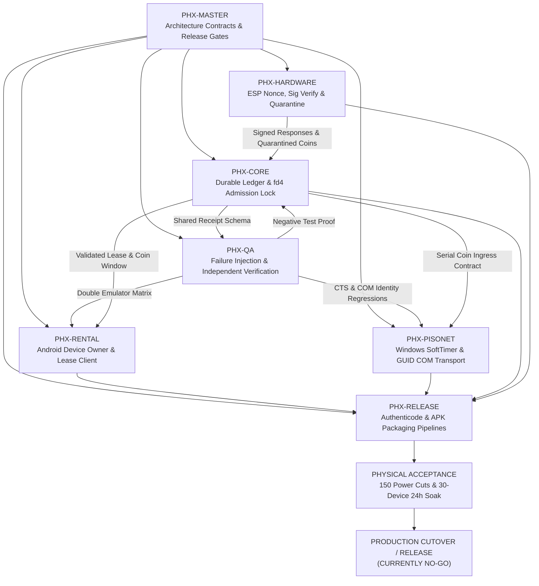

# Project Phoenix — Subsystem Integration Matrix & Gate Hierarchy

**Protocol Specification:** BLAZE-COMMS/1  
**Master Auditor:** `PHX-MASTER`  
**Original matrix date:** 2026-11-13 · **Latest bounded correction:** 2026-11-22 UTC00  
**Overall Commercial / Production Status:** **STRICT NO-GO**

---

## 1. Subsystem Readiness Matrix

| Subsystem | Owner Role | Code Maturity | Dev Ready | Lab / CI Verified | Hardware Accepted | Production Ready | Active Draft PR / Branch |
|---|---|---|---|---|---|---|---|
| **Coordination & Gates** | PHX-MASTER | In review | **DRAFT** | **PARTIAL** (QA recipient 4/4; full 18-suite **NOT RUN**) | N/A (Governance) | **NO RELEASE AUTHORITY** | [Draft #288](https://github.com/BlazeDevStudio/BlazingSystems-Experiments/pull/288) |
| **Financial Ledger / Vendo** | PHX-CORE | Medium | **YES** | **YES** (Lab/CI) | **NO** (Pending HW) | **NO** (Gate P0) | PR #241, #248, #252 |
| **ESP32/ESP8266 Firmware** | PHX-HARDWARE | Medium | **YES** | **YES** (C++ Mock) | **NO** (No bench log) | **NO** (Gate P0) | PR #283, #254 |
| **Android BlazeRental** | PHX-RENTAL | High | **YES** | **YES** (API27 CI) | **NO** (Physical DO) | **NO** (Lineage lock) | PR #240, #285, #287 |
| **Windows SoftTimer** | PHX-PISONET | High | **YES** | **YES** (CLR/Win CI)| **NO** (Serial bench) | **NO** (AuthSign lock) | PR #238, #255, #268 |
| **QA / Failure Injection** | PHX-QA | High | **YES** | **YES** (20-job CI) | **NO** (Physical rig) | **NO** (Gate P0) | PR #267, #264, #279 |
| **Release / Packaging** | PHX-RELEASE | Medium | **YES** | **YES** (CI smoke) | **NO** (Prod secrets) | **NO** (Authenticode) | PR #242, #217 |

---

## 2. Cross-Subsystem Dependency Flow

---

## 3. Mandatory Integration Gates

Every change affecting money, cryptographic state, or physical actuation must progress sequentially through the following numbered gates:

### Gate 1: Source-Contract Definition & Non-Overlapping PRs
- Changes must reside in a dedicated role branch matching `ROLE_ASSIGNMENTS.md`.
- No single PR may alter both client UI and server accounting scripts.
- Handover ledgers (`PROJECT_HANDOVER.md`, `CURRENT_STATE.md`, `CHANGE_LEDGER.md`) must be synchronized with the commit.

### Gate 2: Lab & CI Verification on Exact SHA
- Source-exact commit must pass all automated linters, static checks (`static.sh`, `config.sh`), and compiler warnings-as-errors.
- Negative tests must be demonstrated: the failure must reproduce (RED) on baseline and resolve (GREEN) on candidate.
- Evidence links must cite exact GitHub Actions run and job IDs.

### Gate 3: Peer & QA Independent Verification
- Financial, cryptographic, and migration changes require independent review by `PHX-QA` and `PHX-MASTER`.
- `PHX-QA` verifies the identical git commit SHA using independent test fixtures without shared mutable state.

### Gate 4: Hardware & Physical Acceptance (P0 Gate #34)
- **150 Real Power-Cut Trials:** Abrupt power termination during active coin insertion and member transfer; journal must recover cleanly with zero corrupt receipts or phantom balance.
- **30-Device 24-Hour Soak:** 30 physical client nodes (mix of Android rental devices and Windows SoftTimer stations) running concurrent sessions under full traffic.
- **Physical Coin Ingress Validation:** Real mechanical coin selectors (multi-coin and single-coin) tested across denominations.

### Gate 5: Production Release Authorization (Master Gate)
- Formal approval by `PHX-MASTER`.
- Verification of authentic production code-signing certificates and anti-rollback witness.
- Final tag and manifest generation.

> [!IMPORTANT]
> **Active Gating Notice:**  
> Gates 1–3 are **incomplete across the combined target**; isolated historical CI results do not validate current stacked commits or the final integration tree. Gates 4 and 5 remain **CLOSED (NO-GO)**. No production release, real-money migration, flashing or customer cutover is authorized without independent acceptance and explicit owner approval.

## 4. Live evidence correction — 2026-11-15 UTC23

The 2026-11-13 table retains **historical, scope-limited worker CI claims**, not universal current-HEAD acceptance. Do not interpret the other subsystem `YES (Lab/CI)` cells as green for COE draft #26 or a future combined merge. Per-PR evidence must be reconciled on the exact proposed integration SHA before upgrading readiness; `NO` in the Production Ready column remains binding.

**Master source-exact distinction:** Independent [PHX-QA draft #292](https://github.com/BlazeDevStudio/BlazingSystems-Experiments/pull/292) recorded `4/4 PASS` on original four recipient tests with the **corrected** verifier Git blob `903df4034f8aa46f66e32de6e0be9b9ab2ca4b48`; this is a source-linked minimal checkout, not a full PR synthetic merge or the Master `18`-method unit suite. Consequently **Coordination Lab/CI: PARTIAL**, not `YES`. Earlier source-exact `2 PASS / 2 RED` remains recorded as a genuine pre-fix finding.

**PISONET migration provenance gate:** [Windows SoftTimer parity ledger](WINDOWS_SOFTTIMER_PARITY_20261115.json) compares owner [Experiments PR #255](https://github.com/BlazeDevStudio/BlazingSystems-Experiments/pull/255) pinned `d01fd1642c105b3b0f6cd3343d1c9b67291f6e09` against monorepo [COE integration PR #26](https://github.com/BlazeDevStudio/CoinOperatedEcosystem/pull/26) pinned `b382d233ff06c8791b1028bed3c617cc7b670d12`: 27 same-path identical blobs; **11 different**, **30 source-only** and **9 candidate-only**. File hashes, modes and paths are recorded read-only, not semantic compatibility. PISONET/QA must review each before allowing any copy or merge; do not overwrite staged error-aware `TryGetSignal` with an older active-low fail-open implementation. Stacked child [COE PR #30](https://github.com/BlazeDevStudio/CoinOperatedEcosystem/pull/30) advanced during this audit and is intentionally **not** conflated with PR #26.

**Release sequence:** source parity + license/dependency review → exact proposed combined-tree integration and independent QA → protected signing/independent witness and reversible financial migration → noncustomer real-target acceptance (150 real power cuts, 30-device/24h soak) → explicit owner-authorized release decision. No step can be waived by a readiness percentage, an isolated green CI job, or a coordination-only documentation merge.

---

## Live pinned migration review — 2026-11-16 UTC21

See [SOURCE_INTAKE_STATUS_ENUM_AUDIT_20261116_UTC21.md](SOURCE_INTAKE_STATUS_ENUM_AUDIT_20261116_UTC21.md) for exact Git-tree evidence and human reproduction steps.

- Source snapshot `6d4c9b487af4d768c4d7627654d119417fcc6e00` is 22 commits behind active Phoenix development `blazepwifi-v0.6.0-audit-foundation@2fbd2475e9f54878c316fa7cea2f228386b0e859`.
- COE #26 `b382d233ff06c8791b1028bed3c617cc7b670d12`: 61/61 manifest blob identities and modes match the pinned source/destination trees; actual classification is 46 identical / 15 derived, not the manifest summary 47/14.
- Destination rootfs has one unmanifested extra `usr/sbin/blaze-appliance-diag`; source/current-development test trees contain 149/150 files versus 19 in destination, with only two exact test identities.
- Root project license and three rootfs vendor license/notice files match. Android launcher, jsQR test-vendor, and Tabler license-bearing paths have no corresponding candidate destination path; owner provenance review remains required.
- COE #26 still has five queued workflows. Master PR #288 has no PR-triggered workflow runs. Scoped role CI results are recorded in the audit; none establishes integrated or physical acceptance.
- Production remains NO-GO. No migration, merge, release, or subsystem source edit is authorized by this snapshot.

## Live QA evidence freshness correction — 2026-11-16 UTC22

See [QA_EVIDENCE_FRESHNESS_AUDIT_20261116_UTC22.md](QA_EVIDENCE_FRESHNESS_AUDIT_20261116_UTC22.md) for the pinned refs, exact role PR heads, workflow links and reproduction limits.

- Current Master draft PR #288 is `phoenix/master-coordination@9f05cf7eedb9a91f599504450520f59702ded91d`. Current verifier blob is `3a6d0ca34cad54cd113abbda17d90898603547b3`; the recipient contract accepts one exact registered PHX role or literal `ALL`.
- The prior **18-test** count is stale. The current tree contains **38 authored methods** across `test_verify_coordination.py` (21), `test_verify_source_intake_manifest.py` (11), and `test_snapshot_identity.py` (6). This is inventory, not a pass claim.
- Current source-extracted recipient harness: **8/8 PASS**. Full 38-method exact-checkout suite remains **NOT RUN**; the local Git clone failed DNS and Master #288 has no PR-triggered workflow runs.
- QA PR #292 remains draft at `75a3f66d...`, based on `b1ca02e...`, which is **55 commits behind** current Master HEAD. Its reported 4/4 GREEN retest used older verifier blob `903df403...`, not current blob `3a6d0ca...`. Rebase/reproduce against current #288 HEAD before any QA VERIFIED disposition.
- COE PR #26 remains draft at `b382d233...` with five queued workflows. A separate successful stacked PR #30 run does not clear #26.
- Private Drive v11 registry was not retrieved in this activation; no older registry was substituted. Production remains **NO-GO**.

## Live hardware poll / quarantine stack hold — 2026-11-16 UTC22

See [HARDWARE_POLL_CONTRACT_AND_STACK_HOLD_20261116_UTC22.md](HARDWARE_POLL_CONTRACT_AND_STACK_HOLD_20261116_UTC22.md) for the exact source patches, branch comparisons and CI jobs.

- Hardware #315 and #316 both modify the same ESP32/ESP8266 sketches but are divergent branches: #316 is 10 commits ahead and 108 behind #315. Do not integrate or choose a branch until PHX-HARDWARE consolidates them into one owner-controlled stack.
- #316 run [43972511250](https://github.com/BlazeDevStudio/BlazingSystems-Experiments/actions/runs/43972511250) remains in progress at last observation; validation job [133668043447](https://github.com/BlazeDevStudio/BlazingSystems-Experiments/actions/runs/43972511250/job/133668043447) failed at Controller protocol parity. ESP32/ESP8266 compile jobs passed; other matrix jobs were still in progress. The focused [43972511337](https://github.com/BlazeDevStudio/BlazingSystems-Experiments/actions/runs/43972511337) success is the inherited quarantine lab, not the new poll-response matrix.
- The #316 patch permits an `ok=true` response to pass when `cfg.key` is empty. This conflicts with the existing signed-response contract. Provisional default-deny clarification is now recorded in `ARCHITECTURE_CONTRACTS.md`; PHX-CORE and PHX-HARDWARE review is pending.
- #315's same-boot RAM latch is not by itself proof that a rejected coin event remains non-replayable across reboot. Durable reconciliation semantics remain open with PHX-CORE/HARDWARE and independent QA.
- PHX-HARDWARE's UTC22 issue envelope used a semicolon-separated `to` field, which the current BLAZE-COMMS validator rejects. Republish only as one role or `ALL`; preserve the original comment.
- No subsystem source, firmware, merge or production state changed. Production remains **NO-GO**.

### Final #316 workflow status correction — 2026-11-16 UTC22:45Z

The prior in-progress observation is superseded: exact-head full run [43972511250](https://github.com/BlazeDevStudio/BlazingSystems-Experiments/actions/runs/43972511250) completed **failure** at 22:45:24Z. Validation job [133668043447](https://github.com/BlazeDevStudio/BlazingSystems-Experiments/actions/runs/43972511250/job/133668043447) failed at Controller protocol parity. ESP32/ESP8266 and listed firmware target builds completed success; Android completed success; production signing/import/publication and candidate-gate jobs were skipped. This is not a CI pass, and the inherited focused quarantine lab does not clear the failed poll validation. See the hardware hold document for the exact evidence and owner-reported extractor diagnosis.

## Live role/CI correction — 2026-11-16 UTC23

Exact repository refs observed for this snapshot: Experiments `main@f4e8a891aed8af86d5fd315d28750a0ac3a7372b`; `blazepwifi-v0.5.3-development@aad3aade72c1156eecba1fed30907c6d0283b2c5`; Master draft `phoenix/master-coordination@8201deb9198a8416a6546584a9a8f5789526ad84`; COE `main@a6513ab4412b4c014eee2863e45cbe32d06cb243`; COE integration #26 `b382d233ff06c8791b1028bed3c617cc7b670d12`.

- The current `OWNERSHIP_ROUTES.json` blob `e4db324315a1b3543fec17a148fbf960170fcb29` remains `DRAFT_REVIEW_ONLY`, pinned to source main `f4e8a891...` and destination PR #26 `b382d233...`. Its PHX-MASTER route remains coordination-only; no route authorizes copy or migration.
- Master #288 has no PR-triggered workflow runs. The complete current Master Python suite was not executed: a local `git ls-remote` attempt failed because this runtime could not resolve `github.com`. Do not infer PASS from source inspection.
- COE #26 has five queued candidate-head workflows, not completed CI: 43096752609 (case collision), 43096752632 (SoftTimer), 43096752800 (Hardware/Shared), 43096752563 (Rental), 43096752557 (Pisowifi).
- CORE #252, RENTAL #240/#289/#287, PISONET #255, HARDWARE #294/#314/#315, QA #267 and RELEASE #242/#291 have the scoped success runs listed in the live role snapshot in [ROLE_ASSIGNMENTS.md](ROLE_ASSIGNMENTS.md). These are not combined-tree acceptance.
- HARDWARE #315 and #316 are not a single linear stack. #315 is based on #314 head `556adc20...`; #316 is based on #294 head `8cbd4ece...`. The exact PR file lists overlap on both ESP32 and ESP8266 sketches. Comparing #315 head `953b743f...` with #316 head `888e6941...` reports diverged histories (10 commits ahead / 108 behind; common base #294 head). Do not merge either independently or overwrite one with the other.
- #316's focused source-extracted poll-response lab run 43972511337 passed, but its full build run 43972511250 failed in validation job 133668043447 at Controller protocol parity: the #294 extractor compiles a loop that now calls `acceptPollResponse` without extracting/declaring that helper. ESP32 and ESP8266 compile jobs themselves passed. The new #316 lab is not yet wired into the canonical validation workflow.
- Source inspection of #316 shows `signatureOk=true` before the conditional `if(String(cfg.key).length())`; with an empty key, the signature check is skipped and a response containing `"ok":true` can reach the authorization path. This conflicts with the **provisional** default-deny contract in Architecture Contracts §6.1 (owner review still pending). PHX-CORE and PHX-HARDWARE must agree the keyless policy; PHX-QA must add an empty-key negative case. Master did not edit firmware.
- The RAM-only `journalRecoveryRequired` limitation remains open for reboot-safe rejected-event disposition under Architecture Contracts §6.2. PHX-CORE owns ledger/replay semantics; PHX-HARDWARE owns firmware persistence; QA owns independent failure/reboot tests.
- QA #292 is not current Master evidence: its branch verifier blob is `a8a989964c45ab9aef5719e8d17ba3f6fc66e773`, while current Master is `3a6d0ca34cad54cd113abbda17d90898603547b3`. Branch comparison shows 63 Master-only commits and 6 QA-only commits after the common base. No #292 PR-triggered workflow run was returned.
- P0 issues #31, #32, #34, #43 and #177 remain open. Protected signer/independent anti-rollback witness, crash-atomic financial state, reversible migration, native acceptance, 150 real power cuts and 30-device/24-hour soak remain unverified. **PRODUCTION NO-GO**.
- The exact private Drive registry v11 and newer corrections were not accessible through the current connected tool surface; exact-name Library search did not return v11. Older Library registry artifacts were not substituted. The AGENTS.md storage-policy/handover links also could not be retrieved through the connected GitHub file reader. No private Drive contents or identifiers were published.
- No source migration, firmware edit, branch rewrite, merge, release, signing, secret provisioning, hardware flash, physical test or live financial operation occurred in this Master activation.

## Live PHX-MASTER snapshot — 2026-11-17 UTC00

This section supersedes earlier live-status tables only for the exact refs observed in this snapshot. Historical evidence remains preserved.

### Exact branch and candidate refs

| Ref | Exact SHA |
|---|---|
| Experiments main | f4e8a891aed8af86d5fd315d28750a0ac3a7372b |
| Experiments blazepwifi-v0.5.3-development | aad3aade72c1156eecba1fed30907c6d0283b2c5 |
| Experiments blazepwifi-v0.6.0-audit-foundation | 2fbd2475e9f54878c316fa7cea2f228386b0e859 |
| Master PR #288 before this snapshot | 3d3634dfab35d9f427e159b7d392194edda37930 |
| COE main | a6513ab4412b4c014eee2863e45cbe32d06cb243 |
| COE integration PR #26 | b382d233ff06c8791b1028bed3c617cc7b670d12 |

The v0.5.3 branch is 293 commits behind main. The v0.6 audit-foundation branch is 22 commits ahead of the pinned PisoWiFi source commit 6d4c9b487af4d768c4d7627654d119417fcc6e00; v0.6 and main are divergent. The current OWNERSHIP_ROUTES.json remains DRAFT_REVIEW_ONLY and routes PHX-MASTER to coordination/phoenix/ only.

### Migration manifest and exact selected blobs

At COE #26 b382d233, SOURCE_INTAKE.json blob 1b9018ff944f7f673934d0fc2a97e0a0090d3f5f reports 47 byte-identical / 14 derived rootfs files. MIGRATION_MAP.md blob b54fc15d83bc2269de03db8aadd0e76259fd13d9 has 61 rootfs rows; the recorded Git blob IDs compute 46 identical / 15 different (13 intentionally edited, 2 locally derived). The summary is inconsistent by one in both counters. The two locally derived member.sh and rental.sh entries state real-router tests NOT_RUN.

The source-intake manifest pins source 6d4c9b... and a prior destination feature branch/head cf59b41..., while OWNERSHIP_ROUTES.json pins source main f4e8... and candidate PR #26 b382d233.... Reconcile these snapshots before proposing a move.

Selected blobs: vendo source pin/v0.6 = db58041c0575ad0a1101d99cb85403e03c8dcb22; Experiments main = 2e3a1430d08cc6606429a042df3b5848f53c7267; COE #26 destination = 0a71c4e253ac6ec2c30d46f1f99faf874dbaab8e. common.sh source pin = 4ccb10777b08f541d092f7c2c2d2aad4d2f6562e; v0.6 branch = 50fa2d02d40af7fd8b06e83974345f1016a317f9; COE destination = ae00667da26c68c9e44a54a941887191029afc11. The candidate contains derived versions; current source drift needs owner review.

Root PisoWiFi LICENSE and selected vendor QR LICENSE, TailAdmin LICENSE and NOTICE blobs match between pinned source and destination. This is a bounded check, not a complete dependency/license audit. SOURCE_INTAKE lists four legacy tests (two unchanged, two derived) and 15 derived tests (11 NOT_RUN, four PENDING_CI_RUN). COE #26 has five queued workflows and no completed integration acceptance.

### Current role CI

| Role / PR | Exact head | Exact-head workflow observation |
|---|---|---|
| MASTER #288 | 3d3634dfab35d9f427e159b7d392194edda37930 | No PR-triggered workflows returned |
| CORE #252 | c82705f2de865c89ab733b10efa84f26f56a5cc4 | 42698139210 success |
| RENTAL #289 | 68928774d0d7cf65adb26bc6b54199a3159d066c | 43653329235 and 43653329229 success |
| PISONET #255 | d01fd1642c105b3b0f6cd3343d1c9b67291f6e09 | 42462978704 success |
| HARDWARE #315 | 939e6ae09050e3e7244249acf9c7969301a05363 | Focused 43982762795 success; full 43982762668 validation failure; ESP32/ESP8266 compile jobs success |
| HARDWARE #316 | 888e6941e3a7a81641682c23d937f97d8117d2ea | Focused 43972511337 success; full 43972511250 validation failure |
| QA #292 | 75a3f66d9563e38a0a48b9cf487b0b057a91ea96 | No PR-triggered workflows returned |
| QA #267 | ff5367990c2d27b8ebbb822ee208251af0c890e2 | 41452247439 success |
| RELEASE #291 | 2c4edff231d9b2819415086825530d80b8801307 | 43744993487 success |

COE role drafts: #31 RELEASE f4f93dd7... runs 43986022373 and 43986022315 success; #29 CORE d0830332... runs 43653906675/676 success; #30 PISONET 4897348d... run 43653415598 success; #28 PISONET b21b0461... run 43632393888 success; #32 QA 29b6fe08... run 43653540607 success; #27 HARDWARE/Shared 009f70cc... runs 43079646393/46264 success. COE #18 PisoWiFi and #19 Rental have case-collision-only runs 43061613277 and 43061768902. These are scoped checks, not integrated acceptance.

### HARDWARE shared-contract blocker

Current #315 ESP32/ESP8266 acceptPollResponse helpers skip signature verification when cfg.key is empty because signatureOk starts true and verification is conditional on a nonempty key. A keyless ok=true response with a nonempty target can pass. The focused 8/8 poll lab uses a test-key and has no empty-key case. The full validation failure is also reproducible: the #294 QA extractor omits acceptPollResponse, so both board extracts fail compilation with “not declared in this scope”. Architecture Contracts §6.1 already requires default-deny for an empty key. PHX-HARDWARE owns firmware correction, PHX-CORE owns the signature/replay contract, and PHX-QA owns extractor and negative/reboot tests.

### Execution and release limits

Ten local synthetic Python tests for the new Master-owned migration-map verifier passed; no full Master suite or PR-triggered Master CI ran. The private Drive registry v11 and newer corrections were not available through the connected tool surface; older Library versions were not substituted. No migration, merge, signing, release, flash or physical acceptance is authorized. PRODUCTION NO-GO remains.

## Live poll-response producer/consumer reconciliation — 2026-11-17 UTC02

This snapshot supersedes earlier poll-response claims only for the exact refs below; historical evidence is retained.

### Exact refs and routing

| Ref | Exact SHA / state |
|---|---|
| Experiments main | f4e8a891aed8af86d5fd315d28750a0ac3a7372b |
| Experiments blazepwifi-v0.5.3-development | aad3aade72c1156eecba1fed30907c6d0283b2c5 |
| Experiments blazepwifi-v0.6.0-audit-foundation | 2fbd2475e9f54878c316fa7cea2f228386b0e859 |
| Master branch / PR #288 before this snapshot | d047c49419c920a546ff9438f2fc9e708566f78a |
| COE main | a6513ab4412b4c014eee2863e45cbe32d06cb243 |
| COE integration PR #26 | b382d233ff06c8791b1028bed3c617cc7b670d12 |

PR #288 is open/draft and based on Experiments main. OWNERSHIP_ROUTES.json remains DRAFT_REVIEW_ONLY at blob e4db324315a1b3543fec17a148fbf960170fcb29; PHX-MASTER remains coordination-only. Cleanup issue #266 remains open. No route authorizes source relocation.

### Poll producer/consumer parity

| Exact file snapshot | Git blob | Poll response |
|---|---|---|
| Experiments main | 2e3a1430d08cc6606429a042df3b5848f53c7267 | No response_sig in poll action |
| v0.5.3 development | a1c19180385e618c412b4af21c0e91c1f47da1dd | No response_sig in poll action |
| v0.6 audit-foundation | db58041c0575ad0a1101d99cb85403e03c8dcb22 | No response_sig in poll action |
| COE #26 candidate | 0a71c4e253ac6ec2c30d46f1f99faf874dbaab8e | response_sig emitted by derived vendo_poll_sig |

The current COE candidate root LICENSE blob and Experiments main root LICENSE blob both equal 1ee55b94183417be977ca287cd7391f9a6f7e721. This is one bounded license identity check, not a complete dependency/license audit.

HARDWARE #315 at b21d05822772e7c07299331d2a6a1670da2b077e has ESP8266 blob 226c068731666d20eb91a2544ecb8ef9f9c11432 and ESP32 blob 54308cc5153c11889d107af1e15e560f39ebb327. Both consumers initialize signatureOk=false, require a nonempty configured key and response_sig, reject targetless positive responses, and clear stale insert/target state on denial. This is source inspection plus focused CI, not hardware acceptance.

Focused exact-head run 43997886923 / job 133754358681 completed SUCCESS. Its log reports poll-response 10/10 per board and strict root JSON 13/13 per board, in addition to quarantine/mount/recovery checks. Full run 43997886963 completed FAILURE at validation job 133754360411: the QA-owned tests/controllers.sh source extractor omits acceptPollResponse(), so both generated board harnesses fail with an undeclared-function error. ESP8266 and ESP32 compile jobs, Android and returned target image jobs passed; production sign/import/publish and candidate simulations were skipped. See [focused run](https://github.com/BlazeDevStudio/BlazingSystems-Experiments/actions/runs/43997886923), [full run](https://github.com/BlazeDevStudio/BlazingSystems-Experiments/actions/runs/43997886963), and [failing validation job](https://github.com/BlazeDevStudio/BlazingSystems-Experiments/actions/runs/43997886963/job/133754360411).

HARDWARE #316 remains open/draft at 888e6941e3a7a81641682c23d937f97d8117d2ea; its older full run 43972511250 has the same extractor failure. #315 is the owner-reported consolidated stack; Master did not close #316 or modify firmware.

### Live role CI summary

| Role | Exact open draft head(s) | Exact-head CI observation |
|---|---|---|
| MASTER #288 | d047c49419c920a546ff9438f2fc9e708566f78a | No PR-triggered workflow runs returned |
| CORE #252 | c82705f2de865c89ab733b10efa84f26f56a5cc4 | 42698139210 success |
| RENTAL #240 / #287 / #289 | a7d113fb8ae3f0c5e838e64d31cae7a154e37b56; a4fffd01c8fb1818c32a53522e0590c1dc8a77cd; 68928774d0d7cf65adb26bc6b54199a3159d066c | 40910311141/40910311159; 43754089203; 43653329235/43653329229 success |
| PISONET #255 | d01fd1642c105b3b0f6cd3343d1c9b67291f6e09 | 42462978704 success |
| HARDWARE #314 / #315 / #316 | 556adc20ef0cfd355089aff3b979c0169af79bdd; b21d05822772e7c07299331d2a6a1670da2b077e; 888e6941e3a7a81641682c23d937f97d8117d2ea | #314 43782088731/43782088748 success; #315 focused 43997886923 success, full 43997886963 failure; #316 focused 43972511337 success, full 43972511250 failure |
| QA #267 / #292 / #279 | ff5367990c2d27b8ebbb822ee208251af0c890e2; 75a3f66d9563e38a0a48b9cf487b0b057a91ea96; 8f476ef05893193325ef3d1f65a35e144ae7a568 | #267 41452247439 success; #292 and #279 no PR-triggered runs returned |
| RELEASE #242 / #291 | 734b89d9e7792247e8376335c3f3685500ab3f89; 2c4edff231d9b2819415086825530d80b8801307 | 40882814472 and 43744993487 success |

COE role drafts re-read for this poll review: #27 head 009f70cc2c2775039a5fb072c9d4fdedee76cfc7 (43079646393/43079646264 success); #29 head d0830332dee8a1844a85606150681b41d91fe796 (43653906676/43653906675 success); #31 head f3f995c91e38b5c5908bf8910056523015c8f0fd (44002215761/44002215760 success); #32 head 29b6fe08b10688182d981a66745f482758bd6630 (43653540607 success). COE #26 still has five queued candidate-head workflows: 43096752609, 43096752632, 43096752800, 43096752563 and 43096752557. These are scoped workflow observations, not integrated acceptance.

### Master static audit execution

Seven read-only structural assertions were executed against freshly fetched source files: unsigned poll action on main/v0.5.3/v0.6, signed poll action on COE #26, default-deny key requirement on both hardware consumers, and identical root LICENSE blob. Result: 7/7 PASS. These are Master audit assertions, not the Project Phoenix Python suite, not the canonical controller lab, and not CI.

The full Master Python suite was not executed and #288 has no PR-triggered workflow runs.

### Registry and remaining gates

The exact private Drive BLAZE_PROJECT_REGISTRY_v11_20261027.json and newer corrections were not retrievable: no Google Drive connector/read action was exposed, and exact-name Library search did not return v11. No older Library registry was substituted; no private contents or identifiers were published.

PHX-CORE must resolve the canonical signed poll producer and exact test vector; PHX-QA must add acceptPollResponse to the canonical extractor and independently verify both boards; PHX-HARDWARE must retain default-deny and durable rejected-event work; COE integration must reconcile the derived candidate against pinned source and licenses before any move.

Independent protected signing/anti-rollback witness, crash-atomic durable financial state, reversible migration tests, independent QA, native acceptance, 150 real power cuts and 30-device/24-hour soak remain unverified. PRODUCTION NO-GO.

## Live poll/config trust-boundary reconciliation — 2026-11-17 UTC03

This snapshot supersedes earlier poll/config claims only for the exact refs below; historical checkpoints remain intact.

### Exact refs and current owner evidence

| Area | Exact ref | Current evidence |
|---|---|---|
| Experiments main / development / v0.6 | `f4e8a891...` / `aad3aade...` / `2fbd2475...` | Poll producer in these source refs does not emit the candidate's signed poll response. |
| Master #288 | `2c2b517995365e23d89e423e2b9faeac4135381f` before this audit | No PR-triggered workflow runs returned. Master scope remains coordination/phoenix only. |
| HARDWARE #315 | `58ade5df83df0c6894dd8d1e2a70617b90dae374` | Focused run 44008962809 success; full run 44008962837 failed at QA controller extractor job 133791150681. ESP32/ESP8266 and other target builds passed; no overall full-workflow success. |
| HARDWARE #316 | `888e6941e3a7a81641682c23d937f97d8117d2ea` | Focused run 43972511337 success; full run 43972511250 failed validation. Separate draft remains open. |
| CORE #252 | `c82705f2de865c89ab733b10efa84f26f56a5cc4` | Experiments run 42698139210 success; scoped CORE CI only. |
| QA #292 | `75a3f66d9563e38a0a48b9cf487b0b057a91ea96` | No PR-triggered workflow runs returned; no independent register-config test evidence. |
| RELEASE #242 | `734b89d9e7792247e8376335c3f3685500ab3f89` | Run 40882814472 success; no signing/release authorization. |
| COE integration #26 | `b382d233ff06c8791b1028bed3c617cc7b670d12` | Five candidate-head workflows remain queued; no integrated acceptance. |
| COE HARDWARE #27 / CORE #29 / QA #32 / RELEASE #31 | `009f70cc...` / `d0830332...` / `29b6fe08...` / `79f79c6c...` | Their scoped workflows returned success (respectively 43079646393/46264; 43653906676/675; 43653540607; 44009785780/581). These do not test the Experiments #315 register-config path or establish COE #26 acceptance. |

### New source finding

HARDWARE #315 removed configuration application from poll admission, but the exact ESP32 and ESP8266 `connectSta()` paths still call `applyRemoteConfig(r)` after register/ping. Both initialize `sigOk=true` and only verify a register signature if a key exists. The COE #26 register producer's `vendo_ping_sig()` covers action, controller ID, request nonce and server time, but not the returned controller configuration object. Thus:
- empty-key register responses can still apply configuration without authentication;
- a provisioned-key register signature does not authenticate modified configuration fields;
- the current poll config-injection lab does not cover this register path.

This is a source inspection finding, not a live exploit or physical actuation result. Full evidence and owner actions are in [POLL_CONFIG_REGISTER_TRUST_BOUNDARY_AUDIT_20261117_UTC03.md](POLL_CONFIG_REGISTER_TRUST_BOUNDARY_AUDIT_20261117_UTC03.md).

### Required owner sequence

1. PHX-HARDWARE disables/guards the remaining register-path configuration application and adds both-board negative regressions.
2. PHX-CORE defines a separate domain-separated configuration signature and exact canonical golden vectors.
3. PHX-QA independently verifies keyless, altered-config, wrong-identity/nonce, stale revision, invalid-range and persistence-failure cases on the identical exact SHA; separately repair the canonical controller extractor.
4. PHX-RELEASE keeps signing/publication gated until independent QA and Master review.

**Gate:** remote configuration remains disabled pending owner-reviewed contract; poll admission remains default-deny for keyless/unverified responses. Focused source-extracted CI is SIMULATED / CI VERIFIED only. Physical acceptance remains NOT TESTED. PRODUCTION NO-GO.

## Live remote-configuration source/staging correction — 2026-11-17 UTC04

**Disposition: BLOCKED for COE #26 migration; PRODUCTION NO-GO.**

- Experiments #315 current owner head is 75dc5f0b888f16e2c85e4321f62df4685639ad33. ESP8266 blob f59e624ae2da04bddc70ddc2809bf6d8ff486aac and ESP32 blob 38a2d239eed6af876d421f9f908bbb62b3ae27e1 each contain only the dormant applyRemoteConfig definition. There are zero response call sites.
- COE #26 destination head b382d233ff06c8791b1028bed3c617cc7b670d12 still contains ESP8266 blob c8be98f72596681e36a3ad1f8939bf8046c96887 and ESP32 blob 3cc7ec54b476943dc04a8d1af5e2df5fe054e422. Each contains two applyRemoteConfig(r) response call sites and two sigOk=true defaults (register and poll). The staged candidate therefore remains unsafe for migration until its owner resolves the mismatch.
- HARDWARE focused run 44013351048 succeeded, including register-config denial 7/7 per board. HARDWARE full run 44013351035 failed in validation job 133805413831 because the QA-owned extractor omitted acceptPollResponse(); board compile and target image jobs passed. This is not an overall full-build pass.
- COE #26 still has five queued workflows. Master #288 has no PR-triggered workflow runs.
- The Hardware source-intake/license record is incomplete: Pisowifi/SOURCE_INTAKE.json is explicitly PisoWiFi-only; the Hardware subtree has no LICENSE/NOTICE, and the candidate's firmware audit still claims the firmware was not copied although both sketches exist in the PR tree. The source MIT license and Pisowifi/LICENSE share blob 1ee55b94183417be977ca287cd7391f9a6f7e721, but coverage for Hardware is not established.

**Owner sequence:** HARDWARE maintains the source-side deny behavior; QA repairs the extractor and independently tests both boards; CORE reviews the configuration authorization domain; COE integration owner reconciles per-file provenance, license scope and candidate tests. No blind copy, source move or merge is authorized. See REMOTE_CONFIG_MIGRATION_STAGING_AUDIT_20261117_UTC04.md.

## 11. Live exact-head Hardware migration hold — 2026-11-17 UTC05

| Gate surface | Current owner source | COE #26 candidate | Disposition |
|---|---|---|---|
| ESP32 remote config | #315 blob 38a2d239...; helper definition only; register/poll responses do not apply config | blob 3cc7ec54...; three helper occurrences; register/poll call sites; two keyless-true defaults | BLOCKED |
| ESP8266 remote config | #315 blob f59e624...; helper definition only; fail-closed register tuple and poll acceptance | blob c8be98f...; three helper occurrences; register/poll call sites; two keyless-true defaults | BLOCKED |
| Quarantine clear | #315 returns 403; no quarantine-log delete call | #26 deletes /quarantine.log and returns 200; no explicit AP-origin guard | P0 MIGRATION HOLD |
| Source tests | register config 7/7 and poll/config 11/11 per board in focused #315 source lab | one shell hardening script; no keyless, no-config-callsite, 403/no-delete or AP-origin regressions | IMPORT GAP |
| License/notice | BlazePwifi MIT LICENSE and source repository NOTICE | Pisowifi/LICENSE only; Hardware/root scope unresolved | OWNER REVIEW |

The exact blobs and modes are recorded in HARDWARE_STAGING_PARITY_AUDIT_20261117_UTC05.md. Focused #315 run 44013351048 succeeded on source-extracted host tests; full #315 run 44013351035 failed in the QA-owned controller extractor. COE #26 still has five queued workflows. None of these results establishes integrated acceptance.

**Disposition:** keep #26 draft and do not copy/promote Hardware files until PHX-HARDWARE and independent PHX-QA reconcile exact source/destination blobs, route security, test identities, crypto wording, license/notice scope and candidate CI. No production flash, release, migration or live-money operation is authorized.

## 6. Live exact-head reconciliation — 2026-11-17 UTC06

This section supersedes stale PR/CI identifiers in the historical readiness rows above. All CI labels are scoped to the exact listed commit; none implies hardware acceptance.

| Role | Current draft / exact head | Exact CI evidence | Current disposition |
|---|---|---|---|
| PHX-MASTER | #288 `7616a3d5de69f4e6d7d9905fc91d0c7500bdfd68` | No PR-triggered workflow runs returned | Draft; local full suite NOT RUN |
| PHX-CORE | #252 `c82705f2de865c89ab733b10efa84f26f56a5cc4` | [42698139210](https://github.com/BlazeDevStudio/BlazingSystems-Experiments/actions/runs/42698139210) SUCCESS | Scoped CI only |
| PHX-RENTAL | #289 `68928774d0d7cf65adb26bc6b54199a3159d066c` | [43653329235](https://github.com/BlazeDevStudio/BlazingSystems-Experiments/actions/runs/43653329235), [43653329229](https://github.com/BlazeDevStudio/BlazingSystems-Experiments/actions/runs/43653329229) SUCCESS | Scoped CI only |
| PHX-PISONET | #255 `d01fd1642c105b3b0f6cd3343d1c9b67291f6e09` | [42462978704](https://github.com/BlazeDevStudio/BlazingSystems-Experiments/actions/runs/42462978704) SUCCESS | Scoped CI only; physical serial NOT TESTED |
| PHX-HARDWARE | #315 `c1db0a567500302921c0561bcd31446f12767372` | [44030492133](https://github.com/BlazeDevStudio/BlazingSystems-Experiments/actions/runs/44030492133) focused SUCCESS; [44030492146](https://github.com/BlazeDevStudio/BlazingSystems-Experiments/actions/runs/44030492146) Full validation FAILURE | Host/fake-LittleFS labs only; QA extractor blocker |
| PHX-HARDWARE (separate) | #316 `888e6941e3a7a81641682c23d937f97d8117d2ea` | [43972511337](https://github.com/BlazeDevStudio/BlazingSystems-Experiments/actions/runs/43972511337) focused SUCCESS; [43972511250](https://github.com/BlazeDevStudio/BlazingSystems-Experiments/actions/runs/43972511250) Full FAILURE | Separate open draft; do not compose without owner decision |
| PHX-QA | #292 `75a3f66d9563e38a0a48b9cf487b0b057a91ea96` | No PR-triggered workflow runs returned | Stale base; exact current #315 extractor verification absent |
| PHX-RELEASE | #291 `2c4edff231d9b2819415086825530d80b8801307` | [43744993487](https://github.com/BlazeDevStudio/BlazingSystems-Experiments/actions/runs/43744993487) SUCCESS; publish-release SKIPPED | Scoped Windows CI only |
| COE integration | #26 `b382d233ff06c8791b1028bed3c617cc7b670d12` | Eight exact-head workflows remain QUEUED: 43096752609, 43096752632, 43096752800, 43096752563, 43096752557, 43096746202, 43096746248, 43096746194 | No completed destination acceptance |

### 6.1 Current hardware migration hold

The current #315 source blobs are ESP8266 `35bc5b20...` and ESP32 `5b448444...`; COE #26 destination blobs remain `c8be98f7...` and `3cc7ec54...`. All four files are mode `100644`, but neither source/destination pair is byte-identical.

The #315 source now has the durable one-shot `/pending.attempt` marker and exact-source host lab; COE #26 has no marker state or marker lab. COE still has keyless-positive remote configuration call sites and a destructive `POST /quarantine/clear` handler. Its Hardware test tree has one shell hardening script, not the source's current negative/failure-injection suite. No Hardware-scoped LICENSE/NOTICE exists under `Hardware/`; scope requires owner review.

**Migration decision:** no copy, overwrite, relocation, or promotion of the current COE Hardware sketches. The exact comparison and owner actions are in [the UTC06 Master audit](COIN_POST_ATTEMPT_MARKER_MIGRATION_AND_QA_EXTRACTOR_AUDIT_20261117_UTC06.md).

### 6.2 Provisional financial replay invariant

Before any coin POST, the controller must durably write, flush, close, and read back an attempt marker bound to the pending record. A marker found after reboot (matching, malformed, mismatched, or orphan) blocks automatic replay. Clear the pending record first and the marker last, only after authoritative receipt or durable quarantine disposition. This client fence does not replace server idempotency and remains pending PHX-CORE/PHX-QA review and physical power-cut evidence.

Production remains STRICT NO-GO.

## 7. Live coin POST disposition authority and exact-head reconciliation — 2026-11-17 UTC07

**Exact refs:** Experiments main `f4e8a891...`, v0.5.3 development `aad3aade...`, v0.6 audit foundation `2fbd2475...`, Master #288 pre-change `c121d651...`; COE main `a6513ab4...`, COE #26 `b382d233...`.

| Role | Current open draft(s) / exact head | Exact-head CI observation | Gate state / next owner action |
|---|---|---|---|
| PHX-MASTER | #288 `c121d651...` before this update | No PR-triggered workflow runs; targeted source-intake tests 11/11 PASS locally; full Master suite NOT RUN | Coordination-only; maintain architecture and migration holds |
| PHX-CORE | #252 `c82705f2...`; #241 `8aa2529a...`; #248 `a1f80f30...` | #252 run 42698139210 SUCCESS; #241 run 40813818877 FAILURE; #248 run 40882042148 FAILURE | Publish authenticated event-bound coin receipt/disposition contract and idempotency vectors; no Master source edits |
| PHX-RENTAL | #240 `a7d113fb...`; #287 `a4fffd01...`; #289 `68928774...` | #240 runs 40910311141/40910311159 SUCCESS; #287 43754089203 SUCCESS; #289 43653329235/43653329229 SUCCESS | Scoped software evidence only; physical Device Owner/lease acceptance remains outstanding |
| PHX-PISONET | #255 `d01fd164...` | Run 42462978704 SUCCESS | Native COM/serial physical acceptance NOT TESTED |
| PHX-HARDWARE | #315 `4afc7c8bd8ea410049f1da7bc962bfc989b4ba1b`; separate #316 `888e6941...`; older #283 `a8756729...` | #315 focused 44038469936 SUCCESS; full 44038469823 FAILURE in validation job 133887096342; #316 focused 43972511337 SUCCESS/full 43972511250 FAILURE; #283 43634101437 SUCCESS | #315 is current owner candidate; no Master firmware edits. Full validation blocked by stale QA extractor. Current coin POST verifier returns false until approved receipt contract |
| PHX-QA | #267 `ff536799...`; #279 `8f476ef0...`; #292 `75a3f66d...` | #267 41452247439 SUCCESS; #279/#292 no workflow runs returned | Repair extractor for current #315 dependencies and independently test both-board receipt vectors |
| PHX-RELEASE | #242 `734b89d9...`; #291 `2c4edff2...` | #242 40882814472 SUCCESS; #291 43744993487 SUCCESS | Scoped Windows CI only; signing/publisher gates remain closed |
| COE integration owner | COE #26 `b382d233...` | Five workflows remain QUEUED: 43096752609, 43096752632, 43096752800, 43096752563, 43096752557 | Keep draft; reconcile source/destination blobs, imports, tests and license scope before any move |

### 7.1 Current coin POST disposition hold

At exact #315 source blobs ESP8266 `e47d392e...` and ESP32 `5de92f01...` (both mode `100644`), `coinPostDispositionVerified()` returns false until an approved authenticated receipt contract exists. The source persists and readback-verifies `/pending.attempt` before POST and retains the pending evidence on every unapproved response.

COE #26 still stages ESP8266 `c8be98f7...` and ESP32 `3cc7ec54...` (both mode `100644`). Neither pair is byte-identical. The destination lacks the attempt marker and disposition verifier, retains keyless-positive response paths and the prior destructive quarantine-clear mismatch. COE `Hardware/tests/` has only one shell hardening script; it does not import the current source lab.

**Migration decision:** no copy, overwrite, relocation, merge or promotion. Keep COE #26 draft. Exact full blob identities, sizes, test identity and CI are in [the UTC07 audit](COIN_POST_DISPOSITION_AUTHORITY_AUDIT_20261117_UTC07.md).

### 7.2 CI/test interpretation and release gates

The #315 focused run is source-extracted host/fake-filesystem evidence only: 34/34 host scenarios passed, coin disposition default-deny 4/4 per board, pending attempt marker 19/19 per board. The log explicitly reports physical coin acceptance and power-cut verification as zero. The full #315 workflow is failed because the QA-owned extractor omits five current firmware dependencies; ESP target builds passing does not turn that workflow green.

The PHX-MASTER source-intake test file executed locally at its exact fetched source/test blobs: 11/11 passed. This is not the complete Master suite or cross-repository acceptance.

COE #29, #28 and #30 have scoped successes at their pinned heads, but they do not validate the combined #26 tree. Historical financial issues #31/#32, witness #43, hardware acceptance #34 and pulse issue #177 remain open.

**PRODUCTION NO-GO:** independent protected signing/anti-rollback witness, crash-atomic durable financial state, reversible migration, independent QA, native acceptance, 150 real power cuts and a 30-device/24-hour soak remain mandatory.

## Live Hardware staging refresh — 2026-11-17 UTC08

The current owner source is Experiments HARDWARE PR #315 at cc0743009f44baeda0ea12d84eb6199a8a6916c7, not the older firmware snapshot staged in COE #26. The separate COE Hardware & Shared PR #27 at 009f70cc2c2775039a5fb072c9d4fdedee76cfc7 contains the same ESP32/ESP8266 firmware blobs as #26 and is therefore a duplicate stale candidate for this comparison, not an updated import.

| Evidence | Exact ref / result | Gate interpretation |
|---|---|---|
| HARDWARE source | #315 cc074300…; focused 44041818004 SUCCESS; full 44041818133 FAILURE | Source lab is simulated; full validation blocked by QA extractor |
| HARDWARE parallel draft | #316 888e6941…; focused 43972511337 SUCCESS; full 43972511250 FAILURE | Separate branch; do not silently compose with #315 |
| COE integration | #26 b382d233…; five workflows QUEUED | No combined-tree CI conclusion |
| COE Hardware & Shared | #27 009f70cc…; runs 43079646264 and 43079646393 SUCCESS | These runs validate the stale #27 candidate, not current #315 source parity |
| Master | #288 349c5e24… before this update; no PR-triggered runs | Coordination-only; no subsystem source change |

Exact firmware blobs differ on both boards; #315 has dormant remote configuration, one-shot attempt/disposition helpers and a deny/no-delete quarantine clear, while #26/#27 retain response-driven config paths, keyless defaults, no attempt marker/disposition helpers and destructive quarantine clear. Source board-local failure labs are not imported into COE Hardware/tests. Hardware license scope remains unresolved. See HARDWARE_STAGING_REFRESH_AND_DUPLICATE_CANDIDATE_AUDIT_20261117_UTC08.md for exact blobs, modes, sizes, test identities and CI.

**Disposition:** keep #26/#27 draft and do not copy, overwrite, relocate or promote firmware. PHX-QA must repair the exact #315 extractor and rerun Full validation; the COE integration owner must reconcile the candidate, tests and license scope. Production remains NO-GO.

## 13. Exact-head poll fixture conflict and COE Hardware migration hold — 2026-11-17 UTC09

| Gate | HARDWARE #315 source | COE #26 destination | Result |
|---|---|---|---|
| Poll admission | Both sketches' `acceptPollResponse()` return DENY; candidate state is cleared | Older response-driven poll/config path remains | BLOCKED |
| Coin POST disposition | `coinPostDispositionVerified()` returns DENY pending CORE contract | Current attempt/disposition helpers absent | BLOCKED |
| Remote configuration | `applyRemoteConfig` definition-only | Three occurrences and two `sigOk=true` defaults per sketch | P0 HOLD |
| Quarantine clear | HTTP 403; no log deletion | HTTP 200 and `LittleFS.remove("/quarantine.log")` | P0 HOLD |
| Firmware blobs | ESP32 `c3833a02...`; ESP8266 `77c403ad...` | ESP32 `3cc7ec54...`; ESP8266 `c8be98f7...` | Non-identical |
| Test imports | Source board-local poll, marker, journal and quarantine labs | One `Hardware/tests/test_firmware_hardening.sh` (`f921c56c...`) | IMPORT GAP |
| License/NOTICE | BlazePwifi LICENSE + repository NOTICE | Pisowifi/LICENSE only; no root NOTICE or Hardware-local notice in candidate tree | OWNER REVIEW |

Current #315 Full run [44054778555](https://github.com/BlazeDevStudio/BlazingSystems-Experiments/actions/runs/44054778555) fails at validation job `133941354361`: the inherited v0.5 fixture still requires a positive `|poll|` signature even though the current source intentionally denies poll admission. Focused quarantine run [44054778537](https://github.com/BlazeDevStudio/BlazingSystems-Experiments/actions/runs/44054778537) succeeds, but does not prove poll admission or physical acceptance. The separate v0.6 extractor omission remains open and was not reached. COE #26's five workflows remain queued.

**Disposition:** no file move/copy/overwrite. PHX-QA repairs the stale test contract and extractor; PHX-CORE approves the canonical poll/receipt contract; PHX-HARDWARE preserves the deny state; COE owner reconciles exact blobs, tests and license scope. See `HARDWARE_POLL_SIGNATURE_FIXTURE_AND_COE_MIGRATION_HOLD_20261117_UTC09.md`. Combined integration and production remain NO-GO.

## 14. PISONET candidate-stack, test-import and installer guard audit — 2026-11-17 UTC10

Exact source/destination trees were re-read at Experiments PR #255 `d01fd1642c105b3b0f6cd3343d1c9b67291f6e09`, COE #26 `b382d233ff06c8791b1028bed3c617cc7b670d12`, #28 `b21b04617d38a177260258de2d56b24382822117`, and #30 `4897348d94a0cf7884ecd53244bfcd59e7bf2fbc`. The source has 68 blobs; candidates have 47/48/48. Same-path identical/different and source-only/candidate-only counts are #26 27/11/30/9, #28 28/10/30/10, and #30 26/12/30/10. All compared modes are 100644; no mode mismatch was observed. The full path inventory and commit-graph evidence are in [PISONET_STACKED_DESTINATION_CANDIDATE_AUDIT_20261117_UTC10.md](PISONET_STACKED_DESTINATION_CANDIDATE_AUDIT_20261117_UTC10.md).

COE #30 is 27 commits ahead of #28 and 0 behind; it is **not** a child of COE #26. #26 and #30 diverge from COE main (merge base `a6513ab...`; compare reports 56 ahead / 85 behind). Do not treat #28/#30 as already included in #26 or propose a recursive copy.

A source-vs-destination safety difference is material: old Experiments #255 `SerialHardware.cs`/ `AppController.cs` can turn an active-low status-read error into an active state; COE #26/#30 use `TryGetSignal` and deny before inversion. Do not blanket-copy those old source blobs over the safer destination code. #30 also has same-opened-handle identity checks and synthetic read-error tests, but no physical acceptance.

**New P0:** COE #30's NSIS installer line 44 uses `$COMMONAPPDATA`; exact installer-lab run [43653415598](https://github.com/BlazeDevStudio/CoinOperatedEcosystem/actions/runs/43653415598) logs warning 6000 saying that variable/constant is unknown and ignored. Its InstallerLayoutGuard checks only the literal text, so the green job does not prove existing CommonApplicationData state is detected. PHX-PISONET must fix the path resolution, make the relevant compiler warning fatal, and add a sentinel-existing-state test before any installer candidate promotion.

The source root NOTICE and destination/subtree license/notice inventory are not equivalent; no Pisonet-subtree license/notice was found, and Pisowifi/LICENSE does not establish Pisonet scope. Require owner/custodian decision. COE #26's five workflows remain QUEUED; #28/#30 scoped synthetic Windows jobs pass; QA #290 has no exact-head run. Keep #26/#28/#30/#32 draft and migration blocked.

## 15. COE generated ULA prefix is invalid — 2026-11-17 UTC11

| Gate | Exact evidence | Disposition |
|---|---|---|
| COE #26 packager | Blob c6ad3807... emits fd00:db8:blaze::/48 | P0 configuration blocker |
| COE #31 current packager | Blob 5e42d81e... retains the invalid literal | Open |
| Profile | Blob 6e797cf9... has no networking.ula_prefix | Contract gap |
| Tests | #31 blob 109d1ee2... has no ULA/IPv6 assertions | Test gap |
| COE #31 CI | 44074188531 and 44074188480 SUCCESS, scoped | Does not test prefix validity |
| COE #26 CI | 43096752609, 43096752632, 43096752800, 43096752563, 43096752557 QUEUED | No combined acceptance |

Python ipaddress rejected the exact literal because blaze is non-hex and accepted a valid ULA /48 control. This was not OpenWrt uci/netifd or router validation. Route packager correction to PHX-RELEASE, policy to PHX-CORE/COE owner, independent tests to PHX-QA, and later target validation to PHX-HARDWARE. Master changes coordination only. Keep #26/#31 draft; no migration.

## 16. COE ULA prefix revalidation and deployment-scope decision — 2026-11-17 UTC13

The current COE #26 and release child #31 both emit the same invalid hard-coded `fd00:db8:blaze::/48` from `tools/package_appliance_firmware.py::generate_network_uci()`. Exact packager blobs: #26 `c6ad3807d7fedb00ab7560813b82810cb8cce751`; #31 `fd558928b2869ce1f4b2cb2776b405b4b723b310`. Their test blobs `8f6b2f849152902c341428067e52fe95f6763b93` and `c183ceaad0c470ee06db9a9c68993844553efc3c` contain no ULA/IPv6 assertions. Shared profile schema `ddc5d2ebad868c99908747c75961b45b8c0edced` and EW1200G Pro profile `6e797cf9c9922209efe4c0da49c49fa1da16c11a` contain no ULA field.

At exact COE #31 head `b29d69a4cd97ca93babbab436bcc00b1e9d8280d`, run [44084015060](https://github.com/BlazeDevStudio/CoinOperatedEcosystem/actions/runs/44084015060) passed 57/57 packaging tests, 18/18 shared contracts, 10/10 profiles and both ESP compile jobs; [44084014924](https://github.com/BlazeDevStudio/CoinOperatedEcosystem/actions/runs/44084014924) passed case-collision. Those suites do not test ULA validity. COE #26 still has five queued workflows. No combined acceptance is established.

**Architecture decision:** ULA is installation/site state, not shared router-profile metadata. Do not add one static prefix to the reusable hardware profile. Require a target-supported first-boot generation + durable persistence path, or a validated deployment-specific build input for a site-unique artifact. Never hard-code a shared prefix or assume implicit netifd behavior without target evidence. PHX-RELEASE implements, COE integration owner stages, PHX-QA independently tests, PHX-HARDWARE validates target behavior, and PHX-MASTER owns the contract only.

Python `ipaddress` rejected the exact invalid literal and accepted a valid fd/48 control. This was not OpenWrt UCI/netifd or router validation. Keep #26/#31 draft; no copy, overwrite, move or promotion. See [COE_ULA_PREFIX_CONTRACT_REVALIDATION_20261117_UTC13.md](COE_ULA_PREFIX_CONTRACT_REVALIDATION_20261117_UTC13.md). **PRODUCTION NO-GO.**

## 17. COE ImageBuilder sandbox boundary and ULA exact-head refresh — 2026-11-17 UTC13

| Gate | Exact evidence | Disposition |
|---|---|---|
| COE #31 current head | 19fc87988e55f47e8c6a512e51b470a91abbf816, based on #26 b382d233... | Draft / no promotion |
| Packager | fd558928... still emits fd00:db8:blaze::/48 | P0 invalid ULA |
| Packager tests | 322b4a4b... has no ULA/IPv6 assertions | Test gap |
| EW1200G profile | 6e797cf9... has no ULA field | No static site prefix in model profile |
| Sandbox workflow | b0ca74cb... probes bwrap, then directly runs Python tests | Not contained |
| Current #31 sandbox run | [44098939249](https://github.com/BlazeDevStudio/CoinOperatedEcosystem/actions/runs/44098939249), job 134093412365 | FAILURE at UID/GID probe; packaging tests SKIPPED |
| #31 Hardware/Shared + case collision | [44098939596](https://github.com/BlazeDevStudio/CoinOperatedEcosystem/actions/runs/44098939596), [44098939148](https://github.com/BlazeDevStudio/CoinOperatedEcosystem/actions/runs/44098939148) | Scoped SUCCESS only |
| Earlier #31 sentinel regression | [44098400955](https://github.com/BlazeDevStudio/CoinOperatedEcosystem/actions/runs/44098400955) at prior edf4a37 head | FAILURE: external sentinel became BUILDER-OVERWRITE |
| COE #26 | Five workflows remain QUEUED | No combined acceptance |

The current #31 workflow has a separate bwrap capability probe and UID/GID probe, but the packaging test command is direct Python; the test calls the generated shell wrapper directly. At current head the UID/GID probe fails, so the package regression is skipped. The earlier head reached the test and recorded an external sentinel overwrite. No current-head sandbox containment pass exists.

HARDWARE #317 current head 4496124580a11f8bdd88c2e5adcdfb86e824b978 has focused quarantine run 44097183197 SUCCESS and relay polarity run 44097182916 SUCCESS; Full run 44097182945 fails at QA validation job 134088551798 because the inherited poll fixture still expects a positive signature. Preserve default-deny; PHX-QA owns fixture/extractor correction.

PHX-RELEASE must repair and actually apply the sandbox to the Make process and resolve the installation-scoped ULA contract. PHX-QA independently verifies. COE integration owner keeps #26 draft and reconciles provenance. No file move/copy/overwrite. See COE_IMAGEBUILDER_SANDBOX_EXECUTION_BOUNDARY_AUDIT_20261117_UTC13.md. **PRODUCTION NO-GO.**

## 18. COE #31 sandbox test-harness vs generated-build boundary — 2026-11-17 UTC14

| Gate | Exact evidence | Disposition |
|---|---|---|
| COE #31 final head | d45b84c67dc587fca6226662cb1d8bc59bdb11ae, based on #26 b382d233ff06c8791b1028bed3c617cc7b670d12 | Open / draft |
| Test harness | Test blob b2cdbcebf111a4f04c0504edf983072323fa2718 calls the sandbox runner when PHX_REQUIRE_BWRAP=1; workflow sets it | Test-harness containment attempt |
| Runner | Blob f20267d26185238bc82bcaccebf857fee67d929a; read-only root, writable builder, tmpfs, UID/GID mapping; uses --share-net | No network isolation; no confidentiality claim |
| Generated packager | Blob fd558928b2869ce1f4b2cb2776b405b4b723b310; no bwrap/runner invocation | Runtime build entrypoint does not enforce runner |
| Final-head sandbox | [44104956173](https://github.com/BlazeDevStudio/CoinOperatedEcosystem/actions/runs/44104956173) PENDING / no jobs | No containment PASS |
| Final-head shared CI | [44104956321](https://github.com/BlazeDevStudio/CoinOperatedEcosystem/actions/runs/44104956321) SUCCESS | Scoped only |
| Final-head case collision | [44104956464](https://github.com/BlazeDevStudio/CoinOperatedEcosystem/actions/runs/44104956464) SUCCESS | Scoped only |
| ULA output | Still fd00:db8:blaze::/48; no ULA assertions in packager tests | P0 invalid configuration |

The sandbox helper is now exercised by the CI test harness, but the generated build artifact does not invoke it. Do not classify the actual ImageBuilder build as sandbox-enforced. PHX-RELEASE must enforce the boundary at the supported build entrypoint or document and prove a separate mandatory isolated build host; PHX-QA must test that actual path. Network isolation remains explicitly unclaimed. The ULA remains a separate P0; require installation/site-scoped durable generation or validated deployment input, not a shared static profile prefix.

COE #26 remains at five queued workflows. Keep #26/#31 draft. No copy, overwrite, move, merge or promotion is authorized by this audit.

## 19. COE generated-wrapper runtime guard recheck — 2026-11-17 UTC15

| Gate | Exact evidence | Disposition |
|---|---|---|
| COE RELEASE #31 | `d45b84c67dc587fca6226662cb1d8bc59bdb11ae`, child of #26 `b382d233ff06c8791b1028bed3c617cc7b670d12` | Open / draft |
| Packager | blob `fd558928b2869ce1f4b2cb2776b405b4b723b310`, line 495 | Literal `\\n` in generated shell template; runtime defect reproduced in minimal shell fragment |
| Syntax-only test | `test_generated_build_script_passes_posix_shell_syntax_check` | `sh -n` returned 0 in minimal reproduction; insufficient alone |
| Runtime test | `test_generated_wrapper_denies_empty_firmware_payload` | Relevant exact wrapper execution; expected diagnostic must be verified on corrected head |
| Current sandbox CI | [#44104956173](https://github.com/BlazeDevStudio/CoinOperatedEcosystem/actions/runs/44104956173), job `134126241456` | IN_PROGRESS at last read; no conclusion |
| ULA | `fd00:db8:blaze::/48` | Still invalid; deployment-scoped durable ULA required |
| Generated build sandbox | Packager does not invoke runner; runner uses `--share-net` | Actual build boundary unproven; no network-isolation claim |
| COE #26 | Five workflows queued at exact head | No combined acceptance |

PHX-RELEASE owns generated-wrapper correction; PHX-QA owns independent exact-head runtime verification. PHX-MASTER owns the architecture contract and integration gate only. No COE source edit or destination migration was performed. `OWNERSHIP_ROUTES.json` remains `DRAFT_REVIEW_ONLY`; #26/#31 remain draft. **PRODUCTION NO-GO.**

### §19 exact-head CI follow-up — 2026-11-17 UTC15:14Z

COE #31 sandbox run [#44104956173](https://github.com/BlazeDevStudio/CoinOperatedEcosystem/actions/runs/44104956173) at `d45b84c67dc587fca6226662cb1d8bc59bdb11ae` completed **CANCELLED**, job `134126241456`. Fifteen packaging tests reported `ok`, including `test_generated_build_script_passes_posix_shell_syntax_check`; the job was then canceled before `test_generated_wrapper_denies_empty_firmware_payload`. This is incomplete, not PASS or source RED. The local exact-fragment reproduction still showed `sh -n=0` but runtime exit 2 (`Syntax error: Bad fd number`). Shared-contract #44104956321 and case-collision #44104956464 are scoped successes only.

## 20. COE #31 generated-wrapper correction and operator-build boundary — 2026-11-17 UTC15

| Gate | Exact source / CI evidence | Current disposition |
|---|---|---|
| Experiments source main / development | `main@f4e8a891aed8af86d5fd315d28750a0ac3a7372b`; `blazepwifi-v0.5.3-development@aad3aade72c1156eecba1fed30907c6d0283b2c5`; v0.6 comparison-only `2fbd2475e9f54878c316fa7cea2f228386b0e859` | Exact refs refreshed; do not promote development snapshots by assumption |
| PHX-MASTER #288 | `phoenix/master-coordination@86b91edd2864d796487a9da56a8267ae44ca771c`, base main `f4e8a891...` | Open/draft; no PR-triggered runs returned |
| COE main / integration #26 | main `a6513ab4412b4c014eee2863e45cbe32d06cb243`; #26 `b382d233ff06c8791b1028bed3c617cc7b670d12` | Main remains scaffold/structure-only; #26 open/draft; five workflows QUEUED, zero jobs |
| COE RELEASE #31 | `phoenix/release-imagebuilder-failclosed-20261115@06d8b7c593f8e139891a6a659bf79e694ee229d5`, based on #26 | Open/draft; not integrated into #26 |
| Generated wrapper correction | Packager blob `66fc283eb52add75caee6131b78dcadbb5d8a7fc`; tests blob `3e917c30654ce629391c3fbd864d5b671b0a2e46` | Literal shell line-break defect corrected in source; exact-head runtime CI still pending |
| Final-head sandbox | [44113058229](https://github.com/BlazeDevStudio/CoinOperatedEcosystem/actions/runs/44113058229), job `134155724688` | IN_PROGRESS; no PASS/failure inferred |
| Final-head shared/hardware | [44113058271](https://github.com/BlazeDevStudio/CoinOperatedEcosystem/actions/runs/44113058271) | SUCCESS, scoped |
| Final-head case collision | [44113058276](https://github.com/BlazeDevStudio/CoinOperatedEcosystem/actions/runs/44113058276) | SUCCESS, scoped |
| Test-harness vs operator build | Test blob `3e917c30...` calls `run_imagebuilder_sandbox.py` under `PHX_REQUIRE_BWRAP=1`; generated packager template blob `66fc283e...` still invokes `{cmd}` directly and has no runner call | Actual operator build remains NOT SANDBOX-ENFORCED / UNKNOWN |
| Sandbox network boundary | Runner blob `f20267d26185238bc82bcaccebf857fee67d929a` passes `--share-net` | Network isolation not present or claimed |
| ULA | Current packager still emits `fd00:db8:blaze::/48`; test blob has no ULA parser assertion | P0 invalid configuration; keep §6.9 contract and block integration |
| Ownership routes | Manifest blob `e4db324315a1b3543fec17a148fbf960170fcb29` | `DRAFT_REVIEW_ONLY`; Master target remains null; broad Rental parent remains non-copyable |

The source correction resolves the prior generated-shell literal-newline defect at source level, but the final exact-head sandbox job is still running. The test harness invokes the sandbox helper; the generated operator wrapper does not. Do not collapse those two claims. PHX-RELEASE owns the runtime boundary and ULA implementation; PHX-QA owns independent exact-head verification. PHX-MASTER owns architecture, matrix and migration gate only.

**PHX-MASTER bounded static assertions:** 13/13 passed across current packager/test/runner/workflow/manifest blobs. **Not executed:** COE Python packaging suite, Master Python suite, OpenWrt UCI/netifd tests or physical tests. Local Git clone was blocked by DNS resolution; the GitHub Actions sandbox job remains IN_PROGRESS. No subsystem source, destination staging, license record, secret, firmware, payment or financial state was modified. **PRODUCTION NO-GO.**

## 21. UTC16 exact-head COE sandbox, ULA, and HARDWARE fixture reconciliation — 2026-11-17

| Gate | Exact ref / evidence | Current disposition |
|---|---|---|
| Experiments main / development | `main@f4e8a891aed8af86d5fd315d28750a0ac3a7372b`; `blazepwifi-v0.5.3-development@aad3aade72c1156eecba1fed30907c6d0283b2c5` | Exact live refs; v0.6 audit foundation remains comparison-only |
| PHX-MASTER #288 | `phoenix/master-coordination@5e11daf8d9a65659e92030df94b212eb9e28d21f` before UTC16 audit | Open/draft; no PR-triggered runs returned |
| COE main / integration #26 | `main@a6513ab4412b4c014eee2863e45cbe32d06cb243`; #26 `b382d233ff06c8791b1028bed3c617cc7b670d12` | #26 open/draft; five workflows remain QUEUED; not combined acceptance |
| COE RELEASE #31 | `phoenix/release-imagebuilder-failclosed-20261115@9c2bebf50030c03bc4dd1e827e050863ba482eab`, based on #26 | Open/draft; generated operator wrapper now routes through runner at source level |
| #31 sandbox runtime | [44125258197](https://github.com/BlazeDevStudio/CoinOperatedEcosystem/actions/runs/44125258197), job `134197585782` | CANCELLED at 20-minute workflow timeout after 15 tests; no complete runtime verdict |
| #31 shared/hardware | [44125258235](https://github.com/BlazeDevStudio/CoinOperatedEcosystem/actions/runs/44125258235) | SUCCESS, scoped only |
| #31 case collision | [44125258102](https://github.com/BlazeDevStudio/CoinOperatedEcosystem/actions/runs/44125258102) | SUCCESS, scoped only |
| #31 sandbox runtime observability | Test helper `subprocess.run` and runner `process.communicate` have no per-invocation timeout; workflow timeout is 20 minutes | RELEASE must add bounded child/process-group timeout and diagnostics; QA independently reruns |
| #31 ULA | Packager blob `f819ef1c...` still emits `fd00:db8:blaze::/48`; tests blob `a5310f90...` lacks ULA parser coverage | P0 invalid ULA remains; block integration |
| HARDWARE #317 | `839c21877c27c893e2efc73b3afe7c48e1fcfa4e`, based on #315 `84fe6b790139d147f330f13a40b3ae3e89a7042d` | Focused runs 44130911539/44130911583 SUCCESS; Full 44130911522 fails at legacy positive poll-signature fixture; preserve default-deny |
| QA #290 / #292 | `5c29d15994cee1279058f1eca12f2a3180704292` / `75a3f66d9563e38a0a48b9cf487b0b057a91ea96` | #290 scoped SUCCESS; #292 no runs returned (UNKNOWN) |
| OWNERSHIP_ROUTES.json | Existing blob `e4db324315a1b3543fec17a148fbf960170fcb29` | Unchanged, DRAFT_REVIEW_ONLY; PHX-MASTER target null |

The current #31 operator-wrapper source correction supersedes the older bypass finding, but the sandbox runtime suite is incomplete. The ULA P0 remains. HARDWARE Full validation now fails at the QA-owned legacy poll-signature check; do not restore a positive firmware admission path. No destination copy, move, cherry-pick, merge, or promotion is authorized. See [UTC16 audit](COE_IMAGEBUILDER_SANDBOX_TIMEOUT_AND_ULA_AUDIT_20261117_UTC16.md). **PRODUCTION NO-GO.**

## 21. COE #31 unprivileged user-namespace decision and exact-head runtime blocker — 2026-11-17 UTC17

| Gate | Exact source / CI evidence | Current disposition |
|---|---|---|
| Experiments main / development | `main@f4e8a891aed8af86d5fd315d28750a0ac3a7372b`; `blazepwifi-v0.5.3-development@aad3aade72c1156eecba1fed30907c6d0283b2c5` | Refreshed; development remains separate and unpromoted |
| PHX-MASTER #288 | `phoenix/master-coordination@f8f5169b0f06f52f19f6889fd66ae84bb9461a93` before this commit | Open/draft; Master owns coordination/phoenix only |
| COE main / integration #26 | `main@a6513ab4412b4c014eee2863e45cbe32d06cb243`; #26 `b382d233ff06c8791b1028bed3c617cc7b670d12` | Open/draft; five workflows queued, no jobs; no combined acceptance |
| COE RELEASE #31 | `411eeb103cfeebc589f6dc9c48b1789ebb047913`, child of #26 | Open/draft; not merged or promoted |
| Runner / packager / tests / workflow | blobs `605146f6...` / `f819ef1c...` / `92d8b4c1...` / `e350b17a...` | Runner still root+SUDO+uidmap-helper; generated operator wrapper dispatches through runner |
| Sandbox CI | [44137935105](https://github.com/BlazeDevStudio/CoinOperatedEcosystem/actions/runs/44137935105) | FAILURE at newuidmap UID-map authorization; 52 tests, 20 failures; real timeout regression not reached |
| Shared/hardware CI | [44137935148](https://github.com/BlazeDevStudio/CoinOperatedEcosystem/actions/runs/44137935148) | SUCCESS, scoped only |
| Case-collision CI | [44137935308](https://github.com/BlazeDevStudio/CoinOperatedEcosystem/actions/runs/44137935308) | SUCCESS, scoped only |
| Namespace policy | Master decision §6.15 | Approve unprivileged single-ID mapping trial only; QA independent review required |
| ULA output | Packager still emits `fd00:db8:blaze::/48` | Separate P0 invalid prefix; installation-scoped durable RFC 4193 /48 required |
| Ownership routes | `OWNERSHIP_ROUTES.json` remains `DRAFT_REVIEW_ONLY`, Master target null | No copy/move/overwrite authorization |

The current runner's root/SUDO/newuidmap path is blocked by the hosted runner's UID-map policy. The Master decision approves only a non-root single-ID namespace trial; it does not approve broad subordinate-ID grants or weaken the owner probe. QA must verify the exact final source SHA, host ownership, symlink/sentinel boundary, real timeout path, and fail-closed behavior. The host root remains readable and `--share-net` shares the host network, so this is not a confidentiality or network-isolation boundary.

Current role CI at exact PR heads: CORE #252 `c82705f2...` run 42698139210 SUCCESS (scoped); RENTAL #289 `68928774...` runs 43653329235/43653329229 SUCCESS (scoped); PISONET #255 `d01fd164...` run 42462978704 SUCCESS (scoped); HARDWARE #317 `839c2187...` focused runs 44130911539/44130911583 SUCCESS, Full run 44130911522 FAILURE; QA #290 `5c29d159...` run 43633486963 SUCCESS (scoped), QA #292 `75a3f66d...` has no runs; RELEASE #291 `2c4edff2...` run 43744993487 SUCCESS (scoped). COE candidates: #28 `b21b0461...` run 43632393888 SUCCESS (synthetic); #29 `d0830332...` runs 43653906676/43653906675 SUCCESS; #30 `4897348d...` run 43653415598 SUCCESS (synthetic); #32 `29b6fe08...` run 43653540607 SUCCESS (synthetic). COE #31 remains blocked as above; COE #26 has five queued workflows.

No physical COM acceptance, real OpenWrt UCI/netifd/ImageBuilder execution, native hardware acceptance, financial migration, signing, 150 power cuts, or 30-device/24-hour soak is established. Keep #26/#31 draft and **PRODUCTION NO-GO**.

## 22. COE #26 hardware staging provenance, #31 runner blocker and #317/#318 stack — 2026-11-17 UTC18

| Candidate | Exact HEAD / evidence | Integration disposition |
|---|---|---|
| Experiments main / development | `main@f4e8a891aed8af86d5fd315d28750a0ac3a7372b`; `blazepwifi-v0.5.3-development@aad3aade72c1156eecba1fed30907c6d0283b2c5` | Development is 293 commits behind main; do not treat as a promotion or destination source without exact path review |
| COE main / #26 | `main@a6513ab4412b4c014eee2863e45cbe32d06cb243`; #26 `b382d233ff06c8791b1028bed3c617cc7b670d12` | #26 open/draft; five workflows queued, zero jobs; no combined integration acceptance |
| COE RELEASE #31 | `d0491517388479aa44c6c0ede8fc876f0be5950c` | Sandbox [44147379837](https://github.com/BlazeDevStudio/CoinOperatedEcosystem/actions/runs/44147379837) FAILURE at unprivileged UID-map setup; 53 tests/20 failures; shared [44147379880](https://github.com/BlazeDevStudio/CoinOperatedEcosystem/actions/runs/44147379880) and case [44147379865](https://github.com/BlazeDevStudio/CoinOperatedEcosystem/actions/runs/44147379865) scoped SUCCESS only |
| HARDWARE #317 | `d3acdd8f60fb42bbcc6e8dbd7bdb3634fc496c78`; source/test SHA `1f263114fe003a930028b7fa9610655b03336614` | Focused poll/quarantine [44147243190](https://github.com/BlazeDevStudio/BlazingSystems-Experiments/actions/runs/44147243190) and relay [44147243095](https://github.com/BlazeDevStudio/BlazingSystems-Experiments/actions/runs/44147243095) SUCCESS; Full [44147243144](https://github.com/BlazeDevStudio/BlazingSystems-Experiments/actions/runs/44147243144) FAILURE at QA-owned legacy poll-signature assertion; preserve default-deny |
| HARDWARE child #318 | `be371b03a36306a7691b411bf1b29da60b916646`, base `3ed38225d02c4d8dde9df5b5f483bfbeb7deccc3` | DIVERGED 49 ahead / 40 behind current #317; mergeable=false; no current-head run returned; keep separate/draft pending owner stack proposal |
| COE Hardware firmware source/target | ESP32 `6399b471...` vs `3cc7ec54...`; ESP8266 `b0aba5fb...` vs `c8be98f...` | Both destination sketches differ from current #317 source; not byte-identical migration |
| COE Hardware tests/license | Source `tests/controllers.sh` blob `f7896647...`; target `Pisowifi/tests/controllers.sh` absent; Hardware test `f921c56c...` differs. Source MIT license `1ee55b94...`; no Hardware LICENSE/NOTICE | Import completeness and license/notice applicability unresolved; no copy/move proposed |
| ULA | Current packager blob `062fd263...` emits `fd00:db8:blaze::/48` | Invalid IPv6 literal; separate P0, no replacement guessed |

### Hardware behavior and test parity hold

Current #317 source sketches are fail-closed: `acceptPollResponse()` returns false, `applyRemoteConfig` has no call site, and POST `/quarantine/clear` returns 403 without deleting evidence. COE #26 destination sketches retain `bool sigOk=true`, active `applyRemoteConfig(r)` calls, and a clear handler that deletes `/quarantine.log` and returns 200. COE #26 `Hardware/README.md` still documents clearing quarantine. This is a safety-significant behavior mismatch, not a cosmetic fork.

The source QA entrypoint `experiment/openwrt/BlazePwifi/tests/controllers.sh` is not present at its routed target `Pisowifi/tests/controllers.sh`. The destination's separate `Hardware/tests/test_firmware_hardening.sh` still asserts a positive `|poll|` signature and clear route; it is not equivalent to the current default-deny source tests. Do not make destination test green by restoring positive poll admission or quarantine deletion.

### License and migration gate

The source BlazePwifi subtree has an MIT LICENSE blob `1ee55b94183417be977ca287cd7391f9a6f7e721`. COE #26 has the same blob under sibling `Pisowifi/LICENSE`, but no `Hardware/LICENSE`, `Hardware/NOTICE.md`, root `LICENSE`, or root `NOTICE.md` was found. Do not assume a sibling license covers `Hardware/`; owner/legal applicability and NOTICE mapping must be resolved before any move. The manifest remains `DRAFT_REVIEW_ONLY`, with PHX-MASTER target null.

No destination move, copy, overwrite, cherry-pick, rebase, merge or promotion is authorized. Keep #26/#31 and #317/#318 draft. **PRODUCTION NO-GO.**
## 23. COE sandbox substrate, ULA and Hardware stack revalidation — 2026-11-17 UTC19

| Candidate | Exact HEAD / evidence | Integration disposition |
|---|---|---|
| Experiments main / development | main f4e8a891aed8af86d5fd315d28750a0ac3a7372b; blazepwifi-v0.5.3-development aad3aade72c1156eecba1fed30907c6d0283b2c5 | Development remains separate; no promotion |
| COE main / #26 | main a6513ab4412b4c014eee2863e45cbe32d06cb243; #26 b382d233ff06c8791b1028bed3c617cc7b670d12 | Open/draft; five PR workflows queued, zero jobs; no combined acceptance |
| COE RELEASE #31 | 390f2acc45969689caa00a4647d365b0122877ca | Path-relative mode regression corrected; shared/hardware 44158649108 and case 44158649064 SUCCESS; mandatory sandbox 44158649032 FAILURE at unprivileged UID-map setup (54 tests, 20 environment-induced failures); no runtime sandbox acceptance |
| HARDWARE #317 | 7b42713376853337d622979df3a07d36ebc7b045; source/test 5f4aab0cf52854f550dae63c2f555558feed4130 | Focused poll-drain 44159494324 and relay 44159494397 SUCCESS; Full 44159479287 validation fails at stale positive poll-signature fixture; all 14 target builds pass; physical acceptance NOT TESTED |
| HARDWARE child #318 | be371b03a36306a7691b411bf1b29da60b916646; base/merge-base 3ed38225d02c4d8dde9df5b5f483bfbeb7deccc3 | DIVERGED 49 ahead / 45 behind current #317; mergeable=false; no current-head CI; keep separate/draft |

### Exact Hardware staging parity

| Artifact | Source #317 | COE #26 destination |
|---|---|---|
| ESP32 sketch | 6399b471460effe7817ec849b2f6a9ca271fbc57 | 3cc7ec54b476943dc04a8d1af5e2df5fe054e422 |
| ESP8266 sketch | b0aba5fb9d18a6c3a51f04eed3a52c1e85074d7b | c8be98f72596681e36a3ad1f8939bf8046c96887 |
| Source QA entrypoint | controllers.sh f7896647713d6bf8034ff48ed19b6383e4dedea0 | Pisowifi/tests/controllers.sh absent |
| Destination Hardware test | — | test_firmware_hardening.sh f921c56cecc19cab1989507b9b4ade1f45dac54e |
| Destination README | — | Hardware/README.md 99af3e5b46cd8b6f35c6479b204683f60c55ebcb |

Both destination firmware blobs differ from current #317. Destination sketches retain sigOk=true defaults and active applyRemoteConfig call sites; current source has no positive sigOk default and no active remote-config call. Destination test/README still expect poll signature and quarantine clear; current source preserves default-deny and quarantine evidence. The routed source controllers.sh has no exact destination at Pisowifi/tests/controllers.sh. No import-equivalence claim.

Source BlazePwifi MIT license blob 1ee55b94183417be977ca287cd7391f9a6f7e721 equals COE Pisowifi/LICENSE, but Hardware/LICENSE, Hardware/NOTICE.md, root LICENSE and root NOTICE.md were not found. Legal applicability and NOTICE mapping remain unresolved.

### Release and ULA holds

COE #31 runner blob 7bf7ec5b2512704aca52bedd8ccc7067786533af includes bounded timeouts/process-group cleanup and invokes unprivileged single-ID bubblewrap. Exact sandbox run 44158649032 fails because the hosted runner denies UID-map setup. --share-net still shares the host network; read-only host-root bind still exposes host files. This is not network isolation/confidentiality.

COE #31 packager blob 0763b1ea18ceff2fb9ccae212d5bb86a78119baf still emits invalid fd00:db8:blaze::/48; profile 6e797cf9c9922209efe4c0da49c49fa1da16c11a has no ula_prefix property and tests 18b13939b6d1e64477737c51f7b97acc1dc45169 have no ULA/IPv6 assertions. Keep §6.9 installation-scoped durable RFC 4193 /48 requirement.

**No source/destination move, copy, overwrite, cherry-pick, rebase, merge or promotion is authorized.** `OWNERSHIP_ROUTES.json` remains DRAFT_REVIEW_ONLY with PHX-MASTER target null. **PRODUCTION NO-GO.**

## Live coordination and CI refresh — 2026-11-17 UTC20

| Role / candidate | Exact head | Exact-head evidence / disposition |
|---|---|---|
| PHX-MASTER #288 | `cdb8c355f82255ccf87aaa78e7afdc99dec6f798` pre-audit | This run adds a Master-owned recipient-type regression and exact-head audit; PR remains DRAFT |
| PHX-CORE #252 | `c82705f2de865c89ab733b10efa84f26f56a5cc4` | 42698139210 SUCCESS, scoped; separate CORE automation owns implementation |
| PHX-RENTAL #289 | `68928774d0d7cf65adb26bc6b54199a3159d066c` | 43653329235 and 43653329229 SUCCESS, scoped |
| PHX-PISONET #255 | `d01fd1642c105b3b0f6cd3343d1c9b67291f6e09` | 42462978704 SUCCESS, scoped; native COM acceptance UNKNOWN |
| PHX-HARDWARE #317 | `2e20e21d1129c5b85493c1b48566d7e663fa6ba4` | 44162553889 / 44162553879 focused SUCCESS; 44162553919 Full validation FAILURE at stale QA poll-signature fixture; 14/14 target builds SUCCESS |
| PHX-HARDWARE #318 | `be371b03a36306a7691b411bf1b29da60b916646` | No current-head CI; mergeable=false; separate draft pending stack resolution |
| PHX-QA #290 | `5c29d15994cee1279058f1eca12f2a3180704292` | 43633486963 SUCCESS, scoped |
| PHX-QA #292 | `75a3f66d9563e38a0a48b9cf487b0b057a91ea96` | No current-head CI; old post-fix local 4/4 was against Master blob 903df, so rerun against current blob 3a6d and #288 candidate |
| PHX-RELEASE #291 | `2c4edff231d9b2819415086825530d80b8801307` | 43744993487 SUCCESS, scoped |
| COE RELEASE #31 | `93379dde568b956a56c06358d8031f7304667e1a` | 44168101092 packaging/shared/ESP8266/ESP32 SUCCESS; 44168101019 case guard SUCCESS; 44168101250 mandatory sandbox FAILURE at hosted UID-map denial |
| COE integration #26 | `b382d233ff06c8791b1028bed3c617cc7b670d12` | Five workflows QUEUED, zero jobs; no combined acceptance |

### Coordination recipient regression

Current Master validator blob `3a6d0ca34cad54cd113abbda17d90898603547b3` already rejects unknown and ambiguous recipient strings. QA #292's initial RED was against an older verifier; its recorded post-fix 4/4 run used a prior fixed Master blob, not current HEAD. The Master test suite now explicitly rejects non-string and empty recipient values. Bounded exact-function execution: 14/14 PASS; full Master suite and PR CI NOT RUN. Independent QA must retest the current exact blob and synthetic #288 integration tree.

The COE #31 sandbox remains host-blocked despite final packaging and both board compile jobs passing. ULA, HARDWARE #317 stale fixture, #318 stack, COE #26 queued jobs, registry access and all physical/financial gates remain OPEN/BLOCKED. **PRODUCTION NO-GO.**

## Live exact integration refresh — 2026-11-17 UTC21

| Integration area | Current exact candidate / evidence | State |
|---|---|---|
| Master coordination | #288 `b58771d5ac3f3c7489551429ea531c460d0f1185`; no PR-triggered runs returned | DRAFT / PARTIAL |
| Hardware parent #317 | `1d4320fb11c43192c1e27ebb0b69039729abdc1a`; focused 44173107322 and 44173107264 SUCCESS; Full 44173107277 fails at legacy positive poll-signature fixture | CI PARTIAL / QA BLOCKED |
| Hardware child #318 | `696e28ed4cd53b9189b78095b38aee973d774683`; compare vs #317 51 ahead / 63 behind; no runs; mergeable=false | STACK BLOCKED |
| COE ImageBuilder #31 | `7bdba18b86f706d7fb96831094338600e28cc9c5`; shared/hardware + case checks pass; sandbox fails at UID-map permission denial | SANDBOX BLOCKED |
| COE integration #26 | `b382d233ff06c8791b1028bed3c617cc7b670d12`; five workflows queued, zero jobs | INTEGRATION NOT ACCEPTED |

The #317 failure is a QA fixture/parity failure, not permission to enable positive poll admission. #318's 250 ms quiet-window source changes remain unverified on its current head. No native hardware, coin-acceptor, 150 power-cut, or 30-device/24-hour soak evidence was produced. Site-scoped ULA, protected signing/anti-rollback, crash-atomic financial state, reversible migration, and exact per-file provenance remain NO-GO gates.

## Hardware candidate #283 — exact-head supplement, 2026-11-17 UTC21

| Candidate | Exact head | Base / stack | CI |
|---|---|---|---|
| HARDWARE #283 | `83646f309a84f3f0de9c1af6dac2c7ee08b61c85` | `main@f4e8a891...`; diverged from #317 13/272 and #318 13/260 | Current run 44182715006 PENDING; predecessor run 44182117122 overall CANCELLED |
| HARDWARE #317 | `1d4320fb11c43192c1e27ebb0b69039729abdc1a` | stacked on #315 branch | focused labs pass; Full fails at QA stale poll-signature fixture |
| HARDWARE #318 | `696e28ed4cd53b9189b78095b38aee973d774683` | child of #317 branch but diverged 51/63 | no current-head runs; mergeable=false |

Exact ESP32 and ESP8266 Git blobs differ across #283/#317/#318; #283's `tests/controllers.sh` blob also differs from the shared #317/#318 blob. #283 modifies QA-owned `tests/controllers.sh` and adds `tests/v05_firmware_hardening_test.sh`; require QA review before integration. No candidate is accepted or physically verified.

## UTC23 exact Hardware / COE source-to-staging reconciliation — 2026-11-17

| Artifact | #283 | #317 | #318 | COE #26 |
|---|---|---|---|---|
| ESP32 | `91e2add2635d18228065a96a6dd1e3db3409c43a` | `067c79405a6eb81a6c0b292b858191d3a131ed4f` | `7a24b1b643aa90c0056b5f7634d3c67e3ecb5a34` | `3cc7ec54b476943dc04a8d1af5e2df5fe054e422` |
| ESP8266 | `dd91ae49abeb675015c8fae38e096156170a2e96` | `2f6dce596368d74f51aa6ab6a66b6dde875511c1` | `ebd1572cf82cd1c6ef2c5afbb7b4075533697440` | `c8be98f72596681e36a3ad1f8939bf8046c96887` |
| `tests/controllers.sh` | `0f73e9024b98cfe5c6cc131f70a58cf50375d0fe` | `f7896647713d6bf8034ff48ed19b6383e4dedea0` | `f7896647713d6bf8034ff48ed19b6383e4dedea0` | `Pisowifi/tests/controllers.sh` absent |

Destination `Hardware/tests/test_firmware_hardening.sh` is `f921c56cecc19cab1989507b9b4ade1f45dac54e` (100755), not the routed source `controllers.sh`; it still expects `response_sig`, `|poll|` and `/quarantine/clear`. #283 adds `littlefs_mount_failclosed_lab.py` (`8b63f8ec...`) and `quarantine_clear_deny_lab.py` (`e09b3b76...`); both are absent from #317/#318/#26 and not called by source workflow blob `2cd6ce83...`.

COE #26 `SOURCE_INTAKE.json` blob `1b9018ff...` and `MIGRATION_MAP.md` blob `b54fc15d...` remain pinned to historical source `6d4c9b487af4d768c4d7627654d119417fcc6e00`; intake records 61 rootfs files / 47 identical / 14 derived, but `release_authorized`, `hardware_tested`, `full_ci_tested`, and `source_admission_complete` are all false. Current Hardware candidate files/tests are not proven imported.

License: source BlazePwifi MIT blob `1ee55b94...` equals COE `Pisowifi/LICENSE`, but COE has no `Hardware/LICENSE`, `Hardware/NOTICE.md`, root LICENSE or root NOTICE. Workflow `blazepwifi-build.yml` blob `2cd6ce83...` differs from `pisowifi-ci.yml` blob `cf18705f...`; the manifest requires reimplementation review.

Current pairwise compare results: #283/#317 DIVERGED (13 commits unique to #283, 277 unique to #317); #283/#318 DIVERGED (13 unique to #283, 260 unique to #318); #317/#318 DIVERGED (51 unique to #318, 68 unique to #317). Keep drafts separate. No source copy, overwrite, rebase, cherry-pick or merge.

CI: #283 run 44182715006 SUCCESS for validation, ESP boards, target/platform matrix, Android and software simulations; it does not execute the two new labs. #317 focused runs 44193392313/44193392314 PASS; Full 44193392383 fails the stale QA poll-signature assertion while all 14 target builds pass. #318 has no current-head CI. COE #26 five workflows remain queued. No hardware acceptance is inferred.

## 2026-11-18 UTC00 — pending-clear, Hardware stack and COE test parity — exact Hardware / COE integration state

| Artifact | #283 e8c6619 | #317 fce915 | #318 696e28 | COE #26 b382d2 |
|---|---|---|---|---|
| ESP32 sketch | d86d9456... | 067c7940... | 7a24b1b6... | 3cc7ec54... |
| ESP8266 sketch | 710572a1... | 2f6dce59... | ebd1572c... | c8be98f7... |
| Source controller test | 0f73e902... | f7896647... | divergent branch copy | Pisowifi/tests/controllers.sh absent |

#317 source/test commit ddc7ed1f has exact-source quarantine CI 44209657736: 16/16 boot recovery and 17/17 pending-clear cases per board, plus POST gate, quarantine, poll-drain and pulse-capture simulations. Current PR head fce915 focused runs pass; Full 44209812745 fails the stale QA-owned “Missing poll signature check” assertion; all 14 target builds passed, simulations skipped.

#283 exact current-head Full 44203456152 is green, but it modifies QA-owned tests/controllers.sh and v05_firmware_hardening_test.sh. The v05 fixture only greps response_sig and |poll|; those tokens occur in comments on #283 and do not prove positive signature validation. #283 source calls denyRemoteControl after register/poll. QA must replace static string checks with actual source-linked negative assertions.

COE #26 SOURCE_INTAKE.json 1b9018ff... and Pisowifi/MIGRATION_MAP.md b54fc15d... remain pinned to historical source 6d4c9b..., with 61 rootfs files / 47 byte-identical / 14 derived / zero unrecovered / two unchanged tests. This does not prove current Hardware candidate import. COE Hardware test f921c56c... differs from source controllers.sh; target Pisowifi/tests/controllers.sh is absent. Source BlazePwifi LICENSE and COE Pisowifi/LICENSE are identical blob 1ee55b94..., but no Hardware-specific or root LICENSE/NOTICE exists.

COE #31 current packager still emits invalid fd00:db8:blaze::/48 and mandatory bubblewrap run 44206767227 fails closed at unprivileged UID-map setup. COE #26 still has five queued workflows and zero jobs. No destination files were moved/copied/overwritten/deleted. **PRODUCTION NO-GO.**

## 2026-11-18 UTC01 — COE #27/#26 and Release #31/#35 exact-head matrix

| Artifact / check | COE #26 | COE #27 | Current Experiments source |
|---|---|---|---|
| ESP32 | `3cc7ec54b476943dc04a8d1af5e2df5fe054e422` | same | #283 `d86d94568c0de9a5be6648e8d83c219a9cc58c62`; #317 `067c79405a6eb81a6c0b292b858191d3a131ed4f` |
| ESP8266 | `c8be98f72596681e36a3ad1f8939bf8046c96887` | same | #283 `710572a1aae661cfa7ba3936f2170f921200150e`; #317 `2f6dce596368d74f51aa6ab6a66b6dde875511c1` |
| Branch compare | — | DIVERGED 3 ahead / 83 behind #26 | Neither current source candidate is byte-identical to COE staged firmware |

#27's two firmware blobs equal #26, but its branch is separate and its available runs 43079646393/43079646264 are scoped only. Five #26 workflows remain QUEUED with zero jobs. No combined acceptance.

| Release candidate | Exact relationship | CI |
|---|---|---|
| #31 `20e75fc0...` | Based on #26 `b382d233...` | 44213707995 sandbox FAILURE at UID-map capability; 7/7 preflight unit tests PASS, packaging tests SKIPPED; 44213709669 shared/firmware PASS; 44213707845 case PASS |
| #35 `61e2d8ef...` | Based on old #31 `7bdba18b...`; compared with current #31 DIVERGED 2 ahead / 7 behind; mergeable=false; overlaps same packager/test paths | 44180549932 case PASS; 44180549950 shared/firmware/ESP builds PASS; no mandatory sandbox run returned |

The sandbox workflow's current automatic PR filter targets only the COE integration base branch; its push filter targets only the parent #31 branch. #35 is outside both automatic filters. Manual dispatch exists but no exact-head dispatch result was found. Release owner must repair the stack/trigger and produce exact-head sandbox evidence before any acceptance.

**Migration remains blocked.** Exact source/test/license/import completeness and destination CI must be reverified on the selected authoritative source. No file move/copy is authorized by this matrix.

## UTC03 — Exact Hardware and COE Release candidate matrix

| Candidate | Exact relationship | Exact-head CI | Integration status |
|---|---|---|---|
| #314 → #315 → #317 → #320 | Linear; #320 is 11 ahead / 0 behind #317 | #320 focused quarantine + relay PASS; Full validation FAIL; poll-edge PASS exists only at predecessor SHA | Candidate lineage accepted for review only |
| #318 | DIVERGED 51 ahead / 71 behind current #317 | No current-head run; owner-local Python/timeline report only; C++ lab not run | Keep separate |
| #283 | Main-based, outside #317 chain | Full + append-readback PASS; three mount/boot/clear labs not invoked; static QA string test is not behavior proof | Keep separate; QA review required |
| COE #31 → #35 | Linear; #35 7 ahead / 0 behind #31 | Shared + case PASS; mandatory sandbox FAIL at UID-map probe; packaging regressions skipped | Draft; no sandbox acceptance |
| COE #26 | Integration candidate on main | Five workflows QUEUED, zero jobs | No combined acceptance |
| COE #27 | Separate main-based candidate | Scoped shared/case PASS; firmware blobs match #26, not current source candidates | Not integrated |

The current #35 packager still emits invalid placeholder ULA fd00:db8:blaze::/48. No replacement prefix is guessed. No migration or destination move is authorized.

## UTC03 — output-preload child, poll-fault durability and current COE gate state

| Candidate | Exact relationship / evidence | Integration disposition |
|---|---|---|
| Hardware #314 → #315 → #317 → #320 → #322 | Linear exact ancestry; #322 head `50d93e0d...` has source/test SHA `7ba56c1b...` and exact base #320 `b2b41a3d...` | Candidate lineage for review only; no merge/migration authority |
| Hardware #322 output ordering | Current-head output run 44232877611 SUCCESS; logs report active-high/active-low `OUTPUT_SEQUENCE_PASS` on ESP8266 and ESP32; quarantine/readback 44232877649 SUCCESS | SIMULATED / CI VERIFIED only; GPIO/relay transient NOT TESTED |
| Hardware #322 Full | 44232877624 validation FAILED at QA-owned `Missing poll signature check`; 14/14 target/platform jobs completed SUCCESS; 12 downstream simulation/update/publish/signing jobs SKIPPED after the validation failure | Not a Full CI pass |
| Hardware #320 poll edge | Focused 44225475672 PASS is predecessor SHA `b6e9cfa...`; current-head focused quarantine/relay 44225714826/44225714732 PASS; Full 44225708501 validation FAIL, 14 target builds PASS, simulations/release skipped | Poll-edge current-head evidence still incomplete; marker-open failure has no reboot proof |
| Hardware #283 | Current head 830c355; Full 44219099256 and append/readback 44219099309 PASS | Separate main-based candidate; QA test ownership review required |
| Hardware #318 | DIVERGED from #317 51 ahead / 71 behind; no current-head CI | Keep separate |
| COE #31 → #35 | #35 7 ahead / 0 behind current #31; #35 case/shared CI PASS; sandbox 44228970827 fails at host UID-map probe after 8/8 preflight tests, package tests skipped | Release source/test review only; sandbox remains BLOCKED |
| COE #26 | Five workflows queued, zero jobs at exact head b382d233 | No combined integration acceptance |
| COE #27 | Separate main-based candidate, DIVERGED from #26 3 ahead / 83 behind; firmware matches #26, not current source | Not integrated |

**Durability gap:** #320's marker writer verifies successful write/readback, but when marker creation fails the latch is RAM-only. The source-extracted fake-open-failure case proves same-boot output denial only; it does not simulate reboot with no marker and no pending record. Keep the coin/poll path default-deny until a durable fallback and independent reset/power-loss vectors pass.

**Release gap:** #35's current packager still emits `fd00:db8:blaze::/48`; CORE/COE must define installation-scoped durable ULA provisioning before RELEASE implements it. Mandatory sandbox remains blocked by host namespace policy; no privileged or unsandboxed fallback.

No source/destination file move, copy, overwrite, merge or route change occurred.

## 2026-11-18 UTC04 — COE INTERCON candidate matrix and integration hold

| COE PR | Exact head | Base | Candidate | Exact CI disposition | Acceptance |
|---|---|---|---|---|---|
| #36 | `b4d7434764aab72673de1f496ed9e442f031ddff` | #26 `b382d233...` | Legacy Labs-source intake + V1.5-derived staging | #44226768392 Stage-1 compile, #44226768488 shared, #44226768389 case: SUCCESS | License UNKNOWN; no hardware |
| #37 | `1e9b0269e3ed2138813fcd0c838b0034a08dfd90` | old #36 snapshot `f58e6951...` | V1.6 AP+STA/discovery | #44226761277 firmware, #44226761298 shared, #44226761300 case: SUCCESS | Current #36 compare diverged 7 ahead / 11 behind; no hardware |
| #38 | `8dc5cc650b6c50e410f1d95c0ca18073122328da` | #36 `b4d74347...` | V1.7 authenticated peer transport | #44229469988 Stage-2, #44229470016 shared, #44229470030 case: SUCCESS | No live credit authority |
| #39 | `33e87fbd7f287955d85509cbb05ff5ca20a26a4b` | #38 `8dc5cc65...` | Stage-3 64-byte journal | #44234479271: host journal test + NodeMCU compile SUCCESS | Alternative A; no hardware |
| #40 | `85f38c6e2ba879fca9f26f708c1cbeb1736dd01c` | #38 `8dc5cc65...` | Stage-3 76-byte journal | #44235077999: 76-write fault test + NodeMCU compile SUCCESS | Alternative B; no hardware |
| #42 | `a35672fb60228fb8f84801405d032293f0266023` | #38 `8dc5cc65...` | Stage-3 92-byte journal | #44235625165: image fault test + NodeMCU compile SUCCESS | Alternative C; no hardware |
| #41 | `021e2474c5bc8df37ab016a586db516fb4f2445f` | #39 `33e87fbd...` | Stage-4 shadow-credit test | #44235451605: signed two-node host simulation + NodeMCU compile SUCCESS | Depends on #39; not portable to #40/#42 without reconciliation |

All PRs remain OPEN/DRAFT/UNMERGED. #39/#40/#42 diverge from one another; #41 is specifically stacked on #39. COE #26 remains at `b382d233...` with five queued workflows and zero jobs. No candidate is integrated into #26 or main. Host/compile CI is not physical flash, brownout, power-cut, radio, relay or coin acceptance. See the detailed exact-blob and job-log audit in [COE_INTERCON_STAGE3_PARALLEL_JOURNAL_LINEAGE_AUDIT_20261118_UTC04.md](COE_INTERCON_STAGE3_PARALLEL_JOURNAL_LINEAGE_AUDIT_20261118_UTC04.md).

## 2026-11-18 UTC05 — Hardware #323 dual-store candidate and COE #26 parity hold

### Exact Hardware candidate stack

| PR | Exact head | Base | Current exact-head CI | Disposition |
|---|---|---|---|---|
| #317 | `fce915c1167fc43c6936f3594ae9efce376b711f` | #315 | #44209812693 quarantine PASS; #44209812920 relay PASS; #44209812745 Full validation FAIL | Current #320 parent; preserve default-deny |
| #318 | `696e28ed4cd53b9189b78095b38aee973d774683` | #317 branch ancestor `3ed38225...` | No current-head runs | Diverged / nonmergeable; keep separate |
| #320 | `b2b41a3d6ce7887b9624137c966f58462895d3fa` | exact #317 head | #44225714732 relay PASS; #44225714826 quarantine PASS; #44225714932 Full CANCELLED | Child candidate |
| #322 | `50d93e0de3d682550b6f02fb43484e76ad9c7e08` | exact #320 head | #44232877611 output PASS; #44232877649 quarantine PASS; #44232877624 Full validation FAIL | Child candidate |
| #323 | `f98bc39c29eeb82b292aa83fa680d05d2e36efd5` | exact #322 head | #44242190343 dual-store/quarantine PASS; #44242190332 output PASS; #44242190324 Full validation FAIL | OPEN/DRAFT; conditional same-chip fallback only |

#323 exact focused logs report dual-store lab PASS on ESP32 and ESP8266 and explicitly report both-store failure as current-boot-only. Its output-order fix calls `applyOutputs()` before NVS/EEPROM and LittleFS writes. This is source-extracted host CI, not physical relay/flash/power-cut acceptance.

The Full run #44242190324 fails at the QA-owned legacy `Missing poll signature check` assertion. All 14 target/platform jobs completed SUCCESS; downstream simulations, signed import, update bundle, candidate gate, signing and publishing were skipped. Do not call this Full CI acceptance and do not weaken firmware default-deny to satisfy a stale string assertion.

### Exact COE #26 Hardware staging comparison

COE #26 remains `b382d233ff06c8791b1028bed3c617cc7b670d12`, OPEN/DRAFT, with five workflows QUEUED and zero jobs. Current #323 source blobs do not match the staged destination:
- ESP32 source `b0dfe6cf...` vs destination `3cc7ec54...`.
- ESP8266 source `8e79b9eb...` vs destination `c8be98f...`.
- New source lab `fbfe2c72...` is absent from the COE #26 tree.
- Experiments focused workflow `2358e4ab...` invokes the dual-store lab; COE `hardware-ci.yml` `fe79adbd...` does not.

The source MIT license blob `1ee55b94...` matches COE `Pisowifi/LICENSE`, but COE #26 has no root or Hardware-specific LICENSE/NOTICE path. Sibling Pisowifi license presence does not by itself resolve Hardware subtree applicability. Keep copy/move blocked pending owner/custodian determination.

### Current supporting role and Release refs

| Role/candidate | Exact head | Exact CI observation |
|---|---|---|
| CORE #252 | `c82705f2de865c89ab733b10efa84f26f56a5cc4` | #42698139210 SUCCESS, scoped; separate CORE automation owns implementation |
| RENTAL #289 | `68928774d0d7cf65adb26bc6b54199a3159d066c` | #43653329235 and #43653329229 SUCCESS, scoped |
| PISONET #255 | `d01fd1642c105b3b0f6cd3343d1c9b67291f6e09` | #42462978704 SUCCESS, scoped; native COM acceptance unknown |
| QA #290 / #292 | `5c29d159...` / `75a3f66d...` | #290 #43633486963 SUCCESS; #292 no current-head runs |
| RELEASE #291 | `a74b8b940fba3aa8651f1a9ee8bbf23cf112726e` | #44199987756 SUCCESS, scoped |
| COE RELEASE #31 | `59ed44d0b911e176f1a95b9cf5585ef811ffd31b` | #44222517238 shared PASS; #44222517258 case PASS; #44222517263 sandbox FAIL at UID-map setup |
| COE RELEASE #35 | `4f3e51ddacc85f44574967780cf2272e91e569b4` | #44242759605 shared PASS; #44242759687 case PASS; #44242759579 sandbox FAIL |
| COE INTERCON #39/#40/#41/#42 | `33e87fbd...` / `85f38c6e...` / `021e2474...` / `a35672fb...` | #44234479271 / #44235077999 / #44235451605 / #44235625165 SUCCESS, host/compile only; three Stage-3 schemas remain unselected |

No candidate is integrated into COE #26. No file move, copy, overwrite, merge or routing-manifest change occurred. **PRODUCTION NO-GO.**

---

## 2026-11-18 UTC06 — live exact-head integration refresh

| Candidate | Exact head | Current evidence | Readiness |
|---|---|---|---|
| PHX-MASTER #288 | c1500a585b07a5ecb2772bf58bf25c0e9df816e8 at refresh start | Master Python suite NOT RUN; no Master PR CI returned | DRAFT / PARTIAL |
| HARDWARE #323 | 82b0ed15e4aeb8b9b5af40e457e19d308d4a2cfb (source/test 30fb7cd2...) | Focused #44246998831/#44246999048 PASS; Full #44246998969 fails stale QA poll-signature fixture; 14/14 target builds pass | LAB ONLY / QA BLOCKED |
| COE Stage-3 #39 / #40 / #42 | 33e87fbd / 85f38c6e / a35672fb | Exact build/shared/case workflows pass; incompatible 64/76/92-byte records | UNSELECTED |
| COE Stage-4 #41 | 021e2474, child of #39 | Shadow-only host test + ESP8266 compile CI pass | DRAFT / NO-GO |
| COE Stage-4 #43 | 8f5eec79, child of #42 | HMAC/journal host model + ESP8266 compile CI pass | DRAFT / NO-GO |
| COE Release #35 | d73986d2, source/test aaecb633 | 84 tests, 10/10 profiles, both board builds and case guard pass; mandatory sandbox fails UID-map probe | SANDBOX BLOCKED |
| COE integration #26 | b382d233 | Five workflows queued, zero jobs | NOT ACCEPTED |

Current role refs: CORE #252 c82705f2 (scoped CI success); RENTAL #289 68928774 (two scoped successes); PISONET #255 d01fd164 (scoped success); QA #290 5c29d159 (scoped success), QA #292 75a3f66d (no current-head run); RELEASE #291 a74b8b94 (scoped success). These isolated results do not validate the combined COE #26 tree.

The #43 Intercon paid-time path has no demonstrated BlazePwifi CORE ledger adapter, no durable unresolved-pulse field, no protected key store and no physical acceptance. #41 is shadow-only. Do not promote either candidate or combine Stage-3 formats without owner selection and independent QA.

---

## 2026-11-18 UTC07 — exact-head poll-deny, release sandbox and integration matrix

| Candidate | Exact current ref | Evidence | Readiness |
|---|---|---|---|
| PHX-MASTER #288 | `d60e751f...` before this update; base `f4e8a891...` | 72 paths all in `coordination/phoenix/`; no PR-triggered Master run | DRAFT / coordination only |
| HARDWARE #323 | PR head `0d6f0c7...`; source/test `a3aa967...`; base #322 `50d93e0d...` | Focused #44256737982/#44256738001 SUCCESS; Full #44256738002 FAILS inherited `Missing poll signature check`; 14/14 target jobs SUCCESS | LAB ONLY / QA fixture blocked |
| HARDWARE #318 | `696e28ed...` | DIVERGED from #317 51 ahead / 71 behind; no current-head run | SEPARATE / NOT ACCEPTED |
| COE #26 | `b382d233...` | Five workflows QUEUED, zero jobs | NO COMBINED ACCEPTANCE |
| COE Release #35 | docs `68657a5...`; source/test `5fe815f9...` | Shared/board #44259106391 and case #44259106288 SUCCESS; mandatory sandbox #44259106331 fails UID-map probe after 9/9 preflight tests | SANDBOX HOST-BLOCKED |
| COE Stage-3 #39/#40/#42 | `33e87fbd...` / `85f38c6e...` / `a35672fb...` | Host/compile CI passed; 64/76/92-byte records are incompatible | UNSELECTED |
| COE Stage-4 #41 | `021e2474...`, child of #39 | Shadow-only host simulation + compile CI passed | DRAFT / NO-GO |
| COE Stage-4 #43 | `8f5eec79...`, child of #42 | Live timer/relay host model + compile CI passed; no CORE adapter, durable unresolved pulse or protected key store demonstrated | DRAFT / NO-GO |

### Poll authorization contract and Full CI failure

At #323's current source/test SHA, both `acceptPollResponse()` functions remain hard-deny and both `coinPostDispositionVerified()` functions return false. The current source poll producer emits no `response_sig`. The inherited QA fixture requires literal `response_sig` and `|poll|` strings, causing Full validation to fail even though all 14 target builds pass. The fix is QA-owned: test deny-only behavior, not restore positive poll admission.

The current #323 focused logs report poll-response fail-closed 11/11, strict JSON 13/13, coin POST ACK root status 4/4 and disposition default-deny 4/4. Logs explicitly mark physical coin acceptor, physical power cut and production financial authorization as 0. These are source-extracted CI simulations, not hardware acceptance.

### Migration hold

COE #26 remains at five queued workflows / zero jobs. No file was copied or moved. `OWNERSHIP_ROUTES.json` remains blob `e4db3243...`, DRAFT_REVIEW_ONLY, PHX-MASTER target null. Exact source/destination blobs, licensing, import completeness, test identities and exact-head combined CI remain mandatory before staging.

## 2026-11-18 UTC08 — poll producer/consumer and exact-head role refresh

| Role / candidate | Exact current ref | Exact-head evidence | Disposition |
|---|---|---|---|
| PHX-MASTER #288 | 9fb0d615c58731e488ea8f876e96d3e81425efb3 at refresh start; base f4e8a891aed8af86d5fd315d28750a0ac3a7372b | OPEN/DRAFT, 73 paths under coordination/phoenix/; no PR-triggered run returned | Coordination-only |
| PHX-CORE #252 | c82705f2de865c89ab733b10efa84f26f56a5cc4 | [42698139210](https://github.com/BlazeDevStudio/BlazingSystems-Experiments/actions/runs/42698139210) SUCCESS, scoped | CORE implementation remains with separate hourly continuation |
| PHX-RENTAL #289 | 68928774d0d7cf65adb26bc6b54199a3159d066c | [43653329235](https://github.com/BlazeDevStudio/BlazingSystems-Experiments/actions/runs/43653329235), [43653329229](https://github.com/BlazeDevStudio/BlazingSystems-Experiments/actions/runs/43653329229) SUCCESS, scoped | Rental-owned scope only |
| PHX-PISONET #255 | d01fd1642c105b3b0f6cd3343d1c9b67291f6e09 | [42462978704](https://github.com/BlazeDevStudio/BlazingSystems-Experiments/actions/runs/42462978704) SUCCESS, scoped | Native COM acceptance UNKNOWN |
| PHX-HARDWARE #323 | PR/docs 4850b16a31a1ccb67f265e5224a2799b25cf2e01; source/test c13dfb8d9b7ae83c15aa97c94842c339db8b8584; base #322 50d93e0de3d682550b6f02fb43484e76ad9c7e08 | Focused [44262258247](https://github.com/BlazeDevStudio/BlazingSystems-Experiments/actions/runs/44262258247) and [44262258937](https://github.com/BlazeDevStudio/BlazingSystems-Experiments/actions/runs/44262258937) SUCCESS; Full [44262258842](https://github.com/BlazeDevStudio/BlazingSystems-Experiments/actions/runs/44262258842) FAILURE at QA fixture; 14 firmware target jobs + Android SUCCESS | Deny-only / LAB only; same-chip fallback is not an independent witness |
| PHX-QA #290 / #292 | 5c29d15994cee1279058f1eca12f2a3180704292 / 75a3f66d9563e38a0a48b9cf487b0b057a91ea96 | #290 [43633486963](https://github.com/BlazeDevStudio/BlazingSystems-Experiments/actions/runs/43633486963) SUCCESS, scoped; #292 no current-head run | QA owns stale positive poll-signature fixture correction |
| PHX-RELEASE #291 | b812c40e6a000cbedfc0789d9e62107b1b6f637a | [44269469055](https://github.com/BlazeDevStudio/BlazingSystems-Experiments/actions/runs/44269469055) IN_PROGRESS at readback; handover PASS, Windows build running | Signing/publishing remains closed |
| COE integration #26 | b382d233ff06c8791b1028bed3c617cc7b670d12, base COE main a6513ab4412b4c014eee2863e45cbe32d06cb243 | Five workflows QUEUED, zero jobs | No combined acceptance |

The current Experiments development vendo producer blob a1c19180385e618c412b4af21c0e91c1f47da1dd emits no response signature. COE #26 vendo blob 0a71c4e253ac6ec2c30d46f1f99faf874dbaab8e emits a derived response_sig candidate using keyed SHA-256 concatenation; this is not standard HMAC and has no accepted golden vectors. Current #323 consumer remains hard-deny. See POLL_RESPONSE_PRODUCER_CONSUMER_RECONCILIATION_20261118_UTC08.md.

No source/destination copy or migration occurred. Physical acceptance and production financial authority remain NOT TESTED / NO-GO.

## 2026-11-18 UTC09 — #323 current-head and COE #26 provenance refresh

- HARDWARE #323 branch/docs head 1761bf38d01c44f3bfd87acc6c7f03d97d7e1d17, source/test SHA d37d5da9bdd8e3be08f6344f4a2520c29c2d0abb, child of #322 50d93e0de3d682550b6f02fb43484e76ad9c7e08.
- Focused current-head quarantine [44278980129](https://github.com/BlazeDevStudio/BlazingSystems-Experiments/actions/runs/44278980129) and relay/output [44278980263](https://github.com/BlazeDevStudio/BlazingSystems-Experiments/actions/runs/44278980263) PASS. Full [44278980291](https://github.com/BlazeDevStudio/BlazingSystems-Experiments/actions/runs/44278980291) FAILS at QA-owned Controller protocol parity / Missing poll signature check; 13 firmware target jobs and Android pass, downstream gates skipped.
- COE #26 b382d233ff06c8791b1028bed3c617cc7b670d12 still has five queued workflows / zero jobs. Both mapped sketch blobs differ from #323; the dual-store lab is absent, the workflow/test identities are not equivalent, and Hardware license/NOTICE applicability is unresolved. No migration.
- COE #35 f751c542bfc82602554c6d0900504080aedc99fe source/test 233a9adde1f51e73ff5b228d59e058900430d73c: shared/board [44275990852](https://github.com/BlazeDevStudio/CoinOperatedEcosystem/actions/runs/44275990852) and case [44275990853](https://github.com/BlazeDevStudio/CoinOperatedEcosystem/actions/runs/44275990853) PASS; mandatory sandbox [44275990821](https://github.com/BlazeDevStudio/CoinOperatedEcosystem/actions/runs/44275990821) FAILS CLOSED at bubblewrap UID-map setup. No unsandboxed fallback.
- #291 bf96680ab1d0040da8b70641c7dd3b1ca21ccea4 Windows docs-head run [44270351439](https://github.com/BlazeDevStudio/BlazingSystems-Experiments/actions/runs/44270351439) PASS; write-privileged publisher skipped. QA #292 75a3f66d9563e38a0a48b9cf487b0b057a91ea96 has no current-head run.
- Exact CHANGE_LEDGER readback: 0 bytes at #242 base 6d4c9b... and #242 head 734b89d9...; 45,738 bytes / 198 lines at #291 head bf96680... The prior assistant's 3,360-to-188 deletion claim is unsupported; no restoration task is warranted.
- Private Drive v11/newer corrections remain unavailable; older Library checkpoint not substituted. **PRODUCTION NO-GO.**

## COE Universal / INTERCON lineage and candidate reconciliation — 2026-11-18 UTC10

**Master disposition: REVIEW-ONLY / NO MIGRATION / PRODUCTION NO-GO.** This is an exact-ref coordination snapshot, not an owner selection or license determination.

### Exact refs
- Experiments main: `f4e8a891aed8af86d5fd315d28750a0ac3a7372b`; development `blazepwifi-v0.5.3-development@aad3aade72c1156eecba1fed30907c6d0283b2c5`.
- Labs main: `5d8e4f1d95b6bfc551996634df9c6f7b86af56b4`.
- COE main: `a6513ab4412b4c014eee2863e45cbe32d06cb243`; integration #26: `b382d233ff06c8791b1028bed3c617cc7b670d12`.
- COE #36: `b4d7434764aab72673de1f496ed9e442f031ddff` (base #26); #38: `8dc5cc650b6c50e410f1d95c0ca18073122328da` (base #36).
- COE Stage 3: #39 `33e87fbd7f287955d85509cbb05ff5ca20a26a4b` (64-byte record), #40 `85f38c6e2ba879fca9f26f708c1cbeb1736dd01c` (76-byte record), #42 `a35672fb60228fb8f84801405d032293f0266023` (92-byte record).
- COE Stage 4: #41 `021e2474c5bc8df37ab016a586db516fb4f2445f` is stacked on #39; #43 `8f5eec790dc2a3e25c219a6f51651113cd1c90cd` is stacked on #42. These are parallel, incompatible candidate lines; neither is canonical.

### Source / import / license completeness
The Labs source directory at the exact main HEAD contains three files:
- `BLAZE_PISONET_UNIVERSAL_PUBLIC.ino`: blob `3fb15ecb9272b65500260bc7c92f05590163fa6d`, 73,632 bytes.
- `README.md`: blob `7281abd6a72f73cfd4b23b4786b1eeb2c33b59fd`, 1,217 bytes.
- `preview.html`: blob `106411cce68b0da0b20836d036382ce0d82892f3`, 1,802 bytes.

COE #36 imports the legacy `.ino` with the exact same blob and size. The source README and preview are not copied; the new parent Hardware README is a different blob (`bcea0ec438ba5ae2f4da9c91e5b5a5d175dab2f1`, 4,778 bytes). Labs root NOTICE blob `403478d10bdaf1582fa0ab4287865d3314dc0885` is not present in the COE root/Hardware tree. No explicit LICENSE was present in the Labs root/source-directory listings; COE root and Hardware listings likewise showed no LICENSE/NOTICE. The NOTICE describes public-safe development-source handling; it is not itself an explicit license grant. **Redistribution rights remain unverified; obtain license-custodian review.** This is a verified one-file archival import, not a complete directory mirror.

The new staged V1.5-derived firmware is separate from the exact legacy import. COE #36's audit says the locally delivered V1.5 artifact was not verified in GitHub. Its exact source lineage remains unverified. Experiments main and development ESP8266 directories contain only `BlazePwifiVendo/` and `README.md`; no `BlazePisonetUniversal` path exists there. COE #26 also lacks `Hardware/esp8266/BlazePisonetUniversal/`; #36 is a child of #26, not content already present in #26.

The #36 Stage-1 workflow runs the static contract script against the new staging sketch and compiles that staging directory. It does not compile the legacy imported `.ino`, verify the three-file source-directory completeness, or test license/NOTICE coverage.

### Candidate test identity and CI boundary
- #39 Stage-3 workflow [44234479271](https://github.com/BlazeDevStudio/CoinOperatedEcosystem/actions/runs/44234479271), Hardware/Shared [44234479266](https://github.com/BlazeDevStudio/CoinOperatedEcosystem/actions/runs/44234479266), case guard [44234479329](https://github.com/BlazeDevStudio/CoinOperatedEcosystem/actions/runs/44234479329): PASS.
- #40 Stage-3 workflow [44235077999](https://github.com/BlazeDevStudio/CoinOperatedEcosystem/actions/runs/44235077999), Hardware/Shared [44235077989](https://github.com/BlazeDevStudio/CoinOperatedEcosystem/actions/runs/44235077989), case guard [44235078142](https://github.com/BlazeDevStudio/CoinOperatedEcosystem/actions/runs/44235078142): PASS.
- #42 Stage-3 workflow [44235625165](https://github.com/BlazeDevStudio/CoinOperatedEcosystem/actions/runs/44235625165), Hardware/Shared [44235625122](https://github.com/BlazeDevStudio/CoinOperatedEcosystem/actions/runs/44235625122), case guard [44235625147](https://github.com/BlazeDevStudio/CoinOperatedEcosystem/actions/runs/44235625147): PASS.
- #41 Stage-4 workflow [44235451605](https://github.com/BlazeDevStudio/CoinOperatedEcosystem/actions/runs/44235451605): exact job log compiled and ran secure-wire, credit-ledger, durable-journal and lab-transfer host tests; all emitted PASS. ESP8266 compile/static-contract jobs also passed.
- #43 Stage-4 workflow [44246962253](https://github.com/BlazeDevStudio/CoinOperatedEcosystem/actions/runs/44246962253): exact job log compiled and ran secure-wire, credit-ledger, journal-fault and Stage-4 end-to-end host tests; all emitted PASS. ESP8266 compile/static-contract jobs also passed.
- #41 is journal-only shadow credit; #43 is an authoritative timer candidate. #43's own PR disclosure still lists volatile unresolved-pulse alarm, up-to-60-second timer checkpoint recovery, no BlazePwifi accounting/multi-slave integration, and unverified physical flash/brownout/coin timing. Host simulations and ESP8266 compile are not real power-cut or native acceptance evidence.
- Integration #26 still has five queued workflows and zero jobs. COE Release #35 [44275990821](https://github.com/BlazeDevStudio/CoinOperatedEcosystem/actions/runs/44275990821) fails closed at bubblewrap UID-map setup (`Permission denied`); its 9/9 host preflight tests pass, but mandatory sandbox packaging tests are skipped. Hardware/Shared [44275990852](https://github.com/BlazeDevStudio/CoinOperatedEcosystem/actions/runs/44275990852) and case guard [44275990853](https://github.com/BlazeDevStudio/CoinOperatedEcosystem/actions/runs/44275990853) pass.

### Ownership and decision
`Hardware/esp8266/BlazePisonetUniversal/` is ESP8266 firmware: implementation ownership is PHX-HARDWARE. PHX-PISONET owns Windows SoftTimer and may be an interface stakeholder; the product name “Pisonet” does not reassign firmware ownership. Existing `OWNERSHIP_ROUTES.json` remains unchanged at `e4db324315a1b3543fec17a148fbf960170fcb29`, `DRAFT_REVIEW_ONLY`, PHX-MASTER target null. No Labs-source route has been added.

Do not copy, move, overwrite, cherry-pick, rebase, merge or promote any #36–#43 candidate. Require: license/NOTICE custodian disposition; complete per-file source/provenance decision; PHX-HARDWARE owner selection between Stage-3/Stage-4 alternatives; independent QA; exact-head integration CI; physical coin/relay/flash/power-cut acceptance.

## 2026-11-18 UTC10 — Stage-1/V1.6 exact-head CI correction

COE #36 Stage-1 head `b4d7434764aab72673de1f496ed9e442f031ddff` contains the staged sketch/header/types and static-contract test. Its Stage-1 run [44226768392](https://github.com/BlazeDevStudio/CoinOperatedEcosystem/actions/runs/44226768392) completed both static-contract and ESP8266 compile jobs SUCCESS; case [44226768389](https://github.com/BlazeDevStudio/CoinOperatedEcosystem/actions/runs/44226768389) and Hardware/Shared [44226768488](https://github.com/BlazeDevStudio/CoinOperatedEcosystem/actions/runs/44226768488) also SUCCESS. This verifies a GitHub staging snapshot and bounded compile/static checks, **not** its lineage to the original V1.5 local attachment, legacy source completeness, payment correctness or hardware acceptance.

Parallel V1.6 branch `1e9b0269e3ed2138813fcd0c838b0034a08dfd90` has separate source/parser/test/workflow paths; [44226761277](https://github.com/BlazeDevStudio/CoinOperatedEcosystem/actions/runs/44226761277), case [44226761300](https://github.com/BlazeDevStudio/CoinOperatedEcosystem/actions/runs/44226761300), and Hardware/Shared [44226761298](https://github.com/BlazeDevStudio/CoinOperatedEcosystem/actions/runs/44226761298) SUCCESS. No open PR was found for that branch. Do not equate its branch CI with #36 or #26 integration acceptance.

Current integration #26 remains `b382d233ff06c8791b1028bed3c617cc7b670d12`, five workflows queued / zero jobs. Current #35 `0e6787160b98ceb650fe1ece03366c3116117cbe` shared/board and case checks pass, mandatory sandbox [44284450618](https://github.com/BlazeDevStudio/CoinOperatedEcosystem/actions/runs/44284450618) fails closed. Current Hardware #323 `1761bf38d01c44f3bfd87acc6c7f03d97d7e1d17` focused labs pass, Full [44278980291](https://github.com/BlazeDevStudio/BlazingSystems-Experiments/actions/runs/44278980291) fails at the QA-owned positive poll-signature fixture. COE Stage-4 #41/#43 host/simulation and ESP8266 compile jobs pass, but their disclosed durability gaps and physical acceptance remain open.

## 2026-11-18 UTC11 — Hardware parallel stack and exact-head CI refresh

The current Hardware branch topology is not a single linear stack. #321 is based on #317 at `fce915c...`; #322 is based on #320 at `b2b41a3...`; #323 and #324 are sibling children of #322 at `50d93e0...`. #318 currently has base `3ed38225...`, not current #317 head `fce915c...`, and no exact-head workflow runs were returned for #318 head `5af39837...`.

| PR | Exact current head | Base | Focused CI | Full CI |
|---|---|---|---|---|
| #317 | `fce915c1167fc43c6936f3594ae9efce376b711f` | #315 `84fe6b79...` | [44209812693](https://github.com/BlazeDevStudio/BlazingSystems-Experiments/actions/runs/44209812693), [44209812920](https://github.com/BlazeDevStudio/BlazingSystems-Experiments/actions/runs/44209812920) PASS | [44209812745](https://github.com/BlazeDevStudio/BlazingSystems-Experiments/actions/runs/44209812745) FAIL |
| #318 | `5af39837f5ce42b45e8e707c86fa015a415cc75d` | `3ed38225...` | No exact-head run | No exact-head run |
| #321 | `4c54d6299388617e9ff3d41d5501358ea545c54a` | #317 `fce915c...` | [44294008493](https://github.com/BlazeDevStudio/BlazingSystems-Experiments/actions/runs/44294008493), [44294008398](https://github.com/BlazeDevStudio/BlazingSystems-Experiments/actions/runs/44294008398) PASS | [44294008523](https://github.com/BlazeDevStudio/BlazingSystems-Experiments/actions/runs/44294008523) FAIL |
| #322 | `50d93e0de3d682550b6f02fb43484e76ad9c7e08` | #320 `b2b41a3...` | [44232877611](https://github.com/BlazeDevStudio/BlazingSystems-Experiments/actions/runs/44232877611), [44232877649](https://github.com/BlazeDevStudio/BlazingSystems-Experiments/actions/runs/44232877649) PASS | [44232877624](https://github.com/BlazeDevStudio/BlazingSystems-Experiments/actions/runs/44232877624) FAIL |
| #323 | `1761bf38d01c44f3bfd87acc6c7f03d97d7e1d17` | #322 `50d93e0...` | [44278980263](https://github.com/BlazeDevStudio/BlazingSystems-Experiments/actions/runs/44278980263), [44278980129](https://github.com/BlazeDevStudio/BlazingSystems-Experiments/actions/runs/44278980129) PASS | [44278980291](https://github.com/BlazeDevStudio/BlazingSystems-Experiments/actions/runs/44278980291) FAIL |
| #324 | `8e7f02201cb9295f15672dc21f8a75fc4e5cd0ba` | #322 `50d93e0...` | [44290338178](https://github.com/BlazeDevStudio/BlazingSystems-Experiments/actions/runs/44290338178), [44290338468](https://github.com/BlazeDevStudio/BlazingSystems-Experiments/actions/runs/44290338468) PASS | [44290338340](https://github.com/BlazeDevStudio/BlazingSystems-Experiments/actions/runs/44290338340) FAIL |

#321/#322 share four changed paths (workflow, both board sketches, output-enable lab). #323/#324 share three changed paths (both sketches and poll-loop inhibit lab). #323 already applies outputs OFF before secondary and LittleFS persistence; #324 adds the direct marker-open observer/latch regression that is absent from #323's current lab. These are source/test overlaps, not authority to merge or rebase. PHX-HARDWARE must choose the canonical stack and port any desired test explicitly.

#321 and #324 Full validation logs fail at the QA-owned legacy `Missing poll signature check`; do not weaken deny-only firmware. QA owns the negative deny-behavior replacement.

### Other live owner/destination refs — UTC11

- #252 CORE `c82705f2...`: scoped [42698139210](https://github.com/BlazeDevStudio/BlazingSystems-Experiments/actions/runs/42698139210) PASS.
- #289 RENTAL `68928774...`: [43653329235](https://github.com/BlazeDevStudio/BlazingSystems-Experiments/actions/runs/43653329235) and [43653329229](https://github.com/BlazeDevStudio/BlazingSystems-Experiments/actions/runs/43653329229) PASS.
- #255 PISONET `d01fd164...`: [42462978704](https://github.com/BlazeDevStudio/BlazingSystems-Experiments/actions/runs/42462978704) PASS; native COM acceptance unknown.
- #290 QA `5c29d159...`: [43633486963](https://github.com/BlazeDevStudio/BlazingSystems-Experiments/actions/runs/43633486963) PASS; #292 `75a3f66d...` has no exact-head runs.
- #291 RELEASE `18f61977...`: [44296238509](https://github.com/BlazeDevStudio/BlazingSystems-Experiments/actions/runs/44296238509) PASS; signing and publish jobs skipped.
- COE #35 `ad69c4e9...`: case guard PASS; shared packaging suite fails one test because the test expects `exit 125` while workflow uses `exit 1`; mandatory sandbox fails closed.
- COE #45 `9d76a134...`: case guard and Pisowifi suite PASS; separate candidate, not integrated into #26.
- COE #26 `b382d233...`: five workflows QUEUED, zero jobs; no combined integration acceptance.
- COE #36–#43 remain separate, unmerged INTERCON candidate stacks; their host/static/compile CI is not physical acceptance.

Master branch before this audit was `2dae0d4f...`; Experiments main `f4e8a891...`, development `aad3aade...`, and COE main `a6513ab4...`. Master CI returned no exact-head runs.

## 2026-11-18 UTC12 — Hardware owner selection and exact-head refresh

PHX-HARDWARE's control-plane checkpoint 6978026438 selects #322 → #323 as the review-candidate stack and reports source/test SHA 176ad50da2180ee085e2fb63ddb23d17b53dd63d, current #323 PR/docs head 0975fe4416daa72c097d3fee2b631950eb64908c, and parent #322 50d93e0de3d682550b6f02fb43484e76ad9c7e08. This supersedes the UTC11 statement that #323 lacked the direct pre-persistence output-inhibit regression: the current #323 focused log now shows that regression and rejects the deferred-inhibit mutation on both boards.

| PR | Exact head | Current exact-head CI |
|---|---|---|
| #317 | fce915c1167fc43c6936f3594ae9efce376b711f | Focused 44209812693 / 44209812920 PASS; Full 44209812745 FAIL |
| #318 | 5af39837f5ce42b45e8e707c86fa015a415cc75d | No current-head runs; mergeable=false; base 3ed38225... is older than current #317 |
| #321 | 4c54d6299388617e9ff3d41d5501358ea545c54a | Focused 44294008493 / 44294008398 PASS; Full 44294008523 FAIL |
| #322 | 50d93e0de3d682550b6f02fb43484e76ad9c7e08 | Focused 44232877611 / 44232877649 PASS; Full 44232877624 FAIL |
| #323 | 0975fe4416daa72c097d3fee2b631950eb64908c | Focused 44301775875 / 44301775918 PASS; Full 44301775872 FAIL |
| #324 | 8e7f02201cb9295f15672dc21f8a75fc4e5cd0ba | Focused 44290338178 / 44290338468 PASS; Full 44290338340 FAIL |

#321 and #322 remain divergent (20 ahead / 5 behind in the #321-to-#322 comparison, merge base #317). #323 and #324 remain sibling candidates on #322; #323 now has the pre-persistence output-inhibit observer/mutation. #324 is 8 commits ahead / 41 behind #323 from the same #322 merge base and changes five paths (workflow, handover, both sketches by two lines each, and the poll-loop lab). Hardware must decide whether #324's remaining delta is still required; Master does not merge, rebase, close or compose either branch.

The #323 Full failure is the inherited QA-owned positive Missing poll signature check. The actual current source is deny-only; all 13 firmware target jobs and Android pass on run 44301775872, but downstream jobs are skipped. Keep the firmware deny-only and request QA's negative fixture replacement.

## 2026-11-18 UTC12 — other role and destination exact-head refresh

- CORE #252 c82705f2... run 42698139210 SUCCESS (scoped; separate CORE automation retains implementation ownership).
- RENTAL #289 68928774... runs 43653329235 / 43653329229 SUCCESS.
- PISONET #255 d01fd164... run 42462978704 SUCCESS; native COM acceptance remains unverified.
- QA #290 5c29d159... run 43633486963 SUCCESS; QA #292 75a3f66d... has no current-head workflow runs.
- RELEASE #291 37ee86d2... run 44296971291 SUCCESS for handover and Windows build; signing steps and publish-release were skipped.
- COE #35 ddca6f07... case guard 44303000541 and shared/hardware 44303000556 SUCCESS; mandatory sandbox 44303000651 FAILS closed because bubblewrap is not installed (exit 125); all sandbox tests after the availability check were skipped.
- COE #26 b382d233... still has five workflows QUEUED and zero jobs.
- COE #36 Stage-1 and COE #39–#43 candidate workflows remain scoped host/static/compile successes; COE #45 9d76a134... has case and Pisowifi suite PASS but is a separate CORE candidate, not integrated into #26.

Master exact-head CI for #288 f57456c4... returned no PR-triggered runs. Full Master Python suite NOT RUN.

---

<!-- PHX-MASTER-20261118-UTC13-ESP8266-BOOT-POLARITY-AUDIT -->

## Live exact Hardware stack and destination reconciliation — 2026-11-18 UTC13

This snapshot supersedes older Hardware branch/head claims above for current review. All Hardware PRs remain OPEN / DRAFT / UNMERGED; no source ownership or integration authority changed.

| PR | Exact head | Base head | Current relationship / disposition |
|---|---|---|---|
| #317 | `fce915c1167fc43c6936f3594ae9efce376b711f` | #315 `84fe6b790139d147f330f13a40b3ae3e89a7042d` | Parent of #320 and #321 |
| #318 | `de428b7a3e15854804f09935a36a6afeb67d8cbe` | `3ed38225d02c4d8dde9df5b5f483bfbeb7deccc3` | Diverged from current #317: compare #318 head → #317 head is 71 commits ahead / 57 behind; stale stack, owner reconciliation required |
| #320 | `b2b41a3d6ce7887b9624137c966f58462895d3fa` | #317 `fce915c1167fc43c6936f3594ae9efce376b711f` | Parent of #322 |
| #321 | `4c54d6299388617e9ff3d41d5501358ea545c54a` | #317 `fce915c1167fc43c6936f3594ae9efce376b711f` | Alternate output-preload child; not selected over #322 automatically |
| #322 | `50d93e0de3d682550b6f02fb43484e76ad9c7e08` | #320 `b2b41a3d6ce7887b9624137c966f58462895d3fa` | Output-preload parent for the #323 review candidate |
| #323 | `0975fe4416daa72c097d3fee2b631950eb64908c` | #322 `50d93e0de3d682550b6f02fb43484e76ad9c7e08` | Current review candidate; source/test SHA `176ad50da2180ee085e2fb63ddb23d17b53dd63d`; final commit changes only its handover |
| #324 | `8e7f02201cb9295f15672dc21f8a75fc4e5cd0ba` | #322 `50d93e0de3d682550b6f02fb43484e76ad9c7e08` | Divergent sibling; compare #324 → #323 is 41 commits ahead / 8 behind; do not compose automatically |
| #325 | `f66b45ecbae8cdc6e4d78db976903bb41c7a75b0` | #283 `830c355376380f9b5533d5cda2558beed41a593a` | Separate pending-clear/output-inhibit child of #283, not part of #322 → #323 |

**Important test-coverage correction:** current #323 source/test lab blob `2688ced2b3b605276144c8fda0bbdbd9b96142b7` observes relay/LED state at both `writePollFaultBackup()` and the `/pollpulse.fault` LittleFS open boundary, then rejects either persistence call if an output is still ON. The prior Master request to port #324's direct marker-open regression into #323 is superseded: that specific assertion is already present. #324 remains divergent and may contain other changes; Hardware must reconcile the remaining eight-commit delta rather than merging or closing either branch by assumption.

### Exact-head CI reconciliation

- #317: focused [44209812693](https://github.com/BlazeDevStudio/BlazingSystems-Experiments/actions/runs/44209812693) and [44209812920](https://github.com/BlazeDevStudio/BlazingSystems-Experiments/actions/runs/44209812920) PASS; Full [44209812745](https://github.com/BlazeDevStudio/BlazingSystems-Experiments/actions/runs/44209812745) FAIL.
- #318: push-triggered exact-head [44313531583](https://github.com/BlazeDevStudio/BlazingSystems-Experiments/actions/runs/44313531583) PASS at `de428b7a...`; no PR-triggered run was returned by the PR-only workflow-run wrapper. The Actions API confirms this was a push event associated with PR #318. Passing CI does not repair its stale/divergent base.
- #321: focused [44294008493](https://github.com/BlazeDevStudio/BlazingSystems-Experiments/actions/runs/44294008493) and [44294008398](https://github.com/BlazeDevStudio/BlazingSystems-Experiments/actions/runs/44294008398) PASS; Full [44294008523](https://github.com/BlazeDevStudio/BlazingSystems-Experiments/actions/runs/44294008523) FAIL.
- #322: focused [44232877611](https://github.com/BlazeDevStudio/BlazingSystems-Experiments/actions/runs/44232877611) and [44232877649](https://github.com/BlazeDevStudio/BlazingSystems-Experiments/actions/runs/44232877649) PASS; Full [44232877624](https://github.com/BlazeDevStudio/BlazingSystems-Experiments/actions/runs/44232877624) FAIL.
- #323: focused quarantine/readback [44301775875](https://github.com/BlazeDevStudio/BlazingSystems-Experiments/actions/runs/44301775875) and relay-output [44301775918](https://github.com/BlazeDevStudio/BlazingSystems-Experiments/actions/runs/44301775918) PASS; Full [44301775872](https://github.com/BlazeDevStudio/BlazingSystems-Experiments/actions/runs/44301775872) FAILS at the inherited QA-owned `Missing poll signature check` in controller protocol parity. All 13 firmware target jobs and Android passed; downstream simulations, signing and publishing were skipped.
- #324: focused [44290338468](https://github.com/BlazeDevStudio/BlazingSystems-Experiments/actions/runs/44290338468) and [44290338178](https://github.com/BlazeDevStudio/BlazingSystems-Experiments/actions/runs/44290338178) PASS; Full [44290338340](https://github.com/BlazeDevStudio/BlazingSystems-Experiments/actions/runs/44290338340) FAIL.
- #325: focused [44311211095](https://github.com/BlazeDevStudio/BlazingSystems-Experiments/actions/runs/44311211095) PASS at docs/head `f66b45ec...`; Full [44311211166](https://github.com/BlazeDevStudio/BlazingSystems-Experiments/actions/runs/44311211166) FAILS at controller protocol parity. ESP32/ESP8266 target builds and other returned target jobs passed; downstream jobs were skipped. Earlier full run [44310755257](https://github.com/BlazeDevStudio/BlazingSystems-Experiments/actions/runs/44310755257) was cancelled at an earlier source/test revision and is not final-head evidence.

The #323/#325 Full failures are QA fixture/contract blockers, not permission to add a synthetic positive signature or weaken firmware default-deny. PHX-QA must replace the stale positive poll-signature assertion with negative behavior tests at the exact proposed source SHA.

### COE release and integration status

- COE #35 current head `7e41b9acf41ccca7127d36421541db722175668b`: case-collision [44312869909](https://github.com/BlazeDevStudio/CoinOperatedEcosystem/actions/runs/44312869909) PASS; shared/hardware [44312868745](https://github.com/BlazeDevStudio/CoinOperatedEcosystem/actions/runs/44312868745) PASS; mandatory sandbox [44312868726](https://github.com/BlazeDevStudio/CoinOperatedEcosystem/actions/runs/44312868726) FAILS before preflight because bubblewrap is absent (exit 125). No privileged install or unsandboxed fallback was used; remaining sandbox steps were skipped.
- COE integration #26 remains `b382d233ff06c8791b1028bed3c617cc7b670d12` against main `a6513ab4412b4c014eee2863e45cbe32d06cb243`; five workflows are QUEUED and zero jobs were returned. No combined acceptance or migration is established.
- Other role-specific exact-head runs returned: CORE #252 [42698139210](https://github.com/BlazeDevStudio/BlazingSystems-Experiments/actions/runs/42698139210) PASS; PISONET #255 [42462978704](https://github.com/BlazeDevStudio/BlazingSystems-Experiments/actions/runs/42462978704) PASS; RENTAL #289 [43653329235](https://github.com/BlazeDevStudio/BlazingSystems-Experiments/actions/runs/43653329235) and [43653329229](https://github.com/BlazeDevStudio/BlazingSystems-Experiments/actions/runs/43653329229) PASS; QA #290 [43633486963](https://github.com/BlazeDevStudio/BlazingSystems-Experiments/actions/runs/43633486963) PASS; RELEASE #291 [44296971291](https://github.com/BlazeDevStudio/BlazingSystems-Experiments/actions/runs/44296971291) SUCCESS with privileged publishing skipped; QA #292 has no workflow runs returned. These are scoped results, not combined acceptance.

**PR-description drift:** current PR API heads supersede stale head strings in the bodies of #317, #318, #323, #283 and COE #35. Owners should refresh those descriptions before relying on their embedded SHA/checkpoint text. Master did not edit owner PR descriptions.

## 2026-11-18 UTC14 — exact ESP8266 boot-polarity test-wiring reconciliation

HARDWARE #323 remains OPEN / DRAFT / UNMERGED, parent #322 at 50d93e0de3d682550b6f02fb43484e76ad9c7e08, current PR head 9cd889ec184c81d96569d3994602da3076efb537. Exact source/test blobs are ESP8266 sketch 8e79b9eb8856e67d966f4c6385f89fccdc8be7fc, boot-polarity lab f08e1aadc40acf09e08ad055c92a38073c33f6c2, and relay workflow dd2692df58c5311ad5d365a5539279da2018d8f7.

The sketch still has only the V1 and current V2 configuration records and no local output-polarity validity state. The new lab requires ConfigV2/ConfigV3 and local polarity fields that are absent from the sketch. The workflow folds the second Python line into the first run scalar; exact run 44320124000 logs one command containing both script names, so only relay_output_polarity_lab.py ran. Do not count that green run as boot-polarity coverage.

| Exact-head run | Result | Correct interpretation |
|---|---|---|
| [44320123810](https://github.com/BlazeDevStudio/BlazingSystems-Experiments/actions/runs/44320123810) | SUCCESS | Quarantine/readback focused lab only |
| [44320124000](https://github.com/BlazeDevStudio/BlazingSystems-Experiments/actions/runs/44320124000) | SUCCESS | Existing relay-output lab only; new boot-polarity lab was not invoked |
| [44320123851](https://github.com/BlazeDevStudio/BlazingSystems-Experiments/actions/runs/44320123851) | FAILURE | Controller protocol parity failed at Missing poll signature check; 13/13 firmware target jobs and Android passed; downstream simulation/signing/publishing/candidate jobs skipped |

Other current exact-head role evidence: CORE #252 42698139210 PASS; PISONET #255 42462978704 PASS; RENTAL #289 43653329235 and 43653329229 PASS; QA #290 43633486963 PASS; QA #292 no PR-triggered run returned; RELEASE #291 44296971291 SUCCESS with privileged publishing skipped. HARDWARE #321 focused runs 44294008493/44294008398 PASS and Full 44294008523 FAIL; #322 focused 44232877611/44232877649 PASS and Full 44232877624 FAIL; #324 focused 44290338178/44290338468 PASS and Full 44290338340 FAIL; #325 focused 44311211095 PASS and Full 44311211166 FAIL. These results are scoped to their exact SHAs and do not imply integrated acceptance.

COE main remains a6513ab4412b4c014eee2863e45cbe32d06cb243. COE #26 remains b382d233ff06c8791b1028bed3c617cc7b670d12 with five workflows QUEUED and zero jobs. COE #35 head 7e41b9acf41ccca7127d36421541db722175668b has case/shared PASS but mandatory sandbox run 44312868726 FAILS because bubblewrap is unavailable. No combined migration acceptance exists.

**Governance correction:** live branch API reads show protected=false and protection.enabled=false for Experiments main f4e8a891..., development aad3aade..., Master dd4df401..., and COE main a6513ab4.... Both repository rulesets endpoints returned an empty list. This supersedes the earlier Master statement that branch protection was UNKNOWN. Repository administrators must configure and independently verify required protections/checks before release or protected financial work.

## 2026-11-18 UTC14 — ConfigV3 exact-head and destination refresh

HARDWARE #323 current head 4dc5fd566da6ed3e523e3e15174837f5cfb8b183, parent #322 50d93e0de3d682550b6f02fb43484e76ad9c7e08. Exact-head quarantine/readback 44329837932 and relay/output 44329837962 SUCCESS; Full 44329837987 PENDING. The focused logs show ConfigV3 cold-boot, output preloading, poll-window, poll-loop, coin-pulse, pending-journal and coin-POST deny regressions passing, including rejection of the remove-edge-interrupt-attachment mutation. These remain source-extracted host tests, not physical acceptance.

COE #35 current head at snapshot af5e2618b706bddc5c11f005ab2b10eb039108da; case-collision run 44330483049 SUCCESS; shared run 44330483053 and mandatory sandbox run 44330483002 IN_PROGRESS. The prior head's sandbox run failed closed because bubblewrap was absent (exit 125); do not carry that failure forward as the current run result. COE #26 remains b382d233ff06c8791b1028bed3c617cc7b670d12 with five queued workflows and zero jobs.

Experiments #291 head ed3565395bd70c4de696e49a84f0bb454efebc8b run 44328674893 SUCCESS for handover/build; publish-release SKIPPED. CORE #252, RENTAL #289, PISONET #255 and QA #290 scoped runs remain successful; QA #292 has no run returned. Current branch-protection readback is 403; rulesets returned empty. Private Drive v11 remains unavailable and was not replaced by an older snapshot.

## 2026-11-18 UTC15 — ConfigV3 failure-latch and board-parity refresh

| Role / candidate | Exact head | Exact-head CI observation |
|---|---|---|
| PHX-MASTER #288 | `304fea5bac2049c5ab458ef064a8dbdc085e6231` before this audit | No PR-triggered run returned |
| HARDWARE #321 | `4c54d6299388617e9ff3d41d5501358ea545c54a` | Relay 44294008493 + quarantine 44294008398 SUCCESS; Full 44294008523 FAILURE |
| HARDWARE #322 | `50d93e0de3d682550b6f02fb43484e76ad9c7e08` | Relay 44232877611 + quarantine 44232877649 SUCCESS; Full 44232877624 FAILURE |
| HARDWARE #323 | `bc0447f013698a2e45c154b0ae69a098b0e75fe5` | Quarantine 44330729133 SUCCESS; relay/boot 44330729195 FAILURE at `journalRecoveryRequired`; Full 44330728928 FAILURE at `Missing poll signature check` |
| HARDWARE #324 | `8e7f02201cb9295f15672dc21f8a75fc4e5cd0ba` | Relay 44290338178 + quarantine 44290338468 SUCCESS; Full 44290338340 FAILURE |
| HARDWARE #325 | `f66b45ecbae8cdc6e4d78db976903bb41c7a75b0` | Pending-clear/quarantine 44311211095 SUCCESS; Full 44311211166 FAILURE |
| COE integration #26 | `b382d233ff06c8791b1028bed3c617cc7b670d12` | Five workflows QUEUED; zero jobs |
| COE RELEASE #35 | `77cc0af71c04a75462e544b8ec945a8ffe8a3363` | Shared 44334235762 + case 44334235743 SUCCESS; mandatory sandbox 44334235787 FAILURE (bubblewrap absent, exit 125 after 13 host tests passed) |

HARDWARE #323's block-scalar workflow now executes the boot-polarity lab; the remaining assertion is a real CI failure at this SHA. ESP8266 source visibly latches failed default-config persistence, but the source-extracted harness reports the latch missing; Hardware must instrument and reconcile. ESP32 blob `bd74b11c1496b0943404ff387ee72bb45d4743e5` still lacks the ESP8266 ConfigV3 unknown-polarity gate and configures OUTPUT before the setup portal; do not claim cross-board polarity parity.

Other exact role heads: CORE #252 `c82705f2de865c89ab733b10efa84f26f56a5cc4` (42698139210 SUCCESS, scoped); RENTAL #289 `68928774d0d7cf65adb26bc6b54199a3159d066c` (43653329235/43653329229 SUCCESS); PISONET #255 `d01fd1642c105b3b0f6cd3343d1c9b67291f6e09` (42462978704 SUCCESS); QA #290 `5c29d15994cee1279058f1eca12f2a3180704292` (43633486963 SUCCESS); QA #292 `75a3f66d9563e38a0a48b9cf487b0b057a91ea96` (no PR-triggered run); RELEASE #291 `ed3565395bd70c4de696e49a84f0bb454efebc8b` (44328674893 SUCCESS, privileged publisher skipped). These are scoped results, not combined acceptance.

## 2026-11-18 UTC16 — exact Hardware/COE staging and role refresh

| Role / candidate | Current exact head | Exact-head CI / disposition |
|---|---|---|
| PHX-MASTER #288 | 3e60c9fd52009e0a1379c7c98639bf48b4f2b2da before this update | OPEN / DRAFT, base main f4e8a891...; 83 existing paths, all coordination/phoenix; no Master CI run returned |
| Experiments development | blazepwifi-v0.6.0-audit-foundation@2fbd2475e9f54878c316fa7cea2f228386b0e859 | Current development branch API read; prior aad3aade... snapshot is stale |
| HARDWARE #323 | 988904e8bcd058b62a9fac4aa6319a9b7c5b2470 (source/test tree 359bd8f...) | Quarantine 44347847077 PASS; focused two-board boot/output 44347847191 PASS; Full 44347846832 FAIL at QA positive poll-signature fixture; 13/13 target builds + Android passed |
| HARDWARE #317 / #318 | fce915c... / de428b7... | #317 focused PASS, Full FAIL; #318 no current PR-triggered run |
| HARDWARE #321 / #322 / #324 / #325 | 4c54d629... / 50d93e0... / 8e7f0220... / f66b45ec... | Focused results pass at their own SHAs; Full runs fail at inherited controller fixture. Separate branches; no composition |
| QA #290 / #292 | 5c29d159... / 75a3f66d... | #290 43633486963 PASS; #292 no current-head run returned |
| RELEASE #291 | ed356539... | 44328674893 SUCCESS for handover/build; publisher skipped |
| COE RELEASE #35 | b398906e23f95400ed39d08507e8a3ea1966dbff | Shared 44345859504 + case 44345859677 PASS; sandbox 44345859641 FAILS at missing bubblewrap after 13/13 host preflight tests |
| COE CORE #45 | 9d76a134... | 44295049727 shell suite + 44295049903 case guard PASS; separate CORE-owned candidate |
| COE integration #26 | b382d233ff06c8791b1028bed3c617cc7b670d12 | Five workflows QUEUED / zero jobs; no combined acceptance |

### Exact destination staging comparison

Current #323 ESP32/ESP8266 blobs 7ebf0d34... / 312884c5... differ from COE #26 3cc7ec54... / c8be98f7.... New ESP32 boot, ESP8266 boot and ESP8266 dual-store labs are absent from #26. Destination Hardware test f921c56c... requires positive poll-signature strings; destination workflow fe79adbd... runs that generic test, not the new labs. Source main/dev producer blobs 2e3a1430... / db58041c... do not emit signed poll responses, while destination producer 0a71c4e2... defines vendo_poll_sig. Source MIT license 1ee55b94... matches Pisowifi/LICENSE, but no Hardware-scoped LICENSE/NOTICE or COE root LICENSE/NOTICE was found. Import completeness, interface and license scope remain unresolved; no migration.

Experiments main f4e8a891..., development 2fbd2475..., Master 18cd5064..., and COE main a6513ab4... report protected=false; both rulesets endpoints are empty and classic protection endpoints return 403. Repository administrator must configure and independently verify protection and required checks.

## Live exact integration refresh — 2026-11-18 UTC17

- Hardware #323 current PR head `988904e8bcd058b62a9fac4aa6319a9b7c5b2470`; source/test tree `359bd8f685a2a464f4a77b84501fcf4055944d5c`. Focused quarantine and two-board boot/output-polarity labs pass; Full validation fails at QA-owned `Missing poll signature check`. This is simulated host evidence only.
- COE #26 remains `b382d233ff06c8791b1028bed3c617cc7b670d12`, five workflows QUEUED / zero jobs. Its ESP32/ESP8266 sketches are different blobs from #323, 17 source board labs are absent, its generic test has a different blob and retains positive `response_sig` / `|poll|` assertions, and Hardware license/NOTICE mapping is incomplete.
- COE #35 mandatory sandbox is blocked by absent bubblewrap after 13/13 host preflight tests; no unsandboxed fallback. Experiments #291 build/handover passed but privileged publisher was skipped.
- Migration remains blocked until exact per-file provenance, license scope, test identity, import completeness, same-SHA destination CI and independent QA are verified. Do not infer parity from matching filenames or a green scoped workflow.

Evidence: [Hardware focused quarantine](https://github.com/BlazeDevStudio/BlazingSystems-Experiments/actions/runs/44347847077) · [two-board polarity](https://github.com/BlazeDevStudio/BlazingSystems-Experiments/actions/runs/44347847191) · [Full validation failure](https://github.com/BlazeDevStudio/BlazingSystems-Experiments/actions/runs/44347846832) · [COE #35 sandbox](https://github.com/BlazeDevStudio/CoinOperatedEcosystem/actions/runs/44345859641) · [Experiments #291 build/handover](https://github.com/BlazeDevStudio/BlazingSystems-Experiments/actions/runs/44353380470).

**Production: NO-GO.** Gates 4 and 5 remain closed.

### Later UTC17 exact-head delta — 2026-11-18

- Hardware #326 is the current child candidate of #323 at `28e13fc82a250821e815fd84b5fd61f1769e7106`. Its focused and Full runs are in progress; previous head `02a4429a...` failed the mutation-anchor guard. Do not promote #326 or infer green status before terminal current-head runs and independent QA.
- COE #35 current head is `462d02fb01e689556efcf5bf1019af951807b130`. Case-collision passes; mandatory sandbox is blocked by absent bubblewrap; shared validation fails the injected parent-symlink swap regression, which observed an external `generated-overlay` write. Release owner must resolve and rerun.

### Latest UTC17 terminal CI correction — 2026-11-18

- Hardware #326 `28e13fc82a250821e815fd84b5fd61f1769e7106`: focused quarantine and relay/output labs PASS; Full `44357779219` terminal FAIL at QA-owned `Missing poll signature check`. All firmware/platform targets and Android succeeded; downstream gates skipped. Host simulations only.
- COE #35 `91691a377af5fa4251c0f4695dbf4c4484305f83`: shared `44358115225` PASS (102 tests, two intentional skips, both board compiles); the prior symlink-swap test failure is fixed at this head. Case guard PASS; mandatory sandbox still fails closed because bubblewrap is absent.
- COE #26 remains five queued / zero jobs and is not destination-verified.

## Live exact integration refresh — 2026-11-18T17:39:33Z

- Experiments main `f4e8a891...`; development `blazepwifi-v0.6.0-audit-foundation@2fbd2475...`; Master `97c895b6...` before this follow-up.
- HARDWARE #326 PR head `58c558fb...`: focused [44358712365](https://github.com/BlazeDevStudio/BlazingSystems-Experiments/actions/runs/44358712365) and [44358712238](https://github.com/BlazeDevStudio/BlazingSystems-Experiments/actions/runs/44358712238) PASS; Full [44358712823](https://github.com/BlazeDevStudio/BlazingSystems-Experiments/actions/runs/44358712823) FAIL at QA-owned `Missing poll signature check`. Source/test commit `28e13fc...`; host simulations only.
- COE RELEASE #35 head `36036c41...`: shared [44358536870](https://github.com/BlazeDevStudio/CoinOperatedEcosystem/actions/runs/44358536870) PASS (102 tests, two intentional skips, both board compiles, ten profiles); case [44358536865](https://github.com/BlazeDevStudio/CoinOperatedEcosystem/actions/runs/44358536865) PASS; mandatory sandbox [44358536882](https://github.com/BlazeDevStudio/CoinOperatedEcosystem/actions/runs/44358536882) FAILS closed after 13/13 host preflight tests because bubblewrap is absent (exit 125).
- COE #26 remains `b382d233...`, five workflows QUEUED / zero jobs. Prior exact Hardware source/destination blob, 17-lab import, test-identity and license/NOTICE gaps are unchanged; no migration.
- Other current scoped role checks: CORE #252 42698139210 PASS; RENTAL #289 43653329235/43653329229 PASS; PISONET #255 42462978704 PASS; QA #290 43633486963 PASS, #292 no run; Release #291 44353380470 PASS with privileged publisher skipped.

No scoped PASS is combined COE acceptance. Keep the integration gate BLOCKED.

## Live exact integration refresh — 2026-11-18 UTC18 (2026-11-18T18:52Z)

### Repository and branch pins

| Ref | Exact SHA | Readback |
|---|---|---|
| Experiments default `main` | `f4e8a891aed8af86d5fd315d28750a0ac3a7372b` | `protected=false` |
| Experiments `blazepwifi-v0.5.3-development` | `aad3aade72c1156eecba1fed30907c6d0283b2c5` | `protected=false` |
| Experiments `blazepwifi-v0.6.0-audit-foundation` | `2fbd2475e9f54878c316fa7cea2f228386b0e859` | `protected=false`; comparison/development ref, not main |
| Experiments Master `phoenix/master-coordination` | `1cc0d1ac45a9696349d369abff878022cad315e2` | `protected=false` |
| COE default `main` | `a6513ab4412b4c014eee2863e45cbe32d06cb243` | `protected=false` |
| COE integration PR #26 | `b382d233ff06c8791b1028bed3c617cc7b670d12` | OPEN / DRAFT |

Experiments PR #288 is OPEN / DRAFT on `phoenix/master-coordination`, base `main@f4e8a891...`; pre-update it had 85 changed paths, all under `coordination/phoenix/`. Routing manifest blob remains `e4db324315a1b3543fec17a148fbf960170fcb29`, `DRAFT_REVIEW_ONLY`, PHX-MASTER target `null`. Master exact-head workflow query returned no runs. Both repository rulesets endpoints returned empty arrays; branch-object reads show protection disabled on the refs above. Repository administrator must configure and independently verify protection and required checks.

### Role-owned exact heads and bounded CI

| Role | Current candidate | Exact-head evidence / limitation |
|---|---|---|
| PHX-CORE | Experiments #252 `c82705f2de865c89ab733b10efa84f26f56a5cc4` | [42698139210](https://github.com/BlazeDevStudio/BlazingSystems-Experiments/actions/runs/42698139210) SUCCESS, scoped only; Master did not edit CORE |
| PHX-RENTAL | Experiments #289 `68928774d0d7cf65adb26bc6b54199a3159d066c` | [43653329235](https://github.com/BlazeDevStudio/BlazingSystems-Experiments/actions/runs/43653329235) and [43653329229](https://github.com/BlazeDevStudio/BlazingSystems-Experiments/actions/runs/43653329229) SUCCESS, scoped |
| PHX-PISONET | Experiments #255 `d01fd1642c105b3b0f6cd3343d1c9b67291f6e09` | [42462978704](https://github.com/BlazeDevStudio/BlazingSystems-Experiments/actions/runs/42462978704) SUCCESS; physical COM acceptance not established |
| PHX-HARDWARE | #323 `988904e8...` → #326 `58c558fb...` → #327 docs head `0a264680...`, source/test `e774420c...` | Focused quarantine/relay PASS on source/test SHA and docs head; Full [44373742348](https://github.com/BlazeDevStudio/BlazingSystems-Experiments/actions/runs/44373742348) FAILS at stale positive poll-signature assertion; Android dependency resolution also fails. SIMULATED/CI only; QA review pending |
| PHX-QA | #290 `5c29d15994cee1279058f1eca12f2a3180704292`; #292 `75a3f66d9563e38a0a48b9cf487b0b057a91ea96` | #290 [43633486963](https://github.com/BlazeDevStudio/BlazingSystems-Experiments/actions/runs/43633486963) SUCCESS for build/handover only; its workflow does not invoke NativeComInterfaceHandleLab. #292 has no workflow runs and is based on stale Master `b1ca02e...`, not current `1cc0d1ac...` |
| PHX-RELEASE | Experiments #291 `691ed55dbe39a79a88eac45f6eebff81cee5e628`; COE #35 `1a5be48d2845781b0b07bad39a37f8440cea4d4f` | #291 [44353380470](https://github.com/BlazeDevStudio/BlazingSystems-Experiments/actions/runs/44353380470) SUCCESS, privileged publisher skipped. COE #35 shared [44370198378](https://github.com/BlazeDevStudio/CoinOperatedEcosystem/actions/runs/44370198378) and case [44370198334](https://github.com/BlazeDevStudio/CoinOperatedEcosystem/actions/runs/44370198334) SUCCESS; mandatory sandbox [44370198386](https://github.com/BlazeDevStudio/CoinOperatedEcosystem/actions/runs/44370198386) FAILS closed because bubblewrap is absent after 13/13 host preflight tests |

COE #26 currently has five queued workflows and zero jobs: [43096752609](https://github.com/BlazeDevStudio/CoinOperatedEcosystem/actions/runs/43096752609), [43096752632](https://github.com/BlazeDevStudio/CoinOperatedEcosystem/actions/runs/43096752632), [43096752800](https://github.com/BlazeDevStudio/CoinOperatedEcosystem/actions/runs/43096752800), [43096752563](https://github.com/BlazeDevStudio/CoinOperatedEcosystem/actions/runs/43096752563), [43096752557](https://github.com/BlazeDevStudio/CoinOperatedEcosystem/actions/runs/43096752557). This is NOT combined integration acceptance.

### Hardware #327 source/test review

PR #327 is OPEN / DRAFT / UNMERGED, child of #326 at base `58c558fb...`. Current docs head is `0a264680...`; exact source/test SHA is `e774420c...`. The source-extracted pre-poll ISR edge fence and ambiguous backup-commit same-boot retry hold pass focused CI on both boards. The test-only symbol typo in intermediate `fcb5c1ab...` was corrected at `e774420c...`; do not report that intermediate compile failure as current. Full validation remains failed as recorded in §6.29. QA must review the same source/test SHA; CORE must review unresolved-ingress reconciliation. The RAM-only failure latch does not establish reboot durability when both stores fail.

### COE #26 Hardware destination provenance — current exact tree

At source #327 docs head `0a264680...`, firmware blobs are ESP32 `ada9723c5f07879775284eb128a986ac865394f7` and ESP8266 `dde063b1f578fa66a52221b74643d8862a38957c`. At COE #26 `b382d233...`, destination blobs are ESP32 `3cc7ec54b476943dc04a8d1af5e2df5fe054e422` and ESP8266 `c8be98f72596681e36a3ad1f8939bf8046c96887`; neither is byte-identical.

Source Hardware tree has 18 Python lab files (11 under ESP8266 and 7 under ESP32). COE #26 Hardware tree contains only the two sketches plus one generic shell test `f921c56cecc19cab1989507b9b4ade1f45dac54e`; none of the 18 source labs is present. The destination generic test still requires positive `response_sig` and `|poll|` strings, while current source firmware is deny-only. COE `.github/workflows/pisowifi-ci.yml` blob `cf18705f13168e6848c8eaf80ac150287f07c202` verifies Pisowifi source intake and executes `Pisowifi/tests`; it contains no Hardware workflow/test invocation. Test identity, import completeness, firmware parity and exact-head destination CI remain BLOCKED.

### License / notice correction

The source project MIT license `1ee55b94183417be977ca287cd7391f9a6f7e721` is byte-identical to COE `Pisowifi/LICENSE`. Vendor qrcode LICENSE `150770c0fc2994865ccdbef6662735cc083e780d`, TailAdmin LICENSE `cb92d4176b21b0594e5a6caf94d79340505e3d33`, and TailAdmin NOTICE `f0425bbbe34c1227311098173b1eae0c3e2a807b` are each byte-identical at their corresponding source and Pisowifi destination paths. Correction to the earlier broad wording: the vendor TailAdmin NOTICE **is present and identical**; the source project-root `NOTICE.md` was not found, and COE root `LICENSE` / `NOTICE.md` plus Hardware-scoped LICENSE/NOTICE are absent. Because COE `Hardware/` is a sibling of `Pisowifi/`, the intended scope of `Pisowifi/LICENSE` over Hardware still needs owner/legal confirmation. This is a path-scope question, not a finding of infringement.

No copy, move, overwrite, rename, deletion, rebase or destination proposal was made. Keep the manifest DRAFT_REVIEW_ONLY / Master target null until owner-approved per-file source, license, test, mode, import and exact-SHA CI mapping is complete.

**Production: NO-GO.**

## Live exact integration refresh — 2026-11-18 UTC19 (2026-11-18T19:35Z)

### Repository and branch pins

| Ref | Exact SHA | Readback |
|---|---|---|
| Experiments default `main` | `f4e8a891aed8af86d5fd315d28750a0ac3a7372b` | branch object `protected=false` |
| Experiments development/audit `blazepwifi-v0.6.0-audit-foundation` | `2fbd2475e9f54878c316fa7cea2f228386b0e859` | branch object `protected=false` |
| Experiments Master `phoenix/master-coordination` | `d2cb869d76b1e0ef694a8b9ce6bb7c0d427d4243` before this commit | branch object `protected=false` |
| COE default `main` | `a6513ab4412b4c014eee2863e45cbe32d06cb243` | branch object `protected=false` |
| COE integration PR #26 | `b382d233ff06c8791b1028bed3c617cc7b670d12` | OPEN / DRAFT |

Master PR #288 is OPEN / DRAFT on `phoenix/master-coordination`, base `main@f4e8a891...`; 86 changed paths, all under `coordination/phoenix/`. No exact-head Master CI run returned. Both repository rulesets reads are empty. The routing manifest remains `e4db324315a1b3543fec17a148fbf960170fcb29`, DRAFT_REVIEW_ONLY, PHX-MASTER target null.

### Role-owned exact heads and bounded CI

| Role | Current candidate | Exact-head evidence / limitation |
|---|---|---|
| PHX-CORE | Experiments #252 `c82705f2de865c89ab733b10efa84f26f56a5cc4`; COE #45 `9d76a134c1f6512aa40c20ec4d247306a71a8cce` | Experiments [42698139210](https://github.com/BlazeDevStudio/BlazingSystems-Experiments/actions/runs/42698139210) SUCCESS (scoped); COE #45 [44295049903](https://github.com/BlazeDevStudio/CoinOperatedEcosystem/actions/runs/44295049903) and [44295049727](https://github.com/BlazeDevStudio/CoinOperatedEcosystem/actions/runs/44295049727) SUCCESS (scoped). Master did not edit CORE. |
| PHX-RENTAL | #289 `68928774d0d7cf65adb26bc6b54199a3159d066c` | [43653329235](https://github.com/BlazeDevStudio/BlazingSystems-Experiments/actions/runs/43653329235) and [43653329229](https://github.com/BlazeDevStudio/BlazingSystems-Experiments/actions/runs/43653329229) SUCCESS (scoped). |
| PHX-PISONET | #255 `d01fd1642c105b3b0f6cd3343d1c9b67291f6e09` | [42462978704](https://github.com/BlazeDevStudio/BlazingSystems-Experiments/actions/runs/42462978704) SUCCESS (scoped build); native COM/device acceptance remains unverified. |
| PHX-HARDWARE | #323 `988904e8...` → #326 `58c558fb...` → #327 docs head `0a264680...`, source/test `e774420c...` | #327 focused quarantine [44373742439](https://github.com/BlazeDevStudio/BlazingSystems-Experiments/actions/runs/44373742439) and relay/output [44373742382](https://github.com/BlazeDevStudio/BlazingSystems-Experiments/actions/runs/44373742382) SUCCESS; Full [44373742348](https://github.com/BlazeDevStudio/BlazingSystems-Experiments/actions/runs/44373742348) FAILURE at stale QA positive poll-signature assertion and Android protobuf Gradle plugin 0.8.3 resolution. Host/fake-I/O only; physical acceptance NOT TESTED. |
| PHX-QA | #290 `5c29d15994cee1279058f1eca12f2a3180704292`; #292 `75a3f66d9563e38a0a48b9cf487b0b057a91ea96` | #290 [43633486963](https://github.com/BlazeDevStudio/BlazingSystems-Experiments/actions/runs/43633486963) SUCCESS for build/handover, but native COM lab not invoked. #292 has no runs and is based on stale Master `b1ca02e...`, not current `d2cb869...`; rebase/retest and replace positive poll fixture with negative deny tests. |
| PHX-RELEASE | Experiments #291 `691ed55dbe39a79a88eac45f6eebff81cee5e628`; COE #35 `1a5be48d...` → #44 `0ad58f03...` | #291 [44353380470](https://github.com/BlazeDevStudio/BlazingSystems-Experiments/actions/runs/44353380470) SUCCESS, privileged publisher skipped. COE #35 shared/case [44370198378](https://github.com/BlazeDevStudio/CoinOperatedEcosystem/actions/runs/44370198378) / [44370198334](https://github.com/BlazeDevStudio/CoinOperatedEcosystem/actions/runs/44370198334) SUCCESS; sandbox [44370198386](https://github.com/BlazeDevStudio/CoinOperatedEcosystem/actions/runs/44370198386) FAILS for missing bubblewrap. Child #44 shared/case [44380663938](https://github.com/BlazeDevStudio/CoinOperatedEcosystem/actions/runs/44380663938) / [44380663872](https://github.com/BlazeDevStudio/CoinOperatedEcosystem/actions/runs/44380663872) SUCCESS; mandatory sandbox [44380664237](https://github.com/BlazeDevStudio/CoinOperatedEcosystem/actions/runs/44380664237) FAILS closed because `bwrap` is absent after 14/14 host-preflight tests. #44's per-install random ULA does not yet prove §6.9 same-site multi-appliance sharing. |
| COE integration owner | #26 `b382d233ff06c8791b1028bed3c617cc7b670d12` | Five workflows QUEUED / zero jobs. Existing exact audit remains current because the destination SHA is unchanged: firmware blobs differ, source board labs are missing/not invoked, destination test identity is not source-equivalent, and Hardware license/NOTICE scope is unresolved. No migration proposal. |

### Integration disposition

Keep Hardware #327 and COE #26 separate DRAFTs. The previous exact source/destination comparison remains pinned to the unchanged #26 SHA: source/destination firmware blobs differ; 18 source Python board labs are absent from the destination; the generic destination test still expects positive poll signatures while source firmware remains deny-only; the destination workflow does not invoke the source Hardware labs; and Hardware license/NOTICE scope is unresolved. No copy, move, overwrite, rename or route change.

COE #44 remains DRAFT until site-scoped ULA authority is defined and independently verified. COE #26 remains five queued / zero jobs; this is not combined destination acceptance.

### Governance and access

Cleanup issue #266 remains OPEN with a 2026-10-31 source snapshot and historical PR pins; refresh its task/owner pins before treating it as a current cleanup completion record. Branch objects show protection disabled on Experiments main/development/Master and COE main; both rulesets reads are empty. Repository administrator action is required.

The private Drive v11 registry and newer corrections remain unavailable: no Google Drive connector is exposed and exact-title Library search did not find v11. Older v3–v7 snapshots were not substituted. AGENTS-linked cloud policy/storage handover could not be read through the current GitHub connector path. No private data or IDs were published.

**Production: NO-GO.**

## UTC21 exact-head refresh — 2026-11-18

| Repository/ref | Exact head | State / evidence |
|---|---|---|
| Experiments main | `f4e8a891aed8af86d5fd315d28750a0ac3a7372b` | Default branch; branch object reports protected=false |
| Experiments development | `2fbd2475e9f54878c316fa7cea2f228386b0e859` | Current comparison/development branch; protected=false |
| PHX-MASTER / PR #288 | `4c926ce7de5c6fdd2e59523b7bad55d004df9ea7` before UTC21 commit | OPEN / DRAFT; 87 paths, all under coordination/phoenix; no Master CI run |
| COE main | `a6513ab4412b4c014eee2863e45cbe32d06cb243` | Structure-only main; protected=false |
| COE integration #26 | `b382d233ff06c8791b1028bed3c617cc7b670d12` | OPEN / DRAFT; 205 changed files; five workflows queued / zero jobs |

### Current role PRs and exact-head CI

| Role | PR/head | Latest exact-head evidence |
|---|---|---|
| CORE | Experiments #252 `c82705f2...` | [42698139210](https://github.com/BlazeDevStudio/BlazingSystems-Experiments/actions/runs/42698139210) PASS; CORE remains owned by its separate continuation |
| RENTAL | Experiments #289 `68928774...` | [43653329235](https://github.com/BlazeDevStudio/BlazingSystems-Experiments/actions/runs/43653329235), [43653329229](https://github.com/BlazeDevStudio/BlazingSystems-Experiments/actions/runs/43653329229) PASS |
| PISONET | Experiments #255 `d01fd164...` | [42462978704](https://github.com/BlazeDevStudio/BlazingSystems-Experiments/actions/runs/42462978704) PASS |
| HARDWARE | #323 `988904e8...`, #326 `58c558fb...`, #327 `c5127193...` | #327 quarantine [44395507848](https://github.com/BlazeDevStudio/BlazingSystems-Experiments/actions/runs/44395507848) PASS; relay [44395508081](https://github.com/BlazeDevStudio/BlazingSystems-Experiments/actions/runs/44395508081) PASS; Full [44395507878](https://github.com/BlazeDevStudio/BlazingSystems-Experiments/actions/runs/44395507878) FAIL at inherited positive poll-signature fixture |
| QA | #290 `5c29d159...`, #292 `75a3f66d...` | #290 [43633486963](https://github.com/BlazeDevStudio/BlazingSystems-Experiments/actions/runs/43633486963) PASS (native COM lab not invoked); #292 no current-head run; stale base |
| RELEASE | Experiments #291 `691ed55d...` | [44353380470](https://github.com/BlazeDevStudio/BlazingSystems-Experiments/actions/runs/44353380470) build/handover PASS; privileged publisher skipped |
| COE RELEASE | COE #35 `1a5be48d...`, child #44 `582fd5d5...` | #44 shared [44390136309](https://github.com/BlazeDevStudio/CoinOperatedEcosystem/actions/runs/44390136309) PASS; case [44390136296](https://github.com/BlazeDevStudio/CoinOperatedEcosystem/actions/runs/44390136296) PASS; mandatory sandbox [44390136327](https://github.com/BlazeDevStudio/CoinOperatedEcosystem/actions/runs/44390136327) FAILS closed: bubblewrap missing after 14/14 preflight |
| COE CORE | #45 `9d76a134...` | [44295049903](https://github.com/BlazeDevStudio/CoinOperatedEcosystem/actions/runs/44295049903), [44295049727](https://github.com/BlazeDevStudio/CoinOperatedEcosystem/actions/runs/44295049727) PASS |

### Current integration blockers

- Hardware #327 raw marker-only read correction is focused-CI verified, but the full EEPROM image read path in loadCfg remains unverified; see Architecture §6.31 and the UTC21 audit.
- #327 Full validation fails at the inherited positive `Missing poll signature check`; preserve deny-only firmware.
- COE #26 source Hardware tree has 18 Python board labs; destination has zero. Both sketch blobs differ. Destination generic test still asserts positive response_sig / poll. Five workflows are queued with zero jobs.
- Source root NOTICE.md is present at blob `f6d92cd21465312be5993631fe26977219be0fb9` and absent from COE #26. The project MIT LICENSE blob matches COE Pisowifi/LICENSE; intended scope over sibling Hardware remains unresolved. Vendor TailAdmin NOTICE is identical.
- COE #44 site-scoped ULA authority remains pending; mandatory sandbox is infrastructure-blocked.
- Experiments main/development/Master and COE main branch objects report protected=false; both repository rulesets lists are empty. No protection settings were changed.
- Private Drive registry v11/newer corrections remain inaccessible; no older snapshot substituted.

**No migration is approved or proposed. Production remains NO-GO.**

## UTC21 post-checkpoint exact-head correction — 2026-11-18

This refresh supersedes the earlier #327 head/run pins above; no source ownership or migration approval changes.

- Experiments main: `f4e8a891aed8af86d5fd315d28750a0ac3a7372b`.
- Current development/comparison branch: `blazepwifi-v0.6.0-audit-foundation@2fbd2475e9f54878c316fa7cea2f228386b0e859`; older `blazepwifi-v0.5.3-development@aad3aade72c1156eecba1fed30907c6d0283b2c5` remains a separate historical branch.
- Master before this update: `phoenix/master-coordination@943a13937ea0c29857fd4f53609533c21481cc34`; PR #288 OPEN/DRAFT on main, 88 changed paths, all under `coordination/phoenix/`.
- COE main: `a6513ab4412b4c014eee2863e45cbe32d06cb243`; integration PR #26: `b382d233ff06c8791b1028bed3c617cc7b670d12`, OPEN/DRAFT, 205 changed paths.

| Role | Exact PR head | Current bounded CI evidence |
|---|---|---|
| CORE | #252 `c82705f2de865c89ab733b10efa84f26f56a5cc4` | [42698139210](https://github.com/BlazeDevStudio/BlazingSystems-Experiments/actions/runs/42698139210) SUCCESS, scoped; CORE implementation remains outside Master scope |
| RENTAL | #289 `68928774d0d7cf65adb26bc6b54199a3159d066c` | [43653329235](https://github.com/BlazeDevStudio/BlazingSystems-Experiments/actions/runs/43653329235) and [43653329229](https://github.com/BlazeDevStudio/BlazingSystems-Experiments/actions/runs/43653329229) SUCCESS, scoped |
| PISONET | #255 `d01fd1642c105b3b0f6cd3343d1c9b67291f6e09` | [42462978704](https://github.com/BlazeDevStudio/BlazingSystems-Experiments/actions/runs/42462978704) SUCCESS, scoped; native COM acceptance not established |
| HARDWARE | #323 `988904e8bcd058b62a9fac4aa6319a9b7c5b2470` → #326 `58c558fb6a237935214621adc3dee65a10fe1a51` → #327 `b346eba3ebee228abcff03456deb7889f2d39144` | #327 quarantine [44404536230](https://github.com/BlazeDevStudio/BlazingSystems-Experiments/actions/runs/44404536230) FAIL (job 135156120858, new drain-abort false-return case exits 25); relay/output [44404536459](https://github.com/BlazeDevStudio/BlazingSystems-Experiments/actions/runs/44404536459) FAIL (job 135156122573, same ESP8266 case); ESP32 boot-polarity subjob 135156121872 PASS; Full [44404536187](https://github.com/BlazeDevStudio/BlazingSystems-Experiments/actions/runs/44404536187) FAIL at QA-owned positive `Missing poll signature check` |
| QA | #290 `5c29d15994cee1279058f1eca12f2a3180704292`; #292 `75a3f66d9563e38a0a48b9cf487b0b057a91ea96` | #290 [43633486963](https://github.com/BlazeDevStudio/BlazingSystems-Experiments/actions/runs/43633486963) SUCCESS for build/handover only; native COM lab not invoked. #292 has no runs and stale Master base |
| RELEASE | #291 `4e05350d9a3d65446770e97ced88200eecc27979` | [44401735467](https://github.com/BlazeDevStudio/BlazingSystems-Experiments/actions/runs/44401735467) and [44401735492](https://github.com/BlazeDevStudio/BlazingSystems-Experiments/actions/runs/44401735492) SUCCESS, scoped; privileged publisher not evidenced |
| COE RELEASE | #35 `1a5be48d2845781b0b07bad39a37f8440cea4d4f` → #44 `582fd5d5e83e36b36546ac28534740298ba94af4` | #44 shared [44390136309](https://github.com/BlazeDevStudio/CoinOperatedEcosystem/actions/runs/44390136309) and case [44390136296](https://github.com/BlazeDevStudio/CoinOperatedEcosystem/actions/runs/44390136296) SUCCESS; mandatory sandbox [44390136327](https://github.com/BlazeDevStudio/CoinOperatedEcosystem/actions/runs/44390136327) FAILS closed because bubblewrap is unavailable |
| COE CORE | #45 `9d76a134c1f6512aa40c20ec4d247306a71a8cce` | [44295049903](https://github.com/BlazeDevStudio/CoinOperatedEcosystem/actions/runs/44295049903) and [44295049727](https://github.com/BlazeDevStudio/CoinOperatedEcosystem/actions/runs/44295049727) SUCCESS, scoped |
| COE integration | #26 `b382d233ff06c8791b1028bed3c617cc7b670d12` | Five workflows QUEUED / zero jobs; no combined destination acceptance |

#327 current source/test head adds the false-return drain-abort case. Its focused CI is not green. Full validation fails separately at the inherited QA positive poll-signature fixture; all 13 firmware/platform target jobs and Android completed SUCCESS, while simulations, update bundle, candidate gate, signing and publishing were SKIPPED. Preserve deny-only firmware.

COE #26 remains non-equivalent to the current Hardware source: source ESP8266 blob `4d73c5dc451c29f2ffd64a5cb2d230cc84a78ed5` vs destination `c8be98f72596681e36a3ad1f8939bf8046c96887`; source ESP32 blob `ada9723c5f07879775284eb128a986ac865394f7` vs destination `3cc7ec54b476943dc04a8d1af5e2df5fe054e422`. The 18 source board labs have no corresponding Hardware Python labs in #26. Destination generic test blob `f921c56cecc19cab1989507b9b4ade1f45dac54e` still asserts positive `response_sig` / `|poll|`; workflow blob `fe79adbdb3745a22c5ef6d1f0c87c868b7785793` runs that shell test and shared tests, not the source-extracted labs. License/NOTICE scope remains unresolved. No migration proposed.

## PHX-MASTER UTC22 live exact-head update (2026-11-18T22:51:38.802Z)

| Ref | Exact SHA / state |
|---|---|
| Experiments main | f4e8a891aed8af86d5fd315d28750a0ac3a7372b |
| Experiments development | blazepwifi-v0.5.3-development @ aad3aade72c1156eecba1fed30907c6d0283b2c5 |
| Comparison branch | blazepwifi-v0.6.0-audit-foundation @ 2fbd2475e9f54878c316fa7cea2f228386b0e859 |
| Master pre-update | phoenix/master-coordination @ 0f64a25a9948322d3dfd9e7e190fce1c8c8bcf14 |
| COE main | a6513ab4412b4c014eee2863e45cbe32d06cb243 |
| COE #26 | b382d233ff06c8791b1028bed3c617cc7b670d12 — OPEN/DRAFT; five workflows QUEUED, zero jobs |
| OWNERSHIP_ROUTES | e4db324315a1b3543fec17a148fbf960170fcb29 — DRAFT_REVIEW_ONLY; Master target null |

| Role / PR | Exact head | Current CI / disposition |
|---|---|---|
| CORE #252 | c82705f2de865c89ab733b10efa84f26f56a5cc4 | 42698139210 SUCCESS, scoped; separate owner |
| RENTAL #289 | 68928774d0d7cf65adb26bc6b54199a3159d066c | 43653329235 + 43653329229 SUCCESS; new Android instrumentation not proven |
| PISONET #255 | d01fd1642c105b3b0f6cd3343d1c9b67291f6e09 | 42462978704 SUCCESS; physical COM acceptance NOT TESTED |
| HARDWARE #327 | PR head f9d1fa165ccc94b18aeac7e85ffd83c29899463f; source/test ed667e88f6844284834ebd3a337dfce07a817e8c | 44414150601 + 44414150956 FAIL at config-read exit 31 after poll-drain subtest passes both boards; Full 44414150578 FAIL at positive poll-signature fixture |
| QA #292 | 75a3f66d9563e38a0a48b9cf487b0b057a91ea96; base b1ca02e2087f3b1a7169ceab9c34e52646e700df | No runs; stale Master base |
| RELEASE #291 | 5020f71060cd47d0ebdad394757863171b1cad40 | Windows 44411293227 FAIL ($buildWorkflow uninitialized under StrictMode); shared 44411293180 SUCCESS; publisher skipped |
| COE RELEASE #44 | code/test 81cb1747342b0335d586184c5ba58cb138d6201a; docs 582fd5d5e83e36b36546ac28534740298ba94af4 | case 44390136296 PASS; shared 44390136309 PASS; sandbox 44390136327 FAIL (bubblewrap unavailable) |
| COE CORE #45 | 9d76a134c1f6512aa40c20ec4d247306a71a8cce | 44295049903 + 44295049727 SUCCESS, scoped |

Role-scoped successes are not production acceptance. Separate PHX-HARDWARE and PHX-RELEASE tasks remain separate; user-designated CORE continuation respected; no CORE work performed.

## Live exact-head integration refresh — 2026-11-18 UTC23

### Repository and coordination pins

| Ref | Exact SHA | State / evidence |
|---|---|---|
| Experiments default main | f4e8a891aed8af86d5fd315d28750a0ac3a7372b | Default branch |
| Experiments PHX-MASTER / PR #288 | f16e17683cea47aee9bc48e96cf5b8b9ab16f780 | OPEN / DRAFT; no PR-triggered CI runs returned |
| Experiments v0.5.3 development | aad3aade72c1156eecba1fed30907c6d0283b2c5 | 293 behind main, 0 ahead; branch handover last updated 2026-10-06 |
| Experiments v0.6.0 audit foundation | 2fbd2475e9f54878c316fa7cea2f228386b0e859 | 1,876 ahead / 22 behind main; control plane calls it comparison-only |
| COE main | a6513ab4412b4c014eee2863e45cbe32d06cb243 | Default branch |
| COE integration PR #26 | b382d233ff06c8791b1028bed3c617cc7b670d12 | OPEN / DRAFT; five workflows QUEUED with zero jobs |

The literal branch name development was not present in the live branch listing. Control-plane issue #172 names v0.5.3-development as the development line and v0.6.0-audit-foundation as comparison-only; the v0.6 branch handover/policy still calls v0.6 active. Do not promote either snapshot by assumption until the product owner resolves this conflict.

### Current role PRs and exact-head CI

| Role | Current owner PR/head | Exact-head CI | Interpretation |
|---|---|---|---|
| CORE | Experiments #252 c82705f2de865c89ab733b10efa84f26f56a5cc4 | [42698139210](https://github.com/BlazeDevStudio/BlazingSystems-Experiments/actions/runs/42698139210) SUCCESS | Scoped deny-only candidate; CORE remains separately owned |
| CORE contract candidate | COE #45 9d76a134c1f6512aa40c20ec4d247306a71a8cce | [44295049727](https://github.com/BlazeDevStudio/CoinOperatedEcosystem/actions/runs/44295049727), [44295049903](https://github.com/BlazeDevStudio/CoinOperatedEcosystem/actions/runs/44295049903) SUCCESS | Synthetic receipt-v1 contract only; separate base d0830332, not #26 |
| RENTAL | Experiments #289 68928774d0d7cf65adb26bc6b54199a3159d066c | [43653329235](https://github.com/BlazeDevStudio/BlazingSystems-Experiments/actions/runs/43653329235), [43653329229](https://github.com/BlazeDevStudio/BlazingSystems-Experiments/actions/runs/43653329229) SUCCESS | Scoped instrumentation/build only |
| PISONET | Experiments #255 d01fd1642c105b3b0f6cd3343d1c9b67291f6e09 | [42462978704](https://github.com/BlazeDevStudio/BlazingSystems-Experiments/actions/runs/42462978704) SUCCESS | Scoped Windows Release candidate; destination parity not established |
| HARDWARE | Experiments #327 live PR head 3046c74d19ee1040996860a66cbdcb850acdbe14; source/test head 6b52d63f889a9567303f9f2de464c743c1991f0c | Source/test [44423903845](https://github.com/BlazeDevStudio/BlazingSystems-Experiments/actions/runs/44423903845) and [44423903842](https://github.com/BlazeDevStudio/BlazingSystems-Experiments/actions/runs/44423903842) SUCCESS; docs-head [44424514021](https://github.com/BlazeDevStudio/BlazingSystems-Experiments/actions/runs/44424514021) / [44424514181](https://github.com/BlazeDevStudio/BlazingSystems-Experiments/actions/runs/44424514181) IN_PROGRESS; docs-head Full [44424514063](https://github.com/BlazeDevStudio/BlazingSystems-Experiments/actions/runs/44424514063) QUEUED | Full validation at source/test head failed only at QA-owned Missing poll signature check; all 13 firmware/platform targets plus Android passed on that head; current docs-head CI is pending |
| QA | Experiments #290 5c29d15994cee1279058f1eca12f2a3180704292; #292 75a3f66d9563e38a0a48b9cf487b0b057a91ea96 | #290 [43633486963](https://github.com/BlazeDevStudio/BlazingSystems-Experiments/actions/runs/43633486963) SUCCESS; #292 no runs | #290 scoped Pisonet QA; #292 base is stale and has no current-head CI |
| RELEASE | Experiments #291 e23a004fe4b5fcce2145d73b65e06f133d74310d | [44419768453](https://github.com/BlazeDevStudio/BlazingSystems-Experiments/actions/runs/44419768453) validation FAIL at mandatory handover freshness; firmware/Android targets pass; [44419768450](https://github.com/BlazeDevStudio/BlazingSystems-Experiments/actions/runs/44419768450) handover/Windows validation FAIL; publisher skipped | Owner must refresh release handover; no publish/sign |
| COE RELEASE | COE #44 582fd5d5e83e36b36546ac28534740298ba94af4 | [44390136296](https://github.com/BlazeDevStudio/CoinOperatedEcosystem/actions/runs/44390136296), [44390136309](https://github.com/BlazeDevStudio/CoinOperatedEcosystem/actions/runs/44390136309) SUCCESS; [44390136327](https://github.com/BlazeDevStudio/CoinOperatedEcosystem/actions/runs/44390136327) FAIL at required bubblewrap availability, exit 125 | ULA site-scope authority remains unresolved; no unsandboxed fallback |
| COE integration | COE #26 b382d233ff06c8791b1028bed3c617cc7b670d12 | Five queued workflows; every job endpoint returned zero jobs | No destination CI execution |

### Exact destination provenance — no move proposed

| Source route / exact source | COE #26 destination | Blob / test comparison |
|---|---|---|
| Hardware ESP8266, #327 source/test head 6b52d63f | Hardware/esp8266 | 14 source files vs 1 destination; 1 same-path file differs; 13 source-only. Sketch blob d36e9684f714d4af0ccf01739acb716072d39065 vs c8be98f72596681e36a3ad1f8939bf8046c96887 |
| Hardware ESP32, #327 source/test head 6b52d63f | Hardware/esp32 | 13 source files vs 1 destination; 1 same-path file differs; 12 source-only. Sketch blob ef498761e46d37134730dd41de1cc322d5d443e8 vs 3cc7ec54b476943dc04a8d1af5e2df5fe054e422 |
| Hardware source-extracted Python labs | COE Hardware | 19 source lab files vs 0 destination Python labs |
| Pisonet #255 d01fd164 | Pisonet/SoftTimer in #26 b382d233 | 68 source files vs 47 destination; 27 identical, 11 different, 30 source-only, 9 destination-only. Six production C# blobs differ: AppConfig.cs, AppController.cs, SerialHardware.cs, Storage.cs, TimerEngine.cs, WindowsNativeComPlatform.cs; NativeSerialPinFaultLab Program.cs also differs |
| Pisonet #255 d01fd164 | Separate COE PR #30 4897348d | 68 source vs 48 destination; 26 identical, 12 different, 30 source-only, 10 destination-only. #30 is not #26 and is not integrated into #26 |
| Experiments main BlazePwifi/tests | COE #26 Pisowifi/tests | 38 source files vs 19 destination; 1 identical, 3 different, 34 source-only, 15 destination-only |

License/NOTICE readback:
- Experiments repository-root NOTICE exists (blob f6d92cd2); COE root NOTICE is absent.
- Experiments BlazePwifi/LICENSE and COE Pisowifi/LICENSE are byte-identical (blob 1ee55b94).
- COE Hardware/LICENSE and Hardware/NOTICE.md are absent.
- qrcode LICENSE and TailAdmin LICENSE/NOTICE blobs match their source counterparts.
- Android Launcher and Tabler license files are present in the source tree but no corresponding destination route was found.
- No Pisonet/SoftTimer-scoped LICENSE or NOTICE exists on either side; legal scope still needs owner review.

No source copy, move, overwrite, merge, rebase or migration proposal was made.

## UTC23 final docs-head CI readback — Hardware #327

The latest live PR head remains 3046c74d19ee1040996860a66cbdcb850acdbe14 (source/test head 6b52d63f889a9567303f9f2de464c743c1991f0c). The docs-head focused runs completed PASS: quarantine/readback [44424514021](https://github.com/BlazeDevStudio/BlazingSystems-Experiments/actions/runs/44424514021) and relay/output [44424514181](https://github.com/BlazeDevStudio/BlazingSystems-Experiments/actions/runs/44424514181). Full [44424514063](https://github.com/BlazeDevStudio/BlazingSystems-Experiments/actions/runs/44424514063) completed FAILURE at QA-owned Missing poll signature check; all 13 firmware/platform targets plus Android passed and downstream simulations/update/signing/publishing were skipped. This final readback supersedes the prior in-progress/queued snapshot. Physical acceptance remains NOT TESTED.

## Live exact-head snapshot — 2026-11-19 UTC00

This section supersedes older PR/head/status pins above for the listed candidates only; it does not transfer source ownership or authorize integration.

| Role / candidate | Exact PR head | Current returned CI evidence | Classification |
|---|---|---|---|
| PHX-CORE #252 | `c82705f2de865c89ab733b10efa84f26f56a5cc4` | [42698139210](https://github.com/BlazeDevStudio/BlazingSystems-Experiments/actions/runs/42698139210) success | Scoped historical CI; CORE source untouched |
| PHX-RENTAL #289 | `68928774d0d7cf65adb26bc6b54199a3159d066c` | [43653329235](https://github.com/BlazeDevStudio/BlazingSystems-Experiments/actions/runs/43653329235), [43653329229](https://github.com/BlazeDevStudio/BlazingSystems-Experiments/actions/runs/43653329229) success | Scoped CI; physical DO acceptance absent |
| PHX-PISONET #255 | `d01fd1642c105b3b0f6cd3343d1c9b67291f6e09` | [42462978704](https://github.com/BlazeDevStudio/BlazingSystems-Experiments/actions/runs/42462978704) success | Scoped Windows CI; native COM bench absent |
| PHX-HARDWARE #327 | `3046c74d19ee1040996860a66cbdcb850acdbe14` (source/test `6b52d63f...`) | [44424514021](https://github.com/BlazeDevStudio/BlazingSystems-Experiments/actions/runs/44424514021) and [44424514181](https://github.com/BlazeDevStudio/BlazingSystems-Experiments/actions/runs/44424514181) pass; [44424514063](https://github.com/BlazeDevStudio/BlazingSystems-Experiments/actions/runs/44424514063) fails at QA positive poll-signature assertion | Focused CI verified; Full validation not accepted; simulated only |
| PHX-QA #292 | `75a3f66d9563e38a0a48b9cf487b0b057a91ea96` | No current-head run returned | NOT VERIFIED |
| PHX-RELEASE #291 | `fc2e55e447c6627afc89f38a9412bb5c517de991` | [44427424398](https://github.com/BlazeDevStudio/BlazingSystems-Experiments/actions/runs/44427424398) fails CORE handover freshness; [44427424289](https://github.com/BlazeDevStudio/BlazingSystems-Experiments/actions/runs/44427424289) handover job fails and Windows build/publisher are skipped | Toolchain pin source present; combined validation blocked |
| COE integration #26 | `b382d233ff06c8791b1028bed3c617cc7b670d12` | Five workflows queued, zero jobs | Destination CI NOT EXECUTED |
| COE Release #44 | `582fd5d5e83e36b36546ac28534740298ba94af4` | Shared [44390136309](https://github.com/BlazeDevStudio/CoinOperatedEcosystem/actions/runs/44390136309) pass (109 tests, 2 sandbox-only skips; 10/10 profiles); case [44390136296](https://github.com/BlazeDevStudio/CoinOperatedEcosystem/actions/runs/44390136296) pass; mandatory sandbox [44390136327](https://github.com/BlazeDevStudio/CoinOperatedEcosystem/actions/runs/44390136327) fails closed (missing bwrap) | Software scope only; site identity incomplete |
| COE CORE #45 | `9d76a134c1f6512aa40c20ec4d247306a71a8cce` | [44295049727](https://github.com/BlazeDevStudio/CoinOperatedEcosystem/actions/runs/44295049727), [44295049903](https://github.com/BlazeDevStudio/CoinOperatedEcosystem/actions/runs/44295049903) pass | Receipt-v1 candidate; not mapped to Master v2 |
| COE Release #35 | `1a5be48d2845781b0b07bad39a37f8440cea4d4f` | Shared [44370198378](https://github.com/BlazeDevStudio/CoinOperatedEcosystem/actions/runs/44370198378) and case [44370198334](https://github.com/BlazeDevStudio/CoinOperatedEcosystem/actions/runs/44370198334) pass; sandbox [44370198386](https://github.com/BlazeDevStudio/CoinOperatedEcosystem/actions/runs/44370198386) fails closed | Sandbox infra blocked |
| COE PISONET #28 / #30 | `b21b04617d38a177260258de2d56b24382822117` / `4897348d94a0cf7884ecd53244bfcd59e7bf2fbc` | [43632393888](https://github.com/BlazeDevStudio/CoinOperatedEcosystem/actions/runs/43632393888), [43653415598](https://github.com/BlazeDevStudio/CoinOperatedEcosystem/actions/runs/43653415598) success | Synthetic Windows CI only |

**Current refs:** Experiments main `f4e8a891aed8af86d5fd315d28750a0ac3a7372b`; named current development `blazepwifi-v0.6.0-audit-foundation@2fbd2475e9f54878c316fa7cea2f228386b0e859`; Master `phoenix/master-coordination@3c1ecc3242a84414ce93931e66a0bc4c1bcc588e`; COE main `a6513ab4412b4c014eee2863e45cbe32d06cb243`; COE #26 as above. The older `blazepwifi-v0.5.3-development@aad3aade72c1156eecba1fed30907c6d0283b2c5` still exists; no branch promotion or source selection was made.

Master PR #288 remains OPEN / DRAFT, base main at `f4e8a891...`. All 91 existing changed paths are under `coordination/phoenix/`. `OWNERSHIP_ROUTES.json` remains blob `e4db324315a1b3543fec17a148fbf960170fcb29`, `DRAFT_REVIEW_ONLY`, with PHX-MASTER target `null`.

## Live exact-head reconciliation — 2026-11-19 UTC01

This snapshot supersedes older role/head/CI pins below for the listed candidates only. It does not transfer source ownership or authorize integration.

### Repository refs and branch authority

| Ref | Exact SHA | Current interpretation |
|---|---|---|
| Experiments main | f4e8a891aed8af86d5fd315d28750a0ac3a7372b | Default branch |
| blazepwifi-v0.5.3-development | aad3aade72c1156eecba1fed30907c6d0283b2c5 | 293 behind / 0 ahead of main |
| blazepwifi-v0.6.0-audit-foundation | 2fbd2475e9f54878c316fa7cea2f228386b0e859 | 1,876 ahead / 22 behind main; diverged |
| PHX-MASTER before this commit | acebbb23276d592b3a735e9bc29b59049a27995e | Existing #288 head |
| COE main | a6513ab4412b4c014eee2863e45cbe32d06cb243 | Default branch |
| COE integration #26 | b382d233ff06c8791b1028bed3c617cc7b670d12 | OPEN/DRAFT; five workflows queued, zero jobs |

Issue #172 contains conflicting development labels: several current-source sections call v0.5.3 the development branch and v0.6 comparison-only, while a later exact-ref paragraph calls v0.6 current development. No branch promotion or source selection is made until the product owner resolves the contradiction.

### Current role and candidate evidence

| Role / candidate | Exact current head | Returned exact-head CI | Classification / next owner action |
|---|---|---|---|
| PHX-CORE #252 | c82705f2de865c89ab733b10efa84f26f56a5cc4 | #42698139210 PASS | Scoped evidence only; CORE implementation remains separately owned |
| PHX-RENTAL #289 | 68928774d0d7cf65adb26bc6b54199a3159d066c | #43653329235 and #43653329229 PASS | Physical Device Owner acceptance absent |
| PHX-PISONET #255 | d01fd1642c105b3b0f6cd3343d1c9b67291f6e09 | #42462978704 PASS | Native COM bench absent |
| PHX-HARDWARE #327 | 094564122f19c9e97157bb615bf9bae409f822a7; firmware fix 5ad572f28fab4d5a018cdd4eb9ee395dd16ef69b | Quarantine #44439616778 PASS; relay/output #44439616678 PASS; Full PR #44439616677 FAIL at Controller protocol parity / Missing poll signature check; Full push #44439610252 FAIL at same validation; all 13 firmware/platform targets plus Android PASS; downstream jobs skipped | Focused CI verified; Full validation blocked; QA must add malformed v1/v2/unknown-schema then setup-AP save tests and replace positive signature-presence fixture with negative default-deny tests |
| PHX-QA #290 | 5c29d15994cee1279058f1eca12f2a3180704292 | #43633486963 PASS | Scoped QA CI only |
| PHX-QA #292 | 75a3f66d9563e38a0a48b9cf487b0b057a91ea96 | No exact-head runs returned | NOT VERIFIED; independent review still required |
| PHX-RELEASE #291 | 26e138acf2fbbb8890103fa1cfe2469e8efdd6ba | BlazePwifi build #44432976878 PASS; Windows #44432976880 FAIL in negative-selftest.ps1 because $buildWorkflow is uninitialized under StrictMode | Publisher skipped; coordinate with the owner of the failing test path |
| COE Release #35 | 3455e0ce56bed780a727a6297db14a8e1d345f99; source/test 5e25e4ceab7c0615bcdad8309d50739e6b255f46; base #31 59ed44d0b911e176f1a95b9cf5585ef811ffd31b | Shared #44438686744 PASS (107 tests, two intentional sandbox-only skips, 10/10 profiles, board compiles); case #44438686678 PASS; mandatory sandbox #44438687009 FAIL closed (bwrap absent, exit 125) | Source/test verified in hosted CI; actual mandatory sandbox blocked; QA post-open race regression requested |
| COE Release #44 | 582fd5d5e83e36b36546ac28534740298ba94af4; base 1a5be48d2845781b0b07bad39a37f8440cea4d4 | Shared #44390136309 PASS; case #44390136296 PASS; sandbox #44390136327 FAIL closed | 15 ahead / 13 behind current #35; same-site ULA authority unresolved |
| COE CORE #45 | 9d76a134c1f6512aa40c20ec4d247306a71a8cce | #44295049727 and #44295049903 PASS | Synthetic receipt-v1 candidate; no approved Master-v2 bridge |
| COE integration #26 | b382d233ff06c8791b1028bed3c617cc7b670d12 | Five workflows remain QUEUED with zero jobs | Destination CI NOT EXECUTED; no migration acceptance |

### Migration and governance disposition

No per-file destination migration staging was reviewed or changed in this activation. #26 still lacks exact source/destination blob, license scope, test identity, import completeness and executable destination CI evidence. Keep OWNERSHIP_ROUTES.json unchanged at e4db324315a1b3543fec17a148fbf960170fcb29, DRAFT_REVIEW_ONLY, with PHX-MASTER destination null. No copy, move, overwrite, rebase, merge or promotion is proposed.

Branch-protection reads returned 403 for Experiments main/development and COE main; repository rulesets returned empty arrays. Effective protection remains UNKNOWN pending administrator verification. Private Drive registry v11 and newer corrections remain unavailable; no older snapshot was substituted.

## Live exact-head integration matrix — 2026-11-19 UTC02

| Role / candidate | Exact head | Exact-head CI | Classification / owner action |
|---|---|---|---|
| CORE #252 | c82705f2de865c89ab733b10efa84f26f56a5cc4 | #42698139210 PASS | Scoped; separate CORE continuation owns implementation |
| RENTAL #289 | 68928774d0d7cf65adb26bc6b54199a3159d066c | #43653329235 / #43653329229 PASS | Scoped; physical acceptance absent |
| PISONET #255 | d01fd1642c105b3b0f6cd3343d1c9b67291f6e09 | #42462978704 PASS | Scoped; native COM bench absent |
| HARDWARE #327 | 094564122f19c9e97157bb615bf9bae409f822a7 | Quarantine #44439616778 PASS; relay #44439616678 PASS; Full #44439616677 FAIL at QA Missing poll signature | Focused verified; Full blocked by QA fixture; source ESP32 used 3.3.13 |
| QA #290 / #292 | 5c29d15994cee1279058f1eca12f2a3180704292 / 75a3f66d9563e38a0a48b9cf487b0b057a91ea96 | #290 #43633486963 PASS; #292 no runs | #292 NOT VERIFIED |
| RELEASE #291 | fe940216e9e250b5df48c633b669ef3dd34fb299 | BlazePwifi #44440710888 PASS; Windows #44440710823 FAIL at uninitialized $buildWorkflow | Owner fix; publisher skipped |
| COE Release #35 | 4843580ec9d901fda523bbf4c29f69e3745c698a | Shared #44443780617 validation/ESP8266 PASS, ESP32 FAIL; case #44443780675 PASS; sandbox #44443780613 FAIL closed | Pin toolchain; resolve mbedTLS; sandbox blocked |
| COE Release #44 | 582fd5d5e83e36b36546ac28534740298ba94af4 | Shared #44390136309 PASS; case #44390136296 PASS; sandbox #44390136327 FAIL closed | 15 ahead / 16 behind #35; site ULA authority absent |
| COE CORE #45 | 9d76a134c1f6512aa40c20ec4d247306a71a8cce | #44295049727 / #44295049903 PASS | Receipt-v1 candidate; no Master-v2 bridge |
| COE integration #26 | b382d233ff06c8791b1028bed3c617cc7b670d12 | Five QUEUED / zero jobs | Destination CI not executed; migration not accepted |

Source #327 sketch blob ef498761e46d37134730dd41de1cc322d5d443e8 differs from COE #35 destination blob 3cc7ec54b476943dc04a8d1af5e2df5fe054e422. Source run #44439616677 resolved ESP32 core 3.3.13 and compiled; COE #35 #44443780617 resolved 4.0.0 and failed at mbedtls/sha256.h. Both workflows are unpinned. RELEASE owns pinning; HARDWARE owns firmware compatibility; QA independently verifies. No source/destination copy or move was performed; #26 remains blocked pending blob/license/import/test/CI evidence.

## Live exact-head integration matrix — 2026-11-19 UTC03

| Role / candidate | Current exact head | Current evidence | Owner action / classification |
|---|---|---|---|
| PHX-MASTER #288 | 49a508b90d01b1d314484786b5f2fb45962498cf before UTC03 commit | OPEN/DRAFT; no Master CI runs | Coordination/phoenix only |
| CORE #252 | c82705f2de865c89ab733b10efa84f26f56a5cc4 | Scoped run 42698139210 PASS | Separate CORE continuation retains implementation |
| RENTAL #289 | 68928774d0d7cf65adb26bc6b54199a3159d066c | Scoped runs 43653329235 and 43653329229 PASS | No physical acceptance implied |
| PISONET #255 | d01fd1642c105b3b0f6cd3343d1c9b67291f6e09 | Scoped run 42462978704 PASS | Native COM bench absent |
| HARDWARE #327 | 11fae729df415cc26b9e1675b1758cd8e4d22648; prior lab head 071a711d6598c67124e84ffd995fd48aa7d9f054 | Quarantine 44453235563 PASS; relay 44453235544 PASS; Full 44453235564 FAIL at Missing poll signature. ESP32 4.0.0 compile PASS. | Current PR description stale (a359...); QA fixture and unsupported-major coverage remain |
| QA #290 | 5c29d15994cee1279058f1eca12f2a3180704292 | Scoped run 43633486963 PASS | Independent review still required |
| QA #292 | 75a3f66d9563e38a0a48b9cf487b0b057a91ea96 | No runs; base is stale Master SHA b1ca02e2087f3b1a7169ceab9c34e52646e700df | Refresh base only under QA ownership |
| RELEASE #291 | fe940216e9e250b5df48c633b669ef3dd34fb299 | BlazePwifi run 44440710888 PASS; Windows run 44440710823 FAIL because $buildWorkflow is uninitialized under StrictMode | PISONET owns the negative-selftest file; RELEASE owns its workflows |
| COE Release #35 | a270b547fb5ff570bd2bc49c2e96219043d7c9bd; source/test 3b83a408583091f2b2e8a7cf4ef73833f2eb9e39 | Shared 44451317780 PASS; case 44451317996 PASS; sandbox 44451317807 FAIL CLOSED, bwrap absent | Toolchain pins verified on #35; PR description stale |
| COE Release #44 | 582fd5d5e83e36b36546ac28534740298ba94af4 | Shared 44390136309 PASS; case 44390136296 PASS; sandbox 44390136327 FAIL CLOSED | 15 ahead / 21 behind current #35; per-install ULA does not prove same-site authority |
| COE CORE #45 | 9d76a134c1f6512aa40c20ec4d247306a71a8cce | Synthetic receipt-v1 runs 44295049727 and 44295049903 PASS | Candidate only; no approved Master-v2 mapping |
| COE integration #26 | b382d233ff06c8791b1028bed3c617cc7b670d12 | Five workflows QUEUED / zero jobs; PR description updated but source head unchanged | Migration BLOCKED |

### Current branch authority

Experiments main is f4e8a891aed8af86d5fd315d28750a0ac3a7372b. The control-plane current development label is v0.6.0 audit foundation at 2fbd2475e9f54878c316fa7cea2f228386b0e859 (1,876 ahead / 22 behind main). Legacy v0.5.3 remains at aad3aade72c1156eecba1fed30907c6d0283b2c5 (0 ahead / 293 behind). COE main is a6513ab4412b4c014eee2863e45cbe32d06cb243. No product branch promotion is authorized.

### Migration and safety disposition

The #327 source sketches, eight source-side Python labs, COE #26 destination sketches, single generic positive-presence shell test, toolchain workflow, README version, and Hardware license/NOTICE scope are not equivalent. No destination staging was modified. The #26 description's 95% readiness and licensing-resolved claims are not accepted as evidence while its five workflows have zero jobs and Hardware license scope remains unresolved.

PRODUCTION NO-GO: protected signing/anti-rollback witness, crash-atomic durable financial state, reversible financial migration tests, independent QA, native acceptance, 150 real power cuts, 30-device/24-hour soak, and owner-authorized release gates remain mandatory.

## Live exact-head integration matrix — 2026-11-19 UTC04

### Repository authority

| Ref | Exact SHA / state |
|---|---|
| Experiments main (default) | f4e8a891aed8af86d5fd315d28750a0ac3a7372b |
| Current development label, v0.6.0 audit foundation | 2fbd2475e9f54878c316fa7cea2f228386b0e859; branch object reports protected=false |
| Legacy v0.5.3 development | aad3aade72c1156eecba1fed30907c6d0283b2c5 |
| Literal branch named development | NOT FOUND (404); do not substitute it for the v0.6.0 branch |
| COE main | a6513ab4412b4c014eee2863e45cbe32d06cb243; branch object reports protected=false |
| Master before this update | d26000d4498739f87bb99ef2037ddcf5020d8a99 |
| Existing Master PR #288 | OPEN / DRAFT, base main at f4e8a891..., pre-update head d26000d... |
| COE integration PR #26 | OPEN / DRAFT at b382d233ff06c8791b1028bed3c617cc7b670d12 |

OWNERSHIP_ROUTES.json remains unchanged at e4db324315a1b3543fec17a148fbf960170fcb29, DRAFT_REVIEW_ONLY, with PHX-MASTER destination null.

### Role PRs and exact-head CI

| Role / candidate | Exact current head | Exact-head evidence | Classification / next owner action |
|---|---|---|---|
| PHX-CORE #252 | c82705f2de865c89ab733b10efa84f26f56a5cc4 | Scoped run 42698139210 PASS | Separate CORE continuation owns implementation; define site ULA authority and receipt-v1/v2 bridge |
| PHX-RENTAL #289 | 68928774d0d7cf65adb26bc6b54199a3159d066c | Scoped runs 43653329235 and 43653329229 PASS | Scoped CI only; no native rental acceptance claim |
| PHX-PISONET #255 | d01fd1642c105b3b0f6cd3343d1c9b67291f6e09 | Scoped run 42462978704 PASS | Owner retains native COM bench and SoftTimer acceptance |
| PHX-HARDWARE #327 | Branch/docs head e799b0f042889b97ba7bae2ae2e06c1ec76392d6; firmware source commit 11fae729df415cc26b9e1675b1758cd8e4d22648; source/test lab head 071a711d6598c67124e84ffd995fd48aa7d9f054; base #326 58c558fb6a237935214621adc3dee65a10fe1a51 | Quarantine #44453718564 job 135323579699 PASS; relay/output #44453718633 PASS; Full #44453718661 validation job 135323581119 FAIL at Missing poll signature. ESP8266/ESP32 and 13 firmware/platform targets plus Android PASS; downstream release gates SKIPPED | Local config lab executes through coin_pulse_capture_lab.py; it is not financial migration. QA must independently review; HARDWARE must refresh stale PR body and provide exact-head Mbed TLS 3.3.13 / unsupported-major evidence |
| PHX-QA #290 | 5c29d15994cee1279058f1eca12f2a3180704292 | Scoped run 43633486963 PASS | Independent review of #327 and default-deny poll fixture remains required |
| PHX-QA #292 | 75a3f66d9563e38a0a48b9cf487b0b057a91ea96 | No exact-head runs returned; base b1ca02e2087f3b1a7169ceab9c34e52646e700df is stale vs current Master | QA owns any base refresh and independent verification |
| PHX-RELEASE #291 | 63f9952ce783a007546b09daa5ea4847f32fb505 | Windows run #44458671016 fails at shared handover freshness; build-windows and publisher skipped. BlazePwifi run #44458671105 fails Mandatory handover freshness gate; target builds and Android pass, downstream update/signing/candidate/publishing skipped | Release archive-integrity work is reported by RELEASE as verified; coordinate with CORE to refresh canonical PROJECT_HANDOVER.md after workflow changes. Master does not edit the shared handover |
| COE RELEASE #35 | a270b547fb5ff570bd2bc49c2e96219043d7c9bd | Shared/firmware #44451317780 PASS; case #44451317996 PASS; sandbox #44451317807 FAIL CLOSED because bwrap is absent after 14/14 preflight (exit 125) | Arduino CLI 1.6.0, ESP8266 3.1.2, ESP32 3.3.13 pins verified on #35 only |
| COE RELEASE #44 | 582fd5d5e83e36b36546ac28534740298ba94af4 | Shared #44390136309 PASS; case #44390136296 PASS; sandbox #44390136327 FAIL CLOSED | 15 ahead / 21 behind current #35, merge base 1a5be48d2845781b0b07bad39a37f8440cea4d4; RELEASE owns history-preserving reconciliation |
| COE CORE #45 | 9d76a134c1f6512aa40c20ec4d247306a71a8cce | Synthetic receipt-v1 runs #44295049727 and #44295049903 PASS | Candidate only; no approved Master-v2 mapping or financial authority |
| COE integration #26 | b382d233ff06c8791b1028bed3c617cc7b670d12 | Five workflows remain QUEUED with zero jobs: #43096752609, #43096752632, #43096752800, #43096752563, #43096752557 | Destination CI has not executed; migration remains BLOCKED |

### Current Hardware migration provenance

| Item | Experiments #327 source | COE #26 destination | Result |
|---|---|---|---|
| ESP8266 sketch | 1b32cb90be11da79ba7ea1155f128aee9e495dd2 / 67,300 bytes | c8be98f72596681e36a3ad1f8939bf8046c96887 / 18,394 bytes | Different blobs and sizes |
| ESP32 sketch | f54805b17cac45388dfacc5e65eff9b731234316 / 60,326 bytes | 3cc7ec54b476943dc04a8d1af5e2df5fe054e422 / 18,505 bytes | Different blobs and sizes |
| Test identity | Eight source-side Python labs; local config lab is indirectly invoked by coin_pulse_capture_lab.py | One generic Hardware/tests/test_firmware_hardening.sh blob f921c56cecc19cab1989507b9b4ade1f45dac54e / 4,118 bytes | Not equivalent |
| Poll contract | Source acceptPollResponse() returns false and keeps default-deny | Destination test requires positive response_sig, |register| and |poll| strings | Contract/test conflict |
| Toolchain | #327 build workflow is not pinned to a stable ESP32 core matrix | #26 hardware-ci.yml blob fe79adbdb3745a22c5ef6d1f0c87c868b7785793 uses unversioned core installs; Hardware README blob 99af3e5b46cd8b6f35c6479b204683f60c55ebcb says ESP32 3.3.12 / ESP8266 3.1.2 | Not reproducible; #35 pins do not propagate to #26 |
| License | BlazePwifi/LICENSE blob 1ee55b94183417be977ca287cd7391f9a6f7e721 | Pisowifi/LICENSE same blob; Hardware/LICENSE and Hardware/NOTICE.md return 404 | Pisowifi license identity does not establish Hardware subtree scope |

The COE #26 PR description claims the licensing/privacy conflict is resolved and software readiness is 95%; the exact Hardware subtree license/NOTICE paths are absent and all five workflows have zero jobs. These narrative claims are not accepted as migration evidence.

### Governance and access

Experiments main and v0.6.0 branch objects report protected=false; COE main reports protected=false. Classic protection endpoints return 403 to this integration and repository rulesets return an empty list. Effective required-check enforcement needs repository-administrator verification. Cleanup issue #266 remains OPEN with historical source pins; it is not proof that all seven cleanup tracks completed.

The requested private BLAZE_PROJECT_REGISTRY_v11_20261027.json and newer corrections were not found in the accessible Library. No Google Drive connector is exposed in this runtime. No older registry snapshot was substituted; no private IDs or contents were copied into this public repository.

**Disposition:** no destination staging, copy, move, overwrite, rebase, merge or promotion. Keep OWNERSHIP_ROUTES.json unchanged and PHX-MASTER destination null. PRODUCTION NO-GO.

## Live exact-head integration matrix — 2026-11-19 UTC06

This snapshot supersedes earlier live-status rows for the exact refs below only. It does not promote branches, select a migration candidate or transfer ownership.

### Repository and branch authority

| Ref | Exact head | Observation |
|---|---|---|
| Experiments default main | f4e8a891aed8af86d5fd315d28750a0ac3a7372b | Default branch; branch object reports protected=false |
| Current development candidate | blazepwifi-v0.6.0-audit-foundation @ 2fbd2475e9f54878c316fa7cea2f228386b0e859 | 1,876 ahead / 22 behind main; development label is a named branch, not a literal development branch |
| Legacy v0.5.3 branch | blazepwifi-v0.5.3-development @ aad3aade72c1156eecba1fed30907c6d0283b2c5 | 293 behind / 0 ahead main |
| Literal development branch | NOT FOUND (404) | Do not substitute or promote a guessed branch |
| PHX-MASTER branch / PR #288 | phoenix/master-coordination @ 8d98f7c61e01bbde9fbafb79e22b6fa01f09acd2 | OPEN / DRAFT, base main f4e8a891; pre-update 96 changed paths, all coordination/phoenix |
| COE main | a6513ab4412b4c014eee2863e45cbe32d06cb243 | Default branch; branch object reports protected=false |
| COE integration PR #26 | b382d233ff06c8791b1028bed3c617cc7b670d12 | OPEN / DRAFT; five workflows QUEUED, zero jobs |

### Role PRs and exact-head CI

| Role / candidate | Exact current head | Exact-head evidence | Owner next action |
|---|---|---|---|
| PHX-CORE #252 | c82705f2de865c89ab733b10efa84f26f56a5cc4 | Run 42698139210 SUCCESS, scoped | Separate Blaze Production Continuation retains CORE ownership; define site ULA authority and receipt-v1/v2 mapping |
| PHX-RENTAL #289 | 68928774d0d7cf65adb26bc6b54199a3159d066c | Runs 43653329235 and 43653329229 SUCCESS, scoped | Native rental/device-owner acceptance remains NOT TESTED |
| PHX-PISONET #255 | d01fd1642c105b3b0f6cd3343d1c9b67291f6e09 | Run 42462978704 SUCCESS, scoped | Native COM/device acceptance remains NOT TESTED |
| PHX-HARDWARE #327 | ba4c0cb0c5eae4be5e014c0df6f5abe20a67b0bf; source/test commit 0e5514adb0088649eca8bec9df6215faa50b556c; parent #326 58c558fb6a237935214621adc3dee65a10fe1a51 | Quarantine #44468941707 PASS; relay/output #44468941718 PASS; Full #44468941728 FAIL at QA-owned positive poll-signature assertion. ESP32/ESP8266 and 13 firmware/platform targets plus Android pass; downstream signing/publishing skipped | HARDWARE keeps default-deny and provides exact core 3.3.13 build; QA fixes the legacy positive fixture and independently tests NVS failures |
| PHX-QA #290 | 5c29d15994cee1279058f1eca12f2a3180704292 | Run 43633486963 SUCCESS, scoped | Review current #327 source/test SHA and deny-only behavior |
| PHX-QA #292 | 75a3f66d9563e38a0a48b9cf487b0b057a91ea96 | No exact-head runs returned; base b1ca02e2087f3b1a7169ceab9c34e52646e700df is stale | QA owns any base refresh and independent verification |
| PHX-RELEASE #291 | a8710d5d47dde40ac3273743ca39eaa4cace84b0 | Windows run #44461380937 FAILS at negative-selftest.ps1 because $buildWorkflow is uninitialized; BlazePwifi run #44461381052 SUCCESS; publisher/signing skipped | RELEASE and PISONET coordinate the release-test ownership/fix in their authorized paths |
| COE RELEASE #31 | 59ed44d0b911e176f1a95b9cf5585ef811ffd31b | Shared #44222517238 and case #44222517258 PASS; sandbox #44222517263 FAILS CLOSED | Keep sandbox blocked; no unsandboxed fallback |
| COE RELEASE #35 | 5047af8b5a8296e06294bbda6bf42a6baea2294d | Shared/firmware #44465377784 and case #44465377781 PASS; sandbox #44465377807 FAILS CLOSED because bwrap is absent after 14/14 preflight tests | Pins are proven on #35 only; RELEASE must separately propagate and verify on #26 |
| COE RELEASE #44 | 582fd5d5e83e36b36546ac28534740298ba94af4 | Shared #44390136309 and case #44390136296 PASS; sandbox #44390136327 FAILS CLOSED; compare to #35 is 15 ahead / 25 behind, mergeable=false | RELEASE owns history-preserving reconciliation |
| COE CORE #45 | 9d76a134c1f6512aa40c20ec4d247306a71a8cce | Synthetic receipt-v1 runs #44295049727 and #44295049903 PASS | Candidate only; no Master-v2 mapping or financial authority |
| COE integration #26 | b382d233ff06c8791b1028bed3c617cc7b670d12 | Five workflows QUEUED / zero jobs: #43096752609, #43096752632, #43096752800, #43096752563, #43096752557 | No destination acceptance; migration BLOCKED |

### Hardware source/destination identity at exact refs

| Item | Experiments #327 source | COE #26 destination | Result |
|---|---|---|---|
| ESP8266 sketch | 1b32cb90be11da79ba7ea1155f128aee9e495dd2 / 67,300 bytes | c8be98f72596681e36a3ad1f8939bf8046c96887 / 18,394 bytes | Different blobs and sizes |
| ESP32 sketch | c29483f0761ca6e2db0573bd12d6bfa502f12434 / 61,807 bytes | 3cc7ec54b476943dc04a8d1af5e2df5fe054e422 / 18,505 bytes | Different blobs and sizes |
| Mbed TLS | Explicit major 3/4 selector; unsupported majors compile-rejected; deny-only poll consumer | No major guard; legacy header; positive response_sig/|poll| consumer | Contract and compatibility conflict |
| Test inventory | Nine Python lab files in #327 changed-path inventory; legacy source shell fixture still has positive |poll| assertion | One generic Hardware shell test with positive signature assertions | Not equivalent |
| Toolchain | #327 run resolved ESP32 4.0.0 and ESP8266 3.1.2; source workflow remains floating | #26 workflow installs unversioned cores; README states ESP32 3.3.12 / ESP8266 3.1.2 | Not reproducible |
| License | BlazePwifi/LICENSE | Pisowifi/LICENSE same blob 1ee55b94183417be977ca287cd7391f9a6f7e721 | MIT text matches |
| Hardware license/notice | No source NOTICE found at inspected root | Hardware/LICENSE and Hardware/NOTICE.md absent | Hardware subtree scope unresolved |

COE #35 pins Arduino CLI 1.6.0, ESP8266 3.1.2 and ESP32 3.3.13, but #35 is a separate 108-commit child of #31. Its pins are not present in #26. Do not infer that a #35 pass proves #26 compatibility.

### INTERCON candidates remain alternatives

| Candidate | Exact head | Shape | Exact CI | Disposition |
|---|---|---|---|---|
| Stage-3 #39 | 33e87fbd7f287955d85509cbb05ff5ca20a26a4b | 64-byte journal | #44234479271, #44234479266, #44234479329 PASS | Alternative A |
| Stage-3 #40 | 85f38c6e2ba879fca9f26f708c1cbeb1736dd01c | 76-byte journal | #44235077999, #44235077989, #44235078142 PASS | Alternative B |
| Stage-3 #42 | a35672fb60228fb8f84801405d032293f0266023 | 92-byte journal | #44235625165, #44235625122, #44235625147 PASS | Alternative C |
| Stage-4 #41 | 021e2474c5bc8df37ab016a586db516fb4f2445f | Shadow-credit only; depends on #39 | #44235451605, #44235451492, #44235451542 PASS | Not equivalent to live actuation |
| Stage-4 #43 | 8f5eec790dc2a3e25c219a6f51651113cd1c90cd | Live timer/relay behavior; depends on #42 | #44246962253, #44246962346, #44246962243 PASS | Separate behavior; no adoption |

All INTERCON evidence above is host/simulation and compile scope, not physical flash durability, real power-cut recovery or 30-device acceptance. No canonical Stage-3 or Stage-4 candidate is selected.

### Governance and access

Experiments main, v0.6.0 and COE main branch objects report protected=false; both repositories' rulesets endpoints return empty arrays. Classic branch-protection reads return 403 to this integration. Effective protection and required-check enforcement require repository-administrator verification. Cleanup issue #266 remains OPEN with historical checklist pins.

The canonical private Drive registry v11 and newer corrections remain unavailable through the accessible Library; no Google Drive connector is exposed. Older registry snapshots were not substituted and no private contents or IDs were published. COE root AGENTS.md and the AGENTS-linked cloud policy/storage handover could not be read through the current connector surface.

**Disposition:** no destination staging, copy, move, overwrite, rebase, merge or promotion. Keep OWNERSHIP_ROUTES.json unchanged and PHX-MASTER destination null. PRODUCTION NO-GO.

## Live exact-head integration matrix — 2026-11-19 UTC07

### Repository and branch authority

| Repository/ref | Exact SHA | State |
|---|---|---|
| Experiments main (default) | f4e8a891aed8af86d5fd315d28750a0ac3a7372b | Default branch |
| Experiments v0.6.0 audit foundation | 2fbd2475e9f54878c316fa7cea2f228386b0e859 | Development/audit branch; not promoted |
| Experiments v0.5.3 development | aad3aade72c1156eecba1fed30907c6d0283b2c5 | Legacy development branch; not promoted |
| Master phoenix/master-coordination (pre-update) | b44df280cd93a4a8893d5e486e9564d56a913489 | PR #288 OPEN/DRAFT |
| COE main (default) | a6513ab4412b4c014eee2863e45cbe32d06cb243 | Default branch |
| COE integration #26 | b382d233ff06c8791b1028bed3c617cc7b670d12 | OPEN/DRAFT; no jobs executed |

PR #288 base is Experiments main at f4e8a891. Before this UTC07 update it had 97 changed paths, all under coordination/phoenix/. The machine-readable ownership manifest remains OWNERSHIP_ROUTES.json, SHA e4db324315a1b3543fec17a148fbf960170fcb29, DRAFT_REVIEW_ONLY, PHX-MASTER destination null.

### Current role PRs and exact-head CI

| Owner / candidate | Exact head | Exact CI evidence | Current disposition / next action |
|---|---|---|---|
| CORE #252 | c82705f2de865c89ab733b10efa84f26f56a5cc4 | [42698139210](https://github.com/BlazeDevStudio/BlazingSystems-Experiments/actions/runs/42698139210) PASS | Separate CORE continuation retains implementation; no competing CORE work |
| RENTAL #289 | 68928774d0d7cf65adb26bc6b54199a3159d066c | [43653329235](https://github.com/BlazeDevStudio/BlazingSystems-Experiments/actions/runs/43653329235), [43653329229](https://github.com/BlazeDevStudio/BlazingSystems-Experiments/actions/runs/43653329229) PASS | Scoped CI only; native rental/device acceptance NOT TESTED |
| PISONET #255 | d01fd1642c105b3b0f6cd3343d1c9b67291f6e09 | [42462978704](https://github.com/BlazeDevStudio/BlazingSystems-Experiments/actions/runs/42462978704) PASS | Native COM/device acceptance NOT TESTED |
| HARDWARE #327 | 31f5d727f0f61128694b9b0c4b92af8e4b6afa52; source/test c37338439eec23c54a2e4a5f9c9c538d08f182cf | Quarantine [44478447580](https://github.com/BlazeDevStudio/BlazingSystems-Experiments/actions/runs/44478447580) PASS; relay/output [44478447647](https://github.com/BlazeDevStudio/BlazingSystems-Experiments/actions/runs/44478447647) PASS; Full [44478447410](https://github.com/BlazeDevStudio/BlazingSystems-Experiments/actions/runs/44478447410) FAIL at legacy positive |poll| fixture | QA owns fixture correction; keep firmware deny-only; physical acceptance NOT TESTED |
| QA #290 / #292 | #290 5c29d15994cee1279058f1eca12f2a3180704292; #292 75a3f66d9563e38a0a48b9cf487b0b057a91ea96 | #290 [43633486963](https://github.com/BlazeDevStudio/BlazingSystems-Experiments/actions/runs/43633486963) PASS; #292 no runs returned | QA to replace obsolete positive poll-presence assertion and independently review exact #327 source/test SHA |
| RELEASE #291 | 3ef73265abd52bf44273584afc406382c2805b1d | Windows [44479756135](https://github.com/BlazeDevStudio/BlazingSystems-Experiments/actions/runs/44479756135) FAIL at handover freshness; BlazePwifi [44479756093](https://github.com/BlazeDevStudio/BlazingSystems-Experiments/actions/runs/44479756093) FAIL at same gate; ESP32 core matrix [44479756113](https://github.com/BlazeDevStudio/BlazingSystems-Experiments/actions/runs/44479756113) PASS | Issue progress reports b8f4e361, but remote branch/PR remain at 3ef73265; the reported commit changes only .github/PHX_RELEASE_HANDOVER.md. Release must push the complete handover/workflow state and rerun exact-head CI |
| COE RELEASE #35 | 5047af8b5a8296e06294bbda6bf42a6baea2294d | Shared/firmware [44465377784](https://github.com/BlazeDevStudio/CoinOperatedEcosystem/actions/runs/44465377784) PASS; case [44465377781](https://github.com/BlazeDevStudio/CoinOperatedEcosystem/actions/runs/44465377781) PASS; sandbox [44465377807](https://github.com/BlazeDevStudio/CoinOperatedEcosystem/actions/runs/44465377807) FAIL CLOSED | CLI 1.6.0, ESP8266 3.1.2, ESP32 3.3.13 are pinned on #35 only; bwrap runner still absent |
| COE RELEASE #44 | 582fd5d5e83e36b36546ac28534740298ba94af4 | Shared [44390136309](https://github.com/BlazeDevStudio/CoinOperatedEcosystem/actions/runs/44390136309) PASS; case [44390136296](https://github.com/BlazeDevStudio/CoinOperatedEcosystem/actions/runs/44390136296) PASS; sandbox [44390136327](https://github.com/BlazeDevStudio/CoinOperatedEcosystem/actions/runs/44390136327) FAIL CLOSED | Diverged 15 ahead / 25 behind current #35; Release owns history-preserving reconciliation |
| COE CORE #45 | 9d76a134c1f6512aa40c20ec4d247306a71a8cce | [44295049727](https://github.com/BlazeDevStudio/CoinOperatedEcosystem/actions/runs/44295049727), [44295049903](https://github.com/BlazeDevStudio/CoinOperatedEcosystem/actions/runs/44295049903) PASS | Synthetic receipt-v1 contract only; not Master-v2 adoption or financial authority |
| COE integration #26 | b382d233ff06c8791b1028bed3c617cc7b670d12 | Five workflow runs [43096752609](https://github.com/BlazeDevStudio/CoinOperatedEcosystem/actions/runs/43096752609), [43096752632](https://github.com/BlazeDevStudio/CoinOperatedEcosystem/actions/runs/43096752632), [43096752800](https://github.com/BlazeDevStudio/CoinOperatedEcosystem/actions/runs/43096752800), [43096752563](https://github.com/BlazeDevStudio/CoinOperatedEcosystem/actions/runs/43096752563), [43096752557](https://github.com/BlazeDevStudio/CoinOperatedEcosystem/actions/runs/43096752557) QUEUED; each returns zero jobs | No destination test/CI execution; migration remains BLOCKED |

### Hardware source/destination and migration admission

Experiments #327 source blobs remain ESP8266 1b32cb90... / 67,300 bytes and ESP32 c29483f0... / 61,807 bytes. COE #26 destination blobs remain ESP8266 c8be98f7... / 18,394 bytes and ESP32 3cc7ec54... / 18,505 bytes. Neither pair is byte-identical. Source #327 contains nine Python labs plus a shared source-extraction helper; COE #26 has one generic Hardware shell test with positive response-signature/poll-presence assertions. Hardware/LICENSE and Hardware/NOTICE.md remain absent at #26. #26's hardware workflow still does not inherit #35's pinned CLI/core versions. All five #26 workflow runs are queued with zero jobs.

No destination staging, copy, move, overwrite, cherry-pick, rebase, or merge is proposed. Require exact path/mode/blob provenance, reviewed source-test equivalents, explicit Hardware license/NOTICE scope, pinned CLI/core/FQBN/options, runnable exact-head destination CI, reversible rollback evidence and Hardware/QA/Release acceptance.

### Governance and access

- Current branch objects report protected=false; Experiments and COE rulesets endpoints return empty arrays. Effective required checks/protection still require administrator verification.
- Experiments AGENTS.md was read; COE root AGENTS.md returns 404.
- Private Drive registry v11 and newer corrections are not accessible through the current connected tools; the available Library search did not locate v11. No older registry was substituted and no private registry contents were copied into GitHub.
- Physical/native acceptance, real power cuts and 30-device/24-hour soak remain NOT TESTED.

**Disposition: development/CI evidence only; COE #26 migration BLOCKED; PRODUCTION NO-GO.**

## Live exact refresh — 2026-11-19 UTC08

| Component | Exact head | Current evidence | Disposition |
|---|---|---|---|
| Experiments main | f4e8a891aed8af86d5fd315d28750a0ac3a7372b | Default branch | Current base |
| Experiments development | blazepwifi-v0.6.0-audit-foundation @ 2fbd2475e9f54878c316fa7cea2f228386b0e859 | Current development ref in control plane | Do not substitute legacy v0.5.3 branch |
| PHX-MASTER #288 | 75319bb34a44cfa442f46d462664154b2926bb34 | OPEN/DRAFT, 98 paths, all Master-owned; no exact-head Actions run | DRAFT REVIEW ONLY |
| HARDWARE #327 | c62af73ec5b45cd87f4c8f3295ede18f307fb359 | Quarantine #44486759401 PASS; relay/output #44486759408 PASS; Full #44486759380 FAIL at QA poll-signature fixture | Focused CI only; Full FAIL; physical NOT TESTED |
| RELEASE #291 | d498afbf2aa0e60fc1b1d0471328f5e6eb8e597c | Windows #44487146268 and BlazePwifi #44487146258 fail handover freshness; ESP32 compatibility #44487146336 PASS | BLOCKED; no publisher |
| COE integration #26 | b382d233ff06c8791b1028bed3c617cc7b670d12 | Five workflows QUEUED / zero jobs | MIGRATION BLOCKED |
| COE Release #35 | 5047af8b5a8296e06294bbda6bf42a6baea2294d | Shared #44465377784 PASS; case #44465377781 PASS; sandbox #44465377807 FAIL closed (bwrap missing after 14/14 preflight) | Sandbox BLOCKED |
| CORE #252 | c82705f2de865c89ab733b10efa84f26f56a5cc4 | #42698139210 PASS, scoped | CORE owner retains implementation |
| RENTAL #289 | 68928774d0d7cf65adb26bc6b54199a3159d066c | #43653329235 / #43653329229 PASS | Scoped CI only |
| PISONET #255 | d01fd1642c105b3b0f6cd3343d1c9b67291f6e09 | #42462978704 PASS | Native COM acceptance NOT TESTED |
| QA #290 / #292 | 5c29d15994cee1279058f1eca12f2a3180704292 / 75a3f66d9563e38a0a48b9cf487b0b057a91ea96 | #290 #43633486963 PASS; #292 no current-head run | #327 fixture correction remains QA-owned |
| COE CORE #45 | 9d76a134c1f6512aa40c20ec4d247306a71a8cce | #44295049727 / #44295049903 PASS | Synthetic receipt-v1 only |

Hardware #327 current source sketch blobs differ from COE #26 destination: ESP32 754a5738d30500fe12a573b89956fedeb0e279c3 (62,883 bytes) vs 3cc7ec54b476943dc04a8d1af5e2df5fe054e422 (18,505 bytes); ESP8266 1b32cb90be11da79ba7ea1155f128aee9e495dd2 (67,304 bytes) vs c8be98f72596681e36a3ad1f8939bf8046c96887 (18,394 bytes). Source has 22 board-local Python labs; destination Hardware has one generic shell test with positive signature/poll assumptions. BlazePwifi/LICENSE and Pisowifi/LICENSE match blob 1ee55b94183417be977ca287cd7391f9a6f7e721, but Hardware/LICENSE and Hardware/NOTICE.md are absent. No migration.

Master test suite NOT RUN (GitHub clone failed DNS); Master Actions no runs returned. Cleanup #266 remains OPEN. Private Drive registry v11/newer corrections remain inaccessible; no older snapshot substituted. **PRODUCTION NO-GO.**

## Live exact refresh — 2026-11-19 UTC10

| Component | Exact live ref | Exact-head evidence | Disposition |
|---|---|---|---|
| Experiments main | `f4e8a891aed8af86d5fd315d28750a0ac3a7372b` | Default branch | Current source base |
| Experiments development | `blazepwifi-v0.6.0-audit-foundation@2fbd2475e9f54878c316fa7cea2f228386b0e859` | Current development branch | Do not substitute legacy v0.5.3 |
| Legacy development | `blazepwifi-v0.5.3-development@aad3aade72c1156eecba1fed30907c6d0283b2c5` | Still exists | Historical comparison only |
| PHX-MASTER #288 | `phoenix/master-coordination@1decd7715c4bac46673f673c49f27bfeca160a4e` | OPEN/DRAFT, 99 changed paths, all under `coordination/phoenix/`; no Master Actions run | DRAFT REVIEW ONLY |
| COE main | `a6513ab4412b4c014eee2863e45cbe32d06cb243` | Default branch | Structure-only main |
| COE integration #26 | `integration/ecosystem-nonproprietary-candidate-20261111@b382d233ff06c8791b1028bed3c617cc7b670d12` | OPEN/DRAFT, 205 changed files; five workflows QUEUED / zero jobs | MIGRATION BLOCKED |
| HARDWARE #327 | `47eceaf2ccd3cfdc3403df6b1964610bd32ed24f` | Quarantine #44501072485 PASS; relay/output #44501072498 PASS; Full #44501072563 FAIL at job 135480829727 / Missing poll signature check | Focused CI only; Full FAIL; physical NOT TESTED |
| RELEASE #291 | `ffe4ea8f5eabe23628827e186ebb3f92c9cfcaaf` | Windows #44503871056 FAIL at job 135490397157; BlazePwifi #44503871218 CANCELLED; ESP32 matrix #44503871277 PASS on 3.3.13 and 4.0.0 | BLOCKED; publisher skipped |
| COE RELEASE #35 | `5047af8b5a8296e06294bbda6bf42a6baea2294d` | Shared #44465377784 PASS; case #44465377781 PASS; sandbox #44465377807 FAIL closed (bwrap missing, exit 125 after 14/14 preflight) | Sandbox BLOCKED |
| COE RELEASE #31 | `59ed44d0b911e176f1a95b9cf5585ef811ffd31b` | Shared #44222517238 PASS; case #44222517258 PASS; sandbox #44222517263 FAIL | BLOCKED |
| CORE #252 | `c82705f2de865c89ab733b10efa84f26f56a5cc4` | #42698139210 PASS | Scoped CI only; CORE owner retains implementation |
| RENTAL #289 | `68928774d0d7cf65adb26bc6b54199a3159d066c` | #43653329235 and #43653329229 PASS | Scoped CI only |
| PISONET #255 | `d01fd1642c105b3b0f6cd3343d1c9b67291f6e09` | #42462978704 PASS | Native COM acceptance NOT TESTED |
| QA #290 / #292 | `5c29d15994cee1279058f1eca12f2a3180704292` / `75a3f66d9563e38a0a48b9cf487b0b057a91ea96` | #290 #43633486963 PASS; #292 no current-head run | QA fixture work outstanding |
| COE CORE #45 | `9d76a134c1f6512aa40c20ec4d247306a71a8cce` | #44295049727 and #44295049903 PASS | Synthetic receipt-v1 only |

### Current Hardware source and COE destination identity

At Experiments #327 head `47eceaf2...`, ESP32 sketch blob `1e720d3b2fc76e348ff77e347e0d472d38559d04` differs from COE #26 `Hardware/esp32/BlazePwifiVendo32/BlazePwifiVendo32.ino` blob `3cc7ec54b476943dc04a8d1af5e2df5fe054e422`. ESP8266 source blob `75f62c359bbb69f4f580b7ee0c3875396b12cc7f` differs from COE #26 `Hardware/esp8266/BlazePwifiVendo/BlazePwifiVendo.ino` blob `c8be98f72596681e36a3ad1f8939bf8046c96887`.

The source Hardware route contains **21 board-local Python lab files** (9 ESP32, 12 ESP8266); destination Hardware contains four blobs total: README, two sketches, and one generic shell test. Test blob `f921c56cecc19cab1989507b9b4ade1f45dac54e` still asserts positive `response_sig`, `|register|`, and `|poll|` strings, while current source poll/disposition functions return false. Destination test identity is not equivalent to the source labs.

Source `experiment/openwrt/BlazePwifi/LICENSE` and destination `Pisowifi/LICENSE` match blob `1ee55b94183417be977ca287cd7391f9a6f7e721`. Destination `Hardware/LICENSE` and `Hardware/NOTICE.md` are absent; source `BlazePwifi/NOTICE.md` is also absent. The matching Pisowifi license alone does not establish the target Hardware subtree's explicit license/NOTICE scope. No migration or staging edit is authorized.

### RELEASE #291 current-head correction

Current #291 Windows job fails in `tests/ReleaseSigning/negative-selftest.ps1` because `$buildWorkflow` is read under PowerShell StrictMode but has no assignment anywhere in the file (blob `8b69174bf519154e43f7e12e4a9fa2c0e75d350f`). Run #44503871056 records the uninitialized-variable error; publisher skipped. Run #44503871218 subsequently ended CANCELLED at `2026-11-19T10:19:37Z`, not a full pass. ESP32 compatibility #44503871277 passed both configured core versions. RELEASE's UTC10 role lock #7006125314 is already working on a provenance-snapshot consistency regression; Master does not edit release-owned files.

Master Actions returned no runs. The full Master Python suite was NOT RUN because no repository checkout was available. Source/tree inspection and remote CI inspection are not substitutes for the Master suite or physical acceptance. **PRODUCTION NO-GO.**

## UTC10 later exact refresh — RELEASE and ULA (2026-11-19)

| Candidate | Current ref | Exact evidence | Disposition |
|---|---|---|---|
| RELEASE #291 | docs head `44a2020c52af6beeaa5e6aedf089f8b03a416ed1`; source/test head `ffe4ea8f5eabe23628827e186ebb3f92c9cfcaaf` | Source/test #44503860587 terminal SUCCESS; docs-head #44504554013/#44504561884 SUCCESS; Windows #44504561855 FAIL in PISONET-owned self-test; publisher skipped | OPEN/DRAFT; unsigned |
| #291 ESP32 matrix | #44504553980 | Both 3.3.13/4.0.0 pass, but pins old Hardware source `0e5514adb008`, not #327 head | Not current-Hardware acceptance |
| COE #35 | `5047af8b5a8296e06294bbda6bf42a6baea2294d` | Invalid `fd00:db8:blaze::/48`; no ULA test; sandbox #44465377807 fails because bwrap missing | BLOCKED |
| COE #31 | `59ed44d0b911e176f1a95b9cf5585ef811ffd31b` | Sandbox #44222517263 finds bwrap 0.9.0 but unprivileged UID-map probe returns Permission denied | BLOCKED |

Run #44503860587 is terminal SUCCESS: provenance 19/19, validation 133/133, ESP32/ESP8266/Android, 11 OpenWrt targets, update bundle and nine v0.4 simulations pass. Artifact ZIP/checksum readback passed for ESP8266, ESP32 and Ruijie; artifacts remain unsigned CI previews, and sign/publish steps were skipped. Current #291 docs head is a handover-only successor to the exact source/test head.

The Windows docs-head failure is PISONET-owned `negative-selftest.ps1` reading an uninitialized `$buildWorkflow`; no Release or Master patch is authorized in that path. The #291 compatibility matrix passes but pins older Hardware source, not current #327.

COE #35's invalid ULA is a new architecture/configuration P0. No replacement prefix is selected; CORE/COE owner decision is required before Release implementation. #31 UID-map denial and #35 missing-bwrap are distinct sandbox failures. #26 remains five queued workflows / zero jobs. No migration.

## UTC11 live exact-head refresh — 2026-11-19

This section supersedes the older top-level readiness rows for **current branch/PR identity only**. Historical entries above remain history; scoped CI is not production acceptance.

**Repository refs:** Experiments `main@f4e8a891aed8af86d5fd315d28750a0ac3a7372b`; development `blazepwifi-v0.5.3-development@aad3aade72c1156eecba1fed30907c6d0283b2c5`; comparison-only `blazepwifi-v0.6.0-audit-foundation@2fbd2475e9f54878c316fa7cea2f228386b0e859`; COE `main@a6513ab4412b4c014eee2863e45cbe32d06cb243`. Master PR #288 was OPEN/DRAFT at pre-UTC11 head `9a7a8f855913e6a74cdead136631a1b317a62eb1`, base `main@f4e8a891...`. Destination PR #26 remains OPEN/DRAFT at `b382d233ff06c8791b1028bed3c617cc7b670d12`.

| Owner / candidate | Exact current PR head and base | Exact-head CI observed | Current disposition |
|---|---|---|---|
| PHX-CORE #252 | `c82705f2de865c89ab733b10efa84f26f56a5cc4` | [#42698139210](https://github.com/BlazeDevStudio/BlazingSystems-Experiments/actions/runs/42698139210) SUCCESS, scoped | CORE-owned; separate continuation retains implementation |
| PHX-RENTAL #289 | `68928774d0d7cf65adb26bc6b54199a3159d066c` | [#43653329235](https://github.com/BlazeDevStudio/BlazingSystems-Experiments/actions/runs/43653329235) and [#43653329229](https://github.com/BlazeDevStudio/BlazingSystems-Experiments/actions/runs/43653329229) SUCCESS, scoped | No physical Android acceptance |
| PHX-PISONET #255 | `d01fd1642c105b3b0f6cd3343d1c9b67291f6e09` | [#42462978704](https://github.com/BlazeDevStudio/BlazingSystems-Experiments/actions/runs/42462978704) SUCCESS, scoped | Native COM/serial acceptance not established |
| PHX-QA #290 | `5c29d15994cee1279058f1eca12f2a3180704292` | [#43633486963](https://github.com/BlazeDevStudio/BlazingSystems-Experiments/actions/runs/43633486963) SUCCESS, scoped | Does not independently close current Hardware #327 |
| PHX-QA #292 | `75a3f66d9563e38a0a48b9cf487b0b057a91ea96`, base Master `b1ca02e2087f3b1a7169ceab9c34e52646e700df` | No PR-triggered run returned | No current-head test evidence; base predates UTC11 Master work |
| PHX-HARDWARE #327 | `82fef49d945aeb64da76e89ef12126784a4c64b2`, child of #326 `58c558fb6a237935214621adc3dee65a10fe1a51` | Focused quarantine [#44510401511](https://github.com/BlazeDevStudio/BlazingSystems-Experiments/actions/runs/44510401511) PASS; relay/output [#44510401561](https://github.com/BlazeDevStudio/BlazingSystems-Experiments/actions/runs/44510401561) PASS; Full [#44510401548](https://github.com/BlazeDevStudio/BlazingSystems-Experiments/actions/runs/44510401548) FAIL at QA-owned `Missing poll signature check` | 13 firmware/platform targets and Android PASS; downstream simulation/signing/publishing skipped. PR description still reports old `47eceaf2...` head; current role lock #7008092747 reports `82fef49d...` |
| PHX-RELEASE #291 | `6ce1ee152d49de330ed0f31c3786799284545474`, base #242 `734b89d9e7792247e8376335c3f3685500ab3f89` | Windows [#44516920755](https://github.com/BlazeDevStudio/BlazingSystems-Experiments/actions/runs/44516920755) FAIL at shared handover freshness gate; BlazePwifi [#44516920733](https://github.com/BlazeDevStudio/BlazingSystems-Experiments/actions/runs/44516920733) QUEUED; ESP32 [#44516920957](https://github.com/BlazeDevStudio/BlazingSystems-Experiments/actions/runs/44516920957) QUEUED | Current branch head supersedes the #172 UTC11 role-lock head `19998bc7...` and older PR description. Handover says source/workflow changes are newer than `experiment/openwrt/BlazePwifi/PROJECT_HANDOVER.md`; build/publisher skipped |
| COE RELEASE #35 | `5047af8b5a8296e06294bbda6bf42a6baea2294d` | Shared [#44465377784](https://github.com/BlazeDevStudio/CoinOperatedEcosystem/actions/runs/44465377784) PASS; case [#44465377781](https://github.com/BlazeDevStudio/CoinOperatedEcosystem/actions/runs/44465377781) PASS; sandbox [#44465377807](https://github.com/BlazeDevStudio/CoinOperatedEcosystem/actions/runs/44465377807) FAIL closed because Bubblewrap is absent after 14/14 host preflight | ULA placeholder removed in child work, but no site authority or sandbox acceptance |
| COE RELEASE #44 | `582fd5d5e83e36b36546ac28534740298ba94af4`, base `1a5be48d2845781b0b07bad39a37f8440cea4d4f`; source/test commit `81cb1747342b0335d586184c5ba58cb138d6201a) | Shared PR [#44390136309](https://github.com/BlazeDevStudio/CoinOperatedEcosystem/actions/runs/44390136309) PASS (109 packaging tests, two intentional sandbox-only skips, 18 hardening checks, 10/10 profiles, ESP32/ESP8266 compile+upload); case [#44390136296](https://github.com/BlazeDevStudio/CoinOperatedEcosystem/actions/runs/44390136296) PASS; sandbox [#44390136327](https://github.com/BlazeDevStudio/CoinOperatedEcosystem/actions/runs/44390136327) FAIL closed because Bubblewrap is absent | Compare current #35 head `5047af8...` to #44 head: diverged 15 ahead / 25 behind, merge base `1a5be48...`. First-boot random ID is per appliance; same-site distribution is not implemented/tested |
| COE integration #26 | `b382d233ff06c8791b1028bed3c617cc7b670d12`, base COE main `a6513ab4412b4c014eee2863e45cbe32d06cb243` | Five workflows remain QUEUED with zero jobs | No runnable destination acceptance; no migration |
| COE CORE #45 | `9d76a134c1f6512aa40c20ec4d247306a71a8cce` | [#44295049727](https://github.com/BlazeDevStudio/CoinOperatedEcosystem/actions/runs/44295049727) and [#44295049903](https://github.com/BlazeDevStudio/CoinOperatedEcosystem/actions/runs/44295049903) SUCCESS | Synthetic receipt-v1 vectors only; not Phoenix v2 financial authority |

### ULA site-identity gate

At COE #44 packager blob `f2c2467f37137c38856abcad1b101436e50d3970`, `generate_ula_firstboot_script()` reads five random bytes from `/dev/urandom` for each appliance first boot and persists that appliance-local value. Its test blob `6d8853f325efe08a065937df527abc4c709e52b3` covers first-boot generation, scoped UCI rollback, and wrong UCI section type, but no same-site multi-appliance sharing, distinct-site distribution, concurrent first boot, or restore identity. This is useful local provisioning work, not proof of the Master §6.9 site-scoped contract. See the UTC11 audit report.

### Governance and execution classification

Experiments `main`, development and COE `main` branch objects report `protected=false`; both repository rulesets endpoints return empty arrays. Effective branch protection and required checks still require administrator verification. Master PR #288 has no PR-triggered Actions run. The full Master Python suite was NOT RUN: direct `git ls-remote` could not resolve `github.com` in the execution runtime. Source/tree inspection and role CI are not substitutes for the Master suite or physical acceptance. **PRODUCTION NO-GO.**

### Exact #26 Hardware source/test/license provenance refresh — 2026-11-19

At Experiments #327 head `82fef49d945aeb64da76e89ef12126784a4c64b2` versus COE #26 head `b382d233ff06c8791b1028bed3c617cc7b670d12`:

| Item | Experiments source | COE #26 destination | Result |
|---|---|---|---|
| ESP32 sketch | blob `528187f68aaad7d76a690bbf1cbe338165ad3839`, 64,308 bytes | blob `3cc7ec54b476943dc04a8d1af5e2df5fe054e422`, 18,505 bytes | Different blobs |
| ESP8266 sketch | blob `aa021588b610f928f7af4f5fefb3f32114e6b5ae`, 68,127 bytes | blob `c8be98f72596681e36a3ad1f8939bf8046c96887`, 18,394 bytes | Different blobs |
| Source `BlazePwifi/LICENSE` / destination `Pisowifi/LICENSE` | `1ee55b94183417be977ca287cd7391f9a6f7e721` | Same blob | Pisowifi license match only |
| Hardware license/notice | Source `BlazePwifi/NOTICE.md` absent | `Hardware/LICENSE` and `Hardware/NOTICE.md` absent | Hardware scope unresolved |
| Test inventory | `tests/`: 46 scripts (8 Python, 38 shell); board-local: 22 Python labs (9 ESP32, 13 ESP8266) plus one shared extraction helper | `Hardware/tests/test_firmware_hardening.sh`: one 4,118-byte shell file, blob `f921c56cecc19cab1989507b9b4ade1f45dac54e` | Import completeness NOT established |

Source `tests/v05_firmware_hardening_test.sh` blob `41211b2c110ab409f6d9d1812ef12fda73b13211` and destination shell test both retain positive-presence checks for `response_sig`, `|register|` and `|poll|`. The current #327 poll/disposition consumer intentionally remains default-deny, so those assertions are not a valid acceptance contract. The destination test is not equivalent to the source board-local labs and does not independently verify current #327 behavior.

No Hardware source file, destination file, license or test was copied or changed. #26 still has five queued workflows with zero jobs. Keep migration BLOCKED pending owner-reviewed licensing, exact per-file provenance, source-equivalent negative tests, and runnable exact-head destination CI.

## UTC12 live exact-head supersession — 2026-11-19

This section supersedes the UTC11 head/status snapshot for the candidates below only. It is an evidence refresh, not a merge, release, route-promotion, or migration authorization.

| Role / candidate | Exact live head and base | Exact-head CI | Current disposition |
|---|---|---|---|
| PHX-HARDWARE #327 | `f3581ac5af77032129160b55acf956564c02a094`, child of #326 at `58c558fb6a237935214621adc3dee65a10fe1a51` | [Quarantine #44519297267](https://github.com/BlazeDevStudio/BlazingSystems-Experiments/actions/runs/44519297267) PASS; [relay/output #44519297280](https://github.com/BlazeDevStudio/BlazingSystems-Experiments/actions/runs/44519297280) PASS; [Full #44519297266](https://github.com/BlazeDevStudio/BlazingSystems-Experiments/actions/runs/44519297266) FAIL at validate job 135543472255, `Missing poll signature check` | Thirteen firmware/platform targets and Android pass; downstream signing/simulation/publishing skipped. QA owns the obsolete positive-presence fixture. Current firmware remains default-deny. |
| PHX-RELEASE #291 | `af144e2c44c2a66959dd0ce088694c08ab415639`, base `draft/softtimer-future-release-signing-pipeline@734b89d9e7792247e8376335c3f3685500ab3f89` | [Windows #44519155116](https://github.com/BlazeDevStudio/BlazingSystems-Experiments/actions/runs/44519155116): handover PASS, build-windows FAIL, publisher SKIPPED; [ESP32 compatibility #44519155180](https://github.com/BlazeDevStudio/BlazingSystems-Experiments/actions/runs/44519155180) PASS; [BlazePwifi #44519155396](https://github.com/BlazeDevStudio/BlazingSystems-Experiments/actions/runs/44519155396) PASS | Windows failure is in PISONET-owned `negative-selftest.ps1`: it assigns `$workflow` but reads `$buildWorkflow` without assigning it. PISONET fixes its test; RELEASE reruns exact-head CI. No publisher execution. |
| PHX-CORE #252 | `c82705f2de865c89ab733b10efa84f26f56a5cc4` | [#42698139210](https://github.com/BlazeDevStudio/BlazingSystems-Experiments/actions/runs/42698139210) PASS | Scoped CI only. Separate CORE continuation retains implementation ownership. |
| PHX-RENTAL #289 | `68928774d0d7cf65adb26bc6b54199a3159d066c` | [#43653329235](https://github.com/BlazeDevStudio/BlazingSystems-Experiments/actions/runs/43653329235) PASS; [#43653329229](https://github.com/BlazeDevStudio/BlazingSystems-Experiments/actions/runs/43653329229) PASS | Scoped CI only; no physical device-owner acceptance. |
| PHX-PISONET #255 | `d01fd1642c105b3b0f6cd3343d1c9b67291f6e09` | [#42462978704](https://github.com/BlazeDevStudio/BlazingSystems-Experiments/actions/runs/42462978704) PASS | Scoped CI only; this does not cover the separate failing test file consumed by #291. |
| PHX-QA #290 / #292 | #290 `5c29d15994cee1279058f1eca12f2a3180704292`; #292 `75a3f66d9563e38a0a48b9cf487b0b057a91ea96` | [#43633486963](https://github.com/BlazeDevStudio/BlazingSystems-Experiments/actions/runs/43633486963) PASS; #292 has zero current-head runs | #290 is scoped evidence only. QA still owns the #327 default-deny fixture correction; #292 is not verified at its current head. |
| COE RELEASE #44 | `582fd5d5e83e36b36546ac28534740298ba94af4`, source/test commit `81cb1747342b0335d586184c5ba58cb138d6201a`, base `1a5be48d2845781b0b07bad39a37f8440cea4d4f` | [shared #44390136309](https://github.com/BlazeDevStudio/CoinOperatedEcosystem/actions/runs/44390136309) PASS; [case #44390136296](https://github.com/BlazeDevStudio/CoinOperatedEcosystem/actions/runs/44390136296) PASS; [sandbox #44390136327](https://github.com/BlazeDevStudio/CoinOperatedEcosystem/actions/runs/44390136327) FAIL CLOSED (Bubblewrap absent after 14/14 host preflight) | Per-appliance random ULA is not the site-scoped authority required by §6.9.1. No same-site multi-appliance distribution evidence. #44 remains diverged 15 ahead / 25 behind current #35. |
| COE RELEASE #35 | `5047af8b5a8296e06294bbda6bf42a6baea2294d` | [shared #44465377784](https://github.com/BlazeDevStudio/CoinOperatedEcosystem/actions/runs/44465377784) PASS; [case #44465377781](https://github.com/BlazeDevStudio/CoinOperatedEcosystem/actions/runs/44465377781) PASS; [sandbox #44465377807](https://github.com/BlazeDevStudio/CoinOperatedEcosystem/actions/runs/44465377807) FAIL CLOSED (Bubblewrap absent) | No privileged or unsandboxed fallback. Site-authority decision remains upstream. |
| COE integration #26 | `b382d233ff06c8791b1028bed3c617cc7b670d12`, base COE main `a6513ab4412b4c014eee2863e45cbe32d06cb243` | Five workflows QUEUED with zero jobs | Migration remains BLOCKED; no files staged, copied, moved, overwritten, or route-promoted. |

### UTC12 Hardware lab/source clarification

At #327 head, the shared lexical helper is blob `e640b5dc880bba0b198619daec2025bea4fd333c`. The coin-pulse lab (`68bc00891b799f49d73ba512538d416c543362fd`), poll-window lab (`a1cc1f5ffcf06d23655ef83598ee1fe54dfff7df`), poll-loop lab (`253cf37ae6f7cdbfda67c9b7d87174b6970166e5`), and dual-store poll-fault lab (`907ca1e4133cce3edb25f57670a1e2385d6737c8`) import the shared extractor. Exact-head focused logs show shared-extractor literal/attribute checks, 11/11 coin-pulse capture on both boards, 11/11 poll-window drain, poll-loop inhibit PASS, request-digest fail-closed PASS, poll-response fail-closed 11/11, strict root JSON 13/13, and coin disposition default-deny 4/4.

The same logs explicitly report `LOCAL_CONFIG_MIGRATION_LAB_ONLY=1`, `FINANCIAL_MIGRATION_TESTED=0`, `PRODUCTION_MIGRATION_AUTHORIZED=0`, and `PHYSICAL_COIN_ACCEPTOR_VERIFIED=0`. These are lab/CI results, not financial migration or physical acceptance.

### UTC12 COE #26 exact-source staging recheck

| Item | Experiments #327 source | COE #26 destination | Result |
|---|---|---|---|
| ESP32 sketch | `528187f68aaad7d76a690bbf1cbe338165ad3839` | `3cc7ec54b476943dc04a8d1af5e2df5fe054e422` | Different blobs |
| ESP8266 sketch | `aa021588b610f928f7af4f5fefb3f32114e6b5ae` | `c8be98f72596681e36a3ad1f8939bf8046c96887` | Different blobs |
| Pisowifi license | `1ee55b94183417be977ca287cd7391f9a6f7e721` | `1ee55b94183417be977ca287cd7391f9a6f7e721` | Exact match for Pisowifi only |
| Hardware licensing | Source `BlazePwifi/NOTICE.md` absent | `Hardware/LICENSE` and `Hardware/NOTICE.md` absent | Hardware license/notice scope unresolved |
| Firmware hardening test | `41211b2c110ab409f6d9d1812ef12fda73b13211` | `f921c56cecc19cab1989507b9b4ade1f45dac54e` | Different test identities |

Both source and destination hardening tests still assert positive presence of `response_sig`, `|register|`, and `|poll|`; the current #327 firmware consumer is intentionally default-deny. The destination's single shell test is not equivalent to the source board-local lab suite. Five #26 workflows remain queued with zero jobs. Do not stage a migration until per-file provenance, license/NOTICE scope, source-equivalent negative tests, and runnable exact-head destination CI are independently reviewed.

### Governance / execution boundary

Experiments main `f4e8a891aed8af86d5fd315d28750a0ac3a7372b`, development `blazepwifi-v0.5.3-development@aad3aade72c1156eecba1fed30907c6d0283b2c5`, and COE main `a6513ab4412b4c014eee2863e45cbe32d06cb243` are current. COE has no `development` branch at the checked ref. Experiments main/development and COE main report `protected=false`; both rulesets endpoints return empty arrays. Master branch protection was not independently confirmed.

Experiments AGENTS.md blob `d8777e3b58efc41caa5aa3c969c932aee9103d5f`, Cloud Artifact Policy blob `5e503925750c4e511314e4b7624579d82f60aae2`, and Cloud Storage Handover blob `a15f14cb3baf46424b820e1a921462794422f06b` were read. COE root AGENTS.md returns 404. The private Drive registry v11 and newer corrections remain BLOCKED: Library search/list did not surface them and no Google Drive connector is exposed. No older registry was substituted and no Drive transfer occurred.

No Master Actions run was returned. Direct `git ls-remote` failed because this runtime could not resolve `github.com`; the full Master Python suite is NOT RUN. The Master changes in this run are coordination documentation only. No merge, release, signing, secret provisioning, flash, payment operation, financial migration, or physical test occurred. **PRODUCTION NO-GO.**

## UTC12 later Hardware exact-head supersession — 2026-11-19T12:20:02.270Z

The earlier UTC12 Hardware row is historical. The latest live PR API and owner checkpoint now supersede its #327 head:

- PR #327 latest docs HEAD: `e90c51d733635a891e0f1a8cd875586b43998069`.
- Exact source/test HEAD: `7db41068f9471565471982030f4c119880908291`.
- Parent #326/base: `58c558fb6a237935214621adc3dee65a10fe1a51`.
- Latest owner checkpoint: [#7008092747](https://github.com/BlazeDevStudio/BlazingSystems-Experiments/issues/172#issuecomment-7008092747); latest PR evidence update: [#7008860355](https://github.com/BlazeDevStudio/BlazingSystems-Experiments/pull/327#issuecomment-7008860355).

Exact source/test-head CI:
- Quarantine push [#44521440358](https://github.com/BlazeDevStudio/BlazingSystems-Experiments/actions/runs/44521440358) PASS.
- Quarantine PR [#44521451085](https://github.com/BlazeDevStudio/BlazingSystems-Experiments/actions/runs/44521451085) PASS, including `SHARED_EXTRACTOR_RAW_STRING_PHASE2_PASS`.
- Relay/output PR [#44521450941](https://github.com/BlazeDevStudio/BlazingSystems-Experiments/actions/runs/44521450941) PASS.
- Full push [#44521440354](https://github.com/BlazeDevStudio/BlazingSystems-Experiments/actions/runs/44521440354) and PR [#44521450962](https://github.com/BlazeDevStudio/BlazingSystems-Experiments/actions/runs/44521450962): 13 firmware/platform targets and Android PASS; overall Full FAIL at QA-owned `tests/controllers.sh` assertion `Missing poll signature check`; downstream update/simulation/signing/publishing skipped.

Latest docs-head runs:
- Quarantine [#44522362978](https://github.com/BlazeDevStudio/BlazingSystems-Experiments/actions/runs/44522362978) PASS.
- Relay/output [#44522363113](https://github.com/BlazeDevStudio/BlazingSystems-Experiments/actions/runs/44522363113) PASS.
- Full [#44522362971](https://github.com/BlazeDevStudio/BlazingSystems-Experiments/actions/runs/44522362971) was still IN_PROGRESS at readback; validate job 135554099687 already FAILS at the same missing poll-signature assertion, while multiple target jobs were still running. Do not report this docs-head Full run as terminal.

The only source change in the latest follow-on is the hardware-owned coin-pulse lab fixture for C++ raw strings, escaped strings/chars, phase-2 split/continued comment delimiters, and source-offset/newline preservation. No firmware runtime behavior changed. QA still owns replacing the obsolete positive-presence assertion with source-exact negative/default-deny checks. Physical acceptance remains NOT TESTED; PRODUCTION NO-GO.

## UTC12 later RELEASE exact-head supersession — 2026-11-19T12:22:25.515Z

The earlier UTC12 #291 row at `af144e2...` is historical. Current PR API head is `96ee6d4dab7739ea20a9fd74b0fb067cfb6cc7c5`, base `draft/softtimer-future-release-signing-pipeline@734b89d9e7792247e8376335c3f3685500ab3f89`. The latest owner role lock is [#7008914192](https://github.com/BlazeDevStudio/BlazingSystems-Experiments/issues/172#issuecomment-7008914192).

- [BlazePwifi build / CI-0701 proof #44522980589](https://github.com/BlazeDevStudio/BlazingSystems-Experiments/actions/runs/44522980589) FAILS at job 135556111414. The new release test blob `26a3259cb90f2cbfc2d701d5f0d082a4fba2ee14` has four tests: three pass, `test_windows_sdk_is_exactly_pinned_and_verified` fails because its raw regex uses literal escaped `\\n` / `\\Z` and cannot find the step. This is a test-parser defect, not the intended SDK RED.
- Current workflow blob `d25a907044a8092e28f779e48334c9dd31277832` still writes `rollForward: latestPatch` and only checks `dotnet --version` exit status; it does not yet fail closed unless the selected SDK is exactly 8.0.425.
- [Windows #44522980494](https://github.com/BlazeDevStudio/BlazingSystems-Experiments/actions/runs/44522980494): handover PASS; build-windows was IN_PROGRESS at readback. The prior exact-head Windows run #44519155116 at `af144e2...` failed in PISONET-owned `negative-selftest.ps1` because `$buildWorkflow` was uninitialized; the current run has not yet established that separate defect is fixed.
- [ESP32 compatibility #44522980602](https://github.com/BlazeDevStudio/BlazingSystems-Experiments/actions/runs/44522980602) was IN_PROGRESS at readback and still pins older Hardware source `0e5514adb008`, not current #327.

PHX-RELEASE owns correcting the test parser, then implementing the exact SDK selection guard and rerunning. PHX-PISONET separately owns its uninitialized test input. Do not treat the new test-parser failure as a successful expected RED or as an SDK fix. Publisher/signing remain skipped; PRODUCTION NO-GO.

## UTC12 terminal Hardware + current RELEASE supersession — 2026-11-19T12:25:26.967Z

### HARDWARE #327 terminal docs-head status
- Current PR/docs HEAD remains `e90c51d733635a891e0f1a8cd875586b43998069`; source/test HEAD remains `7db41068f9471565471982030f4c119880908291`; base #326 `58c558fb6a237935214621adc3dee65a10fe1a51`.
- Docs-head quarantine [#44522362978](https://github.com/BlazeDevStudio/BlazingSystems-Experiments/actions/runs/44522362978) PASS; relay/output [#44522363113](https://github.com/BlazeDevStudio/BlazingSystems-Experiments/actions/runs/44522363113) PASS.
- Docs-head Full [#44522362971](https://github.com/BlazeDevStudio/BlazingSystems-Experiments/actions/runs/44522362971) is now terminal FAIL: validate job 135554099687 fails at `Missing poll signature check`; all 13 firmware/platform targets and Android are terminal PASS; update/simulation/signing/publishing jobs are skipped. QA still owns the stale positive fixture.

### RELEASE #291 current head and cross-owner gate
- Current PR API head: `c851519136d299183d61c1b56836b68cd3e92561`; base `734b89d9e7792247e8376335c3f3685500ab3f89`; owner lock [#7008914192](https://github.com/BlazeDevStudio/BlazingSystems-Experiments/issues/172#issuecomment-7008914192).
- Current BlazePwifi/CI-0701 proof [#44523353689](https://github.com/BlazeDevStudio/BlazingSystems-Experiments/actions/runs/44523353689) FAILS at job 135557409257. Three tests pass; `test_windows_sdk_is_exactly_pinned_and_verified` fails because it expects one combined `if ($LASTEXITCODE -ne 0 -or $sdkVersion -ne '8.0.425')`, while the workflow uses two separate fail-closed guards. The current workflow blob `545c308568da2c434180d231ea9b0d62e83720cd` now sets `rollForward: disable`, reads `dotnet --version`, exits on command failure, and throws if the selected version is not 8.0.425. The behavior is present; the test expectation must match the actual split guards or the workflow must be deliberately normalized.
- Current Windows Release [#44523353666](https://github.com/BlazeDevStudio/BlazingSystems-Experiments/actions/runs/44523353666) FAILS at the CORE-owned handover freshness gate; build-windows and publisher are skipped. The log says `.github/workflows/blazepisonet-softtimer-release.yml` is newer than `experiment/openwrt/BlazePwifi/PROJECT_HANDOVER.md`, last checkpoint commit `261139934215ded167c9e3a676b2fb7c8140c90e`. PHX-CORE must refresh its own authoritative handover after the workflow change; Master/RELEASE must not edit CORE-owned handover paths without explicit owner authorization.
- ESP32 compatibility [#44523353663](https://github.com/BlazeDevStudio/BlazingSystems-Experiments/actions/runs/44523353663) was PENDING at readback; the earlier #44522980602 pass used older Hardware source `0e5514adb008`, not current #327.
- The earlier #44519155116 Windows run at #291 head `af144e2...` failed in PISONET-owned `negative-selftest.ps1` because `$buildWorkflow` was uninitialized. The current Windows run stops earlier at the CORE freshness gate, so that test failure is not yet re-cleared.

### #291 cross-owner paths in the existing PR diff
The live #291 diff contains CORE-owned `experiment/openwrt/BlazePwifi/PROJECT_HANDOVER.md`, `docs/handover/CHANGE_LEDGER.md`, and `docs/handover/CURRENT_STATE.md`, plus PISONET-owned `experiment/windows/BlazePisonet-SoftTimer/tests/ReleaseSigning/negative-selftest.ps1` and `PublisherMockCli.ps1`. Head/base blobs differ. File history shows the PISONET self-test was fixed in commit `cfe15c1744d06458f0e7698485f91111a94a504d` then restored by release-side revert `b5f060b8d6c7df90563cf8d6cecca94af21afe5b` after scope review; the current test blob is `8b69174bf519154e43f7e12e4a9fa2c0e75d350f`. These are inherited cross-owner paths in #291's 16-file diff, not Master-owned files. CORE and PISONET must review/own their respective paths before any merge consideration. No Master edit was made.

## UTC12 latest RELEASE / cross-owner state — 2026-11-19T12:27:50.846Z

The previous #291 head `c851519...` is superseded by current PR API head `189ecaca6b35d52c25bd0fdaa5639828bf105731`, base `734b89d9e7792247e8376335c3f3685500ab3f89`. The single PHX-RELEASE UTC12 role lock #7008914192 is stale at `af144e2...`; RELEASE must update its existing lock/checkpoint in place.

- Current CI-0701 proof job 135559051571 in [BlazePwifi build #44523786634](https://github.com/BlazeDevStudio/BlazingSystems-Experiments/actions/runs/44523786634) PASS. The release test parser now locates the named step and checks the two separate fail-closed SDK guards. Current test blob `dd6d239371493fd3867ada06eeff15de9cca110e`; workflow blob `545c308568da2c434180d231ea9b0d62e83720cd`. Workflow sets `rollForward: disable`, observes `dotnet --version`, exits on command failure, and throws unless the selected SDK is 8.0.425.
- Current Windows Release [#44523786593](https://github.com/BlazeDevStudio/BlazingSystems-Experiments/actions/runs/44523786593) FAILS at handover job 135558906484; build-windows and publisher are SKIPPED. Current BlazePwifi build #44523786634 validate job 135559152563 also FAILS at the same CORE-owned handover freshness gate; platform jobs were still running at readback. Both logs identify `.github/workflows/blazepisonet-softtimer-release.yml` as newer than `experiment/openwrt/BlazePwifi/PROJECT_HANDOVER.md`, whose last checkpoint is `261139934215ded167c9e3a676b2fb7c8140c90e`.
- ESP32 compatibility [#44523786487](https://github.com/BlazeDevStudio/BlazingSystems-Experiments/actions/runs/44523786487) was PENDING at readback. Earlier #44522980602 success was against older Hardware source `0e5514adb008`, not current #327.

The current 16-file #291 diff includes CORE-owned `PROJECT_HANDOVER.md`, `CHANGE_LEDGER.md`, `CURRENT_STATE.md`, plus PISONET-owned `negative-selftest.ps1` and `PublisherMockCli.ps1`. Head/base blobs differ. Current PISONET test blob remains `8b69174bf519154e43f7e12e4a9fa2c0e75d350f`; it assigns `$workflow` at line 37 but reads unassigned `$buildWorkflow` at lines 115/119/138. File history shows the release-side fix `cfe15c1...` was reverted by `b5f060b...` after scope review. CORE and PISONET must review/own their respective paths before merge consideration; Master/RELEASE must not take over those paths.

The current #327 docs-head Full [#44522362971](https://github.com/BlazeDevStudio/BlazingSystems-Experiments/actions/runs/44522362971) is terminal FAIL at QA-owned `Missing poll signature check`; all 13 target jobs and Android pass, downstream gates skip. No positive unauthenticated signature was added. PRODUCTION NO-GO.

## Live exact-head reconciliation — 2026-11-19 UTC13

**Live state, not a readiness upgrade:**

| Gate / candidate | Current evidence | Status |
|---|---|---|
| Experiments main / development | `main@f4e8a891...`; `blazepwifi-v0.6.0-audit-foundation@2fbd2475...`; old v0.5.3 branch `aad3aade...` still exists | Source refs confirmed; v0.6.0 is current development reference |
| Master #288 | `d52d346e...`, OPEN/DRAFT, 103 paths all under coordination/phoenix; no Master CI | DRAFT REVIEW ONLY |
| Hardware #327 | `bba3ba4...`; quarantine and relay pass; Full fails at stale QA positive poll-signature assertion | CI PARTIAL / NO HARDWARE ACCEPTANCE |
| Release #291 | `10b2de74...`; ESP32 compatibility and BlazePwifi build pass; Windows self-test fails at uninitialized `$buildWorkflow`; publisher skipped | CI PARTIAL / NO SIGNING |
| COE #26 | `b382d233...`; five candidate workflows queued with zero jobs | MIGRATION BLOCKED |
| COE #35 | `5047af8...`; shared/case pass; mandatory Bubblewrap sandbox fails closed, exit 125 | RELEASE BLOCKED |
| COE #44 | `582fd5d...`; per-appliance ULA; mergeable false; 15 ahead / 25 behind #35; sandbox fails closed | SITE AUTHORITY / HISTORY BLOCKED |
| COE #45 | `9d76a134...`; synthetic receipt-v1 vectors and shell suite pass | CONTRACT LAB ONLY |
| COE #36 / #43 | Universal/INTERCON Stage 1 and Stage 4 branches, not mapped by current Phoenix SoftTimer route | ROUTING HOLD |

### Exact Hardware-to-COE #26 provenance
- Current #327 ESP32 source blob `528187f68aaad7d76a690bbf1cbe338165ad3839`; COE #26 destination blob `3cc7ec54b476943dc04a8d1af5e2df5fe054e422` — different.
- Current #327 ESP8266 source blob `aa021588b610f928f7af4f5fefb3f32114e6b5ae`; COE #26 destination blob `c8be98f72596681e36a3ad1f8939bf8046c96887` — different.
- Source contains 22 board-local Python labs; COE #26 Hardware contains four files (README, two sketches, one shell hardening test). Source poll lab blob `69dbddee4133588940f4c5b53817401db531a8a4`; destination test blob `f921c56cecc19cab1989507b9b4ade1f45dac54e`.
- Destination test requires positive `response_sig`, `|register|`, and `|poll|` strings. Current source-extracted lab asserts `acceptPollResponse()` and `coinPostDispositionVerified()` deny; these test identities are not equivalent.
- Source `BlazePwifi/LICENSE` and destination `Pisowifi/LICENSE` match at `1ee55b94183417be977ca287cd7391f9a6f7e721`, but this does not license Hardware. Source `BlazePwifi/NOTICE.md`, destination `Hardware/LICENSE`, and destination `Hardware/NOTICE.md` return 404.
- Five #26 workflows remain QUEUED with zero jobs. No exact-head destination test execution is established.

### ULA site authority
Architecture Contract §6.9.1 already requires one durable site-scoped /48 shared by appliances at the same site. COE #44 generates an installation-local random 40-bit Global ID and validates local UCI section shape; its tests do not prove multi-appliance same-site sharing, distinct-site allocation, concurrent first boot, or restore behavior. No architecture contract was weakened or replaced.

### Governance correction
Repository rulesets endpoints return empty arrays, but classic branch-protection reads return HTTP 403 `Resource not accessible by integration`. Effective protection is therefore UNKNOWN, not proven `protected=false`; repository administrators must verify required checks and protections directly.

## UTC14 exact-head supersession — 2026-11-19T14:39:41Z

### Exact repository refs
- Experiments main `f4e8a891aed8af86d5fd315d28750a0ac3a7372b`; current development `blazepwifi-v0.6.0-audit-foundation@2fbd2475e9f54878c316fa7cea2f228386b0e859`; Master branch / PR #288 head `37fd3ed542e9b4924d5a0a0c7ece976c9c23f227`, base main `f4e8a891...`.
- COE main `a6513ab4412b4c014eee2863e45cbe32d06cb243`; integration PR #26 `b382d233ff06c8791b1028bed3c617cc7b670d12`.
- COE #35 base `59ed44d0b911e176f1a95b9cf5585ef811ffd31b`, source/test `90ce4200b66ce0b55f40feaab42cc7b53fad1f2d`, final docs head `0e3662b9aef4b2a2248e3a064b07d07e9097be1b`. COE #44 `582fd5d5e83e36b36546ac28534740298ba94af4`, base `1a5be48d2845781b0b07bad39a37f8440cea4d4f`; #44 is 15 ahead / 29 behind #35 and non-mergeable.

### Role PRs and exact-head CI
| Role / candidate | Current exact head | Exact-head observation |
|---|---|---|
| PHX-CORE #252 | `c82705f2de865c89ab733b10efa84f26f56a5cc4` | [42698139210](https://github.com/BlazeDevStudio/BlazingSystems-Experiments/actions/runs/42698139210) PASS, scoped only; separate CORE continuation retains implementation ownership. |
| PHX-RENTAL #289 | `68928774d0d7cf65adb26bc6b54199a3159d066c` | [43653329235](https://github.com/BlazeDevStudio/BlazingSystems-Experiments/actions/runs/43653329235) and [43653329229](https://github.com/BlazeDevStudio/BlazingSystems-Experiments/actions/runs/43653329229) PASS, scoped only; synthetic recovery is not a real PackageInstaller failure test. |
| PHX-PISONET #255 | `d01fd1642c105b3b0f6cd3343d1c9b67291f6e09` | [42462978704](https://github.com/BlazeDevStudio/BlazingSystems-Experiments/actions/runs/42462978704) PASS, scoped only; native COM/physical adapter acceptance remains unverified. |
| PHX-HARDWARE #327 | `bba3ba4ec42904247fdbdabb5719d03a1f6545cc` | Quarantine [44535332759](https://github.com/BlazeDevStudio/BlazingSystems-Experiments/actions/runs/44535332759) and relay [44535332462](https://github.com/BlazeDevStudio/BlazingSystems-Experiments/actions/runs/44535332462) PASS; Full [44535332457](https://github.com/BlazeDevStudio/BlazingSystems-Experiments/actions/runs/44535332457) FAILS at QA-owned `Missing poll signature check`. All 13 firmware/platform targets and Android passed; downstream simulations, signing and publishing skipped. Preserve default-deny firmware. |
| PHX-QA #290 / #292 | `5c29d15994cee1279058f1eca12f2a3180704292` / `75a3f66d9563e38a0a48b9cf487b0b057a91ea96` | #290 [43633486963](https://github.com/BlazeDevStudio/BlazingSystems-Experiments/actions/runs/43633486963) PASS for handover/build only; its workflow does not invoke NativeComInterfaceHandleLab. #292 has no current-head run. |
| PHX-RELEASE #291 | `4e3d954a89835fff54463d456c278eeb5f70b056` | ESP32 compatibility [44538815283](https://github.com/BlazeDevStudio/BlazingSystems-Experiments/actions/runs/44538815283) PASS; BlazePwifi [44538815114](https://github.com/BlazeDevStudio/BlazingSystems-Experiments/actions/runs/44538815114) PASS; Windows [44538815094](https://github.com/BlazeDevStudio/BlazingSystems-Experiments/actions/runs/44538815094) FAILS because PISONET-owned `negative-selftest.ps1` reads uninitialized `$buildWorkflow`; publisher skipped. PR diff includes CORE handover and PISONET test paths; owners must review. |
| COE integration #26 | `b382d233ff06c8791b1028bed3c617cc7b670d12` | Five workflows remain QUEUED with zero jobs: 43096752609, 43096752632, 43096752800, 43096752563, 43096752557. No destination acceptance. |
| COE RELEASE #35 | `0e3662b9aef4b2a2248e3a064b07d07e9097be1b` | [44543625272](https://github.com/BlazeDevStudio/CoinOperatedEcosystem/actions/runs/44543625272): 116 packager/tool tests PASS (two intentional skips), then 10/10 profiles fail closed because no approved site ULA is configured; ESP32/ESP8266 compiles skipped. Case-collision [44543625541](https://github.com/BlazeDevStudio/CoinOperatedEcosystem/actions/runs/44543625541) PASS. Sandbox [44543625389](https://github.com/BlazeDevStudio/CoinOperatedEcosystem/actions/runs/44543625389) fails closed: 14/14 host preflight PASS, Bubblewrap missing (exit 125), sandbox tests skipped. |
| COE RELEASE #44 | `582fd5d5e83e36b36546ac28534740298ba94af4` | Case [44390136296](https://github.com/BlazeDevStudio/CoinOperatedEcosystem/actions/runs/44390136296) and Hardware/Shared [44390136309](https://github.com/BlazeDevStudio/CoinOperatedEcosystem/actions/runs/44390136309) PASS; sandbox [44390136327](https://github.com/BlazeDevStudio/CoinOperatedEcosystem/actions/runs/44390136327) fails closed because Bubblewrap is unavailable. Its random per-installation ULA is not a site-wide authority. |
| COE CORE #45 | `9d76a134c1f6512aa40c20ec4d247306a71a8cce` | Case and synthetic receipt-v1 vector checks PASS; no durable financial ledger or migration acceptance. |

### ULA decision and COE #26 migration hold
COE #35 now rejects a missing/invalid site-scoped RFC 4193 /48. Its test fixture `fd12:3456:789a::/48` is test-only. COE #44's per-installation random prefix does not meet same-site sharing. CORE/COE must select the authority and supply contract before RELEASE wires it into profiles or CLI inputs.

At source #327 / destination #26 exact refs, ESP32 sketch blobs differ: source `528187f68aaad7d76a690bbf1cbe338165ad3839` (64,304 bytes), destination `3cc7ec54b476943dc04a8d1af5e2df5fe054e422` (18,505 bytes). ESP8266 differs: source `aa021588b610f928f7af4f5fefb3f32114e6b5ae` (68,123 bytes), destination `c8be98f72596681e36a3ad1f8939bf8046c96887` (18,394 bytes). The source has 22 board-local Python labs; COE #26 Hardware has one generic shell test (blob `f921c56cecc19cab1989507b9b4ade1f45dac54e`) that still asserts positive `response_sig`, `|register|` and `|poll|` markers contrary to current deny-only source behavior. Source `BlazePwifi/LICENSE` and destination `Pisowifi/LICENSE` match at `1ee55b94183417be977ca287cd7391f9a6f7e721`; source `BlazePwifi/NOTICE.md`, destination `Hardware/LICENSE` and `Hardware/NOTICE.md` are absent. This is not complete Hardware licensing or test-import parity.

No source/destination file was copied, moved, overwritten, rebased, cherry-picked or staged. `OWNERSHIP_ROUTES.json` remains unchanged at `e4db324315a1b3543fec17a148fbf960170fcb29`, `DRAFT_REVIEW_ONLY`, PHX-MASTER target null. **PRODUCTION NO-GO.**

## UTC15 exact-head integration matrix — 2026-11-19

| Boundary | Exact source evidence | Destination / consumer evidence | Integration decision |
|---|---|---|---|
| Poll authorization | Current #327 source/test 05ddd64; ESP32/ESP8266 acceptPollResponse() and coinPostDispositionVerified() return false | COE #26 Hardware shell test f921c56 still requires positive response_sig, |register| and |poll| source markers | Keep deny-only. QA must replace positive fixture; no positive unauthenticated admission. |
| NVS/EEPROM backup commit | poll_fault_dual_store_lab.py blob 2562cdb; one commit-call guard and omitted-commit mutation rejection | Host fake-I/O/readback only; NVS/EEPROM and LittleFS share same physical flash | Focused CI verified call-site guard only; no independent witness or physical durability proof. |
| Hardware firmware import | ESP32 source blob 528187f68aaad7d76a690bbf1cbe338165ad3839 (64,308 bytes); ESP8266 source blob 5c473693a7ca1e865167217d00af90fc7645b44c (68,018 bytes) | COE #26 ESP32 3cc7ec54b476943dc04a8d1af5e2df5fe054e422 (18,505 bytes); ESP8266 c8be98f72596681e36a3ad1f8939bf8046c96887 (18,394 bytes) | Both blobs differ. No source import or binary-equivalence claim. |
| Hardware test import | 22 board-local Python *_lab.py files, plus one shared helper and one RED fixture | One generic Hardware/tests/test_firmware_hardening.sh blob f921c56cecc19cab1989507b9b4ade1f45dac54e | Test identity/import completeness BLOCKED. |
| Hardware licensing | BlazePwifi/LICENSE blob 1ee55b94183417be977ca287cd7391f9a6f7e721; no source NOTICE.md at inspected root | Pisowifi/LICENSE matches; Hardware/LICENSE and Hardware/NOTICE.md are 404/absent | Pisowifi scope does not establish Hardware licensing/NOTICE. Explicit per-file scope review required. |
| COE toolchain | Source-side exact build evidence remains on Experiments role branches | #26 hardware-ci.yml blob fe79adbdb3745a22c5ef6d1f0c87c868b7785793 uses unversioned arduino-cli core install for ESP8266 and ESP32 | #35 pins/tests do not transfer to #26. Pin cores/FQBN/options on destination itself. |
| Site ULA | COE #35 validator intentionally has APPROVED_SITE_ULA_PREFIX=None | COE #44 creates per-appliance random Global ID; 15 ahead / 29 behind #35 | No site identity authority selected. All 10 #35 profiles fail closed; do not select #44 as site-wide authority. |
| Destination CI | COE #26 head b382d233ff06c8791b1028bed3c617cc7b670d12 | Five workflows queued with zero jobs | Destination test execution NOT ESTABLISHED; migration admission closed. |

No file move, copy, overwrite, cherry-pick, rebase, merge or staging occurred. OWNERSHIP_ROUTES.json remains unchanged at e4db324315a1b3543fec17a148fbf960170fcb29, DRAFT_REVIEW_ONLY, PHX-MASTER destination null.

## Live exact-head reconciliation — 2026-11-19 UTC16

| Repository / role | Exact current ref | Exact CI evidence | Disposition |
|---|---|---|---|
| Experiments main | f4e8a891aed8af86d5fd315d28750a0ac3a7372b | Branch object readback; protected=false | Source baseline; admin protection verification still required |
| Experiments development | blazepwifi-v0.6.0-audit-foundation@2fbd2475e9f54878c316fa7cea2f228386b0e859 | Branch object readback; protected=false | Current comparison/development ref; not promoted to main |
| PHX-MASTER #288 | phoenix/master-coordination@7ac132361b29de8c0bff86d337a79e3cab989b33 before this documentation commit; base main@f4e8a891... | No Master PR-triggered Actions run returned | OPEN/DRAFT; Master docs only |
| PHX-CORE #252 | c82705f2de865c89ab733b10efa84f26f56a5cc4 | 42698139210 SUCCESS | Scoped CI only; separate CORE continuation retains implementation |
| PHX-RENTAL #289 | 68928774d0d7cf65adb26bc6b54199a3159d066c | 43653329235 and 43653329229 SUCCESS | Scoped CI only; no physical device acceptance |
| PHX-PISONET #255 | d01fd1642c105b3b0f6cd3343d1c9b67291f6e09 | 42462978704 SUCCESS | Scoped CI only; native COM acceptance not established |
| PHX-HARDWARE #327 | c4954de95e319f7a2acf4bf4ee0bcae44b4b99b5 | Quarantine 44557974485 PASS; relay/output 44557974378 PASS; Full 44557974541 FAILURE at “Missing poll signature check” | Preserve firmware default-deny; QA owns the stale positive fixture. 13 firmware/platform jobs and Android passed; downstream simulations, update bundle, signing and publishing were skipped |
| PHX-QA #290 / #292 | 5c29d15994cee1279058f1eca12f2a3180704292 / 75a3f66d9563e38a0a48b9cf487b0b057a91ea96 | #290 run 43633486963 SUCCESS; #292 no current-head run returned | #292 evidence UNKNOWN, not PASS |
| PHX-RELEASE #291 | PR docs head 9b39a4432f6c87ba005eae0e414a501842f10e62; source/test commit 90165b173179e9b36c73f98e06cfd5e0a06a3fe3 | Docs-head build 44565010341: CI-0701 job 135704442410 PASS (22 provenance tests, 4 workflow-concurrency tests, 8 Arduino archive tests); validate job 135704580242 passed integration x3 and persistence/replay stress x3. ESP32 compatibility 44565010064 passed both core jobs. Windows 44565010212 passed handover then failed in PISONET negative-selftest; publisher skipped | Partial CI only. Hard-link admission is CI-verified; Windows release gate remains blocked |
| COE main | a6513ab4412b4c014eee2863e45cbe32d06cb243 | Branch object readback; protected=false | Destination main remains structure-only |
| COE integration #26 | b382d233ff06c8791b1028bed3c617cc7b670d12 | Five workflows queued: 43096752609, 43096752632, 43096752800, 43096752563, 43096752557; zero jobs returned | Destination acceptance NOT ESTABLISHED; migration blocked |
| COE RELEASE #35 | 0e3662b9aef4b2a2248e3a064b07d07e9097be1b; source/test 90ce4200b66ce0b55f40feaab42cc7b53fad1f2d | 44543625272: 116 packager/tool tests pass (two skips), then all 10 profiles fail closed without approved site ULA; 44543625541 case-collision PASS; 44543625389 sandbox fails after 14/14 preflight because Bubblewrap is unavailable | Fail-closed behavior verified; no profile release or sandbox execution |
| COE RELEASE #44 | 582fd5d5e83e36b36546ac28534740298ba94af4 | Draft remains non-mergeable; per-appliance random ULA | Does not satisfy same-site shared ULA authority |

The RELEASE ESP32 compatibility run verifies source commit 984ea8ff65a93b7da6e22fc2e1943acaf56100ca and sketch blob 528187f68aaad7d76a690bbf1cbe338165ad3839. The current Hardware #327 ESP32 sketch at c4954de... has the same blob SHA. Both ESP32 core 3.3.13 and 4.0.0 compile jobs passed. This is exact single-sketch compatibility evidence, not full Hardware-tree acceptance, firmware flashing, or physical acceptance.

COE #26 migration remains blocked: current source and destination ESP32/ESP8266 sketch blobs differ; source has 22 board-local Python labs while destination Hardware has one generic shell test with stale positive signature/poll assertions; Hardware LICENSE/NOTICE scope is incomplete; five destination workflows are queued with zero jobs. No file was copied, moved, overwritten, rebased, cherry-picked, merged, or staged. OWNERSHIP_ROUTES.json remains unchanged at e4db324315a1b3543fec17a148fbf960170fcb29, DRAFT_REVIEW_ONLY, PHX-MASTER target null.

## UTC17 live exact-head matrix — 2026-11-19T17:42Z

| Integration area | Exact live candidate | CI evidence | Gate |
|---|---|---|---|
| Master coordination | #288 `b1a38cea83a9bfe877acd795730079d65ed3bf25` | No Master Actions run returned | OPEN/DRAFT; full Master suite not run. |
| CORE | #252 `c82705f2de865c89ab733b10efa84f26f56a5cc4` | 42698139210 SUCCESS | Scoped only; money/hardware gates remain open. |
| RENTAL | #289 `68928774d0d7cf65adb26bc6b54199a3159d066c` | 43653329235 and 43653329229 SUCCESS | Scoped only; physical acceptance absent. |
| PISONET | #255 `d01fd1642c105b3b0f6cd3343d1c9b67291f6e09` | 42462978704 SUCCESS | Scoped only; native COM acceptance absent. |
| HARDWARE | #327 API `43a8d511...`; source/test `ad421e48...` | Quarantine 44580223038 PASS; relay 44580223257 IN_PROGRESS; shared validation 44580223115 FAIL at QA-owned `Missing poll signature check` | No Full acceptance; firmware remains deny-only; physical NOT TESTED. |
| QA | #290 / #292 | 43633486963 PASS; #292 no current-head run | Independent poll-deny fixture correction still required. |
| RELEASE | #291 API `110f899...`; source/test `36056d08...` | Full shared build 44576439303: 27 SUCCESS / 5 SKIPPED; Windows 44578334600 FAIL at uninitialized `$buildWorkflow`; publisher skipped | PISONET and CORE owner review required. |
| COE #26 | `b382d233ff06c8791b1028bed3c617cc7b670d12` | Five workflows queued; zero jobs | Migration BLOCKED. |

COE #26 board blobs were re-read at exact source/test and destination refs. ESP32 source blob `f89bc561b2093328286d7633da794667b2ab06de` (66,899 bytes) differs from destination `3cc7ec54b476943dc04a8d1af5e2df5fe054e422` (18,505 bytes); ESP8266 source `284f4337bc9e2aa4d78c61f0d7e4c4163ffb0a82` (70,585 bytes) differs from destination `c8be98f72596681e36a3ad1f8939bf8046c96887` (18,394 bytes). Source has 24 board-directory Python files (including helpers/RED fixture); destination Hardware has one generic shell test. Source LICENSE matches `Pisowifi/LICENSE`, but source NOTICE and Hardware LICENSE/NOTICE are absent. No import or migration is proposed.

COE owner candidate CI (#28/#29/#30/#31/#32/#45) remains separate scoped evidence; it does not substitute for the five queued #26 integration workflows. COE #35 profile packaging remains fail-closed without approved site ULA; its mandatory Bubblewrap sandbox failed. COE #44 is not a site-wide identity authority.

## UTC18 live exact-head matrix — 2026-11-19T18:33Z

| Area | Exact live ref / CI | Disposition |
|---|---|---|
| Experiments main / legacy development / audit foundation | main@f4e8a891aed8af86d5fd315d28750a0ac3a7372b; blazepwifi-v0.5.3-development@aad3aade72c1156eecba1fed30907c6d0283b2c5; blazepwifi-v0.6.0-audit-foundation@2fbd2475e9f54878c316fa7cea2f228386b0e859 | Exact refs re-read; v0.6.0 remains comparison-only. |
| PHX-MASTER #288 | phoenix/master-coordination@3b910343ea25ac93ecb417c3ea29cb2d09c84f00; base main@f4e8a891...; OPEN/DRAFT; 106 changed paths | All 106 existing paths are under coordination/phoenix/; no source ownership or route-manifest change. |
| PHX-CORE #252 | c82705f2de865c89ab733b10efa84f26f56a5cc4; run 42698139210 SUCCESS | Scoped evidence only; separate CORE continuation retains implementation ownership. |
| PHX-RENTAL #289 | 68928774d0d7cf65adb26bc6b54199a3159d066c; runs 43653329235 and 43653329229 SUCCESS | Scoped CI; no physical device acceptance. |
| PHX-PISONET #255 | d01fd1642c105b3b0f6cd3343d1c9b67291f6e09; run 42462978704 SUCCESS | Scoped Windows CI; physical COM identity/pulse acceptance absent. |
| PHX-HARDWARE #317 / #318 | #317 fce915c1167fc43c6936f3594ae9efce376b711f: focused 44209812693 and 44209812920 SUCCESS; Full 44209812745 FAILURE. #318 de428b7a3e15854804f09935a36a6afeb67d8cbe: no PR-triggered run returned. | Keep separate owner branches; #318 is not CI-verified at its exact head. |
| PHX-HARDWARE #321 / #322 / #323 / #324 | #321 4c54d6299388617e9ff3d41d5501358ea545c54a: focused 44294008493/44294008398 PASS, Full 44294008523 FAIL. #322 50d93e0de3d682550b6f02fb43484e76ad9c7e08: focused 44232877611/44232877649 PASS, Full 44232877624 FAIL. #323 988904e8bcd058b62a9fac4aa6319a9b7c5b2470: focused 44347847077/44347847191 PASS, Full 44347846832 FAIL. #324 8e7f02201cb9295f15672dc21f8a75fc4e5cd0ba: focused 44290338468/44290338178 PASS, Full 44290338340 FAIL. | Parallel ancestry remains: #321 is based on #317; #323/#324 are separate children of #322. Do not compose without Hardware owner selection and QA review. Full failures are the inherited QA positive poll-marker assertion. |
| PHX-HARDWARE #326 / #327 | #326 58c558fb6a237935214621adc3dee65a10fe1a51; #327 fa9381c72787ca728e77180023c3143f4225147a, child of #326. #327 focused 44581897191 and 44581897200 PASS; Full 44581897225 FAIL. | Host labs and target builds are simulated/CI evidence only. Full validation fails at Missing poll signature check; downstream simulations/signing/publishing are skipped. |
| PHX-QA #290 / #292 | #290 5c29d15994cee1279058f1eca12f2a3180704292; 43633486963 SUCCESS, but workflow does not invoke NativeComInterfaceHandleLab. #292 75a3f66d9563e38a0a48b9cf487b0b057a91ea96: no current-head run. | #292 is based on stale Master b1ca02e..., not current #288 head; synthetic-merge/current-source verification remains required. |
| PHX-RELEASE #291 | a17f270ef5560e4fada4e9ef7ca4ea5ed03fbf28; BlazePwifi 44581603752 PASS; ESP32 compatibility 44581603620 PASS; Windows 44581603605 FAIL. | Windows handover passes, PISONET-owned negative-selftest.ps1 fails because $buildWorkflow is unset; publisher and signing/package follow-ons are skipped. |
| COE main / integration #26 | main@a6513ab4412b4c014eee2863e45cbe32d06cb243; #26 b382d233ff06c8791b1028bed3c617cc7b670d12, OPEN/DRAFT | Five workflows 43096752609, 43096752632, 43096752800, 43096752563, 43096752557 are all QUEUED; all five job lists return zero jobs. No destination test execution. |
| COE RELEASE #35 / #44 | #35 d41f3231e0eae6cf0c62d19f430818e30372162e: shared 44586100929 FAILS after packager tests because all 10 profiles lack approved site ULA; ESP compiles skipped. Sandbox 44586100962 fails closed because Bubblewrap is absent; case 44586101050 PASS. #44 582fd5d5e83e36b36546ac28534740298ba94af4: shared/case PASS, sandbox 44390136327 FAILS closed. | #35 keeps the production ULA unset and correctly blocks profiles; #44's per-appliance random identity does not establish site-wide shared authority. |

The COE #26 source-intake scope, current-main firmware blob differences, test identity comparison and license/NOTICE findings are detailed in PHX_MASTER_UTC18_COE26_SOURCE_INTAKE_SCOPE_AND_EXACT_HEAD_CI_AUDIT_20261119.md. OWNERSHIP_ROUTES.json remains unchanged at e4db324315a1b3543fec17a148fbf960170fcb29, DRAFT_REVIEW_ONLY, PHX-MASTER target null. No source copy/move or migration staging occurred. PRODUCTION NO-GO.

---

## UTC19 live exact-head snapshot — 2026-11-19T19:01Z

This snapshot supersedes older role/CI pins above; every result below is scoped to the exact listed PR head/run, not the combined target.

| Owner | Current PR head | Exact CI evidence | Current disposition |
|---|---|---|---|
| PHX-CORE #252 | `c82705f2de865c89ab733b10efa84f26f56a5cc4` | [42698139210](https://github.com/BlazeDevStudio/BlazingSystems-Experiments/actions/runs/42698139210) PASS | Scoped historical CI only; separate CORE continuation retains ownership |
| PHX-RENTAL #289 | `68928774d0d7cf65adb26bc6b54199a3159d066c` | [43653329235](https://github.com/BlazeDevStudio/BlazingSystems-Experiments/actions/runs/43653329235), [43653329229](https://github.com/BlazeDevStudio/BlazingSystems-Experiments/actions/runs/43653329229) PASS | Scoped CI; no combined integration acceptance |
| PHX-PISONET #255 | `d01fd1642c105b3b0f6cd3343d1c9b67291f6e09` | [42462978704](https://github.com/BlazeDevStudio/BlazingSystems-Experiments/actions/runs/42462978704) PASS | Scoped CI; PISONET-owned release self-test still blocks #291 |
| PHX-HARDWARE #327 | `214977ae2bfa2522a3096cd10e73ac9d2522fbd4` | Quarantine [44593189254](https://github.com/BlazeDevStudio/BlazingSystems-Experiments/actions/runs/44593189254) PASS; relay/output [44593189178](https://github.com/BlazeDevStudio/BlazingSystems-Experiments/actions/runs/44593189178) PASS; Full [44593189179](https://github.com/BlazeDevStudio/BlazingSystems-Experiments/actions/runs/44593189179) FAIL | Full controller protocol parity stops at QA-owned `Missing poll signature check`; host simulation only |
| PHX-QA #290 | `5c29d15994cee1279058f1eca12f2a3180704292` | [43633486963](https://github.com/BlazeDevStudio/BlazingSystems-Experiments/actions/runs/43633486963) PASS | Native COM scope only; not poll-fixture evidence |
| PHX-QA #292 | `75a3f66d9563e38a0a48b9cf487b0b057a91ea96` | No exact-head run returned | No CI pass claimed |
| PHX-RELEASE #291 | `a17f270ef5560e4fada4e9ef7ca4ea5ed03fbf28` | BlazePwifi [44581603752](https://github.com/BlazeDevStudio/BlazingSystems-Experiments/actions/runs/44581603752) PASS; ESP32 [44581603620](https://github.com/BlazeDevStudio/BlazingSystems-Experiments/actions/runs/44581603620) PASS; Windows [44581603605](https://github.com/BlazeDevStudio/BlazingSystems-Experiments/actions/runs/44581603605) FAIL | Handover/package parity pass; PISONET-owned `$buildWorkflow` uninitialized in negative self-test; publisher skipped |

**COE integration:** main `a6513ab4412b4c014eee2863e45cbe32d06cb243`; PR #26 `b382d233ff06c8791b1028bed3c617cc7b670d12`, OPEN/DRAFT, 205 paths, five queued workflows and zero jobs. PR #35 `d41f3231e0eae6cf0c62d19f430818e30372162e`: shared/hardware run [44586100929](https://github.com/BlazeDevStudio/CoinOperatedEcosystem/actions/runs/44586100929) ran 117 tests (2 skipped), then all 10 appliance profiles failed closed for missing approved site-scoped RFC4193 /48; ESP compile jobs skipped. Sandbox [44586100962](https://github.com/BlazeDevStudio/CoinOperatedEcosystem/actions/runs/44586100962) passed 14/14 host preflight tests then failed closed with exit 125 because Bubblewrap is absent. Case collision [44586101050](https://github.com/BlazeDevStudio/CoinOperatedEcosystem/actions/runs/44586101050) PASS. COE #44 remains OPEN/DRAFT at `582fd5d5e83e36b36546ac28534740298ba94af4`; its per-appliance random ULA is not site-wide authority.

**Integration rule:** a queued workflow is NOT RUN; skipped downstream signing/publishing is NOT PASS; a focused host lab is NOT hardware acceptance. No status propagates to a different SHA or the combined COE #26 candidate.

## PHX-MASTER UTC19 exact-head integration refresh — 2026-11-19T19:38Z

| Role / candidate | Exact current head | Current evidence | Disposition |
|---|---|---|---|
| CORE #252 | c82705f2de865c89ab733b10efa84f26f56a5cc4 | 42698139210 PASS | Owner branch unchanged; separate CORE continuation retains ownership |
| RENTAL #289 | 68928774d0d7cf65adb26bc6b54199a3159d066c | 43653329229 and 43653329235 PASS | No Master source edit |
| PISONET #255 | d01fd1642c105b3b0f6cd3343d1c9b67291f6e09 | 42462978704 PASS | Prior Windows self-test failure is not the current #291 exact-head blocker |
| HARDWARE #327 | f3be11e3bd7f3f0b9e884165a42cf6b838ef2ef6 | 44595856924 PASS; 44595856978 PASS; 44595857199 FAIL | QA-owned positive poll marker stale; current source remains deny-only |
| QA #290 | 5c29d15994cee1279058f1eca12f2a3180704292 | 43633486963 PASS | Scoped native COM QA only |
| QA #292 | 75a3f66d9563e38a0a48b9cf487b0b057a91ea96 | No exact-head run | Base b1ca02e2... is not current Master; refresh and rerun |
| RELEASE #291 | fae5cf41b2cf6e46c450bb5ee79942b63b56d3a4 | 44598882022 ESP32 PASS; 44598882048 handover gate FAIL; 44598882092 Windows handover FAIL | CORE handover update required before downstream builds; publisher skipped |

## COE #26 candidate — no destination acceptance

COE main a6513ab4412b4c014eee2863e45cbe32d06cb243 contains only README.md and Pisonet/README.md. Existing #26 is OPEN/DRAFT at b382d233ff06c8791b1028bed3c617cc7b670d12 with five workflows QUEUED and zero jobs: case collision 43096752609, PISONET 43096752632, Hardware/Shared 43096752800, Rental 43096752563, Pisowifi 43096752557.

Exact source/destination tree comparison:
- ESP32 source sketch f89bc561b2093328286d7633da794667b2ab06de differs from destination 3cc7ec54b476943dc04a8d1af5e2df5fe054e422. Source board subtree has 15 files (1 sketch, 9 Python labs, 5 Markdown); destination has 1 sketch.
- ESP8266 source sketch 284f4337bc9e2aa4d78c61f0d7e4c4163ffb0a82 differs from destination c8be98f72596681e36a3ad1f8939bf8046c96887. Source board subtree has 18 files (1 sketch, 15 Python labs, 2 Markdown); destination has 1 sketch.
- The 24 board-local Python labs and seven board-local documents are absent from the destination Hardware subtrees.
- QA route source tests: 47 files (38 shell, 8 Python, 1 README). COE Pisowifi/tests: 19 shell files. Exact relative-path comparison: 1 identical blob, 3 divergent same-name blobs (config.sh, integration.sh, security.sh), 43 source-only entries, 15 destination-only entries.
- Source BlazePwifi/LICENSE and destination Pisowifi/LICENSE are byte-identical at 1ee55b94183417be977ca287cd7391f9a6f7e721. Experiments root NOTICE.md exists at f6d92cd21465312be5993631fe26977219be0fb9; COE root NOTICE.md, Hardware/LICENSE and Hardware/NOTICE.md are absent. License applicability must be resolved by the licensing owner; the Pisowifi MIT match does not cover Hardware automatically.

## Destination hardware source blockers (static inspection)

ESP32 destination blob 3cc7ec54... calls LittleFS.begin(true) at line 337, which can format on mount failure; its POST /quarantine/clear route removes the log at lines 293–295 without an authentication/reconciliation guard; register starts sigOk=true and only checks a response signature when cfg.key is nonempty (lines 320–331); poll then sets insertMode/activeTarget and applies remote config (lines 366–368); quarantinePending calls clearPending unconditionally after its append attempt (lines 141–152).

ESP8266 destination blob c8be98f... calls LittleFS.format() after mount failure at lines 141–145; its POST /quarantine/clear route removes the log at lines 326–329; register starts sigOk=true and only checks when cfg.key is nonempty at lines 353–364; poll sets insertMode/activeTarget and applies remote config at lines 422–424; quarantinePending calls clearPending unconditionally after its append attempt at lines 377–390.

Both destination sketches unconditionally use legacy mbedtls_sha256_starts/update/finish without status checks; current Experiments source has explicit Mbed TLS 3/4 branches with checked status and PSA handling for 4.x. The destination Hardware test blob f921c56cecc19cab1989507b9b4ade1f45dac54e asserts positive response_sig and |poll| markers, which conflicts with the current deny-only source contract.

These are exact-source static findings, not customer incidents or hardware tests. No destination file was changed. No copy, move, overwrite, cherry-pick, rebase, merge or staging is permitted from this report.

---

## PHX-MASTER live exact-head refresh — 2026-11-19 UTC20

**Current refs:** Experiments main `f4e8a891aed8af86d5fd315d28750a0ac3a7372b`; active development `blazepwifi-v0.6.0-audit-foundation@2fbd2475e9f54878c316fa7cea2f228386b0e859`; legacy `blazepwifi-v0.5.3-development@aad3aade72c1156eecba1fed30907c6d0283b2c5`; Master pre-update `b6ee424b897701bf1c550076610203d45f1a13f2`; COE main `a6513ab4412b4c014eee2863e45cbe32d06cb243`; COE #26 `b382d233ff06c8791b1028bed3c617cc7b670d12`.

| Role | Exact PR head | Exact-head status |
|---|---|---|
| CORE #252 | `c82705f2...` | [42698139210](https://github.com/BlazeDevStudio/BlazingSystems-Experiments/actions/runs/42698139210) PASS |
| RENTAL #289 | `68928774...` | [43653329229](https://github.com/BlazeDevStudio/BlazingSystems-Experiments/actions/runs/43653329229), [43653329235](https://github.com/BlazeDevStudio/BlazingSystems-Experiments/actions/runs/43653329235) PASS |
| PISONET #255 | `d01fd164...` | [42462978704](https://github.com/BlazeDevStudio/BlazingSystems-Experiments/actions/runs/42462978704) PASS |
| HARDWARE #327 | `20c73090...` (source/test `cbc5ae5...`) | Focused [44612105093](https://github.com/BlazeDevStudio/BlazingSystems-Experiments/actions/runs/44612105093) and [44612105234](https://github.com/BlazeDevStudio/BlazingSystems-Experiments/actions/runs/44612105234) PASS; Full [44612105221](https://github.com/BlazeDevStudio/BlazingSystems-Experiments/actions/runs/44612105221) FAIL |
| QA #290 / #292 | `5c29d159...` / `75a3f66d...` | #290 [43633486963](https://github.com/BlazeDevStudio/BlazingSystems-Experiments/actions/runs/43633486963) PASS; #292 no exact-head run |
| RELEASE #291 | `3bffd9d1...` | Windows [44612586795](https://github.com/BlazeDevStudio/BlazingSystems-Experiments/actions/runs/44612586795) FAIL; ESP32 [44612586860](https://github.com/BlazeDevStudio/BlazingSystems-Experiments/actions/runs/44612586860) and build [44612586896](https://github.com/BlazeDevStudio/BlazingSystems-Experiments/actions/runs/44612586896) IN PROGRESS at last read |

COE #26 has eight queued runs across five unique workflows, zero jobs; COE #27 is a separate draft with two scoped passes, not integrated into #26. COE #35 fails closed on missing approved site ULA authority and missing Bubblewrap. Master #288 has no exact-head Actions run. PRODUCTION NO-GO.

---

### Terminal CI status supersession — 2026-11-19 (2026-11-19T21:00:33.875Z)

The prior UTC20 observation that RELEASE #291's BlazePwifi build and ESP32 compatibility jobs were still in progress is superseded by terminal exact-head readback at PR head 3bffd9d14de42abf2c2f6079632e0348127ad025:
- [44612586860](https://github.com/BlazeDevStudio/BlazingSystems-Experiments/actions/runs/44612586860) PHX Release ESP32 core compatibility: **PASS**.
- [44612586896](https://github.com/BlazeDevStudio/BlazingSystems-Experiments/actions/runs/44612586896) BlazePwifi build: **PASS**.
- [44612586795](https://github.com/BlazeDevStudio/BlazingSystems-Experiments/actions/runs/44612586795) Windows Release: **FAIL** in RELEASE-SIGN negative controls because PISONET-owned negative-selftest.ps1 references uninitialized $buildWorkflow; publisher remains skipped.

No release or signing occurred. This corrects status only; it does not clear the PISONET-owned test failure or the cross-owner review boundary.

 
## PHX-MASTER UTC21 live exact-head reconciliation — 2026-11-19T21:36Z

This section supersedes older exact-head status pins only for the refs and runs listed here. It does not promote a branch, role, candidate, or production state.

**Exact refs:** Experiments main `f4e8a891aed8af86d5fd315d28750a0ac3a7372b`; v0.6.0 audit-foundation `2fbd2475e9f54878c316fa7cea2f228386b0e859`; v0.5.3 development `aad3aade72c1156eecba1fed30907c6d0283b2c5`; Master pre-change `e0e499b4fd8f1e6ae3b15c7a22e3fa12559daf10`; COE main `a6513ab4412b4c014eee2863e45cbe32d06cb243`; COE #26 `b382d233ff06c8791b1028bed3c617cc7b670d12`. Issue #172 contains contradictory development-role labels for v0.5.3 and v0.6.0; both SHAs are verified, but canonical designation remains unresolved.

| Role / PR | Exact head | CI |
|---|---|---|
| CORE #252 | `c82705f2...` | [42698139210](https://github.com/BlazeDevStudio/BlazingSystems-Experiments/actions/runs/42698139210) PASS |
| RENTAL #289 | `68928774...` | [43653329229](https://github.com/BlazeDevStudio/BlazingSystems-Experiments/actions/runs/43653329229), [43653329235](https://github.com/BlazeDevStudio/BlazingSystems-Experiments/actions/runs/43653329235) PASS |
| PISONET #255 | `d01fd164...` | [42462978704](https://github.com/BlazeDevStudio/BlazingSystems-Experiments/actions/runs/42462978704) PASS |
| HARDWARE #327 | `20c73090...` | Focused [44612105093](https://github.com/BlazeDevStudio/BlazingSystems-Experiments/actions/runs/44612105093) and [44612105234](https://github.com/BlazeDevStudio/BlazingSystems-Experiments/actions/runs/44612105234) PASS; Full [44612105221](https://github.com/BlazeDevStudio/BlazingSystems-Experiments/actions/runs/44612105221) FAIL at QA-owned positive poll marker |
| QA #290 / #292 | `5c29d159...` / `75a3f66d...` | #290 [43633486963](https://github.com/BlazeDevStudio/BlazingSystems-Experiments/actions/runs/43633486963) PASS; #292 no exact-head run |
| RELEASE #291 | `3bffd9d1...` | Windows [44612586795](https://github.com/BlazeDevStudio/BlazingSystems-Experiments/actions/runs/44612586795) FAIL at PISONET-owned uninitialized `$buildWorkflow`; ESP32 [44612586860](https://github.com/BlazeDevStudio/BlazingSystems-Experiments/actions/runs/44612586860) and BlazePwifi [44612586896](https://github.com/BlazeDevStudio/BlazingSystems-Experiments/actions/runs/44612586896) PASS |

**COE #35:** source/test SHA `6f007699...` adds a hard-link output denial before checksum-manifest creation. Exact docs-head shared CI [44617782050](https://github.com/BlazeDevStudio/CoinOperatedEcosystem/actions/runs/44617782050) confirms the new regression and 118 packaging tests PASS / 2 intentional skips; overall workflow FAILS because all 10 profiles lack an approved site-scoped RFC4193 /48, so board compilation is skipped. Sandbox [44617781877](https://github.com/BlazeDevStudio/CoinOperatedEcosystem/actions/runs/44617781877) fails closed because Bubblewrap is absent (exit 125); case collision [44617783021](https://github.com/BlazeDevStudio/CoinOperatedEcosystem/actions/runs/44617783021) PASS. COE #44 remains a separate older-base first-boot ULA candidate and does not establish site-wide identity. COE #26 remains five queued workflows / zero jobs; #27 is separate and has only two scoped passes.

Branch API returns `protected=false` / protection disabled and required-check enforcement off for Experiments main, both inspected development refs, Master, and COE main; both rulesets endpoints are empty. No settings changed. Private v11 registry/newer corrections remain unavailable; no older snapshot was substituted. No Master Actions or full Master suite ran. **Migration BLOCKED / PRODUCTION NO-GO.**

Full source/run evidence: [UTC21 audit](PHX_MASTER_UTC21_COE35_HARDLINK_ADMISSION_SITE_ULA_SANDBOX_AND_ROLE_CI_20261119.md).

## PHX-MASTER UTC22 — exact-head COE #48 and role CI refresh — 2026-11-19

### COE candidate matrix

| Candidate | Exact ref | Evidence | Integration disposition |
|---|---|---|---|
| COE main | `a6513ab4412b4c014eee2863e45cbe32d06cb243` | Structure-only main; not a completed Phoenix migration | No promotion |
| COE #26 | `b382d233ff06c8791b1028bed3c617cc7b670d12` | 8 queued attempts / 5 unique workflows / 0 jobs | Frozen; no migration |
| COE #48 Stage 5 | `b72ca86a141329b4b401f5d790cfb04a58423331` on #47 `1c10f7421dfaa87fcb2ce89d4a8b2d22422d1597` (+15 / -0) | Stage5 workflow 44629292767 PASS (3/3); case guard 44629291957 PASS; shared CI 44629291962 FAIL on unchanged ESP32 Vendo include `mbedtls/sha256.h` | Separate Hardware LAB candidate; no backend bridge, no relation to #26 import; keep draft |
| COE #35 | `7b9706d898fb5f36c6ed96504aefd04dc59bdc1b` | Hard-link regression passed, but site ULA profile gate fails and mandatory Bubblewrap sandbox unavailable | BLOCKED |
| COE #44 | `582fd5d5e83e36b36546ac28534740298ba94af4` | Separate older-base first-boot ULA candidate; not site-wide authority | BLOCKED |

### Experiments role PR matrix

| Role / PR | Exact head | Current exact-head CI |
|---|---|---|
| CORE #252 | `c82705f2de865c89ab733b10efa84f26f56a5cc4` | [42698139210](https://github.com/BlazeDevStudio/BlazingSystems-Experiments/actions/runs/42698139210) PASS |
| RENTAL #289 | `68928774d0d7cf65adb26bc6b54199a3159d066c` | [43653329229](https://github.com/BlazeDevStudio/BlazingSystems-Experiments/actions/runs/43653329229), [43653329235](https://github.com/BlazeDevStudio/BlazingSystems-Experiments/actions/runs/43653329235) PASS |
| PISONET #255 | `d01fd1642c105b3b0f6cd3343d1c9b67291f6e09` | [42462978704](https://github.com/BlazeDevStudio/BlazingSystems-Experiments/actions/runs/42462978704) PASS |
| HARDWARE #327 | `ac7e94ff416a81ddbe535ca9795d99a2092adf31` | [44622826723](https://github.com/BlazeDevStudio/BlazingSystems-Experiments/actions/runs/44622826723) and [44622826935](https://github.com/BlazeDevStudio/BlazingSystems-Experiments/actions/runs/44622826935) PASS; [44622826708](https://github.com/BlazeDevStudio/BlazingSystems-Experiments/actions/runs/44622826708) FAIL in controller protocol parity |
| QA #290 / #292 | `5c29d159...` / `75a3f66d9563e38a0a48b9cf487b0b057a91ea96` | #290 [43633486963](https://github.com/BlazeDevStudio/BlazingSystems-Experiments/actions/runs/43633486963) PASS; #292 no run for exact head |
| RELEASE #291 | `66f622fe2ba727e7a37e9431aebfeb5d3782e23a` | Windows [44626386129](https://github.com/BlazeDevStudio/BlazingSystems-Experiments/actions/runs/44626386129) FAIL in PISONET-owned `negative-selftest.ps1` (`$buildWorkflow` unset); ESP32 [44626386215](https://github.com/BlazeDevStudio/BlazingSystems-Experiments/actions/runs/44626386215) and BlazePwifi [44626386217](https://github.com/BlazeDevStudio/BlazingSystems-Experiments/actions/runs/44626386217) PASS |

HARDWARE #327's current Full log shows `v05_firmware_hardening_test.sh` still requires positive `response_sig` and `|poll|` markers. The exact source blob `284f4337bc9e2aa4d78c61f0d7e4c4163ffb0a82` deliberately makes `acceptPollResponse()` return false and clears `insertMode` until CORE publishes the canonical config-auth contract and QA approves golden vectors. QA must update its fixture to assert default-deny; do not re-enable positive poll admission to satisfy the old fixture.

All statuses are scoped to the listed exact refs/runs. No subsystem source was edited by Master.

## PHX-MASTER UTC23 — exact role CI and destination refresh — 2026-11-19

### Experiments role PRs

| Role / PR | Exact current head | Exact-head CI |
|---|---|---|
| CORE #252 | `c82705f2de865c89ab733b10efa84f26f56a5cc4` | [42698139210](https://github.com/BlazeDevStudio/BlazingSystems-Experiments/actions/runs/42698139210) PASS, scoped |
| RENTAL #289 | `68928774d0d7cf65adb26bc6b54199a3159d066c` | [43653329229](https://github.com/BlazeDevStudio/BlazingSystems-Experiments/actions/runs/43653329229), [43653329235](https://github.com/BlazeDevStudio/BlazingSystems-Experiments/actions/runs/43653329235) PASS |
| PISONET #255 | `d01fd1642c105b3b0f6cd3343d1c9b67291f6e09` | [42462978704](https://github.com/BlazeDevStudio/BlazingSystems-Experiments/actions/runs/42462978704) PASS |
| HARDWARE #327 | docs/head `06c1cdaa47f2a33594354b014bd0b7445f894aaa`; source/test `291f5206599f033d7e21cd3b031e7dd771afe748` | Focused [44632263871](https://github.com/BlazeDevStudio/BlazingSystems-Experiments/actions/runs/44632263871) and [44632263905](https://github.com/BlazeDevStudio/BlazingSystems-Experiments/actions/runs/44632263905) PASS; Full [44632263889](https://github.com/BlazeDevStudio/BlazingSystems-Experiments/actions/runs/44632263889) FAIL at QA-owned `Missing poll signature check` |
| QA #290 / #292 | `5c29d15994cee1279058f1eca12f2a3180704292` / `75a3f66d9563e38a0a48b9cf487b0b057a91ea96` | #290 [43633486963](https://github.com/BlazeDevStudio/BlazingSystems-Experiments/actions/runs/43633486963) PASS; #292 no exact-head run |
| RELEASE #291 | `e04a059c9c336413184e342aaa5e4fbb9cac7750` | [44636720463](https://github.com/BlazeDevStudio/BlazingSystems-Experiments/actions/runs/44636720463) ESP32 PASS; [44636720621](https://github.com/BlazeDevStudio/BlazingSystems-Experiments/actions/runs/44636720621) BlazePwifi PASS; [44636720536](https://github.com/BlazeDevStudio/BlazingSystems-Experiments/actions/runs/44636720536) Windows FAIL because PISONET-owned `$buildWorkflow` is unset; publisher skipped |

### COE candidates and destination queue

| Candidate | Exact head | Exact CI / disposition |
|---|---|---|
| COE main | `a6513ab4412b4c014eee2863e45cbe32d06cb243` | Structure-only destination baseline |
| COE #26 | `b382d233ff06c8791b1028bed3c617cc7b670d12` | Five unique workflows QUEUED; run-job API returns zero jobs; frozen, no migration |
| COE #47 Stage 4.2 | `1c10f7421dfaa87fcb2ce89d4a8b2d22422d1597` | Stage 4.2 workflow [44620464547](https://github.com/BlazeDevStudio/CoinOperatedEcosystem/actions/runs/44620464547) and case guard [44620464517](https://github.com/BlazeDevStudio/CoinOperatedEcosystem/actions/runs/44620464517) PASS; shared [44620464623](https://github.com/BlazeDevStudio/CoinOperatedEcosystem/actions/runs/44620464623) FAIL |
| COE #48 Stage 5 | `b72ca86a141329b4b401f5d790cfb04a58423331` | Stage 5 [44629292767](https://github.com/BlazeDevStudio/CoinOperatedEcosystem/actions/runs/44629292767) 3/3 PASS; case [44629291957](https://github.com/BlazeDevStudio/CoinOperatedEcosystem/actions/runs/44629291957) PASS; shared [44629291962](https://github.com/BlazeDevStudio/CoinOperatedEcosystem/actions/runs/44629291962) FAIL on ESP32 `mbedtls/sha256.h` under core 4.0.0. Unassigned/audit-only; not #26 |
| COE #35 | `7b9706d898fb5f36c6ed96504aefd04dc59bdc1b` | Case [44617783021](https://github.com/BlazeDevStudio/CoinOperatedEcosystem/actions/runs/44617783021) PASS; shared [44617782050](https://github.com/BlazeDevStudio/CoinOperatedEcosystem/actions/runs/44617782050) FAIL; sandbox [44617781877](https://github.com/BlazeDevStudio/CoinOperatedEcosystem/actions/runs/44617781877) FAIL |
| COE #44 | `582fd5d5e83e36b36546ac28534740298ba94af4` | Shared [44390136309](https://github.com/BlazeDevStudio/CoinOperatedEcosystem/actions/runs/44390136309) and case [44390136296](https://github.com/BlazeDevStudio/CoinOperatedEcosystem/actions/runs/44390136296) PASS; sandbox [44390136327](https://github.com/BlazeDevStudio/CoinOperatedEcosystem/actions/runs/44390136327) FAIL; not site-wide authority |

All results are scoped to the listed exact refs. Green scoped jobs do not establish a combined COE #26 build, source parity, physical acceptance or production readiness. `OWNERSHIP_ROUTES.json` remains unchanged at `e4db324315a1b3543fec17a148fbf960170fcb29`, DRAFT_REVIEW_ONLY, PHX-MASTER destination null. No files were copied, moved, rebased, cherry-picked or staged.

## Live exact-head matrix — 2026-11-20 UTC00

| Role / candidate | Exact head | Current exact-head CI disposition |
|---|---|---|
| PHX-CORE #252 | `c82705f2de865c89ab733b10efa84f26f56a5cc4` | [42698139210](https://github.com/BlazeDevStudio/BlazingSystems-Experiments/actions/runs/42698139210) PASS |
| PHX-RENTAL #289 | `68928774d0d7cf65adb26bc6b54199a3159d066c` | [43653329229](https://github.com/BlazeDevStudio/BlazingSystems-Experiments/actions/runs/43653329229), [43653329235](https://github.com/BlazeDevStudio/BlazingSystems-Experiments/actions/runs/43653329235) PASS |
| PHX-PISONET #255 | `d01fd1642c105b3b0f6cd3343d1c9b67291f6e09` | [42462978704](https://github.com/BlazeDevStudio/BlazingSystems-Experiments/actions/runs/42462978704) PASS |
| PHX-HARDWARE #327 | `1d461f2c5fad1ea411ab89bab8d1a1f4e73dce1c` | [44648324666](https://github.com/BlazeDevStudio/BlazingSystems-Experiments/actions/runs/44648324666) and [44648324424](https://github.com/BlazeDevStudio/BlazingSystems-Experiments/actions/runs/44648324424) PASS; [44648324417](https://github.com/BlazeDevStudio/BlazingSystems-Experiments/actions/runs/44648324417) FAIL at QA-owned Missing poll signature check |
| PHX-QA #290 | `5c29d15994cee1279058f1eca12f2a3180704292` | [43633486963](https://github.com/BlazeDevStudio/BlazingSystems-Experiments/actions/runs/43633486963) PASS |
| PHX-QA #292 | `75a3f66d9563e38a0a48b9cf487b0b057a91ea96` | No exact-head run returned |
| PHX-RELEASE #291 | `2bec5c94b80cc9c3e605ed13bcd001375fa4a6b8` | Windows [44645669562](https://github.com/BlazeDevStudio/BlazingSystems-Experiments/actions/runs/44645669562) FAIL (`$buildWorkflow` unset); ESP32 [44645669471](https://github.com/BlazeDevStudio/BlazingSystems-Experiments/actions/runs/44645669471) PASS; BlazePwifi [44645669512](https://github.com/BlazeDevStudio/BlazingSystems-Experiments/actions/runs/44645669512) PASS |
| COE Stage 4.2 #47 | `1c10f7421dfaa87fcb2ce89d4a8b2d22422d1597` | Case [44620464517](https://github.com/BlazeDevStudio/CoinOperatedEcosystem/actions/runs/44620464517) and Stage4.2 [44620464547](https://github.com/BlazeDevStudio/CoinOperatedEcosystem/actions/runs/44620464547) PASS; shared [44620464623](https://github.com/BlazeDevStudio/CoinOperatedEcosystem/actions/runs/44620464623) FAIL (ESP32 missing mbedTLS header) |
| COE Stage 5 #48 | `8286548e395366f2332830025fed00ceebdfb24a` | Stage5 [44643670696](https://github.com/BlazeDevStudio/CoinOperatedEcosystem/actions/runs/44643670696) 4/4 PASS; case [44643670679](https://github.com/BlazeDevStudio/CoinOperatedEcosystem/actions/runs/44643670679) PASS; shared [44643670685](https://github.com/BlazeDevStudio/CoinOperatedEcosystem/actions/runs/44643670685) FAIL (ESP32 missing mbedTLS header) |
| COE CORE receipt vectors #45 | `9d76a134c1f6512aa40c20ec4d247306a71a8cce` | Case [44295049903](https://github.com/BlazeDevStudio/CoinOperatedEcosystem/actions/runs/44295049903) and shell [44295049727](https://github.com/BlazeDevStudio/CoinOperatedEcosystem/actions/runs/44295049727) PASS; no dedicated exact-head receipt-vector workflow returned |

COE #26 remains at `b382d233ff06c8791b1028bed3c617cc7b670d12`; all five unique workflows are queued with zero jobs. #35 shared/sandbox remain failed; #44 sandbox remains failed and does not establish site-wide ULA authority. Green scoped jobs do not establish combined destination CI, source parity, physical acceptance or production readiness.

## 2026-11-20 UTC01 — current exact-head CI matrix (supersedes UTC00)

| Role / candidate | Exact PR head | CI / disposition |
|---|---|---|
| CORE #252 | `c82705f2de865c89ab733b10efa84f26f56a5cc4` | [42698139210](https://github.com/BlazeDevStudio/BlazingSystems-Experiments/actions/runs/42698139210) PASS |
| RENTAL #289 | `68928774d0d7cf65adb26bc6b54199a3159d066c` | [43653329229](https://github.com/BlazeDevStudio/BlazingSystems-Experiments/actions/runs/43653329229), [43653329235](https://github.com/BlazeDevStudio/BlazingSystems-Experiments/actions/runs/43653329235) PASS |
| PISONET #255 | `d01fd1642c105b3b0f6cd3343d1c9b67291f6e09` | [42462978704](https://github.com/BlazeDevStudio/BlazingSystems-Experiments/actions/runs/42462978704) PASS |
| HARDWARE #327 | `1d461f2c5fad1ea411ab89bab8d1a1f4e73dce1c` | Quarantine [44648324666](https://github.com/BlazeDevStudio/BlazingSystems-Experiments/actions/runs/44648324666) PASS; relay [44648324424](https://github.com/BlazeDevStudio/BlazingSystems-Experiments/actions/runs/44648324424) PASS; Full [44648324417](https://github.com/BlazeDevStudio/BlazingSystems-Experiments/actions/runs/44648324417) FAIL at QA-owned positive poll marker |
| QA #290 | `5c29d15994cee1279058f1eca12f2a3180704292` | [43633486963](https://github.com/BlazeDevStudio/BlazingSystems-Experiments/actions/runs/43633486963) PASS |
| QA #292 | `75a3f66d9563e38a0a48b9cf487b0b057a91ea96` | No exact-head run |
| RELEASE #291 | `6fdb5e2bee3fb7509856da984af25a35f1ea3976` | ESP32 [44649912631](https://github.com/BlazeDevStudio/BlazingSystems-Experiments/actions/runs/44649912631) PASS; BlazePwifi [44649912673](https://github.com/BlazeDevStudio/BlazingSystems-Experiments/actions/runs/44649912673) PASS; Windows [44649912632](https://github.com/BlazeDevStudio/BlazingSystems-Experiments/actions/runs/44649912632) FAIL in PISONET-owned negative self-test; publisher skipped |
| COE #26 | `b382d233ff06c8791b1028bed3c617cc7b670d12` | Five workflows [43096752609](https://github.com/BlazeDevStudio/CoinOperatedEcosystem/actions/runs/43096752609), [43096752632](https://github.com/BlazeDevStudio/CoinOperatedEcosystem/actions/runs/43096752632), [43096752800](https://github.com/BlazeDevStudio/CoinOperatedEcosystem/actions/runs/43096752800), [43096752563](https://github.com/BlazeDevStudio/CoinOperatedEcosystem/actions/runs/43096752563), [43096752557](https://github.com/BlazeDevStudio/CoinOperatedEcosystem/actions/runs/43096752557) QUEUED; zero jobs each |
| COE #48 | `8286548e395366f2332830025fed00ceebdfb24a` | Stage 5 [44643670696](https://github.com/BlazeDevStudio/CoinOperatedEcosystem/actions/runs/44643670696) PASS; case [44643670679](https://github.com/BlazeDevStudio/CoinOperatedEcosystem/actions/runs/44643670679) PASS; shared [44643670685](https://github.com/BlazeDevStudio/CoinOperatedEcosystem/actions/runs/44643670685) FAIL |
| COE #35 | `7b9706d898fb5f36c6ed96504aefd04dc59bdc1b` | Case [44617783021](https://github.com/BlazeDevStudio/CoinOperatedEcosystem/actions/runs/44617783021) PASS; sandbox [44617781877](https://github.com/BlazeDevStudio/CoinOperatedEcosystem/actions/runs/44617781877) FAIL; shared [44617782050](https://github.com/BlazeDevStudio/CoinOperatedEcosystem/actions/runs/44617782050) FAIL |

COE #26 remains frozen. COE #48 is separate and UNASSIGNED/AUDIT-ONLY; BLZCS1 is incompatible with #26 `/cgi-bin/vendo` and no durable-credit adapter exists. Scoped CI does not establish migration or production acceptance. **PRODUCTION NO-GO.**

## PHX-MASTER UTC01 scheduled 2026-11-20T01:37:37Z — live exact-head matrix

| Role / PR | Exact head | Exact-head CI at capture |
|---|---|---|
| CORE #252 | `c82705f2de865c89ab733b10efa84f26f56a5cc4` | [42698139210](https://github.com/BlazeDevStudio/BlazingSystems-Experiments/actions/runs/42698139210) PASS |
| RENTAL #289 | `68928774d0d7cf65adb26bc6b54199a3159d066c` | [43653329229](https://github.com/BlazeDevStudio/BlazingSystems-Experiments/actions/runs/43653329229), [43653329235](https://github.com/BlazeDevStudio/BlazingSystems-Experiments/actions/runs/43653329235) PASS |
| PISONET #255 | `d01fd1642c105b3b0f6cd3343d1c9b67291f6e09` | [42462978704](https://github.com/BlazeDevStudio/BlazingSystems-Experiments/actions/runs/42462978704) PASS |
| HARDWARE #327 | `a2b7903b4009fd7182247e11a7d2954a79cb9bbd` | [44657641548](https://github.com/BlazeDevStudio/BlazingSystems-Experiments/actions/runs/44657641548) and [44657641425](https://github.com/BlazeDevStudio/BlazingSystems-Experiments/actions/runs/44657641425) IN PROGRESS; [44657641509](https://github.com/BlazeDevStudio/BlazingSystems-Experiments/actions/runs/44657641509) QUEUED |
| QA #290 | `5c29d15994cee1279058f1eca12f2a3180704292` | [43633486963](https://github.com/BlazeDevStudio/BlazingSystems-Experiments/actions/runs/43633486963) PASS |
| QA #292 | `75a3f66d9563e38a0a48b9cf487b0b057a91ea96` | No exact-head run |
| RELEASE #291 | `7d51c438469fdfd0412377cc1da17c2a83efb26c` | Windows [44656994686](https://github.com/BlazeDevStudio/BlazingSystems-Experiments/actions/runs/44656994686) FAIL; ESP32 [44656994754](https://github.com/BlazeDevStudio/BlazingSystems-Experiments/actions/runs/44656994754) PASS; BlazePwifi [44656994849](https://github.com/BlazeDevStudio/BlazingSystems-Experiments/actions/runs/44656994849) QUEUED |

| COE candidate | Exact head / base | CI / disposition |
|---|---|---|
| COE main | `a6513ab4412b4c014eee2863e45cbe32d06cb243` | Structure-only baseline |
| COE #26 | `b382d233ff06c8791b1028bed3c617cc7b670d12` | Five workflows queued / zero jobs; frozen |
| COE #48 | `8286548e395366f2332830025fed00ceebdfb24a` | Separate Stage 5 LAB; no route |
| COE #49 | `aeb8ff11b2f5db9a5f86280ab62ab988245f3919` on #48 | Stage 5.1 16/16 mock tests PASS; ESP8266 compile/package PASS; shared ESP32 compile FAIL under core 4.0.0; audit-only, not #26 |

COE #49 runs: [44646341873](https://github.com/BlazeDevStudio/CoinOperatedEcosystem/actions/runs/44646341873), [44646341992](https://github.com/BlazeDevStudio/CoinOperatedEcosystem/actions/runs/44646341992), [44646341922](https://github.com/BlazeDevStudio/CoinOperatedEcosystem/actions/runs/44646341922).

### Terminal CI status supersession — 2026-11-20T02:01Z

The exact-head runs have now completed. This supersedes the earlier “in progress / queued at capture” status above:
- HARDWARE #327 `a2b7903b4009fd7182247e11a7d2954a79cb9bbd`: quarantine [44657641425](https://github.com/BlazeDevStudio/BlazingSystems-Experiments/actions/runs/44657641425) PASS; relay [44657641548](https://github.com/BlazeDevStudio/BlazingSystems-Experiments/actions/runs/44657641548) PASS; BlazePwifi build [44657641509](https://github.com/BlazeDevStudio/BlazingSystems-Experiments/actions/runs/44657641509) FAIL in validate job `136027838672` at QA-owned `Missing poll signature check` in the ESP8266 sketch. All ESP8266/ESP32/other firmware compile targets in that workflow completed successfully; validation failed before later release/production jobs, which were skipped. Keep firmware default-deny; QA owns the stale positive marker correction.
- RELEASE #291 `7d51c438469fdfd0412377cc1da17c2a83efb26c`: Windows [44656994686](https://github.com/BlazeDevStudio/BlazingSystems-Experiments/actions/runs/44656994686) FAIL at PISONET-owned `$buildWorkflow` unset; ESP32 [44656994754](https://github.com/BlazeDevStudio/BlazingSystems-Experiments/actions/runs/44656994754) PASS; BlazePwifi [44656994849](https://github.com/BlazeDevStudio/BlazingSystems-Experiments/actions/runs/44656994849) PASS. Publisher remains skipped.

No role-owned source was edited by Master.

## Live exact-head CI reconciliation — 2026-11-20 UTC02

| Owner | PR / exact head | Exact-head evidence |
|---|---|---|
| CORE | #252 `c82705f2...` | [#42698139210](https://github.com/BlazeDevStudio/BlazingSystems-Experiments/actions/runs/42698139210) SUCCESS; software-only/scoped |
| RENTAL | #289 `68928774...` | [#43653329229](https://github.com/BlazeDevStudio/BlazingSystems-Experiments/actions/runs/43653329229), [#43653329235](https://github.com/BlazeDevStudio/BlazingSystems-Experiments/actions/runs/43653329235) SUCCESS |
| PISONET | #255 `d01fd164...` | [#42462978704](https://github.com/BlazeDevStudio/BlazingSystems-Experiments/actions/runs/42462978704) SUCCESS; scoped Windows CI |
| HARDWARE | #327 `a2b7903b...` | [#44657641425](https://github.com/BlazeDevStudio/BlazingSystems-Experiments/actions/runs/44657641425) quarantine PASS; [#44657641548](https://github.com/BlazeDevStudio/BlazingSystems-Experiments/actions/runs/44657641548) relay PASS; [#44657641509](https://github.com/BlazeDevStudio/BlazingSystems-Experiments/actions/runs/44657641509) Full FAIL: `Missing poll signature check` |
| QA | #290 `5c29d159...`; #292 `75a3f66d...` | #290 [#43633486963](https://github.com/BlazeDevStudio/BlazingSystems-Experiments/actions/runs/43633486963) SUCCESS; #292 no PR-triggered run |
| RELEASE | #291 `734ac932...` | [#44660004663](https://github.com/BlazeDevStudio/BlazingSystems-Experiments/actions/runs/44660004663) Windows FAIL (`$buildWorkflow` unset); [#44660004710](https://github.com/BlazeDevStudio/BlazingSystems-Experiments/actions/runs/44660004710) ESP32 reproducibility FAIL on core 3.3.13 and 4.0.0; [#44660004702](https://github.com/BlazeDevStudio/BlazingSystems-Experiments/actions/runs/44660004702) BlazePwifi build PASS |

### Destination candidates

COE #26 `b382d233...` remains OPEN/DRAFT with five queued workflows and zero jobs; no combined destination acceptance. COE #49 `aeb8ff11...` is a separate Stage 5.1 audit-only branch, not a #26 source or route. Stage 5.1 and case guard pass, while shared ESP32 core 4.0.0 compile fails at missing `mbedtls/sha256.h` [#44646341922](https://github.com/BlazeDevStudio/CoinOperatedEcosystem/actions/runs/44646341922).

These are per-PR exact-head observations, not a green integrated tree. No migration, native acceptance, hardware acceptance or production readiness is implied.

## PHX-MASTER 2026-11-20 UTC04 — Remote-head, cleanup and integration reconciliation

### Experiments — exact owner PR heads and current evidence

| Role / PR | Exact head | CI disposition at this read |
|---|---|---|
| CORE #252 | `c82705f2de865c89ab733b10efa84f26f56a5cc4` | Last available exact-head run #42698139210 PASS; scoped / older. |
| RENTAL #289 | `68928774d0d7cf65adb26bc6b54199a3159d066c` | #43653329229 and #43653329235 PASS; scoped / older. |
| PISONET #255 | `d01fd1642c105b3b0f6cd3343d1c9b67291f6e09` | #42462978704 PASS; scoped Windows evidence / older. |
| HARDWARE #327 | `bcd7757663ae6c1227b4fed65ad8a9674a35bd31` (source/test `242e5a2b...`) | Focused quarantine #44671025193 PASS; relay #44671032112 PASS; Full #44671436863 FAIL at `Missing poll signature check`. Merge-run validation is not a Full PASS. |
| QA #290 / #292 | `5c29d159...` / `75a3f66d...` | #290 run #43633486963 PASS; #292 no exact-head PR run. |
| RELEASE #291 | `55b0782107f37dae28e2a27ddbae32008920f2b4` | New-head compatibility #44673130966 PENDING; BlazePwifi #44673131079 and Windows #44673130939 QUEUED. Predecessor `d0ac4dba...` terminal failures remain unresolved pending these reruns. |

### CoinOperatedEcosystem — separate candidates, not a migration approval

| Candidate | Exact head / base | Exact CI and disposition |
|---|---|---|
| main | `a6513ab4412b4c014eee2863e45cbe32d06cb243` | Structure-only main baseline. |
| #26 integration | `b382d233ff06c8791b1028bed3c617cc7b670d12` on main | 205 changed paths; five workflows queued and zero jobs; frozen. |
| #35 release sandbox | `7b9706d898fb5f36c6ed96504aefd04dc59bdc1b` | Case guard #44617783021 PASS; sandbox #44617781877 FAIL (Bubblewrap unavailable); shared Hardware #44617782050 FAIL (10/10 profile admission). No approved site-scoped ULA authority. |
| #44 ULA child | `582fd5d5e83e36b36546ac28534740298ba94af4` on #35 | Case guard #44390136296 PASS; sandbox #44390136327 FAIL (Bubblewrap unavailable); shared Hardware #44390136309 PASS. Per-appliance randomness is not site authority. |
| #48 Stage 5 Remote CS | `8286548e395366f2332830025fed00ceebdfb24a` on #47 `1c10f7421dfaa87fcb2ce89d4a8b2d22422d1597` | Separate Hardware staging candidate; no exact-head PR run returned; no route to #26. |
| #49 Stage 5.1 bridge | `aeb8ff11b2f5db9a5f86280ab62ab988245f3919` on #48 | Stage 5.1 #44646341873 PASS (5 jobs); case guard #44646341992 PASS; shared Hardware #44646341922 FAIL (ESP32 core 4.0.0 missing `mbedtls/sha256.h`). Hardware ACK is audit-only / ownership declined; no CORE or PISONET scope ACK. |
| #45 receipt candidate | `9d76a134c1f6512aa40c20ec4d247306a71a8cce` | Scoped Pisonet and case guards #44295049727 / #44295049903 PASS; candidate only, not adopted into #26. |

The #49 adapter's rental rejection occurs after a backend `coin` request; the current backend can mutate rental progress before returning `rental:true`. Its signed poll lacks target-kind and authenticated server time; local wall clock and an existing-session ACTIVE fast path do not prove router TTL. See Architecture Contracts §6.54–§6.55. Do not copy, move, rebase, cherry-pick or stage #48/#49 into #26.

### Source/destination and governance

- Experiments main: `f4e8a891aed8af86d5fd315d28750a0ac3a7372b`; v0.5.3 development: `aad3aade72c1156eecba1fed30907c6d0283b2c5`; v0.6 audit-foundation: `2fbd2475e9f54878c316fa7cea2f228386b0e859`; Master branch at audit start: `965d786ec0b0f00e04ccef27182228f1f2f869f0`; COE main: `a6513ab4412b4c014eee2863e45cbe32d06cb243`.
- Branch API reported `protected=false` on inspected refs; repository rulesets endpoints returned empty arrays. Effective organization-level rulesets were not established.
- `OWNERSHIP_ROUTES.json` remains blob `e4db324315a1b3543fec17a148fbf960170fcb29`, `DRAFT_REVIEW_ONLY`, PHX-MASTER target `null`. No #48/#49 route exists.
- Private registry v11 and newer corrections were not found in the available Library search; historical root / v3–v7 snapshots were not substituted. No Google Drive connector was exposed.

### Terminal PHX-RELEASE UTC04 exact-head supersession — 2026-11-20T04:21Z

| PR / source | Exact current head | Terminal / in-progress evidence |
|---|---|---|
| RELEASE #291 | docs head `c4fdf2dec5473dc37b4dbfb20f33e1f97f793b46`; workflow source `55b0782107f37dae28e2a27ddbae32008920f2b4`; Hardware source pin `369007bcbc684a0923a586e991f3aa0667cda105` | Compatibility PR #44673292516 and push #44673286735 both FAIL on both cores; Windows #44673293276 FAIL (`$buildWorkflow` unset); BlazePwifi PR #44673292595 has several simulations in progress, not terminal. |
| HARDWARE #327 | docs head `bcd7757663ae6c1227b4fed65ad8a9674a35bd31`; firmware source `369007bcbc684a0923a586e991f3aa0667cda105`; ESP32 sketch blob `1458f32881d3b340f1101dd0215618b54c1b688b` | Release-owned exact-source matrix confirms pin/blob identity but both cores remain non-reproducible. Hardware Full still fails the QA-owned poll-signature fixture at #44671436863. |

## PHX-MASTER UTC04:39 — exact-head role CI and Hardware ancestry recheck

Audit-start Master branch: phoenix/master-coordination at 5d96b2df6351788613dfc49d4a246637f7b23f64. Experiments main is f4e8a891aed8af86d5fd315d28750a0ac3a7372b; active v0.6 audit-foundation is 2fbd2475e9f54878c316fa7cea2f228386b0e859; legacy v0.5.3 development is aad3aade72c1156eecba1fed30907c6d0283b2c5. COE main is a6513ab4412b4c014eee2863e45cbe32d06cb243.

| Owner / candidate | Exact PR/docs head and source anchor | Current exact-head CI / disposition |
|---|---|---|
| PHX-CORE #252 | c82705f2de865c89ab733b10efa84f26f56a5cc4 | [#42698139210](https://github.com/BlazeDevStudio/BlazingSystems-Experiments/actions/runs/42698139210) PASS; scoped DENY-only evidence, not financial release acceptance. |
| PHX-RENTAL #289 | 68928774d0d7cf65adb26bc6b54199a3159d066c | [#43653329229](https://github.com/BlazeDevStudio/BlazingSystems-Experiments/actions/runs/43653329229) and [#43653329235](https://github.com/BlazeDevStudio/BlazingSystems-Experiments/actions/runs/43653329235) PASS; scoped evidence. |
| PHX-PISONET #255 | d01fd1642c105b3b0f6cd3343d1c9b67291f6e09 | [#42462978704](https://github.com/BlazeDevStudio/BlazingSystems-Experiments/actions/runs/42462978704) PASS; scoped Windows CI. |
| PHX-HARDWARE #327 | docs head b6304208d65548a9cfe371504badf03ae3e15dcf; source/test 2f89326d5b555ffdb2bfaba0a404483d665aa614; base #326 58c558fb6a237935214621adc3dee65a10fe1a51 | Quarantine [#44675789220](https://github.com/BlazeDevStudio/BlazingSystems-Experiments/actions/runs/44675789220) PASS; relay/output [#44675789222](https://github.com/BlazeDevStudio/BlazingSystems-Experiments/actions/runs/44675789222) PASS; Full [#44675789227](https://github.com/BlazeDevStudio/BlazingSystems-Experiments/actions/runs/44675789227) FAIL at QA-owned Missing poll signature check. All firmware target jobs passed; validation failed and downstream simulations/signing/publishing were skipped. |
| PHX-HARDWARE #254 | docs head bea6f44e66f5d692859449253facebf01b217891 | Focused header [#44674147661](https://github.com/BlazeDevStudio/BlazingSystems-Experiments/actions/runs/44674147661) PASS; Full [#44674147778](https://github.com/BlazeDevStudio/BlazingSystems-Experiments/actions/runs/44674147778) FAILS ESP32 compile because mbedtls/sha256.h is unavailable under Arduino core 4.0.0. |
| PHX-HARDWARE #283 | docs/head 830c355376380f9b5533d5cda2558beed41a593a | Quarantine [#44219099309](https://github.com/BlazeDevStudio/BlazingSystems-Experiments/actions/runs/44219099309) and BlazePwifi [#44219099256](https://github.com/BlazeDevStudio/BlazingSystems-Experiments/actions/runs/44219099256) PASS; separate older candidate, not #327 parent. |
| PHX-QA #290 / #292 | #290 5c29d15994cee1279058f1eca12f2a3180704292; #292 75a3f66d9563e38a0a48b9cf487b0b057a91ea96 | #290 [#43633486963](https://github.com/BlazeDevStudio/BlazingSystems-Experiments/actions/runs/43633486963) PASS but does not invoke NativeComInterfaceHandleLab; #292 has no exact-head PR run. |
| PHX-RELEASE #291 | docs head c4fdf2dec5473dc37b4dbfb20f33e1f97f793b46; workflow/source 55b0782107f37dae28e2a27ddbae32008920f2b4; Hardware pin 369007bcbc684a0923a586e991f3aa0667cda105 | BlazePwifi [#44673292595](https://github.com/BlazeDevStudio/BlazingSystems-Experiments/actions/runs/44673292595) terminal SUCCESS: 26 successful jobs, 0 failed, production import/sign/publish jobs skipped. Compatibility [#44673292516](https://github.com/BlazeDevStudio/BlazingSystems-Experiments/actions/runs/44673292516) FAILS on both ESP32 cores: core 4.0.0 differs by 72 bytes in ranges 176-207, 9713-9714, 9716-9717, 836436-836438, 1098143-1098175; core 3.3.13 differs by 69 bytes in ranges 176-207, 9667-9668, 9670-9671, 1044063-1044095. Windows [#44673293276](https://github.com/BlazeDevStudio/BlazingSystems-Experiments/actions/runs/44673293276) FAILS because PISONET-owned negative-selftest.ps1 reads unset $buildWorkflow; publisher skipped. |

### Hardware candidate-stack ancestry

- #322 current docs head 50d93e0de3d682550b6f02fb43484e76ad9c7e08; parent #320 at b2b41a3d6ce7887b9624137c966f58462895d3fa.
- #323 current docs head 1761bf38d01c44f3bfd87acc6c7f03d97d7e1d17; parent #322 at 50d93e0de3d682550b6f02fb43484e76ad9c7e08.
- #326 current head 58c558fb6a237935214621adc3dee65a10fe1a51; its body records the earlier #323 parent snapshot 988904e8bcd058b62a9fac4aa6319a9b7c5b2470.
- Compare current #323 1761bf38 to #326 58c558fb: #326 is 42 commits ahead, 0 behind; merge base is current #323.
- Compare recorded parent snapshot 988904e8 to current #323 1761bf38: current #323 is 31 commits behind that recorded snapshot. Compare 988904e8 to #326 58c558fb: #326 is 11 commits ahead.
- #327 b6304208 is 215 commits ahead of #326 58c558fb, 0 behind; merge base is #326.
- This is a source-grounded parent-head movement anomaly. PHX-HARDWARE must confirm the intended #323/#326 stack semantics. Master performed no rebase, merge, force-push or source edit.

### CoinOperatedEcosystem

| Candidate | Exact head / CI | Disposition |
|---|---|---|
| COE main / #26 | main a6513ab4412b4c014eee2863e45cbe32d06cb243; #26 b382d233ff06c8791b1028bed3c617cc7b670d12, 205 paths | Five unique workflows [43096752609](https://github.com/BlazeDevStudio/CoinOperatedEcosystem/actions/runs/43096752609), [43096752632](https://github.com/BlazeDevStudio/CoinOperatedEcosystem/actions/runs/43096752632), [43096752800](https://github.com/BlazeDevStudio/CoinOperatedEcosystem/actions/runs/43096752800), [43096752563](https://github.com/BlazeDevStudio/CoinOperatedEcosystem/actions/runs/43096752563), [43096752557](https://github.com/BlazeDevStudio/CoinOperatedEcosystem/actions/runs/43096752557) remain QUEUED; each returns zero jobs. Frozen; no migration. |
| COE #49 / #48 | #49 aeb8ff11b2f5db9a5f86280ab62ab988245f3919 on #48 8286548e395366f2332830025fed00ceebdfb24a | Stage 5.1 [#44646341873](https://github.com/BlazeDevStudio/CoinOperatedEcosystem/actions/runs/44646341873) 5/5 PASS; case guard [#44646341992](https://github.com/BlazeDevStudio/CoinOperatedEcosystem/actions/runs/44646341992) PASS; shared Hardware [#44646341922](https://github.com/BlazeDevStudio/CoinOperatedEcosystem/actions/runs/44646341922) FAILS ESP32 compile on missing mbedtls/sha256.h under core 4.0.0. Hardware ACKed audit-only and declined implementation ownership in #7028198239; no CORE/PISONET implementation ACK. |

COE #49 remains separate from #26 and changes no Pisowifi backend path. The existing adapter still needs CORE-approved signed target-kind/server-time/receipt authority, expiry-floor enforcement before ACTIVE, and QA proof of real backend no-mutation on rejected rental targets. No route exists for #48/#49.

### Governance and execution

- Experiments PR #288 is OPEN/DRAFT at audit start head 5d96b2df6351788613dfc49d4a246637f7b23f64, based on main f4e8a891aed8af86d5fd315d28750a0ac3a7372b. This refresh changes only coordination/phoenix files.
- OWNERSHIP_ROUTES.json remains blob e4db324315a1b3543fec17a148fbf960170fcb29, DRAFT_REVIEW_ONLY, Master destination null.
- Issue #266 remains OPEN; Master cleanup checkbox remains unchecked because the full duplicate/dead-code/source inventory is incomplete.
- Private BLAZE_PROJECT_REGISTRY_v11_20261027.json and newer corrections remain BLOCKED: no Google Drive connector is exposed, and the available Library search did not find v11. Older snapshots were not substituted or disclosed.
- Experiments root AGENTS.md, README_FIRST(10), COMMUNICATION_PROTOCOL(10), Cloud Artifact Policy and Cloud Storage Recovery Handover were read. COE root AGENTS.md returned 404.
- Last recorded branch metadata says protected=false on inspected refs and repository rulesets are empty; effective organization-level enforcement remains unestablished. No settings changed.
- Master recipient validator requires 'to' to be one exact role string or ALL; multi-target arrays/strings are rejected. This checkpoint therefore uses one registered recipient string rather than an array.
- No subsystem source, shared API, ownership route, payment state, signing material, release artifact or hardware was changed. No migration, merge, flash, provision, payment or physical test was performed.
- Full Master Python suite and Master GitHub Actions were NOT RUN. This audit uses GitHub API source/commit comparisons and exact Actions run/job/log readback; these are not a substitute for the Master suite.

### Required next owner actions

1. PHX-HARDWARE: confirm the #323/#326 parent snapshot movement and refresh the #327 PR body header to live docs/source pins.
2. PHX-QA: replace the stale positive poll-signature fixture with source-exact default-deny assertions; add real backend no-mutation and authenticated expiry/clock tests.
3. PHX-PISONET: fix the unset $buildWorkflow variable in its owned negative-selftest.ps1 and explicitly ACK/DECLINE COE #49 adapter review scope.
4. PHX-RELEASE: diagnose exact ESP32 differing ranges against ELF/image section maps; preserve the fail-closed comparator and do not normalize bytes.
5. PHX-CORE: approve or reject the versioned target-kind/server-time/receipt contract before any COE #49 adapter change.
6. Repository administrator: independently establish protected branch admission and required checks.
7. Registry custodian: restore authorized access to v11 and newer private corrections.

**PRODUCTION NO-GO.** Independent protected signing/anti-rollback witness, crash-atomic durable financial state, reversible migration tests, independent QA, native acceptance, 150 real power cuts, 30-device/24-hour soak and owner-authorized release gates remain unproven.

## PHX-MASTER UTC05 — live exact-head role / destination matrix (2026-11-20)

This section supersedes the UTC04 current-state rows above. All CI states below are exact-run readbacks, not claims about a merged tree.

| Role / candidate | Exact PR head / source anchor | Exact-head CI | Disposition |
|---|---|---|---|
| CORE #252 | \`c82705f2de865c89ab733b10efa84f26f56a5cc4\` | [#42698139210](https://github.com/BlazeDevStudio/BlazingSystems-Experiments/actions/runs/42698139210) PASS | Scoped DENY-only; no independent freshness witness or production financial acceptance. |
| RENTAL #289 | \`68928774d0d7cf65adb26bc6b54199a3159d066c\` | [#43653329229](https://github.com/BlazeDevStudio/BlazingSystems-Experiments/actions/runs/43653329229), [#43653329235](https://github.com/BlazeDevStudio/BlazingSystems-Experiments/actions/runs/43653329235) PASS | Scoped; not a real PackageInstaller failure or device acceptance. |
| PISONET #255 | \`d01fd1642c105b3b0f6cd3343d1c9b67291f6e09\` | [#42462978704](https://github.com/BlazeDevStudio/BlazingSystems-Experiments/actions/runs/42462978704) PASS | Scoped Windows CI; physical USB-RS232 acceptance absent. |
| HARDWARE #327 | docs \`b6304208d65548a9cfe371504badf03ae3e15dcf\`; source/test \`2f89326d5b555ffdb2bfaba0a404483d665aa614\`; base #326 \`58c558fb6a237935214621adc3dee65a10fe1a51\` | Quarantine [#44675789220](https://github.com/BlazeDevStudio/BlazingSystems-Experiments/actions/runs/44675789220) PASS; relay [#44675789222](https://github.com/BlazeDevStudio/BlazingSystems-Experiments/actions/runs/44675789222) PASS; Full [#44675789227](https://github.com/BlazeDevStudio/BlazingSystems-Experiments/actions/runs/44675789227) FAIL at QA-owned Missing poll signature check | Keep firmware deny-only; downstream Full jobs skipped. |
| HARDWARE #254 | \`bea6f44e66f5d692859449253facebf01b217891\` | Focused [#44674147661](https://github.com/BlazeDevStudio/BlazingSystems-Experiments/actions/runs/44674147661) PASS; Full [#44674147778](https://github.com/BlazeDevStudio/BlazingSystems-Experiments/actions/runs/44674147778) FAIL at ESP32 compile (\`mbedtls/sha256.h\` missing) | Separate candidate; no silent stack into #327. |
| QA #290 / #292 | \`5c29d15994cee1279058f1eca12f2a3180704292\` / \`75a3f66d9563e38a0a48b9cf487b0b057a91ea96\` | #290 [#43633486963](https://github.com/BlazeDevStudio/BlazingSystems-Experiments/actions/runs/43633486963) PASS without NativeComInterfaceHandleLab; #292 no exact-head run | Native lab and #292 exact-head evidence still missing. |
| RELEASE #291 | docs \`8d0c975816569849118c95637078cc29509ef3a0\`; source/test \`a7ad93d4a55292a3e281a6fe2d9ba46543a23070\`; Hardware source \`369007bcbc684a0923a586e991f3aa0667cda105\`; sketch blob \`1458f32881d3b340f1101dd0215618b54c1b688b\` | Compatibility [#44681557945](https://github.com/BlazeDevStudio/BlazingSystems-Experiments/actions/runs/44681557945) FAIL both cores; Windows [#44681557650](https://github.com/BlazeDevStudio/BlazingSystems-Experiments/actions/runs/44681557650) FAIL; BlazePwifi [#44681557828](https://github.com/BlazeDevStudio/BlazingSystems-Experiments/actions/runs/44681557828) terminal SUCCESS: 26 jobs passed, 0 failed, and 4 production import/sign/publish jobs were skipped | Reproducibility fail-closed; exact byte ranges in UTC05 report; publisher skipped. |

### RELEASE #291 differing image bytes

- Core 3.3.13: 68 differing bytes, ranges 176–207, 9668, 9670–9671, 1044063–1044095. Segment-0 data offsets 9636 and 9638–9639 at load address 0x3f400020; ELF descriptor SHA and checksum/appended SHA also differ.
- Core 4.0.0: 65 differing bytes, ranges 176–207, 9716, 1098143–1098156, 1098158–1098175. Segment-0 data offset 9684 at load address 0x3f400020; ELF descriptor SHA and checksum/appended SHA also differ.
- Both builds compile, but neither produces byte-identical images. Root cause is not yet established. RELEASE must preserve both ELF outputs and use pinned Xtensa section mapping; do not normalize bytes.

### CoinOperatedEcosystem destination

| Candidate | Exact head / runs | Disposition |
|---|---|---|
| COE main / #26 | main \`a6513ab4412b4c014eee2863e45cbe32d06cb243\`; #26 \`b382d233ff06c8791b1028bed3c617cc7b670d12\`, 205 paths | Five workflows queued / zero jobs: [case guard](https://github.com/BlazeDevStudio/CoinOperatedEcosystem/actions/runs/43096752609), [Windows](https://github.com/BlazeDevStudio/CoinOperatedEcosystem/actions/runs/43096752632), [Hardware/Shared](https://github.com/BlazeDevStudio/CoinOperatedEcosystem/actions/runs/43096752800), [Rental](https://github.com/BlazeDevStudio/CoinOperatedEcosystem/actions/runs/43096752563), [Pisowifi](https://github.com/BlazeDevStudio/CoinOperatedEcosystem/actions/runs/43096752557). Frozen; no destination acceptance. |
| COE #49 / #48 | #49 \`aeb8ff11b2f5db9a5f86280ab62ab988245f3919\` on #48 \`8286548e395366f2332830025fed00ceebdfb24a\` | Stage 5.1 [#44646341873](https://github.com/BlazeDevStudio/CoinOperatedEcosystem/actions/runs/44646341873) 5/5 PASS; case guard [#44646341992](https://github.com/BlazeDevStudio/CoinOperatedEcosystem/actions/runs/44646341992) PASS; shared Hardware [#44646341922](https://github.com/BlazeDevStudio/CoinOperatedEcosystem/actions/runs/44646341922) FAIL at missing \`mbedtls/sha256.h\` under ESP32 core 4.0.0. Hardware declined implementation ownership; no route exists. |
| COE #35 | \`7b9706d898fb5f36c6ed96504aefd04dc59bdc1b\` | Case guard [#44617783021](https://github.com/BlazeDevStudio/CoinOperatedEcosystem/actions/runs/44617783021) PASS; mandatory sandbox [#44617781877](https://github.com/BlazeDevStudio/CoinOperatedEcosystem/actions/runs/44617781877) FAIL because Bubblewrap is absent; shared/profile [#44617782050](https://github.com/BlazeDevStudio/CoinOperatedEcosystem/actions/runs/44617782050) FAIL because all 10 profiles lack approved site-scoped RFC 4193 ULA /48 authority. | Separate release candidate; not #26 acceptance. |

### Governance and execution

- \`OWNERSHIP_ROUTES.json\` remains blob \`e4db324315a1b3543fec17a148fbf960170fcb29\`, \`DRAFT_REVIEW_ONLY\`, PHX-MASTER target null.
- Issue #266 remains OPEN; Master cleanup checkbox remains unchecked; no mass moves/deletions.
- Private v11 registry and newer corrections were not found in the current Library search; no Google Drive connector is exposed; older snapshots were not substituted.
- Full Master Python suite and Master Actions NOT RUN. The in-memory 14-assertion source/metadata readback is not the repository test suite.
- No subsystem source, route, payment, signer, release, hardware or destination staging changed. No merge, migration, flash, payment operation or physical test occurred.

**PRODUCTION NO-GO.**

### Terminal BlazePwifi full-build supersession — 2026-11-20T05:37Z

The exact docs-head [#44681557828](https://github.com/BlazeDevStudio/BlazingSystems-Experiments/actions/runs/44681557828) completed after the initial readback: **26 successful jobs, 0 failed, 4 skipped**. Validation, Android, all firmware/platform targets, update bundle and all six v0.4 simulation jobs passed. The four skipped jobs are production signed-APK import, production sign handoff, release publication and prerelease publication. This is a terminal successful hosted build/simulation result only; it does not clear the still-failing two-core reproducibility run [#44681557945](https://github.com/BlazeDevStudio/BlazingSystems-Experiments/actions/runs/44681557945) or Windows self-test [#44681557650](https://github.com/BlazeDevStudio/BlazingSystems-Experiments/actions/runs/44681557650). No signing or publishing occurred. **PRODUCTION NO-GO.**

## PHX-MASTER UTC07 live exact-head matrix — 2026-11-20

| Role / candidate | Exact current head | Exact-head CI | Readiness / boundary |
|---|---|---|---|
| PHX-MASTER #288 | \`230bdecf1b404eece414802f544eabbc352e6991\` at audit start | No Master-specific run surfaced; full Master suite NOT RUN | Coordination-only draft |
| CORE #252 | \`c82705f2de865c89ab733b10efa84f26f56a5cc4\` | #42698139210 SUCCESS | Scoped software evidence; separate CORE owner |
| RENTAL #289 | \`68928774d0d7cf65adb26bc6b54199a3159d066c\` | #43653329229 / #43653329235 SUCCESS | Scoped; no physical Device Owner acceptance |
| PISONET #255 | \`d01fd1642c105b3b0f6cd3343d1c9b67291f6e09\` | #42462978704 SUCCESS | Scoped; native COM bench not accepted |
| HARDWARE #327 | \`63c1d2b38855646acc1e04b3f7952c778692460a\` (source/test \`354dddc...\`) | #44690922470 quarantine PASS; #44690922558 relay PASS; #44690922491 Full FAIL at stale positive poll-signature assertion | SIMULATED / CI VERIFIED only; QA fixture owner |
| HARDWARE #254 | \`84c442a46ee2ee48ab733b10efa84f26f56a5cc4\` | #44683629378 focused sanitizer PASS; #44683629491 Full FAIL (handover freshness + missing mbedTLS header) | Non-actuating helper only |
| HARDWARE #283 | \`830c355376380f9b5533d5cda2558beed41a593a\` | #44219099309 / #44219099256 PASS | No approved poll signature contract; not #327 prerequisite |
| QA #290 / #292 | \`5c29d159...\` / \`75a3f66d...\` | #290 #43633486963 PASS without NativeComInterfaceHandleLab; #292 no run | Independent native acceptance still absent |
| RELEASE #291 | \`7fbd4ea256b250aa7305a9a72948655f71e649d6\` | #44692255873 Full PASS (26/0/4 skipped); #44692255708 compatibility FAIL; #44692256309 Windows FAIL | Signing/publishing skipped; reproducibility and owner test failures open |

### COE destination candidates

| Candidate | Exact head | CI / destination disposition |
|---|---|---|
| COE main | \`a6513ab4412b4c014eee2863e45cbe32d06cb243\` | Structure-only |
| COE #26 | \`b382d233ff06c8791b1028bed3c617cc7b670d12\` | 205 paths; five workflows queued / zero jobs; FROZEN |
| COE #35 | \`7b9706d898fb5f36c6ed96504aefd04dc59bdc1b\` | Case guard PASS; Bubblewrap sandbox FAIL; all 10 profiles fail absent approved site ULA /48 |
| COE #48 | \`8286548e395366f2332830025fed00ceebdfb24a\` | Stage 5 + case PASS; shared ESP32 compile FAIL on missing mbedTLS header; unassigned |
| COE #49 | \`aeb8ff11b2f5db9a5f86280ab62ab988245f3919\` | 16/16 host mock tests and ESP8266 compile pass; shared ESP32 compile FAIL; unassigned/audit-only |

### COE #26 hardware provenance gate

Current #327 source ESP8266/ESP32 blobs \`b956bc03...\` / \`1458f328...\` differ from #26 destination blobs \`c8be98f7...\` / \`3cc7ec54...\`. Source \`BlazePwifi/LICENSE\` is MIT (blob \`1ee55b94...\`); destination \`Hardware/\` has no LICENSE/NOTICE. Source board folders contain 25 Python lab files (16 ESP8266 + 9 ESP32); destination \`Hardware/tests/\` contains one shell test, not those exact lab identities. Source has three separate PHX-HARDWARE workflows; destination has one generic hardware workflow. #26 has no completed destination jobs. **No import or move proposed.**

Exact paths/blob identities and next-owner actions are in the [UTC07 provenance report](PHX_MASTER_UTC07_20261120_HW327_STACK_COE26_SOURCE_PROVENANCE_AND_ROLE_CI_AUDIT.md). All production gates remain CLOSED / NO-GO.

## PHX-MASTER UTC07 live role-CI and provenance supersession — 2026-11-20 (current exact-head matrix)

| Role / candidate | Exact current PR head | Exact-head CI | Disposition |
|---|---|---|---|
| PHX-MASTER #288 | f5ae3a1f31d42d681d7e8730aedbbca2bc6353ce at refresh start | No Master-specific run surfaced; full Master suite NOT RUN | Coordination-only draft; all pre-refresh paths under coordination/phoenix/. |
| CORE #252 | c82705f2de865c89ab733b10efa84f26f56a5cc4 | #42698139210 PASS | Scoped DENY-only evidence; separate CORE owner. |
| RENTAL #289 | 68928774d0d7cf65adb26bc6b54199a3159d066c | #43653329229 / #43653329235 PASS | Scoped only; no device acceptance. |
| PISONET #255 | d01fd1642c105b3b0f6cd3343d1c9b67291f6e09 | #42462978704 PASS | Scoped Windows CI; native COM bench unverified. |
| HARDWARE #327 | docs d9072ce36e87a4bb1b9f1f5f888478a3c35fe236; source/test 726981b49fb415fd10b764cbb8c386a00fcdbcf1; base #326 58c558fb6a237935214621adc3dee65a10fe1a51 | #44697742089 quarantine PASS; #44697742266 relay PASS; #44697742114 Full IN_PROGRESS with validation FAIL at Missing poll signature check | QA fixture remains blocker; do not weaken firmware default-deny. |
| HARDWARE #254 | 84c442a46ee2ee48ab733b10ff0f54edbc09ba9 | #44683629378 focused PASS; #44683629491 Full FAIL | Separate candidate; missing mbedTLS header and handover freshness remain. |
| QA #290 / #292 | 5c29d15994cee1279058f1eca12f2a3180704292 / 75a3f66d9563e38a0a48b9cf487b0b057a91ea96 | #290 #43633486963 PASS without NativeComInterfaceHandleLab; #292 no exact-head run | Native acceptance absent. |
| RELEASE #291 | docs df189b079a89f52b6152e613f5f5a32817c05f04; test e6e9a7f42ac2a551509a1e70e95fc5be449830b5; workflow e359d9e5a28adea6b6604ccdf038a555ab4bdf2a | #44697909618 compatibility IN_PROGRESS; #44697909628 Full IN_PROGRESS; #44697909649 Windows FAIL at unset $buildWorkflow; prior #44696502510 parser test RED | Release parser and PISONET negative-selftest blockers remain; publisher skipped. |

### Current COE destination

COE main remains a6513ab4412b4c014eee2863e45cbe32d06cb243. Integration #26 remains OPEN/DRAFT at b382d233ff06c8791b1028bed3c617cc7b670d12, 205 changed paths, five queued workflows and zero jobs. No destination acceptance or migration.

## PHX-MASTER UTC08 terminal status supersession — 2026-11-20

The UTC07 role matrix is superseded by terminal exact-head runs. HARDWARE #327 focused quarantine/relay PASS but Full validation FAILs at QA-owned `Missing poll signature check`; firmware remains default-deny. RELEASE #291 Full non-production build/simulation PASSes with production import/sign/publish skipped; the current ESP32 compatibility run FAILs on the POSIX `nm` parser regression; Windows fails in PISONET-owned `negative-selftest.ps1` because `$buildWorkflow` is unset. The previous completed two-core comparison still had unresolved `.flash.rodata` differences.

COE #26 remains frozen at `b382d233ff06c8791b1028bed3c617cc7b670d12`, five workflows queued / zero jobs. Current source/destination Hardware sketch blobs differ; 25 source board-specific Python lab/helper files and three scoped workflows do not have equivalent destination test/workflow identities. The source MIT license blob is also present at destination `Pisowifi/LICENSE`, but explicit Hardware license/notice scope remains unresolved. No migration is staged.

Master suite NOT RUN: local clone failed DNS and no Master-specific workflow was returned. Private Drive v11 registry remains inaccessible; no older snapshot was substituted. Issue #266 remains OPEN and the Master cleanup checkbox remains unchecked. **PRODUCTION NO-GO.**

## PHX-MASTER UTC08:40Z exact-head CI and destination supersession — 2026-11-20

| Candidate | Exact head | Exact evidence | Disposition |
|---|---|---|---|
| Master #288 | `737f42b40cc25c718aa1f1964165f53a50988bd0` at audit start | No Master status records; local suite not run | Coordination-only OPEN/DRAFT. |
| HARDWARE #327 | docs `d9072ce...`; source/test `726981b...` | #44697742089 / #44697742266 PASS; #44697742114 FAIL at QA poll-signature fixture | Simulated/CI only; default-deny preserved. |
| RELEASE #291 | `e653889...`; source/test `a7ed8ff...` | #44702796235 26 PASS / 4 production skips; #44702796127 both-core reproducibility FAIL; #44702796072 PISONET self-test FAIL | No signing or publishing; strict comparator unchanged. |
| COE #26 | `b382d233ff06c8791b1028bed3c617cc7b670d12` | Five workflows queued / zero jobs | FROZEN; no destination acceptance. |
| COE #49 | `aeb8ff11b2f5db9a5f86280ab62ab988245f3919` | Stage 5.1 + case PASS; shared Hardware CI FAIL | Separate unassigned/audit-only candidate. |

### COE #26 exact import matrix correction

Source tree `08735c3b...` contains 25 board-local Python labs; destination tree `8a7d4cf8...` contains zero Hardware Python files and one generic shell test. The three source `phx-hardware-*.yml` workflows are absent at destination; destination has only generic `hardware-ci.yml`. ESP8266/ESP32 sketch blobs differ. The same MIT blob exists at source `BlazePwifi/LICENSE` and destination sibling `Pisowifi/LICENSE`; source root NOTICE is absent from COE #26, and Hardware/LICENSE / Hardware/NOTICE.md are absent. Exact hashes and paths are in the UTC08:40Z audit report. No migration or staging.

### Release and owner-scope blockers

- #291 compatibility fails at the real two-build comparator: 67 differing bytes on core 3.3.13 and 68 on core 4.0.0, including `app_desc.app_elf_sha256`, unknown `.flash.rodata` bytes, and derived footer hashes.
- #291 Windows fails because PISONET-owned `negative-selftest.ps1` reads `$buildWorkflow` uninitialized. PISONET owns this file; RELEASE must not silently absorb the PISONET fix.
- #327 Full fails at QA-owned `Missing poll signature check`; firmware remains default-deny.

**PRODUCTION NO-GO.**

## PHX-MASTER UTC09 exact current source/destination tree comparison — 2026-11-20

Experiments HARDWARE #327 head 8246afb3d65c5af631dba35d45ef68e114269287 has tree 3ddffcb9e4542a3cc73aa3e4efe382ff954a390b. COE #26 head b382d233ff06c8791b1028bed3c617cc7b670d12 has tree 8a7d4cf81d7227118b876c1138dd2da12345fefa. Both recursive trees were complete and not truncated.

| Item | Exact #327 source | Exact #26 destination | Result |
|---|---|---|---|
| ESP8266 sketch | 3ff575f5cd879c021407849578854b74a2d460bd | c8be98f72596681e36a3ad1f8939bf8046c96887 | Different |
| ESP32 sketch | cc2dc4dada46f8447321168f12aae90cdd46fd5e | 3cc7ec54b476943dc04a8d1af5e2df5fe054e422 | Different |
| Board-local Python labs | 24 | 0 under Hardware/ | No exact import identity |
| Hardware workflows | 3 scoped PHX workflows | 1 generic hardware-ci.yml | Not equivalent |
| Project MIT license | source BlazePwifi/LICENSE blob 1ee55b94183417be977ca287cd7391f9a6f7e721 | Pisowifi/LICENSE same blob | Sibling match only |
| Root NOTICE | source blob f6d92cd21465312be5993631fe26977219be0fb9 | absent | Missing destination notice |
| Hardware LICENSE / NOTICE | no separate source Hardware license file | Hardware/LICENSE and Hardware/NOTICE.md absent | Scope unresolved |

The 24 source Python lab/helper files have no destination Hardware Python identities; COE #26 contains one generic shell test. The three source workflows are phx-hardware-poll-edge-latch.yml, phx-hardware-quarantine-byte-readback.yml and phx-hardware-relay-output-polarity.yml; none is present as an exact destination workflow. No migration or staging.

COE #35 head 7b9706d... remains blocked by absent bubblewrap and missing approved site ULA /48. COE #49 head aeb8ff11... passes Stage 5.1/case checks but fails ESP32 shared compilation on missing mbedtls/sha256.h; PHX-HARDWARE declined implementation ownership. Neither #35 nor #49 has a route in OWNERSHIP_ROUTES.json. COE #26 remains frozen with five queued workflows / zero jobs.

## PHX-MASTER UTC11 — exact current source/destination and CI supersession

Source: Experiments HARDWARE #327 head 89442ce681df965b16c80f73055236a0d842fe0c, tree 50caee5c635b7e2289afb1fe7ec9dcf6e7105ed1. Destination: COE #26 head b382d233ff06c8791b1028bed3c617cc7b670d12, tree 8a7d4cf81d7227118b876c1138dd2da12345fefa. Both recursive trees are complete: 2,435 source entries and 286 destination entries.

| Item | Source #327 | Destination #26 | Result |
|---|---|---|---|
| ESP8266 sketch | 3ff575f5cd879c021407849578854b74a2d460bd | c8be98f72596681e36a3ad1f8939bf8046c96887 | Different blob |
| ESP32 sketch | 849a2c63d75bbbcda58e1a0a7fc55e7c047ea26e | 3cc7ec54b476943dc04a8d1af5e2df5fe054e422 | Different blob |
| Board-local Python labs/helpers | 25 | 0 | No exact destination test identity |
| Hardware tests | 25 Python source labs | 1 generic shell test f921c56cecc19cab1989507b9b4ade1f45dac54e | Not equivalent |
| Scoped workflows | 3 PHX Hardware workflows | 1 generic hardware-ci.yml fe79adbdb3745a22c5ef6d1f0c87c868b7785793 | Not workflow parity |
| MIT license | source LICENSE 1ee55b94183417be977ca287cd7391f9a6f7e721 | Pisowifi/LICENSE same blob | Sibling match only |
| NOTICE | source root NOTICE f6d92cd21465312be5993631fe26977219be0fb9 | absent | Destination notice missing |
| Hardware license scope | no separate Hardware license in source | Hardware/LICENSE and Hardware/NOTICE.md absent | Unresolved |

COE #26 remains OPEN/DRAFT, five workflows QUEUED / zero jobs, and FROZEN. COE #35/#48/#49 remain separate candidates with no route in the manifest. No copy, move, overwrite, rebase, cherry-pick, staging or route promotion is proposed.

### Current exact-head owner CI

- HARDWARE #327: focused quarantine and relay/output PASS; Full FAIL at QA-owned Missing poll signature check.
- RELEASE #291: Windows FAIL in PISONET-owned negative-selftest.ps1; ESP32 compatibility FAILs both core legs at missing verify_esp32_source_date_epoch import; Full run CANCELLED. No current-head reproducibility pass.
- CORE #252, RENTAL #289 and PISONET #255 scoped runs remain PASS; QA #290 is scoped PASS, while #292 has no exact-head run.

No migration acceptance is established.

## PHX-MASTER UTC11 11:40Z terminal CI and destination provenance supersession — 2026-11-20

Experiments HARDWARE #327 @ 89442ce681df965b16c80f73055236a0d842fe0c has a complete recursive tree of 2,435 entries; COE integration #26 @ b382d233ff06c8791b1028bed3c617cc7b670d12 has 286. Exact board sketch blobs differ (ESP8266 3ff575f5... vs c8be98f7...; ESP32 849a2c63... vs 3cc7ec54...). Source has 25 board-local Python labs/helpers and three scoped PHX-HARDWARE workflows; destination has zero Hardware Python files, one generic shell test, and one generic hardware-ci.yml. Source BlazePwifi LICENSE and destination Pisowifi/LICENSE share blob 1ee55b94...; source root NOTICE f6d92cd2... is absent, and Hardware/LICENSE / Hardware/NOTICE.md are absent. Test identity, workflow parity and notice scope are not established.

Current role CI supersession:
- #327: quarantine #44722725391 PASS; relay/output #44722725315 PASS; Full #44722725399 FAIL at QA-owned Missing poll signature check.
- #291: compatibility #44728953554 PASS for both pinned ESP32 core legs; Windows #44728953500 FAIL in PISONET-owned negative-selftest.ps1 ($buildWorkflow unset); Full #44728953513 CANCELLED, with some simulations cancelled and production signing/publishing skipped.
- #26: five workflows QUEUED / zero jobs. No migration, staging, copy, move, cherry-pick, rebase or route promotion.
- Separate COE candidates #28/#29/#30/#31/#32/#35/#44/#45/#48/#49 remain separate; see the UTC11 11:40Z audit report for exact heads and CI.

OWNERSHIP_ROUTES.json remains e4db324315a1b3543fec17a148fbf960170fcb29, DRAFT_REVIEW_ONLY, PHX-MASTER target null.

## PHX-MASTER UTC12 exact-head integration and provenance supersession — 2026-11-20T12:39:46Z

| Gate | Exact evidence | Result |
|---|---|---|
| HARDWARE #327 focused | #44732030243 quarantine; #44732030253 relay/output | PASS / simulated host CI only |
| HARDWARE #327 Full | #44732030246, Controller protocol parity | FAIL: inherited v0.5 fixture requires positive response_sig and |poll| |
| RELEASE #291 compatibility | #44736348774, both ESP32 core legs | PASS / compatibility only |
| RELEASE #291 Windows | #44736348781 | FAIL: mandatory handover freshness gate |
| RELEASE #291 Full | #44736348760 | FAIL: mandatory handover freshness gate; downstream simulation/sign/publish skipped |
| COE #26 | five workflow IDs 43096752609, 43096752632, 43096752800, 43096752563, 43096752557 | QUEUED / zero jobs |

The current #327 source tree at e759f703... is complete (2,436 entries); COE #26 at b382d233... is complete (286 entries). ESP8266 source/destination blobs 3ff575f5... / c8be98f7... differ; ESP32 blobs 849a2c63... / 3cc7ec54... differ. Source contains 25 board-local Python labs/helpers, destination contains zero Hardware Python labs and one generic shell test. Source has three PHX-HARDWARE workflows; destination has one generic hardware-ci.yml. Source root NOTICE blob f6d92cd2... is absent from COE; source BlazePwifi LICENSE and destination Pisowifi/LICENSE share blob 1ee55b94..., but Hardware license/notice scope remains unresolved.

No exact test identity, full workflow parity, complete import, or destination acceptance is established. No file move/copy/staging/overwrite, cherry-pick, rebase, or route promotion is authorized.

## PHX-MASTER UTC13 — fresh exact #327 / COE #26 tree and test-identity comparison

Source Experiments HARDWARE #327 is pinned at `85c54fea5136da182b173c4d89900b22cf61d2b5`; destination COE #26 is pinned at `b382d233ff06c8791b1028bed3c617cc7b670d12`. Both recursive trees were complete and not truncated: 2,438 source entries versus 286 destination entries.

| Item | Source #327 | Destination #26 | Result |
|---|---|---|---|
| ESP8266 sketch | `3ff575f5cd879c021407849578854b74a2d460bd` | `c8be98f72596681e36a3ad1f8939bf8046c96887` | Different |
| ESP32 sketch | `849a2c63d75bbbcda58e1a0a7fc55e7c047ea26e` | `3cc7ec54b476943dc04a8d1af5e2df5fe054e422` | Different |
| Board-local Python lab/helper files | 24 | 0 | No imported test identity |
| Hardware workflows | 3 scoped PHX-HARDWARE workflows | 1 generic `hardware-ci.yml` | Not workflow parity |
| Hardware test | Source-extracted Python labs | `Hardware/tests/test_firmware_hardening.sh` blob `f921c56c...` | Not equivalent |

The source BlazePwifi MIT LICENSE blob `1ee55b94...` matches destination `Pisowifi/LICENSE`, but source repository-root NOTICE blob `f6d92cd2...` is absent from COE #26; root NOTICE, Hardware/LICENSE and Hardware/NOTICE.md are missing at the destination. The sibling Pisowifi license does not establish Hardware subtree notice scope.

COE #26 remains five workflows QUEUED / zero jobs. No copy, move, overwrite, rebase, cherry-pick, staging or route promotion is authorized. `OWNERSHIP_ROUTES.json` remains `e4db324315a1b3543fec17a148fbf960170fcb29`, DRAFT_REVIEW_ONLY, PHX-MASTER target null.

### Current role CI supersession

- HARDWARE #327 focused quarantine/relay runs #44742512577 / #44742512534 PASS; Full #44742512729 FAIL at QA-owned Missing poll signature check.
- RELEASE #291 current head `dcb90533...`: Windows #44746554630 FAIL at PISONET-owned `negative-selftest.ps1`; compatibility #44746554825 and Full #44746554633 remain IN_PROGRESS.
- CORE #252, RENTAL #289 and PISONET #255 retain scoped PASS only. QA #290 is scoped PASS without native COM lab invocation; #292 has no exact-head run.
- COE #26 has five queued workflows and zero jobs; no combined destination acceptance.

## PHX-MASTER UTC13 terminal RELEASE CI update — 2026-11-20

At #291 head `dcb905333c8963fb139eeeefa72471738c874fb8`, compatibility #44746554825 passed both pinned ESP32 core legs. Full #44746554633 was cancelled at Android emulator after firmware, Android compile, validation, update bundle and other simulation jobs passed; production import/sign/publish remained skipped. Windows #44746554630 failed in PISONET-owned `negative-selftest.ps1` because `$buildWorkflow` is unset. The Full run's CI-0701 job executed all 24 build-provenance tests successfully, including the checksum path-alias regression. This is scoped hosted test evidence, not release acceptance.
## PHX-MASTER UTC14 exact source/destination and CI supersession — 2026-11-20

Source: Experiments HARDWARE #327 docs/PR head `a2388aedc611e831f339a87555450bd5554fa781`, source/test commit `dc9af45eaa33713713473cfa1ea8ab051769286f`. Destination: COE #26 head `b382d233ff06c8791b1028bed3c617cc7b670d12`. Both recursive trees are complete and not truncated.

| Measure | Experiments #327 source | COE #26 destination | Result |
|---|---:|---:|---|
| Recursive tree entries | 2,440 | 286 | Different scope |
| Board-local Python lab/helper files | 25 | 0 | No destination Hardware Python test identities |
| Scoped Hardware workflows | 3 | 1 generic `hardware-ci.yml` | Not workflow parity |
| ESP8266 sketch blob | `a1f12edc3d0a2ce93641c3ae2ef1e0e258dbbdaa` | `c8be98f72596681e36a3ad1f8939bf8046c96887` | Different |
| ESP32 sketch blob | `ae0da8e2bb301c9c0af1035148d7d3ea2bd13aa7` | `3cc7ec54b476943dc04a8d1af5e2df5fe054e422` | Different |
| Source hardening fixture | `v05_firmware_hardening_test.sh` blob `41211b2c110ab409f6d9d1812ef12fda73b13211` | `Hardware/tests/test_firmware_hardening.sh` blob `f921c56cecc19cab1989507b9b4ade1f45dac54e` | Different test identity |
| BlazePwifi MIT license | `1ee55b94183417be977ca287cd7391f9a6f7e721` | `Pisowifi/LICENSE` same blob | Sibling match only |
| Source root NOTICE | `f6d92cd21465312be5993631fe26977219be0fb9` | root NOTICE absent | Missing |
| Hardware-specific license/notice | — | `Hardware/LICENSE` and `Hardware/NOTICE.md` absent | Scope unresolved |

Source workflows: `phx-hardware-poll-edge-latch.yml`, `phx-hardware-quarantine-byte-readback.yml`, and `phx-hardware-relay-output-polarity.yml`. Destination has only generic `hardware-ci.yml`; it does not establish equivalent invocation or test identity.

### Exact-head CI

- HARDWARE #327: relay [#44756633455](https://github.com/BlazeDevStudio/BlazingSystems-Experiments/actions/runs/44756633455) PASS; quarantine [#44756634091](https://github.com/BlazeDevStudio/BlazingSystems-Experiments/actions/runs/44756634091) PASS; Full [#44756633635](https://github.com/BlazeDevStudio/BlazingSystems-Experiments/actions/runs/44756633635) FAIL at validation, `Missing poll signature check`. All 14 firmware/platform target and Android jobs passed; simulations, update bundle, signing and publishing were skipped after validation failed.
- RELEASE #291: compatibility [#44753364998](https://github.com/BlazeDevStudio/BlazingSystems-Experiments/actions/runs/44753364998) PASS on ESP32 core 3.3.13 and 4.0.0; Full [#44753364967](https://github.com/BlazeDevStudio/BlazingSystems-Experiments/actions/runs/44753364967) SUCCESS for non-production build/simulation (26 success, 0 failure, 4 production jobs skipped); Windows [#44753364863](https://github.com/BlazeDevStudio/BlazingSystems-Experiments/actions/runs/44753364863) FAIL in PISONET-owned `negative-selftest.ps1` because `$buildWorkflow` is unset.
- COE #26: five workflows QUEUED / zero jobs. No destination CI acceptance.
- COE #31: ImageBuilder sandbox FAIL; Hardware/shared CI PASS; case guard PASS.
- COE #35: ImageBuilder sandbox FAIL; Hardware/shared CI FAIL; case guard PASS.
- COE #48: Stage 5 PASS; Hardware/shared CI FAIL; case guard PASS; no PHX role route.
- COE #49: Stage 5.1 PASS; Hardware/shared CI FAIL; case guard PASS; PHX-HARDWARE declined implementation ownership, so #49 remains audit-only.
- COE #45: Pisowifi shell suite and case guard PASS; this does not authorize promotion.

**Disposition:** #26 remains FROZEN. No exact firmware identity, imported board-lab identity, workflow parity, complete notice scope, or destination CI acceptance is established. No copy, move, overwrite, cherry-pick, rebase, staging, route promotion, or migration was performed.

## PHX-MASTER UTC15 exact-head source/destination and CI supersession — 2026-11-20 (2026-11-20T15:52:44Z)

### Repository and candidate refs

- Experiments main `f4e8a891aed8af86d5fd315d28750a0ac3a7372b`; active v0.6 audit foundation `2fbd2475e9f54878c316fa7cea2f228386b0e859`; legacy v0.5.3 development `aad3aade72c1156eecba1fed30907c6d0283b2c5`.
- Current HARDWARE source candidate #327 docs head `a2f2d42b1e65ceb0e60ae79517a0edc1d38a0d5d`, source/test `53243577ca145e90efa40eeadb536f1737933f6f`.
- COE main `a6513ab4412b4c014eee2863e45cbe32d06cb243` contains 3 tree entries; COE #26 remains at `b382d233ff06c8791b1028bed3c617cc7b670d12`, 205 changed paths, 286 tree entries, five workflows QUEUED / zero jobs.
- Both recursive trees are complete: Experiments #327 has 2,441 entries; COE #26 has 286. No truncation was reported.

### Hardware import provenance

| Item | Experiments source #327 | COE #26 destination | Result |
|---|---|---|---|
| ESP8266 sketch | `a1f12edc3d0a2ce93641c3ae2ef1e0e258dbbdaa` | `c8be98f72596681e36a3ad1f8939bf8046c96887` | Different blobs |
| ESP32 sketch | `ae0da8e2bb301c9c0af1035148d7d3ea2bd13aa7` | `3cc7ec54b476943dc04a8d1af5e2df5fe054e422` | Different blobs |
| Python labs/helpers in ESP32/ESP8266/tests | 33 files | 0 under `Hardware/` | Incomplete |
| Hardware subtree files | Board source plus labs and handover dependencies | 4 files total (README, two sketches, one shell test) | Not import-complete |
| Scoped Hardware workflows | 3: poll-edge-latch, quarantine-byte-readback, relay-output-polarity | 1 generic `hardware-ci.yml` | No workflow/test identity parity |
| Hardening fixture | `v05_firmware_hardening_test.sh` blob `41211b2c110ab409f6d9d1812ef12fda73b13211` | `Hardware/tests/test_firmware_hardening.sh` blob `f921c56cecc19cab1989507b9b4ade1f45dac54e` | Different test identities |

### License and notice scope

- Source `experiment/openwrt/BlazePwifi/LICENSE` and destination `Pisowifi/LICENSE` match exactly at blob `1ee55b94183417be977ca287cd7391f9a6f7e721`.
- Source root `NOTICE.md` exists at `f6d92cd21465312be5993631fe26977219be0fb9`; COE root `NOTICE.md` is absent.
- No separate Hardware-specific LICENSE/NOTICE file was found in the source Hardware directories; COE `Hardware/LICENSE` and `Hardware/NOTICE.md` are also absent. This leaves the Hardware notice/license scope unresolved; the sibling Pisowifi MIT match is not a Hardware license decision.

### Current exact-head CI

- HARDWARE #327: relay [#44765919343](https://github.com/BlazeDevStudio/BlazingSystems-Experiments/actions/runs/44765919343) PASS; quarantine [#44765919179](https://github.com/BlazeDevStudio/BlazingSystems-Experiments/actions/runs/44765919179) PASS; Full [#44765919275](https://github.com/BlazeDevStudio/BlazingSystems-Experiments/actions/runs/44765919275) FAIL in `tests/controllers.sh` at inherited `Missing poll signature check`. The validation job fails; successful firmware/platform builds do not clear it. Downstream simulation/update/sign/publish jobs are skipped.
- RELEASE #291: Full [#44761157724](https://github.com/BlazeDevStudio/BlazingSystems-Experiments/actions/runs/44761157724) completed 26 PASS / 0 FAIL / 4 production import/sign/publish jobs SKIPPED. Windows [#44761157744](https://github.com/BlazeDevStudio/BlazingSystems-Experiments/actions/runs/44761157744) fails at PISONET-owned `negative-selftest.ps1` because `$buildWorkflow` is unset. Compatibility [#44761157699](https://github.com/BlazeDevStudio/BlazingSystems-Experiments/actions/runs/44761157699) passed both ESP32 core jobs, but those logs identify source `dc02efea6590`, not the latest source/test commit `60ee0d25`.
- CORE #252 run [#42698139210](https://github.com/BlazeDevStudio/BlazingSystems-Experiments/actions/runs/42698139210) PASS; RENTAL #240/#287/#289 scoped runs PASS; PISONET #255 [#42462978704](https://github.com/BlazeDevStudio/BlazingSystems-Experiments/actions/runs/42462978704) PASS; QA #290 [#43633486963](https://github.com/BlazeDevStudio/BlazingSystems-Experiments/actions/runs/43633486963) PASS; QA #292 has no PR-triggered run.
- COE #35: case guard PASS, ImageBuilder sandbox FAIL, Shared Hardware FAIL. #44: case guard PASS, ImageBuilder sandbox FAIL, Shared Hardware PASS. #49: Stage 5.1 PASS, case guard PASS, Shared Hardware FAIL. #48: Stage 5 PASS, case guard PASS, Shared Hardware FAIL. #47: Stage 4.2 PASS, case guard PASS, Shared Hardware FAIL. #45: Pisowifi shell suite and case guard PASS. These remain separate drafts and do not validate #26.

**Disposition:** COE #26 remains FROZEN. No copy, move, overwrite, cherry-pick, rebase, staging, route promotion or migration.

## PHX-MASTER UTC18 exact-source / destination staging revalidation — 2026-11-20 (2026-11-20T18:06:08Z)

### Pinned trees

- Current source candidate: Experiments HARDWARE #327 docs/PR head `9bef8c1e7dcbde9e8987f14a1a874de1d7d11514`; recursive tree `d46355267f991cfaae68fc37fa5f6e176fa1c269`, 2,443 entries, not truncated.
- Destination candidate: COE #26 head `b382d233ff06c8791b1028bed3c617cc7b670d12`; recursive tree `8a7d4cf81d7227118b876c1138dd2da12345fefa`, 286 entries, not truncated.
- COE #26 remains OPEN / DRAFT; five workflows QUEUED / zero jobs.

### Hardware subtree import parity

| Item | Experiments #327 source | COE #26 destination | Result |
|---|---|---|---|
| ESP8266 sketch | `a1f12edc3d0a2ce93641c3ae2ef1e0e258dbbdaa` | `c8be98f72596681e36a3ad1f8939bf8046c96887` | Different blobs |
| ESP32 sketch | `ae0da8e2bb301c9c0af1035148d7d3ea2bd13aa7` | `3cc7ec54b476943dc04a8d1af5e2df5fe054e422` | Different blobs |
| Board source files | 36 under ESP32/ESP8266 | 4 under Hardware | Incomplete |
| Python board/test labs/helpers | 33 | 0 | Not imported |
| Scoped Hardware workflows | 3 (poll-edge-latch, quarantine-byte-readback, relay-output-polarity) | 1 generic hardware-ci.yml | No workflow parity |
| Hardening test | source blob `41211b2c110ab409f6d9d1812ef12fda73b13211` | destination blob `f921c56cecc19cab1989507b9b4ade1f45dac54e` | Different test identities |

The current source sketches do not contain the old positive response_sig / |poll| signature markers. Both destination sketches still contain response_sig extraction and positive |poll| expected-signature logic. The inherited source hardening fixture also still asserts those positive markers, which is why #327 Full fails. The destination is not behavior-equivalent to the current deny-only source candidate.

### License / notice scope

- Source BlazePwifi LICENSE and destination Pisowifi/LICENSE both have blob `1ee55b94183417be977ca287cd7391f9a6f7e721`.
- Source root NOTICE.md exists at `f6d92cd21465312be5993631fe26977219be0fb9`; COE root NOTICE.md is absent.
- No Hardware-specific LICENSE/NOTICE was found in the source board folders; destination Hardware/LICENSE and Hardware/NOTICE.md are absent. The sibling Pisowifi MIT match does not establish Hardware license/notice scope.

### Existing COE intake is PisoWiFi-only

- COE Pisowifi/SOURCE_INTAKE.json blob `1b9018ff944f7f673934d0fc2a97e0a0090d3f5f`, schema 8, pins source Experiments commit `6d4c9b487af4d768c4d7627654d119417fcc6e00`, project root experiment/openwrt/BlazePwifi, destination root Pisowifi/.
- It records 61 original rootfs files, 61 recovered, 47 byte-identical, 14 locally derived, zero unrecovered, and two unchanged original tests. It does not provide Hardware firmware/lab provenance.
- COE Pisowifi/MIGRATION_MAP.md blob `b54fc15d83bc2269de03db8aadd0e76259fd13d9` begins NO-GO FOR SHOP INSTALL and scopes the mapped work to Pisowifi/. It is not a Hardware migration map.

### Route authority

OWNERSHIP_ROUTES.json remains blob `e4db324315a1b3543fec17a148fbf960170fcb29`, status DRAFT_REVIEW_ONLY, 11 routes, source ref Experiments main `f4e8a891aed8af86d5fd315d28750a0ac3a7372b`, destination candidate COE #26 `b382d233ff06c8791b1028bed3c617cc7b670d12`, PHX-MASTER route target null. This manifest is not a copy/move instruction.

**Disposition: COE #26 FROZEN.** No copy, move, overwrite, cherry-pick, rebase, staging, route promotion, or migration. Require per-file exact blob+mode provenance, source/destination test identity, license/notice review, owner approval, and destination CI at one pinned candidate SHA before any route proposal.

## PHX-MASTER UTC18 post-checkpoint exact-head revalidation — 2026-11-20

### Exact source/destination tree revalidation

- Experiments HARDWARE #327 docs head `9bef8c1e7dcbde9e8987f14a1a874de1d7d11514`: recursive tree `d46355267f991cfaae68fc37fa5f6e176fa1c269`, 2,443 entries, not truncated.
- COE #26 `b382d233ff06c8791b1028bed3c617cc7b670d12`: recursive tree `8a7d4cf81d7227118b876c1138dd2da12345fefa`, 286 entries, not truncated.
- Source ESP32/ESP8266 board directories contain 36 files, including **25** Python labs/helpers (9 ESP32, 16 ESP8266); destination Hardware contains four files and **zero** Python files. The earlier 33-board-local-Python count is superseded: 16 additional Python files in the wider BlazePwifi subtree belong to Android, simulation, tests, or tools, not the board directories. Total Python files under the wider BlazePwifi subtree: 41.
- ESP8266 sketch blobs differ: source `a1f12edc3d0a2ce93641c3ae2ef1e0e258dbbdaa`, destination `c8be98f72596681e36a3ad1f8939bf8046c96887`.
- ESP32 sketch blobs differ: source `ae0da8e2bb301c9c0af1035148d7d3ea2bd13aa7`, destination `3cc7ec54b476943dc04a8d1af5e2df5fe054e422`.
- Hardening test identities differ: source `41211b2c110ab409f6d9d1812ef12fda73b13211`, destination `f921c56cecc19cab1989507b9b4ade1f45dac54e`.
- Source `experiment/openwrt/BlazePwifi/LICENSE` and destination `Pisowifi/LICENSE` match at `1ee55b94183417be977ca287cd7391f9a6f7e721`; source root `NOTICE.md` exists at `f6d92cd21465312be5993631fe26977219be0fb9` while destination root NOTICE is absent. Hardware-specific license/notice applicability remains unresolved.

### RELEASE #291 terminal CI supersession

- Source/test head `7382f22d8ced1e552d0ebb1fa1b2f8d0e1fa3231`: Full #44791692676 SUCCESS (26 jobs passed, zero failed, four production import/sign/publish jobs skipped); compatibility #44791692471 SUCCESS (3/3) but pinned to Hardware source `dc02efea6590`, not current #327 source/test `d4f7df4e8d286fcc52bbb4a38af9aa9aff4ad3c1`; Windows #44791692826 FAIL at PISONET-owned `negative-selftest.ps1` because `$buildWorkflow` is unset.
- Docs head `3370424619098eeae8ddd0190857f4a98f4f26da`: Full #44793107634 CANCELLED (25 successful, one cancelled x86 simulation, four production jobs skipped); compatibility #44793107259 SUCCESS; Windows #44793107347 FAIL at the same PISONET-owned variable.
- The docs commit is a direct child of the source/test head and changes only `.github/PHX_RELEASE_HANDOVER.md`. The accumulated 26-path PR diff still contains 21 RELEASE, three CORE, and two PISONET paths. No owner review transfer is implied.

**Disposition:** COE #26 remains FROZEN. No copy, move, overwrite, cherry-pick, rebase, staging, route promotion or migration. PR #288 remains DRAFT. **PRODUCTION NO-GO.**

## PHX-MASTER UTC19 exact-head integration and migration supersession — 2026-11-20T19:35Z

### Current source and destination refs

- Experiments main f4e8a891aed8af86d5fd315d28750a0ac3a7372b; current development blazepwifi-v0.6.0-audit-foundation@2fbd2475e9f54878c316fa7cea2f228386b0e859.
- Current HARDWARE #327 head 1a631567eb0c14c12a114f592685f44cc414466f (tree complete, 2,444 entries); current COE #26 head b382d233ff06c8791b1028bed3c617cc7b670d12 (tree complete, 286 entries); COE main a6513ab4412b4c014eee2863e45cbe32d06cb243.
- Source board-local Python labs/helpers 25; destination Hardware Python labs/helpers 0. Source scoped Hardware workflows 3; destination generic Hardware workflow 1.
- Source/destination ESP32, ESP8266 and hardening-test blobs differ. Pisowifi LICENSE is byte-identical; root NOTICE and Hardware license/notice scope are incomplete.
- Five COE #26 workflows remain QUEUED / zero jobs.

### Current exact-head CI

- HARDWARE #327 current head: relay #44805083239 PASS; quarantine #44805083039 IN PROGRESS; BlazePwifi build #44805083043 IN PROGRESS. No current-head Full result yet. Previous docs-head Full #44795789137 failed at the QA-owned positive poll-signature fixture.
- RELEASE #291: BlazePwifi build #44799798801 PASS; ESP32 compatibility #44799798721 PASS on source label 76eca0915943 and unchanged sketch blob ae0da8e2; Windows #44799798699 FAIL at PISONET-owned $buildWorkflow.
- RENTAL #328: APK identity #44782114384 PASS; API21/API23 smoke #44782114393 PASS; shared build #44782114390 FAIL at CORE handover freshness and stale ESP32 Mbed TLS 4 include.
- CORE #252, RENTAL #240/#287/#289, PISONET #255 and QA #290 retain the scoped PASS runs recorded in ROLE_ASSIGNMENTS. QA #292 has no PR-triggered run.

### Migration disposition

COE #26 stays FROZEN. The destination sketches still default to sigOk=true with verification only when the local key is non-empty, call applyRemoteConfig from register/poll, may format LittleFS after mount failure, clear pending coin state after best-effort quarantine append, and expose a network quarantine-clear handler that deletes the log and returns 200. Current #327 source is deny-only, preserves pending evidence on failed append, disables format-on-mount-failure and returns 403 for quarantine deletion. These are exact source inspections, not physical test results.

OWNERSHIP_ROUTES.json remains e4db324315a1b3543fec17a148fbf960170fcb29, DRAFT_REVIEW_ONLY, PHX-MASTER destination null. No move, copy, overwrite, cherry-pick, rebase, staging or route promotion.

## PHX-MASTER UTC19 current HARDWARE #327 docs-head/CI supersession — 2026-11-20T19:52Z

HARDWARE #327 docs head 4d651e918f71de2e69d1f3bcfe627c4f944c9c39 / source-test 1a631567eb0c14c12a114f592685f44cc414466f. Exact current-head quarantine #44805905655 and relay #44805905517 PASS. Full #44805905622 fails validation at the inherited QA-owned Missing poll signature check; 14/14 target/Android builds pass and downstream gates are skipped. Previous head run #44805083043 was cancelled after the docs-head update. Current source/destination COE findings remain unchanged; #26 remains frozen.

## PHX-MASTER UTC20 exact source-pin, role CI and COE #26 supersession — 2026-11-20T20:02Z

### Cross-role build provenance

- RENTAL #328 head 0e0da62acd47c6a1ce287f8a30fc700d603fa070 inherits ESP32 blob 29f1125d52ff474a0d028ad41f7af201be1f0f9d from #289. It is not in the six changed paths.
- Current HARDWARE #327 source/test head 1a631567eb0c14c12a114f592685f44cc414466f / docs head 4d651e918f71de2e69d1f3bcfe627c4f944c9c39 carries ESP32 blob ae0da8e2bb301c9c0af1035148d7d3ea2bd13aa7, with Mbed TLS 3/4 selection.
- #328 shared build #44782114390 fails the CORE-owned mandatory handover freshness gate and ESP32 compile due missing mbedtls/sha256.h under core 4.0.0. Its APK identity and API21/API23 emulator smoke pass, but do not override the shared-build failure.
- #291 compatibility #44799798721 passes both core legs and provenance suite using the same ae0da8e2 sketch blob; its source label is 76eca0915943, so this is sketch-blob compatibility evidence, not validation of the later #327 host-lab tree.

### Exact current role CI

| PR | Current head(s) | Runs / outcome |
|---|---|---|
| HARDWARE #327 | docs 4d651e91; source/test 1a631567 | #44805905655 quarantine PASS; #44805905517 relay PASS; #44805905622 Full FAIL at QA positive poll marker |
| RELEASE #291 | docs bcb71b4c; source/test 05d7b1ef | #44799798801 Full PASS (production jobs skipped); #44799798721 compatibility PASS 3/3; #44799798699 Windows FAIL at PISONET $buildWorkflow |
| RENTAL #328 | 0e0da62a | #44782114384 APK PASS; #44782114393 API21/API23 PASS; #44782114390 shared build FAIL |
| CORE #252 | c82705f2 | #42698139210 scoped PASS; CORE remains with separate continuation |
| RENTAL #240/#287/#289 | a7d113fb / a4fffd01 / 68928774 | Existing scoped runs PASS |
| PISONET #255 | d01fd164 | #42462978704 scoped PASS |
| QA #290/#292 | 5c29d159 / 75a3f66d | #290 #43633486963 scoped PASS; #292 no PR-triggered run |

### COE #26 current destination gate

At source #327 docs head 4d651e91, the complete recursive tree has 2,445 entries; COE #26 at b382d233 has 286. Source has 25 board-local Python labs/helpers and three scoped Hardware workflows; destination has zero Hardware Python identities and one generic workflow. ESP32, ESP8266 and hardening-test blobs differ. Pisowifi LICENSE matches, but root NOTICE and Hardware license/notice scope remain incomplete. Five destination workflows are QUEUED / zero jobs. Keep #26 FROZEN; no migration or staging.

## PHX-MASTER UTC20 RELEASE #291 post-pin CI supersession — 2026-11-20T20:16Z

Current PR #291 docs head 4f6d2371cafa2d7e80f1aa3e37e9744ad6b01ddf; source/workflow fix 5188d1a1cfb5f96462a5ec24941fe35530944f68; test/static guard 5c5001d43e173463024c3c790bead406fa8c90c3.

| Workflow | Run | Exact state |
|---|---:|---|
| ESP32 compatibility | #44809606421 | IN_PROGRESS; provenance job 136542675863 PASS; ESP32 3.3.13 job 136542676483 and 4.0.0 job 136542676949 IN_PROGRESS |
| BlazePwifi Full | #44809606527 | QUEUED at run-list read; validation and multiple firmware/Android jobs started; no terminal result |
| Windows SoftTimer | #44809606428 | FAIL; build-windows job 136542584711 reports unset $buildWorkflow; publisher skipped |

The updated compatibility test and workflow pin HARDWARE #327 source/test 1a631567eb0c14c12a114f592685f44cc414466f and ESP32 sketch blob ae0da8e2bb301c9c0af1035148d7d3ea2bd13aa7. Previous compatibility PASS #44799798721 is historical at the old source label 76eca0915943. No new-pin pass is claimed until both core jobs complete.

The 26-path accumulated #291 diff remains 21 RELEASE / 3 CORE / 2 PISONET. The three new commits change only RELEASE-owned test/workflow/handover paths. CORE and PISONET retain their inherited file review and fix ownership.

## PHX-MASTER UTC20 RELEASE #291 new-pin compatibility terminal refresh — 2026-11-20T20:19Z

Current #291 docs head remains 4f6d2371cafa2d7e80f1aa3e37e9744ad6b01ddf; source/workflow fix 5188d1a1cfb5f96462a5ec24941fe35530944f68; test guard 5c5001d43e173463024c3c790bead406fa8c90c3.

| Workflow | Run | Current terminal state |
|---|---:|---|
| ESP32 compatibility | #44809606421 | SUCCESS, 3/3 jobs: provenance + ESP32 core 3.3.13 + 4.0.0, all pinned to source 1a631567eb0c / sketch blob ae0da8e2 |
| BlazePwifi Full | #44809606527 | IN_PROGRESS; validation, firmware target and Android jobs pass; update bundle and ESP simulations pass; browser/Android/x86/board simulations continue; production sign/publish skipped |
| Windows SoftTimer | #44809606428 | FAILURE at PISONET-owned $buildWorkflow; publisher skipped |

The new-pin compatibility result supersedes the earlier “not observed” note and the historical compatibility PASS at 76eca0915943. Full has no terminal result yet. The 26-path diff remains 21 RELEASE / 3 CORE / 2 PISONET; all cross-owner review obligations remain.

## PHX-MASTER UTC20 RELEASE #291 Full job-count refresh — 2026-11-20T20:20Z

At exact #291 head 4f6d2371cafa2d7e80f1aa3e37e9744ad6b01ddf:

| Run | Latest state | Job detail |
|---|---|---|
| Compatibility #44809606421 | SUCCESS | 3/3: provenance + ESP32 core 3.3.13 + 4.0.0 on source 1a631567eb0c / sketch blob ae0da8e2 |
| Full #44809606527 | IN_PROGRESS | 24 success, 0 failed, 2 in progress (Android emulator 136544529947 and x86 simulation 136544695290), 4 production jobs skipped |
| Windows #44809606428 | FAILURE | PISONET negative-selftest.ps1 reads unset $buildWorkflow; publisher skipped |

Full is not terminal. Do not infer a Full pass from the successful validation, firmware targets, Android build, update bundle or ESP simulations while two simulation jobs remain active.

## PHX-MASTER UTC20 RELEASE #291 terminal Full PASS — 2026-11-20T20:22Z

At exact PR #291 head 4f6d2371cafa2d7e80f1aa3e37e9744ad6b01ddf:

| Run | Terminal outcome |
|---|---|
| Compatibility #44809606421 | SUCCESS 3/3: provenance + ESP32 3.3.13 + 4.0.0 on source 1a631567eb0c / sketch blob ae0da8e2 |
| Full #44809606527 | SUCCESS: 26 successful jobs, zero failed/cancelled; four production import/sign/publish jobs skipped |
| Windows #44809606428 | FAILURE at PISONET-owned $buildWorkflow; publisher skipped |

The Full result is hosted non-production build/simulation evidence. It does not satisfy protected signing, release publication, physical acceptance or owner-authorized production gates. The accumulated 26-path diff remains 21 RELEASE / 3 CORE / 2 PISONET.

## PHX-MASTER UTC20 recipient-contract integration gate — 2026-11-20T20:36Z

QA #292 is not an exact-current-head integration pass. Its OPEN/DRAFT branch head `75a3f66d...` targets historical Master base `b1ca02e...`; its unchanged test blob is `14e10105...`, and no PR-triggered workflow run exists. Current Master verifier blob `3a6d0ca...` enforces one exact registered role or `ALL`; current Master regression blob `e8671fa...` covers unknown/ambiguous and invalid recipient values. A bounded source-extracted local run of the four QA cases passed 4/4 with exact test/fixture blobs, but the full module, full Master suite and hosted QA PR CI remain NOT VERIFIED. QA must rebase/replay and produce exact-head CI before the QA branch can be treated as integrated.

Current exact-head blockers remain:
- HARDWARE #327 Full validation fails at the inherited positive poll-signature assertion; focused quarantine/relay workflows pass.
- RENTAL #328 Android/API21/API23 checks pass, but shared validation fails CORE-owned handover freshness and ESP32 core 4.0.0 compilation fails on inherited `mbedtls/sha256.h`.
- RELEASE #291 compatibility 3/3 and non-production Full 26/26 pass with four production jobs skipped; Windows fails in PISONET-owned `$buildWorkflow` self-test. CORE/PISONET inherited paths still require owner review.
- COE #26 remains FROZEN with five queued workflows / zero jobs and unresolved exact firmware/test blob, board-local Python import, root NOTICE and Hardware license/notice gaps.

No readiness tier is promoted. Production remains NO-GO.

## PHX-MASTER UTC21 exact-head CI and COE #26 staging gate — 2026-11-20T21:34Z

### Release child #35 — distinct from integration candidate #26

COE #35 is OPEN / DRAFT at `580855b6a45a6d3cf506a6aa9320bc4782efc246`, based on release parent #31 at `59ed44d0b911e176f1a95b9cf5585ef811ffd31b`. Its nine changed paths are release tooling/workflow/test paths. Source changes make checksum-manifest publication atomic after successful sort using a same-directory no-overwrite hard link; a failed sort leaves no final manifest. A runner test prevents an ordinary RELEASE-BLOCKED diagnostic from being misclassified as process-group cleanup failure.

| Exact-head run | Result |
|---|---|
| [COE #35 Hardware/Shared #44820473859](https://github.com/BlazeDevStudio/CoinOperatedEcosystem/actions/runs/44820473859) | 120 packaging/tool tests PASS / 2 skips; all 10 appliance profiles fail closed because approved site-scoped RFC 4193 ULA /48 authority is absent |
| [COE #35 sandbox #44820473769](https://github.com/BlazeDevStudio/CoinOperatedEcosystem/actions/runs/44820473769) | 14 host preflight tests PASS; Bubblewrap unavailable; namespace and sandboxed packaging skipped |
| [COE #35 case collision #44820473809](https://github.com/BlazeDevStudio/CoinOperatedEcosystem/actions/runs/44820473809) | PASS |

No real ImageBuilder build or firmware artifact was produced. No review is submitted. #35 does not validate COE #26.

### COE #26 — frozen exact-source comparison

The machine-readable route manifest is still pinned to source main `f4e8a891...` and destination #26 `b382d233...`. The active Hardware candidate source/test SHA `96e725e9...` differs from the manifest source ref and must not be silently substituted.

Complete recursive trees at #327 source/test `96e725e9...` and COE #26 `b382d233...`:

| Item | Source | Destination |
|---|---:|---:|
| Tree entries | 2,445 | 286 |
| Board-local ESP32/ESP8266 Python labs/helpers | 25 | 0 |
| Routed tests | 47 | 19 |
| Routed test blobs | 1 identical / 3 different / 43 missing | — |
| Scoped Hardware workflows | 3 | 1 generic |

ESP32 sketch blob `ae0da8e2...` differs from destination `3cc7ec54...`; ESP8266 `a1f12edc...` differs from `c8be98f7...`. The destination Hardware test `f921c56c...` still asserts positive `response_sig`, `|register|`, and `|poll|` markers that conflict with the current deny-only poll contract.

The source and destination Pisowifi MIT LICENSE blobs match exactly at `1ee55b94...`. Source root NOTICE `f6d92cd2...` is absent at the destination. No Hardware-specific LICENSE/NOTICE was found in either tree; third-party notice scope remains unresolved.

COE #26 remains OPEN / DRAFT / FROZEN with five workflows QUEUED / zero jobs and no submitted reviews. No file copy, move, staging, overwrite, cherry-pick, rebase or route promotion occurred.

### Other current role gates

- HARDWARE #327 focused quarantine/relay PASS; Full fails at QA-owned positive poll-signature fixture. See [#44815590675](https://github.com/BlazeDevStudio/BlazingSystems-Experiments/actions/runs/44815590675).
- RELEASE #291 compatibility 3/3 and Full 26/26 PASS with four production jobs skipped; Windows fails at PISONET-owned `$buildWorkflow`. See [#44809606421](https://github.com/BlazeDevStudio/BlazingSystems-Experiments/actions/runs/44809606421), [#44809606527](https://github.com/BlazeDevStudio/BlazingSystems-Experiments/actions/runs/44809606527), [#44809606428](https://github.com/BlazeDevStudio/BlazingSystems-Experiments/actions/runs/44809606428).
- RENTAL #328 APK/API21/API23 PASS; shared build FAIL. See [#44782114390](https://github.com/BlazeDevStudio/BlazingSystems-Experiments/actions/runs/44782114390).

No readiness tier is promoted. Production remains NO-GO.

## PHX-MASTER UTC22 exact-head role CI and migration revalidation — 2026-11-20T22:34Z

| PR | Current head | Exact-head evidence | Gate disposition |
|---|---|---|---|
| HARDWARE #327 | `427bca9f32e5527181ca8d27fccb03887f272dfa` | [Quarantine #44828750699](https://github.com/BlazeDevStudio/BlazingSystems-Experiments/actions/runs/44828750699) PASS; [Relay #44828750648](https://github.com/BlazeDevStudio/BlazingSystems-Experiments/actions/runs/44828750648) PASS; [Full #44828750581](https://github.com/BlazeDevStudio/BlazingSystems-Experiments/actions/runs/44828750581) FAIL at `Missing poll signature check` | QA fixture stale; firmware remains deny-only. |
| RELEASE #291 | `3344297fca7a4cefed71cccdec96bbbb7ff1bca4` | [Compatibility #44829497810](https://github.com/BlazeDevStudio/BlazingSystems-Experiments/actions/runs/44829497810) PASS 3/3; [Full #44829497792](https://github.com/BlazeDevStudio/BlazingSystems-Experiments/actions/runs/44829497792) FAIL at CORE handover freshness; [Windows #44829497735](https://github.com/BlazeDevStudio/BlazingSystems-Experiments/actions/runs/44829497735) FAIL at same gate | Windows build/publisher skipped; prior PISONET variable failure is not current exact-head failing step. |
| RENTAL #328 | `0e0da62acd47c6a1ce287f8a30fc700d603fa070` | [APK #44782114384](https://github.com/BlazeDevStudio/BlazingSystems-Experiments/actions/runs/44782114384) PASS; [API21/API23 #44782114393](https://github.com/BlazeDevStudio/BlazingSystems-Experiments/actions/runs/44782114393) PASS; [shared #44782114390](https://github.com/BlazeDevStudio/BlazingSystems-Experiments/actions/runs/44782114390) FAIL at CORE freshness and ESP32 Mbed TLS header | Android-only evidence; inherited firmware baseline not accepted. |
| COE RELEASE #35 | `580855b6a45a6d3cf506a6aa9320bc4782efc246` | [Shared #44820473859](https://github.com/BlazeDevStudio/CoinOperatedEcosystem/actions/runs/44820473859) FAIL after 120 packaging/tool tests PASS / 2 skip, all 10 profiles fail on missing approved ULA /48; [Sandbox #44820473769](https://github.com/BlazeDevStudio/CoinOperatedEcosystem/actions/runs/44820473769) FAIL on missing Bubblewrap after 14 host tests; [Case #44820473809](https://github.com/BlazeDevStudio/CoinOperatedEcosystem/actions/runs/44820473809) PASS | Separate Release child, not integration acceptance for #26. |

### Exact COE #26 migration comparison

Recursive trees: Experiments #327 head `427bca9...` = 2,448 entries; COE #26 `b382d233...` = 286 entries. Manifest blob `e4db324315a1b3543fec17a148fbf960170fcb29` remains `DRAFT_REVIEW_ONLY`, source ref main `f4e8a891...`, destination #26, Master target null.

| Route | Source files | Destination files | Same blob+mode | Divergent | Source-only | Destination-only |
|---|---:|---:|---:|---:|---:|---:|
| ESP32 → Hardware/esp32 | 16 | 1 | 0 | 1 | 15 | 0 |
| ESP8266 → Hardware/esp8266 | 20 | 1 | 0 | 1 | 19 | 0 |
| QA tests → Pisowifi/tests | 47 | 19 | 1 | 3 | 43 | 15 |

Source ESP32 sketch `ae0da8e2...` differs from destination `3cc7ec54...`; ESP8266 `a1f12edc...` differs from `c8be98f7...`. Three source Hardware workflows are not equivalent to one generic destination Hardware workflow. The source BlazePwifi LICENSE matches COE `Pisowifi/LICENSE`; source root NOTICE is absent at COE root and no Hardware-local LICENSE/NOTICE was found. Notice applicability remains unresolved, not a legal conclusion.

COE #26 remains OPEN/DRAFT/FROZEN with five queued workflows / zero jobs. No file copy, move, overwrite, rebase, route promotion or merge is authorized. Full Master suite NOT RUN because GitHub DNS blocked checkout; private Drive v11/newer corrections unavailable; production remains NO-GO.

## PHX-MASTER UTC23 exact-source qualification and migration hold — 2026-11-20T23:38:20Z

- [PHX_MASTER_UTC23_20261120_RELEASE_COMPAT_SOURCE_PIN_AND_COE26_EXACT_BLOB_AUDIT.md](PHX_MASTER_UTC23_20261120_RELEASE_COMPAT_SOURCE_PIN_AND_COE26_EXACT_BLOB_AUDIT.md) records the exact Release #291 compatibility workflow source pin, current Hardware #327 / Rental #328 terminal CI, and current COE #26 file-level provenance.
- Release #291 docs head `88d8e326e0b19bed8a157fb88aa0a3a9524d90a9` and source/test head `87fb52cb06d10765aa4f60eb66a47ece88c7ce43` now have exact-source compatibility run [#44835998901](https://github.com/BlazeDevStudio/BlazingSystems-Experiments/actions/runs/44835998901) SUCCESS 3/3. Its two ESP32 jobs verified Hardware source `83c20c9d59bcdf6c24e2112f3396b90847b5bde0` and sketch blob `ae0da8e2bb301c9c0af1035148d7d3ea2bd13aa7`, then compiled ESP32 core 3.3.13 and 4.0.0 with reproducible application-image outputs. The provenance suite passed 32 tests.
- This compatibility result does not clear Release #291: Full [#44835998849](https://github.com/BlazeDevStudio/BlazingSystems-Experiments/actions/runs/44835998849) and Windows [#44835998862](https://github.com/BlazeDevStudio/BlazingSystems-Experiments/actions/runs/44835998862) fail at the shared handover freshness gate. The gate reports `PROJECT_HANDOVER.md` stale after `.github/workflows/blazepisonet-softtimer-release.yml`, last checkpoint `adcae8141e673dc2147fcad50521ef3a23084d71`; Windows build/publisher are skipped.
- HARDWARE #327 docs head `1dbbdff7f6d40e011ae5ff9043c9e8669d02d9cd`, source/test `83c20c9d59bcdf6c24e2112f3396b90847b5bde0`: quarantine [#44831843790](https://github.com/BlazeDevStudio/BlazingSystems-Experiments/actions/runs/44831843790) and relay [#44831844009](https://github.com/BlazeDevStudio/BlazingSystems-Experiments/actions/runs/44831844009) PASS; Full [#44831844300](https://github.com/BlazeDevStudio/BlazingSystems-Experiments/actions/runs/44831844300) FAILS at QA-owned `Missing poll signature check`. Fourteen target/platform jobs passed; downstream simulations/signing/publishing were skipped. Preserve deny-only firmware.
- RENTAL #328 remains `0e0da62acd47c6a1ce287f8a30fc700d603fa070`: APK identity [#44782114384](https://github.com/BlazeDevStudio/BlazingSystems-Experiments/actions/runs/44782114384) and API21/API23 smoke [#44782114393](https://github.com/BlazeDevStudio/BlazingSystems-Experiments/actions/runs/44782114393) PASS; shared [#44782114390](https://github.com/BlazeDevStudio/BlazingSystems-Experiments/actions/runs/44782114390) FAILS at the stale handover gate and ESP32 core-4.0.0 missing `mbedtls/sha256.h`. The six-file Rental diff does not own the inherited firmware.
- QA #292 remains on historical base `b1ca02e...`, head `75a3f66d9563e38a0a48b9cf487b0b057a91ea96`, with no PR-triggered CI. Its prior bounded 4/4 source-extracted result is not full module or hosted Master-suite evidence.
- COE #26 remains OPEN / DRAFT / FROZEN at `b382d233ff06c8791b1028bed3c617cc7b670d12`, five workflows QUEUED / zero jobs. Current exact source #327 vs destination #26 blobs: ESP32 `ae0da8e2...` vs `3cc7ec54...`; ESP8266 `a1f12edc...` vs `c8be98f7...`; hardening test `41211b2c...` vs `f921c56c...`. The two hardening tests differ and both retain positive `response_sig` / `|poll|` assertions contrary to the current deny-only contract. Pisowifi MIT LICENSE is byte-identical (`1ee55b94...`); source root NOTICE.md (`f6d92cd2...`) is absent at COE root. No migration is staged or proposed.
- Routing manifest remains blob `e4db324315a1b3543fec17a148fbf960170fcb29`, `DRAFT_REVIEW_ONLY`, Master target `null`. Private Drive v11/newer corrections remain inaccessible; no older registry substituted and no Drive artifact created. Full Master Python suite NOT RUN. **PRODUCTION NO-GO.**

## PHX-MASTER UTC23 exact-source qualification and COE migration revalidation — 2026-11-20T23:38Z

| PR / evidence | Exact source/head | Result | Scope limit |
|---|---|---|---|
| RELEASE #291 compatibility [#44835998901](https://github.com/BlazeDevStudio/BlazingSystems-Experiments/actions/runs/44835998901) | PR/docs `88d8e326...`; source/test `87fb52cb...`; separately checked-out Hardware `83c20c9d...`; sketch blob `ae0da8e2...` | 3/3 jobs SUCCESS: ESP32 core 3.3.13, ESP32 core 4.0.0, release provenance (32 tests). Reproducible application-image hashes recorded in report. | Proves only the pinned Hardware sketch/source under the two tested cores and release tooling. Does not clear Full/Windows handover failures or production gates. |
| RELEASE #291 Full [#44835998849](https://github.com/BlazeDevStudio/BlazingSystems-Experiments/actions/runs/44835998849) | docs/head `88d8e326...` | FAILED at handover freshness; 14 target/platform jobs completed success; validation failure stops downstream simulations, signing and publishing. | `PROJECT_HANDOVER.md` stale after `.github/workflows/blazepisonet-softtimer-release.yml`; last checkpoint `adcae814...`. |
| RELEASE #291 Windows [#44835998862](https://github.com/BlazeDevStudio/BlazingSystems-Experiments/actions/runs/44835998862) | docs/head `88d8e326...` | Handover job FAILED; Windows build and publisher SKIPPED. | No package/publisher acceptance. |
| HARDWARE #327 focused [#44831843790](https://github.com/BlazeDevStudio/BlazingSystems-Experiments/actions/runs/44831843790) / [#44831844009](https://github.com/BlazeDevStudio/BlazingSystems-Experiments/actions/runs/44831844009) | docs `1dbbdff7...`; source/test `83c20c9d...` | Quarantine and relay/output PASS. | Simulated/host CI only. |
| HARDWARE #327 Full [#44831844300](https://github.com/BlazeDevStudio/BlazingSystems-Experiments/actions/runs/44831844300) | docs/head `1dbbdff7...` | FAILED at `Missing poll signature check`; 14 target/platform jobs passed; downstream simulations/signing/publishing skipped. | QA must replace obsolete positive fixture; firmware remains deny-only. |
| RENTAL #328 [#44782114384](https://github.com/BlazeDevStudio/BlazingSystems-Experiments/actions/runs/44782114384) / [#44782114393](https://github.com/BlazeDevStudio/BlazingSystems-Experiments/actions/runs/44782114393) / [#44782114390](https://github.com/BlazeDevStudio/BlazingSystems-Experiments/actions/runs/44782114390) | `0e0da62a...` | APK identity and API21/API23 PASS; shared build FAIL at stale handover and `mbedtls/sha256.h` missing under ESP32 core 4.0.0. | Rental changed files are Android-only; inherited firmware/toolchain is not Rental-owned. |

### Current COE #26 exact file-level parity

Source candidate: Experiments HARDWARE #327 `83c20c9d59bcdf6c24e2112f3396b90847b5bde0`; destination: COE #26 `b382d233ff06c8791b1028bed3c617cc7b670d12`.

| Artifact | Source blob | Destination blob | Finding |
|---|---|---|---|
| ESP32 sketch | `ae0da8e2bb301c9c0af1035148d7d3ea2bd13aa7` | `3cc7ec54b476943dc04a8d1af5e2df5fe054e422` | Different source; destination still uses legacy mbedTLS header path. |
| ESP8266 sketch | `a1f12edc3d0a2ce93641c3ae2ef1e0e258dbbdaa` | `c8be98f72596681e36a3ad1f8939bf8046c96887` | Different source. |
| Hardening test | `41211b2c110ab409f6d9d1812ef12fda73b13211` | `f921c56cecc19cab1989507b9b4ade1f45dac54e` | Different test identities; both contain positive `response_sig` / `|register|` / `|poll|` assertions conflicting with deny-only contract. |
| Pisowifi MIT LICENSE | `1ee55b94183417be977ca287cd7391f9a6f7e721` | `1ee55b94183417be977ca287cd7391f9a6f7e721` | Exact match. |
| Root NOTICE.md | `f6d92cd21465312be5993631fe26977219be0fb9` | Absent at COE #26 root | Notice scope remains incomplete; no legal conclusion inferred. |

COE #26 has 205 changed paths and five workflows QUEUED / zero jobs. Routing manifest remains `e4db324315a1b3543fec17a148fbf960170fcb29`, `DRAFT_REVIEW_ONLY`, Master target `null`. No copy, move, overwrite, rebase, cherry-pick, route promotion or migration staging occurred.

Release #291's compatibility workflow deliberately checks out Hardware source `83c20c9...` separately; the Release branch's inherited local ESP32 sketch blob is `29f1125d52ff474a0d028ad41f7af201be1f0f9d`. The compatibility PASS therefore applies to the separately pinned Hardware blob `ae0da8e...`, not to that different inherited local blob. This distinction must remain visible in any future release/migration claim.

## PHX-MASTER UTC00 live role/CI reconciliation — 2026-11-21 — current exact-source integration evidence

- RELEASE #291 compatibility [#44843256993](https://github.com/BlazeDevStudio/BlazingSystems-Experiments/actions/runs/44843256993) is 3/3 PASS for exact pinned Hardware commit `0f365dada...` / ESP32 sketch blob `ae0da8e2...`. Current Hardware source/test advanced to `177312434...` through a host-lab-only fixture split; the ESP32 sketch blob is identical at both commits. This preserves the old pinned-blob qualification but does not test the newest host-lab source/test revision.
- HARDWARE #327 focused Quarantine/Relay at source/test `177312434...` PASS. Full [#44845752341](https://github.com/BlazeDevStudio/BlazingSystems-Experiments/actions/runs/44845752341) validation FAILS at the nested QA-owned positive poll-signature fixture; all 14 target/Android jobs pass, downstream gates skip.
- RELEASE #291 Full/Windows fail at the canonical handover freshness gate after `.github/workflows/blazepisonet-softtimer-release.yml`; RENTAL #328 shared build fails at the same freshness gate and inherited ESP32 core-4.0.0 `mbedtls/sha256.h` absence.
- COE #26 exact recursive trees: Experiments source `177312434...` = 2,453 entries; destination `b382d233...` = 286 entries. Source board-local Python labs 28 vs destination 0; source QA tests 47 vs destination 19 (4 same paths, 1 identical blob, 3 divergent, 43 source-only, 15 destination-only).
- Firmware blobs differ: ESP32 `ae0da8e2...` vs `3cc7ec54...`; ESP8266 `a1f12edc...` vs `c8be98f7...`. Hardening test source `41211b2c...` vs destination `f921c56c...`; both contain positive signature/poll assertions conflicting with deny-only.
- Source Pisowifi LICENSE and destination `Pisowifi/LICENSE` match exactly `1ee55b94...`; source root NOTICE `f6d92cd2...` is absent at destination root. Notice scope remains unresolved.
- Three source PHX-HARDWARE workflows vs one generic destination `hardware-ci.yml`; COE #26 has 8 queued runs across 5 distinct workflows and zero jobs.
- No copy, move, staging, cherry-pick, rebase, route promotion, or merge. Manifest `e4db324...` remains `DRAFT_REVIEW_ONLY`, Master target null.

## PHX-MASTER UTC01 exact-head role CI and COE #26 provenance — 2026-11-21T01:42Z

**Current refs:** Experiments main f4e8a891aed8af86d5fd315d28750a0ac3a7372b; active development 2fbd2475e9f54878c316fa7cea2f228386b0e859; Master fcbef56c6ff683e47892b109202292349ff8ee53; COE main a6513ab4412b4c014eee2863e45cbe32d06cb243. PR #288 remains OPEN/DRAFT/UNMERGED. Cleanup #266 remains OPEN, 0/7.

| Role / PR | Exact head | Exact-head result |
|---|---|---|
| CORE #252 | c82705f2... | Build #42698139210 PASS, scoped; separate automation owns CORE. |
| RENTAL #240 / #289 | a7d113fb... / 68928774... | Native-auth and build pairs PASS, scoped. |
| RENTAL #328 | 0e0da62... | APK identity and API21/API23 PASS; shared build #44782114390 FAILS at handover freshness and missing mbedtls/sha256.h. |
| PISONET #255 | d01fd164... | Windows release #42462978704 PASS; physical USB-RS232 acceptance NOT TESTED. |
| HARDWARE #327 | docs cb362dc... / source-test 177312434... | Quarantine #44845752434 and relay #44845752319 PASS; Full #44845752341 FAILS at QA-owned positive poll-signature assertion. All 14 target/Android jobs PASS; downstream gates skipped. |
| QA #290 / #292 | 5c29d159... / 75a3f66d... | #290 scoped Windows CI PASS; #292 no current-head run, stale Master base b1ca02e.... |
| RELEASE #291 | d04b5be6... | Windows #44851462474 FAILS at handover freshness; compatibility #44851462501 completed PASS 3/3; full build #44851462517 completed FAIL at mandatory handover freshness, with target/Android builds passing and downstream simulations/signing/publishing skipped. |
| COE #35 / #45 | 580855b6... / 9d76a134... | #35 case guard PASS, shared/sandbox FAIL; #45 overlay/case PASS, no financial acceptance. |

### COE #26 exact destination comparison

Source tree at HARDWARE #327 source/test 177312434...: 2,453 entries. Destination #26 tree b382d233...: 286 entries. Both recursive API trees are complete.

- Board-local Python labs/helpers: 28 source, 0 destination.
- Source PHX-HARDWARE workflows: 3; destination generic Hardware workflow: 1.
- ESP32: 16 source / 1 destination; 0 identical, 1 divergent same-path, 15 source-only.
- ESP8266: 23 source / 1 destination; 0 identical, 1 divergent, 22 source-only.
- QA tests: 47 source / 19 destination; 1 identical, 3 divergent, 43 source-only, 15 destination-only.
- ESP32 sketch blobs ae0da8e2... vs 3cc7ec54...; ESP8266 a1f12edc... vs c8be98f7...; hardening test 41211b2c... vs f921c56c....
- Pisowifi MIT LICENSE is byte-identical at 1ee55b94...; source root NOTICE f6d92cd2... is absent at destination root; Hardware notice/license scope unresolved.
- Five COE #26 workflow runs are QUEUED and zero jobs exist. The PR description's all-five-modules-unified and 95% readiness claims are unsupported by the exact tree and CI.

**Migration decision:** COE #26 remains FROZEN. No copy, move, overwrite, cherry-pick, rebase, staging, route promotion or merge. OWNERSHIP_ROUTES.json remains e4db324..., DRAFT_REVIEW_ONLY, Master target null.

## PHX-MASTER UTC01 terminal CI and migration evidence — 2026-11-21T01:54Z

| Area | Exact ref | Current evidence | Admission |
|---|---|---|---|
| HARDWARE #327 | docs `e221ab2...`, source/test `28bf18e...` | Quarantine #44852481279 and Relay #44852481271 PASS; Full #44852750354 fails QA positive poll marker after 14 target/Android jobs pass. | Host-lab/CI only; no physical acceptance. |
| RELEASE #291 | `d04b5be6...` | Compatibility #44851462501 PASS 3/3 on pinned Hardware source `177312434...` / sketch `ae0da8e...`; Full #44851462517 and Windows #44851462474 fail handover freshness. | Exact sketch qualification only; not production signing. |
| RENTAL #328 | `0e0da62...` | APK/API21/API23 PASS; shared #44782114390 fails handover freshness and Mbed TLS 4 header. | Android scoped only. |
| COE #26 | `b382d233...` | Five workflows queued / zero jobs; ESP32, ESP8266 and hardening-test blobs differ; root NOTICE absent at destination. | FROZEN; no migration. |
| COE #35/#44 | `580855b6...` / `582fd5d...` | #35 all 10 profiles fail without site ULA /48; #35/#44 sandbox fails closed without Bubblewrap; #44 hardware/case checks pass. | No packaging acceptance. |
| COE #45 | `9d76a134...` | Overlay shell and case checks pass. | No financial acceptance. |

Hardware source/test `28bf18e...` retains ESP32 sketch blob `ae0da8e...` from the earlier Release pin `177312434...`. Source hardening test `41211b2...` and destination `f921c56...` differ and both retain positive response/register/poll markers. Pisowifi LICENSE `1ee55b...` matches; Experiments root NOTICE `f6d92c...` has no COE root counterpart.

Cross-owner review required for #240, #255, #290 and #291. Cleanup #266 remains 0/7. Full Master suite and native/physical acceptance NOT RUN.

## PHX-MASTER UTC02 exact-head integration refresh — 2026-11-21T02:41Z

| Integration area | Exact ref / evidence | Current tier | Gate |
|---|---|---|---|
| ESP8266/ESP32 boot output ordering | HARDWARE #327 source/test `2d10db5...`; Quarantine #44854558168 and Relay #44854558206 PASS | SIMULATED / FOCUSED CI VERIFIED | Physical relay polarity and reset behavior NOT TESTED. |
| Controller poll/coin admission | Full #44854558160 fails at QA-owned `Missing poll signature check` | BLOCKED | Replace obsolete positive fixture with source-linked negative/default-deny checks; do not add positive firmware admission. |
| ESP32 release compatibility | RELEASE #291 run #44855121706, exact Hardware source/test `2d10db5...`, ESP32 cores 3.3.13 and 4.0.0 | CI VERIFIED for pinned source/blob only | Release handover anchor must record the run; no hardware/production promotion. |
| Release Full / Windows | #44855121644 | BLOCKED | CORE-owned `PROJECT_HANDOVER.md` stale after PISONET release workflow; build/publisher skipped. |
| Release CI-0701 handover anchor | #44855121676 | FAIL | Release-owned handover lacks the just-completed exact-source 3/3 run. Update handover then rerun. |
| Rental Android | #328 `0e0da62...` APK identity/API21/API23 | CI VERIFIED, scoped | Shared build remains blocked by handover freshness and inherited Mbed TLS 4 header. |
| COE integration #26 | destination `b382d233...` | FROZEN / NOT ACCEPTED | 5 queued workflows / 0 jobs; tree, firmware, test, license/NOTICE and import differences remain. |

Physical/hardware acceptance, independent QA, protected signing/anti-rollback, durable financial state and production gates remain NO-GO.

## PHX-MASTER UTC04 exact-source integration matrix — 2026-11-21T04:02Z

### HARDWARE #327 / RELEASE #291 source identity

HARDWARE #327 is OPEN / DRAFT / UNMERGED at docs/PR head `efb10354a71c392de8c72b6e73ff7616158cd675`; source/test commit `c5cb17bfa35ea24615f53097b936c49ebe5f0104`; base #326 `58c558fb6a237935214621adc3dee65a10fe1a51`.

The current Hardware-owned poll-loop lab now checks 17 normalized shared ESP8266/ESP32 helpers and rejects six ESP32-only fail-open mutations (poll acceptance, coin disposition, known-polarity gate, one-shot marker, marker identity, and pending-clear gate). This is test coverage/parity evidence; it does not create a positive poll/coin admission contract.

- Expected RED: #44863040495.
- Exact-source GREEN: Quarantine push #44863161774, Quarantine PR #44863167396, Relay/output PR #44863167432.
- Current docs-head focused: Quarantine #44863539280 PASS; Relay/output #44863539382 PASS.
- Full docs-head #44863539439: validation fails at the inherited QA-owned `Missing poll signature check`; all 14/14 firmware-target + Android jobs pass; 12 downstream simulation/update/signing/candidate/publication jobs are skipped.
- The exact log reports the missing poll signature in the ESP8266 sketch. Firmware remains default-deny; do not add an invented signature or weaken the fixture.

### RELEASE #291 compatibility pin

RELEASE #291 current head `f06ac4df2f61b9c39a03a6ff6009b32948b94778` runs compatibility #44862405800, 3/3 PASS:
- ESP32 core 4.0.0 job 136719044384 PASS.
- Provenance suite job 136719044536 PASS.
- ESP32 core 3.3.13 job 136719044591 PASS.

The workflow's immutable Hardware source pin is `268ca9bde6d3710b418134ffd328060250fad42f`, ESP32 sketch blob `09c02d589ae15b0c8a4f2a3bbcdee20c41d2cb79`. Current Hardware source/test `c5cb17b...` is 3 commits ahead / 0 behind. Exact recursive trees show both ESP32 and ESP8266 sketch blobs unchanged (`09c02d...` and `dbb289...`), while the poll-loop host-lab blob changed (`0612d8...` → `cecaeb...`). The prior compile remains valid for the unchanged compiled sketch, but it does not test the new host-lab module. Current focused CI is the evidence for that harness.

- RELEASE Full #44862406950: validation fails at the same QA-owned poll-signature assertion; 14/14 target+Android jobs pass and downstream gates are skipped.
- RELEASE Windows #44862405809: CORE-owned handover gate fails because `PROJECT_HANDOVER.md` is stale after `.github/workflows/blazepisonet-softtimer-release.yml`; last recorded checkpoint `adcae8141e673dc2147fcad50521ef3a23084d71`; Windows build and publisher skipped.
- Next RELEASE action: refresh its own source/test handover anchor to the current Hardware source/test SHA and unchanged sketch blobs, then rerun CI-0701. Do not claim the old compatibility run tested the new host-lab.

### COE #26 exact recursive destination comparison

All trees were complete (`truncated=false`): Hardware source/test `c5cb17b...` 2,459 entries; Release pin `268ca9b...` 2,458; COE #26 destination `b382d233...` 286.

| Route | Source files | Destination files | Identical | Different | Source-only | Destination-only |
|---|---:|---:|---:|---:|---:|---:|
| ESP32 | 16 | 1 | 0 | 1 | 15 | 0 |
| ESP8266 | 24 | 1 | 0 | 1 | 23 | 0 |
| QA tests | 47 | 19 | 1 | 3 | 43 | 15 |

There are 29 source board-local Python lab/helper files and zero equivalent files in destination Hardware. The current ESP32 sketch blob `09c02d...` differs from COE `3cc7ec54...`; current ESP8266 sketch `dbb289f8...` differs from COE `c8be98f7...`. The source hardening test and destination hardening test remain divergent and contain positive marker assertions inconsistent with the current deny-only contract.

Pisowifi LICENSE is byte-identical at `1ee55b94183417be977ca287cd7391f9a6f7e721`. Source root NOTICE `f6d92cd...` has no COE root counterpart. Hardware-specific license/NOTICE applicability remains unresolved; this is not a legal conclusion.

COE #26 current workflows: #43096752609, #43096752632, #43096752800, #43096752563 and #43096752557 are all QUEUED with zero jobs. No destination acceptance exists.

**Migration disposition:** #26 remains FROZEN. No copy, move, overwrite, rebase, cherry-pick, staging, route promotion, or merge.

## PHX-MASTER UTC04 follow-up — COE RELEASE #35 exact-head CI (2026-11-21T04:37Z)

| Area | Exact ref / evidence | Tier | Gate / owner action |
|---|---|---|---|
| COE RELEASE #35 case-collision | Head `07d1a49f7cc91ce2d41704529659829f0c6d4918`; run [#44865120090](https://github.com/BlazeDevStudio/CoinOperatedEcosystem/actions/runs/44865120090) | CI VERIFIED, scoped PASS | Case-collision only; not firmware or release acceptance. |
| COE RELEASE #35 appliance profiles | Run [#44865120037](https://github.com/BlazeDevStudio/CoinOperatedEcosystem/actions/runs/44865120037), job `136726964415` | BLOCKED / FAIL-CLOSED | All 10 profiles fail because approved site-scoped RFC 4193 ULA /48 authority is absent; firmware compile jobs skipped. Site/network authority must supply the real approved prefix. |
| COE RELEASE #35 sandbox | Run [#44865120057](https://github.com/BlazeDevStudio/CoinOperatedEcosystem/actions/runs/44865120057), job `136726964507` | BLOCKED / FAIL-CLOSED | Preflight tests pass, but trusted-path Bubblewrap is absent; namespace and packaging tests skipped, exit 125. Runner owner must supply approved bwrap and verify unprivileged namespace; no privileged install or fallback. |
| COE integration #26 | `b382d233ff06c8791b1028bed3c617cc7b670d12` | FROZEN / NOT ACCEPTED | Five queued workflows / zero jobs; no staging or migration. |

These COE #35 results were re-read from runs tied to the exact PR head. The failing prerequisites are correctly fail-closed; do not bypass them or invent a site prefix. See `PHX_MASTER_UTC04_20261121_COE35_CURRENT_HEAD_CI_GATE_REFRESH.md` for the complete role/CI and governance reconciliation.

## UTC05 exact-head integration gate — 2026-11-21T05:33Z

**HARDWARE #327 current source/test:** `0f4cf65b33b0f0fa6bc1889b9f7b14025c610245`; PR/docs head `bef313ef7d676bb52e91ee8b3aa8327297f8a8b7`. Focused Quarantine #44868064907 and Relay/output #44868064885 pass. Full #44868421623 fails only at the QA-owned `Missing poll signature check`; 14/14 target+Android builds passed and downstream gates skipped.

**RELEASE #291:** compatibility #44862405800 is 3/3 PASS. Its source pin `268ca9b...` is older than #327 source/test `0f4cf65...`, but the complete ESP32 compile directory is 15/15 identical blobs. This is exact ESP32 compile-input evidence only, not ESP8266 or whole-branch acceptance. Full #44862406950 and Windows #44862405809 fail at CORE-owned handover freshness.

**COE #26 exact-tree hold:** source tree `0f4cf65...` has 2,461 entries / 1,882 blobs; destination `b382d233...` has 286 / 207; both untruncated. ESP32, ESP8266 and hardening-test blobs differ; 30 source board-local Python labs have no Hardware Python identities at destination; three scoped Hardware workflows are absent in favor of one generic workflow. Pisowifi LICENSE is exact; source root NOTICE is absent at destination; Hardware-specific notice scope remains unresolved. Five destination workflows remain queued / zero jobs.

**COE #35:** current head `9a20f90...`; 122 host tests pass before ten ULA-profile failures; Bubblewrap sandbox fails closed. Site authority and runner prerequisites remain owner actions.

No source move, copy, staging, route promotion, rebase, cherry-pick or destination edit is authorized.

## UTC06 exact-source integration and migration reconciliation — 2026-11-21T06:00Z

**Current refs:** Experiments main f4e8a891aed8af86d5fd315d28750a0ac3a7372b; active v0.6 development blazepwifi-v0.6.0-audit-foundation@2fbd2475e9f54878c316fa7cea2f228386b0e859; legacy v0.5.3 development aad3aade72c1156eecba1fed30907c6d0283b2c5; Master parent 6fd4d40b979ed0eac87794a7d8cf3d50d904b514; COE main a6513ab4412b4c014eee2863e45cbe32d06cb243; COE #26 b382d233ff06c8791b1028bed3c617cc7b670d12.

### HARDWARE source and RELEASE pin

HARDWARE #327 source/test is now 3292d2a1e207da4241189952eec0e97255a48475; docs/PR head is a873042c2a59a2197e4b4457c18dc75da12a0d02. The source/test-to-docs comparison is 5 commits ahead / 0 behind and adds only the zero-pending quarantine handover document after the tested source tree.

The new Hardware fix makes a zero-pulse RAM state paired with a durable one-shot attempt marker a contradiction: latch journal recovery required, log operator reconciliation, deny, and do not append or clear. Focused current-head Quarantine #44873105133 and Relay/output #44873105198 PASS. Full #44873105141 fails the QA-owned Missing poll signature check; 15/15 target/platform jobs pass but downstream jobs are skipped. All of this is simulated/source-extracted CI, not physical acceptance.

**The UTC05 15/15 ESP32 subtree parity statement is superseded for the current Hardware tip.** RELEASE #291 still pins Hardware 268ca9bde6d3710b418134ffd328060250fad42f and sketch blob 09c02d589ae15b0c8a4f2a3bbcdee20c41d2cb79. Current #327 source/test 3292d2a1... is 11 commits ahead and modifies both ESP32 and ESP8266 sketches plus the quarantine test/lab sources. Current ESP32 sketch blob is 7ffb7b534c7163678726902946a17b04992950a0, not the old pin. Therefore #44862405800 remains valid only for the old immutable pin; it does not qualify the current #327 tip. RELEASE must refresh its source SHA/blob pin and rerun the 3.3.13/4.0.0 matrix and reproducibility checks.

### COE #26 exact recursive tree comparison

Source is Experiments HARDWARE #327 PR head a873042c..., tree dffd123ba73018d0303eb10f8d22c34422c85790, 2,463 entries / 1,884 blobs, truncated=false. Destination is COE #26 b382d233..., tree 8a7d4cf81d7227118b876c1138dd2da12345fefa, 286 entries / 207 blobs, truncated=false.

| Routed path | Source files | Destination files | Identical | Divergent | Source-only | Destination-only |
|---|---:|---:|---:|---:|---:|---:|
| ESP32 → Hardware/esp32 | 16 | 1 | 0 | 1 | 15 | 0 |
| ESP8266 → Hardware/esp8266 | 26 | 1 | 0 | 1 | 25 | 0 |
| QA tests → Pisowifi/tests | 47 | 19 | 1 | 3 | 43 | 15 |

Current ESP32 sketch source blob 7ffb7b534c7163678726902946a17b04992950a0 differs from COE blob 3cc7ec54b476943dc04a8d1af5e2df5fe054e422. Current ESP8266 source blob c2aa71963eaa0288721f0bb13cff771aaaabc42f differs from COE blob c8be98f72596681e36a3ad1f8939bf8046c96887.

Additional exact-tree findings: 30 board-local Python labs/helpers in source vs zero in destination Hardware; three scoped phx-hardware-*.yml source workflows vs one generic destination hardware-ci.yml. The source Pisowifi LICENSE and COE Pisowifi LICENSE are identical (1ee55b94183417be977ca287cd7391f9a6f7e721); source root NOTICE exists (f6d92cd21465312be5993631fe26977219be0fb9) but COE root NOTICE and Hardware-specific LICENSE/NOTICE are absent. This does not settle Hardware license/NOTICE applicability.

The destination firmware is materially older: source has durable attempt-marker and journal-recovery state; the COE ESP8266/ESP32 copies do not contain the same state, and the destination retains older format-on-mount-failure and unconditional quarantine-clear behavior. Static source inspection only; no runtime/customer incident is claimed.

The exact routing manifest remains OWNERSHIP_ROUTES.json@e4db324315a1b3543fec17a148fbf960170fcb29, DRAFT_REVIEW_ONLY, with PHX-MASTER target null. COE #26 remains FROZEN. No staging, copying, moving, overwriting, cherry-picking, rebasing, or route promotion is authorized.

## UTC06 exact integration refresh — 2026-11-21T06:35:21Z

### COE RELEASE #35 — manifest durability correction, sandbox and profile gates

- Current PR/docs head: 93bab4c97e2a487a3223dc209c5be8fbbc609b5c. Source/test head: 3f4028aec38f922e197fa25bd54bf31cdd4c31cd. Parent #31/base: 59ed44d0b911e176f1a95b9cf5585ef811ffd31b. PR remains OPEN / DRAFT / UNMERGED.
- Test-first RED #44875832118: 124 packaging/tool tests, two intentional skips; the two new manifest durability assertions failed on the test-only head as expected.
- Exact source/test validation #44876039985: 124 PASS / 2 intentional skips; the new file/directory fsync and fail-closed tests passed. The following 10-profile admission gate failed because no approved site-scoped RFC 4193 ULA /48 is defined; ESP32/ESP8266 compile jobs were skipped.
- Current docs-head shared run #44876192956 repeats 124 PASS / 2 intentional skips, then fails all ten profiles at the same missing ULA authority gate. Case-collision #44876192979 PASS. Mandatory sandbox #44876192967: host preflight 14/14 PASS, then Bubblewrap unavailable (exit 125); identity, namespace and sandbox-dependent packaging tests were skipped, not passed.
- Source review: the successful finalization sequence is file fsync → directory fsync before cleanup → unlink temporary names → directory fsync. The failure test currently makes the first fsync fail; it does not separately inject failure on the second, pre-cleanup directory fsync. This is a coverage gap/request for PHX-RELEASE and independent PHX-QA, not a demonstrated source defect. Master did not edit RELEASE source or tests.
- CI call ordering is not a physical power-cut proof or storage-controller durability guarantee.

### Separate COE INTERCON Stage 4/5 candidate chain — not part of #26

COE PRs #46 → #47 → #48 → #49 are separate OPEN/DRAFT Intercon branches, not routes in OWNERSHIP_ROUTES.json and not evidence that the frozen Phoenix destination PR #26 is ready. Their focused stage tests and case-collision checks pass, but each overall hardware workflow has an ESP32 compile failure. The #48 and #49 logs identify the same missing mbedtls/sha256.h header under ESP32 core 4.0.0; #49 ESP8266 compile and shared/profile validation pass. Keep this chain under its own owner and do not merge or migrate it through #26.

### Frozen destination and source parity

COE main remains a6513ab4412b4c014eee2863e45cbe32d06cb243; COE #26 remains b382d233ff06c8791b1028bed3c617cc7b670d12. The prior complete, untruncated exact-tree comparison remains applicable because current HARDWARE #327 docs head a873042c2a59a2197e4b4457c18dc75da12a0d02 and COE #26 b382d233 are unchanged: source 2,463 entries / 1,884 blobs versus destination 286 / 207; ESP32 16/1, ESP8266 26/1, QA 47/19; 30 source board-local Python labs absent at destination; root NOTICE and Hardware-specific license scope unresolved. This activation did not rerun the recursive tree walk. No staging, copy, move, overwrite, rebase, cherry-pick, route promotion or destination edit occurred.

The ownership manifest remains e4db324315a1b3543fec17a148fbf960170fcb29, DRAFT_REVIEW_ONLY, with PHX-MASTER target null.

## PHX-MASTER UTC08 live exact-head reconciliation — 2026-11-21T08:47Z — exact source/destination tree comparison

The comparison is read-only and uses active HARDWARE #327 source head `a2d690b511524f8c710813fe4b4fc06cd52de3a8`, not the routing manifest's `main` source ref, against COE integration PR #26 head `b382d233ff06c8791b1028bed3c617cc7b670d12`.

- Source tree: `21389895661460cdce9e18360461aaffed432ac2`, 2,468 entries, not truncated.
- Destination tree: `8a7d4cf81d7227118b876c1138dd2da12345fefa`, 286 entries, not truncated.

| Routed subtree | Source blobs | Destination blobs | Identical | Divergent | Source-only | Destination-only |
|---|---:|---:|---:|---:|---:|---:|
| ESP32 | 16 | 1 | 0 | 1 | 15 | 0 |
| ESP8266 | 28 | 1 | 0 | 1 | 27 | 0 |
| QA tests | 47 | 19 | 1 | 3 | 43 | 15 |

Exact identities:
- ESP32 sketch: source `7ffb7b534c7163678726902946a17b04992950a0`; destination `3cc7ec54b476943dc04a8d1af5e2df5fe054e422`.
- ESP8266 sketch: source `c2aa71963eaa0288721f0bb13cff771aaaabc42f`; destination `c8be98f72596681e36a3ad1f8939bf8046c96887`.
- The only identical QA test is `portal.sh`. Divergent pairs are `config.sh`, `integration.sh`, and `security.sh`; 43 source tests have no destination counterpart and 15 destination tests have no source counterpart.
- Source board-local Python labs: 27; destination Hardware Python labs: 0.
- Source Hardware workflows: three scoped workflows (`phx-hardware-poll-edge-latch.yml`, `phx-hardware-quarantine-byte-readback.yml`, `phx-hardware-relay-output-polarity.yml`); destination: one generic `hardware-ci.yml`.
- `experiment/openwrt/BlazePwifi/LICENSE` and `Pisowifi/LICENSE` are byte-identical blob `1ee55b94183417be977ca287cd7391f9a6f7e721`. Source root `NOTICE.md` is blob `f6d92cd21465312be5993631fe26977219be0fb9`; destination root NOTICE and `Hardware/LICENSE` / `Hardware/NOTICE.md` are absent.

RELEASE #291 now pins Hardware source `5909e6238bc98f76075d910cf2fd09803cbdae99` and ESP32 sketch blob `7ffb7b534c7163678726902946a17b04992950a0`. Its ESP32 source subtree is 16/16 identical to current #327 head `a2d690b...`; compatibility #44885560847 is PASS 3/3. This validates only the pinned ESP32 compile subtree, not the ESP8266 subtree, whole repository, COE migration, or physical acceptance.

The route manifest remains blob `e4db324315a1b3543fec17a148fbf960170fcb29`, `DRAFT_REVIEW_ONLY`, with PHX-MASTER destination `null`. No staging, copying, moving, overwriting, rebasing, cherry-picking, or route promotion occurred.

## PHX-MASTER UTC10 live exact-head and ownership supersession — 2026-11-21 — exact manifest source and active Hardware branch comparison

Manifest source is Experiments main `f4e8a891aed8af86d5fd315d28750a0ac3a7372b`; COE #26 destination is `b382d233ff06c8791b1028bed3c617cc7b670d12`. Active Hardware PR #327 is a separate branch at `827fa75fa4e56ff3033076cc2f9b7ebb0cddf1a8`, source/test anchor `3110a42886bb595e28ba7ddeac16a51c2b86bd1c`; do not conflate it with the manifest's main source ref.

All recursive trees were complete (`truncated=false`): Experiments main 2,340 entries / 1,764 blobs; #327 2,469 / 1,890; COE #26 286 / 207.

### Manifest-pinned main → COE #26

| Route | Source | Destination | Same | Divergent | Source-only | Destination-only |
|---|---:|---:|---:|---:|---:|---:|
| ESP32 | 3 | 1 | 0 | 1 | 2 | 0 |
| ESP8266 | 3 | 1 | 0 | 1 | 2 | 0 |
| QA tests | 38 | 19 | 1 | 3 | 34 | 15 |
| CORE library | 15 | 20 | 6 | 9 | 0 | 5 |
| Vendo CGI | 1 | 1 | 0 | 1 | 0 | 0 |
| Rental Android (selective-review) | 983 | 8 | 0 | 0 | 983 | 8 |
| Rental server | 7 | 4 | 0 | 1 | 6 | 3 |
| Pisonet SoftTimer | 32 | 47 | 13 | 11 | 8 | 23 |

Rental Android is a path-set comparison, not an instruction to copy all 983 files; that route remains selective-review. The standalone-rental profile route remains manual mapping. Test identities/import completeness are not established by basename overlap.

### Active Hardware #327 → COE #26

ESP32 16/1 (0 identical, 1 divergent, 15 source-only); ESP8266 28/1 (0 identical, 1 divergent, 27 source-only); QA 47/19 (1 identical, 3 divergent, 43 source-only, 15 destination-only). #327 has 32 board-local Python labs (9 ESP32 + 23 ESP8266); COE Hardware has zero. #327 has three scoped PHX-HARDWARE workflows; COE has one generic `hardware-ci.yml`.

### License/NOTICE and route disposition

`BlazePwifi/LICENSE` and `Pisowifi/LICENSE` are identical at `1ee55b94183417be977ca287cd7391f9a6f7e721`. Source root `NOTICE.md` blob `f6d92cd21465312be5993631fe26977219be0fb9` is absent from COE; `Hardware/LICENSE` and `Hardware/NOTICE.md` are absent. The Pisowifi license does not prove Hardware subtree license/notice scope.

The unchanged manifest `OWNERSHIP_ROUTES.json` is `e4db324315a1b3543fec17a148fbf960170fcb29`, `DRAFT_REVIEW_ONLY`, source ref main `f4e8a891aed8af86d5fd315d28750a0ac3a7372b`, destination PR #26, PHX-MASTER target null. COE #26 has five queued workflows and zero jobs. Keep it FROZEN; no copy, move, overwrite, staging, cherry-pick, rebase, route promotion or destination edit.

## UTC10 post-owner finalization — 2026-11-21T10:38Z

### Exact current owner evidence — post-owner CI terminal readback

**RELEASE #291** is now source/test-verified for the complete declared Arduino input tree at source/test `1851f1d06648beed70695528f2799d57154a69237`, PR/docs HEAD `42797e2f3d65c30a1070caf49c93aebec149d897`. Compatibility [#44894604453](https://github.com/BlazeDevStudio/BlazingSystems-Experiments/actions/runs/44894604453) is terminal 3/3 SUCCESS: 36 provenance tests + 8 archive-verifier tests pass, both ESP32 core legs pass, action-pin checks pass. Full [#44894604464](https://github.com/BlazeDevStudio/BlazingSystems-Experiments/actions/runs/44894604464) and Windows [#44894604466](https://github.com/BlazeDevStudio/BlazingSystems-Experiments/actions/runs/44894604466) fail at the CORE-owned project-handover freshness gate; Full target/Android jobs pass but simulations/signing/publication skip; Windows build/publisher skip. The 26-path Release diff still crosses 3 CORE handover and 2 PISONET test paths; those owners retain them.

**HARDWARE** remains #322 `50d93e0d...` → #323 `988904e8...` → #326 `58c558fb...` → #327 docs `827fa75...` / source-test `3110a428...`. #327 Quarantine/Relay pass, Full fails at QA-owned poll-signature fixture. #329 `29c7f61...` / source-test `aaf1a0e...` is a sibling child: Quarantine/Relay pass, Full fails. #330 `1a1e5e...` / source-test `5133def2...` is the other sibling: Quarantine pass, Full fails; no exact docs-head Relay run was returned. No rebase/retarget/merge.

**RENTAL** #328 `0e0da62...` remains stacked on #289 `68928774...`; APK identity and API21/API23 smoke pass, while Full is blocked by CORE handover freshness and ESP32 core 4.0.0 missing `mbedtls/sha256.h`.

### Frozen destination and release gates

COE main `a6513ab...`; #26 `b382d233...` remains OPEN / DRAFT / FROZEN with five queued workflows / zero jobs. COE #35 remains at docs `d28271a...` / source-test `d5a2d72...`: 125 packaging tests PASS / 2 skips, ten profile admissions fail closed without approved site ULA /48, case-collision PASS, mandatory Bubblewrap sandbox FAIL closed. The manifest is still `e4db324315a1b3543fec17a148fbf960170fcb29`, DRAFT_REVIEW_ONLY, PHX-MASTER target null.

The prior complete tree/blob/license/test comparison is still tied to exact unchanged source/destination refs; it was not rerun in this post-owner readback. No migration staging, copy, move, overwrite, or route promotion occurred. Source NOTICE/Hardware license scope, divergent firmware and QA test identities, missing board-local labs, and destination CI remain unresolved.

## PHX-MASTER UTC11 exact-head integration refresh — 2026-11-21T11:57:53.717Z

### HARDWARE stack and QA contract

| Candidate | Exact PR head | Parent | Focused evidence | Full integration |
|---|---|---|---|---|
| #327 | 827fa75fa4e56ff3033076cc2f9b7ebb0cddf1a8 | #326 58c558fb6a237935214621adc3dee65a10fe1a51 | Quarantine #44887859017 PASS; Relay #44887858993 PASS | #44887859147 FAIL at QA-owned Missing poll signature check |
| #329 | 29c7f61a6f28f48efa8fdeaec5aba8524bc7c213 | child of #327 | Quarantine #44892233094 PASS; Relay #44892233067 PASS | #44892233150 FAIL at same inherited QA fixture |
| #330 | 1a1e5e25834748fbba95d6253eb668f29b6c82f8 | child of #327; source/test 5133def2a358b6c3c0f0d18f31b9a483018a3a60 | Quarantine #44893767890 PASS | #44893767929 FAIL at same fixture |
| #331 | 33a32ef092f22718cbda141baee75b54323986ff | child of #330; source/test e455869bfe3f95fe8770b0977a8bb9f599406740 | Quarantine #44896951119 PASS | #44896951163 FAIL at same fixture |
| #332 | 9f1d9ebf9c7256da2e8eace4bc0be510f6566daa | child of #330; source/test 8b5b99e08297ba85bda1e665818161ee8d8859f6 | Focused C++17 ISR lab #44898340322 PASS; Quarantine #44898547339 PASS | #44898547404 FAIL at same fixture |

The #332 source-extracted C++17 lab covers no-edge, pre-existing-edge, and ISR-edge-during-clear cases on both boards. Its mutation removing the post-clear ISR recheck is rejected with exit 32. This is hosted source-extracted simulation only, not GPIO timing, LittleFS crash durability, relay acceptance, or physical power-cut evidence.

The Full failure log at #44898547404 job 136829388055 reports Missing poll signature check in the ESP8266 sketch. QA-owned fixture blob 41211b2c110ab409f6d9d1812ef12fda73b13211 still asserts positive response_sig/register/poll markers. Both current firmware sketches keep coinPostDispositionVerified false and acceptPollResponse false until CORE publishes an approved authenticated register/poll and event-bound receipt contract. This is an inherited positive-fixture mismatch, not permission to invent a signature or weaken default-deny firmware.

### Other role gates

- CORE #252 build #42698139210 PASS (scoped); separate owner retains implementation.
- RENTAL #328 APK identity #44782114384 PASS and API21/API23 #44782114393 PASS; shared build #44782114390 fails handover freshness and ESP32 compilation due missing mbedtls/sha256.h.
- PISONET #255 Windows #42462978704 PASS (scoped); native COM/PnP acceptance not run.
- QA #290 Windows #43633486963 PASS (scoped); native COM lab not invoked. QA #292 has no PR-triggered CI.
- RELEASE #291 compatibility #44894604453 PASS 3/3 for its exact ESP32 pin; Full #44894604464 and Windows #44894604466 fail CORE-owned handover freshness. Its 26-file diff comprises 21 RELEASE, 3 CORE handover, 2 PISONET test paths.
- COE RELEASE #35 run #44898825775 reports 127 tests PASS / 2 intentional skips, then all 10 appliance profiles fail closed without an approved site-scoped RFC 4193 ULA /48. Case-collision #44898825782 PASS. Mandatory sandbox #44898825787 fails closed because Bubblewrap is absent (exit 125).
- COE #26 remains OPEN/DRAFT at b382d233ff06c8791b1028bed3c617cc7b670d12 with five queued workflows and zero jobs.

### Exact COE #26 source/destination comparison

Read-only recursive tree comparison uses HARDWARE #332 head 9f1d9ebf9c7256da2e8eace4bc0be510f6566daa as one explicit candidate snapshot (includes #327 and #330; excludes sibling #329 and #331) against COE #26 head b382d233ff06c8791b1028bed3c617cc7b670d12. Both trees are complete and not truncated.

| Metric | Experiments #332 candidate | COE #26 destination |
|---|---:|---:|
| Tree entries / blobs | 2,474 / 1,895 | 286 / 207 |
| ESP32 blobs | 16 | 1 |
| ESP8266 blobs | 31 | 1 |
| QA test blobs | 47 | 19 |
| Board-local Python labs/helpers | 35 | 0 |
| Hardware-specific workflows | 3 | 1 generic hardware-ci.yml |

- ESP32: one same relative path, zero identical blobs, one divergent blob, 15 source-only.
- ESP8266: one same relative path, zero identical blobs, one divergent blob, 30 source-only.
- QA tests: four same relative paths; one identical, three divergent, 43 source-only, 15 destination-only.
- ESP32 sketch source 7ffb7b534c7163678726902946a17b04992950a0 differs from destination 3cc7ec54b476943dc04a8d1af5e2df5fe054e422.
- ESP8266 sketch source c2aa71963eaa0288721f0bb13cff771aaaabc42f differs from destination c8be98f72596681e36a3ad1f8939bf8046c96887.
- BlazePwifi LICENSE and COE Pisowifi LICENSE are byte-identical blob 1ee55b94183417be977ca287cd7391f9a6f7e721. Source root NOTICE blob f6d92cd21465312be5993631fe26977219be0fb9 is absent from COE root; Hardware/LICENSE and Hardware/NOTICE.md are absent. Hardware-specific license/NOTICE scope remains unresolved.

The comparison is evidence of non-equivalence, not migration staging. COE #26 stays FROZEN. No copy, move, overwrite, cherry-pick, rebase, route promotion, or destination edit occurred.

## UTC12 exact-head integration and migration reconciliation — 2026-11-21T12:38Z

### Exact trees

| Ref | Entries | Blobs | Complete |
|---|---:|---:|---|
| Experiments main `f4e8a891...` | 2,340 | 1,764 | Yes |
| Active v0.6 development `2fbd2475...` | 2,392 | 1,846 | Yes |
| HARDWARE #327 `827fa75...` | 2,469 | 1,890 | Yes |
| HARDWARE #333 `e93d178...` | 2,478 | 1,899 | Yes |
| COE main `a6513ab...` | 3 | 2 | Yes |
| COE #26 `b382d233...` | 286 | 207 | Yes |

The manifest still names Experiments main as its source ref. Active Hardware implementation and lab work is on separate owner PR branches; do not silently treat those branches as the manifest source SHA.

### Exact HARDWARE #327 → COE #26 route comparison

| Route | Source | Destination | Same paths | Identical | Divergent | Source-only | Destination-only |
|---|---:|---:|---:|---:|---:|---:|---:|
| ESP32 | 16 | 1 | 1 | 0 | 1 | 15 | 0 |
| ESP8266 | 28 | 1 | 1 | 0 | 1 | 27 | 0 |
| QA tests | 47 | 19 | 4 | 1 | 3 | 43 | 15 |

ESP32 sketch blobs `7ffb7b53...` vs `3cc7ec54...` and ESP8266 blobs `c2aa7196...` vs `c8be98f7...` are divergent. Board-local Python labs/helpers are 32 at #327 and 38 at #333, versus zero under COE #26 Hardware. Source has three scoped Hardware workflows; destination has one generic Hardware workflow.

BlazePwifi LICENSE and COE Pisowifi LICENSE are identical blob `1ee55b94183417be977ca287cd7391f9a6f7e721`. Source root NOTICE blob `f6d92cd21465312be5993631fe26977219be0fb9` is absent from COE root; Hardware/LICENSE and Hardware/NOTICE.md are absent. License/NOTICE scope remains unresolved.

The ownership manifest remains `e4db324315a1b3543fec17a148fbf960170fcb29`, `DRAFT_REVIEW_ONLY`, PHX-MASTER target null. COE #26 remains FROZEN with five queued workflows and zero jobs. No staging, copy, move, overwrite, rebase, cherry-pick or route promotion occurred.

### Exact current CI blockers

- HARDWARE #327/#333 focused labs pass; Full fails at QA-owned `Missing poll signature check`. No positive admission is authorized before CORE's approved authenticated contract and QA golden vectors.
- RELEASE #291 ESP32 compatibility is 3/3 PASS for its immutable pin only; Full/Windows fail the handover freshness gate.
- RENTAL #328 APK/API smoke passes; shared build fails handover freshness and ESP32 core 4.0.0 cannot find `mbedtls/sha256.h`.
- COE #35 packaging/tool tests are 133 PASS / 2 skips; all ten profiles fail closed for missing approved site ULA /48. Sandbox host preflight is 18/18, but Bubblewrap is absent (exit 125); case-collision passes.

## UTC14 exact-head integration and migration gate refresh — 2026-11-21T14:36Z

Current refs: Experiments main `f4e8a891aed8af86d5fd315d28750a0ac3a7372b`; v0.5.3 development `aad3aade72c1156eecba1fed30907c6d0283b2c5`; v0.6 audit/development `2fbd2475e9f54878c316fa7cea2f228386b0e859`; Master `2fdad5acb3dfa8e9c170721b87fd5524061eb577`; COE main `a6513ab4412b4c014eee2863e45cbe32d06cb243`; COE #26 `b382d233ff06c8791b1028bed3c617cc7b670d12`.

- CORE #252 build passes; COE #45 receipt candidate tests pass. Neither result authorizes contract adoption or finance migration.
- RENTAL #328 APK/API smoke passes; shared build fails. #287/#289 scoped checks pass.
- PISONET #255 Windows and COE #28/#30/#32 scoped CI pass; physical/native COM acceptance is absent.
- QA #290 Windows passes. QA #292 has no PR-triggered CI and is based on Master `b1ca02e...`, behind current Master `2fdad5acb3dfa8e9c170721b87fd5524061eb577`.
- HARDWARE #327/#329/#330/#331/#332/#333 focused Quarantine/Relay jobs pass where present; every Full run listed in the UTC14 report fails at the inherited QA `Missing poll signature check`. #333's 14 target/platform jobs succeeded before the validation job failed; downstream stress/import/simulation/signing/publishing jobs were skipped.
- RELEASE #291 ESP32 compatibility is 3/3 PASS for its immutable pin only. Full/Windows fail the canonical PROJECT_HANDOVER freshness gate; the Windows log identifies a newer PISONET release workflow.
- COE #35 has 139 unit/packaging tests PASS / 2 skips, then all ten appliance profiles fail closed for missing approved site ULA /48. Sandbox unit tests pass but execution stops with Bubblewrap missing / exit 125. COE #26 remains five queued workflows / zero jobs.

### Exact COE #26 route comparison

| Route | Main source | #333 source | COE #26 destination | #333 identical | #333 divergent | #333 source-only | Destination-only |
|---|---:|---:|---:|---:|---:|---:|---:|
| ESP32 | 3 | 16 | 1 | 0 | 1 | 15 | 0 |
| ESP8266 | 3 | 34 | 1 | 0 | 1 | 33 | 0 |
| QA tests | 38 | 47 | 19 | 1 | 3 | 43 | 15 |
| OpenWrt library | 15 | 15 | 20 | 6 | 9 | 0 | 5 |
| Vendo CGI | 1 | 1 | 1 | 0 | 1 | 0 | 0 |

Source has three scoped PHX-HARDWARE workflows; destination has one generic Hardware workflow. BlazePwifi/Pisowifi LICENSE blobs match; source root NOTICE and COE Hardware-specific LICENSE/NOTICE are not aligned. COE #26 remains FROZEN and no staging/copy/move/overwrite/route promotion occurred.

**Production remains STRICT NO-GO.**

## UTC15 exact-source provenance refresh — 2026-11-21

Source Hardware #333: e93d178bbe3fcf6a7ba7f3a049f996de10727750, tree c255374b6e9ff9885605fefe07f37ef7915dffa6 (2,478 entries / 1,899 blobs). Destination COE #26: b382d233ff06c8791b1028bed3c617cc7b670d12, tree 8a7d4cf81d7227118b876c1138dd2da12345fefa (286 entries / 207 blobs). Both trees are complete.

| Route | Source | Destination | Same | Divergent | Source-only | Destination-only |
|---|---:|---:|---:|---:|---:|---:|
| ESP32 | 16 | 1 | 0 | 1 | 15 | 0 |
| ESP8266 | 34 | 1 | 0 | 1 | 33 | 0 |
| QA tests | 47 | 19 | 1 | 3 | 43 | 15 |
| OpenWrt library | 15 | 20 | 6 | 9 | 0 | 5 |
| Vendo CGI | 1 | 1 | 0 | 1 | 0 | 0 |

There are 38 Hardware-local Python labs in source and zero under COE Hardware. Three source PHX hardware workflows map to generic hardware-ci.yml and pisowifi-ci.yml. BlazePwifi/LICENSE and COE Pisowifi/LICENSE match at 1ee55b94183417be977ca287cd7391f9a6f7e721; vendor TailAdmin NOTICE matches at f0425bbbe34c1227311098173b1eae0c3e2a807b. COE has no root LICENSE or Hardware/LICENSE/NOTICE; license applicability to the Hardware route requires owner/legal review. Five COE #26 workflows are queued with zero jobs. No staging or migration occurred.

## PHX-MASTER UTC16 exact-head and CI refresh — 2026-11-21T16:39Z

Audit-start refs: Experiments `main@f4e8a891aed8af86d5fd315d28750a0ac3a7372b`; v0.6 development `6d4c9b487af4d768c4d7627654d119417fcc6e00` (live base of PR #242); Master `7b4688dc989f17707f722f85f739b2b31c962eb9`; COE `main@a6513ab4412b4c014eee2863e45cbe32d06cb243`; COE #26 `b382d233ff06c8791b1028bed3c617cc7b670d12`.

| Owner | Exact PR head(s) | Exact-head CI disposition |
|---|---|---|
| CORE | Experiments #252 `c82705f2de865c89ab733b10efa84f26f56a5cc4`; COE #45 `9d76a134c1f6512aa40c20ec4d247306a71a8cce` | #252 build #42698139210 PASS; #45 overlay/case-collision #44295049727/#44295049903 PASS. CORE source remains owner-only. |
| RENTAL | #328 `0e0da62acd47c6a1ce287f8a30fc700d603fa070`; #289 `68928774d0d7cf65adb26bc6b54199a3159d066c` | #328 APK identity #44782114384 and API21/23 #44782114393 PASS; build #44782114390 FAIL (ESP32 Mbed TLS header) and validate job fails. #289 two scoped runs PASS. |
| PISONET | #255 `d01fd1642c105b3b0f6cd3343d1c9b67291f6e09`; COE #28 `b21b04617d38a177260258de2d56b24382822117`, #30 `4897348d94a0cf7884ecd53244bfcd59e7bf2fbc`, #32 `29b6fe08b10688182d981a66745f482758bd6630` | #255 Windows #42462978704 PASS; COE synthetic Windows #43632393888/#43653415598/#43653540607 PASS. Native COM/PnP acceptance NOT TESTED. |
| QA | #290 `5c29d15994cee1279058f1eca12f2a3180704292`; #292 `75a3f66d9563e38a0a48b9cf487b0b057a91ea96` | #290 Windows #43633486963 PASS; #292 has no PR-triggered runs. |
| HARDWARE | #327 `827fa75fa4e56ff3033076cc2f9b7ebb0cddf1a8`; #329 `41efc1ddf4a101d7d1cb4428dcea2662ade6936e`; #330 `1a1e5e25834748fbba95d6253eb668f29b6c82f8`; #331 `33a32ef092f22718cbda141baee75b54323986ff`; #332 `9f1d9ebf9c7256da2e8eace4bc0be510f6566daa`; #333 `e93d178bbe3fcf6a7ba7f3a049f996de10727750` | #329 relay/quarantine focused runs #44916752219/#44916752192 PASS; #333 quarantine #44901170202 PASS. #333 Full #44901170215 FAILS at inherited `Missing poll signature check`; 14 platform/Android build jobs pass before validation failure. Preserve stack ancestry. |
| RELEASE | #291 `42797e2f3d65c30a1070caf49c93aebec149d897` | ESP32 compatibility #44894604453 PASS 3/3; Full #44894604464 validation FAIL; Windows #44894604466 handover FAIL. |
| COE RELEASE | #31 `59ed44d0b911e176f1a95b9cf5585ef811ffd31b`; #35 `c39905cd18af13b3938c00af803e243cb03b8edc`; #48 `8286548e395366f2332830025fed00ceebdfb24a`; #49 `aeb8ff11b2f5db9a5f86280ab62ab988245f3919` | #31 shared/case PASS, sandbox FAIL; #35 case PASS, ten profiles fail closed without approved ULA /48 and sandbox lacks Bubblewrap; #48/#49 stage workflow PASS but shared ESP32 compile fails on missing `mbedtls/sha256.h`. |
| COE integration | #26 `b382d233ff06c8791b1028bed3c617cc7b670d12` | Five workflows queued (#43096752609, #43096752632, #43096752800, #43096752563, #43096752557), zero jobs. FROZEN. |

COE #48/#49 stage 5/5.1 workflows pass, but their shared Hardware CI fails ESP32 compilation at `mbedtls/sha256.h: No such file or directory` (#44643670685, #44646341922). These are not destination acceptance.

No Master Actions runs exist for the current Master head. Full Master Python unittest suite remains NOT RUN.

## UTC17 exact source-main → COE #26 provenance — 2026-11-21T17:41Z

Manifest `OWNERSHIP_ROUTES.json` blob `e4db324315a1b3543fec17a148fbf960170fcb29` remains `DRAFT_REVIEW_ONLY`, 11 routes, source Experiments main `f4e8a891aed8af86d5fd315d28750a0ac3a7372b`, destination COE #26 `b382d233ff06c8791b1028bed3c617cc7b670d12`; PHX-MASTER destination remains null. Complete recursive trees: Experiments main 2,340 entries / 1,764 blobs; COE #26 286 entries / 207 blobs.

| Route | Source | Destination | Same | Divergent | Source-only | Destination-only |
|---|---:|---:|---:|---:|---:|---:|
| CORE OpenWrt library | 15 | 20 | 6 | 9 | 0 | 5 |
| CORE Vendo CGI | 1 | 1 | 0 | 1 | 0 | 0 |
| RENTAL Android path | 983 | 8 | 0 | 0 | 983 | 8 |
| RENTAL standalone server | 7 | 4 | 0 | 1 | 6 | 3 |
| PISONET | 32 | 47 | 13 | 11 | 8 | 23 |
| HARDWARE ESP32 | 3 | 1 | 0 | 1 | 2 | 0 |
| HARDWARE ESP8266 | 3 | 1 | 0 | 1 | 2 | 0 |
| QA tests | 38 | 19 | 1 | 3 | 34 | 15 |
| RELEASE build workflow | 1 | 1 | 0 | 1 | 0 | 0 |

The active Hardware #335 candidate is an unmerged child of #329, not a replacement for the Experiments-main manifest source; #333 remains a separate line. At #335 exact head, firmware sketch blobs differ from COE #26; source QA fixture blob `41211b2c110ab409f6d9d1812ef12fda73b13211` differs from COE `Hardware/tests/test_firmware_hardening.sh` blob `f921c56cecc19cab1989507b9b4ade1f45dac54e`. Both retain positive response-signature/poll assertions and are not an accepted test-identity match for the current deny-only contract.

BlazePwifi/Pisowifi LICENSE and vendor qrcode/TailAdmin license/NOTICE blobs match; source root NOTICE is missing from COE root; COE Hardware-specific LICENSE/NOTICE are absent. Five #26 workflows remain queued with zero jobs. No copy/move/staging/rebase/cherry-pick/overwrite/route promotion/destination edit occurred. Keep #26 FROZEN.

### UTC17 post-checkpoint HARDWARE #335 head refresh — 2026-11-21T18:01Z

#335 current HEAD `d09b0c9dafad8dbbcda5723d8094f4975c14a274`, source/test SHA `182d6393dbeeb342395f06477b54ff30dada2f1b`; ESP32/ESP8266 blobs `53b27aa80fa4a91aabac71de57f550a8eef2cb61` / `71160ac8ebd5163b19a56d6c9e229a5429975fc8`, both divergent from COE #26 destination blobs `3cc7ec54b476943dc04a8d1af5e2df5fe054e422` / `c8be98f72596681e36a3ad1f8939bf8046c96887`. Source QA fixture blob `41211b2c110ab409f6d9d1812ef12fda73b13211` remains non-identical to COE test blob `f921c56cecc19cab1989507b9b4ade1f45dac54e`; both retain positive response-signature/poll assertions. Quarantine #44932969401 and Relay #44932969391 PASS; Full #44932969438 fails at inherited `Missing poll signature check` after 14 target/Android jobs pass. No migration or destination edit.

## UTC18 live exact-head and CI refresh — 2026-11-21T18:08Z

Master starting HEAD: 0fd192b09da50c33b9c49aac43982fc629c55706; PR #288 OPEN/DRAFT, 155 paths all under coordination/phoenix/. Current source main f4e8a891aed8af86d5fd315d28750a0ac3a7372b; v0.5.3 development aad3aade72c1156eecba1fed30907c6d0283b2c5; v0.6 audit/development 2fbd2475e9f54878c316fa7cea2f228386b0e859; COE main a6513ab4412b4c014eee2863e45cbe32d06cb243; COE #26 b382d233ff06c8791b1028bed3c617cc7b670d12.

| Role / PR | Exact head | Exact-head CI / current state |
|---|---|---|
| CORE #252 | c82705f2de865c89ab733b10efa84f26f56a5cc4 | Build #42698139210 PASS. CORE remains separate-owner only. |
| PISONET #255 | d01fd1642c105b3b0f6cd3343d1c9b67291f6e09 | Windows #42462978704 PASS; native COM/PnP acceptance NOT TESTED. |
| QA #290 | 5c29d15994cee1279058f1eca12f2a3180704292 | Windows #43633486963 PASS. |
| QA #292 | 75a3f66d9563e38a0a48b9cf487b0b057a91ea96 | No PR-triggered run returned. |
| RENTAL #328 | 0e0da62acd47c6a1ce287f8a30fc700d603fa070 | APK identity #44782114384 PASS; API21/API23 #44782114393 PASS; build #44782114390 FAIL at missing mbedtls/sha256.h; validate also FAIL. |
| HARDWARE #335 | d09b0c9dafad8dbbcda5723d8094f4975c14a274 | Quarantine #44932969401 PASS; Relay #44932969391 PASS; Full #44932969438 FAIL at Missing poll signature check; 14 target/Android jobs pass, downstream gates skip. |
| RELEASE #291 | 42797e2f3d65c30a1070caf49c93aebec149d897 | ESP32 compatibility #44894604453 PASS; Full #44894604464 and Windows #44894604466 FAIL at stale PROJECT_HANDOVER.md freshness gate (checkpoint adcae814...). |
| COE CORE #45 | 9d76a134c1f6512aa40c20ec4d247306a71a8cce | Overlay #44295049727 PASS; case collision #44295049903 PASS. |
| COE RELEASE #35 | 7fd3d96833ed535b9f3d2c1922663cb9a864fd5e | Case #44929601674 PASS; sandbox #44929601611 FAIL (Bubblewrap absent, exit 125); shared #44929601659 FAIL (10 profiles lack approved site ULA /48). |
| COE Stage 5 #48 | 8286548e395366f2332830025fed00ceebdfb24a | Stage #44643670696 PASS; case #44643670679 PASS; shared #44643670685 FAIL (ESP32 missing mbedtls/sha256.h). |
| COE Stage 5.1 #49 | aeb8ff11b2f5db9a5f86280ab62ab988245f3919 | Stage #44646341873 PASS; case #44646341992 PASS; shared #44646341922 FAIL (ESP32 missing mbedtls/sha256.h). |
| COE integration #26 | b382d233ff06c8791b1028bed3c617cc7b670d12 | Five workflows queued, zero jobs. FROZEN. |
| Master #288 | 0fd192b09da50c33b9c49aac43982fc629c55706 | No PR-triggered Master run returned. |

Master added a strict duplicate-key JSON loader in the coordination validator; focused isolated Python harness 5/5 PASS. Full repository unittest suite NOT RUN. See PHX_MASTER_UTC18_20261121_STRICT_JSON_DUPLICATE_KEY_GUARD_COE26_EXACT_ROUTE_CI_AUDIT.md. Production remains NO-GO.

## UTC18 post-checkpoint COE RELEASE #35 head refresh — 2026-11-21T18:21Z

COE #35 advanced to 732ba66626d267b9b85c80b251722a3f710f2972 (9 release-owned paths). Exact-head runs: sandbox #44935047125 FAILS because Bubblewrap is still absent (exit 125), although trusted-path preflight tests for non-root ownership and UID-map denial pass; shared #44935047159 FAILS closed on all ten appliance profiles because approved site ULA /48 is still unset, while duplicate-JSON-object-key profile rejection passes; case-collision #44935047185 PASS. ESP32/ESP8266 compile jobs are skipped. This update supersedes the earlier 7fd3d968... COE #35 snapshot. COE #26 remains unchanged/FROZEN. No Master or COE source changes were made by this follow-up.

## UTC19 live exact-head and migration-provenance refresh — 2026-11-21T19:07:56Z

This refresh supersedes the earlier UTC18 owner pins for the exact refs below. It is an audit-only coordination update; no source ownership or migration authorization changes.

| Role / PR | Exact head | Exact-head CI / disposition |
|---|---|---|
| CORE #252 | `c82705f2de865c89ab733b10efa84f26f56a5cc4` | [#42698139210](https://github.com/BlazeDevStudio/BlazingSystems-Experiments/actions/runs/42698139210) build PASS; implementation remains with separate CORE owner. |
| RENTAL #328 | `0e0da62acd47c6a1ce287f8a30fc700d603fa070` | APK identity [#44782114384](https://github.com/BlazeDevStudio/BlazingSystems-Experiments/actions/runs/44782114384) and API smoke [#44782114393](https://github.com/BlazeDevStudio/BlazingSystems-Experiments/actions/runs/44782114393) PASS; build [#44782114390](https://github.com/BlazeDevStudio/BlazingSystems-Experiments/actions/runs/44782114390) FAILS at Mbed TLS 4 header and stale handover freshness. |
| PISONET #255 | `d01fd1642c105b3b0f6cd3343d1c9b67291f6e09` | Windows synthetic [#42462978704](https://github.com/BlazeDevStudio/BlazingSystems-Experiments/actions/runs/42462978704) PASS; native COM/PnP acceptance NOT TESTED. |
| HARDWARE #335 | `d09b0c9dafad8dbbcda5723d8094f4975c14a274` | Quarantine [#44932969401](https://github.com/BlazeDevStudio/BlazingSystems-Experiments/actions/runs/44932969401) and Relay [#44932969391](https://github.com/BlazeDevStudio/BlazingSystems-Experiments/actions/runs/44932969391) PASS; Full [#44932969438](https://github.com/BlazeDevStudio/BlazingSystems-Experiments/actions/runs/44932969438) FAILS at inherited QA-owned `Missing poll signature check`; 14 target/Android jobs pass, downstream gates skip. |
| QA #290 / #292 | `5c29d15994cee1279058f1eca12f2a3180704292` / `75a3f66d9563e38a0a48b9cf487b0b057a91ea96` | #290 Windows [#43633486963](https://github.com/BlazeDevStudio/BlazingSystems-Experiments/actions/runs/43633486963) PASS; #292 no PR-triggered run returned. |
| RELEASE #291 | `42797e2f3d65c30a1070caf49c93aebec149d897` | ESP32 compatibility [#44894604453](https://github.com/BlazeDevStudio/BlazingSystems-Experiments/actions/runs/44894604453) PASS; Full [#44894604464](https://github.com/BlazeDevStudio/BlazingSystems-Experiments/actions/runs/44894604464) and Windows [#44894604466](https://github.com/BlazeDevStudio/BlazingSystems-Experiments/actions/runs/44894604466) FAIL at mandatory handover freshness. |
| COE CORE #45 | `9d76a134c1f6512aa40c20ec4d247306a71a8cce` | Overlay [#44295049727](https://github.com/BlazeDevStudio/CoinOperatedEcosystem/actions/runs/44295049727) and case collision [#44295049903](https://github.com/BlazeDevStudio/CoinOperatedEcosystem/actions/runs/44295049903) PASS, scoped. |
| COE PISONET/QA #28/#30/#32 | `b21b04617d38a177260258de2d56b24382822117` / `4897348d94a0cf7884ecd53244bfcd59e7bf2fbc` / `29b6fe08b10688182d981a66745f482758bd6630` | Windows synthetic [#43632393888](https://github.com/BlazeDevStudio/CoinOperatedEcosystem/actions/runs/43632393888), [#43653415598](https://github.com/BlazeDevStudio/CoinOperatedEcosystem/actions/runs/43653415598), [#43653540607](https://github.com/BlazeDevStudio/CoinOperatedEcosystem/actions/runs/43653540607) PASS; not combined acceptance. |
| COE RELEASE #35 | `756f7b38e302b958166d7006d1e98a86bb273303` | Sandbox [#44935351368](https://github.com/BlazeDevStudio/CoinOperatedEcosystem/actions/runs/44935351368) FAILS closed (Bubblewrap absent, exit 125); case [#44935351391](https://github.com/BlazeDevStudio/CoinOperatedEcosystem/actions/runs/44935351391) PASS; shared [#44935351403](https://github.com/BlazeDevStudio/CoinOperatedEcosystem/actions/runs/44935351403) fails closed on all ten profiles without approved site ULA /48. |
| COE Stage 5 #48 / #49 | `8286548e395366f2332830025fed00ceebdfb24a` / `aeb8ff11b2f5db9a5f86280ab62ab988245f3919` | Stage/case runs #44643670696/#44643670679 and #44646341873/#44646341992 PASS; shared runs #44643670685/#44646341922 FAIL ESP32 compile at missing `mbedtls/sha256.h`. |
| COE integration #26 | `b382d233ff06c8791b1028bed3c617cc7b670d12` | Five workflows QUEUED / zero jobs; FROZEN. |
| Master #288 | audit-start `cbe37870e30f6f469f76f7d421dcf9103187228b` | No PR-triggered Master run returned. |

### COE #26 exact source/destination gate

Recursive trees are complete: Experiments main 2,340 entries / 1,764 blobs; current HARDWARE #335 tree 2,471 / 1,892; COE #26 286 / 207. #335 contains 32 ESP32/ESP8266 Python lab/helper files absent from COE Hardware. The #335 source tree has 47 entries under the BlazePwifi test root; COE Hardware has one test file. Source/destination sketch blobs diverge: ESP32 `53b27aa80fa4a91aabac71de57f550a8eef2cb61` vs `3cc7ec54b476943dc04a8d1af5e2df5fe054e422`; ESP8266 `71160ac8ebd5163b19a56d6c9e229a5429975fc8` vs `c8be98f72596681e36a3ad1f8939bf8046c96887`. Source QA fixture `41211b2c110ab409f6d9d1812ef12fda73b13211` differs from destination test `f921c56cecc19cab1989507b9b4ade1f45dac54e`; both retain positive signature/poll assertions and are not accepted parity for the deny-only contract.

Source BlazePwifi LICENSE and destination Pisowifi LICENSE match at `1ee55b94183417be977ca287cd7391f9a6f7e721`; source root NOTICE exists but destination root NOTICE and Hardware-specific LICENSE/NOTICE are absent. Owner/legal review remains required. `OWNERSHIP_ROUTES.json` remains unchanged at `e4db324315a1b3543fec17a148fbf960170fcb29`, DRAFT_REVIEW_ONLY, Master target null. No staging or destination write. **COE #26 FROZEN; PRODUCTION NO-GO.**

## Live exact-head reconciliation — 2026-11-21 UTC19 (same-hour supersession)

**Observed refs:** Experiments `main@f4e8a891aed8af86d5fd315d28750a0ac3a7372b`; legacy `blazepwifi-v0.5.3-development@aad3aade72c1156eecba1fed30907c6d0283b2c5`; comparison `blazepwifi-v0.6.0-audit-foundation@2fbd2475e9f54878c316fa7cea2f228386b0e859`; Master `phoenix/master-coordination@2d117d47404d2b67762a21d25ab3caadaf432580` at audit start; COE `main@a6513ab4412b4c014eee2863e45cbe32d06cb243`; COE #26 `b382d233ff06c8791b1028bed3c617cc7b670d12`. Issue #172 body still lists Master `962e1179...`; the live branch ref and PR #288 head both resolved to `2d117d47...`, so the issue-body pin is stale and is not treated as a branch ref.

| Owner | Exact PR head | Exact-head CI and disposition |
|---|---|---|
| CORE | Experiments #252 `c82705f2de865c89ab733b10efa84f26f56a5cc4`; COE #45 `9d76a134c1f6512aa40c20ec4d247306a71a8cce` | #252 build [#42698139210](https://github.com/BlazeDevStudio/BlazingSystems-Experiments/actions/runs/42698139210) PASS (scoped); COE #45 overlay [#44295049727](https://github.com/BlazeDevStudio/CoinOperatedEcosystem/actions/runs/44295049727) and case guard [#44295049903](https://github.com/BlazeDevStudio/CoinOperatedEcosystem/actions/runs/44295049903) PASS. CORE ownership remains separate. |
| RENTAL | #328 `0e0da62acd47c6a1ce287f8a30fc700d603fa070` | APK identity [#44782114384](https://github.com/BlazeDevStudio/BlazingSystems-Experiments/actions/runs/44782114384) and API21/API23 [#44782114393](https://github.com/BlazeDevStudio/BlazingSystems-Experiments/actions/runs/44782114393) PASS; build [#44782114390](https://github.com/BlazeDevStudio/BlazingSystems-Experiments/actions/runs/44782114390) FAIL at handover freshness and ESP32 `mbedtls/sha256.h` compile. |
| PISONET | #255 `d01fd1642c105b3b0f6cd3343d1c9b67291f6e09` | Windows [#42462978704](https://github.com/BlazeDevStudio/BlazingSystems-Experiments/actions/runs/42462978704) PASS (scoped); native COM/physical adapter acceptance NOT TESTED. |
| HARDWARE | #335 `d09b0c9dafad8dbbcda5723d8094f4975c14a274`; cleanup child #336 `741068c7804b83897f5deab5afc7739457532427` | #336 Quarantine [#44943004243](https://github.com/BlazeDevStudio/BlazingSystems-Experiments/actions/runs/44943004243) PASS (72/72 source-extracted scenarios); Full [#44943004250](https://github.com/BlazeDevStudio/BlazingSystems-Experiments/actions/runs/44943004250) FAIL at `Missing poll signature check`; physical acceptance NOT TESTED. #336 preserves the embedded C++ template exactly (17,937/17,937 characters). |
| QA | #290 `5c29d15994cee1279058f1eca12f2a3180704292`; #292 `75a3f66d9563e38a0a48b9cf487b0b057a91ea96` | #290 Windows [#43633486963](https://github.com/BlazeDevStudio/BlazingSystems-Experiments/actions/runs/43633486963) PASS but does not invoke the new native COM lab; #292 has no PR-triggered run and retains stale base `b1ca02e...`. |
| RELEASE | #291 `42797e2f3d65c30a1070caf49c93aebec149d897` | ESP32 compatibility [#44894604453](https://github.com/BlazeDevStudio/BlazingSystems-Experiments/actions/runs/44894604453) PASS 3/3 on its immutable older Hardware pin; Full [#44894604464](https://github.com/BlazeDevStudio/BlazingSystems-Experiments/actions/runs/44894604464) and Windows [#44894604466](https://github.com/BlazeDevStudio/BlazingSystems-Experiments/actions/runs/44894604466) FAIL at mandatory handover freshness. |
| COE RELEASE | #35 `5eb240ec8b67e491e126b47242e76d823bce6e07` | Case [#44941299106](https://github.com/BlazeDevStudio/CoinOperatedEcosystem/actions/runs/44941299106) PASS; shared [#44941298951](https://github.com/BlazeDevStudio/CoinOperatedEcosystem/actions/runs/44941298951) ran 151 tests PASS / 2 intentional skips, then 10/10 appliance profiles failed closed without approved site ULA /48; sandbox [#44941298871](https://github.com/BlazeDevStudio/CoinOperatedEcosystem/actions/runs/44941298871) FAIL exit 125 because Bubblewrap is absent. |
| COE Stage 5 | #48 `8286548e395366f2332830025fed00ceebdfb24a`; #49 `aeb8ff11b2f5db9a5f86280ab62ab988245f3919` | #48 Stage/case PASS, shared [#44643670685](https://github.com/BlazeDevStudio/CoinOperatedEcosystem/actions/runs/44643670685) FAIL at ESP32 Mbed TLS header; #49 Stage/case PASS, shared [#44646341922](https://github.com/BlazeDevStudio/CoinOperatedEcosystem/actions/runs/44646341922) FAIL at the same missing header. |
| COE integration | #26 `b382d233ff06c8791b1028bed3c617cc7b670d12` | Five workflows remain QUEUED with zero jobs; no combined integration acceptance. |

### Exact migration provenance refresh — #336 versus COE #26

Recursive source tree #336: 2,472 entries / 1,893 blobs. COE #26: 286 entries / 207 blobs. The current route comparison remains non-copy-ready:

| Route | Source | Destination | Identical | Divergent | Source-only | Destination-only |
|---|---:|---:|---:|---:|---:|---:|
| CORE OpenWrt | 15 | 20 | 6 | 9 | 0 | 5 |
| CORE Vendo CGI | 1 | 1 | 0 | 1 | 0 | 0 |
| RENTAL Android | 983 | 8 | 0 | 0 | 983 | 8 |
| RENTAL standalone | 31 | 19 | 0 | 2 | 29 | 17 |
| RENTAL server | 7 | 4 | 0 | 1 | 6 | 3 |
| PISONET | 32 | 47 | 13 | 11 | 8 | 23 |
| HARDWARE ESP32 | 17 | 1 | 0 | 1 | 16 | 0 |
| HARDWARE ESP8266 | 28 | 1 | 0 | 1 | 27 | 0 |
| QA tests | 47 | 19 | 1 | 3 | 43 | 15 |
| RELEASE workflow | 1 | 1 | 0 | 1 | 0 | 0 |

Source firmware blobs remain different from COE #26: ESP32 `53b27aa80fa4a91aabac71de57f550a8eef2cb61` vs `3cc7ec54b476943dc04a8d1af5e2df5fe054e422`; ESP8266 `71160ac8ebd5163b19a56d6c9e229a5429975fc8` vs `c8be98f72596681e36a3ad1f8939bf8046c96887`. Source Hardware subtree contains 33 Python lab/helper files; COE Hardware contains zero Python equivalents. Source QA tree has 47 files versus 19 destination files (1 identical, 3 divergent, 43 source-only, 15 destination-only). Source `experiment/openwrt/BlazePwifi/LICENSE` and destination `Pisowifi/LICENSE` are byte-identical (`1ee55b94183417be977ca287cd7391f9a6f7e721`); source root `NOTICE.md` (`f6d92cd21465312be5993631fe26977219be0fb9`) is absent at COE root, and `Hardware/LICENSE` / `Hardware/NOTICE.md` are absent. The broad RENTAL parent route remains `manual-file-mapping-required`, `copy_permitted:false`.

`OWNERSHIP_ROUTES.json` remains blob `e4db324315a1b3543fec17a148fbf960170fcb29`, `DRAFT_REVIEW_ONLY`, 11 routes, PHX-MASTER target null. No copy, move, stage, cherry-pick, overwrite, rebase or destination edit was performed. Private Drive v11/newer corrections remain inaccessible through the exposed connector; older Library snapshots were not substituted. **PRODUCTION NO-GO.**

## PHX-MASTER UTC20 — exact-head integration and migration matrix

**Audit-start refs:** Experiments main f4e8a891aed8af86d5fd315d28750a0ac3a7372b; legacy v0.5.3 development aad3aade72c1156eecba1fed30907c6d0283b2c5; v0.6 audit-foundation 2fbd2475e9f54878c316fa7cea2f228386b0e859; Master 46cbcd0eac6312d029fd8904e20d362db7dca7db; COE main a6513ab4412b4c014eee2863e45cbe32d06cb243; COE #26 b382d233ff06c8791b1028bed3c617cc7b670d12.

| Owner | Exact PR head(s) | CI disposition |
|---|---|---|
| CORE | #252 c82705f2...; COE #45 9d76a134... | Scoped build/overlay/case PASS. |
| RENTAL | #328 0e0da62... | APK/API smoke PASS; full build FAIL: mbedtls/sha256.h missing and handover freshness gate fails. |
| PISONET | #255 d01fd164...; COE #28/#30/#32 | Scoped Windows synthetic CI PASS; physical/native COM acceptance NOT TESTED. |
| HARDWARE | #239 d83b715...; #254 84c442a...; #283 88581ee...; #327 827fa75...; #329 41efc1d...; #335 d09b0c9...; #336 000d4e6... | Current #336 Quarantine #44943506271 PASS; Full #44943506269 FAIL at Missing poll signature check. All target/Android builds pass; downstream signing/release skipped. Focused host/source-extracted only. |
| QA | #290 5c29d...; #292 75a3f66... | #290 Windows PASS; #292 no PR-triggered runs, stale base. |
| RELEASE | #291 42797e2...; COE #35 5eb240e... | Compatibility PASS; Full/Windows handover FAIL; COE profiles and sandbox remain fail-closed. |
| COE Stage 5 | #48 8286548...; #49 aeb8ff1... | Stage/case PASS; ESP32 shared compile FAIL on missing Mbed TLS header. |
| COE integration | #26 b382d233... | Five workflows queued, zero jobs; no integration acceptance. |

### Manifest baseline route comparison — Experiments main to COE #26

| Route | Source | Destination | Identical | Divergent | Source-only | Destination-only |
|---|---:|---:|---:|---:|---:|---:|
| CORE runtime | 15 | 20 | 6 | 9 | 0 | 5 |
| CORE CGI | 1 | 1 | 0 | 1 | 0 | 0 |
| RENTAL Android | 983 | 8 | 0 | 0 | 983 | 8 |
| RENTAL standalone | 31 | 19 | 0 | 2 | 29 | 17 |
| RENTAL server | 7 | 4 | 0 | 1 | 6 | 3 |
| PISONET | 32 | 47 | 13 | 11 | 8 | 23 |
| HARDWARE ESP32 | 3 | 1 | 0 | 1 | 2 | 0 |
| HARDWARE ESP8266 | 3 | 1 | 0 | 1 | 2 | 0 |
| QA tests | 38 | 19 | 1 | 3 | 34 | 15 |
| RELEASE workflow | 1 | 1 | 0 | 1 | 0 | 0 |

### Current HARDWARE #336 owner-candidate comparison — not the manifest baseline

#336 current PR head 000d4e6804c451991e1cf81ec97d1b2d7ed6b526 (source/test commit 741068c7804b83897f5deab5afc7739457532427): ESP32 17 source files / 1 destination file (16 source-only, 1 divergent); ESP8266 28 / 1 (27 source-only, 1 divergent); 33 Python host-lab/helper files absent from COE Hardware. QA route on this candidate is 47 / 19 (1 identical, 3 divergent, 43 source-only, 15 destination-only). Exact source/destination firmware sketch blobs and LICENSE/NOTICE findings are recorded in the UTC20 report.

The manifest remains DRAFT_REVIEW_ONLY, 11 routes, PHX-MASTER destination null. No migration staging or destination write occurred. COE #26 remains FROZEN.

## UTC20 post-commit owner-head correction — 2026-11-21T20:39:23Z

This append-only correction supersedes the earlier COE RELEASE #35 head/CI pin and records the final Master branch head. It does not transfer source ownership.

- PHX-MASTER PR #288 is OPEN / DRAFT / UNMERGED at `1f89b4f45f94682581e66f3f11b5709253a79174`, based on Experiments main `f4e8a891aed8af86d5fd315d28750a0ac3a7372b`. The PR comparison contains 158 changed paths; all 158 are under `coordination/phoenix/`, with zero out-of-scope paths.
- COE RELEASE PR #35 is OPEN / DRAFT / UNMERGED at `d08e7850bc8afd3dcccf137b4fbbbb28ea4482fd`, branch `phoenix/release-build-script-publication-safety-20261117`, base `phoenix/release-imagebuilder-failclosed` at `59ed44d0b911e176f1a95b9cf5585ef811ffd31b`. This supersedes the prior #35 pin `5eb240ec8b67e491e126b47242e76d823bce6e07`.
  - Case-collision guard [#44946321990](https://github.com/BlazeDevStudio/CoinOperatedEcosystem/actions/runs/44946321990): SUCCESS.
  - Shared Contracts [#44946321942](https://github.com/BlazeDevStudio/CoinOperatedEcosystem/actions/runs/44946321942): FAILURE. The exact-head run executed 152 tests successfully, then all 10 appliance profiles failed closed because no approved site-scoped RFC 4193 ULA /48 has been supplied. ESP32/ESP8266 compile jobs were skipped after the profile gate.
  - ImageBuilder Sandbox [#44946321943](https://github.com/BlazeDevStudio/CoinOperatedEcosystem/actions/runs/44946321943): FAILURE / exit 125. Its 31 host tests passed, then the trusted runner check correctly blocked because Bubblewrap is not installed; no privileged installation or fallback occurred.
- COE integration PR #26 remains at `b382d233ff06c8791b1028bed3c617cc7b670d12`; five PR-triggered workflows remain QUEUED with zero jobs. No combined integration acceptance exists.
- HARDWARE #336 remains a cleanup-only child of #335 at `000d4e6804c451991e1cf81ec97d1b2d7ed6b526` (source/test commit `741068c7804b83897f5deab5afc7739457532427`). Exact-head Quarantine [#44943506271](https://github.com/BlazeDevStudio/BlazingSystems-Experiments/actions/runs/44943506271) succeeds; Full [#44943506269](https://github.com/BlazeDevStudio/BlazingSystems-Experiments/actions/runs/44943506269) fails at the inherited QA-owned `Missing poll signature check` after 14/14 target/Android build jobs pass. Firmware default-deny must not be weakened to satisfy the stale positive fixture.
- QA #292 remains OPEN / DRAFT at `75a3f66d9563e38a0a48b9cf487b0b057a91ea96`, based on stale Master base `b1ca02e2087f3b1a7169ceab9c34e52646e700df`, with no PR-triggered runs. The current Master validator blob `f2442966cbe6ca93cf0ef69e44ed5d328568b580` already enforces one exact registered role or `ALL`; its current tests include unknown/ambiguous and non-string recipient rejection. Do not reimplement or take over QA's branch; QA may rebase/retire its historical draft under its own ownership.
- The full Master coordination unittest suite remains NOT RUN. The local authenticated GitHub clone failed because the runtime could not resolve `github.com`; no Master PR-triggered Actions run was returned.
- Private Drive registry v11/newer corrections remain unavailable through the exposed connector surface; no older Library snapshot was substituted. Effective branch protection remains UNKNOWN; cleanup #266 remains OPEN / 0 of 7.

No subsystem source was edited. No migration staging, copy, move, rebase, cherry-pick, destination write, merge, release, signer provisioning, firmware flash, payment operation or physical test occurred. PRODUCTION NO-GO remains in force.

## PHX-MASTER UTC21 exact-head CI refresh — 2026-11-21T21:39Z

- Experiments #252 CORE build #42698139210 PASS (scoped); #328 RENTAL APK/API smoke PASS but ESP32 compile fails at missing `mbedtls/sha256.h`; #255 PISONET Windows synthetic CI #42462978704 PASS; #336 HARDWARE Quarantine #44948630552 PASS but Full #44948630626 fails at inherited QA-owned `Missing poll signature check` after 14/14 target/Android builds pass; #290 QA Windows #43633486963 PASS (scoped); #292 QA has no PR-triggered run; #291 RELEASE ESP32 compatibility PASS but Full validation and Windows handover fail.
- COE #35 current RELEASE head `1ac24cd36be5ff898c1c8c05fe6467f3076bc146`: case guard PASS; shared 153 tests PASS / 2 skips then all ten appliance profiles fail closed for missing approved site ULA /48; sandbox 31/31 host tests PASS then Bubblewrap absence blocks at exit 125.
- COE #48/#49 Stage/case guards PASS; shared ESP32 compile fails at missing `mbedtls/sha256.h`. COE #26 remains five queued workflows / zero jobs.
- Exact source/destination tree and license/test identity comparison is in [UTC21 audit](PHX_MASTER_UTC21_20261121_LIVE_ROLE_CI_COE26_EXACT_TREE_REVALIDATION.md). No destination staging or source-owner edits.
- Full Master coordination unittest suite NOT RUN because local GitHub DNS resolution failed before checkout; no Master PR-triggered run returned. **PRODUCTION NO-GO.**

## PHX-MASTER UTC22 exact-head CI refresh — 2026-11-21T22:40Z

- Experiments #252 CORE build [42698139210](https://github.com/BlazeDevStudio/BlazingSystems-Experiments/actions/runs/42698139210) PASS (scoped); #328 RENTAL APK/API smoke PASS but build [44782114390](https://github.com/BlazeDevStudio/BlazingSystems-Experiments/actions/runs/44782114390) fails at missing `mbedtls/sha256.h` and stale handover checkpoint; #255 PISONET Windows synthetic [42462978704](https://github.com/BlazeDevStudio/BlazingSystems-Experiments/actions/runs/42462978704) PASS; #290 QA Windows [43633486963](https://github.com/BlazeDevStudio/BlazingSystems-Experiments/actions/runs/43633486963) PASS (scoped); #292 has no PR-triggered run.
- HARDWARE #337 final HEAD `378fc605673b43d34e6bb43642c8405e31f43840`: Quarantine [44953589911](https://github.com/BlazeDevStudio/BlazingSystems-Experiments/actions/runs/44953589911) and Relay [44953590249](https://github.com/BlazeDevStudio/BlazingSystems-Experiments/actions/runs/44953590249) PASS; Full [44953590026](https://github.com/BlazeDevStudio/BlazingSystems-Experiments/actions/runs/44953590026) fails at inherited QA-owned `Missing poll signature check`. #336 Full [44948630626](https://github.com/BlazeDevStudio/BlazingSystems-Experiments/actions/runs/44948630626) has the same failure. Firmware default-deny remains mandatory.
- RELEASE #291: ESP32 compatibility [44894604453](https://github.com/BlazeDevStudio/BlazingSystems-Experiments/actions/runs/44894604453) PASS; Full [44894604464](https://github.com/BlazeDevStudio/BlazingSystems-Experiments/actions/runs/44894604464) FAIL; Windows handover [44894604466](https://github.com/BlazeDevStudio/BlazingSystems-Experiments/actions/runs/44894604466) FAIL because source/workflow changes postdate checkpoint `adcae8141e673dc2147fcad50521ef3a23084d71`.
- COE #35 current head `0d6b9edce4caff16df64c15fedbd11e4640dfdde`: case guard [44956193792](https://github.com/BlazeDevStudio/CoinOperatedEcosystem/actions/runs/44956193792) PASS; shared [44956193759](https://github.com/BlazeDevStudio/CoinOperatedEcosystem/actions/runs/44956193759) runs 154 tests / 2 skips then all ten profiles fail closed for missing site ULA /48; sandbox [44956193651](https://github.com/BlazeDevStudio/CoinOperatedEcosystem/actions/runs/44956193651) runs 31/31 host tests then exits 125 because Bubblewrap is absent.
- COE #48/#49 stage/case checks pass, but shared ESP32 compilation [44643670685](https://github.com/BlazeDevStudio/CoinOperatedEcosystem/actions/runs/44643670685) / [44646341922](https://github.com/BlazeDevStudio/CoinOperatedEcosystem/actions/runs/44646341922) fails at missing `mbedtls/sha256.h`. COE #26 remains five queued workflows / zero jobs.
- Full Master suite NOT RUN; no Master PR-triggered Actions. The GitHub clone attempt failed DNS before checkout. CI on owner PRs is not a substitute for the Master suite. Production remains NO-GO.

## UTC23 exact owner-candidate tree and COE #26 route provenance — 2026-11-21T23:33:33Z

This is a **current owner-candidate** comparison, not a replacement for the manifest baseline. Source is Experiments Hardware child PR #338 at `1a6a7cacf95722a78330d70de057e858143520f2`; destination is COE integration PR #26 at `b382d233ff06c8791b1028bed3c617cc7b670d12`. Both recursive Git trees were complete (`truncated=false`): source tree 2,478 entries; destination tree 286 entries. Counts below compare exact relative paths, Git blob SHA and mode.

| Route | Source files | Destination files | Identical | Divergent | Source-only | Destination-only |
|---|---:|---:|---:|---:|---:|---:|
| CORE runtime | 15 | 20 | 6 | 9 | 0 | 5 |
| CORE CGI | 1 | 1 | 0 | 1 | 0 | 0 |
| RENTAL Android | 983 | 8 | 0 | 0 | 983 | 8 |
| RENTAL standalone (manual map only) | 31 | 19 | 0 | 2 | 29 | 17 |
| RENTAL server | 7 | 4 | 0 | 1 | 6 | 3 |
| PISONET | 32 | 47 | 13 | 11 | 8 | 23 |
| HARDWARE ESP32 | 18 | 1 | 0 | 1 | 17 | 0 |
| HARDWARE ESP8266 | 30 | 1 | 0 | 1 | 29 | 0 |
| QA tests | 47 | 19 | 1 | 3 | 43 | 15 |
| RELEASE workflow | 1 | 1 | 0 | 1 | 0 | 0 |

### Exact #338 delta and license/NOTICE checks

- #338 is a child of #337; source/test SHA `237169157dffc0843767d3be8ddbf57580fee33f`, final PR head `1a6a7cacf95722a78330d70de057e858143520f2`.
- The new `experiment/openwrt/BlazePwifi/esp8266/BlazePwifiVendo/poll_loop_blocking_inhibit_lab_normalizer.py` is source-only at blob `d9c7879f2bbd07a9ca7b2be439d1e2f332392c21` (mode 100644); no equivalent exists under COE `Hardware/esp8266/`. It is a host-test helper, not production firmware. The other two #338 code paths are the existing runner and parity helper under the same Hardware ESP8266 route; the handover is outside the runtime route.
- Source `experiment/openwrt/BlazePwifi/LICENSE` and destination `Pisowifi/LICENSE` are byte/mode-identical: blob `1ee55b94183417be977ca287cd7391f9a6f7e721`, mode 100644.
- Source root `NOTICE.md` exists at blob `f6d92cd21465312be5993631fe26977219be0fb9`; COE root has no `NOTICE.md`. COE `Hardware/` also has no route-local LICENSE/NOTICE. Vendor qrcode/tailadmin license and tailadmin NOTICE blobs match at their existing relative paths.
- QA test identity is incomplete: only 1 of 47 source tests is identical, 3 diverge, 43 are source-only, and 15 destination-only files exist. The new #338 normalizer is not a QA-route file and has no destination counterpart.
- Manifest baseline remains Experiments main `f4e8a891aed8af86d5fd315d28750a0ac3a7372b` to COE #26 `b382d233ff06c8791b1028bed3c617cc7b670d12`; this #338 candidate comparison must not silently rewrite the pinned source_ref.

**Disposition: FROZEN / NO MIGRATION.** No staging, copy, move, overwrite, cherry-pick, rebase, destination edit or route promotion occurred. #26's five workflows remain queued with zero jobs; no combined import/test/CI acceptance exists.

## PHX-MASTER UTC00 exact-tree migration revalidation — 2026-11-22T00:51Z

All three recursive Git trees were complete (`truncated=false`): Experiments main `f4e8a891aed8af86d5fd315d28750a0ac3a7372b` = 2,340 entries; current HARDWARE #339 candidate `144aaf7eda1c34ae501b50236c7fed018f295104` = 2,479 entries; COE #26 `b382d233ff06c8791b1028bed3c617cc7b670d12` = 286 entries. Canonical route comparisons below use manifest source_ref main → COE #26; #339 is separately identified as an unmerged Hardware candidate.

| Manifest route | Source files | Destination files | Identical | Divergent | Source-only | Destination-only |
|---|---:|---:|---:|---:|---:|---:|
| CORE runtime | 15 | 20 | 6 | 9 | 0 | 5 |
| CORE CGI | 1 | 1 | 0 | 1 | 0 | 0 |
| RENTAL Android | 983 | 8 | 0 | 0 | 983 | 8 |
| RENTAL standalone | manual mapping | — | — | — | — | — |
| RENTAL server | 7 | 4 | 0 | 1 | 6 | 3 |
| PISONET | 32 | 47 | 13 | 11 | 8 | 23 |
| HARDWARE ESP32 (canonical main) | 3 | 1 | 0 | 1 | 2 | 0 |
| HARDWARE ESP8266 (canonical main) | 3 | 1 | 0 | 1 | 2 | 0 |
| QA tests | 47 | 19 | 1 | 3 | 43 | 15 |
| RELEASE workflow | 1 | 1 | 0 | 1 | 0 | 0 |

The current #339 candidate tree compared separately with COE #26 contains 18 ESP32 files vs 1 destination (0 identical, 1 divergent, 17 source-only) and 30 ESP8266 files vs 1 destination (0 identical, 1 divergent, 29 source-only). The new host-lab normalizer `experiment/openwrt/BlazePwifi/esp8266/BlazePwifiVendo/poll_loop_blocking_inhibit_lab_normalizer.py` is blob `3f462215657259ea7cb3d75824d661e3b653690f`; no destination equivalent exists.

### Exact license, notice and firmware identities
- `experiment/openwrt/BlazePwifi/LICENSE` and `Pisowifi/LICENSE` are byte-identical at blob `1ee55b94183417be977ca287cd7391f9a6f7e721`.
- Source root `NOTICE.md` exists at blob `f6d92cd21465312be5993631fe26977219be0fb9`; COE root `NOTICE.md` is absent. COE `Hardware/LICENSE` and `Hardware/NOTICE.md` are also absent.
- Current #339 ESP32 sketch blob `53b27aa80fa4a91aabac71de57f550a8eef2cb61` differs from destination `3cc7ec54b476943dc04a8d1af5e2df5fe054e422`.
- Current #339 ESP8266 sketch blob `71160ac8ebd5163b19a56d6c9e229a5429975fc8` differs from destination `c8be98f72596681e36a3ad1f8939bf8046c96887`.
- QA identity remains incomplete: only 1 of 47 canonical source tests is identical; 3 diverge, 43 are source-only and 15 destination-only.

**Disposition: COE #26 FROZEN / NO MIGRATION.** The manifest remains `DRAFT_REVIEW_ONLY`; no staging, copy, move, overwrite, cherry-pick, rebase, destination edit, route promotion or test-import acceptance occurred. Five #26 workflows remain QUEUED with zero jobs.

## UTC01 exact-tree provenance refresh — 2026-11-22T01:56:13.205Z

All four recursive Git trees were complete (`truncated=false`). Counts below are blob/file counts unless noted.

| Exact tree | Entries | Blobs |
|---|---:|---:|
| Experiments main `f4e8a891aed8af86d5fd315d28750a0ac3a7372b` | 2,340 | 1,764 |
| HARDWARE #339 docs head `5777b432...` | 2,479 | 1,900 |
| HARDWARE #340 docs head `b0d3688c...` | 2,359 | 1,780 |
| COE #26 `b382d233...` | 286 | 207 |

### Canonical main-to-COE #26 route comparison

| Route | Source | Destination | Identical | Divergent | Source-only | Destination-only |
|---|---:|---:|---:|---:|---:|---:|
| CORE runtime | 15 | 20 | 6 | 9 | 0 | 5 |
| CORE CGI | 1 | 1 | 0 | 1 | 0 | 0 |
| RENTAL Android | 983 | 8 | 0 | 0 | 983 | 8 |
| RENTAL server | 7 | 4 | 0 | 1 | 6 | 3 |
| PISONET | 32 | 47 | 13 | 11 | 8 | 23 |
| HARDWARE ESP32 | 3 | 1 | 0 | 1 | 2 | 0 |
| HARDWARE ESP8266 | 3 | 1 | 0 | 1 | 2 | 0 |
| QA tests | 38 | 19 | 1 | 3 | 34 | 15 |
| RELEASE workflow | 1 | 1 | 0 | 1 | 0 | 0 |

RENTAL standalone remains `manual-file-mapping-required` and is not treated as a recursive copy route.

### Current HARDWARE candidates vs COE #26

| Candidate | Route | Source | Destination | Identical | Divergent | Source-only |
|---|---|---:|---:|---:|---:|---:|
| #339 | ESP32 | 18 | 1 | 0 | 1 | 17 |
| #339 | ESP8266 | 30 | 1 | 0 | 1 | 29 |
| #340 | ESP32 | 8 | 1 | 0 | 1 | 7 |
| #340 | ESP8266 | 4 | 1 | 0 | 1 | 3 |

Exact sketch blob SHAs (source main / #339 / #340 / COE #26):
- ESP32: `117c6e937e8f12f3890ace2ae23b3a23ff1c3df0` / `53b27aa80fa4a91aabac71de57f550a8eef2cb61` / `b102a79656690fbd49d7268092ab1980579c1cfd` / `3cc7ec54b476943dc04a8d1af5e2df5fe054e422`.
- ESP8266: `bfb94920eb0a189ca01d52e5443954fa133f5423` / `71160ac8ebd5163b19a56d6c9e229a5429975fc8` / `fdd4e45b2346957ce5f55ae529734854e4c78c7f` / `c8be98f72596681e36a3ad1f8939bf8046c96887`.

The #339 host normalizer lab blob `ef4da32716411e8e556e0b0c3df0df4fedf9aca8` and #340 pre-poll lab blob `56452f06bd0c335de4ceedf4de063b358d3da3bb` have no COE #26 equivalent. QA test identity remains incomplete: 38 source files vs 19 destination, 1 identical, 3 divergent, 34 source-only and 15 destination-only.

### License / notice provenance
- Source `experiment/openwrt/BlazePwifi/LICENSE` and COE `Pisowifi/LICENSE` are byte-identical: `1ee55b94183417be977ca287cd7391f9a6f7e721`.
- Source root `NOTICE.md` exists at `f6d92cd21465312be5993631fe26977219be0fb9`; COE #26 root `NOTICE.md` is absent.
- COE #26 `Hardware/LICENSE` and `Hardware/NOTICE.md` are absent.

No candidate was staged or copied. COE #26 remains FROZEN; all exact source/destination differences require owner review and complete import/license/test evidence.

## UTC02 exact recursive-tree and migration-provenance refresh — 2026-11-22

All four recursive tree responses were complete (`truncated=false`) at the exact refs below:

| Exact tree | Entries | Blobs |
|---|---:|---:|
| Experiments main `f4e8a891...` | 2,340 | 1,764 |
| Experiments Hardware #339 `5777b432...` | 2,479 | 1,900 |
| Experiments separate Hardware #340 `b0d3688c...` | 2,359 | 1,780 |
| COE integration #26 `b382d233...` | 286 | 207 |

### Canonical main → COE #26 route comparison

Counts are exact relative-path comparisons from the machine-readable ownership manifest. A same-path blob mismatch is **divergent**, not identical; source-only and destination-only counts are preserved separately.

| Route | Source | Destination | Identical | Divergent | Source-only | Destination-only |
|---|---:|---:|---:|---:|---:|---:|
| CORE runtime | 15 | 20 | 6 | 9 | 0 | 5 |
| CORE Vendo CGI file | 1 | 1 | 0 | 1 | 0 | 0 |
| RENTAL Android | 983 | 8 | 0 | 0 | 983 | 8 |
| RENTAL standalone profile (manual mapping only) | 31 | 19 | 0 | 2 | 29 | 17 |
| RENTAL server | 7 | 4 | 0 | 1 | 6 | 3 |
| PISONET | 32 | 47 | 13 | 11 | 8 | 23 |
| HARDWARE ESP32 (main baseline) | 3 | 1 | 0 | 1 | 2 | 0 |
| HARDWARE ESP8266 (main baseline) | 3 | 1 | 0 | 1 | 2 | 0 |
| QA tests | 38 | 19 | 1 | 3 | 34 | 15 |
| RELEASE workflow | 1 | 1 | 0 | 1 | 0 | 0 |

The source Vendo CGI file blob `2e3a1430d08cc6606429a042df3b5848f53c7267` differs from COE `0a71c4e253ac6ec2c30d46f1f99faf874dbaab8e`. The source workflow `.github/workflows/blazepwifi-build.yml` blob `2cd6ce83b01c65fd78df091e502b68bf4fd277dc` differs from destination `.github/workflows/pisowifi-ci.yml` blob `cf18705f13168e6848c8eaf80ac150287f07c202`.

### Current Hardware owner candidates vs COE #26

The #327→#339 poll/edge line and separate #283→#340 pre-poll deny line remain distinct candidates; neither is migration authority.

| Candidate | Route | Source files | COE files | Identical | Divergent | Source-only | Destination-only |
|---|---|---:|---:|---:|---:|---:|---:|
| #339 | ESP32 | 18 | 1 | 0 | 1 | 17 | 0 |
| #339 | ESP8266 | 30 | 1 | 0 | 1 | 29 | 0 |
| #340 | ESP32 | 8 | 1 | 0 | 1 | 7 | 0 |
| #340 | ESP8266 | 4 | 1 | 0 | 1 | 3 | 0 |

#339 contains 36 Python host-lab/helper files (11 ESP32, 25 ESP8266); #340 contains 6 (5 ESP32, 1 ESP8266); COE #26 Hardware contains zero Python equivalents. These are source/test helpers, not a claim that all are production firmware.

Exact firmware sketch blobs (Experiments main / #339 / #340 / COE #26):

- ESP32 `BlazePwifiVendo32.ino`: `117c6e937e8f12f3890ace2ae23b3a23ff1c3df0` / `53b27aa80fa4a91aabac71de57f550a8eef2cb61` / `b102a79656690fbd49d7268092ab1980579c1cfd` / `3cc7ec54b476943dc04a8d1af5e2df5fe054e422`.
- ESP8266 `BlazePwifiVendo.ino`: `bfb94920eb0a189ca01d52e5443954fa133f5423` / `71160ac8ebd5163b19a56d6c9e229a5429975fc8` / `fdd4e45b2346957ce5f55ae529734854e4c78c7f` / `c8be98f72596681e36a3ad1f8939bf8046c96887`.

### License / NOTICE parity

- Experiments `experiment/openwrt/BlazePwifi/LICENSE` and COE `Pisowifi/LICENSE` are byte-identical at blob `1ee55b94183417be977ca287cd7391f9a6f7e721`.
- Experiments root `NOTICE.md` exists at `f6d92cd21465312be5993631fe26977219be0fb9`; COE #26 root `NOTICE.md` is absent.
- COE #26 `Hardware/LICENSE` and `Hardware/NOTICE.md` are absent.

No source/destination files were staged, copied, moved, cherry-picked, overwritten, rebased, or edited. COE #26 remains FROZEN with five queued workflows / zero jobs; no migration proposal or route promotion is authorized.

## UTC03 exact Hardware candidate tree and CI supersession — 2026-11-22T03:38Z

All recursive tree responses were complete (`truncated=false`): Experiments main 2,340 entries; Hardware #339 at `5777b432...` 2,479; separate Hardware #340 at `9099bbb8...` 2,362; COE #26 at `b382d233...` 286.

| Exact source candidate | ESP32 files | ESP8266 files | Python host-lab/helper files | COE #26 equivalents |
|---|---:|---:|---:|---|
| #339 `5777b432...` | 18 | 30 | 11 + 25 = 36 | one sketch per route; zero Python |
| #340 `9099bbb8...` | 9 | 4 | 6 + 1 = 7 | one sketch per route; zero Python |

Current sketch blobs (main / #339 / #340 / COE #26):

- ESP32: `117c6e937e8f12f3890ace2ae23b3a23ff1c3df0` / `53b27aa80fa4a91aabac71de57f550a8eef2cb61` / `6a6b1c826872af9f21721fb82cbc5754785c7888` / `3cc7ec54b476943dc04a8d1af5e2df5fe054e422`.
- ESP8266: `bfb94920eb0a189ca01d52e5443954fa133f5423` / `71160ac8ebd5163b19a56d6c9e229a5429975fc8` / `fdd4e45b2346957ce5f55ae529734854e4c78c7f` / `c8be98f72596681e36a3ad1f8939bf8046c96887`.

No candidate sketch is byte-identical to COE. #339 and #340 are distinct source lineages. The source helper/test files have no destination equivalents; no test-import identity can be claimed. Source `BlazePwifi/LICENSE` and destination `Pisowifi/LICENSE` match at `1ee55b94183417be977ca287cd7391f9a6f7e721`; source root NOTICE exists, destination root NOTICE and COE Hardware LICENSE/NOTICE are absent.

#340's current five exact-head runs all pass, including the pinned Arduino ESP32 core 3.3.13 compile and source-lab build; production signing/publication are skipped and physical acceptance is NOT TESTED. #339's current Full run fails at the inherited QA poll-signature check despite target builds passing. These are CI/source-candidate facts only, not migration authority.

COE #26 remains FROZEN, with five queued workflows and zero jobs. No destination file was staged, copied, moved, overwritten, rebased, cherry-picked or edited.

## UTC04 exact recursive-tree, test identity and license/NOTICE refresh — 2026-11-22T04:39Z

Complete recursive trees (truncated=false): Experiments main 2,340; Hardware #339 155af6d5... 2,479; separate #340 20c5889... 2,363; COE #26 b382d233... 286.

- #339: 18 ESP32 files, 30 ESP8266 files, 36 Python board-lab helpers (11 ESP32, 25 ESP8266).
- #340: 9 ESP32 files, 4 ESP8266 files, 7 Python board-lab helpers (6 ESP32, 1 ESP8266).
- COE #26 Hardware: four files (README, two sketches, one shell test), zero Python helpers.

Sketch blobs — ESP32: main 117c6e937e8f12f3890ace2ae23b3a23ff1c3df0; #339 53b27aa80fa4a91aabac71de57f550a8eef2cb61; #340 6a6b1c826872af9f21721fb82cbc5754785c7888; COE #26 3cc7ec54b476943dc04a8d1af5e2df5fe054e422.

Sketch blobs — ESP8266: main bfb94920eb0a189ca01d52e5443954fa133f5423; #339 71160ac8ebd5163b19a56d6c9e229a5429975fc8; #340 fdd4e45b2346957ce5f55ae529734854e4c78c7f; COE #26 c8be98f72596681e36a3ad1f8939bf8046c96887.

Test identities diverge: #339 source v05_firmware_hardening_test.sh 41211b2c110ab409f6d9d1812ef12fda73b13211; #340 source same path dc20a6ce1a1828c9cba9631fc67193840de5c224; COE Hardware/tests/test_firmware_hardening.sh f921c56cecc19cab1989507b9b4ade1f45dac54e. No byte-identical test import is established.

Only BlazePwifi/LICENSE ↔ Pisowifi/LICENSE is byte-identical (1ee55b94183417be977ca287cd7391f9a6f7e721). Source root NOTICE.md exists (f6d92cd21465312be5993631fe26977219be0fb9); COE root NOTICE.md and COE Hardware/LICENSE / Hardware/NOTICE.md are absent. No destination staging or write occurred.

## UTC05 exact recursive-tree, firmware/test identity and license refresh — 2026-11-22T05:38Z

All recursive trees were complete (`truncated=false`): Experiments main 2,340 entries; HARDWARE #339 2,479; separate HARDWARE #340 2,363; COE #26 286.

| Source candidate | Route | Source files | COE #26 files | Identical | Divergent | Source-only | Destination-only |
|---|---|---:|---:|---:|---:|---:|---:|
| Experiments main | ESP32 | 3 | 1 | 0 | 1 | 2 | 0 |
| Experiments main | ESP8266 | 3 | 1 | 0 | 1 | 2 | 0 |
| Experiments main | QA/Pisowifi tests | 38 | 19 | 1 | 3 | 34 | 15 |
| HARDWARE #339 | ESP32 | 18 | 1 | 0 | 1 | 17 | 0 |
| HARDWARE #339 | ESP8266 | 30 | 1 | 0 | 1 | 29 | 0 |
| HARDWARE #339 | QA/Pisowifi tests | 47 | 19 | 1 | 3 | 43 | 15 |
| HARDWARE #340 | ESP32 | 9 | 1 | 0 | 1 | 8 | 0 |
| HARDWARE #340 | ESP8266 | 4 | 1 | 0 | 1 | 3 | 0 |
| HARDWARE #340 | QA/Pisowifi tests | 39 | 19 | 1 | 3 | 35 | 15 |

### Exact firmware and test blobs

| Artifact | Exact path | Git blob |
|---|---|---|
| Main ESP32 | `experiment/openwrt/BlazePwifi/esp32/BlazePwifiVendo32/BlazePwifiVendo32.ino` | `117c6e937e8f12f3890ace2ae23b3a23ff1c3df0` |
| #339 ESP32 | same source path | `53b27aa80fa4a91aabac71de57f550a8eef2cb61` |
| #340 ESP32 | same source path | `6a6b1c826872af9f21721fb82cbc5754785c7888` |
| COE ESP32 | `Hardware/esp32/BlazePwifiVendo32/BlazePwifiVendo32.ino` | `3cc7ec54b476943dc04a8d1af5e2df5fe054e422` |
| Main ESP8266 | `experiment/openwrt/BlazePwifi/esp8266/BlazePwifiVendo/BlazePwifiVendo.ino` | `bfb94920eb0a189ca01d52e5443954fa133f5423` |
| #339 ESP8266 | same source path | `71160ac8ebd5163b19a56d6c9e229a5429975fc8` |
| #340 ESP8266 | same source path | `fdd4e45b2346957ce5f55ae529734854e4c78c7f` |
| COE ESP8266 | `Hardware/esp8266/BlazePwifiVendo/BlazePwifiVendo.ino` | `c8be98f72596681e36a3ad1f8939bf8046c96887` |

Host-lab Python helpers: #339 has 36, #340 has 7, COE Hardware has 0.

Firmware-hardening test identities are not equivalent: #339 `experiment/openwrt/BlazePwifi/tests/v05_firmware_hardening_test.sh` = `41211b2c110ab409f6d9d1812ef12fda73b13211`; #340 same path = `dc20a6ce1a1828c9cba9631fc67193840de5c224`; COE `Hardware/tests/test_firmware_hardening.sh` = `f921c56cecc19cab1989507b9b4ade1f45dac54e`. No byte-identical test import is established.

### License / NOTICE

- Experiments `experiment/openwrt/BlazePwifi/LICENSE` and COE `Pisowifi/LICENSE` are byte-identical: `1ee55b94183417be977ca287cd7391f9a6f7e721`.
- Experiments root `NOTICE.md` exists: `f6d92cd21465312be5993631fe26977219be0fb9`; COE root `NOTICE.md` is absent.
- COE `Hardware/LICENSE` and `Hardware/NOTICE.md` are absent.

These are exact tree/blob comparisons, not test execution or migration approval. No COE destination file was staged, copied, moved, overwritten, rebased, cherry-picked or edited. COE #26 remains FROZEN.

## UTC09 exact Hardware ancestry and COE #26 provenance — 2026-11-22T09:40Z

All five recursive trees were complete (truncated=false). Counts are total Git tree entries / blob entries:

| Exact source ref | Tree entries | Blobs | Board-local Python lab/helper modules |
|---|---:|---:|---:|
| Experiments main f4e8a891... | 2,340 | 1,764 | baseline |
| HARDWARE #327 final 21315a8... | 2,475 | 1,896 | 32 |
| HARDWARE #339 final b3e15588... | 2,479 | 1,900 | 36 |
| HARDWARE #340 final 20c5889... | 2,363 | 1,784 | 7 |
| COE #26 b382d233... | 286 | 207 | 0 |

Board-local helper counts include Python files under the source ESP32 and ESP8266 board directories; COE Hardware has no equivalent Python board-lab modules. They are not a count of all repository tests.

### Exact firmware sketch blobs

| Ref | ESP32 sketch blob | ESP8266 sketch blob |
|---|---|---|
| Experiments main | 117c6e937e8f12f3890ace2ae23b3a23ff1c3df0 | bfb94920eb0a189ca01d52e5443954fa133f5423 |
| HARDWARE #327 | 7ffb7b534c7163678726902946a17b04992950a0 | c2aa71963eaa0288721f0bb13cff771aaaabc42f |
| HARDWARE #339 | 53b27aa80fa4a91aabac71de57f550a8eef2cb61 | 71160ac8ebd5163b19a56d6c9e229a5429975fc8 |
| HARDWARE #340 | 6a6b1c826872af9f21721fb82cbc5754785c7888 | fdd4e45b2346957ce5f55ae529734854e4c78c7f |
| COE #26 | 3cc7ec54b476943dc04a8d1af5e2df5fe054e422 | c8be98f72596681e36a3ad1f8939bf8046c96887 |

No candidate sketch is byte-identical to COE #26, and #327/#339/#340 are not byte-identical to one another.

### Exact test and helper identities

- HARDWARE #327 and #339 source path experiment/openwrt/BlazePwifi/tests/v05_firmware_hardening_test.sh: blob 41211b2c110ab409f6d9d1812ef12fda73b13211.
- HARDWARE #340 same source test path: blob dc20a6ce1a1828c9cba9631fc67193840de5c224.
- COE #26 Hardware/tests/test_firmware_hardening.sh: blob f921c56cecc19cab1989507b9b4ade1f45dac54e.
- The #327 dual-store fixture helper blob is 894589c45500f76c0728ffa1ce16c12992da4f12; #339 carries older blob ab18b709de2fdf7a2acc4432c1b902007e538caf. The #339 source tree therefore does not inherit the #327 fixture hardening merely because both PRs share an earlier ancestor.
- #327 and #339 each have three PHX Hardware workflows; #339's quarantine workflow blob differs from #327. #340 has two separate pre-poll/quarantine workflows. COE #26 has one generic Hardware workflow.

### Exact ancestry and license/NOTICE

GitHub compare #327...#339 returns DIVERGED: 64 commits ahead, 32 behind, merge base 827fa75fa4e56ff3033076cc2f9b7ebb0cddf1a8. #327 is based on #326; #339 is based on #338. #340 is a separate child of #283. These are distinct candidate lineages, not a merge-ready stack.

Experiments experiment/openwrt/BlazePwifi/LICENSE and COE Pisowifi/LICENSE are byte-identical at blob 1ee55b94183417be977ca287cd7391f9a6f7e721. Experiments root NOTICE.md exists at f6d92cd21465312be5993631fe26977219be0fb9; COE root NOTICE.md is absent; COE Hardware/LICENSE and Hardware/NOTICE.md are absent.

**Disposition: NO MIGRATION.** No file staging, copy, move, overwrite, cherry-pick, rebase, retarget, destination edit or route promotion occurred. The unchanged OWNERSHIP_ROUTES.json remains 11 routes, DRAFT_REVIEW_ONLY, PHX-MASTER target null. COE #26 remains FROZEN.

## UTC10 exact #341 source and COE #26 staging comparison — 2026-11-22

The #341 source/test commit `56ce713088fb5dccda5fb5434416fc5b6c75388a` and final docs head `a655d0b5c144535a3ad8e48009fc4498318ff5e3` were re-read at exact refs. COE #26 destination was re-read at `b382d233ff06c8791b1028bed3c617cc7b670d12`.

| Artifact | Experiments #341 | COE #26 | Result |
|---|---|---|---|
| ESP8266 sketch | `71160ac8ebd5163b19a56d6c9e229a5429975fc8` | `c8be98f72596681e36a3ad1f8939bf8046c96887` | Different blobs |
| ESP32 sketch | `53b27aa80fa4a91aabac71de57f550a8eef2cb61` | `3cc7ec54b476943dc04a8d1af5e2df5fe054e422` | Different blobs |
| Firmware hardening test | `41211b2c110ab409f6d9d1812ef12fda73b13211` | `f921c56cecc19cab1989507b9b4ade1f45dac54e` | Different blobs |
| Dual-store fixture helper | `c5bc7da2d10e865d8fea2ca6b7fcd735770c1655` | No Hardware Python helper | No destination equivalent |
| Dual-store runner | `d50d5f9eadd798e3e43464f9c7c10f1908706cae` | No Hardware Python helper | No destination equivalent |
| LICENSE | `1ee55b94183417be977ca287cd7391f9a6f7e721` | `1ee55b94183417be977ca287cd7391f9a6f7e721` | Byte-identical |
| Root NOTICE | `f6d92cd21465312be5993631fe26977219be0fb9` | Missing | Gap |
| Hardware LICENSE / NOTICE | Source root LICENSE/NOTICE only | Both missing | Gap |

COE #26 PR changed-file inventory is 205 paths and contains zero `Hardware/**/*.py` files. #327's fixture/runner blobs (`894589c45500f76c0728ffa1ce16c12992da4f12` / `190303695af19f90f6d29f12ec5db552cff9c971`) are not byte-identical to the #341 port. The new child is a separately reviewed port candidate, not a byte-identical import.

No complete import is established. No destination staging, copy, move, overwrite, cherry-pick, rebase, retarget or COE edit occurred. No route promotion is proposed. COE #26 remains FROZEN.

## UTC11 exact producer/consumer compatibility matrix — 2026-11-22

| Boundary | Exact source | Observed contract | Compatibility result |
|---|---|---|---|
| CORE register/poll producer | #252 `c82705f2...`; controller blob `1a820416...`; Vendo blob `16eb4105...` | Nested `config_auth`, domain `blazepwifi-controller-response-v1`, HMAC canonical tuple, `admission_allowed:false`; legacy `insert` is explicitly non-authoritative. | Current deny-only producer; no positive poll authorization. |
| Hardware consumer | #327 `21315a8a...`; #340 `20c5889f...` | #327 `acceptPollResponse()` and `coinPostDispositionVerified()` return false; #340 ignores poll fields and reasserts `denyRemoteControl()`. | Deliberately fail-closed; do not weaken. |
| COE #26 destination | `b382d233...`; ESP8266 `c8be98f7...`; ESP32 `3cc7ec54...`; test `f921c56c...` | Top-level `response_sig`, legacy `|register|` / `|poll|` digest; test requires those legacy strings. | Incompatible with current CORE #252 nested `config_auth`; no destination CI jobs have run. |
| COE #45 receipt candidate | `9d76a134...`; contract `cadc8057...`; golden `ff4c7be5...`; test `20458f79...` | Separate `blazepwifi-coin-receipt-v1` HMAC-SHA256 domain and event-bound receipt. Explicitly runtime-deny. Golden vectors executed in #44295049727. | Contract test PASS only; not a register/poll response and not runtime integration. |

The legacy `response_sig` member-operation fields in CORE are not poll authorization. The controller response and coin receipt are separate contracts and must not share domains/keys by assumption. COE #26 remains FROZEN; no migration staging or route promotion.\n

## UTC12 exact poll-fixture / producer compatibility audit — 2026-11-22T12:03Z

The current HARDWARE #327 Full failure is a source-grounded test-contract mismatch, not evidence that poll admission should be enabled.

| Boundary | Exact ref / blob | Observed behavior | Result |
|---|---|---|---|
| Inherited Experiments hardening test | #327 `tests/v05_firmware_hardening_test.sh` blob `41211b2c110ab409f6d9d1812ef12fda73b13211` | Requires `response_sig`, `|register|`, and `|poll|` strings in both sketches and models the legacy SHA-256 `key|poll|...` tuple. | The positive poll-signature assertion is stale against the current deny-only interface. |
| ESP8266 sketch | #327 `BlazePwifiVendo.ino` blob `c2aa71963eaa0288721f0bb13cff771aaaabc42f` | Retains register response authentication, but contains no legacy `|poll|` canonical string. `acceptPollResponse()` returns false; `coinPostDispositionVerified()` returns false. | Poll and coin disposition remain default-deny. |
| ESP32 sketch | #327 `BlazePwifiVendo32.ino` blob `7ffb7b534c7163678726902946a17b04992950a0` | Same boundary: register authentication is distinct; no legacy poll tuple; both poll acceptance and coin disposition return false. | Poll and coin disposition remain default-deny. |
| CORE producer | #252 Vendo CGI blob `16eb4105c15569dfd77b19a276ee05a25768083e` | Builds nested `config_auth` via `bp_controller_lab_response_v1` for register/poll. Separate member snapshot/mutation endpoints still use `response_sig`. | Member `response_sig` is not poll authorization. |
| COE #26 destination test | `Hardware/tests/test_firmware_hardening.sh` blob `f921c56cecc19cab1989507b9b4ade1f45dac54e` | Still expects legacy `response_sig` and `|poll|` behavior. | Destination is not compatible with current CORE producer; keep #26 frozen. |
| COE CORE #45 receipt contract | #45 head `9d76a134c1f6512aa40c20ec4d247306a71a8cce` | Separate `blazepwifi-coin-receipt-v1` event-bound receipt candidate; golden vectors pass, runtime remains deny. | Not a register/poll response and not a substitute for controller auth. |

### Current #327 change and exact CI

- Latest #327 commit `14339cb7a22c75d4bc80a8bc1eb5208ee86559e7`, message `fix(hw): reject inactive debounce callsite decoys`, parent `743c2e394403d7242870ccdbdab92035ce5d82c5`, changes only the host-lab `poll_response_failclosed_lab.py` fixture. It does not modify either production sketch or the inherited QA shell test.
- Focused Quarantine [#45019896729](https://github.com/BlazeDevStudio/BlazingSystems-Experiments/actions/runs/45019896729) and Relay [#45019896769](https://github.com/BlazeDevStudio/BlazingSystems-Experiments/actions/runs/45019896769) PASS.
- Full [#45019896838](https://github.com/BlazeDevStudio/BlazingSystems-Experiments/actions/runs/45019896838) fails in `Controller protocol parity` at the exact log line `Missing poll signature check` for the ESP8266 sketch. The failure is the inherited test's `grep -q '|poll|'`, not a reason to weaken the default-deny consumer.

A bounded static source audit ran 15 assertions against the exact blobs above: **15/15 PASS**. These assertions validate source/test identity and contract separation; they are NOT product tests, compilation, QA acceptance or hardware evidence. No subsystem source, test, destination or ownership route was changed.

**Migration disposition: NO MIGRATION.** OWNERSHIP_ROUTES.json remains unchanged at `e4db324315a1b3543fec17a148fbf960170fcb29`, 11 routes, `DRAFT_REVIEW_ONLY`, PHX-MASTER destination null. COE #26 remains FROZEN with five queued workflows / zero jobs. No staging, copy, move, overwrite, rebase, cherry-pick, route promotion or destination edit occurred.

## UTC13 exact COE Stage 5.1 / destination provenance hold — 2026-11-22

Current source #327 tree is complete at 2,476 entries; COE #26 tree is complete at 286. Thirty-two board-local Python lab/helper files exist under source ESP32/ESP8266; COE Hardware has zero. Source and destination ESP32/ESP8266 sketches differ; source hardening test blob 41211b2c... differs from COE Hardware test blob f921c56c.... The source BlazePwifi LICENSE and destination Pisowifi/LICENSE match, but COE root NOTICE.md and Hardware/LICENSE/NOTICE are absent. COE #49 Stage 5.1 is a separate #46→#47→#48→#49 draft chain; its isolated bridge tests pass, while the inherited ESP32 build still fails on missing mbedtls/sha256.h. Its bridge test is FakeRouter/FakeEsp + SQLite, not physical acceptance. #26 remains FROZEN; no migration or route promotion.

## UTC14 — exact HARDWARE #342 / COE #26 provenance gate (2026-11-22)

The new [PHX-MASTER UTC14 exact-tree report](PHX_MASTER_UTC14_20261122_HW342_MBEDTLS_LAB_AND_COE26_EXACT_TREE_PROVENANCE.md) records the full source/destination blob inventory. Source candidate #342 at `4cd878d2...` has 2,478 tree entries / 1,899 blobs and 32 board-local Python helpers; COE #26 at `b382d233...` has 286 entries / 207 blobs and zero board-local Python helpers. ESP32, ESP8266 and firmware-hardening test blobs diverge. The PisoWiFi LICENSE is byte-identical; source root NOTICE and Hardware-local LICENSE/NOTICE are absent from the COE candidate. No migration or destination edit is permitted from this evidence alone.

#342 is a Hardware-owned host-lab refactor reusing `firmware_lab_source.py`; focused Quarantine CI passes, while Full is cancelled after the inherited QA-owned `Missing poll signature check`. Keep firmware deny-only. COE #49 Stage 5.1 is a separate router-side bridge candidate, not a port of #342 or CORE `config_auth`; its stage-specific CI passes but shared hardware CI fails. COE #26 remains FROZEN with five queued workflows and zero jobs.

COE #35 latest release CI remains blocked by missing approved site ULA /48 and missing trusted Bubblewrap. Experiments main/v0.6/v0.5.3 and COE main report `protected=false`; Master branch protection remains unverified. Private Drive v11/newer corrections and full Master local tests remain BLOCKED.

 
## UTC15 exact route-mapped COE #26 provenance — 2026-11-22

The current route-aware comparison is in [the UTC15 audit](PHX_MASTER_UTC15_20261122_EXACT_OWNER_CI_ROUTE_MAPPED_COE26_AND_CLEANUP_INVENTORY_AUDIT.md). Both recursive trees are complete: HARDWARE #342 source 2,478 entries / 1,899 blobs; COE #26 destination 286 / 207. Mapping by `OWNERSHIP_ROUTES.json` prefixes shows Hardware ESP32 16/1 (one divergent sketch), ESP8266 28/1 (one divergent sketch), QA tests 47/19 (1 identical, 3 divergent, 43 source-only, 15 destination-only), CORE library 15/20 (6 identical, 9 divergent, 5 destination-only), PISONET 32/47 (13 identical, 11 divergent, 8 source-only, 23 destination-only), and Rental standalone 7/4 (one divergent install script). Rental Android's source/destination layout is not prefix-preserving (`BlazeRental/` versus flattened `app/`); do not treat the 983 source files as a missing-file count without an explicit per-file map.

The source QA hardening test and COE Hardware test are distinct blobs and both retain legacy positive poll-signature assertions. BlazePwifi/Pisowifi LICENSE blobs match; source root NOTICE and COE Hardware-local LICENSE/NOTICE scope remain unresolved. COE #26 stays FROZEN; no migration staging or destination edit.

## UTC16 — COE #26 source baseline and summary counter gate (2026-11-22)

The candidate's `SOURCE_INTAKE.json` and `MIGRATION_MAP.md` are internally path/blob aligned for 61/61 rootfs entries and match their pinned 2026-10-28 source commit 61/61. However, the current ownership manifest source ref is Experiments main f4e8, while the candidate still pins 6d4c9b; only 33/61 recorded source blobs match f4e8 (20 changed, 8 absent). The migration table computes 46 identical / 15 divergent, while the summary claims 47 / 14. The validator unit fixture already covers the off-by-one count; new tests now reject non-leading/ambiguous status labels. COE #26 stays FROZEN until owner-reviewed per-file refresh, license/NOTICE decisions, test identity, import completeness and exact-head CI.

 
## UTC17 — exact COE #26 migration-source and firmware/test provenance revalidation

Exact complete recursive trees: Experiments main `f4e8a891...` = 2,340 entries; separate HARDWARE #327 candidate `fadac4ed...` = 2,477 entries; COE #26 destination `b382d233...` = 286 entries. All three tree responses were non-truncated.

The 61-row `Pisowifi/MIGRATION_MAP.md` rootfs table and `SOURCE_INTAKE.json` were read at exact COE #26 head. The intake pins source commit `6d4c9b487af4d768c4d7627654d119417fcc6e00`, while `OWNERSHIP_ROUTES.json` still names current Experiments main `f4e8a891...`. Exact current-main comparison: 33/61 source blobs match, 20/61 changed, 8/61 absent. All 61 destination blobs match their recorded map identities. The map computes 46 identical / 15 divergent rootfs rows, while SOURCE_INTAKE claims 47 identical / 14 locally derived. This is a one-row summary discrepancy and a source-baseline drift; it is not permission to overwrite or delete anything. Four separately mapped original-test rows contain 2 identical / 2 divergent blobs.

Exact firmware/test identities:
- HARDWARE #327 ESP32 sketch `7ffb7b534c7163678726902946a17b04992950a0` vs COE #26 ESP32 `3cc7ec54b476943dc04a8d1af5e2df5fe054e422`.
- HARDWARE #327 ESP8266 sketch `c2aa71963eaa0288721f0bb13cff771aaaabc42f` vs COE #26 ESP8266 `c8be98f72596681e36a3ad1f8939bf8046c96887`.
- HARDWARE #327 source hardening test `41211b2c110ab409f6d9d1812ef12fda73b13211` vs COE Hardware test `f921c56cecc19cab1989507b9b4ade1f45dac54e`. Both test files contain legacy positive `response_sig`, `|register|` and `|poll|` assertions. The source test is a #327 candidate file; it is not part of the manifest's main baseline. The COE test is not byte-identical and is not a substitute.
- Source `BlazePwifi/LICENSE` and COE `Pisowifi/LICENSE` are byte-identical at `1ee55b94183417be977ca287cd7391f9a6f7e721`. Source root `NOTICE.md` (`f6d92cd21465312be5993631fe26977219be0fb9`) is absent at COE root; COE `Hardware/LICENSE` and `Hardware/NOTICE.md` are absent.

The current candidate therefore fails source-pin freshness, summary-count consistency, firmware blob equivalence, test identity, and notice/license-scope completeness. COE #26 stays FROZEN. No staging, copy, move, overwrite, rebase, cherry-pick, route promotion or destination edit occurred.

## UTC17 same-hour integration evidence — Hardware #343 / COE #35

Current exact source/CI status is intentionally distinct from hardware acceptance:

- HARDWARE #343 branch `phoenix/hw-esp8266-pin-recovery-20261122-utc16` is a child of #342 at `e7815297...`; final head `bd25c330...`. Its four changed paths include the ESP8266 production sketch, pin-recovery lab, blocking-inhibit lab and handover.
- The source/test commit `ea437956...` exercises the actual production `jsonInt()` parser with a non-default GPIO tuple. Test-first RED [#45048415916](https://github.com/BlazeDevStudio/BlazingSystems-Experiments/actions/runs/45048415916) was expected; source/test GREEN [#45048644447](https://github.com/BlazeDevStudio/BlazingSystems-Experiments/actions/runs/45048644447) passed 3/3 valid/negative cases. Final-head Quarantine and Relay pass. Full validation still fails at the inherited QA assertion; downstream signing/candidate/publishing jobs skip.
- The #343 ESP8266 consumer still clears `insertMode` and `activeTarget` and returns false from `acceptPollResponse()`. The #327 ESP32 consumer does the same. This parser/GPIO improvement does not approve poll authentication or coin admission.
- COE RELEASE #35 current head `7c1496778c9809d7b13ad27fc2dd98dd3272b81f`: case guard [#45049104274](https://github.com/BlazeDevStudio/CoinOperatedEcosystem/actions/runs/45049104274) SUCCESS; shared [#45049104305](https://github.com/BlazeDevStudio/CoinOperatedEcosystem/actions/runs/45049104305) runs 189 tests with 2 intentional skips, then fails all 10 appliance profiles closed because approved site-scoped ULA /48 authority is missing; sandbox [#45049104266](https://github.com/BlazeDevStudio/CoinOperatedEcosystem/actions/runs/45049104266) runs 36 host tests successfully, then exits 125 because Bubblewrap is unavailable.
- COE #45 remains a contract-only receipt candidate with exact-head contract [#44295049727](https://github.com/BlazeDevStudio/CoinOperatedEcosystem/actions/runs/44295049727) and case guard [#44295049903](https://github.com/BlazeDevStudio/CoinOperatedEcosystem/actions/runs/44295049903) SUCCESS; runtime remains DENY. COE #49 Stage 5.1 suite [#44646341873](https://github.com/BlazeDevStudio/CoinOperatedEcosystem/actions/runs/44646341873) passes, but shared [#44646341922](https://github.com/BlazeDevStudio/CoinOperatedEcosystem/actions/runs/44646341922) fails ESP32 compilation at missing `mbedtls/sha256.h`.

COE #26 remains OPEN / DRAFT / FROZEN at `b382d233ff06c8791b1028bed3c617cc7b670d12`, with five queued workflows and zero jobs. No destination file was staged, copied, moved, overwritten or edited.

## PHX-MASTER UTC19 exact-head integration snapshot — 2026-11-22

- CORE #252 focused build PASS; RENTAL #328 build FAIL (ESP32 Mbed TLS header missing); PISONET #255 Windows workflow PASS; HARDWARE #327/#342/#343 focused labs PASS but Full validation fails at the QA-owned legacy poll-signature assertion.
- QA #290 has a scoped Windows workflow pass; QA #292 has no PR-triggered runs. RELEASE #291 current Full and Windows workflows fail at handover/current-ref gates; its ESP32 compatibility run was still in progress at last read.
- COE #26 five candidate workflows remain queued with zero jobs. COE #35 remains blocked by missing site-scoped ULA /48 authority and Bubblewrap. COE #45 focused suites pass; COE #49 Stage 5.1 suite passes but shared validation fails.
- Exact run IDs, heads, log findings and source/destination hashes are recorded in [the UTC19 audit](PHX_MASTER_UTC19_20261122_EXACT_ROLE_HEAD_CI_BRANCH_PROTECTION_AND_COE26_PROVENANCE.md). These are scoped CI results, not integrated or physical acceptance.

## UTC19 exact-head owner CI delta and integration admission — 2026-11-22T19:48Z

- The latest RELEASE #291 head is `11063a5bd5c744aef1f8dc6ca5fb4e06d6aa7882`. Its handover gate fails because `PROJECT_HANDOVER.md` is older than source/workflow changes; the Android leg also fails at `:lintVitalAospRelease` after SDK/NDK metadata incompatibility and a JCenter read timeout. The ESP32 compatibility leg passes. The PR remains mixed-owner (22 RELEASE / 3 CORE / 2 PISONET paths); no cross-owner path is accepted by this Master review.
- HARDWARE #341 at `4368435ad762d507a907e72a9c739c7bddbc3a81` has focused Quarantine PASS but Full validation FAIL at the inherited QA-owned `Missing poll signature check`; all target/platform and Android build jobs pass, while downstream simulation/signing/publication are skipped.
- HARDWARE #343 at `19550979b788c3d9be9571db3685a89ad944d617` has focused Quarantine and Relay PASS but Full validation FAIL at the same QA-owned poll assertion. This parser/GPIO recovery work does not authorize poll authentication; keep the Hardware consumers default-deny.
- COE RELEASE #35 at `edb4eb482dfa94bbad2dcf29b90b8463a2165fa5` passes case-collision checks but shared appliance validation fails closed for all ten profiles without approved site-scoped ULA /48 authority; the mandatory sandbox exits 125 because Bubblewrap is unavailable. No actual ImageBuilder output is admitted.
- COE integration #26 remains pinned to `b382d233ff06c8791b1028bed3c617cc7b670d12`, OPEN / DRAFT / FROZEN, with five queued workflow entries and zero jobs. The previously verified source-pin drift, 46/15 vs 47/14 summary discrepancy, firmware/test blob divergence, missing board-local Python helpers, and NOTICE/Hardware licence-scope gaps remain blocking. No staging, copy, move, rebase, cherry-pick or destination edit.
- `OWNERSHIP_ROUTES.json` remains blob `e4db324315a1b3543fec17a148fbf960170fcb29`, 11 routes, `DRAFT_REVIEW_ONLY`; PHX-MASTER remains `coordination-only` with `target: null`.

---

## UTC20 — exact role CI and COE #26 staging provenance revalidation (2026-11-22T20:36Z)

Experiments main `f4e8a891...`, development `aad3aade...`, audit foundation `2fbd2475...`, Master start HEAD `48d1d3af...`; COE main `a6513ab4...`, integration #26 `b382d233...`. Master PR #288 had 174 paths at audit start, all under `coordination/phoenix/`; no Master CI runs or combined statuses were returned.

Current owner evidence:
- CORE #252 `c82705f2...`: build 42698139210 PASS (separate CORE automation owns implementation).
- RENTAL #328 `0e0da62a...`: APK/API21/API23 pass; ESP32 build 44782114390 fails on missing `mbedtls/sha256.h`.
- PISONET #255 `d01fd164...`: Windows synthetic release 42462978704 PASS; native COM acceptance untested.
- HARDWARE #327 → #342 → #343: current #343 docs head `dfeff7d5...`; focused Quarantine/Relay 45062595339/45062595335 PASS; Full 45062595995 fails at inherited QA poll-signature assertion. No default-deny weakening.
- QA #290 `5c29d159...` Windows 43633486963 PASS; QA #292 `75a3f66d...` has no PR-triggered run.
- RELEASE #291 `6d4a95ed...`: Windows and BlazePwifi runs 45065978523/45065978506 fail at stale handover freshness; ESP32 compatibility 45065978550 passes. Its 27 changed paths include 22 RELEASE, 3 CORE, 2 PISONET.
- COE #35: all ten profiles fail closed for missing approved site ULA /48; sandbox unavailable without Bubblewrap. COE #45 scoped Pi overlay/shell tests pass. COE #49 Stage 5.1/case guard pass but Shared Contracts fails. COE #26 five workflows queued / zero jobs.

Migration facts at exact source/destination trees are recorded in [the UTC20 report](PHX_MASTER_UTC20_20261122_LIVE_ROLE_CI_COE26_PROVENANCE_REVALIDATION.md): source pin 6d4c9b differs from routed main f4e8; 33/61 source blobs unchanged, 20 changed, 8 absent; all 61 destination blobs match their recorded destination SHAs; intake/map summary classification differs by one row; #343 has 34 board-local Python helpers versus zero Hardware Python files in COE #26; firmware and hardening-test blobs differ; 11/15 derived tests are marked NOT_RUN. Pisowifi LICENSE matches, while Hardware-local LICENSE and COE root NOTICE are absent. No migration or staging change.

Private Drive registry v11/newer corrections remain inaccessible; older snapshots were not substituted. COE #26 remains FROZEN. Production NO-GO.

### UTC20 post-checkpoint Hardware candidate delta — 2026-11-22T20:45Z

Register two separate Hardware candidate lines:
1. Firmware safety: #327 `fadac4ed...` → #342 `e7815297...` → #343 `dfeff7d5...`. Current #343 focused Quarantine/Relay pass; Full fails at QA-owned `Missing poll signature check`.
2. Host-lab preprocessing: #338 `1a6a7cac...` → #339 `b3e15588...` → #341 `4368435a...` → #344 `f4c79335...`. #344 exact source/test `f9a18ea3...` Quarantine pass; docs-head Quarantine pass; Full 45068113012 FAIL at QA-owned `Missing poll signature check`; all 14 target/platform jobs plus Android PASS, downstream simulation/signing/publication skipped. Four changed files are Hardware lab/handover only; no runtime sketch or shared API change.

Do not combine the two lines or transfer Hardware/QA ownership. #344 pending Full must remain PENDING, not PASS/FAIL. Physical acceptance remains NOT TESTED.

---

## UTC21 — exact recursive-tree, owner-CI and COE #26 provenance revalidation (2026-11-22T21:42:03Z)

Exact non-truncated tree counts: Experiments main 2,340; Hardware #343 2,481; Master 2,517; COE #26 286. Master has 90 reports and 90 unique INDEX links before the new UTC21 report.

Exact owner refs/CI superseding UTC20: CORE #252 c82705f2 build PASS; RENTAL #328 0e0da62a APK/API21/API23 PASS but Build FAIL (handover freshness and missing Mbed TLS header); PISONET #255 d01fd164 Windows PASS, physical COM NOT TESTED; Hardware #343 dfeff7d5 focused Quarantine/Relay PASS and Full FAIL at QA-owned poll assertion; separate Hardware #344 f4c79335 Quarantine PASS and Full FAIL at the same assertion; QA #290 5c29d159 Windows PASS but does not execute NativeComInterfaceHandleLab, QA #292 75a3f66d has no run; RELEASE #291 cb5e5450 Windows and Full FAIL at handover freshness while ESP32 compatibility passes; COE #26 b382d233 five queued workflows/zero jobs; COE #35 edb4eb48 shared and sandbox fail; COE #45 9d76a134 scoped overlay/case guard pass; COE #49 aeb8ff11 stage suite passes but shared ESP32 compile fails.

### COE #26 migration gate — exact refs, no staging

The 61-row source intake/map pins Experiments `6d4c9b487af4d768c4d7627654d119417fcc6e00`, while the ownership manifest source is current main `f4e8a891...`. Current-main comparison is 33 unchanged / 20 changed / 8 absent; every recorded destination blob matches the 61-row map (61/61). Row classifications compute 46 identical / 15 derived, while SOURCE_INTAKE summary claims 47 / 14. Hardware #343 has 34 board-local Python helpers versus zero COE Hardware Python helpers. Source/destination hardening tests and both ESP sketches have distinct blobs. PisoWiFi LICENSE matches; source root NOTICE exists, destination root NOTICE and Hardware-local license/notice are absent. COE #26 remains FROZEN.

No destination staging, copy, move, overwrite, cherry-pick, rebase, route promotion or edit. Master remains coordination-only; ownership manifest remains DRAFT_REVIEW_ONLY and Master target null.

### Verification boundary

Master PR #288 has no workflow runs and no combined statuses. Full Master unittest discovery and verify_coordination.py NOT RUN. Branch objects report protected=false, rulesets list empty, classic branch-protection detail 403; admin verification required. Private Drive v11/newer corrections unavailable; older registry snapshots not substituted. Cleanup #266 OPEN, 0/7. PRODUCTION NO-GO.

## PHX-MASTER UTC22 path-overlap and CI revalidation — 2026-11-22T22:38:20Z

Static exact changed-filename comparison covered 16 open PRs and found 14 pairwise overlap relationships, with zero overlap between Master #288 and selected owner PRs. Principal clusters: three BlazePwifi handover files across CORE #252, PISONET #255, QA #290 and RELEASE #291; two PISONET native-lab files shared by #255/#290; ESP sketches across Hardware #283/#327/#343 and dual-store lab/parser files across #327/#341/#344; COE #26/#35 ImageBuilder files and #26/#45 PisoWiFi intake/map/test files.

Exact heads and CI are recorded in [the UTC22 report](PHX_MASTER_UTC22_20261122_CROSS_OWNER_PATH_OVERLAP_AND_LIVE_CI_AUDIT.md). These overlaps require explicit owner review and stack reconciliation; they do not establish merge permission. Hardware default-deny remains unchanged. COE #26 stays FROZEN.

Master #288 has zero workflow runs and zero combined statuses. Full Master unittest discovery and `verify_coordination.py` are NOT RUN. Private Drive v11/newer corrections remain unavailable; no older registry was substituted. Cleanup #266 remains OPEN; PRODUCTION NO-GO.

## UTC23 — relay-disabled coin-edge gate and exact-tree migration revalidation (2026-11-22T23:34:12Z)

### Hardware #345 — test-first RED, not a source fix

- #345 is OPEN / DRAFT / UNMERGED, one changed path, child of #343 at parent dfeff7d5f63e699de7bc296c7641f2493f1e0e13; test head 834738d2e82b6857779935b988c4046cbcb6c89f.
- The new exact-source scenario disables the acceptor relay, samples an active coin edge, and requires a sticky fault marker, zero pending pulses, zero save calls, and outputs/insertion state OFF.
- Quarantine run 45083252631 fails on ESP8266 exact-source with expected exit 0, got 60. This is the intended RED proving the current source does not satisfy the new invariant; it is not a passing regression.
- Full run 45083252628 fails at the inherited QA-owned Missing poll signature check. ESP8266, ESP32, target firmware jobs, and Android compile jobs pass; downstream simulation/signing/publication are skipped.
- The ESP8266 source blob is 01fe33404d51653515e64833038d23d080ff80b2 and ESP32 source blob is 9011029ea05bb6160bc326598e6d25cbe953c4c2. Neither sketch changed in #345. Hardware owns implementation; QA owns independent verification; Master records the provisional cross-role invariant in Architecture Contracts §6.76.

### Current COE #26 migration evidence — exact recursive trees

| Exact ref | Recursive tree entries |
|---|---:|
| Experiments main f4e8a891aed8af86d5fd315d28750a0ac3a7372b | 2,340 |
| Experiments development aad3aade72c1156eecba1fed30907c6d0283b2c5 | 2,079 |
| Hardware #343 dfeff7d5f63e699de7bc296c7641f2493f1e0e13 | 2,481 |
| Master start 72f1c39a951229ba3c9d5337c0e28ff5eb01d852 | 2,519 |
| COE main a6513ab4412b4c014eee2863e45cbe32d06cb243 | 3 |
| COE #26 b382d233ff06c8791b1028bed3c617cc7b670d12 | 286 |

All six tree responses were non-truncated. Master contained 177 coordination/phoenix blobs and 92 PHX_MASTER reports before this report; INDEX contained 92 unique report links with no duplicates.

The COE PisoWiFi intake still pins historical source 6d4c9b487af4d768c4d7627654d119417fcc6e00, not current Experiments main f4e8a891aed8af86d5fd315d28750a0ac3a7372b. The 61-row runtime table computes 46 byte-identical / 15 derived, while its summary claims 47 / 14. Current Hardware #343 contains 34 board-local Python helpers; COE #26 contains zero corresponding Hardware Python helpers.

| Hardware identity | Source #343 | COE #26 |
|---|---|---|
| ESP32 sketch | 9011029ea05bb6160bc326598e6d25cbe953c4c2 | 3cc7ec54b476943dc04a8d1af5e2df5fe054e422 |
| ESP8266 sketch | 01fe33404d51653515e64833038d23d080ff80b2 | c8be98f72596681e36a3ad1f8939bf8046c96887 |
| Hardening test | 41211b2c110ab409f6d9d1812ef12fda73b13211 | f921c56cecc19cab1989507b9b4ade1f45dac54e |

PisoWiFi LICENSE matches exactly at 1ee55b94183417be977ca287cd7391f9a6f7e721. Experiments root NOTICE exists at f6d92cd21465312be5993631fe26977219be0fb9; COE #26 root NOTICE is absent and Hardware-local LICENSE/NOTICE are absent. COE #26 remains FROZEN with five queued workflows and zero jobs. No staging, copy, move, overwrite, rebase, cherry-pick, route promotion, or destination edit.

### Governance and test boundary

- Classic branch-protection detail remains HTTP 403 for Experiments main/development/Master and COE main; rulesets endpoints return empty arrays. Effective required-check enforcement is NOT independently readable; repository administrators must verify it in an authorized admin context.
- The private canonical BLAZE_PROJECT_REGISTRY_v11_20261027.json and newer corrections are not surfaced by Library search; only older v3-v7 registry snapshots/addenda appeared. No Google Drive connector is exposed. No older registry was substituted and no private IDs/content were published.
- Full Master unittest discovery and verify_coordination.py remain NOT RUN. The static tree/blob/count assertions are inventory checks, not a Master test-suite result.
- Cleanup #266 remains OPEN; the Master inventory is still partial. PRODUCTION NO-GO.

## PHX-MASTER UTC00 — 2026-11-23 live exact-head CI and migration refresh

- Experiments: main `f4e8a891aed8af86d5fd315d28750a0ac3a7372b`; development `aad3aade72c1156eecba1fed30907c6d0283b2c5`; Master prior HEAD `d1cb7dfe8cac0c491c424a1ea24769be220b98e2` on `phoenix/master-coordination`.
- COE: main `a6513ab4412b4c014eee2863e45cbe32d06cb243` (3-entry scaffold); integration #26 `b382d233ff06c8791b1028bed3c617cc7b670d12` (286-entry frozen candidate; five queued workflows, zero jobs).
- CORE #252 `c82705f2...`: Build [42698139210](https://github.com/BlazeDevStudio/BlazingSystems-Experiments/actions/runs/42698139210) PASS; no Master source changes.
- RENTAL #328 `0e0da62a...`: APK identity [44782114384](https://github.com/BlazeDevStudio/BlazingSystems-Experiments/actions/runs/44782114384) and API21/API23 [44782114393](https://github.com/BlazeDevStudio/BlazingSystems-Experiments/actions/runs/44782114393) PASS; Build [44782114390](https://github.com/BlazeDevStudio/BlazingSystems-Experiments/actions/runs/44782114390) FAIL.
- PISONET #255 `d01fd164...`: Windows [42462978704](https://github.com/BlazeDevStudio/BlazingSystems-Experiments/actions/runs/42462978704) PASS.
- HARDWARE #283 `4dd0b01b...`: Quarantine [45057637178](https://github.com/BlazeDevStudio/BlazingSystems-Experiments/actions/runs/45057637178) PASS; Full [45057637196](https://github.com/BlazeDevStudio/BlazingSystems-Experiments/actions/runs/45057637196) FAIL. #343 `dfeff7d5...`: Quarantine [45062595339](https://github.com/BlazeDevStudio/BlazingSystems-Experiments/actions/runs/45062595339) + Relay [45062595335](https://github.com/BlazeDevStudio/BlazingSystems-Experiments/actions/runs/45062595335) PASS; Full [45062595995](https://github.com/BlazeDevStudio/BlazingSystems-Experiments/actions/runs/45062595995) FAIL. #344 `3bfa530c...`: Quarantine [45080942944](https://github.com/BlazeDevStudio/BlazingSystems-Experiments/actions/runs/45080942944) PASS; Full [45080942789](https://github.com/BlazeDevStudio/BlazingSystems-Experiments/actions/runs/45080942789) FAIL. #345 `01916c89ae6718d3991c778b676d06718155d6a2`: Quarantine [45085291729](https://github.com/BlazeDevStudio/BlazingSystems-Experiments/actions/runs/45085291729) + Relay [45085291635](https://github.com/BlazeDevStudio/BlazingSystems-Experiments/actions/runs/45085291635) PASS; Full [45085291816](https://github.com/BlazeDevStudio/BlazingSystems-Experiments/actions/runs/45085291816) FAIL at inherited QA parity assertion.
- QA #290 `5c29d159...`: Windows [43633486963](https://github.com/BlazeDevStudio/BlazingSystems-Experiments/actions/runs/43633486963) PASS; #292 `75a3f66d...`: no runs.
- RELEASE #291 `1e0e58aa...`: Windows [45088729284](https://github.com/BlazeDevStudio/BlazingSystems-Experiments/actions/runs/45088729284) FAIL; Full [45088729330](https://github.com/BlazeDevStudio/BlazingSystems-Experiments/actions/runs/45088729330) FAIL; ESP32 compatibility [45088729327](https://github.com/BlazeDevStudio/BlazingSystems-Experiments/actions/runs/45088729327) PASS.
- COE #35 `16c0e140...`: case guard [45082913966](https://github.com/BlazeDevStudio/CoinOperatedEcosystem/actions/runs/45082913966) PASS; shared validation [45082913844](https://github.com/BlazeDevStudio/CoinOperatedEcosystem/actions/runs/45082913844) FAIL closed; sandbox [45082913881](https://github.com/BlazeDevStudio/CoinOperatedEcosystem/actions/runs/45082913881) FAIL. COE #45 `9d76a134...`: [44295049727](https://github.com/BlazeDevStudio/CoinOperatedEcosystem/actions/runs/44295049727) + [44295049903](https://github.com/BlazeDevStudio/CoinOperatedEcosystem/actions/runs/44295049903) PASS. COE #49 `aeb8ff11...`: [44646341873](https://github.com/BlazeDevStudio/CoinOperatedEcosystem/actions/runs/44646341873) + [44646341992](https://github.com/BlazeDevStudio/CoinOperatedEcosystem/actions/runs/44646341992) PASS; shared [44646341922](https://github.com/BlazeDevStudio/CoinOperatedEcosystem/actions/runs/44646341922) FAIL.

### COE #26 exact-tree delta

Current #345 source sketches remain different from COE #26 destination blobs; the new disabled-ingress fixture has no destination counterpart. Source has 34 board-local Python helpers; destination has zero. PisoWiFi schema-8 intake has 61 rows; destination blobs match 61/61, but actual status counts are 46 identical / 15 derived vs summary 47 / 14. Current Experiments main vs historical source pins: 33 unchanged / 20 changed / 8 absent. PisoWiFi LICENSE matches; source root NOTICE exists but COE root NOTICE and Hardware-local LICENSE/NOTICE are absent. #26 stays FROZEN; no staging or destination write.

Master full suite and `verify_coordination.py` remain NOT RUN. Cleanup #266 remains OPEN / incomplete. PRODUCTION NO-GO.

## UTC00 follow-up — Hardware #345 pending-identity coverage at current head (2026-11-23)

Current #345 PR/docs HEAD `01916c89ae6718d3991c778b676d06718155d6a2`, latest source/test SHA `6eb3e9ba82fdbdcfe4fb6dc8ab1c38c9ffdc3043`. It adds six pending-identity cases per board source and two mutation controls. Exact-source Quarantine [45090899038](https://github.com/BlazeDevStudio/BlazingSystems-Experiments/actions/runs/45090899038) + Relay [45090899225](https://github.com/BlazeDevStudio/BlazingSystems-Experiments/actions/runs/45090899225) PASS; Full [45090899167](https://github.com/BlazeDevStudio/BlazingSystems-Experiments/actions/runs/45090899167) FAIL at inherited QA parity. Later current-head Quarantine [45091417124](https://github.com/BlazeDevStudio/BlazingSystems-Experiments/actions/runs/45091417124) + Relay [45091417060](https://github.com/BlazeDevStudio/BlazingSystems-Experiments/actions/runs/45091417060) PASS; Full [45091417147](https://github.com/BlazeDevStudio/BlazingSystems-Experiments/actions/runs/45091417147) IN_PROGRESS at last read.

This follow-up proves host-level pending count/target/nonce preservation and no new POST/save for disabled-gate edges; it does not prove physical reboot durability. #345 remains draft. QA owns the inherited parity assertion and independent review. COE #26 remains FROZEN with 34 source Hardware helpers / zero destination and divergent firmware/test blobs.

## UTC00 terminal refresh — Hardware #345 Full at current PR head (2026-11-23)

Current #345 head `01916c89ae6718d3991c778b676d06718155d6a2`: Quarantine [45091417124](https://github.com/BlazeDevStudio/BlazingSystems-Experiments/actions/runs/45091417124) PASS; Relay [45091417060](https://github.com/BlazeDevStudio/BlazingSystems-Experiments/actions/runs/45091417060) PASS; Full [45091417147](https://github.com/BlazeDevStudio/BlazingSystems-Experiments/actions/runs/45091417147) FAIL at validation step 8 `Controller protocol parity` / inherited QA-owned `Missing poll signature check`. All 14 target/platform jobs (13 firmware targets plus Android) pass; downstream simulation/update/candidate/signing/publication skipped. Focused CI is not hardware acceptance. #345 remains OPEN / DRAFT / UNMERGED.

## Live exact-head reconciliation — 2026-11-23T03:17:36.200Z (PHX-MASTER UTC03)

The following is the current observation, not a claim that scoped CI equals full integration acceptance.

| Area | Exact candidate | Latest observed result |
|---|---|---|
| Experiments main / development | main `f4e8a891aed8af86d5fd315d28750a0ac3a7372b`; v0.5.3 dev `aad3aade72c1156eecba1fed30907c6d0283b2c5`; v0.6 audit foundation `2fbd2475e9f54878c316fa7cea2f228386b0e859` | Branch refs re-read; v0.6 remains comparison-only in the control plane. |
| Master #288 | `8750d615cbb39aa70c1b12847479acb594fe5e3c` | OPEN/DRAFT; 180 prior changed paths, all coordination-only; zero Actions runs and zero combined statuses. |
| CORE #252 | `c82705f2de865c89ab733b10efa84f26f56a5cc4` | Scoped Build PASS [42698139210](https://github.com/BlazeDevStudio/BlazingSystems-Experiments/actions/runs/42698139210). |
| RENTAL #328 | `0e0da62acd47c6a1ce287f8a30fc700d603fa070` | APK identity and API21/API23 smoke PASS; Build FAIL [44782114390](https://github.com/BlazeDevStudio/BlazingSystems-Experiments/actions/runs/44782114390). |
| PISONET #255 | `d01fd1642c105b3b0f6cd3343d1c9b67291f6e09` | Windows synthetic CI PASS [42462978704](https://github.com/BlazeDevStudio/BlazingSystems-Experiments/actions/runs/42462978704); physical acceptance NOT TESTED. |
| HARDWARE #345 | `c69a69678a5074108eb7946352b1edb5382d9ce9` | Quarantine [45102194088](https://github.com/BlazeDevStudio/BlazingSystems-Experiments/actions/runs/45102194088) and Relay [45102194019](https://github.com/BlazeDevStudio/BlazingSystems-Experiments/actions/runs/45102194019) PASS; Full/build [45102194087](https://github.com/BlazeDevStudio/BlazingSystems-Experiments/actions/runs/45102194087) FAIL at QA-owned Missing poll signature check. |
| QA #290 / #292 | `5c29d159...` / `75a3f66d...` | #290 Windows PASS; #292 no runs. |
| RELEASE #291 | `29bd31bcd8e4a120a8d23de041c1494a84e19f8d` | Compatibility PENDING [45104926749](https://github.com/BlazeDevStudio/BlazingSystems-Experiments/actions/runs/45104926749); Windows freshness FAIL [45104926685](https://github.com/BlazeDevStudio/BlazingSystems-Experiments/actions/runs/45104926685); Build QUEUED [45104926718](https://github.com/BlazeDevStudio/BlazingSystems-Experiments/actions/runs/45104926718). |
| COE #26 | `b382d233ff06c8791b1028bed3c617cc7b670d12` | Five workflows QUEUED / zero jobs; FROZEN. |
| COE #35 / #45 / #49 | `16c0e140...` / `9d76a134...` / `aeb8ff11...` | #35 ULA/sandbox gates FAIL closed; #45 scoped Pisowifi suite PASS; #49 Stage 5.1 bridge and case guard PASS but Hardware/Shared CI FAIL. |

COE #26 migration remains blocked: prior exact audit still shows 61 mapped rows (46 byte-identical / 15 derived vs 47/14 summary), 34 source Hardware helpers / zero destination, divergent firmware/test identities, and incomplete NOTICE/Hardware license scope. No staging or destination write.

Branch objects report protected=false and no required contexts for Experiments main/development/Master and COE main. Administrator configuration/verification is required. Private Drive v11/newer corrections remain inaccessible; no older snapshot substituted. Production remains NO-GO.

## UTC04 live exact-head and destination provenance refresh — 2026-11-23T04:41:02Z

Exact refs: Experiments main `f4e8a891aed8af86d5fd315d28750a0ac3a7372b`; development `blazepwifi-v0.5.3-development@aad3aade72c1156eecba1fed30907c6d0283b2c5`; Master branch / PR #288 `e3e1f642d5a4129f81300ce927c0c78ce250b7c4`; COE main `a6513ab4412b4c014eee2863e45cbe32d06cb243`; COE #26 `b382d233ff06c8791b1028bed3c617cc7b670d12`. Both repositories default to `main`. COE main remains a three-entry scaffold; candidate #26 is a 286-entry tree and 205-file draft diff.

| Role | Exact current head | Current CI |
|---|---|---|
| CORE #252 | `c82705f2de865c89ab733b10efa84f26f56a5cc4` | Build [42698139210](https://github.com/BlazeDevStudio/BlazingSystems-Experiments/actions/runs/42698139210) PASS, scoped. |
| RENTAL #328 | `0e0da62acd47c6a1ce287f8a30fc700d603fa070` | APK identity + API21/API23 smoke PASS; build [44782114390](https://github.com/BlazeDevStudio/BlazingSystems-Experiments/actions/runs/44782114390) FAIL at handover freshness and missing ESP32 `mbedtls/sha256.h`. |
| PISONET #255 | `d01fd1642c105b3b0f6cd3343d1c9b67291f6e09` | Windows synthetic [42462978704](https://github.com/BlazeDevStudio/BlazingSystems-Experiments/actions/runs/42462978704) PASS; physical COM acceptance NOT TESTED. |
| HARDWARE #345 | docs `ee1a9fee188942ad0fc21b0f01dda5b343e7b4cc`; source/test `e95b1109141f8c3377aff055946c3fdd78965c73` | Quarantine/Relay [45107994891](https://github.com/BlazeDevStudio/BlazingSystems-Experiments/actions/runs/45107994891) / [45107994845](https://github.com/BlazeDevStudio/BlazingSystems-Experiments/actions/runs/45107994845) PASS; Full [45107994895](https://github.com/BlazeDevStudio/BlazingSystems-Experiments/actions/runs/45107994895) FAIL at QA poll-signature parity. |
| QA #290 / #292 | `5c29d159...` / `75a3f66d...` | #290 Windows PASS; #292 no runs. |
| RELEASE #291 | `ed73974472b5162e7d283211b3bb7ab8e208380e` | Compatibility [45111939876](https://github.com/BlazeDevStudio/BlazingSystems-Experiments/actions/runs/45111939876) PASS; Windows [45111939904](https://github.com/BlazeDevStudio/BlazingSystems-Experiments/actions/runs/45111939904) and Full [45111939890](https://github.com/BlazeDevStudio/BlazingSystems-Experiments/actions/runs/45111939890) FAIL at CORE handover freshness. |
| COE #26 | `b382d233ff06c8791b1028bed3c617cc7b670d12` | Five exact-head workflows queued, zero jobs; FROZEN. |

### Exact COE #26 source/staging comparison

The candidate tree is non-truncated. Comparisons use current owner PR heads and exact COE #26 head; historical intake is checked separately.

- **PisoWiFi rootfs:** current CORE #252 source 61 blobs vs COE 62; 45 identical, 16 different, zero missing, one destination-only `usr/sbin/blaze-appliance-diag`. The 16 different files include init scripts, UCI defaults, auth/capabilities/common/config/controller/member/rental helpers, core/remote-admin/remote-guard binaries, and admin/API/vendo CGI. Do not overwrite the staged tree.
- **Historical intake audit:** `Pisowifi/SOURCE_INTAKE.json` blob `1b9018ff944f7f673934d0fc2a97e0a0090d3f5f` pins source commit `6d4c9b487af4d768c4d7627654d119417fcc6e00`; its 61 historical source blobs and 61 destination blobs match the manifest. The per-row statuses are 46 `byte_identical` + 15 `derived_cleanup_review_required_real_router_test`, but the summary says 47 + 14. This one-file summary mismatch must be corrected by the COE owner; do not silently edit the destination intake from Master. Current CORE #252 has 16 differing blobs relative to the candidate, so the historical source pin is not current-owner equivalence.
- **QA tests:** Experiments main has 38 files under the routed tests path; COE has 19. One file is identical, three differ (`config.sh`, `integration.sh`, `security.sh`), 34 source files are absent and 15 destination files are extra/derived.
- **RENTAL Android:** current #328 source has 991 blobs; COE has 8, with no exact path/blob matches. Source includes `BlazeRentalLauncher/LICENSE` and `assets/license.html`; destination has no corresponding license files.
- **Standalone RENTAL:** 12 source / 4 destination; 1 different, 11 missing, 3 destination-only.
- **PISONET:** 68 source / 47 destination; 27 identical, 11 different, 30 missing, 9 destination-only.
- **HARDWARE:** ESP32 16 source / 1 destination (15 missing, 1 different); ESP8266 30 / 1 (29 missing, 1 different).
- **RELEASE:** source workflow and destination workflow both exist but are different blobs; route is explicitly `reimplementation-review`, not a copy.

Licensing: source `BlazePwifi/LICENSE` and destination `Pisowifi/LICENSE` match blob `1ee55b94183417be977ca287cd7391f9a6f7e721`. Experiments root `NOTICE.md` exists; COE root NOTICE is absent. Hardware-local LICENSE/NOTICE files are absent at checked locations. Preserve third-party vendor notices already present in the PisoWiFi overlay.

**Disposition:** COE #26 remains FROZEN. No staging, copy, move, overwrite, cherry-pick, rebase or destination write. No migration proposal until each divergent file, test identity, license, import and current owner SHA is reconciled by its source owner and independently reviewed by QA.

## PHX-MASTER UTC05 exact-head matrix — 2026-11-23T06:06:54Z

This live section supersedes earlier exact-head pins below. Experiments main=f4e8a891aed8af86d5fd315d28750a0ac3a7372b; development=blazepwifi-v0.5.3-development@aad3aade72c1156eecba1fed30907c6d0283b2c5; Master starting HEAD=dab1f42b93c258d00054a754bd85698e3ae38b82. COE main=a6513ab4412b4c014eee2863e45cbe32d06cb243; COE #26=b382d233ff06c8791b1028bed3c617cc7b670d12 OPEN/DRAFT/FROZEN, five workflows QUEUED/zero jobs.

| Role / candidate | Exact head | Latest exact-head evidence |
|---|---|---|
| CORE #252 | c82705f2de865c89ab733b10efa84f26f56a5cc4 | [42698139210](https://github.com/BlazeDevStudio/BlazingSystems-Experiments/actions/runs/42698139210) scoped Build PASS |
| RENTAL #328 | 0e0da62acd47c6a1ce287f8a30fc700d603fa070 | [44782114384](https://github.com/BlazeDevStudio/BlazingSystems-Experiments/actions/runs/44782114384) APK identity PASS; [44782114390](https://github.com/BlazeDevStudio/BlazingSystems-Experiments/actions/runs/44782114390) Build FAIL; [44782114393](https://github.com/BlazeDevStudio/BlazingSystems-Experiments/actions/runs/44782114393) API21/API23 smoke PASS |
| PISONET #255 | d01fd1642c105b3b0f6cd3343d1c9b67291f6e09 | [42462978704](https://github.com/BlazeDevStudio/BlazingSystems-Experiments/actions/runs/42462978704) Windows synthetic PASS; native acceptance NOT TESTED |
| HARDWARE #345 | fdf0d39eaef79fee0f5661ac30029e831ba5f0a6 | [45121931669](https://github.com/BlazeDevStudio/BlazingSystems-Experiments/actions/runs/45121931669) Quarantine PASS; [45121931651](https://github.com/BlazeDevStudio/BlazingSystems-Experiments/actions/runs/45121931651) Relay PASS; [45121931662](https://github.com/BlazeDevStudio/BlazingSystems-Experiments/actions/runs/45121931662) Full FAIL at inherited QA Controller protocol parity / Missing poll signature check. All 14 target/platform jobs passed; downstream stages skipped. |
| QA #290 | 5c29d15994cee1279058f1eca12f2a3180704292 | [43633486963](https://github.com/BlazeDevStudio/BlazingSystems-Experiments/actions/runs/43633486963) Windows PASS |
| QA #292 | 75a3f66d9563e38a0a48b9cf487b0b057a91ea96 | No workflow runs. Current Master verifier blob f2442966cbe6ca93cf0ef69e44ed5d328568b580 enforces exact registered role or ALL. Local function-excerpt checks 7/7; full module/QA branch CI NOT RUN. |
| RELEASE #291 | 886cabfc5080c3fbef03c2a3b1afe9d52dea6f60 | [45117006790](https://github.com/BlazeDevStudio/BlazingSystems-Experiments/actions/runs/45117006790) core3.3.13 PASS/core4.0.0 archive verification FAIL; [45117006843](https://github.com/BlazeDevStudio/BlazingSystems-Experiments/actions/runs/45117006843) Windows freshness FAIL; [45117006794](https://github.com/BlazeDevStudio/BlazingSystems-Experiments/actions/runs/45117006794) Full freshness FAIL; target builds completed, downstream validation/release skipped. |

### Recipient contract and migration hold

Master verifier blob f2442966... requires to be exactly one registered PHX role or literal ALL. QA #292 is test-only and based on old Master base b1ca02e; no Actions runs exist. Keep it DRAFT until QA executes the unchanged test file against the current verifier at an exact SHA. Do not accept array-valued or semicolon-separated recipients.

COE #26 remains FROZEN. No staging or destination writes were made. The canonical private v11 registry and newer corrections were not surfaced by the authorized connected surface; older registry snapshots/checkpoint summaries are not substitutes. Rulesets list is empty; branch-protection endpoints returned 403, so enforcement could not be verified in this activation. Full Master tests remain NOT RUN.

## PHX-MASTER UTC06 live exact-head correction — 2026-11-23

This section supersedes stale exact-head and CI pins above; earlier evidence remains historical.

| Role / candidate | Exact head | Exact-head evidence |
|---|---|---|
| CORE #252 | `c82705f2de865c89ab733b10efa84f26f56a5cc4` | [42698139210](https://github.com/BlazeDevStudio/BlazingSystems-Experiments/actions/runs/42698139210) scoped Build PASS. |
| RENTAL #328 | `0e0da62acd47c6a1ce287f8a30fc700d603fa070` | [44782114384](https://github.com/BlazeDevStudio/BlazingSystems-Experiments/actions/runs/44782114384) APK identity PASS; [44782114390](https://github.com/BlazeDevStudio/BlazingSystems-Experiments/actions/runs/44782114390) Build FAIL; [44782114393](https://github.com/BlazeDevStudio/BlazingSystems-Experiments/actions/runs/44782114393) API21/API23 smoke PASS. |
| PISONET #255 | `d01fd1642c105b3b0f6cd3343d1c9b67291f6e09` | [42462978704](https://github.com/BlazeDevStudio/BlazingSystems-Experiments/actions/runs/42462978704) Windows synthetic PASS; native acceptance NOT TESTED. |
| HARDWARE #345 | `e385a26fecd36e2696b5be1dcfcce601609614ff` | [45125188884](https://github.com/BlazeDevStudio/BlazingSystems-Experiments/actions/runs/45125188884) Quarantine PASS; [45125188887](https://github.com/BlazeDevStudio/BlazingSystems-Experiments/actions/runs/45125188887) Relay PASS; [45125188863](https://github.com/BlazeDevStudio/BlazingSystems-Experiments/actions/runs/45125188863) Full FAIL at QA-owned Missing poll signature check. |
| QA #290 | `5c29d15994cee1279058f1eca12f2a3180704292` | [43633486963](https://github.com/BlazeDevStudio/BlazingSystems-Experiments/actions/runs/43633486963) Windows PASS. |
| QA #292 | `75a3f66d9563e38a0a48b9cf487b0b057a91ea96` | No workflow runs; stale Master base. |
| RELEASE #291 | `886cabfc5080c3fbef03c2a3b1afe9d52dea6f60` | [45117006790](https://github.com/BlazeDevStudio/BlazingSystems-Experiments/actions/runs/45117006790) core 4.0.0 archive verification FAIL; [45117006843](https://github.com/BlazeDevStudio/BlazingSystems-Experiments/actions/runs/45117006843) Windows freshness FAIL; [45117006794](https://github.com/BlazeDevStudio/BlazingSystems-Experiments/actions/runs/45117006794) Full freshness FAIL. |
| COE #26 | `b382d233ff06c8791b1028bed3c617cc7b670d12` | Five workflows QUEUED / zero jobs; FROZEN. |
| COE #35 | `adbb3894ac222ab615cd681ffe893163dc9214c2` | [45124298956](https://github.com/BlazeDevStudio/CoinOperatedEcosystem/actions/runs/45124298956) host preflight 39/39 PASS then Bubblewrap missing / exit 125; [45124298960](https://github.com/BlazeDevStudio/CoinOperatedEcosystem/actions/runs/45124298960) 10/10 appliance profiles fail closed without approved site ULA /48; [45124298967](https://github.com/BlazeDevStudio/CoinOperatedEcosystem/actions/runs/45124298967) case-collision PASS. |
| COE #45 | `9d76a134c1f6512aa40c20ec4d247306a71a8cce` | [44295049727](https://github.com/BlazeDevStudio/CoinOperatedEcosystem/actions/runs/44295049727) and [44295049903](https://github.com/BlazeDevStudio/CoinOperatedEcosystem/actions/runs/44295049903) scoped PASS. |
| COE #49 | `aeb8ff11b2f5db9a5f86280ab62ab988245f3919` | [44646341992](https://github.com/BlazeDevStudio/CoinOperatedEcosystem/actions/runs/44646341992) case-collision PASS; [44646341873](https://github.com/BlazeDevStudio/CoinOperatedEcosystem/actions/runs/44646341873) INTERCON PASS; [44646341922](https://github.com/BlazeDevStudio/CoinOperatedEcosystem/actions/runs/44646341922) Hardware/Shared FAIL. |

**Master execution:** PR #288 has zero Actions runs and zero combined statuses. Full Master tests and `verify_coordination.py` remain NOT RUN. The current exact role heads above are separate owner candidates, not a combined integration acceptance.

## PHX-MASTER UTC07 exact-head and migration supersession — 2026-11-23T07:59:44.571Z

### Current owner refs and CI

| Owner | Exact candidate head | Evidence / disposition |
|---|---|---|
| CORE #252 | c82705f2de865c89ab733b10efa84f26f56a5cc4 | [42698139210](https://github.com/BlazeDevStudio/BlazingSystems-Experiments/actions/runs/42698139210) scoped Build PASS. |
| RENTAL #328 | 0e0da62acd47c6a1ce287f8a30fc700d603fa070 | [44782114384](https://github.com/BlazeDevStudio/BlazingSystems-Experiments/actions/runs/44782114384) APK identity PASS; [44782114390](https://github.com/BlazeDevStudio/BlazingSystems-Experiments/actions/runs/44782114390) Build FAIL (handover freshness and missing mbedtls/sha256.h); [44782114393](https://github.com/BlazeDevStudio/BlazingSystems-Experiments/actions/runs/44782114393) API smoke PASS. |
| PISONET #255 | d01fd1642c105b3b0f6cd3343d1c9b67291f6e09 | [42462978704](https://github.com/BlazeDevStudio/BlazingSystems-Experiments/actions/runs/42462978704) Windows synthetic PASS; native COM NOT TESTED. |
| HARDWARE #345 | docs deed0f49; source/test 78bfd193; logging 7dee461 | Source/test Quarantine/Relay PASS, Full FAIL at inherited poll-signature assertion; current docs-head Relay PASS, Quarantine/build IN_PROGRESS. No physical acceptance. |
| QA #290 / #292 | 5c29d159 / 75a3f66d | #290 Windows PASS; #292 no workflow runs. |
| RELEASE #291 | 886cabfc5080c3fbef03c2a3b1afe9d52dea6f60 | Windows and Full freshness FAIL; core 4.0.0 archive fetch HTTP 403; core 3.3.13 and artifact provenance regression PASS. |
| COE #26 | b382d233ff06c8791b1028bed3c617cc7b670d12 | Five workflows queued / zero jobs; frozen. |
| COE #35 / #45 / #49 | ead1c3b4 / 9d76a134 / aeb8ff11 | #35 missing Bubblewrap and missing site ULA /48; #45 scoped PASS; #49 shared validation PASS, ESP32 compile FAIL, ESP8266 compile PASS. |

### COE #26 exact tree and intake recheck

COE main a6513ab has 3 tree entries / 2 blobs; PR #26 tree 8a7d4cf has 286 entries / 207 blobs.

- Current CORE #252 rootfs: 61 source files vs 62 destination files; 45 exact blob matches, 16 differences, 0 missing, 1 destination-only file (blaze-appliance-diag).
- Historical intake pin 6d4c9b487af4d768c4d7627654d119417fcc6e00 / tree 9b0ec594, manifest blob 1b9018ff944f7f673934d0fc2a97e0a0090d3f5f: 61 runtime rows all resolve to their recorded source and destination blobs, with 0 missing and 0 blob mismatches. Row-level comparison is 46 identical / 15 derived, while summary counters say 47 / 14. The summary is off by one; do not silently rewrite the historical source pin.
- Historical original tests tree 7e3b16f2 has 149 blobs; destination Pisowifi/tests has 19: 2 identical, 2 different, 145 missing, 15 destination-only.
- Current QA #292 tests route: 38 source / 19 destination; 1 identical, 3 different, 34 missing, 15 destination-only.
- PISONET #255 route: 68 / 47; 27 identical, 11 different, 30 missing, 9 destination-only.
- RENTAL Android: 991 / 8; 991 missing, 8 destination-only, no exact path/blob match. Rental server: 12 / 4; 1 different, 11 missing, 3 destination-only.
- HARDWARE #345: ESP32 16 / 1 (1 different, 15 missing); ESP8266 32 / 1 (1 different, 31 missing). Current source has 36 board-local Python helpers; COE #26 has 0.
- RELEASE workflow: 1 source / 1 destination, blobs differ; destination is a reimplementation, not byte-identical.

### License and NOTICE scope

PisoWiFi LICENSE is byte-identical. Source root NOTICE exists but COE has no root counterpart. Rental Android, jsQR and Tabler license files exist in source but have no destination counterpart. qrcode and tailadmin license blobs match. Hardware-local LICENSE/NOTICE is absent at the checked source/destination paths. No license grant or approval is implied.

No route promotion, staging, copy, move, overwrite, cherry-pick, rebase or destination edit is authorized. OWNERSHIP_ROUTES.json remains DRAFT_REVIEW_ONLY with PHX-MASTER target null.
## Live exact-head integration refresh — 2026-11-23 UTC07 (observed 2026-11-23T08:07:19Z)

This section supersedes older live status rows; it does not merge stacks, change owners or authorize route promotion.

| Subsystem | Current owner candidate | Exact evidence | Readiness |
|---|---|---|---|
| Master / coordination | #288 `fbbd4f79...` | 185 changed paths, all `coordination/phoenix/`; 0 Actions runs and 0 combined statuses. 8/8 source-extracted recipient checks pass; full Master suite NOT RUN. | DRAFT / partial; no release authority |
| CORE / Vendo | #252 `c82705f2...` | Build #42698139210 PASS (scoped DENY-only). | Lab-only; financial admission NO-GO |
| Rental | #328 `0e0da62a...` | APK identity #44782114384 and API21/23 smoke #44782114393 PASS; build #44782114390 FAIL at handover freshness and ESP32 compile. | Partial; no production signing/device acceptance |
| Windows SoftTimer | #255 `d01fd164...` | Windows #42462978704 PASS. | Software lab only; physical COM acceptance NO |
| ESP32/ESP8266 | #345 `deed0f49...` (source/test `b1a5a366...`) | Quarantine #45134012104 and Relay #45134012012 PASS; build #45134012436 FAIL at inherited QA poll-signature assertion; 14/14 targets PASS. | Simulated only; Full integration blocked; hardware acceptance NO |
| QA | #290 `5c29d159...`; #292 `75a3f66d...` | #290 Windows #43633486963 PASS; #292 no workflow runs. | Independent exact-head review incomplete |
| Release | #291 `886cabfc...` | ESP32 compatibility, Windows and full build fail; all target/platform jobs pass but validation/handover failures skip downstream signing/publication. | No release authority |

### COE #26 — exact source/destination review; keep FROZEN

- COE main remains a three-entry scaffold at `a6513ab4412b4c014eee2863e45cbe32d06cb243`; candidate #26 is `b382d233ff06c8791b1028bed3c617cc7b670d12`, 286 tree entries / 205 changed PR paths / five PR workflows queued with zero jobs.
- The 11-route ownership manifest remains blob `e4db324315a1b3543fec17a148fbf960170fcb29`, `DRAFT_REVIEW_ONLY`; PHX-MASTER target is null. The manifest describes representative routes, not an executable complete migration map.
- Current CORE #252 rootfs: 61 source files vs 62 destination files; 45 byte-identical, 16 different, 0 missing, and one destination-only `usr/sbin/blaze-appliance-diag`.
- Historical `Pisowifi/SOURCE_INTAKE.json` blob `1b9018ff944f7f673934d0fc2a97e0a0090d3f5f`: 61 runtime rows contain 46 `byte_identical` and 15 derived rows, while its summary says 47 identical / 14 derived. All 61 destination blobs match their recorded manifest values. Against current Experiments main `f4e8a891...`, only 33 recorded source blobs still match; 20 differ and 8 are absent. This is source-pin drift, not a reason to overwrite the candidate.
- Route-mapped path/blob comparison at current owner heads: PISONET 68/47 (27 identical, 11 different, 30 missing, 9 destination-only; 29 source test files: 7 identical, 2 different, 20 missing); Rental Android 991/8 (no exact matches; 65 source tests missing); standalone Rental profile 30/19 (2 different, 28 missing, 17 extra); standalone Rental server 12/4 (1 different, 11 missing, 3 extra; 5 source tests missing); Hardware ESP32 16/1 (15 missing, 1 different); Hardware ESP8266 32/1 (31 missing, 1 different); QA tests 38/19 (1 identical, 3 different, 34 missing, 15 extra); Release workflow 1/1 but different.
- Licensing: `Pisowifi/LICENSE` matches the source LICENSE blob; COE root NOTICE is absent while Experiments root `NOTICE.md` exists; source Android Launcher and Tabler license files have no matching destination path; qrcode and TailAdmin LICENSE/NOTICE blobs match. No Hardware-local LICENSE/NOTICE was found in the inspected source/destination paths; licensing scope remains an owner review item.
- COE #35 still lacks trusted Bubblewrap and approved site-scoped ULA /48; #49 ESP32 compile remains failed; #45 is scoped contract CI only. None authorizes destination promotion.

**Decision:** no staging, copy, move, overwrite, cherry-pick, rebase or destination write. Reconcile source pins, import completeness, test identities, license/NOTICE scope and terminal CI first. Keep PR #26 FROZEN.

### Governance and execution

- Experiments main `f4e8a891...`, development `aad3aade...`, and Master `fbbd4f79...` report `protected=false`; COE main `a6513ab...` also reports `protected=false`. Both repositories return empty ruleset lists.
- Cleanup #266 remains OPEN; all seven checkboxes remain unchecked (0/7). Master cleanup inventory is not complete.
- Local `git ls-remote` failed because this runner cannot resolve `github.com`; full Master tests and `verify_coordination.py` remain NOT RUN. The 8/8 recipient test above is only an executed source-excerpt check.
- Canonical private Drive v11 and newer corrections are NOT ACCESSIBLE through this runtime; no older Library snapshot is substituted. No private registry content or identifiers are published.

**Production remains STRICT NO-GO.** Independent protected signing/anti-rollback witness, crash-atomic durable financial state, reversible migration tests, independent QA, native acceptance, 150 real power cuts, 30-device/24-hour soak and owner-authorized release gates remain mandatory.

## PHX-MASTER UTC08 live owner CI and COE #26 provenance refresh — 2026-11-23T08:38:39Z

### Current exact refs

- Experiments `main@f4e8a891aed8af86d5fd315d28750a0ac3a7372b`; development `blazepwifi-v0.5.3-development@aad3aade72c1156eecba1fed30907c6d0283b2c5`; Master `phoenix/master-coordination@952fc374f75e53a9d7dbc09074981bf5b89e66df`.
- COE `main@a6513ab4412b4c014eee2863e45cbe32d06cb243`; integration #26 `b382d233ff06c8791b1028bed3c617cc7b670d12`.
- Master PR #288 is OPEN / DRAFT / UNMERGED, base main `f4e8a891...`, 185 changed paths, all under `coordination/phoenix/`, 0 Actions runs and 0 combined statuses.
- `OWNERSHIP_ROUTES.json` remains blob `e4db324315a1b3543fec17a148fbf960170fcb29`, 11 routes, `DRAFT_REVIEW_ONLY`, PHX-MASTER target null.

### Exact owner CI and blockers

- CORE #252 scoped Build PASS; no CORE source changes by Master.
- RENTAL #328 APK identity/API21/23 smoke PASS; combined build fails at mandatory handover freshness and ESP32 compile.
- PISONET #255 Windows Release PASS; native COM hardware acceptance NOT TESTED.
- HARDWARE #345 Quarantine/Relay PASS; Full fails at QA-owned legacy `Missing poll signature check`; all 14 target/platform jobs pass, downstream simulations/signing/publication skip. Host/FakeLittleFS only.
- QA #290 Windows PASS; QA #292 has no workflow runs.
- RELEASE #291 ESP32 core 4.0.0 archive verifier, Windows handover freshness and full-build freshness checks fail; core 3.3.13 compatibility sub-job passes. No downstream release authority.
- COE #26 five workflows queued / zero jobs. COE #35 current head `ede91d43...` has no exact-head workflow runs; prior run #45124298956 is on superseded `adbb3894...`. COE #45 scoped overlay/case checks pass. COE #49 Stage 5.1/case checks pass but Hardware & Shared Contracts ESP32 compile fails.

### COE #26 exact source/destination provenance carried forward

The owner source PR heads and COE #26 candidate SHA are unchanged from the prior exact-tree comparison, so the route counts below remain pinned to those same refs; no destination mutation or staging occurred.

| Route | Source / destination files | Exact comparison |
|---|---:|---|
| CORE rootfs | 61 / 62 | 45 identical, 16 different, 0 missing, 1 destination-only diagnostic |
| PISONET | 68 / 47 | 27 identical, 11 different, 30 missing, 9 destination-only; 29 source tests: 7 identical, 2 different, 20 missing |
| Rental Android | 991 / 8 | No exact path/blob matches; 65 source tests missing |
| Standalone Rental profile | 30 / 19 | 2 different, 28 missing, 17 extra |
| Standalone Rental server | 12 / 4 | 1 different, 11 missing, 3 extra; 5 source tests missing |
| Hardware ESP32 | 16 / 1 | 15 missing, 1 different |
| Hardware ESP8266 | 32 / 1 | 31 missing, 1 different |
| QA tests | 38 / 19 | 1 identical, 3 different, 34 missing, 15 extra |
| Release workflow | 1 / 1 | Different implementation; reimplementation review required |

### SOURCE_INTAKE and licensing recheck

Current COE #26 `Pisowifi/SOURCE_INTAKE.json` blob `1b9018ff944f7f673934d0fc2a97e0a0090d3f5f` has 61 runtime rows: 46 `byte_identical` and 15 `derived_cleanup_review_required_real_router_test`. Its summary still claims 47 byte-identical / 14 derived. The 4 test rows are marked 2 derived-cleanup-executed-in-CI and 2 byte-identical-executed-in-CI, but the current #26 PR workflows are still queued with zero jobs; those manifest labels are not current exact-head CI evidence. The separate `derived_tests` list has 15 entries.

- PisoWiFi LICENSE matches source exactly (both blob `1ee55b94183417be977ca287cd7391f9a6f7e721`).
- Experiments root `NOTICE.md` exists (blob `f6d92cd21465312be5993631fe26977219be0fb9`); COE candidate root `NOTICE.md` is absent.
- Android Launcher and Tabler license coverage remains missing at the checked destination paths; qrcode and TailAdmin LICENSE/NOTICE blobs match.
- No Hardware-local LICENSE/NOTICE was found at the inspected source/destination paths; keep this as an owner/licensing review item.

**Decision:** COE #26 remains FROZEN. Do not stage, copy, move, overwrite, cherry-pick, rebase or promote any route until exact source blobs, licenses, test identities, import completeness and terminal CI are reconciled and owner-authorized.

## UTC09 COE #35 exact-head CI update — 2026-11-23T09:40:15Z

COE RELEASE PR #35 advanced from the UTC08 observed `ede91d4323c158f6abd454da18b6ee059f4609d0` to current PR/docs HEAD `9b300ea18886c11447ff6f0891d4ed9147454881`. The previous no-runs observation is superseded; do not transfer results from earlier heads.

- Source/test commit: `59c57cba0dd230434ad0cb89bc1a0f19c0a684d3`; final docs/handover head: `9b300ea18886c11447ff6f0891d4ed9147454881`.
- [Sandbox run #45145590304](https://github.com/BlazeDevStudio/CoinOperatedEcosystem/actions/runs/45145590304), job 137593948352: 39/39 host tests PASS; runner then fails closed because `bwrap` is not installed (exit 125). Unprivileged namespace and mandatory packaging regressions are skipped.
- [Shared/firmware run #45145590011](https://github.com/BlazeDevStudio/CoinOperatedEcosystem/actions/runs/45145590011), job 137593947117: 195 tests PASS / 2 intentional skips; all 10 appliance profile admissions fail closed because no approved site-scoped RFC 4193 ULA /48 has been supplied; ESP32/ESP8266 compile jobs are skipped.
- [Case-collision #45145590247](https://github.com/BlazeDevStudio/CoinOperatedEcosystem/actions/runs/45145590247) PASS.

This is exact-head hosted CI evidence. It is not a successful ImageBuilder sandbox, appliance firmware build, native hardware acceptance, production signing or release. COE #26 remains FROZEN; no destination staging or migration is authorized.

## Live integration snapshot — 2026-11-23 UTC10

Exact refs re-read: Experiments `main@f4e8a891aed8af86d5fd315d28750a0ac3a7372b`; development `blazepwifi-v0.5.3-development@aad3aade72c1156eecba1fed30907c6d0283b2c5`; Master branch audit-start `2214dc064cee24ddf6753f3fe3af2014f6915b0a`; COE `main@a6513ab4412b4c014eee2863e45cbe32d06cb243`; COE #26 candidate `b382d233ff06c8791b1028bed3c617cc7b670d12`.

| Area | Current evidence | Integration disposition |
|---|---|---|
| CORE #252 | Scoped build [#42698139210](https://github.com/BlazeDevStudio/BlazingSystems-Experiments/actions/runs/42698139210) SUCCESS | Lab/CI only; durable accounting, protected witness and producer contract remain unaccepted |
| RENTAL #328 | APK identity/API smoke PASS; build [#44782114390](https://github.com/BlazeDevStudio/BlazingSystems-Experiments/actions/runs/44782114390) FAILs handover freshness and ESP32 Mbed TLS include | Integration blocked; owner handover/build correction required |
| PISONET #255 | Windows [#42462978704](https://github.com/BlazeDevStudio/BlazingSystems-Experiments/actions/runs/42462978704) SUCCESS | Synthetic Windows CI only; native COM stress/acceptance NOT TESTED |
| HARDWARE #345 | Final-head Quarantine/Relay PASS; Full [#45151311738](https://github.com/BlazeDevStudio/BlazingSystems-Experiments/actions/runs/45151311738) FAILs QA poll-signature assertion | Default-deny retained; hardware acceptance NOT TESTED |
| QA #290/#292 | #290 Windows PASS; #292 no runs | Independent review and exact-head test execution pending |
| RELEASE #291 | Core 4.0.0 archive download HTTP 403; Windows and Full handover freshness fail | No signing/publication authority |
| COE #26 | Five workflows queued / zero jobs | FROZEN; no destination admission |
| COE #35 | 197/197 host packaging tests pass (2 skips), but all 10 appliance profiles fail closed for missing ULA /48; sandbox lacks Bubblewrap | BLOCKED; do not bypass preflight or invent ULA authority |
| COE #45/#49 | #45 scoped checks pass; #49 shared ESP32 compile fails on missing `mbedtls/sha256.h` | Separate draft experiments; not integrated acceptance |

### Exact migration provenance — manifest baseline vs COE #26

`OWNERSHIP_ROUTES.json` remains blob `e4db324315a1b3543fec17a148fbf960170fcb29`, 11 routes, `DRAFT_REVIEW_ONLY`, PHX-MASTER target `null`, source baseline `main@f4e8a891...`, destination candidate #26 `b382d233...`. The source tree at f4e8 has 2,340 entries; COE #26 has 286 entries; neither tree response was truncated.

| Manifest route | Source files | Destination files | Identical | Different | Missing | Extra |
|---|---:|---:|---:|---:|---:|---:|
| CORE `usr/lib/blazepwifi/` | 15 | 20 | 6 | 9 | 0 | 5 |
| CORE `cgi-bin/vendo` | 1 | 1 | 0 | 1 | 0 | 0 |
| Rental Android | 983 | 8 | 0 | 0 | 983 | 8 |
| Standalone Rental profiles (manual mapping only) | 31 | 19 | 0 | 2 | 29 | 17 |
| Rental standalone server | 7 | 4 | 0 | 1 | 6 | 3 |
| Pisonet SoftTimer | 32 | 47 | 13 | 11 | 8 | 23 |
| Hardware ESP32 | 3 | 1 | 0 | 1 | 2 | 0 |
| Hardware ESP8266 | 3 | 1 | 0 | 1 | 2 | 0 |
| QA tests | 38 | 19 | 1 | 3 | 34 | 15 |
| RELEASE workflow | Reimplementation review | Reimplementation review | Not byte-identical | | | |

### PisoWiFi SOURCE_INTAKE / MIGRATION_MAP exact audit

COE #26 `Pisowifi/SOURCE_INTAKE.json` blob `1b9018ff944f7f673934d0fc2a97e0a0090d3f5f` is schema 8 and pins Experiments source commit `6d4c9b487af4d768c4d7627654d119417fcc6e00`, not current main f4e8. Its 61 runtime rows contain **46 byte-identical / 15 derived**, but summary counters claim 47 / 14. All 61 recorded source blobs match that pinned historical source tree; all 61 destination blobs match COE #26. Only 33/61 pinned source blobs still match current Experiments main; 28 have drifted. `MIGRATION_MAP.md` rootfs table has 61 rows: 46 copied unchanged, 13 intentionally edited, 2 locally derived (15 non-identical total), confirming the summary off-by-one.

The intake lists four original tests; all four source/destination blob identities match the pinned trees (two byte-identical, two derived cleanup tests). It lists 15 derived tests, but the migration-map derived-fixture section contains 14 rows: `tests/voucher_txn_journal.sh` is omitted; `tests/run_focus.sh` and `tests/member_txn_journal.sh` have stale map blob IDs. All 15 derived test blobs are present at their recorded COE destination paths, but 11 are marked NOT_RUN and four PENDING_CI_RUN. COE #26's five candidate workflows remain QUEUED, so no current-head CI completion can be claimed.

License/NOTICE: PisoWiFi `LICENSE` matches the source blob `1ee55b94183417be977ca287cd7391f9a6f7e721`; vendored QRCode and TailAdmin license/notice blobs match their source. Source root `NOTICE.md` blob `f6d92cd21465312be5993631fe26977219be0fb9` has no destination root counterpart. The intake snapshot's older source commit and the routing manifest's current-main baseline must remain separate; do not rewrite either pin to conceal drift.

**Disposition:** no file copied, moved, staged, overwritten, rebased or cherry-picked. COE #26 remains FROZEN; all per-file provenance, test identity, licensing, and exact-head CI gaps must be resolved by the owning roles before any migration proposal.

## UTC11 exact-head integration and destination revalidation — 2026-11-23

### Hardware stack
HARDWARE #346 is not integration-ready: its base is 797dece while parent #345 is ca72497 (four commits ahead); the child and parent both modify poll_loop_blocking_inhibit_lab.py, and the parent adds pending_clear_failure_lab.py absent from the child. No exact-head focused CI exists for #346 bd3. Parent #345 focused Quarantine/Relay pass, but Full remains blocked by QA's inherited poll-signature assertion. No Master source change or rebase.

### COE #35 exact-head CI
At d97501a1a325dd304afd1f1c227ccd5d28d2ae9f: sandbox fails because Bubblewrap is unavailable; shared/firmware executes 198 tests (2 intentional skips) then fails closed on all ten profiles due missing approved site ULA /48; case-collision passes. Compile jobs are skipped. No ULA or sandbox bypass is invented.

### COE #26 frozen destination route matrix
The source main tree f4e8 has 2,340 entries; COE #26 b382 has 286; both are complete. The 11-route manifest remains blob e4db324315a1b3543fec17a148fbf960170fcb29, DRAFT_REVIEW_ONLY, PHX-MASTER target null. Current route-by-route source/destination counts are recorded in the UTC11 report; no route is promoted.

SOURCE_INTAKE schema 8 remains blob 1b9018ff944f7f673934d0fc2a97e0a0090d3f5f: 61 runtime rows actually classify 46 identical / 15 derived while summary claims 47 / 14. All 61 pinned historical source blobs and all 61 destination blobs match the intake records; 28 pinned source blobs have drifted from current main. Derived tests are 15 in the intake but 14 in MIGRATION_MAP; voucher journal is omitted, and run_focus/member journal map IDs are stale. PisoWiFi LICENSE matches; source root NOTICE has no COE root counterpart. Five #26 workflows remain queued / zero jobs.

Disposition: keep #26 FROZEN. No copy, move, staging, overwrite, cherry-pick, rebase, retarget or destination write.

## UTC12 exact-head integration snapshot — 2026-11-23T12:30:40.280Z

**Observed:** 2026-11-23T12:30:40.280Z  
**Experiments main:** `f4e8a891aed8af86d5fd315d28750a0ac3a7372b`  
**Experiments development:** `blazepwifi-v0.5.3-development@aad3aade72c1156eecba1fed30907c6d0283b2c5`  
**Master starting HEAD:** `502d64727c0967566a9d45eabffa561ee2009591`  
**COE main:** `a6513ab4412b4c014eee2863e45cbe32d06cb243`  
**COE #26:** `b382d233ff06c8791b1028bed3c617cc7b670d12`  
**Ownership manifest:** `OWNERSHIP_ROUTES.json@e4db324315a1b3543fec17a148fbf960170fcb29` — 11 routes, `DRAFT_REVIEW_ONLY`, PHX-MASTER target `null`.

### Hardware stacked candidate gate

- PR #345 current head is `ca72497ed386c9ac4e50d3f811827bef51e296ad`; exact-head Quarantine #45165015610 and Relay #45165015665 pass, while Full #45165015859 fails at Controller protocol parity / `Missing poll signature check`. All 14 target/platform jobs pass; 12 validation-dependent downstream jobs are skipped.
- Child PR #346 is `bd3fd6e85717395f768aae26a310b647cdd72a7e`, based on `797dece76c18d464a7c0580658b5db9351cb8e15`. GitHub compare reports parent #345 four commits ahead, zero behind. Four changed paths overlap; the parent adds `pending_clear_failure_lab.py` and changes the same poll-loop lab, but the child does not contain the parent-only failure lab. No current-head Quarantine/Relay/Full run exists for #346.
- Integration disposition: #346 is STALE / OWNER-RECONCILIATION-REQUIRED, not a cumulative accepted candidate. The Hardware owner must reconcile its branch and preserve parent-only tests; QA owns the inherited poll-signature assertion; CORE owns the authenticated producer contract. Master must not rebase or retarget owner branches.

### COE candidate and current release gate

| Candidate | Exact head / tree | Current exact-head CI | Disposition |
|---|---|---|---|
| COE main | `a6513ab4412b4c014eee2863e45cbe32d06cb243`, 3 entries | N/A | Scaffold only. |
| COE #26 | `b382d233ff06c8791b1028bed3c617cc7b670d12`, 286 entries, 205 changed paths | Five workflows QUEUED / zero jobs | FROZEN; no staging or promotion. |
| COE #35 | `4234ee00b1fbb02167a977383a737fe5f3917e3a` | Shared #45174042588 fails on missing approved ULA /48; Sandbox #45174042599 fails because Bubblewrap is unavailable (exit 125); case collision #45174042568 passes. | BLOCKED; no sandbox bypass, no invented ULA. |
| COE #45 | `9d76a134c1f6512aa40c20ec4d247306a71a8cce` | Overlay/Shell and case-collision scoped checks pass. | Contract vectors only. |
| COE #49 | `aeb8ff11b2f5db9a5f86280ab62ab988245f3919` | Stage 5.1 and case-collision pass; Shared Contracts ESP32 compile fails. | BLOCKED. |

### Frozen #26 provenance carried forward at unchanged exact refs

- The 11-route manifest remains `DRAFT_REVIEW_ONLY`; PHX-MASTER target is null.
- `Pisowifi/SOURCE_INTAKE.json` has 61 runtime rows classified 46 byte-identical / 15 derived, while its summary says 47 / 14. The derived-test list has 15 entries but the migration map has 14; `voucher_txn_journal.sh` is omitted and two migration-map test blob IDs are stale.
- The prior exact audit at source main `f4e8a891...` and destination #26 `b382d233...` found all 61 recorded destination blobs match the intake, but only 33/61 historical source blobs still match current main; 28 have drifted. These exact refs have not moved, so the previous blob/mode comparison remains the current provenance baseline.
- PisoWiFi LICENSE matches; source root NOTICE is absent from COE #26; Android Launcher/Tabler coverage is missing at checked destination paths; QRCode/TailAdmin license/notice blobs match; no Hardware-local LICENSE/NOTICE was found at the checked paths.
- Keep #26 FROZEN until per-file source/destination blobs, modes, licenses, imports, test identities, terminal exact-head CI and independent owner review are reconciled. No staging, copy, move, overwrite, cherry-pick, rebase, or destination write.

## UTC13 exact-head integration snapshot — 2026-11-23T13:42:41Z

### Hardware stack: #345 → #347; #346 is a stale sibling

- Parent #345 HEAD: `ca72497ed386c9ac4e50d3f811827bef51e296ad`.
- Stale sibling #346 HEAD: `bd3fd6e85717395f768aae26a310b647cdd72a7e`, base `797dece76c18d464a7c0580658b5db9351cb8e15`; no exact-head workflow runs.
- Reconciled child #347 HEAD: `275057aa28375223a32da099420f52696d9b667c`, base exactly #345 HEAD `ca72497ed386c9ac4e50d3f811827bef51e296ad`.
- #347 exact-head Quarantine [#45186057750](https://github.com/BlazeDevStudio/BlazingSystems-Experiments/actions/runs/45186057750) PASS; Relay [#45186057806](https://github.com/BlazeDevStudio/BlazingSystems-Experiments/actions/runs/45186057806) PASS; Full [#45186057891](https://github.com/BlazeDevStudio/BlazingSystems-Experiments/actions/runs/45186057891) FAIL. The Full validation job log explicitly reports `Missing poll signature check` in the ESP8266 sketch via `tests/controllers.sh`; all 14 firmware/platform/Android jobs completed successfully, but downstream simulation/signing/publication jobs were skipped.
- The final commit `275057aa...` changes only `experiment/openwrt/BlazePwifi/esp8266/BlazePwifiVendo/pending_clear_failure_lab.py`. #347's current PR body still says no test source changed after source/test SHA `724d892e...` and pins docs HEAD `c7ab3601...`. That assertion is now stale. Treat `275057aa...` as the latest test-source/PR head until Hardware updates its body/handover; no firmware runtime change is indicated by this final commit.
- Hardware owns #347 source/lab and its PR description; QA owns the inherited poll assertion; CORE owns the authenticated producer response contract. PHX-MASTER owns this integration/freshness record only. Do not add a positive legacy signature or weaken default-deny.

### COE and other exact-head gates

- Experiments main `f4e8a891...`; development `aad3aade...`; Master start `9f04ece155d2a7f58753521645d16042ae52dbaa`; COE main `a6513ab4412b4c014eee2863e45cbe32d06cb243`.
- COE #26 `b382d233ff06c8791b1028bed3c617cc7b670d12`: OPEN / DRAFT / FROZEN, five workflows queued / zero jobs, 205 changed paths, 286-entry candidate tree. The prior 61-row SOURCE_INTAKE 46 identical / 15 derived versus summary 47 / 14, derived-test map omission/stale SHAs, source drift and NOTICE/license gaps remain unresolved. Manifest stays 11 routes / DRAFT_REVIEW_ONLY / Master target null.
- COE #35 `4234ee00b1fbb02167b3c99853d4143a4a0550e`: Shared/firmware #45174042588 FAIL, Sandbox #45174042599 FAIL, Case collision #45174042568 PASS. Ten profiles fail closed without approved site-scoped ULA /48; Bubblewrap is unavailable. No ULA is invented and no unsandboxed fallback is allowed.
- COE #45 `9d76a134...` scoped checks PASS. COE #49 `aeb8ff11...` Stage 5.1 and case-collision PASS, Shared/firmware FAIL.

**Migration disposition:** no source/destination staging, copy, move, overwrite, cherry-pick, rebase, retarget, route promotion or destination write. Keep COE #26 frozen pending per-file source blob, license, import completeness, test identity, terminal exact-head CI and owner-review evidence.
