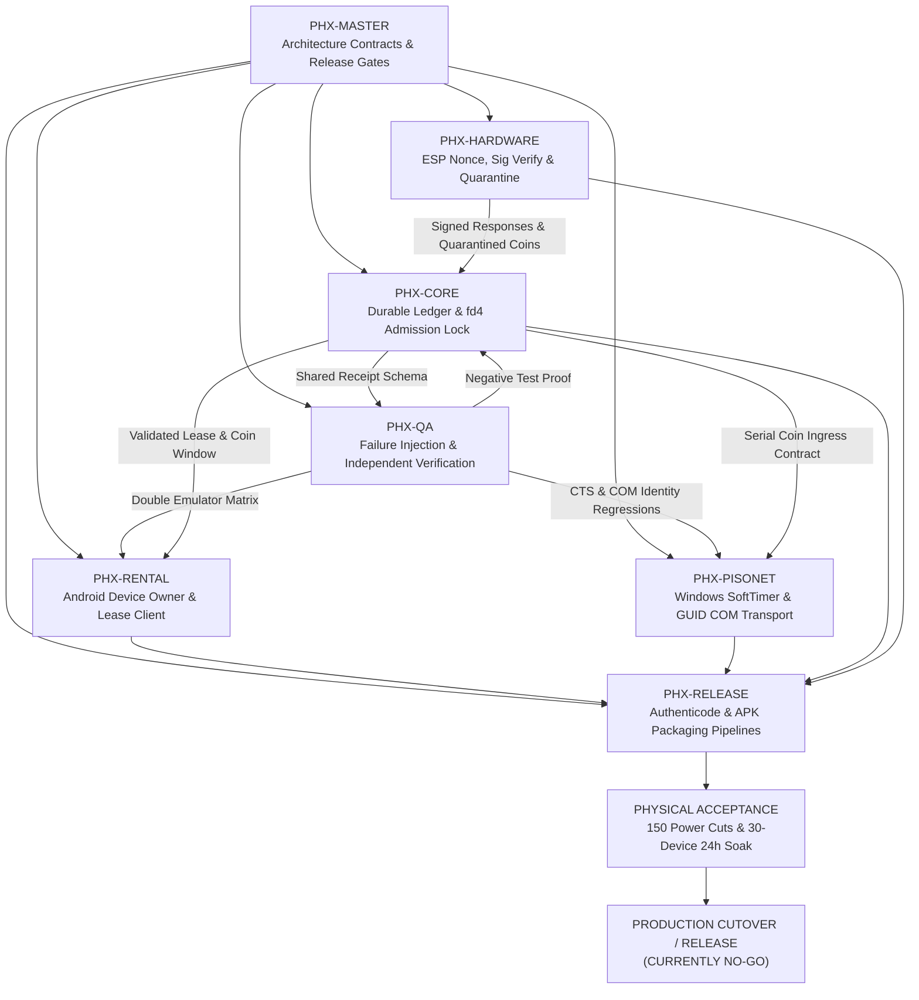

# Project Phoenix — Subsystem Integration Matrix & Gate Hierarchy

**Protocol Specification:** BLAZE-COMMS/1  
**Master Auditor:** `PHX-MASTER`  
**Original matrix date:** 2026-11-13 · **Latest bounded correction:** 2026-11-15  
**Overall Commercial / Production Status:** **STRICT NO-GO**

---

## 1. Subsystem Readiness Matrix

| Subsystem | Owner Role | Code Maturity | Dev Ready | Lab / CI Verified | Hardware Accepted | Production Ready | Active Draft PR / Branch |
|---|---|---|---|---|---|---|---|
| **Coordination & Gates** | PHX-MASTER | In review | **DRAFT** | **PARTIAL** (QA recipient 4/4; full 18-suite **NOT RUN**) | N/A (Governance) | **NO RELEASE AUTHORITY** | [Draft #288](https://github.com/BlazeDevStudio/BlazingSystems-Experiments/pull/288) |
| **Financial Ledger / Vendo** | PHX-CORE | Medium | **YES** | **YES** (Lab/CI) | **NO** (Pending HW) | **NO** (Gate P0) | PR #241, #248, #252 |
| **ESP32/ESP8266 Firmware** | PHX-HARDWARE | Medium | **YES** | **YES** (C++ Mock) | **NO** (No bench log) | **NO** (Gate P0) | PR #283, #254 |
| **Android BlazeRental** | PHX-RENTAL | High | **YES** | **YES** (API27 CI) | **NO** (Physical DO) | **NO** (Lineage lock) | PR #240, #285, #287 |
| **Windows SoftTimer** | PHX-PISONET | High | **YES** | **YES** (CLR/Win CI)| **NO** (Serial bench) | **NO** (AuthSign lock) | PR #238, #255, #268 |
| **QA / Failure Injection** | PHX-QA | High | **YES** | **YES** (20-job CI) | **NO** (Physical rig) | **NO** (Gate P0) | PR #267, #264, #279 |
| **Release / Packaging** | PHX-RELEASE | Medium | **YES** | **YES** (CI smoke) | **NO** (Prod secrets) | **NO** (Authenticode) | PR #242, #217 |

---

## 2. Cross-Subsystem Dependency Flow

---

## 3. Mandatory Integration Gates

Every change affecting money, cryptographic state, or physical actuation must progress sequentially through the following numbered gates:

### Gate 1: Source-Contract Definition & Non-Overlapping PRs
- Changes must reside in a dedicated role branch matching `ROLE_ASSIGNMENTS.md`.
- No single PR may alter both client UI and server accounting scripts.
- Handover ledgers (`PROJECT_HANDOVER.md`, `CURRENT_STATE.md`, `CHANGE_LEDGER.md`) must be synchronized with the commit.

### Gate 2: Lab & CI Verification on Exact SHA
- Source-exact commit must pass all automated linters, static checks (`static.sh`, `config.sh`), and compiler warnings-as-errors.
- Negative tests must be demonstrated: the failure must reproduce (RED) on baseline and resolve (GREEN) on candidate.
- Evidence links must cite exact GitHub Actions run and job IDs.

### Gate 3: Peer & QA Independent Verification
- Financial, cryptographic, and migration changes require independent review by `PHX-QA` and `PHX-MASTER`.
- `PHX-QA` verifies the identical git commit SHA using independent test fixtures without shared mutable state.

### Gate 4: Hardware & Physical Acceptance (P0 Gate #34)
- **150 Real Power-Cut Trials:** Abrupt power termination during active coin insertion and member transfer; journal must recover cleanly with zero corrupt receipts or phantom balance.
- **30-Device 24-Hour Soak:** 30 physical client nodes (mix of Android rental devices and Windows SoftTimer stations) running concurrent sessions under full traffic.
- **Physical Coin Ingress Validation:** Real mechanical coin selectors (multi-coin and single-coin) tested across denominations.

### Gate 5: Production Release Authorization (Master Gate)
- Formal approval by `PHX-MASTER`.
- Verification of authentic production code-signing certificates and anti-rollback witness.
- Final tag and manifest generation.

> [!IMPORTANT]
> **Active Gating Notice:**  
> Gates 1–3 are **incomplete across the combined target**; isolated historical CI results do not validate current stacked commits or the final integration tree. Gates 4 and 5 remain **CLOSED (NO-GO)**. No production release, real-money migration, flashing or customer cutover is authorized without independent acceptance and explicit owner approval.

## 4. Live evidence correction — 2026-11-15 UTC23

The 2026-11-13 table retains **historical, scope-limited worker CI claims**, not universal current-HEAD acceptance. Do not interpret the other subsystem `YES (Lab/CI)` cells as green for COE draft #26 or a future combined merge. Per-PR evidence must be reconciled on the exact proposed integration SHA before upgrading readiness; `NO` in the Production Ready column remains binding.

**Master source-exact distinction:** Independent [PHX-QA draft #292](https://github.com/BlazeDevStudio/BlazingSystems-Experiments/pull/292) recorded `4/4 PASS` on original four recipient tests with the **corrected** verifier Git blob `903df4034f8aa46f66e32de6e0be9b9ab2ca4b48`; this is a source-linked minimal checkout, not a full PR synthetic merge or the Master `18`-method unit suite. Consequently **Coordination Lab/CI: PARTIAL**, not `YES`. Earlier source-exact `2 PASS / 2 RED` remains recorded as a genuine pre-fix finding.

**PISONET migration provenance gate:** [Windows SoftTimer parity ledger](WINDOWS_SOFTTIMER_PARITY_20261115.json) compares owner [Experiments PR #255](https://github.com/BlazeDevStudio/BlazingSystems-Experiments/pull/255) pinned `d01fd1642c105b3b0f6cd3343d1c9b67291f6e09` against monorepo [COE integration PR #26](https://github.com/BlazeDevStudio/CoinOperatedEcosystem/pull/26) pinned `b382d233ff06c8791b1028bed3c617cc7b670d12`: 27 same-path identical blobs; **11 different**, **30 source-only** and **9 candidate-only**. File hashes, modes and paths are recorded read-only, not semantic compatibility. PISONET/QA must review each before allowing any copy or merge; do not overwrite staged error-aware `TryGetSignal` with an older active-low fail-open implementation. Stacked child [COE PR #30](https://github.com/BlazeDevStudio/CoinOperatedEcosystem/pull/30) advanced during this audit and is intentionally **not** conflated with PR #26.

**Release sequence:** source parity + license/dependency review → exact proposed combined-tree integration and independent QA → protected signing/independent witness and reversible financial migration → noncustomer real-target acceptance (150 real power cuts, 30-device/24h soak) → explicit owner-authorized release decision. No step can be waived by a readiness percentage, an isolated green CI job, or a coordination-only documentation merge.

---

## Live pinned migration review — 2026-11-16 UTC21

See [SOURCE_INTAKE_STATUS_ENUM_AUDIT_20261116_UTC21.md](SOURCE_INTAKE_STATUS_ENUM_AUDIT_20261116_UTC21.md) for exact Git-tree evidence and human reproduction steps.

- Source snapshot `6d4c9b487af4d768c4d7627654d119417fcc6e00` is 22 commits behind active Phoenix development `blazepwifi-v0.6.0-audit-foundation@2fbd2475e9f54878c316fa7cea2f228386b0e859`.
- COE #26 `b382d233ff06c8791b1028bed3c617cc7b670d12`: 61/61 manifest blob identities and modes match the pinned source/destination trees; actual classification is 46 identical / 15 derived, not the manifest summary 47/14.
- Destination rootfs has one unmanifested extra `usr/sbin/blaze-appliance-diag`; source/current-development test trees contain 149/150 files versus 19 in destination, with only two exact test identities.
- Root project license and three rootfs vendor license/notice files match. Android launcher, jsQR test-vendor, and Tabler license-bearing paths have no corresponding candidate destination path; owner provenance review remains required.
- COE #26 still has five queued workflows. Master PR #288 has no PR-triggered workflow runs. Scoped role CI results are recorded in the audit; none establishes integrated or physical acceptance.
- Production remains NO-GO. No migration, merge, release, or subsystem source edit is authorized by this snapshot.

## Live QA evidence freshness correction — 2026-11-16 UTC22

See [QA_EVIDENCE_FRESHNESS_AUDIT_20261116_UTC22.md](QA_EVIDENCE_FRESHNESS_AUDIT_20261116_UTC22.md) for the pinned refs, exact role PR heads, workflow links and reproduction limits.

- Current Master draft PR #288 is `phoenix/master-coordination@9f05cf7eedb9a91f599504450520f59702ded91d`. Current verifier blob is `3a6d0ca34cad54cd113abbda17d90898603547b3`; the recipient contract accepts one exact registered PHX role or literal `ALL`.
- The prior **18-test** count is stale. The current tree contains **38 authored methods** across `test_verify_coordination.py` (21), `test_verify_source_intake_manifest.py` (11), and `test_snapshot_identity.py` (6). This is inventory, not a pass claim.
- Current source-extracted recipient harness: **8/8 PASS**. Full 38-method exact-checkout suite remains **NOT RUN**; the local Git clone failed DNS and Master #288 has no PR-triggered workflow runs.
- QA PR #292 remains draft at `75a3f66d...`, based on `b1ca02e...`, which is **55 commits behind** current Master HEAD. Its reported 4/4 GREEN retest used older verifier blob `903df403...`, not current blob `3a6d0ca...`. Rebase/reproduce against current #288 HEAD before any QA VERIFIED disposition.
- COE PR #26 remains draft at `b382d233...` with five queued workflows. A separate successful stacked PR #30 run does not clear #26.
- Private Drive v11 registry was not retrieved in this activation; no older registry was substituted. Production remains **NO-GO**.

## Live hardware poll / quarantine stack hold — 2026-11-16 UTC22

See [HARDWARE_POLL_CONTRACT_AND_STACK_HOLD_20261116_UTC22.md](HARDWARE_POLL_CONTRACT_AND_STACK_HOLD_20261116_UTC22.md) for the exact source patches, branch comparisons and CI jobs.

- Hardware #315 and #316 both modify the same ESP32/ESP8266 sketches but are divergent branches: #316 is 10 commits ahead and 108 behind #315. Do not integrate or choose a branch until PHX-HARDWARE consolidates them into one owner-controlled stack.
- #316 run [43972511250](https://github.com/BlazeDevStudio/BlazingSystems-Experiments/actions/runs/43972511250) remains in progress at last observation; validation job [133668043447](https://github.com/BlazeDevStudio/BlazingSystems-Experiments/actions/runs/43972511250/job/133668043447) failed at Controller protocol parity. ESP32/ESP8266 compile jobs passed; other matrix jobs were still in progress. The focused [43972511337](https://github.com/BlazeDevStudio/BlazingSystems-Experiments/actions/runs/43972511337) success is the inherited quarantine lab, not the new poll-response matrix.
- The #316 patch permits an `ok=true` response to pass when `cfg.key` is empty. This conflicts with the existing signed-response contract. Provisional default-deny clarification is now recorded in `ARCHITECTURE_CONTRACTS.md`; PHX-CORE and PHX-HARDWARE review is pending.
- #315's same-boot RAM latch is not by itself proof that a rejected coin event remains non-replayable across reboot. Durable reconciliation semantics remain open with PHX-CORE/HARDWARE and independent QA.
- PHX-HARDWARE's UTC22 issue envelope used a semicolon-separated `to` field, which the current BLAZE-COMMS validator rejects. Republish only as one role or `ALL`; preserve the original comment.
- No subsystem source, firmware, merge or production state changed. Production remains **NO-GO**.

### Final #316 workflow status correction — 2026-11-16 UTC22:45Z

The prior in-progress observation is superseded: exact-head full run [43972511250](https://github.com/BlazeDevStudio/BlazingSystems-Experiments/actions/runs/43972511250) completed **failure** at 22:45:24Z. Validation job [133668043447](https://github.com/BlazeDevStudio/BlazingSystems-Experiments/actions/runs/43972511250/job/133668043447) failed at Controller protocol parity. ESP32/ESP8266 and listed firmware target builds completed success; Android completed success; production signing/import/publication and candidate-gate jobs were skipped. This is not a CI pass, and the inherited focused quarantine lab does not clear the failed poll validation. See the hardware hold document for the exact evidence and owner-reported extractor diagnosis.

## Live role/CI correction — 2026-11-16 UTC23

Exact repository refs observed for this snapshot: Experiments `main@f4e8a891aed8af86d5fd315d28750a0ac3a7372b`; `blazepwifi-v0.5.3-development@aad3aade72c1156eecba1fed30907c6d0283b2c5`; Master draft `phoenix/master-coordination@8201deb9198a8416a6546584a9a8f5789526ad84`; COE `main@a6513ab4412b4c014eee2863e45cbe32d06cb243`; COE integration #26 `b382d233ff06c8791b1028bed3c617cc7b670d12`.

- The current `OWNERSHIP_ROUTES.json` blob `e4db324315a1b3543fec17a148fbf960170fcb29` remains `DRAFT_REVIEW_ONLY`, pinned to source main `f4e8a891...` and destination PR #26 `b382d233...`. Its PHX-MASTER route remains coordination-only; no route authorizes copy or migration.
- Master #288 has no PR-triggered workflow runs. The complete current Master Python suite was not executed: a local `git ls-remote` attempt failed because this runtime could not resolve `github.com`. Do not infer PASS from source inspection.
- COE #26 has five queued candidate-head workflows, not completed CI: 43096752609 (case collision), 43096752632 (SoftTimer), 43096752800 (Hardware/Shared), 43096752563 (Rental), 43096752557 (Pisowifi).
- CORE #252, RENTAL #240/#289/#287, PISONET #255, HARDWARE #294/#314/#315, QA #267 and RELEASE #242/#291 have the scoped success runs listed in the live role snapshot in [ROLE_ASSIGNMENTS.md](ROLE_ASSIGNMENTS.md). These are not combined-tree acceptance.
- HARDWARE #315 and #316 are not a single linear stack. #315 is based on #314 head `556adc20...`; #316 is based on #294 head `8cbd4ece...`. The exact PR file lists overlap on both ESP32 and ESP8266 sketches. Comparing #315 head `953b743f...` with #316 head `888e6941...` reports diverged histories (10 commits ahead / 108 behind; common base #294 head). Do not merge either independently or overwrite one with the other.
- #316's focused source-extracted poll-response lab run 43972511337 passed, but its full build run 43972511250 failed in validation job 133668043447 at Controller protocol parity: the #294 extractor compiles a loop that now calls `acceptPollResponse` without extracting/declaring that helper. ESP32 and ESP8266 compile jobs themselves passed. The new #316 lab is not yet wired into the canonical validation workflow.
- Source inspection of #316 shows `signatureOk=true` before the conditional `if(String(cfg.key).length())`; with an empty key, the signature check is skipped and a response containing `"ok":true` can reach the authorization path. This conflicts with the **provisional** default-deny contract in Architecture Contracts §6.1 (owner review still pending). PHX-CORE and PHX-HARDWARE must agree the keyless policy; PHX-QA must add an empty-key negative case. Master did not edit firmware.
- The RAM-only `journalRecoveryRequired` limitation remains open for reboot-safe rejected-event disposition under Architecture Contracts §6.2. PHX-CORE owns ledger/replay semantics; PHX-HARDWARE owns firmware persistence; QA owns independent failure/reboot tests.
- QA #292 is not current Master evidence: its branch verifier blob is `a8a989964c45ab9aef5719e8d17ba3f6fc66e773`, while current Master is `3a6d0ca34cad54cd113abbda17d90898603547b3`. Branch comparison shows 63 Master-only commits and 6 QA-only commits after the common base. No #292 PR-triggered workflow run was returned.
- P0 issues #31, #32, #34, #43 and #177 remain open. Protected signer/independent anti-rollback witness, crash-atomic financial state, reversible migration, native acceptance, 150 real power cuts and 30-device/24-hour soak remain unverified. **PRODUCTION NO-GO**.
- The exact private Drive registry v11 and newer corrections were not accessible through the current connected tool surface; exact-name Library search did not return v11. Older Library registry artifacts were not substituted. The AGENTS.md storage-policy/handover links also could not be retrieved through the connected GitHub file reader. No private Drive contents or identifiers were published.
- No source migration, firmware edit, branch rewrite, merge, release, signing, secret provisioning, hardware flash, physical test or live financial operation occurred in this Master activation.

## Live PHX-MASTER snapshot — 2026-11-17 UTC00

This section supersedes earlier live-status tables only for the exact refs observed in this snapshot. Historical evidence remains preserved.

### Exact branch and candidate refs

| Ref | Exact SHA |
|---|---|
| Experiments main | f4e8a891aed8af86d5fd315d28750a0ac3a7372b |
| Experiments blazepwifi-v0.5.3-development | aad3aade72c1156eecba1fed30907c6d0283b2c5 |
| Experiments blazepwifi-v0.6.0-audit-foundation | 2fbd2475e9f54878c316fa7cea2f228386b0e859 |
| Master PR #288 before this snapshot | 3d3634dfab35d9f427e159b7d392194edda37930 |
| COE main | a6513ab4412b4c014eee2863e45cbe32d06cb243 |
| COE integration PR #26 | b382d233ff06c8791b1028bed3c617cc7b670d12 |

The v0.5.3 branch is 293 commits behind main. The v0.6 audit-foundation branch is 22 commits ahead of the pinned PisoWiFi source commit 6d4c9b487af4d768c4d7627654d119417fcc6e00; v0.6 and main are divergent. The current OWNERSHIP_ROUTES.json remains DRAFT_REVIEW_ONLY and routes PHX-MASTER to coordination/phoenix/ only.

### Migration manifest and exact selected blobs

At COE #26 b382d233, SOURCE_INTAKE.json blob 1b9018ff944f7f673934d0fc2a97e0a0090d3f5f reports 47 byte-identical / 14 derived rootfs files. MIGRATION_MAP.md blob b54fc15d83bc2269de03db8aadd0e76259fd13d9 has 61 rootfs rows; the recorded Git blob IDs compute 46 identical / 15 different (13 intentionally edited, 2 locally derived). The summary is inconsistent by one in both counters. The two locally derived member.sh and rental.sh entries state real-router tests NOT_RUN.

The source-intake manifest pins source 6d4c9b... and a prior destination feature branch/head cf59b41..., while OWNERSHIP_ROUTES.json pins source main f4e8... and candidate PR #26 b382d233.... Reconcile these snapshots before proposing a move.

Selected blobs: vendo source pin/v0.6 = db58041c0575ad0a1101d99cb85403e03c8dcb22; Experiments main = 2e3a1430d08cc6606429a042df3b5848f53c7267; COE #26 destination = 0a71c4e253ac6ec2c30d46f1f99faf874dbaab8e. common.sh source pin = 4ccb10777b08f541d092f7c2c2d2aad4d2f6562e; v0.6 branch = 50fa2d02d40af7fd8b06e83974345f1016a317f9; COE destination = ae00667da26c68c9e44a54a941887191029afc11. The candidate contains derived versions; current source drift needs owner review.

Root PisoWiFi LICENSE and selected vendor QR LICENSE, TailAdmin LICENSE and NOTICE blobs match between pinned source and destination. This is a bounded check, not a complete dependency/license audit. SOURCE_INTAKE lists four legacy tests (two unchanged, two derived) and 15 derived tests (11 NOT_RUN, four PENDING_CI_RUN). COE #26 has five queued workflows and no completed integration acceptance.

### Current role CI

| Role / PR | Exact head | Exact-head workflow observation |
|---|---|---|
| MASTER #288 | 3d3634dfab35d9f427e159b7d392194edda37930 | No PR-triggered workflows returned |
| CORE #252 | c82705f2de865c89ab733b10efa84f26f56a5cc4 | 42698139210 success |
| RENTAL #289 | 68928774d0d7cf65adb26bc6b54199a3159d066c | 43653329235 and 43653329229 success |
| PISONET #255 | d01fd1642c105b3b0f6cd3343d1c9b67291f6e09 | 42462978704 success |
| HARDWARE #315 | 939e6ae09050e3e7244249acf9c7969301a05363 | Focused 43982762795 success; full 43982762668 validation failure; ESP32/ESP8266 compile jobs success |
| HARDWARE #316 | 888e6941e3a7a81641682c23d937f97d8117d2ea | Focused 43972511337 success; full 43972511250 validation failure |
| QA #292 | 75a3f66d9563e38a0a48b9cf487b0b057a91ea96 | No PR-triggered workflows returned |
| QA #267 | ff5367990c2d27b8ebbb822ee208251af0c890e2 | 41452247439 success |
| RELEASE #291 | 2c4edff231d9b2819415086825530d80b8801307 | 43744993487 success |

COE role drafts: #31 RELEASE f4f93dd7... runs 43986022373 and 43986022315 success; #29 CORE d0830332... runs 43653906675/676 success; #30 PISONET 4897348d... run 43653415598 success; #28 PISONET b21b0461... run 43632393888 success; #32 QA 29b6fe08... run 43653540607 success; #27 HARDWARE/Shared 009f70cc... runs 43079646393/46264 success. COE #18 PisoWiFi and #19 Rental have case-collision-only runs 43061613277 and 43061768902. These are scoped checks, not integrated acceptance.

### HARDWARE shared-contract blocker

Current #315 ESP32/ESP8266 acceptPollResponse helpers skip signature verification when cfg.key is empty because signatureOk starts true and verification is conditional on a nonempty key. A keyless ok=true response with a nonempty target can pass. The focused 8/8 poll lab uses a test-key and has no empty-key case. The full validation failure is also reproducible: the #294 QA extractor omits acceptPollResponse, so both board extracts fail compilation with “not declared in this scope”. Architecture Contracts §6.1 already requires default-deny for an empty key. PHX-HARDWARE owns firmware correction, PHX-CORE owns the signature/replay contract, and PHX-QA owns extractor and negative/reboot tests.

### Execution and release limits

Ten local synthetic Python tests for the new Master-owned migration-map verifier passed; no full Master suite or PR-triggered Master CI ran. The private Drive registry v11 and newer corrections were not available through the connected tool surface; older Library versions were not substituted. No migration, merge, signing, release, flash or physical acceptance is authorized. PRODUCTION NO-GO remains.

## Live poll-response producer/consumer reconciliation — 2026-11-17 UTC02

This snapshot supersedes earlier poll-response claims only for the exact refs below; historical evidence is retained.

### Exact refs and routing

| Ref | Exact SHA / state |
|---|---|
| Experiments main | f4e8a891aed8af86d5fd315d28750a0ac3a7372b |
| Experiments blazepwifi-v0.5.3-development | aad3aade72c1156eecba1fed30907c6d0283b2c5 |
| Experiments blazepwifi-v0.6.0-audit-foundation | 2fbd2475e9f54878c316fa7cea2f228386b0e859 |
| Master branch / PR #288 before this snapshot | d047c49419c920a546ff9438f2fc9e708566f78a |
| COE main | a6513ab4412b4c014eee2863e45cbe32d06cb243 |
| COE integration PR #26 | b382d233ff06c8791b1028bed3c617cc7b670d12 |

PR #288 is open/draft and based on Experiments main. OWNERSHIP_ROUTES.json remains DRAFT_REVIEW_ONLY at blob e4db324315a1b3543fec17a148fbf960170fcb29; PHX-MASTER remains coordination-only. Cleanup issue #266 remains open. No route authorizes source relocation.

### Poll producer/consumer parity

| Exact file snapshot | Git blob | Poll response |
|---|---|---|
| Experiments main | 2e3a1430d08cc6606429a042df3b5848f53c7267 | No response_sig in poll action |
| v0.5.3 development | a1c19180385e618c412b4af21c0e91c1f47da1dd | No response_sig in poll action |
| v0.6 audit-foundation | db58041c0575ad0a1101d99cb85403e03c8dcb22 | No response_sig in poll action |
| COE #26 candidate | 0a71c4e253ac6ec2c30d46f1f99faf874dbaab8e | response_sig emitted by derived vendo_poll_sig |

The current COE candidate root LICENSE blob and Experiments main root LICENSE blob both equal 1ee55b94183417be977ca287cd7391f9a6f7e721. This is one bounded license identity check, not a complete dependency/license audit.

HARDWARE #315 at b21d05822772e7c07299331d2a6a1670da2b077e has ESP8266 blob 226c068731666d20eb91a2544ecb8ef9f9c11432 and ESP32 blob 54308cc5153c11889d107af1e15e560f39ebb327. Both consumers initialize signatureOk=false, require a nonempty configured key and response_sig, reject targetless positive responses, and clear stale insert/target state on denial. This is source inspection plus focused CI, not hardware acceptance.

Focused exact-head run 43997886923 / job 133754358681 completed SUCCESS. Its log reports poll-response 10/10 per board and strict root JSON 13/13 per board, in addition to quarantine/mount/recovery checks. Full run 43997886963 completed FAILURE at validation job 133754360411: the QA-owned tests/controllers.sh source extractor omits acceptPollResponse(), so both generated board harnesses fail with an undeclared-function error. ESP8266 and ESP32 compile jobs, Android and returned target image jobs passed; production sign/import/publish and candidate simulations were skipped. See [focused run](https://github.com/BlazeDevStudio/BlazingSystems-Experiments/actions/runs/43997886923), [full run](https://github.com/BlazeDevStudio/BlazingSystems-Experiments/actions/runs/43997886963), and [failing validation job](https://github.com/BlazeDevStudio/BlazingSystems-Experiments/actions/runs/43997886963/job/133754360411).

HARDWARE #316 remains open/draft at 888e6941e3a7a81641682c23d937f97d8117d2ea; its older full run 43972511250 has the same extractor failure. #315 is the owner-reported consolidated stack; Master did not close #316 or modify firmware.

### Live role CI summary

| Role | Exact open draft head(s) | Exact-head CI observation |
|---|---|---|
| MASTER #288 | d047c49419c920a546ff9438f2fc9e708566f78a | No PR-triggered workflow runs returned |
| CORE #252 | c82705f2de865c89ab733b10efa84f26f56a5cc4 | 42698139210 success |
| RENTAL #240 / #287 / #289 | a7d113fb8ae3f0c5e838e64d31cae7a154e37b56; a4fffd01c8fb1818c32a53522e0590c1dc8a77cd; 68928774d0d7cf65adb26bc6b54199a3159d066c | 40910311141/40910311159; 43754089203; 43653329235/43653329229 success |
| PISONET #255 | d01fd1642c105b3b0f6cd3343d1c9b67291f6e09 | 42462978704 success |
| HARDWARE #314 / #315 / #316 | 556adc20ef0cfd355089aff3b979c0169af79bdd; b21d05822772e7c07299331d2a6a1670da2b077e; 888e6941e3a7a81641682c23d937f97d8117d2ea | #314 43782088731/43782088748 success; #315 focused 43997886923 success, full 43997886963 failure; #316 focused 43972511337 success, full 43972511250 failure |
| QA #267 / #292 / #279 | ff5367990c2d27b8ebbb822ee208251af0c890e2; 75a3f66d9563e38a0a48b9cf487b0b057a91ea96; 8f476ef05893193325ef3d1f65a35e144ae7a568 | #267 41452247439 success; #292 and #279 no PR-triggered runs returned |
| RELEASE #242 / #291 | 734b89d9e7792247e8376335c3f3685500ab3f89; 2c4edff231d9b2819415086825530d80b8801307 | 40882814472 and 43744993487 success |

COE role drafts re-read for this poll review: #27 head 009f70cc2c2775039a5fb072c9d4fdedee76cfc7 (43079646393/43079646264 success); #29 head d0830332dee8a1844a85606150681b41d91fe796 (43653906676/43653906675 success); #31 head f3f995c91e38b5c5908bf8910056523015c8f0fd (44002215761/44002215760 success); #32 head 29b6fe08b10688182d981a66745f482758bd6630 (43653540607 success). COE #26 still has five queued candidate-head workflows: 43096752609, 43096752632, 43096752800, 43096752563 and 43096752557. These are scoped workflow observations, not integrated acceptance.

### Master static audit execution

Seven read-only structural assertions were executed against freshly fetched source files: unsigned poll action on main/v0.5.3/v0.6, signed poll action on COE #26, default-deny key requirement on both hardware consumers, and identical root LICENSE blob. Result: 7/7 PASS. These are Master audit assertions, not the Project Phoenix Python suite, not the canonical controller lab, and not CI.

The full Master Python suite was not executed and #288 has no PR-triggered workflow runs.

### Registry and remaining gates

The exact private Drive BLAZE_PROJECT_REGISTRY_v11_20261027.json and newer corrections were not retrievable: no Google Drive connector/read action was exposed, and exact-name Library search did not return v11. No older Library registry was substituted; no private contents or identifiers were published.

PHX-CORE must resolve the canonical signed poll producer and exact test vector; PHX-QA must add acceptPollResponse to the canonical extractor and independently verify both boards; PHX-HARDWARE must retain default-deny and durable rejected-event work; COE integration must reconcile the derived candidate against pinned source and licenses before any move.

Independent protected signing/anti-rollback witness, crash-atomic durable financial state, reversible migration tests, independent QA, native acceptance, 150 real power cuts and 30-device/24-hour soak remain unverified. PRODUCTION NO-GO.

## Live poll/config trust-boundary reconciliation — 2026-11-17 UTC03

This snapshot supersedes earlier poll/config claims only for the exact refs below; historical checkpoints remain intact.

### Exact refs and current owner evidence

| Area | Exact ref | Current evidence |
|---|---|---|
| Experiments main / development / v0.6 | `f4e8a891...` / `aad3aade...` / `2fbd2475...` | Poll producer in these source refs does not emit the candidate's signed poll response. |
| Master #288 | `2c2b517995365e23d89e423e2b9faeac4135381f` before this audit | No PR-triggered workflow runs returned. Master scope remains coordination/phoenix only. |
| HARDWARE #315 | `58ade5df83df0c6894dd8d1e2a70617b90dae374` | Focused run 44008962809 success; full run 44008962837 failed at QA controller extractor job 133791150681. ESP32/ESP8266 and other target builds passed; no overall full-workflow success. |
| HARDWARE #316 | `888e6941e3a7a81641682c23d937f97d8117d2ea` | Focused run 43972511337 success; full run 43972511250 failed validation. Separate draft remains open. |
| CORE #252 | `c82705f2de865c89ab733b10efa84f26f56a5cc4` | Experiments run 42698139210 success; scoped CORE CI only. |
| QA #292 | `75a3f66d9563e38a0a48b9cf487b0b057a91ea96` | No PR-triggered workflow runs returned; no independent register-config test evidence. |
| RELEASE #242 | `734b89d9e7792247e8376335c3f3685500ab3f89` | Run 40882814472 success; no signing/release authorization. |
| COE integration #26 | `b382d233ff06c8791b1028bed3c617cc7b670d12` | Five candidate-head workflows remain queued; no integrated acceptance. |
| COE HARDWARE #27 / CORE #29 / QA #32 / RELEASE #31 | `009f70cc...` / `d0830332...` / `29b6fe08...` / `79f79c6c...` | Their scoped workflows returned success (respectively 43079646393/46264; 43653906676/675; 43653540607; 44009785780/581). These do not test the Experiments #315 register-config path or establish COE #26 acceptance. |

### New source finding

HARDWARE #315 removed configuration application from poll admission, but the exact ESP32 and ESP8266 `connectSta()` paths still call `applyRemoteConfig(r)` after register/ping. Both initialize `sigOk=true` and only verify a register signature if a key exists. The COE #26 register producer's `vendo_ping_sig()` covers action, controller ID, request nonce and server time, but not the returned controller configuration object. Thus:
- empty-key register responses can still apply configuration without authentication;
- a provisioned-key register signature does not authenticate modified configuration fields;
- the current poll config-injection lab does not cover this register path.

This is a source inspection finding, not a live exploit or physical actuation result. Full evidence and owner actions are in [POLL_CONFIG_REGISTER_TRUST_BOUNDARY_AUDIT_20261117_UTC03.md](POLL_CONFIG_REGISTER_TRUST_BOUNDARY_AUDIT_20261117_UTC03.md).

### Required owner sequence

1. PHX-HARDWARE disables/guards the remaining register-path configuration application and adds both-board negative regressions.
2. PHX-CORE defines a separate domain-separated configuration signature and exact canonical golden vectors.
3. PHX-QA independently verifies keyless, altered-config, wrong-identity/nonce, stale revision, invalid-range and persistence-failure cases on the identical exact SHA; separately repair the canonical controller extractor.
4. PHX-RELEASE keeps signing/publication gated until independent QA and Master review.

**Gate:** remote configuration remains disabled pending owner-reviewed contract; poll admission remains default-deny for keyless/unverified responses. Focused source-extracted CI is SIMULATED / CI VERIFIED only. Physical acceptance remains NOT TESTED. PRODUCTION NO-GO.

## Live remote-configuration source/staging correction — 2026-11-17 UTC04

**Disposition: BLOCKED for COE #26 migration; PRODUCTION NO-GO.**

- Experiments #315 current owner head is 75dc5f0b888f16e2c85e4321f62df4685639ad33. ESP8266 blob f59e624ae2da04bddc70ddc2809bf6d8ff486aac and ESP32 blob 38a2d239eed6af876d421f9f908bbb62b3ae27e1 each contain only the dormant applyRemoteConfig definition. There are zero response call sites.
- COE #26 destination head b382d233ff06c8791b1028bed3c617cc7b670d12 still contains ESP8266 blob c8be98f72596681e36a3ad1f8939bf8046c96887 and ESP32 blob 3cc7ec54b476943dc04a8d1af5e2df5fe054e422. Each contains two applyRemoteConfig(r) response call sites and two sigOk=true defaults (register and poll). The staged candidate therefore remains unsafe for migration until its owner resolves the mismatch.
- HARDWARE focused run 44013351048 succeeded, including register-config denial 7/7 per board. HARDWARE full run 44013351035 failed in validation job 133805413831 because the QA-owned extractor omitted acceptPollResponse(); board compile and target image jobs passed. This is not an overall full-build pass.
- COE #26 still has five queued workflows. Master #288 has no PR-triggered workflow runs.
- The Hardware source-intake/license record is incomplete: Pisowifi/SOURCE_INTAKE.json is explicitly PisoWiFi-only; the Hardware subtree has no LICENSE/NOTICE, and the candidate's firmware audit still claims the firmware was not copied although both sketches exist in the PR tree. The source MIT license and Pisowifi/LICENSE share blob 1ee55b94183417be977ca287cd7391f9a6f7e721, but coverage for Hardware is not established.

**Owner sequence:** HARDWARE maintains the source-side deny behavior; QA repairs the extractor and independently tests both boards; CORE reviews the configuration authorization domain; COE integration owner reconciles per-file provenance, license scope and candidate tests. No blind copy, source move or merge is authorized. See REMOTE_CONFIG_MIGRATION_STAGING_AUDIT_20261117_UTC04.md.
