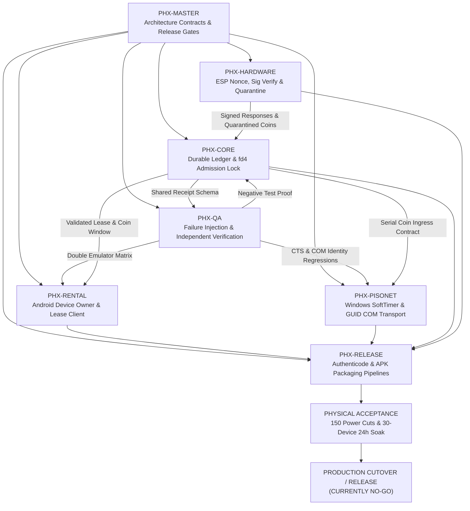

# Project Phoenix — Subsystem Integration Matrix & Gate Hierarchy

**Protocol Specification:** BLAZE-COMMS/1  
**Master Auditor:** `PHX-MASTER`  
**Original matrix date:** 2026-11-13 · **Latest bounded correction:** 2026-11-15  
**Overall Commercial / Production Status:** **STRICT NO-GO**

---

## 1. Subsystem Readiness Matrix

| Subsystem | Owner Role | Code Maturity | Dev Ready | Lab / CI Verified | Hardware Accepted | Production Ready | Active Draft PR / Branch |
|---|---|---|---|---|---|---|---|
| **Coordination & Gates** | PHX-MASTER | In review | **DRAFT** | **PARTIAL** (QA recipient 4/4; full 18-suite **NOT RUN**) | N/A (Governance) | **NO RELEASE AUTHORITY** | [Draft #288](https://github.com/BlazeDevStudio/BlazingSystems-Experiments/pull/288) |
| **Financial Ledger / Vendo** | PHX-CORE | Medium | **YES** | **YES** (Lab/CI) | **NO** (Pending HW) | **NO** (Gate P0) | PR #241, #248, #252 |
| **ESP32/ESP8266 Firmware** | PHX-HARDWARE | Medium | **YES** | **YES** (C++ Mock) | **NO** (No bench log) | **NO** (Gate P0) | PR #283, #254 |
| **Android BlazeRental** | PHX-RENTAL | High | **YES** | **YES** (API27 CI) | **NO** (Physical DO) | **NO** (Lineage lock) | PR #240, #285, #287 |
| **Windows SoftTimer** | PHX-PISONET | High | **YES** | **YES** (CLR/Win CI)| **NO** (Serial bench) | **NO** (AuthSign lock) | PR #238, #255, #268 |
| **QA / Failure Injection** | PHX-QA | High | **YES** | **YES** (20-job CI) | **NO** (Physical rig) | **NO** (Gate P0) | PR #267, #264, #279 |
| **Release / Packaging** | PHX-RELEASE | Medium | **YES** | **YES** (CI smoke) | **NO** (Prod secrets) | **NO** (Authenticode) | PR #242, #217 |

---

## 2. Cross-Subsystem Dependency Flow

---

## 3. Mandatory Integration Gates

Every change affecting money, cryptographic state, or physical actuation must progress sequentially through the following numbered gates:

### Gate 1: Source-Contract Definition & Non-Overlapping PRs
- Changes must reside in a dedicated role branch matching `ROLE_ASSIGNMENTS.md`.
- No single PR may alter both client UI and server accounting scripts.
- Handover ledgers (`PROJECT_HANDOVER.md`, `CURRENT_STATE.md`, `CHANGE_LEDGER.md`) must be synchronized with the commit.

### Gate 2: Lab & CI Verification on Exact SHA
- Source-exact commit must pass all automated linters, static checks (`static.sh`, `config.sh`), and compiler warnings-as-errors.
- Negative tests must be demonstrated: the failure must reproduce (RED) on baseline and resolve (GREEN) on candidate.
- Evidence links must cite exact GitHub Actions run and job IDs.

### Gate 3: Peer & QA Independent Verification
- Financial, cryptographic, and migration changes require independent review by `PHX-QA` and `PHX-MASTER`.
- `PHX-QA` verifies the identical git commit SHA using independent test fixtures without shared mutable state.

### Gate 4: Hardware & Physical Acceptance (P0 Gate #34)
- **150 Real Power-Cut Trials:** Abrupt power termination during active coin insertion and member transfer; journal must recover cleanly with zero corrupt receipts or phantom balance.
- **30-Device 24-Hour Soak:** 30 physical client nodes (mix of Android rental devices and Windows SoftTimer stations) running concurrent sessions under full traffic.
- **Physical Coin Ingress Validation:** Real mechanical coin selectors (multi-coin and single-coin) tested across denominations.

### Gate 5: Production Release Authorization (Master Gate)
- Formal approval by `PHX-MASTER`.
- Verification of authentic production code-signing certificates and anti-rollback witness.
- Final tag and manifest generation.

> [!IMPORTANT]
> **Active Gating Notice:**  
> Gates 1–3 are **incomplete across the combined target**; isolated historical CI results do not validate current stacked commits or the final integration tree. Gates 4 and 5 remain **CLOSED (NO-GO)**. No production release, real-money migration, flashing or customer cutover is authorized without independent acceptance and explicit owner approval.

## 4. Live evidence correction — 2026-11-15 UTC23

The 2026-11-13 table retains **historical, scope-limited worker CI claims**, not universal current-HEAD acceptance. Do not interpret the other subsystem `YES (Lab/CI)` cells as green for COE draft #26 or a future combined merge. Per-PR evidence must be reconciled on the exact proposed integration SHA before upgrading readiness; `NO` in the Production Ready column remains binding.

**Master source-exact distinction:** Independent [PHX-QA draft #292](https://github.com/BlazeDevStudio/BlazingSystems-Experiments/pull/292) recorded `4/4 PASS` on original four recipient tests with the **corrected** verifier Git blob `903df4034f8aa46f66e32de6e0be9b9ab2ca4b48`; this is a source-linked minimal checkout, not a full PR synthetic merge or the Master `18`-method unit suite. Consequently **Coordination Lab/CI: PARTIAL**, not `YES`. Earlier source-exact `2 PASS / 2 RED` remains recorded as a genuine pre-fix finding.

**PISONET migration provenance gate:** [Windows SoftTimer parity ledger](WINDOWS_SOFTTIMER_PARITY_20261115.json) compares owner [Experiments PR #255](https://github.com/BlazeDevStudio/BlazingSystems-Experiments/pull/255) pinned `d01fd1642c105b3b0f6cd3343d1c9b67291f6e09` against monorepo [COE integration PR #26](https://github.com/BlazeDevStudio/CoinOperatedEcosystem/pull/26) pinned `b382d233ff06c8791b1028bed3c617cc7b670d12`: 27 same-path identical blobs; **11 different**, **30 source-only** and **9 candidate-only**. File hashes, modes and paths are recorded read-only, not semantic compatibility. PISONET/QA must review each before allowing any copy or merge; do not overwrite staged error-aware `TryGetSignal` with an older active-low fail-open implementation. Stacked child [COE PR #30](https://github.com/BlazeDevStudio/CoinOperatedEcosystem/pull/30) advanced during this audit and is intentionally **not** conflated with PR #26.

**Release sequence:** source parity + license/dependency review → exact proposed combined-tree integration and independent QA → protected signing/independent witness and reversible financial migration → noncustomer real-target acceptance (150 real power cuts, 30-device/24h soak) → explicit owner-authorized release decision. No step can be waived by a readiness percentage, an isolated green CI job, or a coordination-only documentation merge.

---

## Live pinned migration review — 2026-11-16 UTC21

See [SOURCE_INTAKE_STATUS_ENUM_AUDIT_20261116_UTC21.md](SOURCE_INTAKE_STATUS_ENUM_AUDIT_20261116_UTC21.md) for exact Git-tree evidence and human reproduction steps.

- Source snapshot `6d4c9b487af4d768c4d7627654d119417fcc6e00` is 22 commits behind active Phoenix development `blazepwifi-v0.6.0-audit-foundation@2fbd2475e9f54878c316fa7cea2f228386b0e859`.
- COE #26 `b382d233ff06c8791b1028bed3c617cc7b670d12`: 61/61 manifest blob identities and modes match the pinned source/destination trees; actual classification is 46 identical / 15 derived, not the manifest summary 47/14.
- Destination rootfs has one unmanifested extra `usr/sbin/blaze-appliance-diag`; source/current-development test trees contain 149/150 files versus 19 in destination, with only two exact test identities.
- Root project license and three rootfs vendor license/notice files match. Android launcher, jsQR test-vendor, and Tabler license-bearing paths have no corresponding candidate destination path; owner provenance review remains required.
- COE #26 still has five queued workflows. Master PR #288 has no PR-triggered workflow runs. Scoped role CI results are recorded in the audit; none establishes integrated or physical acceptance.
- Production remains NO-GO. No migration, merge, release, or subsystem source edit is authorized by this snapshot.

## Live QA evidence freshness correction — 2026-11-16 UTC22

See [QA_EVIDENCE_FRESHNESS_AUDIT_20261116_UTC22.md](QA_EVIDENCE_FRESHNESS_AUDIT_20261116_UTC22.md) for the pinned refs, exact role PR heads, workflow links and reproduction limits.

- Current Master draft PR #288 is `phoenix/master-coordination@9f05cf7eedb9a91f599504450520f59702ded91d`. Current verifier blob is `3a6d0ca34cad54cd113abbda17d90898603547b3`; the recipient contract accepts one exact registered PHX role or literal `ALL`.
- The prior **18-test** count is stale. The current tree contains **38 authored methods** across `test_verify_coordination.py` (21), `test_verify_source_intake_manifest.py` (11), and `test_snapshot_identity.py` (6). This is inventory, not a pass claim.
- Current source-extracted recipient harness: **8/8 PASS**. Full 38-method exact-checkout suite remains **NOT RUN**; the local Git clone failed DNS and Master #288 has no PR-triggered workflow runs.
- QA PR #292 remains draft at `75a3f66d...`, based on `b1ca02e...`, which is **55 commits behind** current Master HEAD. Its reported 4/4 GREEN retest used older verifier blob `903df403...`, not current blob `3a6d0ca...`. Rebase/reproduce against current #288 HEAD before any QA VERIFIED disposition.
- COE PR #26 remains draft at `b382d233...` with five queued workflows. A separate successful stacked PR #30 run does not clear #26.
- Private Drive v11 registry was not retrieved in this activation; no older registry was substituted. Production remains **NO-GO**.

## Live hardware poll / quarantine stack hold — 2026-11-16 UTC22

See [HARDWARE_POLL_CONTRACT_AND_STACK_HOLD_20261116_UTC22.md](HARDWARE_POLL_CONTRACT_AND_STACK_HOLD_20261116_UTC22.md) for the exact source patches, branch comparisons and CI jobs.

- Hardware #315 and #316 both modify the same ESP32/ESP8266 sketches but are divergent branches: #316 is 10 commits ahead and 108 behind #315. Do not integrate or choose a branch until PHX-HARDWARE consolidates them into one owner-controlled stack.
- #316 run [43972511250](https://github.com/BlazeDevStudio/BlazingSystems-Experiments/actions/runs/43972511250) remains in progress at last observation; validation job [133668043447](https://github.com/BlazeDevStudio/BlazingSystems-Experiments/actions/runs/43972511250/job/133668043447) failed at Controller protocol parity. ESP32/ESP8266 compile jobs passed; other matrix jobs were still in progress. The focused [43972511337](https://github.com/BlazeDevStudio/BlazingSystems-Experiments/actions/runs/43972511337) success is the inherited quarantine lab, not the new poll-response matrix.
- The #316 patch permits an `ok=true` response to pass when `cfg.key` is empty. This conflicts with the existing signed-response contract. Provisional default-deny clarification is now recorded in `ARCHITECTURE_CONTRACTS.md`; PHX-CORE and PHX-HARDWARE review is pending.
- #315's same-boot RAM latch is not by itself proof that a rejected coin event remains non-replayable across reboot. Durable reconciliation semantics remain open with PHX-CORE/HARDWARE and independent QA.
- PHX-HARDWARE's UTC22 issue envelope used a semicolon-separated `to` field, which the current BLAZE-COMMS validator rejects. Republish only as one role or `ALL`; preserve the original comment.
- No subsystem source, firmware, merge or production state changed. Production remains **NO-GO**.

### Final #316 workflow status correction — 2026-11-16 UTC22:45Z

The prior in-progress observation is superseded: exact-head full run [43972511250](https://github.com/BlazeDevStudio/BlazingSystems-Experiments/actions/runs/43972511250) completed **failure** at 22:45:24Z. Validation job [133668043447](https://github.com/BlazeDevStudio/BlazingSystems-Experiments/actions/runs/43972511250/job/133668043447) failed at Controller protocol parity. ESP32/ESP8266 and listed firmware target builds completed success; Android completed success; production signing/import/publication and candidate-gate jobs were skipped. This is not a CI pass, and the inherited focused quarantine lab does not clear the failed poll validation. See the hardware hold document for the exact evidence and owner-reported extractor diagnosis.

## Live role/CI correction — 2026-11-16 UTC23

Exact repository refs observed for this snapshot: Experiments `main@f4e8a891aed8af86d5fd315d28750a0ac3a7372b`; `blazepwifi-v0.5.3-development@aad3aade72c1156eecba1fed30907c6d0283b2c5`; Master draft `phoenix/master-coordination@8201deb9198a8416a6546584a9a8f5789526ad84`; COE `main@a6513ab4412b4c014eee2863e45cbe32d06cb243`; COE integration #26 `b382d233ff06c8791b1028bed3c617cc7b670d12`.

- The current `OWNERSHIP_ROUTES.json` blob `e4db324315a1b3543fec17a148fbf960170fcb29` remains `DRAFT_REVIEW_ONLY`, pinned to source main `f4e8a891...` and destination PR #26 `b382d233...`. Its PHX-MASTER route remains coordination-only; no route authorizes copy or migration.
- Master #288 has no PR-triggered workflow runs. The complete current Master Python suite was not executed: a local `git ls-remote` attempt failed because this runtime could not resolve `github.com`. Do not infer PASS from source inspection.
- COE #26 has five queued candidate-head workflows, not completed CI: 43096752609 (case collision), 43096752632 (SoftTimer), 43096752800 (Hardware/Shared), 43096752563 (Rental), 43096752557 (Pisowifi).
- CORE #252, RENTAL #240/#289/#287, PISONET #255, HARDWARE #294/#314/#315, QA #267 and RELEASE #242/#291 have the scoped success runs listed in the live role snapshot in [ROLE_ASSIGNMENTS.md](ROLE_ASSIGNMENTS.md). These are not combined-tree acceptance.
- HARDWARE #315 and #316 are not a single linear stack. #315 is based on #314 head `556adc20...`; #316 is based on #294 head `8cbd4ece...`. The exact PR file lists overlap on both ESP32 and ESP8266 sketches. Comparing #315 head `953b743f...` with #316 head `888e6941...` reports diverged histories (10 commits ahead / 108 behind; common base #294 head). Do not merge either independently or overwrite one with the other.
- #316's focused source-extracted poll-response lab run 43972511337 passed, but its full build run 43972511250 failed in validation job 133668043447 at Controller protocol parity: the #294 extractor compiles a loop that now calls `acceptPollResponse` without extracting/declaring that helper. ESP32 and ESP8266 compile jobs themselves passed. The new #316 lab is not yet wired into the canonical validation workflow.
- Source inspection of #316 shows `signatureOk=true` before the conditional `if(String(cfg.key).length())`; with an empty key, the signature check is skipped and a response containing `"ok":true` can reach the authorization path. This conflicts with the **provisional** default-deny contract in Architecture Contracts §6.1 (owner review still pending). PHX-CORE and PHX-HARDWARE must agree the keyless policy; PHX-QA must add an empty-key negative case. Master did not edit firmware.
- The RAM-only `journalRecoveryRequired` limitation remains open for reboot-safe rejected-event disposition under Architecture Contracts §6.2. PHX-CORE owns ledger/replay semantics; PHX-HARDWARE owns firmware persistence; QA owns independent failure/reboot tests.
- QA #292 is not current Master evidence: its branch verifier blob is `a8a989964c45ab9aef5719e8d17ba3f6fc66e773`, while current Master is `3a6d0ca34cad54cd113abbda17d90898603547b3`. Branch comparison shows 63 Master-only commits and 6 QA-only commits after the common base. No #292 PR-triggered workflow run was returned.
- P0 issues #31, #32, #34, #43 and #177 remain open. Protected signer/independent anti-rollback witness, crash-atomic financial state, reversible migration, native acceptance, 150 real power cuts and 30-device/24-hour soak remain unverified. **PRODUCTION NO-GO**.
- The exact private Drive registry v11 and newer corrections were not accessible through the current connected tool surface; exact-name Library search did not return v11. Older Library registry artifacts were not substituted. The AGENTS.md storage-policy/handover links also could not be retrieved through the connected GitHub file reader. No private Drive contents or identifiers were published.
- No source migration, firmware edit, branch rewrite, merge, release, signing, secret provisioning, hardware flash, physical test or live financial operation occurred in this Master activation.

## Live PHX-MASTER snapshot — 2026-11-17 UTC00

This section supersedes earlier live-status tables only for the exact refs observed in this snapshot. Historical evidence remains preserved.

### Exact branch and candidate refs

| Ref | Exact SHA |
|---|---|
| Experiments main | f4e8a891aed8af86d5fd315d28750a0ac3a7372b |
| Experiments blazepwifi-v0.5.3-development | aad3aade72c1156eecba1fed30907c6d0283b2c5 |
| Experiments blazepwifi-v0.6.0-audit-foundation | 2fbd2475e9f54878c316fa7cea2f228386b0e859 |
| Master PR #288 before this snapshot | 3d3634dfab35d9f427e159b7d392194edda37930 |
| COE main | a6513ab4412b4c014eee2863e45cbe32d06cb243 |
| COE integration PR #26 | b382d233ff06c8791b1028bed3c617cc7b670d12 |

The v0.5.3 branch is 293 commits behind main. The v0.6 audit-foundation branch is 22 commits ahead of the pinned PisoWiFi source commit 6d4c9b487af4d768c4d7627654d119417fcc6e00; v0.6 and main are divergent. The current OWNERSHIP_ROUTES.json remains DRAFT_REVIEW_ONLY and routes PHX-MASTER to coordination/phoenix/ only.

### Migration manifest and exact selected blobs

At COE #26 b382d233, SOURCE_INTAKE.json blob 1b9018ff944f7f673934d0fc2a97e0a0090d3f5f reports 47 byte-identical / 14 derived rootfs files. MIGRATION_MAP.md blob b54fc15d83bc2269de03db8aadd0e76259fd13d9 has 61 rootfs rows; the recorded Git blob IDs compute 46 identical / 15 different (13 intentionally edited, 2 locally derived). The summary is inconsistent by one in both counters. The two locally derived member.sh and rental.sh entries state real-router tests NOT_RUN.

The source-intake manifest pins source 6d4c9b... and a prior destination feature branch/head cf59b41..., while OWNERSHIP_ROUTES.json pins source main f4e8... and candidate PR #26 b382d233.... Reconcile these snapshots before proposing a move.

Selected blobs: vendo source pin/v0.6 = db58041c0575ad0a1101d99cb85403e03c8dcb22; Experiments main = 2e3a1430d08cc6606429a042df3b5848f53c7267; COE #26 destination = 0a71c4e253ac6ec2c30d46f1f99faf874dbaab8e. common.sh source pin = 4ccb10777b08f541d092f7c2c2d2aad4d2f6562e; v0.6 branch = 50fa2d02d40af7fd8b06e83974345f1016a317f9; COE destination = ae00667da26c68c9e44a54a941887191029afc11. The candidate contains derived versions; current source drift needs owner review.

Root PisoWiFi LICENSE and selected vendor QR LICENSE, TailAdmin LICENSE and NOTICE blobs match between pinned source and destination. This is a bounded check, not a complete dependency/license audit. SOURCE_INTAKE lists four legacy tests (two unchanged, two derived) and 15 derived tests (11 NOT_RUN, four PENDING_CI_RUN). COE #26 has five queued workflows and no completed integration acceptance.

### Current role CI

| Role / PR | Exact head | Exact-head workflow observation |
|---|---|---|
| MASTER #288 | 3d3634dfab35d9f427e159b7d392194edda37930 | No PR-triggered workflows returned |
| CORE #252 | c82705f2de865c89ab733b10efa84f26f56a5cc4 | 42698139210 success |
| RENTAL #289 | 68928774d0d7cf65adb26bc6b54199a3159d066c | 43653329235 and 43653329229 success |
| PISONET #255 | d01fd1642c105b3b0f6cd3343d1c9b67291f6e09 | 42462978704 success |
| HARDWARE #315 | 939e6ae09050e3e7244249acf9c7969301a05363 | Focused 43982762795 success; full 43982762668 validation failure; ESP32/ESP8266 compile jobs success |
| HARDWARE #316 | 888e6941e3a7a81641682c23d937f97d8117d2ea | Focused 43972511337 success; full 43972511250 validation failure |
| QA #292 | 75a3f66d9563e38a0a48b9cf487b0b057a91ea96 | No PR-triggered workflows returned |
| QA #267 | ff5367990c2d27b8ebbb822ee208251af0c890e2 | 41452247439 success |
| RELEASE #291 | 2c4edff231d9b2819415086825530d80b8801307 | 43744993487 success |

COE role drafts: #31 RELEASE f4f93dd7... runs 43986022373 and 43986022315 success; #29 CORE d0830332... runs 43653906675/676 success; #30 PISONET 4897348d... run 43653415598 success; #28 PISONET b21b0461... run 43632393888 success; #32 QA 29b6fe08... run 43653540607 success; #27 HARDWARE/Shared 009f70cc... runs 43079646393/46264 success. COE #18 PisoWiFi and #19 Rental have case-collision-only runs 43061613277 and 43061768902. These are scoped checks, not integrated acceptance.

### HARDWARE shared-contract blocker

Current #315 ESP32/ESP8266 acceptPollResponse helpers skip signature verification when cfg.key is empty because signatureOk starts true and verification is conditional on a nonempty key. A keyless ok=true response with a nonempty target can pass. The focused 8/8 poll lab uses a test-key and has no empty-key case. The full validation failure is also reproducible: the #294 QA extractor omits acceptPollResponse, so both board extracts fail compilation with “not declared in this scope”. Architecture Contracts §6.1 already requires default-deny for an empty key. PHX-HARDWARE owns firmware correction, PHX-CORE owns the signature/replay contract, and PHX-QA owns extractor and negative/reboot tests.

### Execution and release limits

Ten local synthetic Python tests for the new Master-owned migration-map verifier passed; no full Master suite or PR-triggered Master CI ran. The private Drive registry v11 and newer corrections were not available through the connected tool surface; older Library versions were not substituted. No migration, merge, signing, release, flash or physical acceptance is authorized. PRODUCTION NO-GO remains.

## Live poll-response producer/consumer reconciliation — 2026-11-17 UTC02

This snapshot supersedes earlier poll-response claims only for the exact refs below; historical evidence is retained.

### Exact refs and routing

| Ref | Exact SHA / state |
|---|---|
| Experiments main | f4e8a891aed8af86d5fd315d28750a0ac3a7372b |
| Experiments blazepwifi-v0.5.3-development | aad3aade72c1156eecba1fed30907c6d0283b2c5 |
| Experiments blazepwifi-v0.6.0-audit-foundation | 2fbd2475e9f54878c316fa7cea2f228386b0e859 |
| Master branch / PR #288 before this snapshot | d047c49419c920a546ff9438f2fc9e708566f78a |
| COE main | a6513ab4412b4c014eee2863e45cbe32d06cb243 |
| COE integration PR #26 | b382d233ff06c8791b1028bed3c617cc7b670d12 |

PR #288 is open/draft and based on Experiments main. OWNERSHIP_ROUTES.json remains DRAFT_REVIEW_ONLY at blob e4db324315a1b3543fec17a148fbf960170fcb29; PHX-MASTER remains coordination-only. Cleanup issue #266 remains open. No route authorizes source relocation.

### Poll producer/consumer parity

| Exact file snapshot | Git blob | Poll response |
|---|---|---|
| Experiments main | 2e3a1430d08cc6606429a042df3b5848f53c7267 | No response_sig in poll action |
| v0.5.3 development | a1c19180385e618c412b4af21c0e91c1f47da1dd | No response_sig in poll action |
| v0.6 audit-foundation | db58041c0575ad0a1101d99cb85403e03c8dcb22 | No response_sig in poll action |
| COE #26 candidate | 0a71c4e253ac6ec2c30d46f1f99faf874dbaab8e | response_sig emitted by derived vendo_poll_sig |

The current COE candidate root LICENSE blob and Experiments main root LICENSE blob both equal 1ee55b94183417be977ca287cd7391f9a6f7e721. This is one bounded license identity check, not a complete dependency/license audit.

HARDWARE #315 at b21d05822772e7c07299331d2a6a1670da2b077e has ESP8266 blob 226c068731666d20eb91a2544ecb8ef9f9c11432 and ESP32 blob 54308cc5153c11889d107af1e15e560f39ebb327. Both consumers initialize signatureOk=false, require a nonempty configured key and response_sig, reject targetless positive responses, and clear stale insert/target state on denial. This is source inspection plus focused CI, not hardware acceptance.

Focused exact-head run 43997886923 / job 133754358681 completed SUCCESS. Its log reports poll-response 10/10 per board and strict root JSON 13/13 per board, in addition to quarantine/mount/recovery checks. Full run 43997886963 completed FAILURE at validation job 133754360411: the QA-owned tests/controllers.sh source extractor omits acceptPollResponse(), so both generated board harnesses fail with an undeclared-function error. ESP8266 and ESP32 compile jobs, Android and returned target image jobs passed; production sign/import/publish and candidate simulations were skipped. See [focused run](https://github.com/BlazeDevStudio/BlazingSystems-Experiments/actions/runs/43997886923), [full run](https://github.com/BlazeDevStudio/BlazingSystems-Experiments/actions/runs/43997886963), and [failing validation job](https://github.com/BlazeDevStudio/BlazingSystems-Experiments/actions/runs/43997886963/job/133754360411).

HARDWARE #316 remains open/draft at 888e6941e3a7a81641682c23d937f97d8117d2ea; its older full run 43972511250 has the same extractor failure. #315 is the owner-reported consolidated stack; Master did not close #316 or modify firmware.

### Live role CI summary

| Role | Exact open draft head(s) | Exact-head CI observation |
|---|---|---|
| MASTER #288 | d047c49419c920a546ff9438f2fc9e708566f78a | No PR-triggered workflow runs returned |
| CORE #252 | c82705f2de865c89ab733b10efa84f26f56a5cc4 | 42698139210 success |
| RENTAL #240 / #287 / #289 | a7d113fb8ae3f0c5e838e64d31cae7a154e37b56; a4fffd01c8fb1818c32a53522e0590c1dc8a77cd; 68928774d0d7cf65adb26bc6b54199a3159d066c | 40910311141/40910311159; 43754089203; 43653329235/43653329229 success |
| PISONET #255 | d01fd1642c105b3b0f6cd3343d1c9b67291f6e09 | 42462978704 success |
| HARDWARE #314 / #315 / #316 | 556adc20ef0cfd355089aff3b979c0169af79bdd; b21d05822772e7c07299331d2a6a1670da2b077e; 888e6941e3a7a81641682c23d937f97d8117d2ea | #314 43782088731/43782088748 success; #315 focused 43997886923 success, full 43997886963 failure; #316 focused 43972511337 success, full 43972511250 failure |
| QA #267 / #292 / #279 | ff5367990c2d27b8ebbb822ee208251af0c890e2; 75a3f66d9563e38a0a48b9cf487b0b057a91ea96; 8f476ef05893193325ef3d1f65a35e144ae7a568 | #267 41452247439 success; #292 and #279 no PR-triggered runs returned |
| RELEASE #242 / #291 | 734b89d9e7792247e8376335c3f3685500ab3f89; 2c4edff231d9b2819415086825530d80b8801307 | 40882814472 and 43744993487 success |

COE role drafts re-read for this poll review: #27 head 009f70cc2c2775039a5fb072c9d4fdedee76cfc7 (43079646393/43079646264 success); #29 head d0830332dee8a1844a85606150681b41d91fe796 (43653906676/43653906675 success); #31 head f3f995c91e38b5c5908bf8910056523015c8f0fd (44002215761/44002215760 success); #32 head 29b6fe08b10688182d981a66745f482758bd6630 (43653540607 success). COE #26 still has five queued candidate-head workflows: 43096752609, 43096752632, 43096752800, 43096752563 and 43096752557. These are scoped workflow observations, not integrated acceptance.

### Master static audit execution

Seven read-only structural assertions were executed against freshly fetched source files: unsigned poll action on main/v0.5.3/v0.6, signed poll action on COE #26, default-deny key requirement on both hardware consumers, and identical root LICENSE blob. Result: 7/7 PASS. These are Master audit assertions, not the Project Phoenix Python suite, not the canonical controller lab, and not CI.

The full Master Python suite was not executed and #288 has no PR-triggered workflow runs.

### Registry and remaining gates

The exact private Drive BLAZE_PROJECT_REGISTRY_v11_20261027.json and newer corrections were not retrievable: no Google Drive connector/read action was exposed, and exact-name Library search did not return v11. No older Library registry was substituted; no private contents or identifiers were published.

PHX-CORE must resolve the canonical signed poll producer and exact test vector; PHX-QA must add acceptPollResponse to the canonical extractor and independently verify both boards; PHX-HARDWARE must retain default-deny and durable rejected-event work; COE integration must reconcile the derived candidate against pinned source and licenses before any move.

Independent protected signing/anti-rollback witness, crash-atomic durable financial state, reversible migration tests, independent QA, native acceptance, 150 real power cuts and 30-device/24-hour soak remain unverified. PRODUCTION NO-GO.

## Live poll/config trust-boundary reconciliation — 2026-11-17 UTC03

This snapshot supersedes earlier poll/config claims only for the exact refs below; historical checkpoints remain intact.

### Exact refs and current owner evidence

| Area | Exact ref | Current evidence |
|---|---|---|
| Experiments main / development / v0.6 | `f4e8a891...` / `aad3aade...` / `2fbd2475...` | Poll producer in these source refs does not emit the candidate's signed poll response. |
| Master #288 | `2c2b517995365e23d89e423e2b9faeac4135381f` before this audit | No PR-triggered workflow runs returned. Master scope remains coordination/phoenix only. |
| HARDWARE #315 | `58ade5df83df0c6894dd8d1e2a70617b90dae374` | Focused run 44008962809 success; full run 44008962837 failed at QA controller extractor job 133791150681. ESP32/ESP8266 and other target builds passed; no overall full-workflow success. |
| HARDWARE #316 | `888e6941e3a7a81641682c23d937f97d8117d2ea` | Focused run 43972511337 success; full run 43972511250 failed validation. Separate draft remains open. |
| CORE #252 | `c82705f2de865c89ab733b10efa84f26f56a5cc4` | Experiments run 42698139210 success; scoped CORE CI only. |
| QA #292 | `75a3f66d9563e38a0a48b9cf487b0b057a91ea96` | No PR-triggered workflow runs returned; no independent register-config test evidence. |
| RELEASE #242 | `734b89d9e7792247e8376335c3f3685500ab3f89` | Run 40882814472 success; no signing/release authorization. |
| COE integration #26 | `b382d233ff06c8791b1028bed3c617cc7b670d12` | Five candidate-head workflows remain queued; no integrated acceptance. |
| COE HARDWARE #27 / CORE #29 / QA #32 / RELEASE #31 | `009f70cc...` / `d0830332...` / `29b6fe08...` / `79f79c6c...` | Their scoped workflows returned success (respectively 43079646393/46264; 43653906676/675; 43653540607; 44009785780/581). These do not test the Experiments #315 register-config path or establish COE #26 acceptance. |

### New source finding

HARDWARE #315 removed configuration application from poll admission, but the exact ESP32 and ESP8266 `connectSta()` paths still call `applyRemoteConfig(r)` after register/ping. Both initialize `sigOk=true` and only verify a register signature if a key exists. The COE #26 register producer's `vendo_ping_sig()` covers action, controller ID, request nonce and server time, but not the returned controller configuration object. Thus:
- empty-key register responses can still apply configuration without authentication;
- a provisioned-key register signature does not authenticate modified configuration fields;
- the current poll config-injection lab does not cover this register path.

This is a source inspection finding, not a live exploit or physical actuation result. Full evidence and owner actions are in [POLL_CONFIG_REGISTER_TRUST_BOUNDARY_AUDIT_20261117_UTC03.md](POLL_CONFIG_REGISTER_TRUST_BOUNDARY_AUDIT_20261117_UTC03.md).

### Required owner sequence

1. PHX-HARDWARE disables/guards the remaining register-path configuration application and adds both-board negative regressions.
2. PHX-CORE defines a separate domain-separated configuration signature and exact canonical golden vectors.
3. PHX-QA independently verifies keyless, altered-config, wrong-identity/nonce, stale revision, invalid-range and persistence-failure cases on the identical exact SHA; separately repair the canonical controller extractor.
4. PHX-RELEASE keeps signing/publication gated until independent QA and Master review.

**Gate:** remote configuration remains disabled pending owner-reviewed contract; poll admission remains default-deny for keyless/unverified responses. Focused source-extracted CI is SIMULATED / CI VERIFIED only. Physical acceptance remains NOT TESTED. PRODUCTION NO-GO.

## Live remote-configuration source/staging correction — 2026-11-17 UTC04

**Disposition: BLOCKED for COE #26 migration; PRODUCTION NO-GO.**

- Experiments #315 current owner head is 75dc5f0b888f16e2c85e4321f62df4685639ad33. ESP8266 blob f59e624ae2da04bddc70ddc2809bf6d8ff486aac and ESP32 blob 38a2d239eed6af876d421f9f908bbb62b3ae27e1 each contain only the dormant applyRemoteConfig definition. There are zero response call sites.
- COE #26 destination head b382d233ff06c8791b1028bed3c617cc7b670d12 still contains ESP8266 blob c8be98f72596681e36a3ad1f8939bf8046c96887 and ESP32 blob 3cc7ec54b476943dc04a8d1af5e2df5fe054e422. Each contains two applyRemoteConfig(r) response call sites and two sigOk=true defaults (register and poll). The staged candidate therefore remains unsafe for migration until its owner resolves the mismatch.
- HARDWARE focused run 44013351048 succeeded, including register-config denial 7/7 per board. HARDWARE full run 44013351035 failed in validation job 133805413831 because the QA-owned extractor omitted acceptPollResponse(); board compile and target image jobs passed. This is not an overall full-build pass.
- COE #26 still has five queued workflows. Master #288 has no PR-triggered workflow runs.
- The Hardware source-intake/license record is incomplete: Pisowifi/SOURCE_INTAKE.json is explicitly PisoWiFi-only; the Hardware subtree has no LICENSE/NOTICE, and the candidate's firmware audit still claims the firmware was not copied although both sketches exist in the PR tree. The source MIT license and Pisowifi/LICENSE share blob 1ee55b94183417be977ca287cd7391f9a6f7e721, but coverage for Hardware is not established.

**Owner sequence:** HARDWARE maintains the source-side deny behavior; QA repairs the extractor and independently tests both boards; CORE reviews the configuration authorization domain; COE integration owner reconciles per-file provenance, license scope and candidate tests. No blind copy, source move or merge is authorized. See REMOTE_CONFIG_MIGRATION_STAGING_AUDIT_20261117_UTC04.md.

## 11. Live exact-head Hardware migration hold — 2026-11-17 UTC05

| Gate surface | Current owner source | COE #26 candidate | Disposition |
|---|---|---|---|
| ESP32 remote config | #315 blob 38a2d239...; helper definition only; register/poll responses do not apply config | blob 3cc7ec54...; three helper occurrences; register/poll call sites; two keyless-true defaults | BLOCKED |
| ESP8266 remote config | #315 blob f59e624...; helper definition only; fail-closed register tuple and poll acceptance | blob c8be98f...; three helper occurrences; register/poll call sites; two keyless-true defaults | BLOCKED |
| Quarantine clear | #315 returns 403; no quarantine-log delete call | #26 deletes /quarantine.log and returns 200; no explicit AP-origin guard | P0 MIGRATION HOLD |
| Source tests | register config 7/7 and poll/config 11/11 per board in focused #315 source lab | one shell hardening script; no keyless, no-config-callsite, 403/no-delete or AP-origin regressions | IMPORT GAP |
| License/notice | BlazePwifi MIT LICENSE and source repository NOTICE | Pisowifi/LICENSE only; Hardware/root scope unresolved | OWNER REVIEW |

The exact blobs and modes are recorded in HARDWARE_STAGING_PARITY_AUDIT_20261117_UTC05.md. Focused #315 run 44013351048 succeeded on source-extracted host tests; full #315 run 44013351035 failed in the QA-owned controller extractor. COE #26 still has five queued workflows. None of these results establishes integrated acceptance.

**Disposition:** keep #26 draft and do not copy/promote Hardware files until PHX-HARDWARE and independent PHX-QA reconcile exact source/destination blobs, route security, test identities, crypto wording, license/notice scope and candidate CI. No production flash, release, migration or live-money operation is authorized.

## 6. Live exact-head reconciliation — 2026-11-17 UTC06

This section supersedes stale PR/CI identifiers in the historical readiness rows above. All CI labels are scoped to the exact listed commit; none implies hardware acceptance.

| Role | Current draft / exact head | Exact CI evidence | Current disposition |
|---|---|---|---|
| PHX-MASTER | #288 `7616a3d5de69f4e6d7d9905fc91d0c7500bdfd68` | No PR-triggered workflow runs returned | Draft; local full suite NOT RUN |
| PHX-CORE | #252 `c82705f2de865c89ab733b10efa84f26f56a5cc4` | [42698139210](https://github.com/BlazeDevStudio/BlazingSystems-Experiments/actions/runs/42698139210) SUCCESS | Scoped CI only |
| PHX-RENTAL | #289 `68928774d0d7cf65adb26bc6b54199a3159d066c` | [43653329235](https://github.com/BlazeDevStudio/BlazingSystems-Experiments/actions/runs/43653329235), [43653329229](https://github.com/BlazeDevStudio/BlazingSystems-Experiments/actions/runs/43653329229) SUCCESS | Scoped CI only |
| PHX-PISONET | #255 `d01fd1642c105b3b0f6cd3343d1c9b67291f6e09` | [42462978704](https://github.com/BlazeDevStudio/BlazingSystems-Experiments/actions/runs/42462978704) SUCCESS | Scoped CI only; physical serial NOT TESTED |
| PHX-HARDWARE | #315 `c1db0a567500302921c0561bcd31446f12767372` | [44030492133](https://github.com/BlazeDevStudio/BlazingSystems-Experiments/actions/runs/44030492133) focused SUCCESS; [44030492146](https://github.com/BlazeDevStudio/BlazingSystems-Experiments/actions/runs/44030492146) Full validation FAILURE | Host/fake-LittleFS labs only; QA extractor blocker |
| PHX-HARDWARE (separate) | #316 `888e6941e3a7a81641682c23d937f97d8117d2ea` | [43972511337](https://github.com/BlazeDevStudio/BlazingSystems-Experiments/actions/runs/43972511337) focused SUCCESS; [43972511250](https://github.com/BlazeDevStudio/BlazingSystems-Experiments/actions/runs/43972511250) Full FAILURE | Separate open draft; do not compose without owner decision |
| PHX-QA | #292 `75a3f66d9563e38a0a48b9cf487b0b057a91ea96` | No PR-triggered workflow runs returned | Stale base; exact current #315 extractor verification absent |
| PHX-RELEASE | #291 `2c4edff231d9b2819415086825530d80b8801307` | [43744993487](https://github.com/BlazeDevStudio/BlazingSystems-Experiments/actions/runs/43744993487) SUCCESS; publish-release SKIPPED | Scoped Windows CI only |
| COE integration | #26 `b382d233ff06c8791b1028bed3c617cc7b670d12` | Eight exact-head workflows remain QUEUED: 43096752609, 43096752632, 43096752800, 43096752563, 43096752557, 43096746202, 43096746248, 43096746194 | No completed destination acceptance |

### 6.1 Current hardware migration hold

The current #315 source blobs are ESP8266 `35bc5b20...` and ESP32 `5b448444...`; COE #26 destination blobs remain `c8be98f7...` and `3cc7ec54...`. All four files are mode `100644`, but neither source/destination pair is byte-identical.

The #315 source now has the durable one-shot `/pending.attempt` marker and exact-source host lab; COE #26 has no marker state or marker lab. COE still has keyless-positive remote configuration call sites and a destructive `POST /quarantine/clear` handler. Its Hardware test tree has one shell hardening script, not the source's current negative/failure-injection suite. No Hardware-scoped LICENSE/NOTICE exists under `Hardware/`; scope requires owner review.

**Migration decision:** no copy, overwrite, relocation, or promotion of the current COE Hardware sketches. The exact comparison and owner actions are in [the UTC06 Master audit](COIN_POST_ATTEMPT_MARKER_MIGRATION_AND_QA_EXTRACTOR_AUDIT_20261117_UTC06.md).

### 6.2 Provisional financial replay invariant

Before any coin POST, the controller must durably write, flush, close, and read back an attempt marker bound to the pending record. A marker found after reboot (matching, malformed, mismatched, or orphan) blocks automatic replay. Clear the pending record first and the marker last, only after authoritative receipt or durable quarantine disposition. This client fence does not replace server idempotency and remains pending PHX-CORE/PHX-QA review and physical power-cut evidence.

Production remains STRICT NO-GO.

## 7. Live coin POST disposition authority and exact-head reconciliation — 2026-11-17 UTC07

**Exact refs:** Experiments main `f4e8a891...`, v0.5.3 development `aad3aade...`, v0.6 audit foundation `2fbd2475...`, Master #288 pre-change `c121d651...`; COE main `a6513ab4...`, COE #26 `b382d233...`.

| Role | Current open draft(s) / exact head | Exact-head CI observation | Gate state / next owner action |
|---|---|---|---|
| PHX-MASTER | #288 `c121d651...` before this update | No PR-triggered workflow runs; targeted source-intake tests 11/11 PASS locally; full Master suite NOT RUN | Coordination-only; maintain architecture and migration holds |
| PHX-CORE | #252 `c82705f2...`; #241 `8aa2529a...`; #248 `a1f80f30...` | #252 run 42698139210 SUCCESS; #241 run 40813818877 FAILURE; #248 run 40882042148 FAILURE | Publish authenticated event-bound coin receipt/disposition contract and idempotency vectors; no Master source edits |
| PHX-RENTAL | #240 `a7d113fb...`; #287 `a4fffd01...`; #289 `68928774...` | #240 runs 40910311141/40910311159 SUCCESS; #287 43754089203 SUCCESS; #289 43653329235/43653329229 SUCCESS | Scoped software evidence only; physical Device Owner/lease acceptance remains outstanding |
| PHX-PISONET | #255 `d01fd164...` | Run 42462978704 SUCCESS | Native COM/serial physical acceptance NOT TESTED |
| PHX-HARDWARE | #315 `4afc7c8bd8ea410049f1da7bc962bfc989b4ba1b`; separate #316 `888e6941...`; older #283 `a8756729...` | #315 focused 44038469936 SUCCESS; full 44038469823 FAILURE in validation job 133887096342; #316 focused 43972511337 SUCCESS/full 43972511250 FAILURE; #283 43634101437 SUCCESS | #315 is current owner candidate; no Master firmware edits. Full validation blocked by stale QA extractor. Current coin POST verifier returns false until approved receipt contract |
| PHX-QA | #267 `ff536799...`; #279 `8f476ef0...`; #292 `75a3f66d...` | #267 41452247439 SUCCESS; #279/#292 no workflow runs returned | Repair extractor for current #315 dependencies and independently test both-board receipt vectors |
| PHX-RELEASE | #242 `734b89d9...`; #291 `2c4edff2...` | #242 40882814472 SUCCESS; #291 43744993487 SUCCESS | Scoped Windows CI only; signing/publisher gates remain closed |
| COE integration owner | COE #26 `b382d233...` | Five workflows remain QUEUED: 43096752609, 43096752632, 43096752800, 43096752563, 43096752557 | Keep draft; reconcile source/destination blobs, imports, tests and license scope before any move |

### 7.1 Current coin POST disposition hold

At exact #315 source blobs ESP8266 `e47d392e...` and ESP32 `5de92f01...` (both mode `100644`), `coinPostDispositionVerified()` returns false until an approved authenticated receipt contract exists. The source persists and readback-verifies `/pending.attempt` before POST and retains the pending evidence on every unapproved response.

COE #26 still stages ESP8266 `c8be98f7...` and ESP32 `3cc7ec54...` (both mode `100644`). Neither pair is byte-identical. The destination lacks the attempt marker and disposition verifier, retains keyless-positive response paths and the prior destructive quarantine-clear mismatch. COE `Hardware/tests/` has only one shell hardening script; it does not import the current source lab.

**Migration decision:** no copy, overwrite, relocation, merge or promotion. Keep COE #26 draft. Exact full blob identities, sizes, test identity and CI are in [the UTC07 audit](COIN_POST_DISPOSITION_AUTHORITY_AUDIT_20261117_UTC07.md).

### 7.2 CI/test interpretation and release gates

The #315 focused run is source-extracted host/fake-filesystem evidence only: 34/34 host scenarios passed, coin disposition default-deny 4/4 per board, pending attempt marker 19/19 per board. The log explicitly reports physical coin acceptance and power-cut verification as zero. The full #315 workflow is failed because the QA-owned extractor omits five current firmware dependencies; ESP target builds passing does not turn that workflow green.

The PHX-MASTER source-intake test file executed locally at its exact fetched source/test blobs: 11/11 passed. This is not the complete Master suite or cross-repository acceptance.

COE #29, #28 and #30 have scoped successes at their pinned heads, but they do not validate the combined #26 tree. Historical financial issues #31/#32, witness #43, hardware acceptance #34 and pulse issue #177 remain open.

**PRODUCTION NO-GO:** independent protected signing/anti-rollback witness, crash-atomic durable financial state, reversible migration, independent QA, native acceptance, 150 real power cuts and a 30-device/24-hour soak remain mandatory.

## Live Hardware staging refresh — 2026-11-17 UTC08

The current owner source is Experiments HARDWARE PR #315 at cc0743009f44baeda0ea12d84eb6199a8a6916c7, not the older firmware snapshot staged in COE #26. The separate COE Hardware & Shared PR #27 at 009f70cc2c2775039a5fb072c9d4fdedee76cfc7 contains the same ESP32/ESP8266 firmware blobs as #26 and is therefore a duplicate stale candidate for this comparison, not an updated import.

| Evidence | Exact ref / result | Gate interpretation |
|---|---|---|
| HARDWARE source | #315 cc074300…; focused 44041818004 SUCCESS; full 44041818133 FAILURE | Source lab is simulated; full validation blocked by QA extractor |
| HARDWARE parallel draft | #316 888e6941…; focused 43972511337 SUCCESS; full 43972511250 FAILURE | Separate branch; do not silently compose with #315 |
| COE integration | #26 b382d233…; five workflows QUEUED | No combined-tree CI conclusion |
| COE Hardware & Shared | #27 009f70cc…; runs 43079646264 and 43079646393 SUCCESS | These runs validate the stale #27 candidate, not current #315 source parity |
| Master | #288 349c5e24… before this update; no PR-triggered runs | Coordination-only; no subsystem source change |

Exact firmware blobs differ on both boards; #315 has dormant remote configuration, one-shot attempt/disposition helpers and a deny/no-delete quarantine clear, while #26/#27 retain response-driven config paths, keyless defaults, no attempt marker/disposition helpers and destructive quarantine clear. Source board-local failure labs are not imported into COE Hardware/tests. Hardware license scope remains unresolved. See HARDWARE_STAGING_REFRESH_AND_DUPLICATE_CANDIDATE_AUDIT_20261117_UTC08.md for exact blobs, modes, sizes, test identities and CI.

**Disposition:** keep #26/#27 draft and do not copy, overwrite, relocate or promote firmware. PHX-QA must repair the exact #315 extractor and rerun Full validation; the COE integration owner must reconcile the candidate, tests and license scope. Production remains NO-GO.

## 13. Exact-head poll fixture conflict and COE Hardware migration hold — 2026-11-17 UTC09

| Gate | HARDWARE #315 source | COE #26 destination | Result |
|---|---|---|---|
| Poll admission | Both sketches' `acceptPollResponse()` return DENY; candidate state is cleared | Older response-driven poll/config path remains | BLOCKED |
| Coin POST disposition | `coinPostDispositionVerified()` returns DENY pending CORE contract | Current attempt/disposition helpers absent | BLOCKED |
| Remote configuration | `applyRemoteConfig` definition-only | Three occurrences and two `sigOk=true` defaults per sketch | P0 HOLD |
| Quarantine clear | HTTP 403; no log deletion | HTTP 200 and `LittleFS.remove("/quarantine.log")` | P0 HOLD |
| Firmware blobs | ESP32 `c3833a02...`; ESP8266 `77c403ad...` | ESP32 `3cc7ec54...`; ESP8266 `c8be98f7...` | Non-identical |
| Test imports | Source board-local poll, marker, journal and quarantine labs | One `Hardware/tests/test_firmware_hardening.sh` (`f921c56c...`) | IMPORT GAP |
| License/NOTICE | BlazePwifi LICENSE + repository NOTICE | Pisowifi/LICENSE only; no root NOTICE or Hardware-local notice in candidate tree | OWNER REVIEW |

Current #315 Full run [44054778555](https://github.com/BlazeDevStudio/BlazingSystems-Experiments/actions/runs/44054778555) fails at validation job `133941354361`: the inherited v0.5 fixture still requires a positive `|poll|` signature even though the current source intentionally denies poll admission. Focused quarantine run [44054778537](https://github.com/BlazeDevStudio/BlazingSystems-Experiments/actions/runs/44054778537) succeeds, but does not prove poll admission or physical acceptance. The separate v0.6 extractor omission remains open and was not reached. COE #26's five workflows remain queued.

**Disposition:** no file move/copy/overwrite. PHX-QA repairs the stale test contract and extractor; PHX-CORE approves the canonical poll/receipt contract; PHX-HARDWARE preserves the deny state; COE owner reconciles exact blobs, tests and license scope. See `HARDWARE_POLL_SIGNATURE_FIXTURE_AND_COE_MIGRATION_HOLD_20261117_UTC09.md`. Combined integration and production remain NO-GO.

## 14. PISONET candidate-stack, test-import and installer guard audit — 2026-11-17 UTC10

Exact source/destination trees were re-read at Experiments PR #255 `d01fd1642c105b3b0f6cd3343d1c9b67291f6e09`, COE #26 `b382d233ff06c8791b1028bed3c617cc7b670d12`, #28 `b21b04617d38a177260258de2d56b24382822117`, and #30 `4897348d94a0cf7884ecd53244bfcd59e7bf2fbc`. The source has 68 blobs; candidates have 47/48/48. Same-path identical/different and source-only/candidate-only counts are #26 27/11/30/9, #28 28/10/30/10, and #30 26/12/30/10. All compared modes are 100644; no mode mismatch was observed. The full path inventory and commit-graph evidence are in [PISONET_STACKED_DESTINATION_CANDIDATE_AUDIT_20261117_UTC10.md](PISONET_STACKED_DESTINATION_CANDIDATE_AUDIT_20261117_UTC10.md).

COE #30 is 27 commits ahead of #28 and 0 behind; it is **not** a child of COE #26. #26 and #30 diverge from COE main (merge base `a6513ab...`; compare reports 56 ahead / 85 behind). Do not treat #28/#30 as already included in #26 or propose a recursive copy.

A source-vs-destination safety difference is material: old Experiments #255 `SerialHardware.cs`/ `AppController.cs` can turn an active-low status-read error into an active state; COE #26/#30 use `TryGetSignal` and deny before inversion. Do not blanket-copy those old source blobs over the safer destination code. #30 also has same-opened-handle identity checks and synthetic read-error tests, but no physical acceptance.

**New P0:** COE #30's NSIS installer line 44 uses `$COMMONAPPDATA`; exact installer-lab run [43653415598](https://github.com/BlazeDevStudio/CoinOperatedEcosystem/actions/runs/43653415598) logs warning 6000 saying that variable/constant is unknown and ignored. Its InstallerLayoutGuard checks only the literal text, so the green job does not prove existing CommonApplicationData state is detected. PHX-PISONET must fix the path resolution, make the relevant compiler warning fatal, and add a sentinel-existing-state test before any installer candidate promotion.

The source root NOTICE and destination/subtree license/notice inventory are not equivalent; no Pisonet-subtree license/notice was found, and Pisowifi/LICENSE does not establish Pisonet scope. Require owner/custodian decision. COE #26's five workflows remain QUEUED; #28/#30 scoped synthetic Windows jobs pass; QA #290 has no exact-head run. Keep #26/#28/#30/#32 draft and migration blocked.

## 15. COE generated ULA prefix is invalid — 2026-11-17 UTC11

| Gate | Exact evidence | Disposition |
|---|---|---|
| COE #26 packager | Blob c6ad3807... emits fd00:db8:blaze::/48 | P0 configuration blocker |
| COE #31 current packager | Blob 5e42d81e... retains the invalid literal | Open |
| Profile | Blob 6e797cf9... has no networking.ula_prefix | Contract gap |
| Tests | #31 blob 109d1ee2... has no ULA/IPv6 assertions | Test gap |
| COE #31 CI | 44074188531 and 44074188480 SUCCESS, scoped | Does not test prefix validity |
| COE #26 CI | 43096752609, 43096752632, 43096752800, 43096752563, 43096752557 QUEUED | No combined acceptance |

Python ipaddress rejected the exact literal because blaze is non-hex and accepted a valid ULA /48 control. This was not OpenWrt uci/netifd or router validation. Route packager correction to PHX-RELEASE, policy to PHX-CORE/COE owner, independent tests to PHX-QA, and later target validation to PHX-HARDWARE. Master changes coordination only. Keep #26/#31 draft; no migration.

## 16. COE ULA prefix revalidation and deployment-scope decision — 2026-11-17 UTC13

The current COE #26 and release child #31 both emit the same invalid hard-coded `fd00:db8:blaze::/48` from `tools/package_appliance_firmware.py::generate_network_uci()`. Exact packager blobs: #26 `c6ad3807d7fedb00ab7560813b82810cb8cce751`; #31 `fd558928b2869ce1f4b2cb2776b405b4b723b310`. Their test blobs `8f6b2f849152902c341428067e52fe95f6763b93` and `c183ceaad0c470ee06db9a9c68993844553efc3c` contain no ULA/IPv6 assertions. Shared profile schema `ddc5d2ebad868c99908747c75961b45b8c0edced` and EW1200G Pro profile `6e797cf9c9922209efe4c0da49c49fa1da16c11a` contain no ULA field.

At exact COE #31 head `b29d69a4cd97ca93babbab436bcc00b1e9d8280d`, run [44084015060](https://github.com/BlazeDevStudio/CoinOperatedEcosystem/actions/runs/44084015060) passed 57/57 packaging tests, 18/18 shared contracts, 10/10 profiles and both ESP compile jobs; [44084014924](https://github.com/BlazeDevStudio/CoinOperatedEcosystem/actions/runs/44084014924) passed case-collision. Those suites do not test ULA validity. COE #26 still has five queued workflows. No combined acceptance is established.

**Architecture decision:** ULA is installation/site state, not shared router-profile metadata. Do not add one static prefix to the reusable hardware profile. Require a target-supported first-boot generation + durable persistence path, or a validated deployment-specific build input for a site-unique artifact. Never hard-code a shared prefix or assume implicit netifd behavior without target evidence. PHX-RELEASE implements, COE integration owner stages, PHX-QA independently tests, PHX-HARDWARE validates target behavior, and PHX-MASTER owns the contract only.

Python `ipaddress` rejected the exact invalid literal and accepted a valid fd/48 control. This was not OpenWrt UCI/netifd or router validation. Keep #26/#31 draft; no copy, overwrite, move or promotion. See [COE_ULA_PREFIX_CONTRACT_REVALIDATION_20261117_UTC13.md](COE_ULA_PREFIX_CONTRACT_REVALIDATION_20261117_UTC13.md). **PRODUCTION NO-GO.**

## 17. COE ImageBuilder sandbox boundary and ULA exact-head refresh — 2026-11-17 UTC13

| Gate | Exact evidence | Disposition |
|---|---|---|
| COE #31 current head | 19fc87988e55f47e8c6a512e51b470a91abbf816, based on #26 b382d233... | Draft / no promotion |
| Packager | fd558928... still emits fd00:db8:blaze::/48 | P0 invalid ULA |
| Packager tests | 322b4a4b... has no ULA/IPv6 assertions | Test gap |
| EW1200G profile | 6e797cf9... has no ULA field | No static site prefix in model profile |
| Sandbox workflow | b0ca74cb... probes bwrap, then directly runs Python tests | Not contained |
| Current #31 sandbox run | [44098939249](https://github.com/BlazeDevStudio/CoinOperatedEcosystem/actions/runs/44098939249), job 134093412365 | FAILURE at UID/GID probe; packaging tests SKIPPED |
| #31 Hardware/Shared + case collision | [44098939596](https://github.com/BlazeDevStudio/CoinOperatedEcosystem/actions/runs/44098939596), [44098939148](https://github.com/BlazeDevStudio/CoinOperatedEcosystem/actions/runs/44098939148) | Scoped SUCCESS only |
| Earlier #31 sentinel regression | [44098400955](https://github.com/BlazeDevStudio/CoinOperatedEcosystem/actions/runs/44098400955) at prior edf4a37 head | FAILURE: external sentinel became BUILDER-OVERWRITE |
| COE #26 | Five workflows remain QUEUED | No combined acceptance |

The current #31 workflow has a separate bwrap capability probe and UID/GID probe, but the packaging test command is direct Python; the test calls the generated shell wrapper directly. At current head the UID/GID probe fails, so the package regression is skipped. The earlier head reached the test and recorded an external sentinel overwrite. No current-head sandbox containment pass exists.

HARDWARE #317 current head 4496124580a11f8bdd88c2e5adcdfb86e824b978 has focused quarantine run 44097183197 SUCCESS and relay polarity run 44097182916 SUCCESS; Full run 44097182945 fails at QA validation job 134088551798 because the inherited poll fixture still expects a positive signature. Preserve default-deny; PHX-QA owns fixture/extractor correction.

PHX-RELEASE must repair and actually apply the sandbox to the Make process and resolve the installation-scoped ULA contract. PHX-QA independently verifies. COE integration owner keeps #26 draft and reconciles provenance. No file move/copy/overwrite. See COE_IMAGEBUILDER_SANDBOX_EXECUTION_BOUNDARY_AUDIT_20261117_UTC13.md. **PRODUCTION NO-GO.**

## 18. COE #31 sandbox test-harness vs generated-build boundary — 2026-11-17 UTC14

| Gate | Exact evidence | Disposition |
|---|---|---|
| COE #31 final head | d45b84c67dc587fca6226662cb1d8bc59bdb11ae, based on #26 b382d233ff06c8791b1028bed3c617cc7b670d12 | Open / draft |
| Test harness | Test blob b2cdbcebf111a4f04c0504edf983072323fa2718 calls the sandbox runner when PHX_REQUIRE_BWRAP=1; workflow sets it | Test-harness containment attempt |
| Runner | Blob f20267d26185238bc82bcaccebf857fee67d929a; read-only root, writable builder, tmpfs, UID/GID mapping; uses --share-net | No network isolation; no confidentiality claim |
| Generated packager | Blob fd558928b2869ce1f4b2cb2776b405b4b723b310; no bwrap/runner invocation | Runtime build entrypoint does not enforce runner |
| Final-head sandbox | [44104956173](https://github.com/BlazeDevStudio/CoinOperatedEcosystem/actions/runs/44104956173) PENDING / no jobs | No containment PASS |
| Final-head shared CI | [44104956321](https://github.com/BlazeDevStudio/CoinOperatedEcosystem/actions/runs/44104956321) SUCCESS | Scoped only |
| Final-head case collision | [44104956464](https://github.com/BlazeDevStudio/CoinOperatedEcosystem/actions/runs/44104956464) SUCCESS | Scoped only |
| ULA output | Still fd00:db8:blaze::/48; no ULA assertions in packager tests | P0 invalid configuration |

The sandbox helper is now exercised by the CI test harness, but the generated build artifact does not invoke it. Do not classify the actual ImageBuilder build as sandbox-enforced. PHX-RELEASE must enforce the boundary at the supported build entrypoint or document and prove a separate mandatory isolated build host; PHX-QA must test that actual path. Network isolation remains explicitly unclaimed. The ULA remains a separate P0; require installation/site-scoped durable generation or validated deployment input, not a shared static profile prefix.

COE #26 remains at five queued workflows. Keep #26/#31 draft. No copy, overwrite, move, merge or promotion is authorized by this audit.

## 19. COE generated-wrapper runtime guard recheck — 2026-11-17 UTC15

| Gate | Exact evidence | Disposition |
|---|---|---|
| COE RELEASE #31 | `d45b84c67dc587fca6226662cb1d8bc59bdb11ae`, child of #26 `b382d233ff06c8791b1028bed3c617cc7b670d12` | Open / draft |
| Packager | blob `fd558928b2869ce1f4b2cb2776b405b4b723b310`, line 495 | Literal `\\n` in generated shell template; runtime defect reproduced in minimal shell fragment |
| Syntax-only test | `test_generated_build_script_passes_posix_shell_syntax_check` | `sh -n` returned 0 in minimal reproduction; insufficient alone |
| Runtime test | `test_generated_wrapper_denies_empty_firmware_payload` | Relevant exact wrapper execution; expected diagnostic must be verified on corrected head |
| Current sandbox CI | [#44104956173](https://github.com/BlazeDevStudio/CoinOperatedEcosystem/actions/runs/44104956173), job `134126241456` | IN_PROGRESS at last read; no conclusion |
| ULA | `fd00:db8:blaze::/48` | Still invalid; deployment-scoped durable ULA required |
| Generated build sandbox | Packager does not invoke runner; runner uses `--share-net` | Actual build boundary unproven; no network-isolation claim |
| COE #26 | Five workflows queued at exact head | No combined acceptance |

PHX-RELEASE owns generated-wrapper correction; PHX-QA owns independent exact-head runtime verification. PHX-MASTER owns the architecture contract and integration gate only. No COE source edit or destination migration was performed. `OWNERSHIP_ROUTES.json` remains `DRAFT_REVIEW_ONLY`; #26/#31 remain draft. **PRODUCTION NO-GO.**

### §19 exact-head CI follow-up — 2026-11-17 UTC15:14Z

COE #31 sandbox run [#44104956173](https://github.com/BlazeDevStudio/CoinOperatedEcosystem/actions/runs/44104956173) at `d45b84c67dc587fca6226662cb1d8bc59bdb11ae` completed **CANCELLED**, job `134126241456`. Fifteen packaging tests reported `ok`, including `test_generated_build_script_passes_posix_shell_syntax_check`; the job was then canceled before `test_generated_wrapper_denies_empty_firmware_payload`. This is incomplete, not PASS or source RED. The local exact-fragment reproduction still showed `sh -n=0` but runtime exit 2 (`Syntax error: Bad fd number`). Shared-contract #44104956321 and case-collision #44104956464 are scoped successes only.

## 20. COE #31 generated-wrapper correction and operator-build boundary — 2026-11-17 UTC15

| Gate | Exact source / CI evidence | Current disposition |
|---|---|---|
| Experiments source main / development | `main@f4e8a891aed8af86d5fd315d28750a0ac3a7372b`; `blazepwifi-v0.5.3-development@aad3aade72c1156eecba1fed30907c6d0283b2c5`; v0.6 comparison-only `2fbd2475e9f54878c316fa7cea2f228386b0e859` | Exact refs refreshed; do not promote development snapshots by assumption |
| PHX-MASTER #288 | `phoenix/master-coordination@86b91edd2864d796487a9da56a8267ae44ca771c`, base main `f4e8a891...` | Open/draft; no PR-triggered runs returned |
| COE main / integration #26 | main `a6513ab4412b4c014eee2863e45cbe32d06cb243`; #26 `b382d233ff06c8791b1028bed3c617cc7b670d12` | Main remains scaffold/structure-only; #26 open/draft; five workflows QUEUED, zero jobs |
| COE RELEASE #31 | `phoenix/release-imagebuilder-failclosed-20261115@06d8b7c593f8e139891a6a659bf79e694ee229d5`, based on #26 | Open/draft; not integrated into #26 |
| Generated wrapper correction | Packager blob `66fc283eb52add75caee6131b78dcadbb5d8a7fc`; tests blob `3e917c30654ce629391c3fbd864d5b671b0a2e46` | Literal shell line-break defect corrected in source; exact-head runtime CI still pending |
| Final-head sandbox | [44113058229](https://github.com/BlazeDevStudio/CoinOperatedEcosystem/actions/runs/44113058229), job `134155724688` | IN_PROGRESS; no PASS/failure inferred |
| Final-head shared/hardware | [44113058271](https://github.com/BlazeDevStudio/CoinOperatedEcosystem/actions/runs/44113058271) | SUCCESS, scoped |
| Final-head case collision | [44113058276](https://github.com/BlazeDevStudio/CoinOperatedEcosystem/actions/runs/44113058276) | SUCCESS, scoped |
| Test-harness vs operator build | Test blob `3e917c30...` calls `run_imagebuilder_sandbox.py` under `PHX_REQUIRE_BWRAP=1`; generated packager template blob `66fc283e...` still invokes `{cmd}` directly and has no runner call | Actual operator build remains NOT SANDBOX-ENFORCED / UNKNOWN |
| Sandbox network boundary | Runner blob `f20267d26185238bc82bcaccebf857fee67d929a` passes `--share-net` | Network isolation not present or claimed |
| ULA | Current packager still emits `fd00:db8:blaze::/48`; test blob has no ULA parser assertion | P0 invalid configuration; keep §6.9 contract and block integration |
| Ownership routes | Manifest blob `e4db324315a1b3543fec17a148fbf960170fcb29` | `DRAFT_REVIEW_ONLY`; Master target remains null; broad Rental parent remains non-copyable |

The source correction resolves the prior generated-shell literal-newline defect at source level, but the final exact-head sandbox job is still running. The test harness invokes the sandbox helper; the generated operator wrapper does not. Do not collapse those two claims. PHX-RELEASE owns the runtime boundary and ULA implementation; PHX-QA owns independent exact-head verification. PHX-MASTER owns architecture, matrix and migration gate only.

**PHX-MASTER bounded static assertions:** 13/13 passed across current packager/test/runner/workflow/manifest blobs. **Not executed:** COE Python packaging suite, Master Python suite, OpenWrt UCI/netifd tests or physical tests. Local Git clone was blocked by DNS resolution; the GitHub Actions sandbox job remains IN_PROGRESS. No subsystem source, destination staging, license record, secret, firmware, payment or financial state was modified. **PRODUCTION NO-GO.**

## 21. UTC16 exact-head COE sandbox, ULA, and HARDWARE fixture reconciliation — 2026-11-17

| Gate | Exact ref / evidence | Current disposition |
|---|---|---|
| Experiments main / development | `main@f4e8a891aed8af86d5fd315d28750a0ac3a7372b`; `blazepwifi-v0.5.3-development@aad3aade72c1156eecba1fed30907c6d0283b2c5` | Exact live refs; v0.6 audit foundation remains comparison-only |
| PHX-MASTER #288 | `phoenix/master-coordination@5e11daf8d9a65659e92030df94b212eb9e28d21f` before UTC16 audit | Open/draft; no PR-triggered runs returned |
| COE main / integration #26 | `main@a6513ab4412b4c014eee2863e45cbe32d06cb243`; #26 `b382d233ff06c8791b1028bed3c617cc7b670d12` | #26 open/draft; five workflows remain QUEUED; not combined acceptance |
| COE RELEASE #31 | `phoenix/release-imagebuilder-failclosed-20261115@9c2bebf50030c03bc4dd1e827e050863ba482eab`, based on #26 | Open/draft; generated operator wrapper now routes through runner at source level |
| #31 sandbox runtime | [44125258197](https://github.com/BlazeDevStudio/CoinOperatedEcosystem/actions/runs/44125258197), job `134197585782` | CANCELLED at 20-minute workflow timeout after 15 tests; no complete runtime verdict |
| #31 shared/hardware | [44125258235](https://github.com/BlazeDevStudio/CoinOperatedEcosystem/actions/runs/44125258235) | SUCCESS, scoped only |
| #31 case collision | [44125258102](https://github.com/BlazeDevStudio/CoinOperatedEcosystem/actions/runs/44125258102) | SUCCESS, scoped only |
| #31 sandbox runtime observability | Test helper `subprocess.run` and runner `process.communicate` have no per-invocation timeout; workflow timeout is 20 minutes | RELEASE must add bounded child/process-group timeout and diagnostics; QA independently reruns |
| #31 ULA | Packager blob `f819ef1c...` still emits `fd00:db8:blaze::/48`; tests blob `a5310f90...` lacks ULA parser coverage | P0 invalid ULA remains; block integration |
| HARDWARE #317 | `839c21877c27c893e2efc73b3afe7c48e1fcfa4e`, based on #315 `84fe6b790139d147f330f13a40b3ae3e89a7042d` | Focused runs 44130911539/44130911583 SUCCESS; Full 44130911522 fails at legacy positive poll-signature fixture; preserve default-deny |
| QA #290 / #292 | `5c29d15994cee1279058f1eca12f2a3180704292` / `75a3f66d9563e38a0a48b9cf487b0b057a91ea96` | #290 scoped SUCCESS; #292 no runs returned (UNKNOWN) |
| OWNERSHIP_ROUTES.json | Existing blob `e4db324315a1b3543fec17a148fbf960170fcb29` | Unchanged, DRAFT_REVIEW_ONLY; PHX-MASTER target null |

The current #31 operator-wrapper source correction supersedes the older bypass finding, but the sandbox runtime suite is incomplete. The ULA P0 remains. HARDWARE Full validation now fails at the QA-owned legacy poll-signature check; do not restore a positive firmware admission path. No destination copy, move, cherry-pick, merge, or promotion is authorized. See [UTC16 audit](COE_IMAGEBUILDER_SANDBOX_TIMEOUT_AND_ULA_AUDIT_20261117_UTC16.md). **PRODUCTION NO-GO.**

## 21. COE #31 unprivileged user-namespace decision and exact-head runtime blocker — 2026-11-17 UTC17

| Gate | Exact source / CI evidence | Current disposition |
|---|---|---|
| Experiments main / development | `main@f4e8a891aed8af86d5fd315d28750a0ac3a7372b`; `blazepwifi-v0.5.3-development@aad3aade72c1156eecba1fed30907c6d0283b2c5` | Refreshed; development remains separate and unpromoted |
| PHX-MASTER #288 | `phoenix/master-coordination@f8f5169b0f06f52f19f6889fd66ae84bb9461a93` before this commit | Open/draft; Master owns coordination/phoenix only |
| COE main / integration #26 | `main@a6513ab4412b4c014eee2863e45cbe32d06cb243`; #26 `b382d233ff06c8791b1028bed3c617cc7b670d12` | Open/draft; five workflows queued, no jobs; no combined acceptance |
| COE RELEASE #31 | `411eeb103cfeebc589f6dc9c48b1789ebb047913`, child of #26 | Open/draft; not merged or promoted |
| Runner / packager / tests / workflow | blobs `605146f6...` / `f819ef1c...` / `92d8b4c1...` / `e350b17a...` | Runner still root+SUDO+uidmap-helper; generated operator wrapper dispatches through runner |
| Sandbox CI | [44137935105](https://github.com/BlazeDevStudio/CoinOperatedEcosystem/actions/runs/44137935105) | FAILURE at newuidmap UID-map authorization; 52 tests, 20 failures; real timeout regression not reached |
| Shared/hardware CI | [44137935148](https://github.com/BlazeDevStudio/CoinOperatedEcosystem/actions/runs/44137935148) | SUCCESS, scoped only |
| Case-collision CI | [44137935308](https://github.com/BlazeDevStudio/CoinOperatedEcosystem/actions/runs/44137935308) | SUCCESS, scoped only |
| Namespace policy | Master decision §6.15 | Approve unprivileged single-ID mapping trial only; QA independent review required |
| ULA output | Packager still emits `fd00:db8:blaze::/48` | Separate P0 invalid prefix; installation-scoped durable RFC 4193 /48 required |
| Ownership routes | `OWNERSHIP_ROUTES.json` remains `DRAFT_REVIEW_ONLY`, Master target null | No copy/move/overwrite authorization |

The current runner's root/SUDO/newuidmap path is blocked by the hosted runner's UID-map policy. The Master decision approves only a non-root single-ID namespace trial; it does not approve broad subordinate-ID grants or weaken the owner probe. QA must verify the exact final source SHA, host ownership, symlink/sentinel boundary, real timeout path, and fail-closed behavior. The host root remains readable and `--share-net` shares the host network, so this is not a confidentiality or network-isolation boundary.

Current role CI at exact PR heads: CORE #252 `c82705f2...` run 42698139210 SUCCESS (scoped); RENTAL #289 `68928774...` runs 43653329235/43653329229 SUCCESS (scoped); PISONET #255 `d01fd164...` run 42462978704 SUCCESS (scoped); HARDWARE #317 `839c2187...` focused runs 44130911539/44130911583 SUCCESS, Full run 44130911522 FAILURE; QA #290 `5c29d159...` run 43633486963 SUCCESS (scoped), QA #292 `75a3f66d...` has no runs; RELEASE #291 `2c4edff2...` run 43744993487 SUCCESS (scoped). COE candidates: #28 `b21b0461...` run 43632393888 SUCCESS (synthetic); #29 `d0830332...` runs 43653906676/43653906675 SUCCESS; #30 `4897348d...` run 43653415598 SUCCESS (synthetic); #32 `29b6fe08...` run 43653540607 SUCCESS (synthetic). COE #31 remains blocked as above; COE #26 has five queued workflows.

No physical COM acceptance, real OpenWrt UCI/netifd/ImageBuilder execution, native hardware acceptance, financial migration, signing, 150 power cuts, or 30-device/24-hour soak is established. Keep #26/#31 draft and **PRODUCTION NO-GO**.

## 22. COE #26 hardware staging provenance, #31 runner blocker and #317/#318 stack — 2026-11-17 UTC18

| Candidate | Exact HEAD / evidence | Integration disposition |
|---|---|---|
| Experiments main / development | `main@f4e8a891aed8af86d5fd315d28750a0ac3a7372b`; `blazepwifi-v0.5.3-development@aad3aade72c1156eecba1fed30907c6d0283b2c5` | Development is 293 commits behind main; do not treat as a promotion or destination source without exact path review |
| COE main / #26 | `main@a6513ab4412b4c014eee2863e45cbe32d06cb243`; #26 `b382d233ff06c8791b1028bed3c617cc7b670d12` | #26 open/draft; five workflows queued, zero jobs; no combined integration acceptance |
| COE RELEASE #31 | `d0491517388479aa44c6c0ede8fc876f0be5950c` | Sandbox [44147379837](https://github.com/BlazeDevStudio/CoinOperatedEcosystem/actions/runs/44147379837) FAILURE at unprivileged UID-map setup; 53 tests/20 failures; shared [44147379880](https://github.com/BlazeDevStudio/CoinOperatedEcosystem/actions/runs/44147379880) and case [44147379865](https://github.com/BlazeDevStudio/CoinOperatedEcosystem/actions/runs/44147379865) scoped SUCCESS only |
| HARDWARE #317 | `d3acdd8f60fb42bbcc6e8dbd7bdb3634fc496c78`; source/test SHA `1f263114fe003a930028b7fa9610655b03336614` | Focused poll/quarantine [44147243190](https://github.com/BlazeDevStudio/BlazingSystems-Experiments/actions/runs/44147243190) and relay [44147243095](https://github.com/BlazeDevStudio/BlazingSystems-Experiments/actions/runs/44147243095) SUCCESS; Full [44147243144](https://github.com/BlazeDevStudio/BlazingSystems-Experiments/actions/runs/44147243144) FAILURE at QA-owned legacy poll-signature assertion; preserve default-deny |
| HARDWARE child #318 | `be371b03a36306a7691b411bf1b29da60b916646`, base `3ed38225d02c4d8dde9df5b5f483bfbeb7deccc3` | DIVERGED 49 ahead / 40 behind current #317; mergeable=false; no current-head run returned; keep separate/draft pending owner stack proposal |
| COE Hardware firmware source/target | ESP32 `6399b471...` vs `3cc7ec54...`; ESP8266 `b0aba5fb...` vs `c8be98f...` | Both destination sketches differ from current #317 source; not byte-identical migration |
| COE Hardware tests/license | Source `tests/controllers.sh` blob `f7896647...`; target `Pisowifi/tests/controllers.sh` absent; Hardware test `f921c56c...` differs. Source MIT license `1ee55b94...`; no Hardware LICENSE/NOTICE | Import completeness and license/notice applicability unresolved; no copy/move proposed |
| ULA | Current packager blob `062fd263...` emits `fd00:db8:blaze::/48` | Invalid IPv6 literal; separate P0, no replacement guessed |

### Hardware behavior and test parity hold

Current #317 source sketches are fail-closed: `acceptPollResponse()` returns false, `applyRemoteConfig` has no call site, and POST `/quarantine/clear` returns 403 without deleting evidence. COE #26 destination sketches retain `bool sigOk=true`, active `applyRemoteConfig(r)` calls, and a clear handler that deletes `/quarantine.log` and returns 200. COE #26 `Hardware/README.md` still documents clearing quarantine. This is a safety-significant behavior mismatch, not a cosmetic fork.

The source QA entrypoint `experiment/openwrt/BlazePwifi/tests/controllers.sh` is not present at its routed target `Pisowifi/tests/controllers.sh`. The destination's separate `Hardware/tests/test_firmware_hardening.sh` still asserts a positive `|poll|` signature and clear route; it is not equivalent to the current default-deny source tests. Do not make destination test green by restoring positive poll admission or quarantine deletion.

### License and migration gate

The source BlazePwifi subtree has an MIT LICENSE blob `1ee55b94183417be977ca287cd7391f9a6f7e721`. COE #26 has the same blob under sibling `Pisowifi/LICENSE`, but no `Hardware/LICENSE`, `Hardware/NOTICE.md`, root `LICENSE`, or root `NOTICE.md` was found. Do not assume a sibling license covers `Hardware/`; owner/legal applicability and NOTICE mapping must be resolved before any move. The manifest remains `DRAFT_REVIEW_ONLY`, with PHX-MASTER target null.

No destination move, copy, overwrite, cherry-pick, rebase, merge or promotion is authorized. Keep #26/#31 and #317/#318 draft. **PRODUCTION NO-GO.**
## 23. COE sandbox substrate, ULA and Hardware stack revalidation — 2026-11-17 UTC19

| Candidate | Exact HEAD / evidence | Integration disposition |
|---|---|---|
| Experiments main / development | main f4e8a891aed8af86d5fd315d28750a0ac3a7372b; blazepwifi-v0.5.3-development aad3aade72c1156eecba1fed30907c6d0283b2c5 | Development remains separate; no promotion |
| COE main / #26 | main a6513ab4412b4c014eee2863e45cbe32d06cb243; #26 b382d233ff06c8791b1028bed3c617cc7b670d12 | Open/draft; five PR workflows queued, zero jobs; no combined acceptance |
| COE RELEASE #31 | 390f2acc45969689caa00a4647d365b0122877ca | Path-relative mode regression corrected; shared/hardware 44158649108 and case 44158649064 SUCCESS; mandatory sandbox 44158649032 FAILURE at unprivileged UID-map setup (54 tests, 20 environment-induced failures); no runtime sandbox acceptance |
| HARDWARE #317 | 7b42713376853337d622979df3a07d36ebc7b045; source/test 5f4aab0cf52854f550dae63c2f555558feed4130 | Focused poll-drain 44159494324 and relay 44159494397 SUCCESS; Full 44159479287 validation fails at stale positive poll-signature fixture; all 14 target builds pass; physical acceptance NOT TESTED |
| HARDWARE child #318 | be371b03a36306a7691b411bf1b29da60b916646; base/merge-base 3ed38225d02c4d8dde9df5b5f483bfbeb7deccc3 | DIVERGED 49 ahead / 45 behind current #317; mergeable=false; no current-head CI; keep separate/draft |

### Exact Hardware staging parity

| Artifact | Source #317 | COE #26 destination |
|---|---|---|
| ESP32 sketch | 6399b471460effe7817ec849b2f6a9ca271fbc57 | 3cc7ec54b476943dc04a8d1af5e2df5fe054e422 |
| ESP8266 sketch | b0aba5fb9d18a6c3a51f04eed3a52c1e85074d7b | c8be98f72596681e36a3ad1f8939bf8046c96887 |
| Source QA entrypoint | controllers.sh f7896647713d6bf8034ff48ed19b6383e4dedea0 | Pisowifi/tests/controllers.sh absent |
| Destination Hardware test | — | test_firmware_hardening.sh f921c56cecc19cab1989507b9b4ade1f45dac54e |
| Destination README | — | Hardware/README.md 99af3e5b46cd8b6f35c6479b204683f60c55ebcb |

Both destination firmware blobs differ from current #317. Destination sketches retain sigOk=true defaults and active applyRemoteConfig call sites; current source has no positive sigOk default and no active remote-config call. Destination test/README still expect poll signature and quarantine clear; current source preserves default-deny and quarantine evidence. The routed source controllers.sh has no exact destination at Pisowifi/tests/controllers.sh. No import-equivalence claim.

Source BlazePwifi MIT license blob 1ee55b94183417be977ca287cd7391f9a6f7e721 equals COE Pisowifi/LICENSE, but Hardware/LICENSE, Hardware/NOTICE.md, root LICENSE and root NOTICE.md were not found. Legal applicability and NOTICE mapping remain unresolved.

### Release and ULA holds

COE #31 runner blob 7bf7ec5b2512704aca52bedd8ccc7067786533af includes bounded timeouts/process-group cleanup and invokes unprivileged single-ID bubblewrap. Exact sandbox run 44158649032 fails because the hosted runner denies UID-map setup. --share-net still shares the host network; read-only host-root bind still exposes host files. This is not network isolation/confidentiality.

COE #31 packager blob 0763b1ea18ceff2fb9ccae212d5bb86a78119baf still emits invalid fd00:db8:blaze::/48; profile 6e797cf9c9922209efe4c0da49c49fa1da16c11a has no ula_prefix property and tests 18b13939b6d1e64477737c51f7b97acc1dc45169 have no ULA/IPv6 assertions. Keep §6.9 installation-scoped durable RFC 4193 /48 requirement.

**No source/destination move, copy, overwrite, cherry-pick, rebase, merge or promotion is authorized.** `OWNERSHIP_ROUTES.json` remains DRAFT_REVIEW_ONLY with PHX-MASTER target null. **PRODUCTION NO-GO.**

## Live coordination and CI refresh — 2026-11-17 UTC20

| Role / candidate | Exact head | Exact-head evidence / disposition |
|---|---|---|
| PHX-MASTER #288 | `cdb8c355f82255ccf87aaa78e7afdc99dec6f798` pre-audit | This run adds a Master-owned recipient-type regression and exact-head audit; PR remains DRAFT |
| PHX-CORE #252 | `c82705f2de865c89ab733b10efa84f26f56a5cc4` | 42698139210 SUCCESS, scoped; separate CORE automation owns implementation |
| PHX-RENTAL #289 | `68928774d0d7cf65adb26bc6b54199a3159d066c` | 43653329235 and 43653329229 SUCCESS, scoped |
| PHX-PISONET #255 | `d01fd1642c105b3b0f6cd3343d1c9b67291f6e09` | 42462978704 SUCCESS, scoped; native COM acceptance UNKNOWN |
| PHX-HARDWARE #317 | `2e20e21d1129c5b85493c1b48566d7e663fa6ba4` | 44162553889 / 44162553879 focused SUCCESS; 44162553919 Full validation FAILURE at stale QA poll-signature fixture; 14/14 target builds SUCCESS |
| PHX-HARDWARE #318 | `be371b03a36306a7691b411bf1b29da60b916646` | No current-head CI; mergeable=false; separate draft pending stack resolution |
| PHX-QA #290 | `5c29d15994cee1279058f1eca12f2a3180704292` | 43633486963 SUCCESS, scoped |
| PHX-QA #292 | `75a3f66d9563e38a0a48b9cf487b0b057a91ea96` | No current-head CI; old post-fix local 4/4 was against Master blob 903df, so rerun against current blob 3a6d and #288 candidate |
| PHX-RELEASE #291 | `2c4edff231d9b2819415086825530d80b8801307` | 43744993487 SUCCESS, scoped |
| COE RELEASE #31 | `93379dde568b956a56c06358d8031f7304667e1a` | 44168101092 packaging/shared/ESP8266/ESP32 SUCCESS; 44168101019 case guard SUCCESS; 44168101250 mandatory sandbox FAILURE at hosted UID-map denial |
| COE integration #26 | `b382d233ff06c8791b1028bed3c617cc7b670d12` | Five workflows QUEUED, zero jobs; no combined acceptance |

### Coordination recipient regression

Current Master validator blob `3a6d0ca34cad54cd113abbda17d90898603547b3` already rejects unknown and ambiguous recipient strings. QA #292's initial RED was against an older verifier; its recorded post-fix 4/4 run used a prior fixed Master blob, not current HEAD. The Master test suite now explicitly rejects non-string and empty recipient values. Bounded exact-function execution: 14/14 PASS; full Master suite and PR CI NOT RUN. Independent QA must retest the current exact blob and synthetic #288 integration tree.

The COE #31 sandbox remains host-blocked despite final packaging and both board compile jobs passing. ULA, HARDWARE #317 stale fixture, #318 stack, COE #26 queued jobs, registry access and all physical/financial gates remain OPEN/BLOCKED. **PRODUCTION NO-GO.**

## Live exact integration refresh — 2026-11-17 UTC21

| Integration area | Current exact candidate / evidence | State |
|---|---|---|
| Master coordination | #288 `b58771d5ac3f3c7489551429ea531c460d0f1185`; no PR-triggered runs returned | DRAFT / PARTIAL |
| Hardware parent #317 | `1d4320fb11c43192c1e27ebb0b69039729abdc1a`; focused 44173107322 and 44173107264 SUCCESS; Full 44173107277 fails at legacy positive poll-signature fixture | CI PARTIAL / QA BLOCKED |
| Hardware child #318 | `696e28ed4cd53b9189b78095b38aee973d774683`; compare vs #317 51 ahead / 63 behind; no runs; mergeable=false | STACK BLOCKED |
| COE ImageBuilder #31 | `7bdba18b86f706d7fb96831094338600e28cc9c5`; shared/hardware + case checks pass; sandbox fails at UID-map permission denial | SANDBOX BLOCKED |
| COE integration #26 | `b382d233ff06c8791b1028bed3c617cc7b670d12`; five workflows queued, zero jobs | INTEGRATION NOT ACCEPTED |

The #317 failure is a QA fixture/parity failure, not permission to enable positive poll admission. #318's 250 ms quiet-window source changes remain unverified on its current head. No native hardware, coin-acceptor, 150 power-cut, or 30-device/24-hour soak evidence was produced. Site-scoped ULA, protected signing/anti-rollback, crash-atomic financial state, reversible migration, and exact per-file provenance remain NO-GO gates.

## Hardware candidate #283 — exact-head supplement, 2026-11-17 UTC21

| Candidate | Exact head | Base / stack | CI |
|---|---|---|---|
| HARDWARE #283 | `83646f309a84f3f0de9c1af6dac2c7ee08b61c85` | `main@f4e8a891...`; diverged from #317 13/272 and #318 13/260 | Current run 44182715006 PENDING; predecessor run 44182117122 overall CANCELLED |
| HARDWARE #317 | `1d4320fb11c43192c1e27ebb0b69039729abdc1a` | stacked on #315 branch | focused labs pass; Full fails at QA stale poll-signature fixture |
| HARDWARE #318 | `696e28ed4cd53b9189b78095b38aee973d774683` | child of #317 branch but diverged 51/63 | no current-head runs; mergeable=false |

Exact ESP32 and ESP8266 Git blobs differ across #283/#317/#318; #283's `tests/controllers.sh` blob also differs from the shared #317/#318 blob. #283 modifies QA-owned `tests/controllers.sh` and adds `tests/v05_firmware_hardening_test.sh`; require QA review before integration. No candidate is accepted or physically verified.

## UTC23 exact Hardware / COE source-to-staging reconciliation — 2026-11-17

| Artifact | #283 | #317 | #318 | COE #26 |
|---|---|---|---|---|
| ESP32 | `91e2add2635d18228065a96a6dd1e3db3409c43a` | `067c79405a6eb81a6c0b292b858191d3a131ed4f` | `7a24b1b643aa90c0056b5f7634d3c67e3ecb5a34` | `3cc7ec54b476943dc04a8d1af5e2df5fe054e422` |
| ESP8266 | `dd91ae49abeb675015c8fae38e096156170a2e96` | `2f6dce596368d74f51aa6ab6a66b6dde875511c1` | `ebd1572cf82cd1c6ef2c5afbb7b4075533697440` | `c8be98f72596681e36a3ad1f8939bf8046c96887` |
| `tests/controllers.sh` | `0f73e9024b98cfe5c6cc131f70a58cf50375d0fe` | `f7896647713d6bf8034ff48ed19b6383e4dedea0` | `f7896647713d6bf8034ff48ed19b6383e4dedea0` | `Pisowifi/tests/controllers.sh` absent |

Destination `Hardware/tests/test_firmware_hardening.sh` is `f921c56cecc19cab1989507b9b4ade1f45dac54e` (100755), not the routed source `controllers.sh`; it still expects `response_sig`, `|poll|` and `/quarantine/clear`. #283 adds `littlefs_mount_failclosed_lab.py` (`8b63f8ec...`) and `quarantine_clear_deny_lab.py` (`e09b3b76...`); both are absent from #317/#318/#26 and not called by source workflow blob `2cd6ce83...`.

COE #26 `SOURCE_INTAKE.json` blob `1b9018ff...` and `MIGRATION_MAP.md` blob `b54fc15d...` remain pinned to historical source `6d4c9b487af4d768c4d7627654d119417fcc6e00`; intake records 61 rootfs files / 47 identical / 14 derived, but `release_authorized`, `hardware_tested`, `full_ci_tested`, and `source_admission_complete` are all false. Current Hardware candidate files/tests are not proven imported.

License: source BlazePwifi MIT blob `1ee55b94...` equals COE `Pisowifi/LICENSE`, but COE has no `Hardware/LICENSE`, `Hardware/NOTICE.md`, root LICENSE or root NOTICE. Workflow `blazepwifi-build.yml` blob `2cd6ce83...` differs from `pisowifi-ci.yml` blob `cf18705f...`; the manifest requires reimplementation review.

Current pairwise compare results: #283/#317 DIVERGED (13 commits unique to #283, 277 unique to #317); #283/#318 DIVERGED (13 unique to #283, 260 unique to #318); #317/#318 DIVERGED (51 unique to #318, 68 unique to #317). Keep drafts separate. No source copy, overwrite, rebase, cherry-pick or merge.

CI: #283 run 44182715006 SUCCESS for validation, ESP boards, target/platform matrix, Android and software simulations; it does not execute the two new labs. #317 focused runs 44193392313/44193392314 PASS; Full 44193392383 fails the stale QA poll-signature assertion while all 14 target builds pass. #318 has no current-head CI. COE #26 five workflows remain queued. No hardware acceptance is inferred.

## 2026-11-18 UTC00 — pending-clear, Hardware stack and COE test parity — exact Hardware / COE integration state

| Artifact | #283 e8c6619 | #317 fce915 | #318 696e28 | COE #26 b382d2 |
|---|---|---|---|---|
| ESP32 sketch | d86d9456... | 067c7940... | 7a24b1b6... | 3cc7ec54... |
| ESP8266 sketch | 710572a1... | 2f6dce59... | ebd1572c... | c8be98f7... |
| Source controller test | 0f73e902... | f7896647... | divergent branch copy | Pisowifi/tests/controllers.sh absent |

#317 source/test commit ddc7ed1f has exact-source quarantine CI 44209657736: 16/16 boot recovery and 17/17 pending-clear cases per board, plus POST gate, quarantine, poll-drain and pulse-capture simulations. Current PR head fce915 focused runs pass; Full 44209812745 fails the stale QA-owned “Missing poll signature check” assertion; all 14 target builds passed, simulations skipped.

#283 exact current-head Full 44203456152 is green, but it modifies QA-owned tests/controllers.sh and v05_firmware_hardening_test.sh. The v05 fixture only greps response_sig and |poll|; those tokens occur in comments on #283 and do not prove positive signature validation. #283 source calls denyRemoteControl after register/poll. QA must replace static string checks with actual source-linked negative assertions.

COE #26 SOURCE_INTAKE.json 1b9018ff... and Pisowifi/MIGRATION_MAP.md b54fc15d... remain pinned to historical source 6d4c9b..., with 61 rootfs files / 47 byte-identical / 14 derived / zero unrecovered / two unchanged tests. This does not prove current Hardware candidate import. COE Hardware test f921c56c... differs from source controllers.sh; target Pisowifi/tests/controllers.sh is absent. Source BlazePwifi LICENSE and COE Pisowifi/LICENSE are identical blob 1ee55b94..., but no Hardware-specific or root LICENSE/NOTICE exists.

COE #31 current packager still emits invalid fd00:db8:blaze::/48 and mandatory bubblewrap run 44206767227 fails closed at unprivileged UID-map setup. COE #26 still has five queued workflows and zero jobs. No destination files were moved/copied/overwritten/deleted. **PRODUCTION NO-GO.**

## 2026-11-18 UTC01 — COE #27/#26 and Release #31/#35 exact-head matrix

| Artifact / check | COE #26 | COE #27 | Current Experiments source |
|---|---|---|---|
| ESP32 | `3cc7ec54b476943dc04a8d1af5e2df5fe054e422` | same | #283 `d86d94568c0de9a5be6648e8d83c219a9cc58c62`; #317 `067c79405a6eb81a6c0b292b858191d3a131ed4f` |
| ESP8266 | `c8be98f72596681e36a3ad1f8939bf8046c96887` | same | #283 `710572a1aae661cfa7ba3936f2170f921200150e`; #317 `2f6dce596368d74f51aa6ab6a66b6dde875511c1` |
| Branch compare | — | DIVERGED 3 ahead / 83 behind #26 | Neither current source candidate is byte-identical to COE staged firmware |

#27's two firmware blobs equal #26, but its branch is separate and its available runs 43079646393/43079646264 are scoped only. Five #26 workflows remain QUEUED with zero jobs. No combined acceptance.

| Release candidate | Exact relationship | CI |
|---|---|---|
| #31 `20e75fc0...` | Based on #26 `b382d233...` | 44213707995 sandbox FAILURE at UID-map capability; 7/7 preflight unit tests PASS, packaging tests SKIPPED; 44213709669 shared/firmware PASS; 44213707845 case PASS |
| #35 `61e2d8ef...` | Based on old #31 `7bdba18b...`; compared with current #31 DIVERGED 2 ahead / 7 behind; mergeable=false; overlaps same packager/test paths | 44180549932 case PASS; 44180549950 shared/firmware/ESP builds PASS; no mandatory sandbox run returned |

The sandbox workflow's current automatic PR filter targets only the COE integration base branch; its push filter targets only the parent #31 branch. #35 is outside both automatic filters. Manual dispatch exists but no exact-head dispatch result was found. Release owner must repair the stack/trigger and produce exact-head sandbox evidence before any acceptance.

**Migration remains blocked.** Exact source/test/license/import completeness and destination CI must be reverified on the selected authoritative source. No file move/copy is authorized by this matrix.

## UTC03 — Exact Hardware and COE Release candidate matrix

| Candidate | Exact relationship | Exact-head CI | Integration status |
|---|---|---|---|
| #314 → #315 → #317 → #320 | Linear; #320 is 11 ahead / 0 behind #317 | #320 focused quarantine + relay PASS; Full validation FAIL; poll-edge PASS exists only at predecessor SHA | Candidate lineage accepted for review only |
| #318 | DIVERGED 51 ahead / 71 behind current #317 | No current-head run; owner-local Python/timeline report only; C++ lab not run | Keep separate |
| #283 | Main-based, outside #317 chain | Full + append-readback PASS; three mount/boot/clear labs not invoked; static QA string test is not behavior proof | Keep separate; QA review required |
| COE #31 → #35 | Linear; #35 7 ahead / 0 behind #31 | Shared + case PASS; mandatory sandbox FAIL at UID-map probe; packaging regressions skipped | Draft; no sandbox acceptance |
| COE #26 | Integration candidate on main | Five workflows QUEUED, zero jobs | No combined acceptance |
| COE #27 | Separate main-based candidate | Scoped shared/case PASS; firmware blobs match #26, not current source candidates | Not integrated |

The current #35 packager still emits invalid placeholder ULA fd00:db8:blaze::/48. No replacement prefix is guessed. No migration or destination move is authorized.

## UTC03 — output-preload child, poll-fault durability and current COE gate state

| Candidate | Exact relationship / evidence | Integration disposition |
|---|---|---|
| Hardware #314 → #315 → #317 → #320 → #322 | Linear exact ancestry; #322 head `50d93e0d...` has source/test SHA `7ba56c1b...` and exact base #320 `b2b41a3d...` | Candidate lineage for review only; no merge/migration authority |
| Hardware #322 output ordering | Current-head output run 44232877611 SUCCESS; logs report active-high/active-low `OUTPUT_SEQUENCE_PASS` on ESP8266 and ESP32; quarantine/readback 44232877649 SUCCESS | SIMULATED / CI VERIFIED only; GPIO/relay transient NOT TESTED |
| Hardware #322 Full | 44232877624 validation FAILED at QA-owned `Missing poll signature check`; 14/14 target/platform jobs completed SUCCESS; 12 downstream simulation/update/publish/signing jobs SKIPPED after the validation failure | Not a Full CI pass |
| Hardware #320 poll edge | Focused 44225475672 PASS is predecessor SHA `b6e9cfa...`; current-head focused quarantine/relay 44225714826/44225714732 PASS; Full 44225708501 validation FAIL, 14 target builds PASS, simulations/release skipped | Poll-edge current-head evidence still incomplete; marker-open failure has no reboot proof |
| Hardware #283 | Current head 830c355; Full 44219099256 and append/readback 44219099309 PASS | Separate main-based candidate; QA test ownership review required |
| Hardware #318 | DIVERGED from #317 51 ahead / 71 behind; no current-head CI | Keep separate |
| COE #31 → #35 | #35 7 ahead / 0 behind current #31; #35 case/shared CI PASS; sandbox 44228970827 fails at host UID-map probe after 8/8 preflight tests, package tests skipped | Release source/test review only; sandbox remains BLOCKED |
| COE #26 | Five workflows queued, zero jobs at exact head b382d233 | No combined integration acceptance |
| COE #27 | Separate main-based candidate, DIVERGED from #26 3 ahead / 83 behind; firmware matches #26, not current source | Not integrated |

**Durability gap:** #320's marker writer verifies successful write/readback, but when marker creation fails the latch is RAM-only. The source-extracted fake-open-failure case proves same-boot output denial only; it does not simulate reboot with no marker and no pending record. Keep the coin/poll path default-deny until a durable fallback and independent reset/power-loss vectors pass.

**Release gap:** #35's current packager still emits `fd00:db8:blaze::/48`; CORE/COE must define installation-scoped durable ULA provisioning before RELEASE implements it. Mandatory sandbox remains blocked by host namespace policy; no privileged or unsandboxed fallback.

No source/destination file move, copy, overwrite, merge or route change occurred.

## 2026-11-18 UTC04 — COE INTERCON candidate matrix and integration hold

| COE PR | Exact head | Base | Candidate | Exact CI disposition | Acceptance |
|---|---|---|---|---|---|
| #36 | `b4d7434764aab72673de1f496ed9e442f031ddff` | #26 `b382d233...` | Legacy Labs-source intake + V1.5-derived staging | #44226768392 Stage-1 compile, #44226768488 shared, #44226768389 case: SUCCESS | License UNKNOWN; no hardware |
| #37 | `1e9b0269e3ed2138813fcd0c838b0034a08dfd90` | old #36 snapshot `f58e6951...` | V1.6 AP+STA/discovery | #44226761277 firmware, #44226761298 shared, #44226761300 case: SUCCESS | Current #36 compare diverged 7 ahead / 11 behind; no hardware |
| #38 | `8dc5cc650b6c50e410f1d95c0ca18073122328da` | #36 `b4d74347...` | V1.7 authenticated peer transport | #44229469988 Stage-2, #44229470016 shared, #44229470030 case: SUCCESS | No live credit authority |
| #39 | `33e87fbd7f287955d85509cbb05ff5ca20a26a4b` | #38 `8dc5cc65...` | Stage-3 64-byte journal | #44234479271: host journal test + NodeMCU compile SUCCESS | Alternative A; no hardware |
| #40 | `85f38c6e2ba879fca9f26f708c1cbeb1736dd01c` | #38 `8dc5cc65...` | Stage-3 76-byte journal | #44235077999: 76-write fault test + NodeMCU compile SUCCESS | Alternative B; no hardware |
| #42 | `a35672fb60228fb8f84801405d032293f0266023` | #38 `8dc5cc65...` | Stage-3 92-byte journal | #44235625165: image fault test + NodeMCU compile SUCCESS | Alternative C; no hardware |
| #41 | `021e2474c5bc8df37ab016a586db516fb4f2445f` | #39 `33e87fbd...` | Stage-4 shadow-credit test | #44235451605: signed two-node host simulation + NodeMCU compile SUCCESS | Depends on #39; not portable to #40/#42 without reconciliation |

All PRs remain OPEN/DRAFT/UNMERGED. #39/#40/#42 diverge from one another; #41 is specifically stacked on #39. COE #26 remains at `b382d233...` with five queued workflows and zero jobs. No candidate is integrated into #26 or main. Host/compile CI is not physical flash, brownout, power-cut, radio, relay or coin acceptance. See the detailed exact-blob and job-log audit in [COE_INTERCON_STAGE3_PARALLEL_JOURNAL_LINEAGE_AUDIT_20261118_UTC04.md](COE_INTERCON_STAGE3_PARALLEL_JOURNAL_LINEAGE_AUDIT_20261118_UTC04.md).